# <lo-sample/> LV.SOL.1988.4.1

Aizstājiet zvaigznītes ar cipariem tā, lai iegūtu pareizu saskaitīšanas piemēru (zināms, ka pirmais saskaitāmais lielāks par otro):

$$
\begin{array}{r}
\ast\ast\ast 6\ast\\
+\ast\ast 3\ast 1\\
\hline
\ast 98236
\end{array}.
$$

Atrodiet visas iespējas un parādiet, kāpēc citu bez Jūsu atrastajām nav.

<small>
   
* questionType:
* domain:
   
</small>

## Atrisinājums

Apzīmēsim ciparus, kā parādīts 2.zīmējumā

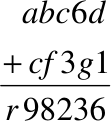{ width=100px }

2. zīm.

Skaidrs, ka $d=5$, tātad vienu šķirā pārnesums nerodas, un $g=8$, tāpēc $c=8$. Tā kā $r\ne 0$ (citādi tas nebūtu rakstīts), tad, saskaitot $a$ un $e$, rodas pārnesums; tātad $r=1$ un uz desmit tūkstošu šķiru ir bijis pārnesums no tūkstošu šķiras. Tāpēc $1+b+f=18;\ b+f=17;\ a+e=18\Rightarrow a=e=9$. Var būt vai nu $b=9;\ f=8$, vai arī $b=8;\ f=9$. Tā kā pirmais saskaitāmais lielāks par otru, tad $b=9;\ f=8$ un saskaitīšanas piemērs ir

$$
\begin{array}{r}
99865\\
+98371\\
\hline
198236
\end{array}
$$

# <lo-sample/> LV.SOL.1988.4.2

Rindā uzrakstīti visi veselie skaitļi no $1$ līdz $1987$ ieskaitot, katrs vienu reizi. Cik ciparu uzrakstīts?

<small>
   
* questionType:
* domain:
   
</small>

## Atrisinājums

Pavisam ir $9$ viencipara skaitļi $90$ divciparu skaitļi $900$ trīsciparu skaitļi un $988$ četrciparu skaitļi; tāpēc kopējais ciparu skaits ir

$$
9\cdot 1+90\cdot 2+900\cdot 3+988\cdot 4=6821.
$$

# <lo-sample/> LV.SOL.1988.4.3

Vai var plaknē uzzīmēt $8$ punktus tā, ka nekādi $3$ no tiem neatrodas uz vienas taisnes, un dažus no tiem savienot ar taisnes nogriežņiem tā, lai katrs punkts būtu savienots ar tieši četriem citiem? Nogriežņi nedrīkst krustoties.

<small>
   
* questionType:
* domain:
   
</small>

## Atrisinājums

Jā, var. Skat. $3.$ zīmējumu.

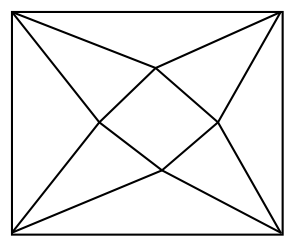{ width=150px }

3. zīm.

# <lo-sample/> LV.SOL.1988.4.4

Parādīt, ka $4$ stari var sadalīt plakni $2$; $3$; $4$; $5$; $6$; $7$ daļās.

<small>
   
* questionType:
* domain:
   
</small>

## Atrisinājums

Skat. $4.$ zīm.

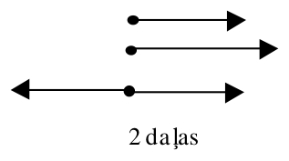{ width=150px }

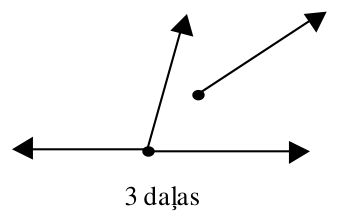{ width=150px }

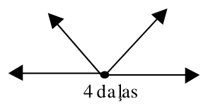{ width=150px }

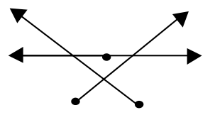{ width=150px }

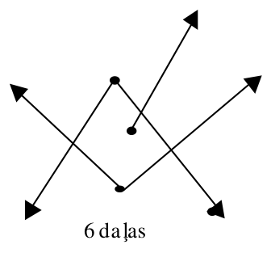{ width=150px }

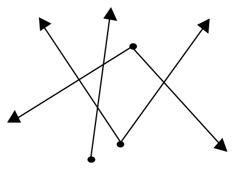{ width=200px }

$4.$ zīm.

# <lo-sample/> LV.SOL.1988.4.5

Robots "Robis" prot paņemt no plaukta jebkuras $3$ blakus stāvošas grāmatas un tādā pašā kārtībā nolikt plauktā citā vietā

$1$) Plauktā stāv piecas grāmatas šādā secībā: $ABCDE$. Kā ar robota palīdzību var iegūt secību $BACDE$?

$2$) Plauktā stāv septiņas grāmatas. Kā ar robota palīdzību pārlikt tās pretējā secībā?

<small>
   
* questionType:
* domain:
   
</small>

## Atrisinājums

$1)$ Robots var rīkoties šādi:

$$ABCDE \to DEABC \to BCDEA \to BACDE.$$

$2)$ Mēs redzam, ka varam mainīt vietām patvaļīgas divas blakus esošas grāmatas, ja pa labi no tām ir vismaz $3$ citas. To var izdarīt arī, ja pa kreisi no tām ir $3$ citas (jārīkojas simetriski). Ja pavisam ir $7$ grāmatas, tad, vai nu pa labi, vai pa kreisi nu jebkurām blakus esošām grāmatām atrodas vismaz $3$ grāmatas; tātad mēs varam mainīt vietām jebkuras divas blakus esošas grāmatas. Skaidrs, ka šādā veidā mēs varam iegūt jebkuru grāmatu izkārtojumu, tai skaitā arī pretējo.

# <lo-sample/> LV.SOL.1988.5.1

Cik dažādos veidos var izvēlēties veselus skaitļus $a$ un $b$ tā, ka

$$
|a|+|b|<6\ ?
$$

<small>
   
* questionType:
* domain:
   
</small>

## Atrisinājums

Ja $a=0$, tad $b$ var pieņemt $11$ vērtības $0,\pm1,\pm2,\pm3,\pm4,\pm5$.

Ja $a=\pm1$, tad $b$ var pieņemt $9$ vērtības.

Ja $a=\pm2$, tad $b$ var pieņemt $7$ vērtības, utt.

Tātad dažādo iespēju skaits ir $11+2\cdot9+2\cdot7+2\cdot5+2\cdot3+2\cdot1=61$.

# <lo-sample/> LV.SOL.1988.5.2

Visa bezgalīgā plakne sadalīta kvadrātiņos kā rūtiņu lapa un izkrāsota melnā un baltā krāsā šaha galdiņa kārtībā.

1) Kur atrodas tādi punkti $O$, ka katram melnajam punktam simetriskais attiecībā pret $O$ ir malas un katram baltajam punktam simetriskais attiecībā pret $O$ ir balts?

2) Kur atrodas tādi punkti $S$, ka katram melnajam punktam simetriskais attiecībā pret $S$ ir balts un katram baltajam punktam simetriskais attiecībā pret $S$ ir melns?

Piezīme. Rūtiņu malu punktus un virsotnes varam vienlaicīgi uzskatīt gan par melniem, gan par baltiem punktiem.

<small>
   
* questionType:
* domain:
   
</small>

## Atrisinājums

a) rūtiņu virsotnes un to centri,

b) rūtiņu malu viduspunkti.

# <lo-sample/> LV.SOL.1988.5.3

Sienāzis lēkā pa taisni, sākot no punkta $O$. Viņš izdara vienu lēcienu garumā $1$ cm, vienu lēcienu garumā $2$ cm, vienu lēcienu garumā $3$ cm, ... , vienu lēcienu garumā $1987$ cm.

Vai sienāzis var lēkāt tā, lai beigās atkal atrastos punktā $O$?

<small>
   
* questionType:
* domain:
   
</small>

## Atrisinājums

Jā, var. Ievērosim, ka

$$(1+2-3)+(4-5-6+7)+(8-9-10+11)+\ldots(1984-1985-1986+1987)=0.$$

Tātad sienāzis ar pēdējo gājienu var atgriezties sākuma punktā.

# <lo-sample/> LV.SOL.1988.5.4

$1$. zīmējumā attēloto figūru sagriezt divās vienādās daļās (iekrāsota rūtiņa ir caurums).

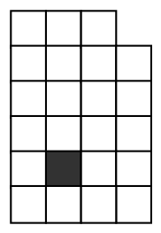{ width=100px }

1. zīm.

<small>
   
* questionType:
* domain:
   
</small>

## Atrisinājums

Skat. $5.$ zīmējumu.

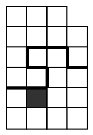{ width=100px }

$5.$ zīm.

# <lo-sample/> LV.SOL.1988.5.5

Jānis iedomājies $5$ veselus skaitļus. Pierādiet, ka Andris no šiem skaitļiem varēs atrast $3$ tādus, kuru summa dalās ar $3$.

<small>
   
* questionType:
* domain:
   
</small>

## Atrisinājums

Aizstājam skaitļus ar to atlikumiem, dalot ar $3$: tie var būt $0$, $1$, $2$. Ja trīs atlikumi ir vienādi, varam izvēlēties atbilstošos trīs skaitļus. Pretējā gadījumā paliek $3$ iespējas, kuras pārbauda tieši:

a) $2, 2, 1, 1, 0$ ; izvēlamies $2$, $1$ un $0$;

b) $2, 2, 1, 0, 0$ ; izvēlamies $2$, $1$ un $0$;

c) $2, 1, 1, 0, 0$ ; izvēlamies $2$, $1$ un $0$.

# <lo-sample/> LV.SOL.1988.6.1

Vai vienādība

$$
\begin{aligned}
&a(b-c)+b(c-d)+c(d-a)+d(a-b)=\\
&a(d-c)+b(a-d)+c(b-a)+d(c-b)
\end{aligned}
$$

ir identitātes?

Kā ērti ģeometriski aprakstīt labās un kreisās puses veidošanos?

<small>
   
* questionType:
* domain:
   
</small>

## Atrisinājums

Identitāti pārbauda, atverot iekavas:

$$
a(b-c)+b(c-d)+c(d-a)+d(a-b)=
$$

$$
ab-ac+bc-bd+cd-ca+da-db=
$$

$$
ad-ac+ba-bd+cb-ca+dc-db=
$$

$$
a(d-c)+b(a-d)+c(b-a)+d(c-b).
$$

Ģeometriskā interpretācija: skaitļus uzraksta pa riņķa līniju. Katru skaitli pareizina ar divu nākošo skaitļu starpību un visus reizinājumus saskaita. Vienreiz to izdara pulksteņa rādītāja kustības virzienā – otrreiz pretējā virzienā. Abos gadījumos summā divu blakusstāvošo skaitļu reizinājums ieiet ar $+$ zīmi, bet divu pretējo skaitļu reizinājums ar $-$ zīmi.

# <lo-sample/> LV.SOL.1988.6.2

Dots, ka $\triangle ABC=\triangle BCA$. Pierādīt, ka $\triangle BCA=\triangle CAB$.

Piezīme. Dotajā laika periodā trijstūri $ABC$ un $BCA$ tika uzskatīti par dažādiem.

<small>
   
* questionType:
* domain:
   
</small>

## Atrisinājums

No dotā seko, ka $AB=BC$, $BC=CA$ un $CA=AB$. Tātad trijstūris $ABC$ ir regulārs; protams tas nozīmē, ka $\triangle BCA=\triangle CAB$.

# <lo-sample/> LV.SOL.1988.6.3

Apskata vienādojumus $a\cdot x+b=c\cdot x+d$, kur $a$, $b$, $c$, $d$ katrs ir ar vērtību $1$, $2$ vai $3$.

1) uzrādīt vienu no šiem vienādojumiem, kuram ir sakne (atrisinājums) $0$;

2) uzrādīt vienu no šiem vienādojumiem, kuram sakņu (atrisinājumu) nav;

3) cik starp šiem vienādojumiem ir tādu, kuriem nav atrisinājumu?

<small>
   
* questionType:
* domain:
   
</small>

## Atrisinājums

1) $3x+1=2x+1$ ;

2) $3x+1=3x+2$ ;

3) Vienādojumam nav atrisinājuma, $a=c$ un $b\ne d$. Vienādība $a=c$ var izpildīties $3$ veidos; katrā no tiem $b$ un $d$ var izvēlēties $6$ veidos. Tātad tādu vienādojumu ir $18$.

# <lo-sample/> LV.SOL.1988.6.4

Iedomāsimies, ka atvērtas iekavas un savilkti līdzīgie saskaitāmie izteiksmē
$$
(511\cdot x+397\cdot y+481\cdot z)\cdot(119\cdot x+317\cdot y+813\cdot z)\cdot(7\cdot x+6\cdot y+z).
$$
Cik saskaitāmo paliks?

Cik no tiem skaitliskais reizinātājs būs pāra skaitlis?

<small>
   
* questionType:
* domain:
   
</small>

## Atrisinājums

Paliks saskaitāmie, kuros pakāpju reizinājumi ir

$$
x^3,\ y^3,\ z^3,\ x^2y,\ xy^2,\ x^2z,\ xz^2,\ y^2z,\ yz^2,\ xyz,
$$

t.i., $10$ saskaitāmie.

Pēc moduļa $2$ šo izteiksmi var pārrakstīt veidā:
$$(x+y+z)(x+y+z)(x+z).$$

Redzam, ka pāra koeficienti būs locekļiem, kas satur $y^3$, $x^2y$, $yz^2$, $xyz$, t.i., pie četriem locekļiem.

# <lo-sample/> LV.SOL.1988.6.5

Ar kādu vismazāko dažādu pirmskaitļu daudzumu var dalīties skaitlis
$$
3\cdot x\cdot(x+2\cdot y+1)\cdot(7\cdot y+1),
$$
ja $x$ un $y$ – veseli pozitīvi skaitļi?

<small>
   
* questionType:
* domain:
   
</small>

## Atrisinājums

Skaidrs, ka skaitlis dalās ar $3$ neatkarīgi no $x$ un $y$. Parādīsim, ka tas nav trijnieka pakāpe. Tiešām, ja $x$ ir trijnieka pakāpe, tad $x+2y+1$ ir pāra skaitlis, tātad dalās ar $2$.

Tātad apskatāmais skaitlis satur vismaz divus pirmreizinātājus. Piemērs parāda, ka tas var saturēt tieši divus pirmreizinātājus:
$$3x(x+2y+1)(7y+1)=3\cdot 24\cdot 27\cdot 8=2^6\cdot 3^5.$$

# <lo-sample/> LV.SOL.1988.7.1

Atrast tādus veselus pozitīvus $A$ un $B$, lai vienādība
$$
\frac{A}{x+1}+\frac{B}{x+2}=\frac{7\cdot x+10}{(x+1)\cdot(x+2)}
$$
būtu identitāte.

<small>
   
* questionType:
* domain:
   
</small>

## Atrisinājums

Vienādojot saucējus, iegūstam vienādību
$$A(x+2)+B(x+1)=7x+10.$$

No šejienes iegūstam vienādojumu sistēmu:
$$
\begin{cases}
A+B=7\\
2A+B=10.
\end{cases}
$$

Tātad $A=3$, $B=4$.

# <lo-sample/> LV.SOL.1988.7.2

Izliektā četrstūrī $ABCD$ dots, ka $AB=BC$ un $AD=DC$. Pierādīt, ka $AC\perp BD$.

<small>
   
* questionType:
* domain:
   
</small>

## Atrisinājums

Skat 6.zīm.

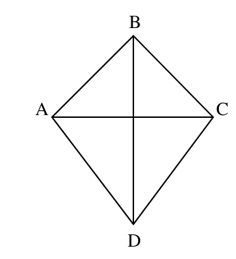{ width=150px }

6. zīm.

No dotā seko ka trijstūri $BAD$ un $BCD$ ir vienādi. Tātad $BD$ ir četrstūra $ABCD$ leņķa $B$ bisektrise. Tā kā $ABC$ ir vienādsānu trijstūris, tad bisektrise ir arī šā trijstūra augstums. Tātad $BD\perp AC$.

# <lo-sample/> LV.SOL.1988.7.3

Apskatām izteiksmi
$$
\frac{1}{1+\frac{1}{1+\frac{1}{1+\cdots+\frac{1}{1+\frac{1}{1}}}}}
$$
($15$ daļsvītras).

Uzrakstīt to kā racionālu skaitli ar vienu daļsvītru.

<small>
   
* questionType:
* domain:
   
</small>

## Atrisinājums

Pakāpeniski aprēķinām analogas izteiksmes ar divām, trijām, ... daļsvītrām. Iegūstam $1$, $\frac{1}{2}$, $\frac{2}{3}$, $\frac{3}{5}$, $\frac{5}{8}$, utt. Izpētot daļu veidošanās procesu, viegli saprast, ka katras nākošās daļas skaitītājs vienāds ar iepriekšējo saucēju, bet saucējs — ar iepriekšējās skaitītāja un saucēja summu. Tātad daļu virkne ir

$$1, \frac{1}{2}, \frac{2}{3}, \frac{5}{8}, \frac{8}{13}, \frac{13}{21}, \frac{21}{34}, \frac{34}{55}, \frac{55}{89}, \frac{89}{144}, \frac{144}{233}, \frac{233}{377}, \frac{377}{610}, \frac{610}{987}.$$

Pēdējā uzrakstītā daļa ir tā, kas jāaprēķina.

# <lo-sample/> LV.SOL.1988.7.4

Ja katrs klases zēns nopirktu pīrādziņu, bet katra meitene – bulciņu, tad visa klase kopā izdotu par $1$ kap. vairāk nekā tad, ja katrs zēns nopirktu bulciņu, bet katra meitene – pīrādziņu. Zināms, ka zēnu ir vairāk nekā meiteņu. par cik zēnu ir vairāk?

<small>
   
* questionType:
* domain:
   
</small>

## Atrisinājums

Apzīmēsim zēnu skaitu ar $Z$, meiteņu kopu ar $M$, pīrādziņu cenu ar $p$, bulciņu cenu ar $b$ (cenas izteiktas kapeikās). Tad

$$(Z \cdot p + M \cdot b) - (Z \cdot b + M \cdot p) = 1 \text{ jeb}$$

$$(Z - M) \cdot (p - b) = 1.$$

Tā kā $Z$, $M$, $p$, $b$ — veseli skaitļi un $Z > M$, tad $Z - M = 1$. Tātad zēnu ir par vienu vairāk nekā meiteņu.

# <lo-sample/> LV.SOL.1988.7.5

Dotas $1000$ kartiņas. Daļa no tām nokrāsotas zilas, pārējās – sarkanas. Uz katras kartiņas uzrakstīts vesels pozitīvs skaitlis, kas mazāks par $1000$. Zināms, ka nekādi divi skaitļi, kas uzrakstīti uz zilajām kartiņām, nav savā starpā vienādi, un nekādi divi skaitļi, kas uzrakstīti uz sarkanajām kartiņām, arī nav savā starpā vienādi. Pierādīt, ka var atrast vienu zilu un vienu sarkanu kartiņu tā, ka uz tām uzrakstīto skaitļu summa ir $1000$.

<small>
   
* questionType:
* domain:
   
</small>

## Atrisinājums

Aizstāsim katru sarkanu kartiņu, uz kuras uzrakstīts skaitlis $x$, ar dzeltenu kartiņu, uz kuras ir uzrakstīts $1000 - x$. Tad uzdevuma apgalvojums izsakāms šādi: eksistē zila un dzeltena kartiņa uz kurām uzrakstītie skaitļi ir vienādi.

Ievērosim, ka zilo un dzelteno kartiņu kopā ir $1000$, bet uz tām uzrakstīti augstākais $999$ dažādi skaitļi. Tātad uz kaut kādām divām kartiņām uzrakstīti vienādi skaitļi. Tā kā gan "zilie" skaitļi, gan "dzeltenie" skaitļi savā starpā nav vienādi, tad kāds "zilais" skaitlis ir vienāds ar "dzelteno" skaitli, ko arī vajadzēja pierādīt.
