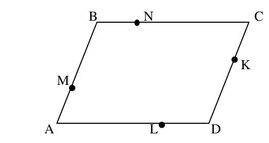
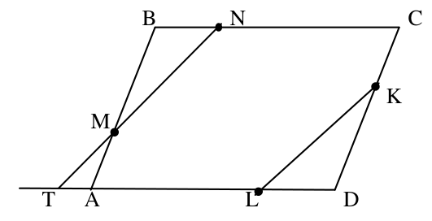
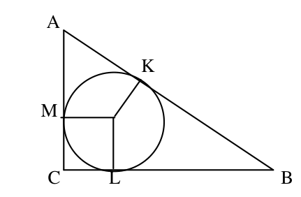
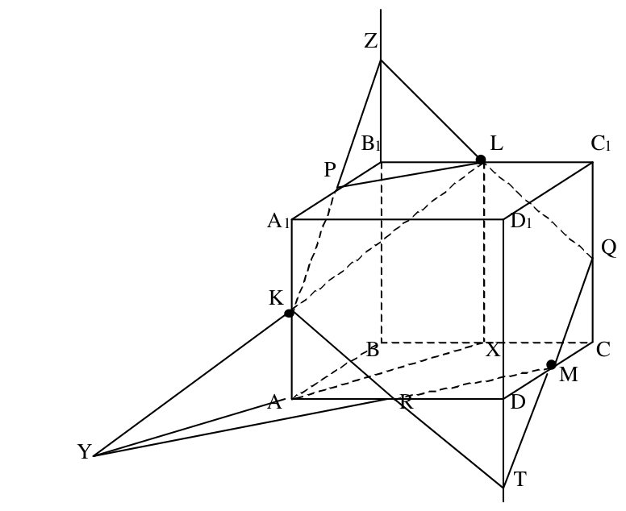
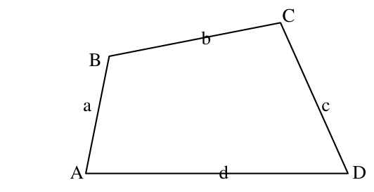
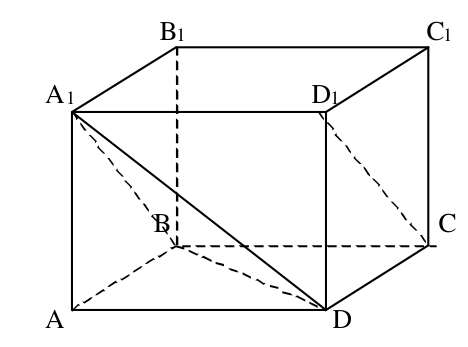
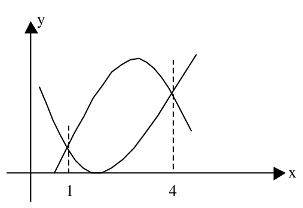
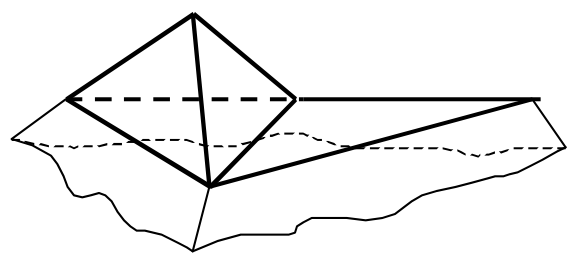

# <lo-sample/> LV.SOL.1989.6.1

Plaknē novietotas $16$ taisnes. Kāds ir lielākais nogriežņu daudzums, kāds var rasties, tām krustojoties?

<small>
   
* questionType:
* domain:
   
</small>

## Atrisinājums

Uz katras no dotajām taisnēm var atrasties ne vairāk kā $15$ krustpunkti ar citām no dotajām taisnēm (pa vienam ar katru taisni). Tie uz taisnes atzīmē $14$ nogriežņus. Tātad kopējais nogriežņu skaits nepārsniedz $16 \cdot 14 = 224$.

Šāds skaits rodas, ja starp dotajām taisnēm nav paralēlu (tātad jebkuras divas krustojas) un nekādas trīs no tām neiet caur vienu punktu. Šādā gadījumā pieņemts teikt, ka taisnes atrodas vispārīgā stāvoklī.

# <lo-sample/> LV.SOL.1989.6.2

Funkcijas definīcijas apgabals ir kopa $\{0;1;2\}$, bet vērtību apgabals ir kopa $\{0;1\}$.

Cik tādu funkciju ir?

<small>
   
* questionType:
* domain:
   
</small>

## Atrisinājums

Katrā no trim definīcijas apgabala punktiem funkcija var pieņemt jebkuru no divām vērtībām. Tātad pavisam iespējamas $2 \cdot 2 \cdot 2 = 8$ dažādas funkcijas.

Tas, ka iespēju skaits ir jāsareizina, seko no principa, ko kombinatorikā sauc reizināšanas likumu.

# <lo-sample/> LV.SOL.1989.6.3

Neviens no skaitļiem $a$, $b$, $c$, $d$, $e$ nav nulle.

Pierādīt, ka vismaz vienam no vienādojumiem

$$
\begin{gathered}
ax+b=0\\
bx+c=0\\
cx+d=0\\
dx+e=0\\
ex+a=0
\end{gathered}
$$

atrisinājums ir negatīvs.

<small>
   
* questionType:
* domain:
   
</small>

## Atrisinājums

Pieņemsim pretējo, ka visu doto vienādojumu atrisinājumi ir pozitīvi.

Aplūkosim vienu no vienādojumiem $ax + b = 0$. Tā atrisinājums ir skaitlis $x = -\frac{b}{a}$.

No tā, ka $-\frac{b}{a} > 0$, seko, ka skaitļu $a$ un $b$ zīmes ir pretējas.

Līdzīgi iegūstam, ka $b$ un $c$, $c$ un $d$, $d$ un $e$, $e$ un $a$ zīmes ir pretējas.

No tā, ka $a$ un $b$ zīmes ir pretējas un $b$ un $c$ zīmes ir pretējas, seko, ka $a$ zīme sakrīt ar $c$ zīmi; līdzīgi $c$ zīme sakrīt ar $e$ zīmi. Rezultātā $a$ zīmei jāsakrīt ar $e$ zīmi. Iegūta pretruna; tas nozīmē, ka vismaz vienam no vienādojumiem atrisinājums ir negatīvs.

# <lo-sample/> LV.SOL.1989.6.4

Naturāli skaitļi $a$ un $b$ ir tādi, ka $34a=43b$.

Vai $a+b$ var būt pirmskaitlis?

<small>
   
* questionType:
* domain:
   
</small>

## Atrisinājums

No dotā seko, ka $34(a + b) = 34a + 34b = 43b + 34b = 77b$. Tas nozīmē, ka skaitlis $34(a + b)$ dalās ar $77$.

Tā kā skaitļiem $34$ un $77$ nav kopīgu dalītāju (lielāku par $1$), tad ar $77$ dalās skaitlis $a + b$; tātad tas nav pirmskaitlis (tam, piemēram, ir dalītājs $7$, kas atšķirīgs no $1$ un paša skaitļa).

# <lo-sample/> LV.SOL.1989.6.5

Kādā klasē katrs zēns draudzējas tieši ar $3$ meitenēm, bet katra meitene – tieši ar $6$ zēniem.

Pierādīt, ka zēnu ir divas reizes vairāk nekā meiteņu.

<small>
   
* questionType:
* domain:
   
</small>

## Atrisinājums

Apzīmēsim zēnu skaitu klasē ar $z$, meiteņu skaitu – ar $m$, bet kopīgo draudzību skaitu (tās, protams, ir abpusējas) ar $d$.

No dotā seko vienādība $3z = d = 6m \Rightarrow z = 2m$.

Interesanti izpētīt šādu uzdevumu: kādam jābūt skolēnu skaitam klasē, lai prasītā situācija būtu iespējama?

# <lo-sample/> LV.SOL.1989.7.1

Aprēķināt izteiksmes

$$
\frac{(x-a)(x-b)}{(c-a)(c-b)}+\frac{(x-a)(x-c)}{(b-a)(b-c)}+\frac{(x-b)(x-c)}{(a-b)(a-c)}
$$

vērtību, ja $x=37^2$, $a=19^2$, $b=17^2$, $c=13^2$.

<small>
   
* questionType:
* domain:
   
</small>

## Atrisinājums

Dotā izteiksme ir polinoms no $x$, kura pakāpe nepārsniedz $2$.

Apzīmēsim to ar $f(x)$.

Ievērosim, ka
$$
f(a)=\frac{(a-a)(a-b)}{(c-a)(c-b)}+\frac{(a-a)(a-c)}{(b-a)(b-c)}+\frac{(a-b)(a-c)}{(a-b)(a-c)}=1;
$$
Līdzīgi $f(b)=f(c)=1$.

Tātad funkcijai $f(x)$ ir vismaz $3$ saknes. Tātad funkcija $f(x)$ nevar būt kvadrātfunkcija vai lineāra funkcija; tas nozīmē, ka $f(x)$ ir konstanta funkcija.

Tas nozīmē, ka $f(x)=1$; tātad aplūkojamās izteiksmes vērtība ir vienāda ar $1$.

# <lo-sample/> LV.SOL.1989.7.2

Kāds lielākais daudzums veselu skaitļu var būt starp skaitļiem

$$
\sqrt{n};\sqrt{n+1};\sqrt{n+2};\ldots;\sqrt{n+100}\ ?
$$

Atrast mazāko tādu naturālu skaitli $n$, ka neviens no skaitļiem

$$\sqrt n;\sqrt{n+1};\sqrt{n+2};\ldots;\sqrt{n+1000000}$$

nav vesels.

<small>
   
* questionType:
* domain:
   
</small>

## Atrisinājums

Uzdevuma pirmo daļu var pārformulēt šādi: kāds lielākais skaits naturālu skaitļu kvadrātu atrodas intervālā $[n,n+100]$.

Ja $n=1$, tad šajā intervālā atrodas $10$ kvadrāti.

Vairāk kvadrātu būt nevar. Tiešām, pieņemsim, ka intervālā $[n,n+100]$ atrodas $11$ kvadrāti; mazāko no tiem apzīmēsim ar $m$. Tad izpildās nevienādības
$$
m^2\ge n,\ (m+10)^2\le n+100 \quad \Rightarrow
$$
$$
(m+10)^2-m^2\le 100 \quad \Rightarrow
$$
$$
2m+100\le 100 \quad \Rightarrow \quad m\le 0.
$$

Iegūta pretruna.

Lai starp skaitļiem $\sqrt{n};\sqrt{n+1};\sqrt{n+2};\ldots;\sqrt{n+1000000}$ nebūtu veselu skaitļu nepieciešams, lai atrastos $1000001$ nekvadrāti pēc kārtas.

Tā kā starp $m^2$ un $(m+1)^2$ atrodas $2m$ nekvadrāti, tad $1000001$ nekvadrāti pēc kārtas pirmo reizi parādās intervālā no $500001^2+1$ līdz $500001^2+1000001$.

Atbilde: $n=500001^2+1$.

# <lo-sample/> LV.SOL.1989.7.3

Uz paralelograma $ABCD$ malām ņemti punkti $M$, $N$, $K$, $L$ tā, ka

$$\frac{AM}{MB}=\frac{BN}{NC}=\frac{CK}{KD}=\frac{DL}{LA}=\frac{1}{2}$$

(skat. $1$. zīm.).

{ width=250px }

1. zīm.

Pierādīt, ka $MNKL$ ir paralelograms.

<small>
   
* questionType:
* domain:
   
</small>

## Atrisinājums

Aplūkosim $2.$ zīm.

{ width=250px }

2. zīm.

Trijstūri $BMN$ un $DKL$ ir vienādi (leņķis un divas piemalas).Tātad

$$\angle NTL = \angle BNM = \angle DLK.$$

No šejienes seko, ka taisnes $MN$ un $KL$ ir paralēlas (vienādi kāpšļu leņķi).

Līdzīgi pierāda nogriežņu $NK$ un $ML$ paralelitāti. Līdz ar to pierādīts, ka $MNKL$ ir paralelograms.

# <lo-sample/> LV.SOL.1989.7.4

Vai var būt pionieru pulciņš ar $10$ biedriem, kuriem draugu skaits šajā pulciņā ir attiecīgi $9$, $8$, $7$, $6$, $5$, $4$, $3$, $2$, $1$, $1$?

<small>
   
* questionType:
* domain:
   
</small>

## Atrisinājums

Nē, nevar būt.

Apzīmēsim ar $A$ pionieri, kas draudzējas ar deviņiem citiem, ar $X$ un $Y$ pionierus, kuriem ir tieši $1$ draugs. Pionieris $A$ draudzējas ar visiem pionieriem, tātad arī ar $X$ un $Y$. Bet tādā gadījumā nav tāda pioniera $B$, kuram ir tieši $8$ draugi. Tiešām, no atlikušajiem $9$ pionieriem viņam var būt augstākais $7$ draugi, jo $X$ un $Y$ nedraudzējas ne ar vienu citu izņemot $A$.

# <lo-sample/> LV.SOL.1989.7.5

Dots, ka $a$, $b$, $c$ – naturāli skaitļi un

$$\frac{1}{a}+\frac{1}{b}+\frac{1}{c}<1.$$

Pierādīt, ka $\frac{1}{a}+\frac{1}{b}+\frac{1}{c}\leq \frac{41}{42}$.

<small>
   
* questionType:
* domain:
   
</small>

## Atrisinājums

Varam uzskatīt, ka $a \leq b \leq c$.

Ja $a \geq 3$, tad $\frac{1}{a} + \frac{1}{b} + \frac{1}{c} \leq \frac{1}{3} + \frac{1}{3} + \frac{1}{4} = \frac{11}{12} < \frac{41}{42}$.

Atliek aplūkot gadījumu $a = 2$.

Ja $b \geq 4$, tad $\frac{1}{b} + \frac{1}{c} \leq \frac{1}{4} + \frac{1}{5}$ un $\frac{1}{a} + \frac{1}{b} + \frac{1}{c} \leq \frac{1}{2} + \frac{1}{4} + \frac{1}{5} = \frac{19}{20} < \frac{41}{42}$.

Ja $b = 2$, tad $\frac{1}{a} + \frac{1}{b} + \frac{1}{c} > 1$, bet tas ir pretrunā ar uzdevuma nosacījumiem.

Atliek aplūkot gadījumu $b = 3$. Tad no dotās nevienādības

$$\frac{1}{2} + \frac{1}{3} + \frac{1}{c} < 1 \quad \Leftrightarrow \quad \frac{1}{c} < \frac{1}{6}$$

seko, ka $c \geq 7$. Tātad arī šajā gadījumā

$$\frac{1}{a} + \frac{1}{b} + \frac{1}{c} \leq \frac{1}{2} + \frac{1}{3} + \frac{1}{7} = \frac{41}{42}.$$

# <lo-sample/> LV.SOL.1989.8.1

Uzrakstīt tās parabolas vienādojumu, kuru iegūst no parabolas $y=x^2$, pārbīdot to par $2$ vienībām pa labi un par $2$ vienībām uz augšu.

<small>
   
* questionType:
* domain:
   
</small>

## Atrisinājums

Šīs parabolas vienādojums ir

$$y = (x - 2)^2 + 2.$$

# <lo-sample/> LV.SOL.1989.8.2

Dots, ka $0\leq x\leq 1$ un $0\leq y\leq 1$. Pierādīt, ka

$$\frac{x}{1+y}+\frac{y}{1+x}\leq 1.$$

<small>
   
* questionType:
* domain:
   
</small>

## Atrisinājums

Tā kā nevienādības izteiksme ir simetriska attiecībā pret $x$ un $y$, tad varam uzskatīt, ka $x \leq y$. Iegūstam

$$
\frac{x}{1+y}+\frac{y}{1+x} \leq \frac{x}{1+x}+\frac{1}{1+x}=\frac{x+1}{1+x}=1.
$$

Otrs risinājums.

$$
\frac{x}{1+y}+\frac{y}{1+x} \leq \frac{x}{x+y}+\frac{y}{y+x}=\frac{x+y}{y+x}=1.
$$

# <lo-sample/> LV.SOL.1989.8.3

Dots, ka $abc=1$ un $a+b+c=\frac{1}{a}+\frac{1}{b}+\frac{1}{c}$. Pierādīt, ka vismaz viens no skaitļiem $a$, $b$, $c$ ir $1$.

<small>
   
* questionType:
* domain:
   
</small>

## Atrisinājums

Pakāpeniski iegūstam

$$
\begin{aligned}
a+b+c&=\frac{1}{a}+\frac{1}{b}+\frac{1}{c}=\\
\frac{bc+ac+ab}{abc}&=ab+ac+bc \quad \Rightarrow\\
abc+a+b+c&=1+ab+ac+bc \quad \Rightarrow\\
abc-ab-ac-bc+a+b+c-1&=0 \quad \Rightarrow\\
(a-1)\cdot(b-1)\cdot(c-1)&=0.
\end{aligned}
$$

Tātad vismaz viens no skaitļiem $a$, $b$, $c$ ir vienāds ar $1$.

# <lo-sample/> LV.SOL.1989.8.4

Pierādīt, ka taisnleņķa trijstūrī ievilktās riņķa līnijas rādiusu var aprēķināt pēc formulas

$$
r=\frac{a+b-c}{2},
$$

kur $a$, $b$ ir katetes, bet $c$ – hipotenūza.

<small>
   
* questionType:
* domain:
   
</small>

## Atrisinājums

Aplūkosim $3.$ zīmējumu.

{ width=200px }

3. zīm.

Pieskares riņķa līnijai, kas vilktas no viena punkta, ir vienādas. Tātad

$$
AK=AM,\quad BK=BL,\quad CL=CM=r.
$$

No šejienes iegūstam

$$
\begin{aligned}
a+b-c&=(BL+CL)+(AM+MC)-(BK+AK)=\\
&=(BL-BK)+(AM-AK)+CL+MC=\\
&=0+0+r+r=2r.
\end{aligned}
$$

Tātad $r=\frac{a+b-c}{2}$.

# <lo-sample/> LV.SOL.1989.8.5

Uzrādīt kaut vienu $100$-ciparu skaitli, kas nesatur nevienu ciparu $0$ un dalās ar savu ciparu summu.

<small>
   
* questionType:
* domain:
   
</small>

## Atrisinājums

To var izdarīt, piemēram, šādi: uzrakstīt skaitli, kura ciparu summa ir $125$ un kurš dalās ar $125$. Dalāmība ar $125$ ir atkarīga tikai no skaitļa trim pēdējiem cipariem, jo $1000$ dalās ar $125$.

Var, piemēram, izvēlēties skaitli $\underbrace{111\ldots 11}_{94}995125$.

# <lo-sample/> LV.SOL.1989.9.1

Konstruēt kuba $ABCDA_1B_1C_1D_1$ šķēlumu ar plakni, kas iet caur šķautņu $AA_1$, $BB_1$ un $CD$ viduspunktiem.

<small>
   
* questionType:
* domain:
   
</small>

## Atrisinājums

Skat. $4.$ zīmējumu.

{ width=350px }

$4.$ zīm.

Velkam $LX$ paralēli $BB_1$. Tad punkti $A,K,L,X$ atrodas vienā plaknē.

Konstruējam $Y=KL\cap AX$. Punkts $Y$ pieder šķēluma plaknei, jo taisne $KL$ pieder šķēluma plaknei. Tālākā konstrukcijas gaita ir vienkārša:

$$
R=YM\cap AD
$$

$$
T=KR\cap DD_1
$$

$$
Q=TM\cap CC_1
$$

$$
Z=QL\cap BB_1
$$

$$
P=ZK\cap A_1B_1.
$$

Meklējamais šķēlums ir regulārs sešstūris $KPLQMR$.

# <lo-sample/> LV.SOL.1989.9.2

Dots, ka $\sin x=\sin y$ un $\cos x=\cos y$. Pierādīt, ka $\frac{x-y}{\pi}$ ir pāra skaitlis.

<small>
   
* questionType:
* domain:
   
</small>

## Atrisinājums

Katram leņķim $x$ un $y$ atbilst punkts uz vienības riņķa līnijas. Tā kā sakrīt gan to abscisas (kosinusi), gan ordinātas (sinusi), tad šie leņķi atšķiras par pilna leņķa daudzkārtni, t.i. par $2\pi k$.

Tātad $x-y=2\pi k\quad\Rightarrow\quad \frac{x-y}{\pi}=2k,\ k\in Z$.

# <lo-sample/> LV.SOL.1989.9.3

Izliekta četrstūra pēc kārtas ņemtu malu garumi ir $a$, $b$, $c$ un $d$, bet laukums – $L$. Pierādīt, ka
$$
L\leq \frac{a\cdot b+b\cdot c+c\cdot d+d\cdot a}{4}.
$$

<small>
   
* questionType:
* domain:
   
</small>

## Atrisinājums

Skat. $5.$ zīm.

{ width=250px }

5. zīm.

Izmantojot trijstūra laukuma formulu $S=\frac{1}{2}\cdot a\cdot b\sin\gamma$, iegūstam

$$
\begin{aligned}
L&=\frac{1}{2}\left[(S_{ABD}+S_{BCD})+(S_{ABC}+S_{ACD})\right]\le\\
&\frac{1}{2}\left[\left(\frac{1}{2}\cdot a\cdot d+\frac{1}{2}\cdot b\cdot c\right)+\left(\frac{1}{2}\cdot a\cdot b+\frac{1}{2}\cdot c\cdot d\right)\right]=\\
&\frac{a\cdot b+b\cdot c+c\cdot d+d\cdot a}{4}.
\end{aligned}
$$

# <lo-sample/> LV.SOL.1989.9.4

Dots, ka naturāli skaitļi $a$, $b$, $c$, $d$ katrs dalās ar skaitli $a\cdot b-c\cdot d$ (dots, ka $a\cdot b-c\cdot d>0$). Pierādīt, ka $a\cdot b-c\cdot d=1$.

<small>
   
* questionType:
* domain:
   
</small>

## Atrisinājums

Pieņemsim, ka

$$
\begin{aligned}
a&=x\cdot(a\cdot b-c\cdot d)\\
b&=y\cdot(a\cdot b-c\cdot d)\\
c&=z\cdot(a\cdot b-c\cdot d)\\
d&=t\cdot(a\cdot b-c\cdot d),
\end{aligned}
$$

kur $x$, $y$, $z$, $t$ – veseli skaitļi. Tad

$$
a\cdot b-c\cdot d=(x\cdot y-z\cdot t)\cdot(a\cdot b-c\cdot d)^2.
$$

No šejienes seko, ka

$$
1=(x\cdot y-z\cdot t)\cdot(a\cdot b-c\cdot d).
$$

Tas iespējams tikai tad, ja $a\cdot b-c\cdot d=1$.

# <lo-sample/> LV.SOL.1989.9.5

Pierādīt, ka skaitļa $2^n$ ciparu summa nevar būt $3$, ja $n$ naturāls skaitlis.

<small>
   
* questionType:
* domain:
   
</small>

## Atrisinājums

Tā kā skaitļa $2^n$ pēdējais cipars var būt tikai $2$, $4$, $6$ vai $8$, tad skaitļa $2^n$ ciparu summa var būt $3$ tikai tad, ja $2^n=1\underbrace{00\ldots 00}_{k}2$.

Ja $k=0$, tad skaitlis $12$ nav divnieka pakāpe.

Ja $k>0$, tad skaitlis $1\underbrace{00\ldots 00}_{k}2$ dalās ar $2$, bet nedalās ar $4$; tātad nav divnieka pakāpe.

# <lo-sample/> LV.SOL.1989.10.1

Atrast funkcijas
$$
y=\frac{1-\sin x}{1+\cos x}
$$
atvasinājumu.

<small>
   
* questionType:
* domain:
   
</small>

## Atrisinājums

Izmantojot atvasināšanas formulas, iegūstam

$$
\begin{aligned}
\left(\frac{1-\sin x}{1+\cos x}\right)'&=\frac{(1-\sin x)'(1+\cos x)-(1-\sin x)\cdot(1+\cos x)'}{(1+\cos x)^2}=\\
&=\frac{-\cos x\cdot(1+\cos x)-(1-\sin x)\cdot(-\sin x)}{(1+\cos x)^2}=\\
&=\frac{-\cos x-\cos^2 x+\sin x-\sin^2 x}{(1+\cos x)^2}=\\
&=\frac{\sin x-\cos x-1}{(1+\cos x)^2}
\end{aligned}
$$

# <lo-sample/> LV.SOL.1989.10.2

Atrast kosinusu leņķim starp kuba $ABCDA_1B_1C_1D_1$ skaldņu diagonālēm $CD_1$ un $DA_1$.

<small>
   
* questionType:
* domain:
   
</small>

## Atrisinājums

Aplūkosim $6.$ zīmējumu.

{ width=200px }

6. zīm.

Tā kā nogrieznis $CD_1$ ir paralēls nogrieznim $BA_1$, tad mums jāaprēķina leņķis $\angle BA_1D$ trijstūrī $BA_1D$. Tā kā trijstūris $BA_1D$ ir vienādmalu (visas malas vienādas ar $\sqrt{2}\cdot a$, $a$ – kuba malas garums), tad prasītais kosinuss ir vienāds ar $\cos 60^{\circ}=\frac{1}{2}$.

# <lo-sample/> LV.SOL.1989.10.3

Kādiem naturāliem skaitļiem $n$ skaitlis $n^3+3$ dalās ar $n^2-n+1$?

<small>
   
* questionType:
* domain:
   
</small>

## Atrisinājums

Pieņemsim, ka $n^3+3$ dalās ar $n^2-n+1$.

Izdalīsim polinomu $n^3+3$ ar $n^2-n+1$ ar atlikumu. Iegūsim

$$
n^3+3=(n^2-n+1)\cdot(n+1)+2.
$$

Tātad arī skaitlis $2$ dalās ar skaitli $n^2-n+1$.

Tas nozīmē, ka $n^2-n+1\in\{\pm1,\pm2\}$.

Risinot atbilstošos vienādojumus, atrodam tikai vienu naturālu $n$ vērtību $n=1$.

# <lo-sample/> LV.SOL.1989.10.4

Dots, ka $a<b<c<d$. Pierādīt, ka vienādojumam
$$
\frac{1}{x-a}+\frac{1}{x-b}+\frac{1}{x-c}+\frac{1}{x-d}=0
$$
ir vismaz trīs dažādas saknes.

<small>
   
* questionType:
* domain:
   
</small>

## Atrisinājums

Vienādības kreisās puses izteiksmi apzīmēsim ar $f(x)$.

Intervālā $(a,b)$ funkcija ir nepārtraukta.

Ja $x=a+\varepsilon$ ($\varepsilon$ -- "ļoti mazs skaitlis"), tad $f(x)>0$.

(Funkcijas vērtības zīmi nosaka loceklis $\frac{1}{x-a}=\frac{1}{\varepsilon}$, kas var kļūt patvaļīgi liels).

Ja $x=b-\varepsilon$ ($\varepsilon$ -- "ļoti mazs skaitlis"), tad $f(x)<0$.

Tātad intervālā $(a,b)$ funkcijai ir sakne.

Līdzīgi pierāda, ka funkcijai $f(x)$ ir saknes intervālos $(b,c)$ un $(c,d)$. Kopā iegūstam vismaz trīs saknes.

# <lo-sample/> LV.SOL.1989.10.5

Katrā bezgalīgas rūtiņu lapas rūtiņā ierakstīts pa naturālam skaitlim, pie tam katrs skaitlis vienāds ar $8$ tam apkārt ierakstīto skaitļu vidējo aritmētisko. Pierādīt, ka visi ierakstītie skaitļi ir vienādi.

<small>
   
* questionType:
* domain:
   
</small>

## Atrisinājums

Apskatīsim rūtiņu, kurā atrodas pats mazākais no ierakstītajiem skaitļiem $a$. Tad skaitlis $a$ ir astoņu tādu skaitļu vidējais aritmētiskais, kuri visi ir ne mazāki par $a$. Tātad

$$
a=\frac{b_1+b_2+\cdots+b_8}{8}\quad \Rightarrow\quad b_1+b_2+\cdots+b_8=8a.
$$

Turklāt visiem $i$ izpildās nevienādība $b_i\ge a$.

Ja kāds no skaitļiem $b_i$ būtu lielāks par $a$, tad izpildītos stingrā nevienādība

$$
b_1+b_2+\cdots+b_8>8a.
$$

Iegūta pretruna; tātad visi skaitļa $a$ kaimiņi ir vienādi ar $a$.

Šo kaimiņu kaimiņi arī būs vienādi ar $a$, utt. Tā kā no jebkuras rūtiņas uz jebkuru var nonākt, pārejot uz kaimiņu rūtiņu vairākas reizes, tad visiem skaitļiem rūtiņu lapā jābūt vienādiem.

# <lo-sample/> LV.SOL.1989.11.1

Atrast laukumu, ko ierobežo parabolas $y=(x-2)^2$ un $y=-4+6x-x^2$.

<small>
   
* questionType:
* domain:
   
</small>

## Atrisinājums

Atrisinot vienādojumu $(x-2)^2=-4+6x-x^2$, iegūstam, ka dotās parabolas krustojas punktos, kuru abscisas ir $1$ un $4$. Šajā intervālā otrās parabolas grafiks atrodas virs pirmās parabolas grafika (skat. 7. zīm.).

{ width=250px }

7. zīm.

Tātad meklētais laukums ir vienāds ar

$$
\int_1^4\left(\left(-4+6x-x^2\right)-(x-2)^2\right)\,dx=
$$

$$
\int_1^4(10x-8-2x^2)\cdot dx=
$$

$$
\left(5x^2-8x-\frac{2x^3}{3}\right)\Bigg|_1^4=9.
$$

# <lo-sample/> LV.SOL.1989.11.2

Vai eksistē daudzskaldnis ar $6$, $1988$, $1989$ skaldnēm, kuram visas skaldnes ir trijstūri?

<small>
   
* questionType:
* domain:
   
</small>

## Atrisinājums

Visos gadījumos šādi daudzskaldņi eksistē.

Saliekot kopā ar pamatiem divas vienādas trijstūra piramīdas, iegūstam daudzskaldni ar $6$ skaldnēm.

Saliekot kopā ar pamatiem divas vienādas $994$-stūra piramīdas, iegūstam daudzskaldni ar $1988$ skaldnēm.

Lai iegūtu trešo piemēru, saliekam kopā ar pamatiem divas vienādas $993$-stūra piramīdas un iegūstam daudzskaldni ar $1986$ skaldnēm.

Uz vienas skaldnes daļas konstruējam trijstūra piramīdu tā, kā parādīts $8$. zīmējumā.

{ width=250px }

8. zīm.

Tādējādi skaldņu skaits palielinās par $3$ un kļūst vienāds ar $1989$.

Ievērosim, ka iegūtais daudzskaldnis ir ieliekts. Izliektu daudzskaldni ar $1989$ skaldnēm – trijstūriem konstruēt nevar. Pamēģiniet to pierādīt.

# <lo-sample/> LV.SOL.1989.11.3

Telpa sadalīta kubiskā režģī. Katrā kubā ierakstīts naturāls skaitlis. Katrā kubā $a$ ierakstītais skaitlis vienāds ar $6$ kubos ierakstīto skaitļu vidējo aritmētisko, kam ar $a$ ir kopīga skaldne.

Pierādīt, ka visi ierakstītie skaitļi ir vienādi.

Vai šis apgalvojums paliek spēkā, ja ieraksta veselus skaitļus?

<small>
   
* questionType:
* domain:
   
</small>

## Atrisinājums

Apskatīsim kubiņu, kurā atrodas pats mazākais no ierakstītajiem skaitļiem $a$.

Tad skaitlis $a$ ir sešu tādu skaitļu vidējais aritmētiskais, kuri visi ir ne mazāki par $a$.

Tātad

$$
a=\frac{b_1+b_2+\cdots+b_6}{6}\quad \Rightarrow \quad b_1+b_2+\cdots+b_6=6a.
$$

Turklāt visiem $i$ izpildās nevienādība $b_i \ge a$.

Ja kāds no skaitļiem $b_i$ būtu lielāks par $a$, tad izpildītos stingrā nevienādība

$$
b_1+b_2+\cdots+b_6>6a.
$$

Iegūta pretruna; tātad visi skaitļa $a$ kaimiņi ir vienādi ar $a$.

Šo kaimiņu kaimiņi arī būs vienādi ar $a$, utt. Tā kā no jebkura kubiņa uz jebkuru var nonākt, pārejot uz kaimiņu kubiņu vairākas reizes, tad visiem ierakstītajiem skaitļiem ir jābūt vienādiem.

Ja kubiņos ierakstīti veseli skaitļi, tad apgalvojums neizpildās. Visus kubiskā režģa kubiņus sadala pa slāņiem vienā no virzieniem (teiksim $x$ ass virzienā). Kubiņos, kuri atrodas slānī ar kreisās skaldnes abscisu $n$, ierakstām skaitli $n$. Viegli pārbaudīt, ka uzdevuma nosacījums izpildās; tiešām, katram skaitlim $n$ blakus atrodas $4$ skaitļi $n$, skaitlis $(n-1)$ un skaitlis $(n+1)$. To vidējais aritmētiskais ir vienāds ar $n$.

# <lo-sample/> LV.SOL.1989.11.4

Dots, ka skaitļi $a_1, a_2, \ldots, a_n$ veido aritmētisku progresiju un arī skaitļi $\sin a_1, \sin a_2, \ldots, \sin a_n$ veido aritmētisku progresiju. Vēl dots, ka $\sin a_1=\frac{1}{2}$ un $\sin a_n=-\frac{1}{2}$.

Aprēķināt $\sin a_2$.

<small>
   
* questionType:
* domain:
   
</small>

## Atrisinājums

Ja $n=2$, tad $\sin a_2=-\frac{1}{2}$.

Ja $n\ge 3$, tad
$$
\begin{aligned}
\sin a_1+\sin a_3&=2\sin a_2 \quad \Leftrightarrow\\
2\sin\frac{a_1+a_3}{2}\cdot\cos\frac{a_1-a_3}{2}&=2\sin a_2 \quad \Leftrightarrow\\
2\sin a_2\cdot\cos\frac{a_1-a_3}{2}&=2\sin a_2.
\end{aligned}
$$

Pastāv divas iespējas:

1) $\sin a_2=0$;

2) $\cos\frac{a_1-a_3}{2}=1$. Tad $a_3=a_1+4\pi k$, $k\in Z$, un $a_2=a_1+2\pi k$. Šajā gadījumā
$$
\sin a_1=\sin a_2=\cdots=\sin a_n.
$$

Tā ir pretruna.

Tātad, ja $n\ge 3$, tad $\sin a_2=0$.

Tagad viegli pierādīt, ka $n$ nevar būt lielāks par $3$.

# <lo-sample/> LV.SOL.1989.11.5

Uz vienas no šaha galdiņa rūtiņām stāv zirdziņš. Zirdziņam pārejot no vienas rūtiņas uz otru, mainās tās rūtiņas krāsa, no kuras tas aiziet.

Vai zirdziņš var staigāt tā, lai rezultātā visas rūtiņas kļūtu baltas?

<small>
   
* questionType:
* domain:
   
</small>

## Atrisinājums

Jā, tas ir iespējams.

Ja zirdziņš aiziet no rūtiņas $a$ uz rūtiņu $b$ un atgriežas atpakaļ pa to pašu maršrutu, tad mainās $a$ un $b$ krāsas, bet nemainās citu rūtiņu krāsas. Atkārtojot šādas ekskursijas no sākuma rūtiņas $a$ uz visām melnajām rūtiņām, tās kļūs baltas. Ja šajā brīdī $a$ ir melna, tad zirdziņš izdara vēl vienu gājienu, un arī $a$ kļūst balta.
