# <lo-sample/> LV.SOL.1990.5.1

Jānis, Juris, Andris, Pēteris un Kārlis katrs iedomājās pa skaitlim; tie visi bija dažādi. Jāņa skaitlis bija lielāks par diviem citiem, Kārļa skaitlis – par četriem, Pētera skaitlis – par vienu, bet Jura skaitlis – ne par vienu citu iedomāto skaitli.  
Par cik iedomātajiem skaitļiem bija lielāks Andra skaitlis.

<small>
   
* questionType:
* domain:
   
</small>

## Atrisinājums

Katrs no iedomātajiem skaitļiem var būt lielāks par $0$, $1$, $2$, $3$, $4$ skaitļiem. Tā kā vērtības $0$, $1$, $2$, $4$ jau izmantotas, tad Andra iedomātais skaitlis ir lielāks par $3$ citu iedomātajiem skaitļiem.

# <lo-sample/> LV.SOL.1990.5.2

Vai uz lineāla var atzīmēt $4$ punktus $A$, $B$, $C$, $D$ tā, lai seši attālumi starp tiem būtu $1$ cm, $2$ cm, $3$ cm, $4$cm, $5$ cm, $6$ cm?  
Visi attālumiem jābūt dažādiem.

<small>
   
* questionType:
* domain:
   
</small>

## Atrisinājums

To var izdarīt, skat. $4.$ zīm.

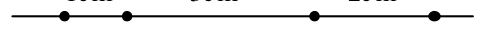{ width=250px }

$4.$ zīm.

# <lo-sample/> LV.SOL.1990.5.3

Dotas $6$ pēc ārējā izskata vienādas monētas. Trim no tām ir vienādas masas, trim citām – arī vienādas, bet mazākas nekā trim pirmajām. Doti sviru svari bez atsvariem. Kā atrast vienu (vienalga, kuru) no smagākajām monētām, lietojot svarus tikai divas reizes.

<small>
   
* questionType:
* domain:
   
</small>

## Atrisinājums

Pirmajā svēršanā noliekam uz katra kausa $3$ monētas. Viens no svaru kausiem noteikti nosvērsies uz leju. Šajā svaru kausā būs vismaz $2$ smagās monētas. Otrajā svēršanā salīdzinām jebkuras divas monētas no šī kausa. Ja viens kauss pārsver otru, tad smagā monēta ir atrasta; ja abi kausi ir līdzsvarā, tad abas monētas ir smagās.

# <lo-sample/> LV.SOL.1990.5.4

Aizstāt vārdos VIENS, DIVI, TRĪS, ČETRI, PIECI burtus ar cipariem (vienādus burtus ar vienādiem, dažādus ar dažādiem; I un Ī, kā arī C un Č uzskatām par vienādiem burtiem) tā, lai iegūto $5$ skaitļu summa būtu lielākā iespējamā.

<small>
   
* questionType:
* domain:
   
</small>

## Atrisinājums

Jāizmanto apsvērums, ka vecākajās šķirās jāliek lielāki cipari. Atbilde: $V=9$, $C=8$, $P=7$, $I=6$, $E=5$, $T=4$, $D=3$, $R=2$, $N=1$, $S=0$.

# <lo-sample/> LV.SOL.1990.5.5

Katrā kuba virsotnē ar zilu krāsu bija uzrakstīts vesels pozitīvs skaitlis. Vilnis katrā virsotnē ar sarkanu krāsu ierakstīja to $3$ zilo skaitļu summu, kas atrodas trijās šai virsotnei blakus esošās virsotnēs; pēc tam zilos skaitļus nodzēsa. Sarkanie skaitļi izvietojās tā, kā parādīts $1.$ zīmējumā.

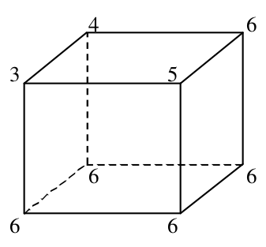{ width=150px }

1. zīm.

Atrast sākumā ierakstītos zilos skaitļus.

Paskaidrojums: saka, ka kuba virsotnes atrodas blakus, ja tās savienotas ar šķautni.

<small>
   
* questionType:
* domain:
   
</small>

## Atrisinājums

Sarkanais trijnieks varēja rasties tikai kā trīs vieninieku summa. Tālāk viennozīmīgi var atrast pārējos skaitļus.

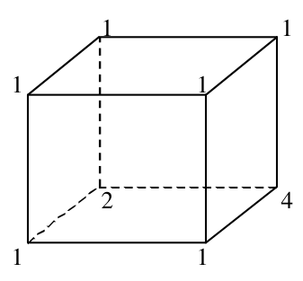{ width=150px }

$5.$ zīm.

# <lo-sample/> LV.SOL.1990.6.1

Izmantojot katru ciparu tieši vienu reizi, uzrakstīt vienu vai vairākus skaitļus decimālajā pierakstā tā, lai uzrakstīto skaitļu summa būtu lielākā iespējamā.

<small>
   
* questionType:
* domain:
   
</small>

## Atrisinājums

Divus saskaitāmos pierakstot vienu otram galā, kopējā summa palielinās, jo pirmā pierakstītā skaitļa cipari "pāriet" vecākās šķirās. Tāpēc maksimums tiks sasniegts, ja ir tikai viens saskaitāmais. Skaidrs, ka tas ir $9876543210$.

# <lo-sample/> LV.SOL.1990.6.2

Dots, ka $|a+b|>|a-b|$ un $|a-c|>|a+c|$.

Pierādīt, ka $|b-c|>|b+c|$.

<small>
   
* questionType:
* domain:
   
</small>

## Atrisinājums

Nevienādība $|a+b|>|a-b|$ izpildās, ja skaitļu $a$ un $b$ zīmes ir vienādas. Nevienādība $|a-c|>|a+c|$ izpildās, ja skaitļu $a$ un $c$ zīmes ir dažādas. Tātad skaitļu $b$ un $c$ zīmes atšķiras, un izpildās nevienādība $|b-c|>|b+c|$.

# <lo-sample/> LV.SOL.1990.6.3

Koordinātu plaknē atzīmēti $10$ punkti. Caur katru no tiem novilktas $2$ taisnes perpendikulāri koordinātu asīm.

Vai var gadīties, ka pavisam novilktas tikai $7$ dažādas taisnes?

Bet tikai $6$ dažādas taisnes?

<small>
   
* questionType:
* domain:
   
</small>

## Atrisinājums

Var būt $7$ taisnes. Skat. 6. zīmējumu.

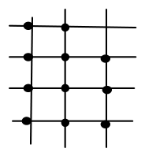{ width=100px }

6. zīm.

Nevar būt tikai $6$ taisnes. Ja horizontālajā virzienā iet tikai $n$ taisnes, bet vertikālajā virzienā $6-n$ taisnes, tad kopā veidojas $n\cdot(6-n)$ krustpunkti; kā viegli pārbaudīt šis skaitlis nav lielāks par $9$.

# <lo-sample/> LV.SOL.1990.6.4

Slēpošanas trases starts un finišs atrodas vienā punktā. Trase vairākkārt krusto pati sevi. Pirms sacensībām tiesnesis izbrauca pa trasi un katru reizi, šķērsojot krustojumu, iesprauda pie tā karodziņu: pirmo reizi ar numuru $1$, otro reizi – ar numuru $2$, utt. Uzzīmēt tādu trasi, kuru izbraucot, pie krustojumiem esošo karodziņu pāri būtu $(1, 6)$, $(2, 7)$, $(3, 10)$, $(4, 9)$, $(5, 12)$, $(8, 11)$.

Pietiek uzzīmēt vienu piemēru.

<small>
   
* questionType:
* domain:
   
</small>

## Atrisinājums

Piemēram, tā, kā parādīts 7. zīmējumā.

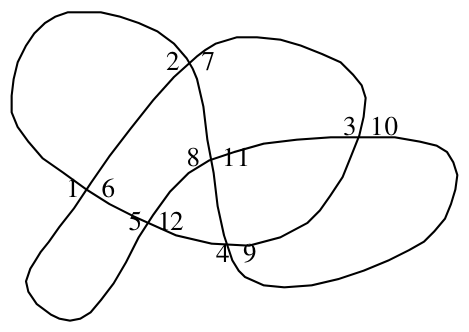{ width=200px }

7. zīm.

# <lo-sample/> LV.SOL.1990.6.5

Plaknē uzzīmētas $4$ taisnes; nekādas divas no tām nav paralēlas un nekādas trīs nekrustojas vienā punktā. Vai var sanumurēt taišņu krustpunktus ar skaitļiem no $1$ līdz $6$ (katru punktu ar citu skaitli) tā, lai uz visām taisnēm numuru summa būtu viena un tā pati?

<small>
   
* questionType:
* domain:
   
</small>

## Atrisinājums

Nē, nevar. Pieņemsim, ka summa uz vienas taisnes ir $S$. Saskaitot visas summas uz visām taisnēm, iegūstam $4S$. Šajā summā katrs skaitlis ir ieskaitīts divas reizes; iegūstam vienādību

$$4S=2\cdot(1+2+3+4+5+6)=42\quad \Rightarrow \quad S=10,5.$$

Bet tā ir pretruna, jo $S$ ir vesels skaitlis.

# <lo-sample/> LV.SOL.1990.7.1

Vai $5$ taisnēm var būt $11$ dažādi krustpunkti?

<small>
   
* questionType:
* domain:
   
</small>

## Atrisinājums

Nē, nevar būt. Katra no $5$ taisnēm var krustoties augstākais ar $4$ taisnēm. Katrs no krustpunktiem tiek ieskaitīts $2$ reizes. Tātad kopīgais krustpunktu skaits nevar pārsniegt $\dfrac{5\cdot4}{2}=10$.

# <lo-sample/> LV.SOL.1990.7.2

Ar $[x]$ apzīmē skaitļa $x$ veselo daļu (lielāko veselo skaitli, kas nepārsniedz $x$). Piemēram, $[2\frac{1}{3}]=2$, $[5]=5$.

Vai vienādība $[x]+[x]=[2x]$ ir identitāte?

<small>
   
* questionType:
* domain:
   
</small>

## Atrisinājums

Nē, šī vienādība nav identitāte. Piemēram, izvēlēsimies $x=1\frac{3}{4}$. Tad $[x]+[x]=1+1=2$, bet $[2x]=[3\frac{1}{2}]=3$.

# <lo-sample/> LV.SOL.1990.7.3

Sadalīt skaitli $1989$ divos veselos pozitīvos saskaitāmajos, kas tieši proporcionāli diviem no skaitļiem $1, 4, 9, 16, 25, 36, 64, 81$. Atrodiet divus veidus, kā to izdarīt.

<small>
   
* questionType:
* domain:
   
</small>

## Atrisinājums

Sadalīsim skaitli $1989$ pirmreizinātājos: $1989=3^2\cdot13\cdot17$. No vienādībām $13=2^2+3^2$ un $17=1^2+4^2$ iegūstam prasītos sadalījumus:
$$1989=9\cdot17\cdot(4+9)=612+1377 \text{ un } 1989=9\cdot13\cdot(1+16)=117+1872.$$

# <lo-sample/> LV.SOL.1990.7.4

Dota kvadrātveida tabula $3\times 3$ rūtiņas. Vai var rūtiņās ierakstīt pa vienam ciparam no $1$ līdz $9$ (katrā rūtiņā citu ciparu) tā, lai katrā kolonnā un katrā rindiņā ierakstīto skaitļu reizinājums dalītos ar $4$?

<small>
   
* questionType:
* domain:
   
</small>

## Atrisinājums

Nē, nevar. No dotajiem skaitļiem tikai $4$ skaitļi ir pāra skaitļi; tie ir $2$, $4$, $6$, $8$. Lai reizinājums dalītos ar $4$, katrā rindiņā un katrā kolonnā jāatrodas vismaz vienam pāra skaitlim. Tātad katrā rindiņā atrodas tikai viens pāra skaitlis. Ja tas ir $2$, tad skaitļu reizinājums nedalās ar $4$.

# <lo-sample/> LV.SOL.1990.7.5

Četras taisnes, kas parādītas $2$. zīm., sadala plakni $11$ daļās.

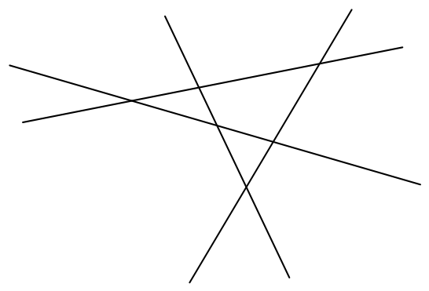{ width=250px }

$2$. zīm.

Ierakstīt katrā no tām veselu skaitli, kas nav $0$, tā, lai gan vienā, gan otrā pusē katrai taisnei visu ierakstīto skaitļu summa būtu $0$. Starp skaitļiem var būt arī vienādi.

<small>
   
* questionType:
* domain:
   
</small>

## Atrisinājums

To var izdarīt, piemēram, tā, kā parādīts $8$. zīmējumā.

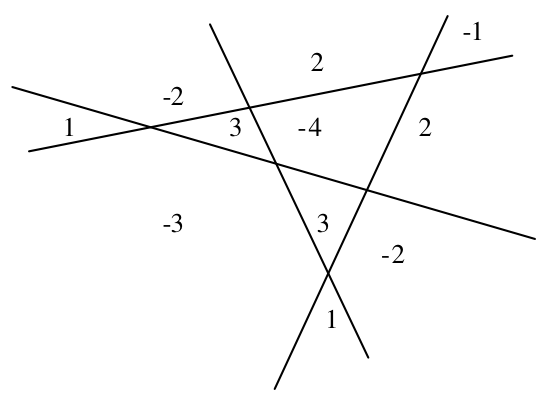{ width=250px }

8. zīm.

# <lo-sample/> LV.SOL.1990.8.1

Atrisināt vienādojumu sistēmu

$$
\begin{cases}
1989x-1988y=1\\
1990x-1989y=2.
\end{cases}
$$

<small>
   
* questionType:
* domain:
   
</small>

## Atrisinājums

Atņemot no otrā vienādojuma pirmo, iegūstam $x=y+1$. Ievietojot šo vienādību pirmajā vienādojumā, iegūstam $x=-1987$, $y=-1988$.

# <lo-sample/> LV.SOL.1990.8.2

Sadalīt skaitļus no $1$ līdz $15$ sešās grupās tā, lai visās grupās skaitļu summas būtu vienādas. Pietiek parādīt vienu veidu, kā to izdarīt.

<small>
   
* questionType:
* domain:
   
</small>

## Atrisinājums

To var izdarīt, piemēram, šādi:
$$\{1,2,4,10\},\{5,15\},\{6,14\},\{7,13\},\{8,12\},\{9,11\}.$$
Protams, pirms tam bija jāaprēķina, kādām jābūt šīm summām.

# <lo-sample/> LV.SOL.1990.8.3

Četrstūri, kas $3$. zīm. apzīmēti ar cipariem no $1$ līdz $5$, ir paralelogrami. Pierādīt, ka $ABCD$ arī ir paralelograms.

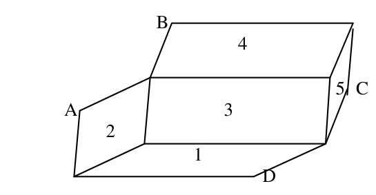{ width=250px }

$3$. zīm.

<small>
   
* questionType:
* domain:
   
</small>

## Atrisinājums

Skat. $9$. zīm.

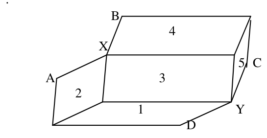{ width=250px }

9. zīm.

No paralelogramiem $1$ un $2$ seko, ka $AX$ ir vienāds un paralēls ar $DY$. Līdzīgi pierāda, ka $BX$ ir vienāds un paralēls ar $CY$. Tātad trijstūri $AXB$ un $DYC$ ir vienādi un paralēli novietoti. Tātad $AB$ un $DC$ ir vienādi un paralēli. No tā seko, ka četrstūris $ABCD$ ir paralelograms.

# <lo-sample/> LV.SOL.1990.8.4

Daļas $\frac{a}{b}$ skaitītājs un saucējs ir veseli pozitīvi skaitļi. Pieskaitot gan skaitītājam, gan saucējam $1$, daļas vērtība palielinās. Pierādīt, ka, izdarot to vēlreiz, daļas vērtība atkal palielināsies.

<small>
   
* questionType:
* domain:
   
</small>

## Atrisinājums

Daļa pirms pieskaitīšanas ir vienāda ar $1-\frac{b-a}{b}$, bet pēc pirmās pieskaitīšanas ar $1-\frac{b-a}{b+1}$. No dotā seko, ka $a<b$.

Savukārt pēc otrās pieskaitīšanas iegūstām daļu $1-\frac{b-a}{b+2}$. Redzam, ka daļas vērtība atkal palielinās.

# <lo-sample/> LV.SOL.1990.8.5

Kvadrātveida tabula sastāv no $4\cdot 4$ rūtiņām. Katrā rūtiņā jāieraksta viens no skaitļiem $0$, $1$, $-1$. Aprēķinot visas summas pa rindiņām un pa kolonnām, tām visām jābūt vienādām.

Vai to var izdarīt?

<small>
   
* questionType:
* domain:
   
</small>

## Atrisinājums

Jā, var. Piemērs parādīts 10. zīmējumā.

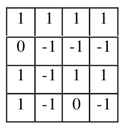{ width=100px }

10. zīm.

# <lo-sample/> LV.SOL.1990.9.1

Dota kvadrātveida tabula ar izmēriem $5\cdot 5$ rūtiņas. Atzīmēt tajā $5$ rūtiņu centrus tā, lai taisnes, kas caur atzīmētajiem punktiem novilktas paralēli tabulas malām un diagonālēm, visas būtu dažādas. Pietiek parādīt vienu veidu, kā to izdarīt.

<small>
   
* questionType:
* domain:
   
</small>

## Atrisinājums

Piemērs parādīts 11. zīmējumā.

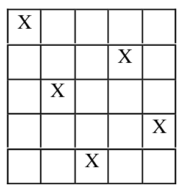{ width=150px }

11. zīm.

# <lo-sample/> LV.SOL.1990.9.2

Doti $7$ nogriežņi ar garumiem $\sqrt{1}$, $\sqrt{2}$, $\sqrt{3}$, $\sqrt{4}$, $\sqrt{5}$, $\sqrt{6}$, $\sqrt{7}$.

Cik ir dažādu taisnleņķu trijstūru, kam katra mala vienāda ar vienu no šiem nogriežņiem?

<small>
   
* questionType:
* domain:
   
</small>

## Atrisinājums

No Pitagora teorēmas seko, ka jāatrod starp skaitļiem $1$, $2$, $3$, $4$, $5$, $6$, $7$ tik daudz trijnieku, ka divu skaitļu summa ir vienāda ar trešo. Tādu trijnieku kopskaits ir $12$.

# <lo-sample/> LV.SOL.1990.9.3

Dotas divas aritmētiskās progresijas $a_1, a_2, a_3, \ldots$ un $b_1, b_2, b_3, \ldots$. Vai var vienlaicīgi pastāvēt nevienādības

$$
a_1 < b_1,\ a_{100} > b_{100},\ a_{200} < b_{200}.
$$

<small>
   
* questionType:
* domain:
   
</small>

## Atrisinājums

Nē, nevar. No pirmajiem diviem nosacījumiem seko, ka pirmās progresijas diference ir lielāka par otrās progresijas diferenci; bet tad no nevienādības $a_{100}>b_{100}$ sekotu nevienādība $a_{200}>b_{200}$, kas ir pretrunā ar uzdevuma nosacījumiem.

# <lo-sample/> LV.SOL.1990.9.4

Dots naturāls skaitlis $n>5$. Pierādīt, ka $n$ var izsacīt kā pirmskaitļa un salikta skaitļa summu.

<small>
   
* questionType:
* domain:
   
</small>

## Atrisinājums

Ja $n$ ir pāra skaitlis, izteiksim $n$ formā

$$
n=2+(n-2).
$$

Skaitlis $2$ ir pirmskaitlis, bet $(n-2)$ ir salikts skaitlis (tas dalās ar $2$ un ir lielāks par $2$).

Ja $n$ ir nepāra skaitlis, izteiksim $n$ formā

$$
n=3+(n-3).
$$

Skaitlis $3$ ir pirmskaitlis, bet $(n-3)$ ir salikts skaitlis (tas dalās ar $2$ un ir lielāks par $2$).

# <lo-sample/> LV.SOL.1990.9.5

Dots, ka $x+y+z\geq xyz$. Pierādīt, ka $x^2+y^2+z^2\geq xyz$.

<small>
   
* questionType:
* domain:
   
</small>

## Atrisinājums

Ja neviens no skaitļiem $x$, $y$, $z$ pēc absolūtās vērtības nav mazāks par $1$, tad

$$
x^2+y^2+z^2\ge x+y+z\ge xyz.
$$

Ja kaut viens no šiem skaitļiem (piemēram, $z$) pēc moduļa mazāks par $1$, tad

$$
x^2+y^2+z^2\ge x^2+y^2\ge |2xy|\ge |xyz|\ge xyz.
$$

# <lo-sample/> LV.SOL.1990.10.1

Vai kvadrātveida tabulā ar izmēriem $4\cdot 4$ rūtiņas var ierakstīt naturālus skaitļus no $1$ līdz $16$ (katrā rūtiņā — citu skaitli) tā, lai visās rindiņās un kolonnās ierakstīto skaitļu reizinājumi būtu vienādi?

<small>
   
* questionType:
* domain:
   
</small>

## Atrisinājums

Nē, nevar, jo tikai vienā rindiņā skaitļu reizinājums var dalīties ar $13$ (tajā, kurā ierakstīts skaitlis $13$),

# <lo-sample/> LV.SOL.1990.10.2

Atrast skaitļa $\sin 1989$ zīmi. Dots, ka $\pi = 3{,}14159265$.

<small>
   
* questionType:
* domain:
   
</small>

## Atrisinājums

Ievērosim, ka $3{,}1415<\pi<3{,}1416$. Tā kā

$$
633\cdot 3{,}1416=1988{,}6328<1989
$$

un

$$
634\cdot 3{,}1415=1991{,}711>1989,
$$

tad

$$
633\cdot \pi<1989<634\cdot \pi.
$$

Tāpēc $1989$ (radiāni) ir $3.$ vai $4.$ kvadranta leņķis. Tas nozīmē, ka $\sin 1989<0$.

# <lo-sample/> LV.SOL.1990.10.3

Vai plakne var šķelt piecas trijstūra piramīdas šķautnes to iekšējos punktos?

<small>
   
* questionType:
* domain:
   
</small>

## Atrisinājums

Nē, nevar. Pretējā gadījumā šķēlumā izveidotos piecstūris (jo daudzstūrim būtu $5$ virsotnes – plaknes krustpunkti ar piramīdas šķautnēm). Taču šķēluma daudzstūrim var būt augstākais $4$ malas, jo trijstūra piramīdai ir tikai $4$ skaldnes (katra no tām šķeļoties ar plakni var dot tikai vienu šķēluma daudzstūra malu).

# <lo-sample/> LV.SOL.1990.10.4

Trijstūrī $ABC$ novilkta mediāna $BM$. Vai var gadīties, ka trijstūrī $ABM$ ievilktās riņķa līnijas rādiuss ir divas reizes lielāks par trijstūrī $CBM$ ievilktās riņķa līnijas rādiusu?

<small>
   
* questionType:
* domain:
   
</small>

## Atrisinājums

Nē, nevar. Aplūkosim $12.$ zīmējumu

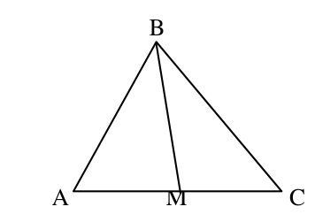{ width=150px }

13. zīm.

Apzīmēsim trijstūrī $ABM$ ievilktās riņķa līnijas rādiusu ar $r_1$, bet trijstūrī $CBM$ ievilktās riņķa līnijas rādiusu ar $r_2$ un pieņemsim, ka $r_1=2r_2$.

Trijstūru $AMB$ un $CBM$ laukumi ir vienādi (vienādi pamati un augstumi).

No formulas $S=p\cdot r$ seko, trijstūra $CBM$ perimetrs ir divas reizes lielāks par trijstūra $AMB$ perimetru, jeb

$$
(MB+MC+BC)=2\cdot(AM+BM+AB).
$$

No šejienes seko, ka

$$BC=AM+BM+2AB=CM+BM+2AB>CM+BM,$$

kas ir pretrunā ar trijstūra nevienādību.

# <lo-sample/> LV.SOL.1990.10.5

Dots, ka $a \ge b \ge c > 0$, $a+b+c \le 1$.

Pierādīt, ka $a^2+3b^2+5c^2 \le 1$.

<small>
   
* questionType:
* domain:
   
</small>

## Atrisinājums

Pārveidojot iegūstam:

$$
\begin{aligned}
a^2+3b^2+5c^2&=a^2+b^2+c^2+2b^2+2c^2+2c^2\le\\
& a^2+b^2+c^2+2ab+2ac+2bc=\\
& (a+b+c)^2\le 1.
\end{aligned}
$$

# <lo-sample/> LV.SOL.1990.11.1

Trijstūrī $ABC$ mediānu garumu summa vienāda ar augstumu garumu summu. Pierādīt, ka trijstūris ir regulārs.

<small>
   
* questionType:
* domain:
   
</small>

## Atrisinājums

Mediāna ir garāka vai vienāda par augstumu, kas vilkts no tās pašas virsotnes; pie kam vienādība izpildās tikai tad, kad malas, kas iziet no atbilstošās virsotnes, ir vienādas. Tātad

$$m_a+m_b+m_c\ge h_a+h_b+h_c,$$

un uzdevumā dotā vienādība var izpildīties tikai tad, ja

$$m_a=h_a,\ m_b=h_b,\ m_c=h_c.$$

Tas nozīmē, ka

$$AB=AC,\ BA=BC,\ CA=CB,$$

t.i., trijstūris ir regulārs.

# <lo-sample/> LV.SOL.1990.11.2

Atrast kaut vienu otrās pakāpes polinomu $P(x)$, lai vienādība $(P'(x))^2=P(x)$ būtu identitāte. Vai eksistē tāds trešās pakāpes polinoms?

<small>
   
* questionType:
* domain:
   
</small>

## Atrisinājums

Piemēram, tāds ir polinoms $P(x)=\frac{1}{4}x^2$.

Trešās pakāpes polinoma atvasinājums ir otrās pakāpes polinoms, atvasinājuma kvadrāts ir ceturtās pakāpes polinoms. Tātad šajā gadījumā prasītā vienādība nav iespējama.

# <lo-sample/> LV.SOL.1990.11.3

Vai no regulāra $13$-stūra virsotnēm var izvēlēties $4$ virsotnes tā, lai visi attālumi starp tiem būtu dažādi?

<small>
   
* questionType:
* domain:
   
</small>

## Atrisinājums

Jā, var. Ņemam pēc kārtas $1$., $2$.,$4$.,$10$. virsotnes. Skat. $14$. zīm.

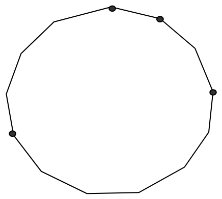{ width=200px }

14. zīm.

# <lo-sample/> LV.SOL.1990.11.4

Dots, ka $n$ dalās ar $6$, $n$ – naturāls skaitlis. Pierādīt, ka $n$ var sadalīt triju veselu pozitīvu saskaitāmo summā tā, lai katriem diviem no tiem lielākais kopīgais dalītājs būtu $1$.

<small>
   
* questionType:
* domain:
   
</small>

## Atrisinājums

Ja $n=6k$, ņemam saskaitāmos $2k-1$, $2k$, $2k+1$.

Blakus esošiem naturāliem skaitļiem LKD vienmēr ir $1$. Atliek pārbaudīt, ka arī skaitļu $2k-1$ un $2k+1$ LKD ir $1$. Tiešām, ja skaitļi $2k-1$ un $2k+1$ abi dalās ar $x$, tad arī to starpība (skaitlis $2$) dalās ar $x$. Tātad $x=1$ vai $x=2$. Tā kā $2k+1$ nedalās ar $2$, tad skaitļu $2k-1$ un $2k+1$ LKD ir $1$.

# <lo-sample/> LV.SOL.1990.11.5

Dots, ka $0<x<\dfrac{\pi}{2}$ un $0<y<\dfrac{\pi}{2}$. Zināms, ka $\sin x+\operatorname{tg}^3 x=\sin y+\operatorname{tg}^3 y$.

Pierādīt, ka $x=y$.

<small>
   
* questionType:
* domain:
   
</small>

## Atrisinājums

Tā kā gan funkcija $\sin t$, gan funkcija $\operatorname{tg} t$ aplūkojamā intervālā ir augošas, tad arī funkcija $f(t)=\sin t+\operatorname{tg}^3 t$ ir augoša.

Uzdevumā doto vienādību var pārrakstīt formā:

$$
f(x)=f(y).
$$

Stingri augošai funkcijai $f$ no šejienes seko, ka $x=y$.

# <lo-sample/> LV.SOL.1990.12.1

Vai trijstūri $ABC$, $BCD$, $CDA$, $DAB$ visi var būt vienādi?

<small>
   
* questionType:
* domain:
   
</small>

## Atrisinājums

Jā, ja, piemēram, $ABCD$ ir kvadrāts. Visi aplūkojamie trijstūri šajā gadījumā ir vienādi vienādsānu taisnleņķa trijstūri.

Padomājiet, vai iespējams izdomāt citu piemēru.

# <lo-sample/> LV.SOL.1990.12.2

Kādas veselas vērtības var pieņemt izteiksme $\sin x+\sin 2x$?

<small>
   
* questionType:
* domain:
   
</small>

## Atrisinājums

Ja $x=0$, tad $\sin x+\sin 2x=0$. Tā kā $\sin \frac{\pi}{6}+\sin \frac{2\pi}{6}=\frac{1}{2}+\frac{\sqrt{3}}{2}>1$, tad, izmantojot funkcijas $\sin x+\sin 2x$ nepārtrauktību, secinām, ka intervālā $\left[0;\frac{\pi}{6}\right]$ atradīsies tāds skaitlis $a$, kuram izpildās vienādība

$$
\sin a+\sin 2a=1.
$$

Tā kā $\sin x \leq 1$ un $\sin 2x \leq 1$, tad izteiksmes var pieņemt vērtību $2$ tikai tad, ja $\sin x=1$ un $\sin 2x=1$. Taču, ja $\sin x=1$, tad

$$
|\sin 2x|=\left|2\sin x\cdot \sqrt{1-\sin^2 x}\right|=0.
$$

Tātad lielākas veselas vērtības par $1$ dotā izteiksme pieņemt nevar.

Tā kā $\sin x+\sin 2x$ ir nepāra funkcija, tad vienīgā negatīvā veselā vērtība, ko var pieņemt dotā izteiksme ir $-1$.

Atbilde: Dotā izteiksme var pieņemt tikai veselas vērtības $-1, 0, 1$.

# <lo-sample/> LV.SOL.1990.12.3

Zināms, ka divu dotu racionālu skaitļu summa un reizinājums ir veseli skaitļi. Pierādīt, ka dotie skaitļi paši ir veseli. Vai apgalvojums paliek spēkā, ja nav zināms, ka dotie skaitļi ir racionāli?

<small>
   
* questionType:
* domain:
   
</small>

## Atrisinājums

Apzīmēsim dotos skaitļus ar $x$ un $y$. Tad

$$
\begin{cases}
x+y=n\\
xy=m
\end{cases}
\Rightarrow x+\frac{m}{x}=n \Rightarrow x^2+m=nx.
$$

Pieņemsim, ka $x=\frac{p}{q}$ nesaīsināma daļa un $q>1$. Pēc pārveidojumiem iegūstam vienādību $p^2=q(np-qm)$.

Šī vienādība nav iespējama, jo vienādības labās puses izteiksme dalās ar $q$, bet kreisās puses izteiksme nedalās ($p$ un $q$ nav kopīgu dalītāju). Tātad $x$ (un līdz arī $y$) ir veseli skaitļi.

Iracionāliem skaitļiem apgalvojums nav spēkā. Piemēram, skaitļiem
$$
x=2+\sqrt{2},\quad y=2-\sqrt{2}
$$
gan summa, gan reizinājums ir veseli skaitļi.

# <lo-sample/> LV.SOL.1990.12.4

Plauktā atrodas $6$ sējumu kopotie raksti. Sākumā sējumi atrodas pareizā kārtībā. Jānis katru dienu maina vietām divus blakus stāvošus sējumus. Vai viņš to var darīt tā, lai kādā laika periodā realizētos visi iespējamie izkārtojumi, katrs tieši vienu reizi?

<small>
   
* questionType:
* domain:
   
</small>

## Atrisinājums

Jānis to var izdarīt. Pierādīsim to ar indukciju.

Ja $n=2$ ($n$ – sējumu skaits), tad pārkārtošanas gaita ir sekojoša:

$1,2\ \to\ 2,1$

Induktīvā pāreja ($n\Rightarrow n+1$).

Katru reizi, pirms mainīt vietām kādus divus sējumus no pirmajiem $n$, Jānis "izdzen" pēdējo sējumu no viena gala līdz otram (nav svarīgi kurā galā tajā brīdī atrodas pēdējais sējums) "caur" visiem pirmajiem $n$ sējumiem.

Skaidrības labad paskatīsimies, kā pārkārtošanas gaita izskatās trim sējumiem.

$1,2,3 \to 1,3,2 \to 3,1,2 \to 3,2,1 \to 2,3,1 \to 2,1,3$.

# <lo-sample/> LV.SOL.1990.12.5

Kuba šķautnes garums ir $1$. To projicē plaknē $Q$ un atrod projekcijas laukumu. Pēc tam kubu projicē uz taisnes $t$, kas perpendikulāra plaknei $Q$, un atrod projekcijas garumu. Pierādīt, ka abu projekciju skaitliskās vērtības ir vienādas.

<small>
   
* questionType:
* domain:
   
</small>

## Atrisinājums

Kuba projekciju plaknē $Q$ veido triju tā skaldņu projekcijas (paralelogramu) ar kopīgu virsotni; šīs projekcijas nepārklājas. Savukārt kuba projekciju uz taisni $t$ veido šīm $3$ skaldnēm perpendikulāro šķautņu projekcijas, kas saliktas cita citai galā. Atliek ievērot, ka skaldne ar $Q$ veido tādu pašu leņķi, kā tai perpendikulārā šķautne ar $t$, un atcerēties formulas $S_{proj}=S\cdot\cos\alpha,\quad a_{proj}=a\cdot\cos\alpha$.
