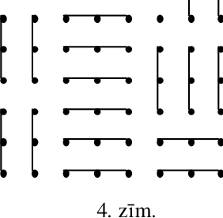
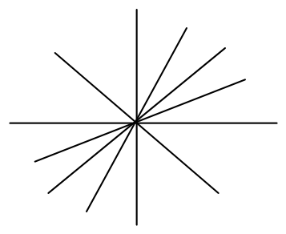
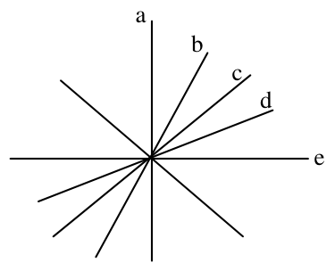
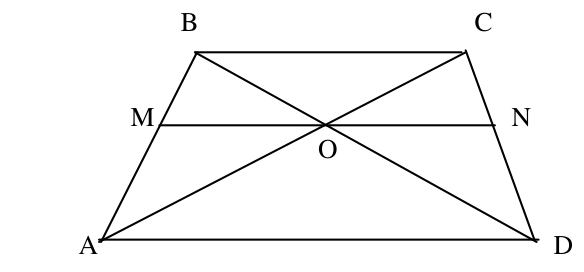
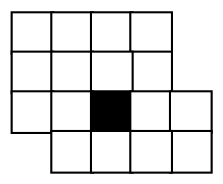
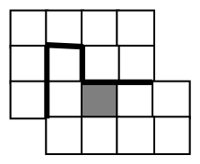
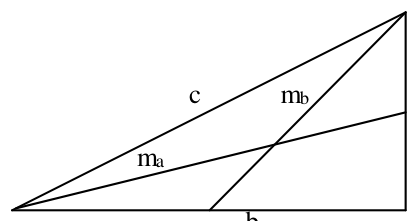
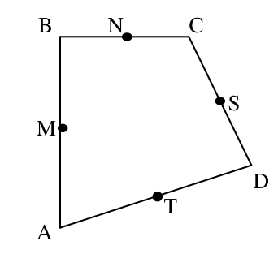
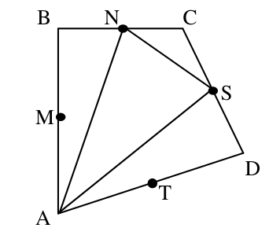
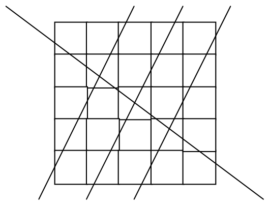

# <lo-sample/> LV.SOL.1991.5.1

Doti $1990$ vienādi stienīši. Kādas figūras no tiem var salikt vairāk: trijstūrus vai kvadrātus? Par cik vairāk? Katra trijstūra (kvadrāta) malu veido viens stienītis.

<small>
   
* questionType:
* domain:
   
</small>

## Atrisinājums

Izdalām skaitli $1990$ ar $3$ un ar $4$ ar atlikumu

$$1990:3=663,\ \text{atl.}1$$

$$1990:4=497,\ \text{atl.}2.$$

Tātad trijstūrus var izveidot par $663-497=166$ vairāk.

# <lo-sample/> LV.SOL.1991.5.2

Kvadrātiska režģa veidā novietoti $8 \cdot 8$ punkti; katrā vertikālē un horizontālē attālums starp blakus esošiem punktiem ir $1$. Kādu lielāko daudzumu nogriežņu ar garumu $2$ var novilkt tā, lai tie nekrustotos, nesaskartos un nepārklātos, un lai katrs no tiem saturētu tieši $3$ no režģī izvietotajiem punktiem?

<small>
   
* questionType:
* domain:
   
</small>

## Atrisinājums

Kā parādīts $4.$ zīmējumā, var novilkt $21$ nogriezni.

{ width=150px }

$4.$ zīm.

Vairāk nogriežņus novilkt nevar, jo tad tie pārklātu vismaz $22\cdot3=66$ punktus, bet režģī ir tikai $64$ punkti.

# <lo-sample/> LV.SOL.1991.5.3

Izveidoti $2$ četrciparu skaitļi; katrs no tiem pa reizei satur ciparus $1$, $4$, $6$, $9$. Vai viens no izveidotajiem skaitļiem var būt $7$ reizes lielāks par otru?

<small>
   
* questionType:
* domain:
   
</small>

## Atrisinājums

Nē, nevar. Skaidrs, ka ņemot mazākā skaitļa pēdējo ciparu un pareizinot to ar $7$, jāiegūst skaitlis, kura pēdējais cipars ir lielākā skaitļa pēdējais cipars. Reizinot ciparus $1$, $4$, $6$, $9$ ar $7$ iegūstam skaitļus $7$, $28$, $42$, $63$. Neviens no šo skaitļu pēdējiem cipariem nav vienāds ar cipariem $1$, $4$, $6$, $9$; tātad nevar būt lielākā skaitļa pēdējais cipars.

# <lo-sample/> LV.SOL.1991.5.4

Kastītē atrodas vairāki zīmuļi. Starp tiem var atrast zīmuļus, kuri atšķiras pēc garuma, un zīmuļus, kuri atšķiras pēc krāsas. Vai noteikti var atrast divus zīmuļus, kuri vienlaikus atšķiras gan pēc krāsas, gan pēc garuma?

<small>
   
* questionType:
* domain:
   
</small>

## Atrisinājums

Jā, noteikti var. Paņemsim jebkurus divus zīmuļus $A$ un $B$, kas atšķiras pēc garuma. Pastāv divas iespējas:

1) To krāsas ir dažādas; tad vajadzīgie zīmuļi atrasti.

2) To krāsas ir vienādas (teiksim, pirmās krāsas zīmuļi). Tā kā krāsas ir vairākas, tad varam paņemt otrās krāsas zīmuli $C$. Skaidrs, ka tādā gadījumā der vai nu zīmuļu pāris $C,A$, vai nu pāris $C,B$.

# <lo-sample/> LV.SOL.1991.5.5

Dotas $8$ pēc ārējā izskata vienādas monētas. No tām $7$ ir ar vienādu masu, bet vienas monētas masa ir citāda. Doti arī sviras svari bez atsvariem. Kā ar $3$ svēršanu palīdzību atrast atšķirīgo monētu?

<small>
   
* questionType:
* domain:
   
</small>

## Atrisinājums

Novietojam uz katra svaru kausa pa divām monētām. Ja kausi nav līdzsvarā, tad atšķirīgā monēta ir starp šīm četrām. Ja ir, tad starp atlikušajām četrām. Atrastas četras monētas, starp kurām ir atšķirīgā.

Novietojam uz kausiem pa vienai no tām. Ja kausi nav līdzsvarā, tad atšķirīgā monēta ir starp šīm divām. Ja ir, tad starp atlikušajām divām. Atrastas divas monētas, starp kurām ir atšķirīga.

Vienu no tām salīdzinām ar kādu no atrastajām īstajām un noskaidrojam, kura no atlikušajām divām ir atšķirīga.

# <lo-sample/> LV.SOL.1991.6.1

Doti $10$ skaitļi (starp tiem var būt arī vienādi). Apskatām to reizinājumus pa diviem skaitļiem. Vai var gadīties, ka tieši

a) $25$,

b) $12$,

c) $13$

no šiem reizinājumiem ir negatīvi?

<small>
   
* questionType:
* domain:
   
</small>

## Atrisinājums

a) Var. Ņemsim $5$ pozitīvus skaitļus un $5$ negatīvus. Tad negatīvu reizinājumu iegūsim, ja viens no reizinātājiem ir pozitīvs, bet otrs negatīvs. Tādu reizinājumu skaits ir $5\cdot5=25$.

b) Var. Ņemsim $4$ pozitīvus skaitļus, $3$ negatīvus un $3$ nulles.

c) Nevar. Negatīvo reizinājumu skaits ir pozitīvo skaitļu skaita $a$ un negatīvo skaitļu skaita $b$ reizinājums. Bet skaitli $13$ nevar sadalīt divos reizinātājos, kas abi nepārsniedz $10$.

# <lo-sample/> LV.SOL.1991.6.2

Apskatām $10$ dažādus skaitļus un visas to starpības (no lielākā skaitļa atņem mazāko). Kāds ir mazākais dažādo starpību skaits, kāds var izveidoties?

<small>
   
* questionType:
* domain:
   
</small>

## Atrisinājums

Var būt tieši $9$ dažādas starpības. Piemēram, var izvēlēties skaitļus $1,2,3,\ldots,10$. Vismaz $9$ dažādas starpības noteikti būs; tās var iegūt no lielākā skaitļa atņemot visus citus.

# <lo-sample/> LV.SOL.1991.6.3

Aplūkosim divciparu pirmskaitļus.

Vai tos visus var izrakstīt rindā tā, lai katrs nākošais pirmskaitlis sāktos ar tādu pašu ciparu, ar kādu beidzas iepriekšējais?

<small>
   
* questionType:
* domain:
   
</small>

## Atrisinājums

Nē, nevar. Pirmskaitlis $43$ nevar sekot ne aiz viena cita pirmskaitļa (nav pirmskaitļu, kuru pēdējais cipars ir $4$). To varētu ņemt kā pirmo, taču to pašu var teikt par pirmskaitli $47$.

# <lo-sample/> LV.SOL.1991.6.4

Attēlot koordinātu plaknē visus tos punktus $(x,y)$, kas apmierina vienādību $\left|8-x\right|+\left|4-y\right|=3$.

<small>
   
* questionType:
* domain:
   
</small>

## Atrisinājums

Punkti veido kvadrāta kontūru, kura virsotnes atrodas punktos ar koordinātēm $(5;4)$, $(11;4)$, $(8;1)$, $(8;7)$.

# <lo-sample/> LV.SOL.1991.6.5

Dotas $6$ pēc ārējā izskata vienādas monētas. Četrām no tām masas savā starpā vienādas, bet divām – arī savā starpā vienādas, taču mazākas nekā pirmajām četrām. Doti arī sviras svari bez atsvariem. Kā ar $3$ svēršanu palīdzību atrast abas vieglākās monētas?

<small>
   
* questionType:
* domain:
   
</small>

## Atrisinājums

Salīdzinām $A+B$ ar $C+D$ (uz viena svaru kausa uzliktas monētas $A$ un $B$, uz otra $C$ un $D$).

$1)$ $A+B=C+D$; salīdzinām $A$ ar $B$.

a) $A=B$; tad vieglākās monētas ir $E$ un $F$.

b) $A>B$; tad viena no vieglākajām monētām ir $B$. Salīdzinot $C$ ar $D$, noskaidrojam otru vieglāko monētu.

$2)$ $A+B>C+D$ (gadījums $A+B<C+D$ ir analoģisks); $A$ un $B$ ir smagākās monētas. Salīdzinām $C$ un $D$.

a) $C=D$; tad vieglākās monētas ir $C$ un $D$.

b) $C>D$, tad viena no vieglākajām monētām ir $D$. Salīdzinot $E$ ar $F$, noskaidrojam otru vieglāko monētu.

# <lo-sample/> LV.SOL.1991.7.1

No 1. zīm. attēlotajām taisnēm divas ir koordinātu asis, bet pārējās – funkciju $y=2x$, $y=x$, $y=-x$, $y=\frac{1}{2}x$ grafiki (asu apzīmējumi un pozitīvie virzieni nodzēsti).

{ width=150px }

1. zīm.

Par kurām taisnēm var droši pateikt, kas tas ir?

<small>
   
* questionType:
* domain:
   
</small>

## Atrisinājums

Skat. $5$. zīm.

{ width=150px }

5. zīm.

Koordinātu asu pāris var būt tikai $(a,e)$ vai $(c,f)$ (jo tie ir vienīgie savstarpēji perpendikulārie taisņu pāri). Otrais gadījums nav iespējams, jo triju funkciju grafikiem jāiet caur pirmo un trešo kvadrantu. Tātad koordinātu asis ir $a$ un $e$. Skaidrs, ka $c$ ir funkcijas $y=x$ grafiks un $f$ ir funkcijas $y=-x$ grafiks.

Kura no taisnēm $b$ un $d$ ir kuras atlikušās funkcijas grafiks, noskaidrot nevar, jo nav zināms, kura no taisnēm $a$ un $e$ ir abscisu ass.

# <lo-sample/> LV.SOL.1991.7.2

Vienādojumam $ax=b$ nav neviena atrisinājuma ($a$ un $b$ – kaut kādi doti skaitļi, $x$ – mainīgais). Cik atrisinājumu ir vienādojumam $bx=a$?

<small>
   
* questionType:
* domain:
   
</small>

## Atrisinājums

Tā kā vienādojumam $ax=b$ nav atrisinājuma, tad $a=0$ un $b\ne 0$.

Tātad vienādojumam $bx=a$ ir viens atrisinājums $x=0$.

# <lo-sample/> LV.SOL.1991.7.3

Rindā izrakstīti cipari $1234567890123\ldots890$ (ciparu grupa $1234567890$ atkārtota $10$ reizes). Iegūtajā ciparu virknē izsvītro visus ciparus, kas atrodas nepāra vietās. Ar palikušo virkni izdara to pašu, utt., kamēr paliek pāri viens cipars. Kāds tas ir?

<small>
   
* questionType:
* domain:
   
</small>

## Atrisinājums

Pēc pirmās svītrošanas paliek cipari, kuru kārtas numuri dalās ar $2$, pēc otrās, kuru kārtas numuri dalās ar $4$, $\ldots$, pēc devītās – ar $512$. Tāds cipars ir tikai viens – tas, kas atrodas $512$. vietā. Tas ir cipars $2$.

# <lo-sample/> LV.SOL.1991.7.4

Doti $6$ stieņi, katrs $50$ cm garš. Vai tos var sagriezt gabalos tā, lai rastos $12$ gabali ar garumu $12$ cm katrs, $30$ gabali ar garumu $3$ cm katrs un $11$ gabali ar garumu $6$ cm katrs?

<small>
   
* questionType:
* domain:
   
</small>

## Atrisinājums

Nē. Visu daļu garumi dalās ar $3$, bet $50$ ar $3$ nedalās.

# <lo-sample/> LV.SOL.1991.7.5

Kastītē atrodas vairāki zīmuļi. Ir zināms, ka starp tiem var atrast zīmuļus, kuri atšķiras pēc krāsas, var atrast zīmuļus, kuri atšķiras pēc garuma un var atrast zīmuļus, kuri atšķiras pēc formas (apaļi vai šķautņaini). Vai noteikti var atrast divus zīmuļus, kuri vienlaikus atšķiras gan pēc krāsas, gan pēc garuma, gan pēc formas?

<small>
   
* questionType:
* domain:
   
</small>

## Atrisinājums

Nē. Lūk pretpiemērs ar četriem zīmuļiem:

$1$. zīmulis – (zaļš, garš, apaļš),

$2$. zīmulis – (zaļš, īss, kantains),

$3$. zīmulis – (sarkans, garš, kantains),

$4$. zīmulis – (sarkans, īss, apaļš).

# <lo-sample/> LV.SOL.1991.8.1

Sadalīt reizinātājos izteiksmi $a^4-b^4$.

<small>
   
* questionType:
* domain:
   
</small>

## Atrisinājums

$a^4-b^4=(a^2-b^2)(a^2+b^2)=(a-b)(a+b)(a^2+b^2)$.

# <lo-sample/> LV.SOL.1991.8.2

Ar $[x]$ apzīmē skaitļa $x$ veselo daļu.

Piemēram, $[4,1]=4$, $[3]=3$.

Cik ir tādu naturālu skaitļu $n$, ka $\left[\sqrt{n}\right]=25$?

<small>
   
* questionType:
* domain:
   
</small>

## Atrisinājums

Vienādība $\left[\sqrt n\right]=25$ ir ekvivalenta nevienādībām

$$25\le \sqrt n<26 \quad \Leftrightarrow \quad 25^2\le n<26^2.$$

Tātad šādu naturālu skaitļu skaits ir $26^2-25^2=51$.

# <lo-sample/> LV.SOL.1991.8.3

Vai trapeces diagonāļu krustpunkts var atrasties uz tās viduslīnijas?

<small>
   
* questionType:
* domain:
   
</small>

## Atrisinājums

Nē, nevar. Pieņemsim, ka tāda situācija izveidojusies (skat. $6$. zīmējumu).

{ width=250px }

6. zīm.

Tā kā $BM=AM$ un $MO\parallel BC$, tad pēc Talesa teorēmas $AO=OC$. Līdzīgi pierāda, ka $DO=OB$. Tātad četrstūra $ABCD$ diagonāles krustojoties dalās uz pusēm, no tā secinām, ka četrstūris ir paralelograms; tātad nav trapece.

# <lo-sample/> LV.SOL.1991.8.4

Sagriezt 2. zīm. parādīto figūru divās vienādās daļās. Griezumiem jāiet pa rūtiņu līnijām; tumšā rūtiņa ir caurums.

{ width=100px }

2. zīm.

<small>
   
* questionType:
* domain:
   
</small>

## Atrisinājums

Skat. 7. zīmējumu.

{ width=100px }

7. zīm.

# <lo-sample/> LV.SOL.1991.8.5

Atrast

a) trīs,

b) četrus,

c) desmit

dažādus naturālus skaitļus, kuru summa dalās ar katru no šiem skaitļiem.

Katrā gadījumā pietiek uzrādīt vienu skaitļu komplektu.

<small>
   
* questionType:
* domain:
   
</small>

## Atrisinājums

a) $1$, $2$ un $3$;

b) $1,2,3$ un $6$;

c) $1$, $2$, $3$, $6$, $12$, $24$, $48$, $96$, $192$, $384$.

Katru nākošo skaitli iegūst kā visu iepriekšējo summu.

# <lo-sample/> LV.SOL.1991.9.1

Taisnleņķa trijstūrī hipotenūzas garums ir $10$ cm.

Atrast to mediānu garumu kvadrātu summu, kuras novilktas no šauro leņķu virsotnēm.

<small>
   
* questionType:
* domain:
   
</small>

## Atrisinājums

Skat 8. zīmējumu.

{ width=200px }

8. zīm.

No Pitagora teorēmas

$$m_a^2=b^2+\left(\frac{a}{2}\right)^2,\quad m_b^2=a^2+\left(\frac{b}{2}\right)^2.$$

Tātad

$$
m_b^2+m_a^2=a^2+\left(\frac{1}{2}b\right)^2+b^2+\left(\frac{1}{2}a\right)^2=
$$

$$
\frac{5}{4}\left(a^2+b^2\right)=\frac{5}{4}c^2=125.
$$

# <lo-sample/> LV.SOL.1991.9.2

Atrisināt nevienādību

$$
\frac{x^2+5x+6}{x^2+3x+2}<0.
$$

<small>
   
* questionType:
* domain:
   
</small>

## Atrisinājums

Doto nevienādību pārveidojam formā

$$
\frac{(x+2)(x+3)}{(x+1)(x+2)}<0.
$$

Risinot ar intervālu metodi, iegūst atrisinājumu $x\in(-3;-2)\cup(-2;-1)$.

# <lo-sample/> LV.SOL.1991.9.3

Pierādīt, ka aritmētiskajā progresijā

$$
1990+1991\cdot n,\quad n=1,2,3,\ldots
$$

var atrast bezgalīgi daudzus locekļus, kuru ciparu summas savā starpā ir vienādas.

<small>
   
* questionType:
* domain:
   
</small>

## Atrisinājums

Dotajai aritmētiskajai progresijai pieder visi šādi skaitļi

$$
1991\underbrace{00\ldots00}_{k}1990.
$$

Visiem tiem ciparu summa ir $39$.

# <lo-sample/> LV.SOL.1991.9.4

Kādu lielāko dažādu komisiju skaitu var izveidot no $4$ cilvēkiem tā, lai katrām divām komisijām būtu vismaz viens kopīgs loceklis?

Divas komisijas nesastāv no vieniem un tiem pašiem cilvēkiem

<small>
   
* questionType:
* domain:
   
</small>

## Atrisinājums

Apzīmēsim cilvēkus ar $A$, $B$, $C$, $D$. var izveidot $8$ komisijas:

$$
A,\ AB,\ AC,\ AD,\ ABC,\ ABD,\ ACD,\ ABCD.
$$

Vairāk komisijas izveidot nevar: $4$ elementu kopai ir $16$ apakškopas, un, ja kādu apakškopu izvēlas par komisiju, tad tās papildinājumu par komisiju ņemt vairs nevar.

# <lo-sample/> LV.SOL.1991.9.5

Kvadrāts sastāv no $8\cdot 8$ rūtiņām. Vienu rūtiņu izgriež..

Vai atlikušo daļu var sagriezt $63$ vienādsānu trijstūros, kuru katetes ir rūtiņu diagonāles?

<small>
   
* questionType:
* domain:
   
</small>

## Atrisinājums

Izkrāsosim kvadrātu šaha galdiņa kārtībā. Pēc rūtiņas izgriešanas vienas krāsas laukums paliek pārsvarā, bet katrs trijstūris pārklāj vienādu balto un melno laukumu. Tātad prasītā sagriešana nav iespējama.

# <lo-sample/> LV.SOL.1991.10.1

Funkcijas $f(x)=a+b\sin x$ vērtību kopa ir intervāls $[4;5]$.

Atrast $a$ un $b$.

<small>
   
* questionType:
* domain:
   
</small>

## Atrisinājums

Funkcija $f(x)=a+b\sin x$ pieņem savu lielāko un mazāko vērtību tajos punktos, kuros pieņem savu lielāko un mazāko vērtību funkcija $\sin x$. Tikai ne obligāti minimumam atbilst minimums; tas ir atkarīgs no $b$ zīmes.

Ņemot $\sin x=1$ un $\sin x=-1$, iegūstam divas iespējas:

$$
\begin{cases}
a+b=5\\
a-b=4
\end{cases}
\qquad
\begin{cases}
a+b=4\\
a-b=5
\end{cases}.
$$

Atbilde: $a=4{,}5\quad b=0{,}5$ vai $a=4{,}5\quad b=-0{,}5$.

# <lo-sample/> LV.SOL.1991.10.2

Kādu vislielāko kuba šķautņu skaitu to iekšējos punktos var šķelt viena plakne?

<small>
   
* questionType:
* domain:
   
</small>

## Atrisinājums

Ja kubu šķeļ ar plakni, kas iet caur tā centru perpendikulāri galvenajai diagonālei, tad šķēlumā veidojas sešstūris un plakne šķeļ $6$ kuba šķautnes.

Ja plakne šķeltu vairāk par $6$ šķautnēm, tad šķēlumā veidotos daudzstūris ar vismaz $7$ malām. Bet katrai šķēluma daudzstūra malai atbilst kāda no kuba skaldnēm. Taču kubam ir tikai $6$ skaldnes.

# <lo-sample/> LV.SOL.1991.10.3

Izliekta četrstūra $ABCD$ laukums ir $L$, bet malu viduspunkti ir $M$, $N$, $S$, $T$ (skat. 3. zīm.).

{ width=150px }

3. zīm.

Atrast trijstūru $ANS$, $BST$, $CTM$ un $DMN$ laukumu summu.

<small>
   
* questionType:
* domain:
   
</small>

## Atrisinājums

Skat. $9.$ zīmējumu.

{ width=150px }

$9.$ zīm.

Tā kā $N$ un $S$ ir malu viduspunkti, tad

$$
\begin{aligned}
S_{ANS} &= L - S_{ABN} - S_{DSA} - S_{CNS} = \\
&= L - \frac{1}{2}S_{ABC} - \frac{1}{2}S_{ACD} - \frac{1}{4}S_{CDB} = \\
&= \frac{1}{2}L - \frac{1}{4}S_{CDB}.
\end{aligned}
$$

Līdzīgas formulas izpildās arī pārējiem trim aplūkojamiem trijstūriem. Izmantojot šīs formulas, aprēķinām prasīto summu.

$$
\begin{aligned}
&S_{ANS} + S_{BST} + S_{CTM} + S_{DMN} = \\
&\left(\frac{1}{2}L - \frac{1}{4}S_{CDB}\right) +
\left(\frac{1}{2}L - \frac{1}{4}S_{ACD}\right) +
\left(\frac{1}{2}L - \frac{1}{4}S_{ABD}\right) +
\left(\frac{1}{2}L - \frac{1}{4}S_{ABC}\right) = \frac{3}{2}L.
\end{aligned}
$$

# <lo-sample/> LV.SOL.1991.10.4

Zināms, ka divu pozitīvu skaitļu reizinājums lielāks par to summu. Pierādīt, ka šo skaitļu summa lielāka par $4$.

<small>
   
* questionType:
* domain:
   
</small>

## Atrisinājums

Izmantojot nevienādību starp divu skaitļu vidējo aritmētisko un vidējo ģeometrisko, iegūstam:

$$
x + y \ge 2\sqrt{xy} > 2\sqrt{x+y}.
$$

No šejienes seko, ka $\sqrt{x+y} > 2$ un $x+y > 4$.

# <lo-sample/> LV.SOL.1991.10.5

Dots, ka $a$ un $b$ – naturāli skaitļi un $a^2+b^2$ dalās ar $7$.

Pierādīt, ka $a^2+b^2$ dalās ar $49$.

<small>
   
* questionType:
* domain:
   
</small>

## Atrisinājums

Aprēķināsim, kādus atlikumus pēc moduļa $7$ dod veselu skaitļu kvadrāti:

$$
0^2 \equiv 0 \pmod{7},
$$

$$
1^2 \equiv 1 \pmod{7},
$$

$$
2^2 \equiv 4 \pmod{7},
$$

$$
3^2 \equiv 2 \pmod{7},
$$

$$
4^2 \equiv 2 \pmod{7},
$$

$$
5^2 \equiv 4 \pmod{7},
$$

$$
6^2 \equiv 1 \pmod{7}.
$$

Aplūkoti visi atlikumi pēc moduļa $7$; redzam, ka iespējami tikai atlikumi $0$, $1$, $2$, $4$.

Dots, ka $a^2+b^2\equiv 0\pmod{7}$. Skaitļi $a^2$ un $b^2$ pēc moduļa $7$ var pieņemt tikai norādītās vērtības. Vienīgais veids kā summā iegūt $0\pmod{7}$ ir $0+0$. Tas nozīmē, ka $a$ un $b$ dalās ar $7$; tad $a^2$ un $b^2$ dalās ar $49$ un, protams arī $a^2+b^2$ dalās ar $49$.

# <lo-sample/> LV.SOL.1991.11.1

Funkcijas $f(x)$ atvasinājuma atvasinājumu apzīmēsim ar $f''$.

Dots funkcijas $h(x)$ un $g(x)$. Pierādīt, ka

$$(h\cdot g)''=h''\cdot g+2h'\cdot g'+h\cdot g''.$$

<small>
   
* questionType:
* domain:
   
</small>

## Atrisinājums

Izmantojot atvasināšanas formulas, iegūstam
$$
\begin{aligned}
(h\cdot g)''&=(h'\cdot g+h\cdot g')'=(h'\cdot g)' +(h\cdot g')'=\\
&=(h''\cdot g+h'\cdot g')+(h'\cdot g'+h\cdot g'')=\\
&=h''\cdot g+2h'g'+h\cdot g''.
\end{aligned}
$$

# <lo-sample/> LV.SOL.1991.11.2

Kāds lielākais pirmskaitļu daudzums var būt sastopams starp $12$ pēc kārtas ņemtiem naturāliem skaitļiem?

<small>
   
* questionType:
* domain:
   
</small>

## Atrisinājums

No $2$ līdz $13$ sastopami $6$ pirmskaitļi: $2$, $3$, $5$, $7$, $11$, $13$.

Pierādīsim, ka vairāk par $6$ pirmskaitļiem būt nevar. No $1$ līdz $12$ ir $5$ pirmskaitļi. Ja mazākais, no grupas skaitļiem ir lielāks par $2$, tad katrs pāra skaitlis šajā grupā ir salikts skaitlis. Pāra skaitļi katrā grupā ir $6$; tātad grupā nevar būt vairāk par $6$ pirmskaitļiem.

# <lo-sample/> LV.SOL.1991.11.3

Atrisināt vienādojumu

$$|\sin x|+|\sin \sqrt{2}x|=0.$$

<small>
   
* questionType:
* domain:
   
</small>

## Atrisinājums

Dotā vienādība ir iespējama tikai, ja $\sin x=0$ un $\sin \sqrt{2}x=0$ (jo abi saskaitāmie ir nenegatīvi). Iegūstam:
$$
x=\pi n,\quad \sqrt{2}x=\pi m,\quad n,m\in Z.
$$
Ja $x\ne 0$, tad no šīm vienādībām seko, $\sqrt{2}=\dfrac{m}{n}$; tātad ir racionāls skaitlis; tā ir pretruna. Vienīgā atlikusī vērtība $x=0$ ir vienādojuma atrisinājums.

# <lo-sample/> LV.SOL.1991.11.4

Trīs savstarpēji perpendikulāras plaknes krustojas punktā $O$ un sadala telpu $8$ daļās. Vienā no tām ņemti punkti $A$ un $B$. Pierādīt, ka leņķis starp vektoriem $\overrightarrow{OA}$ un $\overrightarrow{OB}$ ir šaurs.

<small>
   
* questionType:
* domain:
   
</small>

## Atrisinājums

Uzskatīsim, ka dotās plaknes ir koordinātu plaknes telpā. Punktu koordinātes apzīmēsim ar $A(x_1,y_1,z_1)$ un $B(x_2,y_2,z_2)$. Tā kā $A$ un $B$ atrodas vienā oktantā, tad punktu atbilstošo koordināšu zīmes sakrīt. Tātad
$$
\left(\overrightarrow{OA},\overrightarrow{OB}\right)=x_1x_2+y_1y_2+z_1z_2>0.
$$
Tā kā aplūkojamo vektoru skalārais reizinājums ir pozitīvs, tad leņķis starp tiem ir šaurs.

# <lo-sample/> LV.SOL.1991.11.5

Stacijā pie vienas sienas karājas divi pilnīgi vienādi absolūti precīzi pulksteņi. . Viens no tiem rāda Latvijas laiku, otrs — Maskavas laiku (laiki ir atšķirīgi). Īsākais attālums starp stundu rādītāju galapunktiem ir $m$, garākais — $M$. Atrast attālumu starp ciparnīcu centriem.

<small>
   
* questionType:
* domain:
   
</small>

## Atrisinājums

Apzīmēsim stundu rādītāju galapunktus ar $A$ un $B$, bet ciparnīcu centrus ar $O_1$ un $O_2$. Tad
$$
\overrightarrow{AB}=\overrightarrow{O_1O_2}+\left(\overrightarrow{O_2B}-\overrightarrow{O_1A}\right).
$$
Vektora $b=\overrightarrow{O_1O_2}$ garums ir fiksēts. Arī vektora $a=\left(\overrightarrow{O_2B}-\overrightarrow{O_1A}\right)$ garums ir fiksēts (lai to pamatotu jāatliek abi vektori $\overrightarrow{O_2B}$ un $\overrightarrow{O_1A}$ no viena punkta; leņķis starp tiem ir fiksēts). Tātad mazākais attālums realizēsies, kad vektori $a$ un $b$ būs pretēji vērsti, bet lielākais, kad tie būs vienādi vērsti. No šejienes seko, ka attālums starp ciparnīcu centriem ir $\dfrac{1}{2}(m+M)$.

# <lo-sample/> LV.SOL.1991.12.1

Dots, ka $x+y=1$. Pierādīt, ka $x^2+y^2\ge\dfrac{1}{2}$.

<small>
   
* questionType:
* domain:
   
</small>

## Atrisinājums

$x^2+y^2=x^2+(1-x)^2=2x^2-2x+1=2\left(x-\frac{1}{2}\right)^2+\frac{1}{2}\geq \frac{1}{2}$.

# <lo-sample/> LV.SOL.1991.12.2

Kvadrāts sastāv no $5\times 5$ rūtiņām. Vai var visas rūtiņas pārsvītrot ar četrām taisnēm?

(Saka, ka taisne pārsvītro rūtiņu, ja tā iet caur šīs rūtiņas iekšēju punktu)

<small>
   
* questionType:
* domain:
   
</small>

## Atrisinājums

To var izdarīt. Skat. 10. zīmējumu.

{ width=250px }

10. zīm.

# <lo-sample/> LV.SOL.1991.12.3

Zināms, ka $F(x)$ un $G(x)$ ir funkcijas un ka

$$F'(x)=x\sin x+\cos 3x\ \text{un}\ G'(x)=x\sin x+\cos 3x.$$

Zināms arī, ka $F(3)=2$ un $G(3)=5$.

Aprēķināt $F(5)-G(5)$.

<small>
   
* questionType:
* domain:
   
</small>

## Atrisinājums

Tā kā $F'(x)=G'(x)$, tad $F(x)$ un $G(x)$ atšķiras par konstanti. Tātad

$$F(5)-G(5)=F(3)-G(3)=-3.$$

# <lo-sample/> LV.SOL.1991.12.4

Trijplakņu kakta visas šķautnes pa pāriem perpendikulāras; tā skaldņu iekšpuses ir spoguļi. Uz šo kaktu krīt gaismas stars un pa reizei atstarojas no katras tā skaldnes.

Pierādīt, ka trīskārt atstarotā stara virziens ir pretējs sākotnējā stara virzienam.

(Atstarošanās no plaknes notiek pēc likuma: krītošais un atstarojošais stars ir vienā plaknē ar perpendikulu pret spoguļa plakni atstarošanas punktā un veido ar šo perpendikulu vienādus leņķus.)

<small>
   
* questionType:
* domain:
   
</small>

## Atrisinājums

Apzīmēsim krītošā stara virziena vektoru ar $(a,b,c)$. Pēc pirmās atstarošanās uz pretējo mainās viena koordināta, pēc otrās – otra, pēc trešās – trešā. Rezultātā iegūstam pretēji vērstu vektoru.

# <lo-sample/> LV.SOL.1991.12.5

Izvēlamies vienības kubam trīs skaldnes, kurām ir kopīga virsotne, un pa šīm skaldnēm pielīmējam tam trīs tādus pašus vienības kubus (salīmētās skaldnes pilnībā sakrīt). Iegūto figūru sauksim par ķieģeli.

Vai var salikt taisnstūra paralēlskaldni ar izmēriem $11 \cdot 12 \cdot 13$ no $429$ šādiem ķieģeļiem?

<small>
   
* questionType:
* domain:
   
</small>

## Atrisinājums

Pieņemsim, ka taisnstūra paralēlskaldnis salikts no ķieģeļiem. $429$ ķieģeļos ir tieši $11\cdot 12\cdot 13$ vienības kubiņi. Izkrāsosim paralēlskaldņa kubiņus telpiskā šahveida kārtībā. Katrs ķieģelis satur vai nu $3$ melnus kubiņus, vai $1$ melnu kubiņu. Tātad $429$ ķieģeļi satur nepāra skaitu melno kubiņu. Bet paralēlskaldnī ir pāra skaits melno kubiņu. Iegūta pretruna.
