# <lo-sample/> LV.SOL.1992.5.1

Vai var uzzīmēt $6$ nogriežņus tā, lai katrs no tiem krustotu tieši četrus citus?

<small>
   
* questionType:
* domain:
   
</small>

## Atrisinājums

Var; skat., piemēram, $6.$ zīm.

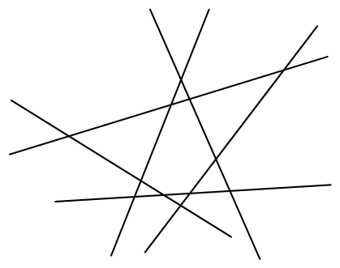{ width=200px }

6. zīm.

# <lo-sample/> LV.SOL.1992.5.2

Tabula sastāv no $3 \times 3$ rūtiņām. Katrā rūtiņā ierakstīts kāds skaitlis. Kolonnās ierakstīto skaitļu summas ir $32$, $34$, $35$. Divās rindās ierakstīto skaitļu summas ir $42$ un $27$. Kāda ir trešajā rindā ierakstīto skaitļu summa?

<small>
   
* questionType:
* domain:
   
</small>

## Atrisinājums

Kolonnās ierakstīto skaitļu summas saskaitot, iegūsim visu tabulā ierakstīto skaitļu summu. To pašu var teikt arī par rindiņās ierakstīto skaitļu summām. Tāpēc trešajā rindiņā ierakstīto skaitļu summa ir

$$(32+34+35)-(42+27)=32.$$

# <lo-sample/> LV.SOL.1992.5.3

Uz skaitļu ass attēloti vairāki veseli skaitļi, kas ņemti pēc kārtas (skat. $1$. zīm.):

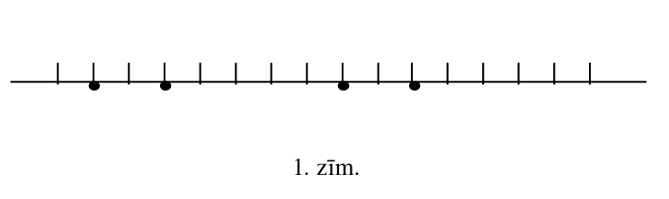{ width=350px }

$1$. zīm.

Divi no tiem skaitļiem, kas attēloti ar melniem aplīšiem, dalās ar $3$, bet divi — ar $5$ (nav zināms, kuri). Norādiet zīmējumā skaitli, kurš dalās ar $15$.

<small>
   
* questionType:
* domain:
   
</small>

## Atrisinājums

Skat. $7.$ zīm.

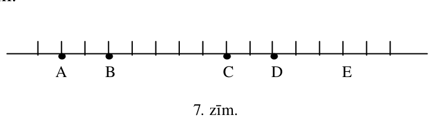{ width=350px }

7. zīm.

Ja divi skaitļi dalās ar $5$, tad arī to starpība dalās ar $5$. No atzīmētajiem skaitļiem tikai skaitļu $C$ un $B$ starpība dalās ar $5$. Nākamais skaitlis aiz $C$, kas dalās ar $5$ ir $E$. Tā kā abi atlikušie skaitļi $A$ un $D$ dalās ar $3$, un $E-D=3$, tad arī $E$ dalās ar $3$.

Tā kā skaitlis $E$ dalās ar $3$ un $5$, tad dalās arī ar $15$.

# <lo-sample/> LV.SOL.1992.5.4

Sešas monētas sver pa $5$ g katra, bet divas — pa $6$ g katra. Doti svari ar vienu svaru kausu un skalu, kuras iedaļas vērtība ir $1$ g. Kā ar $5$ svēršanu palīdzību atrast katras monētas masu?

<small>
   
* questionType:
* domain:
   
</small>

## Atrisinājums

Nosveram vispirms kopā $4$ monētas; svēršanas rezultātā uzzinām, cik smagāko monētu ir svērto monētu grupā (ja kopsvars ir $20\ \mathrm{g}$, tad smago monētu nav; ja – $21\ \mathrm{g}$, tad smagā monēta ir viena; ja – $22\ \mathrm{g}$, tad ir divas smagas monētas). Aplūkosim šos gadījumus.

$1)$ Ja monētu četriniekā ir divas smagās monētas, tad nosveram katru no tām atsevišķi.

$2)$ Ja monētu četriniekā ($A$, $B$, $C$, $D$) ir viena smagā monēta, tad arī otrā četriniekā ir viena smagā monēta. Parādīsim, kā ar divām svēršanām katrā no četriniekiem mēs atradīsim smago monētu.

Vispirms nosveram kopā $A$ un $B$; tā rezultātā uzzinām, vai smagā monēta ir starp $A$ un $B$, vai starp $C$ un $D$; ar otro svēršanu nosakām, kura no divām ir smagā.

$3)$ Ja monētu četriniekā nav smago monētu, tad šīs monētas vairāk nav jāsver, un nosveram pa vienai atlikušās $4$ monētas.

# <lo-sample/> LV.SOL.1992.5.5

Katrā no mazajiem trijstūrīšiem ierakstīts vesels skaitlis no $1$ līdz $16$, turklāt dažādos trijstūrīšos — dažādi skaitļi (skat. $2$. zīm.).

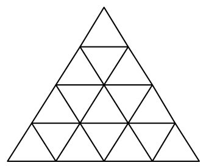{ width=150px }

$2$. zīm.

Pierādīt, ka var atrast divus tādus trijstūrīšus, kuros ierakstītie skaitļi atšķiras vismaz par $3$ un kam ir kopīga mala.

<small>
   
* questionType:
* domain:
   
</small>

## Atrisinājums

Skat. $8.$ zīm.

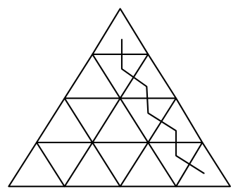{ width=150px }

$8.$ zīm.

Kā redzams no zīmējuma, no viena trijstūrīša uz otru var pāriet augstākais ar $6$ gājieniem, katru reizi šķērsojot divu trijstūrīšu kopējo malu. Aplūkosim ceļu no trijstūrīša, kurā ierakstīts skaitlis $1$, līdz trijstūrītim, kurā ierakstīts skaitlis $16$. Ja apskatāmās starpības nepārsniegtu $2$, tad $6$ gājienu rezultātā no skaitļa $1$ mēs varētu nonākt augstākais līdz skaitlim $1+2\cdot 6=13$; tātad kādai no starpībām šajā ceļā ir jābūt ne mazākai par $3$.

# <lo-sample/> LV.SOL.1992.6.1

Četrus veselus pozitīvus skaitļus katru dalīja ar $5$ ar atlikumu. Iegūto atlikumu summa ir $3$. Pierādīt, ka šo četru skaitļu reizinājums dalās ar $5$.

<small>
   
* questionType:
* domain:
   
</small>

## Atrisinājums

Atlikumi ir veseli nenegatīvi skaitļi. Ja četru atlikumu summa ir $3$, tad vismaz viens no tiem ir $0$; atbilstošais skaitlis un līdz ar to visu skaitļu reizinājums dalās ar $5$.

# <lo-sample/> LV.SOL.1992.6.2

Vai var uzzīmēt $8$ nogriežņus tā, lai katrs no tiem krustotos ar dažādu skaitu citu nogriežņu?

<small>
   
* questionType:
* domain:
   
</small>

## Atrisinājums

Nē, nevar. Katrs nogrieznis var krustoties ar $0$, $1$, $2$, ..., $7$ citiem. Ja katrs nogrieznis krustojas ar atšķirīgu skaitu citiem nogriežņiem, tad jābūt realizētām visām $8$ pieminētajām vērtībām. Bet, ja kāds nogrieznis krustojas ar $7$ citiem (tātad ar visiem), tad nav nogriežņa, kam būtu $0$ krustpunktu.

# <lo-sample/> LV.SOL.1992.6.3

Reizināšanas pierakstā viens cipars aizstāts ar zvaigznīti.

$$1*74633 \cdot 2840332 = 3904414098156.$$

Kas tas par ciparu?

<small>
   
* questionType:
* domain:
   
</small>

## Atrisinājums

Izmantojot dalāmības pazīmes ar $3$ un $9$, noskaidrojam, ka skaitļu reizinājums dalās ar $9$, bet otrais reizinātājs nedalās ar $3$. Tātad pirmais reizinātājs dalās ar $9$. Tā kā pirmā reizinātāja ierakstīto ciparu summa ir $24$, lai tas dalītos ar $9$, zvaigznītes vietā ir jāieraksta cipars $3$.

# <lo-sample/> LV.SOL.1992.6.4

Vai piecstūra malas un diagonāles var tā sanumurēt ar skaitļiem no $1$ līdz $10$ tā, lai katram trijstūrim, kura visas virsotnes ir piecstūra virsotnēs, malu numuru summa būtu viena un tā pati?

<small>
   
* questionType:
* domain:
   
</small>

## Atrisinājums

Nē. Pieņemsim, ka tas iespējams un katra trijstūra malu numuru summa ir $S$. Tad, saskaitot tās visas, iegūstam

$$
10\cdot S=3\cdot(1+2+\cdots+10)=165,
$$

jo katrs nogrieznis ietilpst kā mala trijos trijstūros; tātad $S=16{,}5$, bet tā ir pretruna, jo $S$ jābūt veselam skaitlim.

# <lo-sample/> LV.SOL.1992.6.5

Klases šaha turnīrā piedalās $10$ dalībnieki; katrs spēlē ar katru vienu reizi. Par uzvaru piešķir $1$ punktu, par neizšķirtu $\frac{1}{2}$ punktus, par zaudējumu $0$ punktus. Nolemts, ka klases lielmeistara nosaukumu piešķirs tiem, kas izcīnīs vismaz $7$ punktus. Kāds lielākais skolēnu skaits šajā turnīrā var iegūt lielmeistara nosaukumu?

<small>
   
* questionType:
* domain:
   
</small>

## Atrisinājums

Turnīrā kopā izspēlē $45$ partijas un izcīna $45$ punktus.

Ja lielmeistaru būtu ne mazāk par $7$, tad viņu kopējais punktu skaits būtu vismaz $7\cdot7=49$ -- pretruna.

Ja lielmeistaru būtu $6$, tad viņiem kopā jāizcīna vismaz $6\cdot7=42$ punkti; bet atlikušie $4$ dalībnieki jau savā starpā vien izcīna $6$ punktus. Tātad kopā būtu vismaz $48$ punkti; tā ir pretruna.

Tātad lielmeistaru nevar būt vairāk par $5$. Pieci lielmeistari var būt – piemēram, ja katrs no viņiem uzvar visus citus dalībniekus, bet savā starpā lielmeistari visas partijas nospēlē neizšķirti; tad katrs iegūst $7$ punktus.

# <lo-sample/> LV.SOL.1992.7.1

Vienādojumu $ax=b$, $bx=c$, $cx=a$ saknes ir vienādi pozitīvi skaitļi. Atrast sakņu skaitliskās vērtības.

<small>
   
* questionType:
* domain:
   
</small>

## Atrisinājums

Doto vienādojumu saknes ir $\frac{b}{a}$, $\frac{c}{b}$, $\frac{a}{c}$. Dots, ka tās ir vienādas; šo kopīgo sakni apzīmēsim ar $s$. Tad

$$
s^3=\frac{b}{a}\cdot\frac{c}{b}\cdot\frac{a}{c}=1.
$$

No šejienes seko, ka $s=1$.

# <lo-sample/> LV.SOL.1992.7.2

Zināms, ka $ad=bc$, $cf=ed$, $eh=gf$.

Pierādīt, ka $ah=gb$ (burti apzīmē pozitīvus skaitļus).

<small>
   
* questionType:
* domain:
   
</small>

## Atrisinājums

Dotās vienādības pierakstām proporciju veidā:

$$
\frac{a}{b}=\frac{c}{d},\quad \frac{c}{d}=\frac{e}{f},\quad \frac{e}{f}=\frac{g}{h}.
$$

No šejienes iegūstam, ka $\frac{a}{b}=\frac{g}{h}$, jeb $a\cdot h=g\cdot b$.

# <lo-sample/> LV.SOL.1992.7.3

Dots, ka $a$ un $b$ ir naturāli skaitļi un $a+b=210$.

Pierādīt, ka $ab$ nedalās ar $210$.

<small>
   
* questionType:
* domain:
   
</small>

## Atrisinājums

Pieņemsim pretējo, ka $a\cdot b$ dalās ar $210$.

Ievērosim, ka $210=2\cdot3\cdot5\cdot7$. Ar $p$ apzīmēsim jebkuru no pirmskaitļiem $2$, $3$, $5$, $7$. Tad $a\cdot b$ dalās ar $p$. Tātad vismaz viens no skaitļiem $a$, $b$ dalās ar $p$. Tā kā $a+b=210$ dalās ar $p$, tad arī otrs skaitlis dalās ar $p$.

Tātad gan $a$, gan $b$ dalās ar $2\cdot3\cdot5\cdot7=210$, bet tādā gadījumā $a\geq210$, $b\geq210$ un $a+b>210$. Iegūta pretruna.

# <lo-sample/> LV.SOL.1992.7.4

Plaknē uzzīmētas $7$ taisnes. Nekādas divas no tām nav paralēlas savā starpā un nekādas trīs neiet caur vienu punktu.

Vai var gadīties, ka starp apgabaliem, kuros šīs taisnes sadala plakni ir $9$ trijstūri un $7$ četrstūri?

(Apskatām tikai tos apgabalus, kuri ar novilktajām taisnēm nesadalās sīkākos apgabalos)

<small>
   
* questionType:
* domain:
   
</small>

## Atrisinājums

Divas taisnes sadala plakni $4$ apgabalos. Trešā taisne, krustojot abas jau novilktās, ar $2$ krustpunktiem sadalās $3$ daļās. Katra no šīm daļām sadala vienu apgabalu divos, tātad trīs taisnes veido $4+3=7$ apgabalus. Pakāpeniski pierāda, ka $7$ taisnes veido

$$
7+4+5+6+7=29\text{ apgabalus.}
$$

Septiņu taisņu $14$ "gali" veido $14$ bezgalīgus apgabalus; tātad galīgo apgabalu skaits ir $29-14=15$. Tātad uzdevumā minētais nav iespējams.

# <lo-sample/> LV.SOL.1992.7.5

Pa apli izrakstīti $10$ skaitļi; daži no tiem ir pozitīvi, pārējie – negatīvi. Ar vienu gājienu var mainīt zīmi uz pretējo jebkuriem trim pēc kārtas uzrakstītiem skaitļiem. Pierādīt, ka ar vairākiem gājieniem noteikti var panākt, lai visi skaitļi vienlaicīgi būtu pozitīvi.

<small>
   
* questionType:
* domain:
   
</small>

## Atrisinājums

Apzīmēsim skaitļus pēc kārtas ar $a,b,c,d,e,f,g,h,i,j$.

Izdarot zīmju maiņas trijniekos

$$abc,\ def,\ ghi,\ jab,\ cde,\ fgh,\ ija,$$

skaitļa $a$ zīme tiek mainīta $3$ reizes, bet citu skaitļu zīmes – pa $2$ reizēm. Tātad varam mainīt zīmi patvaļīgam vienam skaitlim, tātad arī iegūt jebkuru zīmju kombināciju.

# <lo-sample/> LV.SOL.1992.8.1

Atrast kaut vienu tādu daļu $\frac{m}{n}$, ka visas daļas

$$
\frac{m}{n},\ \frac{m+1}{n+1},\ \frac{m+2}{n+2},\ldots,\frac{m+5}{n+5}
$$

vienlaicīgi ir saīsināmas; turklāt $m \ne n$ .

<small>
   
* questionType:
* domain:
   
</small>

## Atrisinājums

Var ņemt, piemēram, skaitļus

$$m=2\cdot3\cdot5\cdot7+2 \quad \text{un} \quad n=2^2\cdot3\cdot5\cdot7+2.$$

# <lo-sample/> LV.SOL.1992.8.2

Uz tāfeles uzrakstīts skaitlis $1$. Ar vienu gājienu atļauts uz tāfeles uzrakstīto skaitli nodzēst un uzrakstīt vietā vai nu nodzēstā skaitļa kvadrātu vai divkāršotu nodzēsto skaitli.

Kā ar $10$ gājieniem iegūt uz tāfeles $2^{89}$ ?

<small>
   
* questionType:
* domain:
   
</small>

## Atrisinājums

To var izdarīt šādi:

$$1\to2\to2^2\to2^4\to2^5\to2^{10}\to2^{11}\to2^{22}\to2^{44}\to2^{88}\to2^{89}.$$

# <lo-sample/> LV.SOL.1992.8.3

Daudzstūris ar diagonālēm sadalīts trijstūros; diagonāles savā starpā nekrustojas. Daļa trijstūru nokrāsoti baltā, pārējie – melnā krāsā tā, ka nekādiem diviem vienādi nokrāsotiem trijstūriem nav kopīgas malas.

Vai var gadīties, ka balto trijstūru skaits vairāk nekā trīs reizes pārsniedz melno trijstūru skaitu?

Bet vai tas var tieši trīs reizes pārsniegt melno trijstūru skaitu?

<small>
   
* questionType:
* domain:
   
</small>

## Atrisinājums

Ar katru melno trijstūri robežojas ne vairāk kā trīs balti, pie tam daži baltie trijstūri var robežoties reizē ar vairākiem melnajiem. Tātad balto trijstūru skaits nevar vairāk kā trīs reizes pārsniegt melno trijstūru skaitu.

Balto trijstūru skaits var tieši trīs reizes pārsniegt melno trijstūru skaitu, piemēram, tā kā parādīts $9.$ zīmējumā

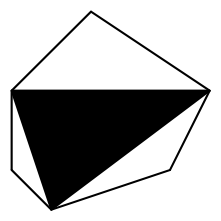{ width=100px }

$9.$ zīm.

# <lo-sample/> LV.SOL.1992.8.4

Pierādīt, ka

$$
\sqrt{17-12\sqrt{2}}+\sqrt{3-2\sqrt{2}}+\sqrt{3+2\sqrt{2}}=3.
$$

<small>
   
* questionType:
* domain:
   
</small>

## Atrisinājums

Ievērosim šādas vienādības

$$17-12\sqrt{2}=\left(3-2\sqrt{2}\right)^2,\quad 3\pm2\sqrt{2}=\left(\sqrt{2}\pm1\right)^2.$$

Tātad doto summu var pārveidot šādi:

$$\sqrt{17-12\sqrt{2}}+\sqrt{3-2\sqrt{2}}+\sqrt{3+2\sqrt{2}}=$$
$$(3-2\sqrt{2})+(\sqrt{2}+1)+(\sqrt{2}-1)=3.$$

# <lo-sample/> LV.SOL.1992.8.5

Trijstūra $ABC$ iekšpusē atrodas punkts $O$ (skat. $3$. zīm.).

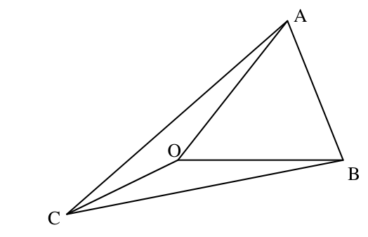{ width=250px }

3. zīm.

Pierādīt, ka $AO+BO+CO<AB+AC+BC$.

<small>
   
* questionType:
* domain:
   
</small>

## Atrisinājums

Apzīmēsim ar $K$ taisnes $OB$ krustpunktu ar $AC$ (skat. $10.$ zīm.)

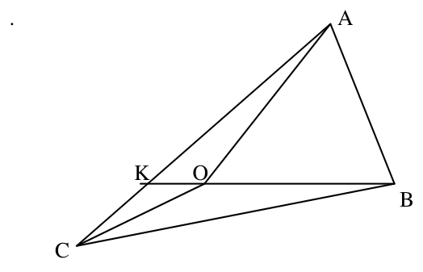{ width=250px }

10. zīm.

No trijstūra nevienādības seko
$$
BO+AO<BO+OK+AK=BK+AK<
$$
$$
BC+CK+OK=BC+AC.
$$

Līdzīgi pierāda šādas nevienādības
$$
BO+CO<BA+CA,\qquad CO+AO<CB+AB.
$$

Summējot šīs trīs nevienādības iegūstam prasīto.

# <lo-sample/> LV.SOL.1992.9.1

Dots, ka skaitļi $a_1, a_2, \ldots, a_n$ veido aritmētisku progresiju un ka $f(x)=Ax+B$. Vai taisnība, ka skaitļi $f(a_1), f(a_2), \ldots, f(a_n)$ arī veido aritmētisku progresiju?

<small>
   
* questionType:
* domain:
   
</small>

## Atrisinājums

Jā, tie veido aritmētisko progresiju. Lai to pierādītu, parādīsim, ka divu sekojošu virknes locekļu starpība ir konstanta.
$$
f(a_{k+1})-f(a_k)=f(a_1+kd)-f(a_1+(k-1)d)=
$$
$$
A(a_1+kd)+B-A(a_1+(k-1)d)-B=Ad.
$$

# <lo-sample/> LV.SOL.1992.9.2

Uzzīmēt $13$-stūri, kuru var sagriezt $5$ paralelogramos.

<small>
   
* questionType:
* domain:
   
</small>

## Atrisinājums

Piemēram, skat. $11.$ zīmējumu.

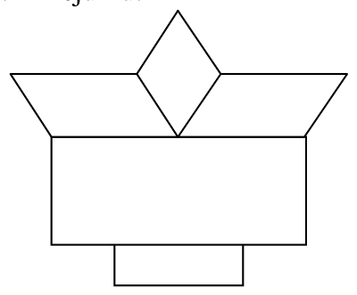{ width=200px }

11. zīm.

# <lo-sample/> LV.SOL.1992.9.3

Vienādojumam $x^2-ax+x=0$ ir divas saknes $x_1$ un $x_2$.

Pierādīt, ka $x_1^2+x_2^2\ge 2(x_1+x_2)$.

<small>
   
* questionType:
* domain:
   
</small>

## Atrisinājums

Izmantojot Vjeta teorēmu, pārveidojam nevienādību:
$$
(x_1+x_2)^2-2x_1x_2\ge 2(x_1+x_2)\Leftrightarrow
$$
$$
a^2-2a\ge 2a\Leftrightarrow a^2-4a\ge 0.
$$
Izteiksme $a^2-4a$ ir dotā kvadrāttrinoma diskriminants, un tas nav negatīvs, jo vienādojumam ir saknes.

# <lo-sample/> LV.SOL.1992.9.4

$ABC$ ir taisnleņķa trijstūris, $\angle B=90^{\circ}$; $AMNB$ un $BKLC$ ir kvadrāti, kas nepārklājas ar trijstūri $ABC$. $MC$ un $AB$ krustojas punktā $R$, bet $AL$ un $BC$ – punktā $S$ (skat. $4$. zīm.).

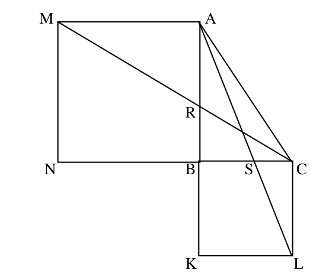{ width=250px }

4. zīm.

Pierādīt, ka $RB=SB$.

<small>
   
* questionType:
* domain:
   
</small>

## Atrisinājums

Skat. $12.$ zīm.

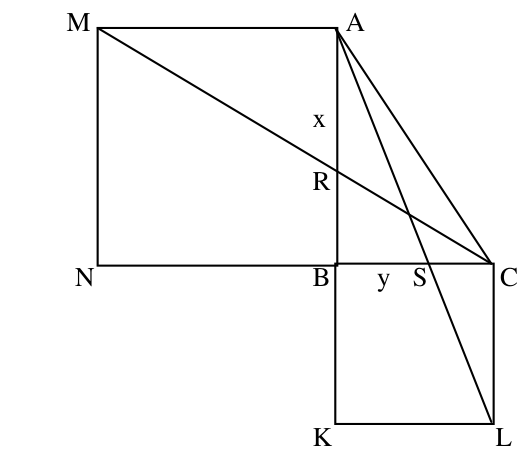{ width=250px }

12. zīm.

Apzīmējam $AB=x$, $BC=y$. No trijstūru $CBR$ un $CNM$ līdzības seko, ka
$$
\frac{BC}{BR}=\frac{NC}{NM}\quad \Rightarrow \quad \frac{y}{BR}=\frac{x+y}{x}\quad \Rightarrow \quad BR=\frac{xy}{x+y}.
$$

Līdzīgi pierāda, ka arī $BS=\frac{xy}{x+y}$.

# <lo-sample/> LV.SOL.1992.9.5

Pierādīt, ka vienādojumam

$$x^5+y^3=z^2$$

ir bezgalīgi daudz atrisinājumu naturālos skaitļos.

<small>
   
* questionType:
* domain:
   
</small>

## Atrisinājums

Viegli atrast vienu atrisinājumu $x=1$, $y=2$, $z=3$. Izmantojot šo atrisinājumu, var norādīt bezgalīgu atrisinājumu sēriju. Tiešām, katram naturālam $n$ der atrisinājums $x=1\cdot n^6$, $y=2\cdot n^{10}$, $z=3\cdot n^{15}$.

# <lo-sample/> LV.SOL.1992.10.1

Dots, ka $\lvert a+b\rvert=\lvert b+c\rvert=\lvert a+c\rvert$. Vai noteikti $a=b=c$ ?

Pamatojiet savu atbildi.

<small>
   
* questionType:
* domain:
   
</small>

## Atrisinājums

Nē, ne noteikti. Kā pretpiemēru var ņemt skaitļus
$$
a=3,\ b=-1,\ c=-1.
$$

# <lo-sample/> LV.SOL.1992.10.2

Vai četrciparu skaitlis, kura pirmais cipars vienāds ar pēdējo, bet otrais ar trešo var būt pirmskaitlis?

<small>
   
* questionType:
* domain:
   
</small>

## Atrisinājums

Nē, nevar būt, jo šāds skaitlis dalās ar $11$. Tiešām
$$
\overline{abba}=1000a+100b+10b+a=
$$
$$
1001a+110b=11\cdot(91a+10b).
$$

# <lo-sample/> LV.SOL.1992.10.3

Pierādīt, ka

$$
\frac{1}{2+\frac{1}{3+\frac{1}{4+\cdots+\frac{1}{1991}}}}+
\frac{1}{1+\frac{1}{1+\frac{1}{3+\frac{1}{4+\cdots+\frac{1}{1991}}}}}=1.
$$

<small>
   
* questionType:
* domain:
   
</small>

## Atrisinājums

Apzīmēsim
$$
\frac{1}{3+\frac{1}{4+\cdots \frac{1}{1991}}}=a.
$$

Tad pierādāmo vienādību var pierakstīt šādi:
$$
\frac{1}{2+a}+\frac{1}{1+\frac{1}{1+a}}=1.
$$

To var pārbaudīt ar tiešiem pārveidojumiem:
$$
\frac{1}{2+a}+\frac{1}{1+\frac{1}{1+a}}=\frac{1}{2+a}+\frac{1+a}{2+a}=\frac{2+a}{2+a}=1
$$

# <lo-sample/> LV.SOL.1992.10.4

Atrast izteiksmes

$$
S=\sqrt{9+x^2}+\sqrt{(44-x)^2+900}
$$

mazāko iespējamo vērtību.

<small>
   
* questionType:
* domain:
   
</small>

## Atrisinājums

Aplūkosim plaknē punktus ar sekojošām koordinātēm:

$$A(0,0), \quad X(x,3), \quad B(44,33).$$

Tad aplūkojamā izteiksme $S$ ir vienāda ar nogriežņu $AX$ un $BX$ garumu summu. Tātad

$$S=AX+XB\ge AB=\sqrt{44^2+33^2}=55.$$

Vērtību $55$ izteiksme $S$ pieņems, ja punktu $X$ izvēlēsimies uz nogriežņa $AB$; t.i., ja $x=4$.

# <lo-sample/> LV.SOL.1992.10.5

Caur riņķa līnijas $\omega_1$ centru novilkta riņķa līnija $\omega_2$ (skat. 5. zīm.).

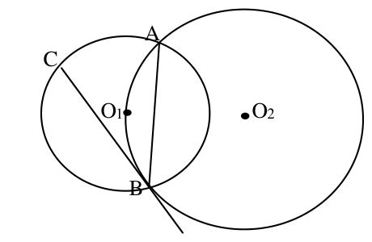{ width=200px }

5. zīm.

Abas riņķa līnijas krustojas punktos $A$ un $B$. Punktā $B$ riņķa līnijai $\omega_2$ novilkta pieskare, kas krusto $\omega_1$ punktā $C$. Pierādīt, ka $AB=CB$.

<small>
   
* questionType:
* domain:
   
</small>

## Atrisinājums

Skat. $13.$ zīm.

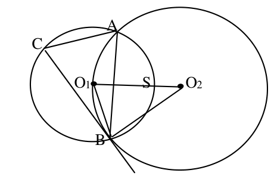{ width=200px }

$13.$ zīm.

$\angle O_1O_2B=\angle CBA$ kā leņķi ar savstarpēji perpendikulārām malām.

$\angle O_2O_1B=\overset{\frown}{SB}=\dfrac{1}{2}\overset{\frown}{AB}=\angle ACB$.

Tātad trijstūri $O_1O_2B$ un $CBA$ ir līdzīgi. Tā kā trijstūris $O_1O_2B$ ir vienādsānu, tad tāds ir arī trijstūris $CBA$. Tas nozīmē, ka $CB=BA$.

# <lo-sample/> LV.SOL.1992.11.1

Skaitli $1991$ dalot ar $a$, atlikumā iegūst $9$. Kāds var būt $a$ ?

<small>
   
* questionType:
* domain:
   
</small>

## Atrisinājums

Tā kā $1991=ka+9$, tad $ka=1982=2\cdot 991$, kur abi reizinātāji ir pirmskaitļi. Tātad $a\in\{1,2,991,1982\}$. Tā kā $a>9$, tad der tikai skaitļi $991$ un $1982$.

# <lo-sample/> LV.SOL.1992.11.2

Zināms, ka $P(x)=(x-a)(x-b)(x-c)(x-d)$; skaitļi $a$, $b$, $c$, $d$ visi ir dažādi. Pierādīt, ka vienādojumam
$$
P'(x)=0
$$
ir vismaz $3$ dažādas saknes.

<small>
   
* questionType:
* domain:
   
</small>

## Atrisinājums

Uzskatīsim, ka $a<b<c<d$.

Funkcija $P(x)$ punktā $a$ maina zīmi no "$+$" uz "$-$". Tātad $P'(a)<0$.

Funkcija $P(x)$ punktā $b$ maina zīmi no "$-$" uz "$+$". Tātad $P'(b)>0$.

Tā kā $P'(x)$ ir nepārtraukta funkcija, tad intervālā $(a,b)$ tai ir sakne.

Līdzīgi pamato, ka funkcijai $P'(x)$ ir saknes intervālos $(b,c)$ un $(c,d)$.

# <lo-sample/> LV.SOL.1992.11.3

Par zebru sauksim figūru, kas ar vienu gājienu var pārvietoties par $2$ vai par $3$ rūtiņām horizontālā vai vertikālā virzienā. Vai zebra var apstaigāt visas rūtiņas kvadrātā $4\cdot 4$, katrā rūtiņā nonākot tieši vienu reizi un ar pēdējo gājienu atgriežoties sākotnējā rūtiņā?

<small>
   
* questionType:
* domain:
   
</small>

## Atrisinājums

Zebra to var izdarīt; gājienu secība parādīta $14.$ zīmējumā.

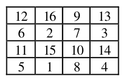{ width=100px }

$14.$ zīm.

# <lo-sample/> LV.SOL.1992.11.4

Viena trijstūra piramīda atrodas otras iekšpusē. Vai pirmās piramīdas šķautņu garumu summa noteikti ir mazāka par otrās piramīdas šķautņu garumu summu?

<small>
   
* questionType:
* domain:
   
</small>

## Atrisinājums

Nē, ne noteikti. Pretpiemērs: ārējā piramīdā $ABCD$ šķautnes $AB$, $AC$, $BC$ izvēlas ļoti īsas, bet $AD$, $BD$, $CD$ garas; bet iekšējās piramīdas divas virsotnes novieto tuvu punktam $D$, bet pārējās divas tuvu trijstūrim $ABC$. Rezultātā Ārējai piramīdai ir $3$ garas šķautnes, bet iekšējai $4$ garas šķautnes. Pārējo šķautņu garumi uz nevienādību neietekmē.

# <lo-sample/> LV.SOL.1992.11.5

Šaurleņķa trijstūra malu garumi ir $a$, $b$ un $c$, turklāt $a<b<c$; ievilktās un apvilktās riņķa līniju rādiusi ir $r$ un $R$. Pierādīt, ka
$$
r+R<b.
$$

<small>
   
* questionType:
* domain:
   
</small>

## Atrisinājums

Trijstūrī $ABC$ izpildās nevienādības $\angle A<\angle B<\angle C$.

Tā kā $90^{\circ}>\angle B>90^{\circ}-\angle A$, tad $\cos B<\cos(90^{\circ}-A)=\sin A$.

Līdzīgi $\cos A<\sin B$. Tāpēc $(1-\cos A)(1-\cos B)>(1-\sin A)(1-\sin B)$, no kurienes pēc pārveidojumiem iegūstam

$$\sin A+\sin B>\cos A+\cos B+\cos C.$$

Tā kā $\sin A=\dfrac{a}{2R}$ un $\sin B=\dfrac{b}{2R}$, tad $\sin A+\sin B=\dfrac{a+b}{2R}$.

No kosinusu teorēmas, izmantojot formulas $r=\dfrac{S}{p}$, $R=\dfrac{abc}{4S}$ un Herona formulu iegūstam $\cos A+\cos B+\cos C=1+\dfrac{r}{R}$.

No šejienes $\dfrac{a+b}{2R}>\dfrac{R+r}{R}$; tātad $\dfrac{a+b}{2}>R+r$. Tā kā $b>a$, tad iegūstam prasīto nevienādību $b>R+r$.

# <lo-sample/> LV.SOL.1992.12.1

Dots, ka $\sin 4x<4\sin x$. Pierādīt, ka $\sin x>0$.

<small>
   
* questionType:
* domain:
   
</small>

## Atrisinājums

Doto nevienādību pārveidojam formā

$$4\cdot\sin x(1-\cos x\cdot\cos 2x)>0$$

Iekavas vērtība nevar būt negatīva; viegli pārbaudīt, ka tā nav $0$. Tas nozīmē, ka $\sin x>0$.

# <lo-sample/> LV.SOL.1992.12.2

Divas riņķa līnijas ar centriem $A$ un $B$ katra pieskaras abām leņķa malām un savā starpā pieskaras ārēji. Pierādīt, ka riņķa līnija ar diametru $AB$ arī pieskaras abām leņķa malām.

<small>
   
* questionType:
* domain:
   
</small>

## Atrisinājums

Apzīmēsim doto riņķa līniju rādiusus ar $r$ un $R$. Tad $AB=r+R$ un trešās riņķa līnijas rādiuss ir $\dfrac{r+R}{2}$. No trapeces viduslīnijas garuma formulas seko, ka attālums no trešās riņķa līnijas centra – $AB$ viduspunkta līdz leņķa malām ir $\dfrac{r+R}{2}$. Tātad trešā riņķa līnija pieskaras leņķa malām.

# <lo-sample/> LV.SOL.1992.12.3

Cik ir dažādu trijstūra piramīdu ar šķautņu garumiem $2$, $3$, $3$, $4$, $5$, $5$?

<small>
   
* questionType:
* domain:
   
</small>

## Atrisinājums

No trijstūra nevienādībām seko, ka iespējams izveidot $3$ dažādas piramīdas ar norādītajiem šķautņu garumiem (skat. $15.$ zīm.).

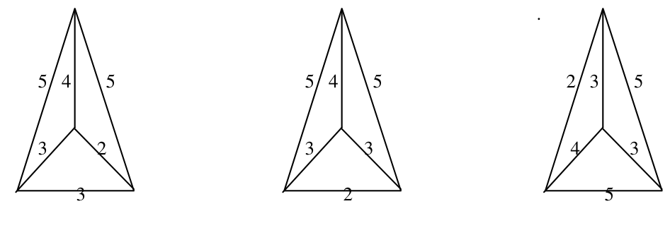{ width=450px }

15. zīm.

# <lo-sample/> LV.SOL.1992.12.4

Par skaitļu virkni $(a_n)$, $n=0,1,2,\ldots$ zināms, ka $a_0=9$ un katram $n\geq 0$ pastāv vienādība
$$
a_{n+1}=a_n^2+2a_n.
$$
Pierādīt, ka $a_{10}$ savā pierakstā satur vismaz $1000$ devītniekus.

<small>
   
* questionType:
* domain:
   
</small>

## Atrisinājums

Apskatām skaitļu virkni $x_n=a_n+1$. Tad

$$
x_{n+1}=a_n^2+2a_n+1=(a_n+1)^2=x_n^2 \quad \text{un} \quad x_0=10.
$$

Tātad $x_{10}=10^{1024}$ un $a_{10}=10^{1024}-1=\underbrace{999\ldots9}_{1024}$.

# <lo-sample/> LV.SOL.1992.12.5

Atrisināt naturālos skaitļos vienādojumu
$$
\frac{xy}{z}+\frac{xz}{y}+\frac{yz}{x}=3.
$$

<small>
   
* questionType:
* domain:
   
</small>

## Atrisinājums

No nevienādības starp vidējo aritmētisko un vidējo ģeometrisko seko

$$
\frac{xy}{z}+\frac{xz}{y}+\frac{yz}{x}\ge 3\cdot\sqrt[3]{\frac{xy}{z}\cdot\frac{xz}{y}\cdot\frac{yz}{x}}=3\cdot\sqrt[3]{xyz}\ge 3.
$$

Turklāt vienādība var izpildīties tikai, ja $xyz=1$.

Tā kā $x$, $y$, $z$ naturāli skaitļi, tad $x=y=z=1$.
