# <lo-sample/> LV.SOL.1993.5.1

Uzrakstām ar vārdiem skaitļus no $1$ līdz $100$:

viens, divi, trīs, ... , deviņdesmit deviņi, simts.

Cik pavisam vārdu uzrakstīts?

<small>
   
* questionType:
* domain:
   
</small>

## Atrisinājums

Uzrakstīti $172$ vārdi.

# <lo-sample/> LV.SOL.1993.5.2

Kvadrāts sastāv no $4 \cdot 4$ rūtiņām. Vai var katrā rūtiņā ierakstīt naturālu skaitli no $1$ līdz $16$ (katrā citu) tā, lai katrās $4$ rūtiņās, kam ir kopīga virsotne, ierakstīto skaitļu reizinājums dalītos ar $5$?

<small>
   
* questionType:
* domain:
   
</small>

## Atrisinājums

Nē, nevar. Sadalīsim kvadrātu četros kvadrātos $2\times 2$. Katrā no tiem ierakstīto skaitļu reizinājumam jādalās ar $5$; tas nozīmē, ka jābūt ierakstītam vismaz vienam skaitlim, kas dalās ar $5$. Taču starp pirmajiem $16$ skaitļiem ir tikai $3$ skaitļi, kas dalās ar $5$.

# <lo-sample/> LV.SOL.1993.5.3

Pierādīt, ka trīssimt divnieku reizinājums nesatur vairāk par $100$ cipariem.

<small>
   
* questionType:
* domain:
   
</small>

## Atrisinājums

Tā kā $2\cdot 2\cdot 2=8<10$, tad apskatāmais reizinājums mazāks par

$$
\underbrace{10\cdot 10\cdot 10\cdots\cdot 10}_{100\ \text{reizes}},
$$

tātad nesatur vairāk par $100$ cipariem (uzrakstītais skaitlis ir mazākais $101$-ciparu skaitlis).

# <lo-sample/> LV.SOL.1993.5.4

Vai kvadrātu ar izmēriem $8 \cdot 8$ rūtiņas var sagriezt tādās figūrās, kāda parādīta $1.$ zīm.? (Figūras var būt novietotas arī citādi).

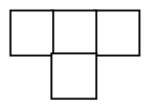{ width=100px }

$1.$ zīm.

<small>
   
* questionType:
* domain:
   
</small>

## Atrisinājums

Jā, var. Kvadrātu no $8\times 8$ rūtiņām sagriežam četros kvadrātos ar izmēriem $4\times 4$ rūtiņas. Katru $4\times 4$ rūtiņu kvadrātu var sagriezt šādās figūrās tā, kā tas parādīts $6.$ zīm.

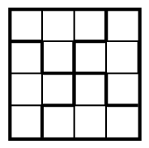{ width=100px }

$6.$ zīm.

# <lo-sample/> LV.SOL.1993.5.5

Smaragda karaļvalstī saskaitīšanu un reizināšanu apzīmē ar $*$ un $\circ$ (nav zināms, kuru darbību ar kuru simbolu). Ar $a$, $b$, $c$, $d$ ir apzīmēti dažādi cipari, kas nav nulle. Lauva apgalvo, ka sekojošas vienādības

$$a * a = a$$

$$b \circ a = c$$

$$b * c = d$$

ir pareizas.

Aprēķināt vērtību $(a * b) \circ (c * d)$.

<small>
   
* questionType:
* domain:
   
</small>

## Atrisinājums

Tā kā vienādība $a+a=a$ nav iespējama, jo $a\ne 0$, tad $*$ apzīmē reizināšanu un $a=1$. No otrās vienādības secinām, ka $c=b+1$. Trešā vienādība norāda, ka $b\cdot(b+1)=d$. Tā kā $d$ cipars, tad $b=2$, $c=3$, $d=6$.

Atliek aprēķināt dotās izteiksmes vērtību. Tā ir $20$.

# <lo-sample/> LV.SOL.1993.6.1

Izrakstīt neiekrāsotajās rūtiņās ($2.$ zīm.) skaitļus no $1$ līdz $24$ (katrā rūtiņā citu skaitli) tā, lai skaitļu summa katrās divās rūtiņās, kurām ir kopēja mala, būtu nepāra skaitlis.

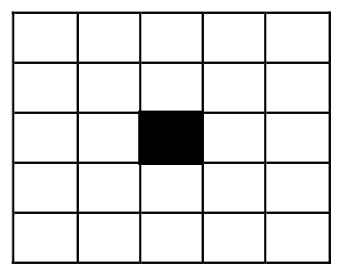{ width=150px }

2. zīm.

<small>
   
* questionType:
* domain:
   
</small>

## Atrisinājums

Neiekrāsotās rūtiņas izkrāso baltas un sarkanas šahveida kārtībā un baltajās rūtiņās patvaļīgā veidā ieraksta pāra skaitļus, bet sarkanajās nepāra skaitļus.

# <lo-sample/> LV.SOL.1993.6.2

Vai, saskaitot visus naturālos skaitļus no $1$ līdz kādai vietai (nevienu neizlaižot), var iegūt summu, kuras pēdējais cipars ir

a) $8$,

b) $7$ ?

<small>
   
* questionType:
* domain:
   
</small>

## Atrisinājums

a) Jā, var: $1+2+3+4+5+6+7=28$.

b) Nē, nevar. Lai to pierādītu, sastādīsim tabulu, kurā ierakstīts skaitļa $n$ pēdējais cipars un pirmo $n$ skaitļu summas pēdējais cipars:

| $n$ | $1$ | $2$ | $3$ | $4$ | $5$ | $6$ | $7$ | $8$ | $9$ | $0$ | $1$ | $2$ | $3$ | $4$ | $5$ | $6$ | $7$ | $8$ | $9$ | $0$ | $1$ |
|---|---|---|---|---|---|---|---|---|---|---|---|---|---|---|---|---|---|---|---|---|---|
| $S$ | $1$ | $3$ | $6$ | $0$ | $5$ | $1$ | $8$ | $6$ | $5$ | $5$ | $6$ | $8$ | $1$ | $5$ | $0$ | $6$ | $3$ | $1$ | $0$ | $0$ | $1$ |

Tā kā pēdējā kolonnā $n$ un $S$ pēdējie cipari ir tādi paši kā pirmajā, tad tālāk tabula periodiski atkārtosies. Tātad cipars $7$ tās apakšējā rindā neparādīsies.

# <lo-sample/> LV.SOL.1993.6.3

Ar vienādiem burtiem apzīmēti vienādi cipari, ar dažādiem burtiem – dažādi. Pierādīt, ka vienādība

$$\mathrm{JĀ}\cdot\mathrm{NĒ}=\mathrm{FFGG}$$

Nav pareiza.

<small>
   
* questionType:
* domain:
   
</small>

## Atrisinājums

Skaitlis $FFGG$ dalās ar $11$ (dalījums ir $F0G$), bet neviens no kreisās puses reizinātājiem ar $11$ nedalās; tā ir pretruna.

# <lo-sample/> LV.SOL.1993.6.4

Vai trijstūra piramīdas (skat. $3.$ zīm.) šķautnes (trijstūru malas) var sanumurēt ar skaitļiem no $1$ līdz $6$ tā, lai visiem $4$ trijstūriem visu triju malu numuru summas būtu vienādas?

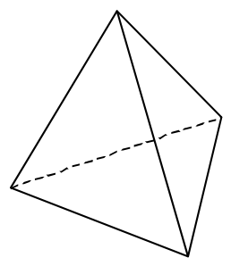{ width=100px }

3. zīm.

<small>
   
* questionType:
* domain:
   
</small>

## Atrisinājums

Nē, nevar. Pieņemsim, ka visas summas ir vienādas ar $S$. Sasummēsim visas šīs summas un ievērosim, ka katrs skaitlis no $1$ līdz $6$ būs ieskaitīts divas reizes, jo katra šķautne pieder divām skaldnēm; iegūsim:

$$4S=2\cdot(1+2+3+4+5+6)=42.$$

No šejienes seko, ka $S=10\frac{1}{2}$, bet $S$ jābūt veselam skaitlim.

# <lo-sample/> LV.SOL.1993.6.5

Salikt taisnstūri ar izmēriem $5\cdot 6$ rūtiņas no gabaliem ar izmēriem $1\cdot 2$ rūtiņas tā, lai to nevarētu sadalīt divos taisnstūros, nepārgriežot nevienu gabalu. Pietiek parādīt vienu veidu, kā to izdarīt.

<small>
   
* questionType:
* domain:
   
</small>

## Atrisinājums

Skat., piemēram, $7.$ zīm.

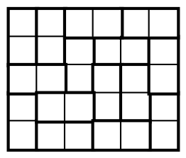{ width=100px }

7. zīm.

# <lo-sample/> LV.SOL.1993.7.1

Pierādīt, ka

$$
\frac{1}{1\cdot 2}+\frac{1}{2\cdot 3}+\frac{1}{3\cdot 4}+\frac{1}{4\cdot 5}+\frac{1}{5\cdot 6}+\frac{1}{6\cdot 7}+\frac{1}{7\cdot 8}+\frac{1}{8\cdot 9}+\frac{1}{9\cdot 10}=\frac{9}{10}.
$$

<small>
   
* questionType:
* domain:
   
</small>

## Atrisinājums

Visiem skaitļiem $n$ izpildās vienādība

$$\frac{1}{n\cdot(n+1)}=\frac{1}{n}-\frac{1}{n+1}.$$

Tāpēc

$$\frac{1}{1\cdot2}+\frac{1}{2\cdot3}+\frac{1}{3\cdot4}+\cdots+\frac{1}{9\cdot10}=$$

$$\left(\frac{1}{1}-\frac{1}{2}\right)+\left(\frac{1}{2}-\frac{1}{3}\right)+\left(\frac{1}{3}-\frac{1}{4}\right)+\cdots+\left(\frac{1}{9}-\frac{1}{10}\right)=\frac{1}{1}-\frac{1}{10}=\frac{9}{10}.$$

Pārējās daļas saīsinājās.

# <lo-sample/> LV.SOL.1993.7.2

Rindā uzrakstīti skaitļi

$$
1\quad 2\quad 3\quad 4\quad 5\quad \ldots\quad 1992
$$

Vai var katram no tiem priekšā pierakstīt "$+$" vai "$-$" zīmi tā, lai iegūtās summas vērtība būtu $0$?

<small>
   
* questionType:
* domain:
   
</small>

## Atrisinājums

Jā, var. Ievērosim, ka $1982$ dalās ar $4$. Visus skaitļus sagrupēsim grupās pa četriem pēc kārtas ņemtiem skaitļiem. No šādiem skaitļiem var summā iegūt nulli:

$$+a-(a+1)-(a+2)+(a+3)=0.$$

Arī kopējā summa būs vienāda ar $0$. Virkne izskatīsies šādi:

$$+1-2-3+4+5-6-7+8+9-10-11+12\cdots.$$

# <lo-sample/> LV.SOL.1993.7.3

Kādu mazāko skaitu rūtiņu jāiekrāso kvadrātā ar izmēriem $6\times 6$ rūtiņas, lai neiekrāsotajā daļā nevarētu ievietot tādu stūrīti (varbūt pagrieztu citā virzienā), kāds redzams $4$. zīm.?

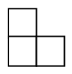{ width=100px }

4. zīm.

<small>
   
* questionType:
* domain:
   
</small>

## Atrisinājums

Mazākais daudzums rūtiņu, kāds jāiekrāso, ir $18$. Var iekrāsot $18$ rūtiņas, piemēram, kā parādīts $8.$ zīmējumā.

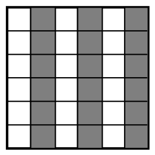{ width=100px }

8. zīm.

Ar mazāku skaitu iekrāsoto rūtiņu nepietiek. Tiešām, sadalīsim kvadrātu $9$ kvadrātos $2 \cdot 2$. Ja iekrāsotas ne vairāk kā $17$ rūtiņas, tad kādā no $9$ kvadrātiem $2 \cdot 2$ iekrāsots ne vairāk par vienu rūtiņu. Atlikušajās $3$ rūtiņās izvietosies stūrītis.

# <lo-sample/> LV.SOL.1993.7.4

Kvadrāts sastāv no $4\times 4$ rūtiņām. Tajās ierakstīti naturāli skaitļi no $1$ līdz $16$ (visi dažādi). Katrām divām rūtiņām, kurām ir kopīga mala, aprēķinām tajās ierakstīto skaitļu summu. Vai var gadīties, ka tieši viena no tām (ne vairāk un ne mazāk) ir pāra skaitlis?

<small>
   
* questionType:
* domain:
   
</small>

## Atrisinājums

Nē, nevar. Pieņemsim pretējo, ka tas ir izdevies un aplūkosim tās blakus rūtiņas, kurās ierakstīto skaitļu $A$ un $B$ summa ir pāra skaitlis. Tām blakus atrodas rūtiņas, kurās ierakstīti skaitļi $C$ un $D$ (skat. 9. zīm.).

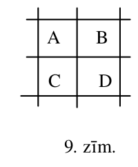{ width=100px }

9. zīm.

Skaitļu $A$ un $B$ paritātes ir vienādas. Tā kā visām pārējām summām jābūt nepāra, tad skaitļu $C$ un $D$ paritātes ir pretējas skaitļu $A$ un $B$ paritātei, tātad vienādas. Bet tas nozīmē, ka skaitļu $C$ un $D$ summa arī ir pāra skaitlis; pretruna.

# <lo-sample/> LV.SOL.1993.7.5

Turnīrā piedalās $10$ komandas, katrai ar katru jāizspēlē viena spēle. Vai var gadīties tāds brīdis, kad visas komandas izspēlējušas dažādu spēļu skaitu?

<small>
   
* questionType:
* domain:
   
</small>

## Atrisinājums

Nē. Komandu izspēlēto spēļu skaits var būt tikai $0$, $1$, $2$, ... , $9$. Ja visas $10$ komandas izspēlējušas dažādu spēļu skaitu, tad visām norādītajām vērtībām (to ir $10$) jābūt realizētām. Bet, ja kāda komanda ir izspēlējusi $9$ spēles, tad tā ir spēlējusi ar visām komandām; tas nozīmē, ka nav komandas kurai ir $0$ spēļu.

# <lo-sample/> LV.SOL.1993.8.1

Slēgtā lauztā līnijā ir $10$ posmi. Cik posmi var krustoties vienā punktā?

<small>
   
* questionType:
* domain:
   
</small>

## Atrisinājums

Vienā punktā var krustoties $2$, $3$, $4$ vai $5$ posmi (skat. 10. zīm.). Vairāk nekā $5$ posmi krustoties vienā punktā nevar. Ja vienā punktā krustotos $6$ posmi, tad kopā tiem ir $12$ gali, kas jāsavieno; tātad vajadzīgi vēl vismaz $6$ posmi, bet atlikuši tikai četri.

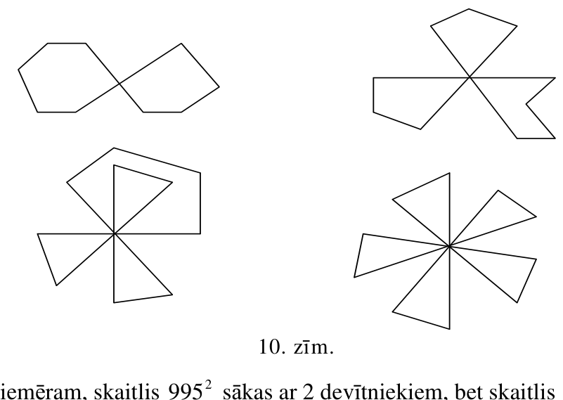{ width=350px }

10. zīm.

# <lo-sample/> LV.SOL.1993.8.2

Vai naturāla skaitļa kvadrāts var sākties tieši ar

a) diviem,

b) deviņiem

devītniekiem.

<small>
   
* questionType:
* domain:
   
</small>

## Atrisinājums

Jā. Piemēram, skaitlis $995^2$ sākas ar $2$ devītniekiem, bet skaitlis $\left(\underbrace{99\ldots 9}_{9}5\right)^2$ sākas ar $9$ devītniekiem.

Vispār skaitļa $\underbrace{99\ldots 9}_{n}5$ kvadrāts sākas ar $n$ devītniekiem. Tiešām,

$$
\left(\underbrace{99\ldots 9}_{n}5\right)^2=(10^{n+1}-5)^2=10^{2n+2}-2\cdot 5\cdot 10^{n+1}+25=
$$

$$
10^{2n+2}-10^{n+2}+25=\underbrace{99\ldots 9}_{n}\underbrace{00\ldots 0}_{n}025.
$$

# <lo-sample/> LV.SOL.1993.8.3

Kvadrāts sastāv no $6\times 6$ rūtiņām. Kādu mazāko skaitu rūtiņu jāiekrāso, lai katrā taisnstūrī ar izmēriem $2\times 3$ rūtiņas būtu iekrāsota vismaz viena?

<small>
   
* questionType:
* domain:
   
</small>

## Atrisinājums

Kvadrātu no $6\times 6$ rūtiņām var sagriezt $6$ taisnstūros ar izmēriem $2\times 3$. Tā kā katrā taisnstūrī jāiekrāso vismaz viena rūtiņa, tad jāiekrāso vismaz $6$ rūtiņas. Ar $6$ rūtiņām pietiek; piemērs parādīts 11. zīmējumā.

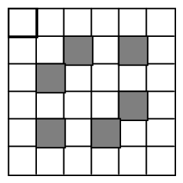{ width=100px }

11. zīm.

# <lo-sample/> LV.SOL.1993.8.4

Rindā uzrakstīti skaitļi

$$
1\quad 2\quad 3\quad 4\quad 5\quad \ldots\quad 100\quad 101.
$$

Vai var katram no tiem priekšā pierakstīt "$+$" vai "$-$" zīmi tā, lai iegūtās summas vērtība būtu $0$?

<small>
   
* questionType:
* domain:
   
</small>

## Atrisinājums

Tā kā starp dotajiem skaitļiem ir $51$ (nepāra skaits) nepāra skaitļu, tad iegūtā vērtība vienmēr būs nepāra skaitlis, tātad nevar būt vienāda ar $0$.

# <lo-sample/> LV.SOL.1993.8.5

Uz $11$ šķīvīšiem novietotas konfektes; šķīvīši izvietoti pa apli. Ar vienu gājienu atļauts $7$ pēc kārtas ņemtos šķīvīšos pievienot pa konfektei.

Pierādīt, ka ar šādiem gājieniem var panākt, lai konfekšu skaits visos šķīvīšos būtu vienāds.

<small>
   
* questionType:
* domain:
   
</small>

## Atrisinājums

Pieliekot pa vienai konfektei septiņos šķīvīšos, tad nākošajos septiņos šķīvīšos, utt. ($8$ reizes), rezultātā $10$ šķīvīšos pievienots pa $5$ konfektēm, bet vienā – $6$ konfektes. Tā kā kopējais konfekšu skaits šķīvīšos mūs neinteresē, varam uzskatīt, ka vienā šķīvītī ielikta konfekte. Skaidrs, ka tādā gadījumā mēs varam izlīdzināt konfekšu skaitu visos šķīvīšos.

# <lo-sample/> LV.SOL.1993.9.1

Trijstūrī divu malu garumi ir $52$ cm un $25$ cm, bet augstuma garums, kas novilkts no to kopīgās virsotnes, ir $20$ cm.

Aprēķināt trešās malas garumu.

<small>
   
* questionType:
* domain:
   
</small>

## Atrisinājums

Skat $12.$ zīm.

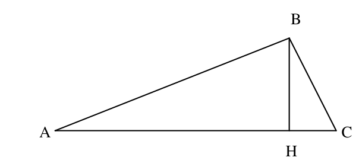{ width=300px }

12. zīm.

Izmantojot Pitagora teorēmu aprēķinām

$$
AC=AH+HC=\sqrt{52^2-20^2}+\sqrt{25^2-20^2}=64.
$$

# <lo-sample/> LV.SOL.1993.9.2

Dots, ka $\sqrt{x}+\sqrt{y}<x+y$. Pierādīt, ka $x+y>1$.

<small>
   
* questionType:
* domain:
   
</small>

## Atrisinājums

Vismaz viens no skaitļiem $x$, $y$ lielāks par $1$; pretējā gadījumā būtu $\sqrt{x}\ge x$ un $\sqrt{y}\ge y$, tātad būtu $\sqrt{x}+\sqrt{y}\ge x+y$; iegūta pretruna.

Ja viens no skaitļiem $x$, $y$ lielāks par $1$, tad, protams, $x+y>1$.

# <lo-sample/> LV.SOL.1993.9.3

Katrai veselai kvadrāttrinoma $ax^2+bx+c$ vērtība ir vesels skaitlis.

a) Pierādīt, ka vismaz viens no skaitļiem $a,b,c$ ir vesels.

b) Vai noteikti visi šie skaitļi ir veseli?

<small>
   
* questionType:
* domain:
   
</small>

## Atrisinājums

a) Ievietojot $x=0$, iegūstam, ka $c$ ir vesels skaitlis.

b) Nē, ne noteikti. Piemēram, kvadrāttrinoms $\frac{1}{2}x^2+\frac{1}{2}x$ visiem veseliem skaitļiem $x$ pieņem veselas vērtības.

# <lo-sample/> LV.SOL.1993.9.4

Dots, ka $a+b+c+d=0$ un $a^2+b^2+c^2+d^2=1$.

Pierādīt, ka no skaitļiem $a,b,c,d$ var izvēlēties divus, kuru reizinājums nav lielāks par $\left(-\frac{1}{4}\right)$.

<small>
   
* questionType:
* domain:
   
</small>

## Atrisinājums

Apzīmējam dotos skaitļus dilstošā kārtībā ar $x_1\ge x_2\ge x_3\ge x_4$. Katram $i$, $1\le i\le 4$, iegūstam $(x_1-x_i)(x_i-x_4)\ge 0$ (abi reizinātāji ir nenegatīvi), no kurienes seko

$$
x_i(x_1+x_4)\ge x_i^2+x_1x_4.
$$

Saskaitot šīs nevienādības pie $i=1,2,3,4$, iegūstam

$$
(x_1+x_2+x_3+x_4)(x_1+x_4)\ge x_1^2+x_2^2+x_3^2+x_4^2+4x_1x_4.
$$

Ievērojot uzdevuma nosacījumos dotās vienādības, iegūstam

$$
0\ge 1+4x_1x_4,
$$

no kurienes $x_1x_4\le -\frac{1}{4}$.

# <lo-sample/> LV.SOL.1993.9.5

Figūra (skat. $5.$ zīm.) sastāv no $6$ vienādiem vienādmalu trijstūriem. Kā to sagriezt $4$ vienādās daļās?

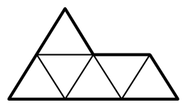{ width=100px }

5. zīm

<small>
   
* questionType:
* domain:
   
</small>

## Atrisinājums

Skat., piemēram, $13.$zīm.

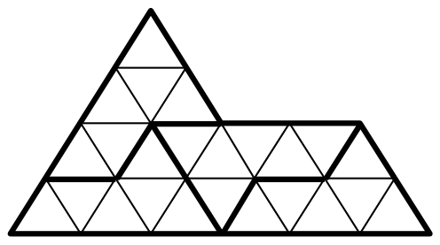{ width=250px }

13.zīm.

# <lo-sample/> LV.SOL.1993.10.1

Vai var uzzīmēt $5$ riņķa līnijas tā, ka katra no tām pieskaras tieši trim citām?

<small>
   
* questionType:
* domain:
   
</small>

## Atrisinājums

Nē. Ja tas būtu iespējams, tad, saskaitot visām riņķa līnijām to pieskaršanās punktu skaitu, iegūtu $5 \cdot 3=15$. Bet šai summai jābūt pāra skaitlim, jo katra pieskaršanās ieskaitīta divas reizes.

# <lo-sample/> LV.SOL.1993.10.2

Dots, ka $x^2+y^2=1$. Pierādīt, ka $x^4+y^4\ge 2x^3y^3$.

<small>
   
* questionType:
* domain:
   
</small>

## Atrisinājums

No nevienādības par divu skaitļu vidējo aritmētisko un vidējo ģeometrisko seko

$$
x^4+y^4 \ge 2\sqrt{x^4y^4}=2x^2y^2 \ge 2x^3y^3.
$$

Pēdējā nevienādība seko no tā, ka $x^2 \le 1$, un $y^2 \le 1$. Tiešām $x^2 \le 1 \Rightarrow |x| \le 1 \Rightarrow x^2 \ge |x^3|$, līdzīgi $y^2 \ge |y^3|$; tātad $x^2y^2 \ge x^3y^3$.

# <lo-sample/> LV.SOL.1993.10.3

Dots, ka $n$ – naturāls skaitlis. Pierādīt, ka $3^n+2\cdot17^n$ nav nekāda naturāla skaitļa kvadrāts.

<small>
   
* questionType:
* domain:
   
</small>

## Atrisinājums

Noskaidrosim, kādi var būt šo skaitļu pēdējie cipari. Lai to izdarītu sastādīsim tabulu:

| $n$ | $1$ | $2$ | $3$ | $4$ | $5$ | $\ldots$ |
|---|---|---|---|---|---|---|
| $3^n(\operatorname{mod}10)$ | $3$ | $9$ | $7$ | $1$ | $3$ | $\ldots$ |
| $17^n(\operatorname{mod}10)$ | $7$ | $9$ | $3$ | $1$ | $7$ | $\ldots$ |
| $2 \cdot 17^n(\operatorname{mod}10)$ | $4$ | $8$ | $6$ | $2$ | $4$ | $\ldots$ |
| $3^n+2 \cdot 17^n(\operatorname{mod}10)$ | $7$ | $7$ | $3$ | $3$ | $7$ | $\ldots$ |

Tālāk skaitļi periodiski atkārtojas. No tabulas redzam, ka skaitļa $3^n+2 \cdot 17^n$ pēdējais cipars var būt tikai $3$ vai $7$, bet vesela skaitļa kvadrāts nevar beigties ar $3$ vai $7$.

# <lo-sample/> LV.SOL.1993.10.4

Diagonāles sadala izliektu četrstūri $4$ trijstūros. Šo trijstūru laukumiem ir $3$ dažādas vērtības. Pierādīt, ka četrstūris ir trapece.

<small>
   
* questionType:
* domain:
   
</small>

## Atrisinājums

Skat. $14.$ zīmējumu. Divu trijstūru laukumi ir vienādi. Tie nevar atrasties blakus. Tiešām, ja, piemēram $S_{ABO}=S_{CBO}$, tad $AO=CO$ un $S_{AOD}=S_{COD}$; tas nozīmē, ka trijstūru laukumi pieņem ne vairāk kā divas vērtības.

Tātad vienādi laukumi ir diviem pretējiem trijstūriem, teiksim $ABO$ un $COD$. Tad vienādi laukumi ir arī trijstūriem $ABD$ un $ACD$ (pievienots trijstūris $AOD$). Tā kā šiem trijstūriem ir kopīgs pamats $AD$, tad punkti $B$ un $C$ atrodas vienādos attālumos no taisnes $AD$. Tas nozīmē, ka malas $AD$ un $BC$ ir paralēlas. Ievērojot, ka četrstūris nav paralelograms ( tad visu trijstūru laukumi ir vienādi), iegūstam, ka $ABCD$ ir trapece.

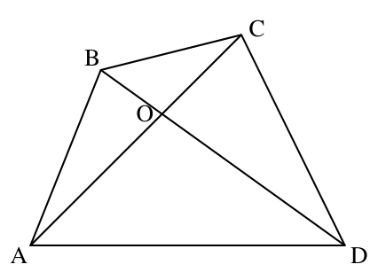{ width=200px }

14. zīm.

# <lo-sample/> LV.SOL.1993.10.5

Doti sviras svari. To pleci ir dažāda garuma un svaru kausiem ir dažādas masas. Novietojot priekšmetus $A$, $B$, $C$ uz kreisā svaru kausa, tie attiecīgi tiek līdzsvaroti ar masām $A_1$, $B_1$, $C_1$ uz labā kausa. Novietojot priekšmetus $A$, $B$ uz labā svaru kausa, tie attiecīgi tiek līdzsvaroti ar masām $A_2$, $B_2$ uz kreisā kausa. Atrast priekšmeta $C$ patieso masu.

<small>
   
* questionType:
* domain:
   
</small>

## Atrisinājums

Pieņemam, ka kreisā pleca garums ir $k$, labā pleca garums $l$, kreisā kausa masa $K$ un labā pleca masa $L$. Iegūstam vienādojumu sistēmu:

$$
\begin{cases}
k\cdot(K+A)=l\cdot(L+A_1)\\
k\cdot(K+B)=l\cdot(L+B_1)\\
k\cdot(K+C)=l\cdot(L+C_1)\\
k\cdot(K+A_2)=l\cdot(L+A)\\
k\cdot(K+B_2)=l\cdot(L+B)
\end{cases}
$$

Izslēdzot mainīgos $k$, $l$, $K$, $L$, iegūstam atbildi:

$$
C=\frac{C_1\left(\sqrt{(A_1-B_1)(A_2-B_2)}+(A_2-B_2)\right)+A_1B_2-A_2B_1}{\sqrt{(A_1-B_1)(A_2-B_2)}+A_1-B_1}
$$

# <lo-sample/> LV.SOL.1993.11.1

Dots, ka $abc=1$. Pierādīt, ka

$$(a+1)(b+1)(c+1)=2+a+b+c+\frac{1}{a}+\frac{1}{b}+\frac{1}{c}.$$

<small>
   
* questionType:
* domain:
   
</small>

## Atrisinājums

Identitāte

$$
(a+1)(b+1)(c+1)=
$$

$$
abc+(ab+ac+bc)+a+b+c+1
$$

aizvietojot $abc$ ar $1$ un izdalot $(ab+ac+bc)$ ar $abc$, iegūstam prasīto vienādību.

# <lo-sample/> LV.SOL.1993.11.2

Pierādīt, ka katram naturālam $n$ skaitlis

$$(n+1)(n+9)(n+9)(n+2)$$

dalās ar $3$.

<small>
   
* questionType:
* domain:
   
</small>

## Atrisinājums

Ja $n=3k$, tad $n+9$ dalās ar $3$, un arī viss reizinājums dalās ar $3$;

ja $n=3k+1$, tad $n+2$ dalās ar $3$, un arī viss reizinājums dalās ar $3$;

ja $n=3k+2$, tad $n+1$ dalās ar $3$, un arī viss reizinājums dalās ar $3$.

# <lo-sample/> LV.SOL.1993.11.3

Izliekta sešstūra $ABCDEF$ visu malu garumi mazāki par $1$ cm. Pierādīt, ka vismaz viena no diagonālēm $AD$, $BE$, $CF$ īsāka par $2$ cm.

<small>
   
* questionType:
* domain:
   
</small>

## Atrisinājums

Skat. 15. zīmējumu. Ievērojam, ka

$$
\angle CAD+\angle EAD+\angle ACF+\angle ECF+\angle CEB+\angle AEB=
$$

$$
\angle EAC+\angle ACE+\angle CEA=180^\circ.
$$

Tātad vismaz viens no šiem $6$ leņķiem nepārsniedz $30^\circ$; varam pieņemt, ka $\angle CAD\le 30^\circ$. Tad $1>CD\ge AD\sin 30^\circ=\frac{1}{2}AD$, no kurienes $AD<2$.

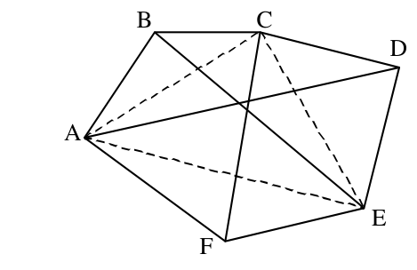{ width=200px }

15. zīm.

# <lo-sample/> LV.SOL.1993.11.4

Skaitļi $x_1,x_2,\ldots,x_n$ ir pozitīvi. Pierādīt, ka

$$\frac{x_1^2}{x_1+x_2}+\frac{x_2^2}{x_2+x_3}+\cdots+\frac{x_n^2}{x_n+x_1}\ge \frac{x_1+x_2+\cdots+x_n}{2}.$$

<small>
   
* questionType:
* domain:
   
</small>

## Atrisinājums

Ievērojam, ka

$$
\frac{x_1^2-x_2^2}{x_1+x_2}+\frac{x_2^2-x_3^2}{x_2+x_3}+\cdots+\frac{x_n^2-x_1^2}{x_n+x_1}=
$$

$$
(x_1-x_2)+(x_2-x_3)+\cdots+(x_n-x_1)=0.
$$

Tāpēc

$$
\frac{x_1^2}{x_1+x_2}+\frac{x_2^2}{x_2+x_3}+\cdots+\frac{x_n^2}{x_n+x_1}
=
\frac{x_2^2}{x_1+x_2}+\frac{x_3^2}{x_2+x_3}+\cdots+\frac{x_1^2}{x_n+x_1},
$$

un prasītais būs pierādīts, ja pierādīsim, ka

$$
\frac{x_1^2+x_2^2}{x_1+x_2}+\frac{x_2^2+x_3^2}{x_2+x_3}+\cdots+\frac{x_n^2+x_1^2}{x_n+x_1}\ge x_1+x_2+\cdots+x_n.
$$

Tas seko no nevienādības

$$
\frac{a^2+b^2}{a+b}\ge \frac{a+b}{2}
$$

(tā pārveidojas formā $(a-b)^2\ge 0$), pielietojot to skaitļu pāriem $(x_1,x_2),(x_2,x_3),\ldots,(x_n,x_1)$ un iegūtās nevienādības saskaitot.

# <lo-sample/> LV.SOL.1993.11.5

Pilī ir $500$ istabas. No katras istabas var aiziet uz katru. Starp katrām divām istabām nav vairāk par vienām durvīm. Ja starp divām istabām ir durvis, tad no vienas istabas var aiziet uz otru tikai pa šīm durvīm.

Pierādīt, ka $9$ sargi var noķert pilī ielavījušos zagli. (Zaglis skaitās noķerts, ja sargs nonāk ar to vienā istabā.)

<small>
   
* questionType:
* domain:
   
</small>

## Atrisinājums

Pilī var atrast istabu, uz katru pusi no kuras ir ne vairāk kā $250$ istabas. To pierāda, izvēloties patvaļīgu istabu un, ja kādas durvis ved virzienā ar vairāk nekā $250$ istabām, tad pavirzāmies pa šīm durvīm uz blakus istabu; atkārtojot šo procesu atrodam vajadzīgo istabu.

Nostādām šajā istabā sargu. Pa katrām šīs istabas durvīm var nokļūt kādā pils istabu grupā. No vienas istabu grupas otrā nonākt, nesastopot šo sargu nevar. Tāpēc atlikušie $8$ sargi pēc kārtas var pārmeklēt šīs neatkarīgās istabu grupas (tajās ir ne vairāk par $250$ istabām).

Katrā no šīm grupām sargi rīkojas analogiski. Vienu no sargiem ievieto "centrālajā" istabā, un atlikušie $7$ sargi pārmeklē atsevišķas istabu grupas, kurās tagad ir ne vairāk kā $125$ istabas.

Tā turpinot redzam, ka $6$ sargiem būs jāpārmeklē istabu grupas ar ne vairāk kā $64$ istabām, $5$ sargiem – $32$ istabām, $4$ sargiem – $16$ istabām, $3$ sargiem – $8$ istabām, $2$ sargiem – $4$ istabām, $1$ sargam – $2$ istabām.

Skaidrs, ka sargs var noķert zagli divās blakus istabās, pārejot no vienas uz otru.

# <lo-sample/> LV.SOL.1993.12.1

Atrisināt vienādojumu

$$\cos x = 1 + x^2$$

<small>
   
* questionType:
* domain:
   
</small>

## Atrisinājums

Visiem $x$ izpildās nevienādības

$$
\cos x \le 1 \quad \text{un} \quad 1 \le 1+x^2,
$$

turklāt, ja $x \ne 0$, tad $1<1+x^2$.

Tātad, ja $x \ne 0$, $\cos x < 1+x^2$. Atliek pārbaudīt vērtību $x=0$; tā ir vienādojuma sakne.

# <lo-sample/> LV.SOL.1993.12.2

Četru pēc ārējā izskata vienādu priekšmetu masas veido ģeometrisko progresiju, kas nav konstanta. Atrast smagāko priekšmetu, veicot $2$ svēršanas uz sviras svariem bez atsvariem.

<small>
   
* questionType:
* domain:
   
</small>

## Atrisinājums

Viegli pierādīt, ka ģeometriskās progresijas (visi locekļi pozitīvi) pirmā un ceturtā locekļu summa lielāka par otrā un trešā locekļa summu. Tiešām, jāpierāda, ka

$$
b+bq^3>bq+bq^2.
$$

Nevienādība pārveidojas formā:

$$
q^3-q^2-q+1>0 \Leftrightarrow (q^2-1)(q-1)>0 \Leftrightarrow (q+1)(q-1)^2>0.
$$

Tā ir patiesa, jo $q>0$ un $q \ne 1$; abi reizinātāji pozitīvi.

Tāpēc vispirms sadalām priekšmetus pa divi un salīdzinām vienu pāri ar otru. No pierādītā seko, ka smagākais priekšmets būs smagākajā pārī.

Ar otro svēršanu salīdzinām abus smagākā pāra priekšmetus.

# <lo-sample/> LV.SOL.1993.12.3

Uz trijstūra malas $AB$ ņemts tās iekšējs punkts $M$. Zināms, ka $\dfrac{AM}{MC}=\dfrac{AB}{BC}$. Pierādīt, ka leņķis $ACB$ ir plats.

<small>
   
* questionType:
* domain:
   
</small>

## Atrisinājums

Novelkam leņķa $B$ bisektrisi $BE$ (skat. $16.$ zīm.).

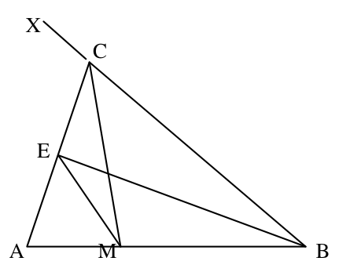{ width=200px }

16. zīm.

Tad $\dfrac{AE}{EC}=\dfrac{AB}{BC}=\dfrac{AM}{MC}$. Tāpēc $ME$ ir leņķa $AMC$ bisektrise. Tātad $E$ atrodas vienādos attālumos no $AB$, $CM$, $BC$, tātad atrodas uz leņķa $XCM$ bisektrises.

Tātad $\angle BCA>\angle MCA=\angle XCA$; no šejienes seko, ka leņķis $BCA$ ir plats.

# <lo-sample/> LV.SOL.1993.12.4

Katram no skaitļiem $m$ un $n$ aprēķināja tā visu pozitīvo dalītāju reizinājumu; šie reizinājumi izrādījās vienādi. Pierādīt, ka $m=n$.

<small>
   
* questionType:
* domain:
   
</small>

## Atrisinājums

Apzīmēsim naturāla skaitļa $x$ visus pozitīvos dalītājus ar $d_1<d_2<\ldots<d_k$, bet to reizinājumu ar $r(x)$. Ievērosim, ka $x=d_1 \cdot d_k=d_2 \cdot d_{k-1}=\ldots$ no šejienes iegūstam formulu

$$
r^2(x)=(d_1\cdot d_k)\cdot(d_2\cdot d_{k-1})\cdot\ldots\cdot(d_k\cdot d_1)=x^k.
$$

Dots, ka $r(n)=r(m)$. Tātad eksistē tādi naturāli $p$ un $q$, ka

$$
n^p=m^q.
$$

Varam uzskatīt, ka $p\geq q$. Tad $m^q=n^p:n^q\Rightarrow m:n$.

Ja $m$ dalās ar $n$ un nav vienāds ar $n$, tad, acīmredzami, $m$ dalītāju reizinājums ir lielāks par $n$ dalītāju reizinājumu. Tātad $m=n$.

# <lo-sample/> LV.SOL.1993.12.5

Rūķīšu ziemassvētku ballē katri divi rūķīši sasveicinās, vai nu pamājot viens otram, vai sarokojoties, vai saskūpstoties, vai apkampjoties. Do saskūpstījās ar Mo, bet nesaskūpstījās ar Lo. Lai kurus trīs rūķīšus mēs izvēlētos, tie vai nu visi savā starpā sasveicinās vienā veidā, vai arī visas trīs sasveicināšanās ir dažāda veida. Parādiet, ka ballē varēja piedalīties $9$ rūķīši.

<small>
   
* questionType:
* domain:
   
</small>

## Atrisinājums

Lūk piemērs, kad ballē ir $9$ rūķīši. Apzīmēsim rūķīšus ar burtiem un izvietosim tos kvadrātā $3\times 3$.

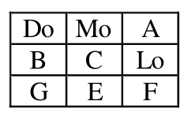{ width=100px }

Rūķīši vienā rindiņā saskūpstās.

Rūķīši vienā kolonnā samājas.

Rūķīši kopās $\{\mathrm{Do}, C, F\}$, $\{\mathrm{Mo}, \mathrm{Lo}, G\}$, $\{A, B, E\}$ sarokojas.

Rūķīši kopās $\{A, C, G\}$, $\{\mathrm{Mo}, B, F\}$, $\{\mathrm{Do}, E, \mathrm{Lo}\}$ apkampjas.

Viegli pārbaudīt, ka visi uzdevuma nosacījumi izpildās.
