# <lo-sample/> LV.SOL.1994.5.1

No divām vienādām figūrām nogrieza pa vienādam gabalam. Vai var gadīties, ka pārpalikumi nav vienādi?

<small>
   
* questionType:
* domain:
   
</small>

## Atrisinājums

Jā, var. Piemēram, ņemam divus kvadrātus no $3 \cdot 3$ rūtiņām; pirmajam izgriežam stūra rūtiņu, bet otrajam – malas vidējo rūtiņu. Protams, ka iegūtās figūras nav vienādas.

# <lo-sample/> LV.SOL.1994.5.2

Vai desmit pēc kārtas ņemtu naturālu skaitļu summa var būt

a) $1000$;

b) $111111$;

c) $1045$?

<small>
   
* questionType:
* domain:
   
</small>

## Atrisinājums

a) Nē. No desmit pēc kārtas ņemtiem skaitļiem tieši $5$ ir nepāra skaitļi; tātad šo desmit skaitļu summa ir nepāra skaitlis, bet $1000$ ir pāra skaitlis.

b) Nē. Desmit pēc kārtas ņemtu skaitļu pēdējie cipari ir visi cipari no $0$ līdz $9$; tātad desmit pēc kārtas ņemtu skaitļu summas pēdējais cipars ir skaitļa
$$
0+1+2+3+4+5+6+7+8+9=45
$$
pēdējais cipars; tātad $5$.

c) Jā: $100+101+102+\cdots 109=1045$.

# <lo-sample/> LV.SOL.1994.5.3

Atrodiet tādus $4$ skaitļus, ka to starpības pa divi (no lielākā skaitļa atņemot mazāko) ir $2, 3, 4, 5, 6, 9$.

Pietiek uzrādīt vienu piemēru.

<small>
   
* questionType:
* domain:
   
</small>

## Atrisinājums

Tādi, piemēram, ir skaitļi $1$, $4$, $6$, $10$.

# <lo-sample/> LV.SOL.1994.5.4

Vai vari pa apli uzrakstīt naturālos skaitļus no $1$ līdz $1000$ (katru vienu reizi) tādā kārtībā, ka starp katriem pieciem pēc kārtas uzrakstītiem skaitļiem vismaz divi dalās ar $3$?

<small>
   
* questionType:
* domain:
   
</small>

## Atrisinājums

Nē. Sadalīsim uzrakstītos skaitļus $200$ grupās pa pieciem pēc kārtas ņemtiem skaitļiem. Katrā no grupām jābūt vismaz diviem skaitļiem, kas dalās ar $3$; tātad kopā jābūt vismaz $400$ skaitļiem, kas dalās ar $3$, bet starp pirmajiem $1000$ skaitļiem ir tikai $333$ skaitļi, kas dalās ar $3$.

# <lo-sample/> LV.SOL.1994.5.5

Kvadrāts sastāv no $4 \cdot 4$ rūtiņām. Rūtiņās ierakstīti skaitļi (sk. $1.$ zīm.). Ar vienu gājienu drīkst pieskaitīt pa vieniniekiem divās rūtiņās, kurām ir kopīga mala. Vai var panākt, lai visās rūtiņās skaitļi kļūtu vienādi?

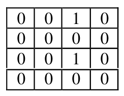{ width=100px }

$1.$ zīm.

<small>
   
* questionType:
* domain:
   
</small>

## Atrisinājums

Nē, nevar. Izkrāsojam rūtiņas šaha galdiņa kārtībā; tad abi vieninieki atrodas uz vienas (teiksim, melnās) krāsas lauciņiem.

Tātad sākumā skaitļu summa, kas atrodas melnajos lauciņos, ir $2$, bet sākumā skaitļu summa, kas atrodas baltajos lauciņos ir nulle. Ar katru gājienu gan melnajās, gan baltajās rūtiņās ierakstīto skaitļu summas palielinās par $1$ katra. Tātad tās nevar kļūt vienādas.

(Ja visi skaitļi vienādi, tad abas summas arī ir vienādas.)

# <lo-sample/> LV.SOL.1994.6.1

Katram naturālam skaitlim no $1$ līdz $1000$ aprēķināja tā ciparu reizinājumu. Cik reizes ieguva nulli?

<small>
   
* questionType:
* domain:
   
</small>

## Atrisinājums

Skaitļu ciparu reizinājums ir nulle, ja kaut viens no tā cipariem ir nulle.

Atradīsim, cik starp pirmajiem $1000$ skaitļiem ir tādu, kuri nesatur ciparu $0$.

Ir $9$ tādi vienciparu skaitļi;

ir $9 \cdot 9=81$ tādi divciparu skaitļi;

ir $9 \cdot 9 \cdot 9=729$ tādi trīsciparu skaitļi.

Kopā šādu skaitļu ir $9+81+729=819$. Pārējie $1000-819=181$ satur nulles.

Tātad nulli ieguva $181$ reizi.

# <lo-sample/> LV.SOL.1994.6.2

Taisnstūris sastāv no vienādām kvadrātiskām rūtiņām. Katrā no tām ierakstīts skaitlis (ne noteikti vesels). Vai var gadīties, ka katrā kolonnā skaitļu reizinājums ir $3$, bet katrā rindiņā – $7$?

<small>
   
* questionType:
* domain:
   
</small>

## Atrisinājums

Nē, nevar. Visu kolonnu reizinājumu reizinājumam jābūt vienādam ar visu rindu reizinājumu reizinājumu (jo tie abi ir vienādi ar visu tabulā ierakstīto skaitļu reizinājumu).

Taču tie nevar būt vienādi, jo pirmais dalās ar $3$, otrais — nē.

# <lo-sample/> LV.SOL.1994.6.3

Kubam augšējā un apakšējā skaldne nokrāsotas ar nežūstošu melnu krāsu. Sākumā kubs atrodas uz melnās rūtiņas (sk. $2.$ zīm.). To ripina pa zīmējumā parādīto ceļu. Kuras rūtiņas vēl nokrāsosies melnas?

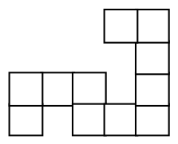{ width=100px }

$2.$zīm.

<small>
   
* questionType:
* domain:
   
</small>

## Atrisinājums

Atbilde parādīta $8$.zīmējumā.

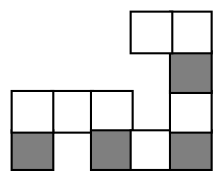{ width=100px }

8.zīm.

# <lo-sample/> LV.SOL.1994.6.4

Ap apaļu galdu sēž $1993$ rūķīši no $4$ ciltīm: voti, šilli, pukki un elfi. Ir zināms, ka voti nesēž blakus ar šilliem un pukki – ar elfiem. Pierādi, ka vienas cilts pārstāvji kaut kur sēž blakus.

<small>
   
* questionType:
* domain:
   
</small>

## Atrisinājums

Pieņemsim pretējo. Palūgsim piecelties kājās votus un šillus. Starp katriem diviem sēdošajiem tagad ir vismaz viena brīva vieta. Tā kā voti un šilli nesēdēja blakus, tad divu brīvu vietu blakus nav. Tāpēc aizņemtās un brīvās vietas atrodas pamīšus; tātad kopā jābūt pāra skaitam vietu. Pretruna.

# <lo-sample/> LV.SOL.1994.6.5

Sešstūra virsotnēs ierakstīti skaitļi, kā parādīts $3.$zīm. Ar vienu gājienu var pieskaitīt pa vieniniekam vai nu abiem vienas (jebkuras) malas galapunktiem, vai divām pretējām virsotnēm (tās savienotas ar pārtrauktām līnijām). Vai, daudzkārt atkārtojot šādus gājienus, var panākt, lai visi skaitļi kļūtu vienādi?

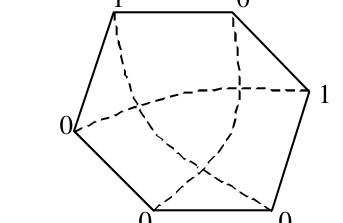{ width=150px }

$3.$ zīm.

<small>
   
* questionType:
* domain:
   
</small>

## Atrisinājums

Nē. Izkrāsojam virsotnes, kā parādīts $9$. zīm. Ar katru gājienu par $1$ palielinās gan melnajās, gan baltajās virsotnēs ierakstīto skaitļu summas. Sākuma melnajās virsotnēs ierakstīto skaitļu summa ir $2$, bet baltajās virsotnēs ierakstīto skaitļu summa ir $0$. Tātad tās nekad nekļūs vienādas, bet, ja visās virsotnēs ierakstītie skaitļi būtu vienādi, tad arī abām summām jābūt vienādām.

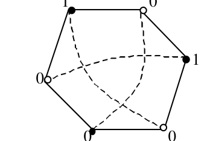{ width=150px }

9. zīm.

# <lo-sample/> LV.SOL.1994.7.1

Plaknē novilktas $5$ taisnes un $1$ riņķa līnija. Vai var gadīties, ka tās sadala plakni tieši $23$ daļās?

<small>
   
* questionType:
* domain:
   
</small>

## Atrisinājums

Jā, var. Piemērs parādīts $10$. zīm.

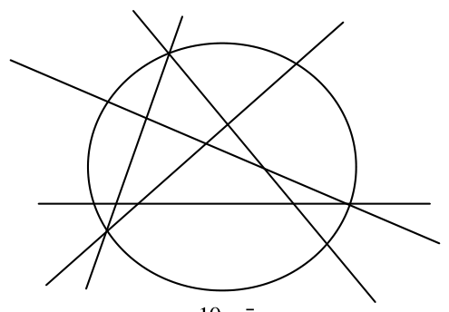{ width=250px }

$10.$ zīm.

# <lo-sample/> LV.SOL.1994.7.2

Kuri no sekojošiem skaitļiem ir pirmskaitļi?  
Pamato savu atbildi:

a) $1395$;

b) $131313$;

c) $1993$;

d) $1991$.

<small>
   
* questionType:
* domain:
   
</small>

## Atrisinājums

a) Nē, jo skaitlis dalās ar $5$.

b) Nē, jo skaitlis dalās ar $13$.

c) Jā, $1993$ ir pirmskaitlis.

d) Nē, jo skaitlis dalās ar $11$.

# <lo-sample/> LV.SOL.1994.7.3

Dots, ka $a, b, c, d$ ir naturāli skaitļi,

$$a+b=c+d=10,$$

$$ac+bd=99.$$

Vai tā var būt?

<small>
   
* questionType:
* domain:
   
</small>

## Atrisinājums

Nē, nevar būt. No dotā seko, ka

$$
\begin{aligned}
a\cdot d+b\cdot c&=(a\cdot d+b\cdot c+a\cdot c+b\cdot d)-(a\cdot c+b\cdot d)=\\
&=(a+b)\cdot(c+d)-(a\cdot c+b\cdot d)=10\cdot 10-99=1.
\end{aligned}
$$

Bet, tā kā doti naturāli skaitļi, tad $a\cdot d+b\cdot c\ge 2$. Iegūta pretruna.

# <lo-sample/> LV.SOL.1994.7.4

Plakne sadalīta kvadrātiņos kā rūtiņu lapa. Vai var katrā rūtiņā ierakstīt tieši vienu no skaitļiem $1$, $2$, $4$, lai katrā tādā figūrā, kāda redzama $4.$ zīm. (tā var būt pagriezta arī citādi), ierakstīto skaitļu summa būtu $8$?

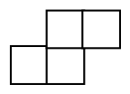{ width=100px }

$4.$ zīm.

<small>
   
* questionType:
* domain:
   
</small>

## Atrisinājums

To var izdarīt, piemēram, tā, kā parādīts $11.$ zīm.

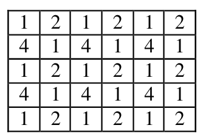{ width=150px }

$11.$ zīm.

# <lo-sample/> LV.SOL.1994.7.5

Ar vienu gājienu atļauts diviem trijstūrīšiem, kam $5.$ zīm. ir kopīga mala, pieskaitīt pa vieniniekiem. Vai, daudzkārt atkārtojot šādus gājienus, var panākt, lai visos trijstūrīšos būtu ierakstīti vienādi skaitļi?

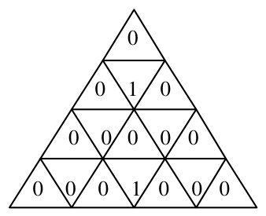{ width=150px }

$5.$ zīm.

<small>
   
* questionType:
* domain:
   
</small>

## Atrisinājums

Nē. Izkrāsojam trijstūrīšus, kā parādīts $12.$ zīm. Ar katru gājienu par $1$ palielinās gan melnajos, gan baltajos trijstūrīšos ierakstīto skaitļu summas. Sākuma melnajos trijstūrīšos ierakstīto skaitļu summa ir $2$, bet baltajos trijstūrīšos ierakstīto skaitļu summa ir $0$. Tātad baltajos trijstūrīšos ierakstīto skaitļu summa nekad nekļūs lielāka par melnajos trijstūrīšos ierakstīto skaitļu summu, bet, ja visās virsotnēs ierakstītie skaitļi būtu vienādi, tad otrajai summai jābūt lielākai (balto trijstūru ir vairāk)

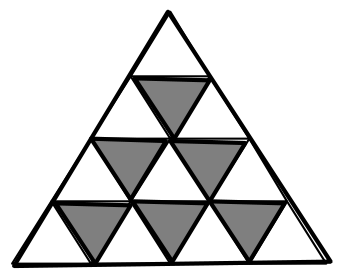{ width=150px }

12. zīm.

# <lo-sample/> LV.SOL.1994.8.1

Dots, ka $\dfrac{x}{y}=\dfrac{9y}{x}$. Kāda var būt $\dfrac{x}{y}$ vērtība?

<small>
   
* questionType:
* domain:
   
</small>

## Atrisinājums

Pārveidojot doto vienādību, iegūstam

$$
\left(\frac{x}{y}\right)^2=9 \quad \Rightarrow \quad \frac{x}{y}\in\{-3,3\}.
$$

Noteikti jāparāda ar piemēriem, ka abas vērtības realizējas.

# <lo-sample/> LV.SOL.1994.8.2

Uzzīmējiet kaut vienu deviņstūri, kam $6$ virsotnes atrodas uz vienas taisnes.

<small>
   
* questionType:
* domain:
   
</small>

## Atrisinājums

Skat., piemēram, 13. zīmējumu.

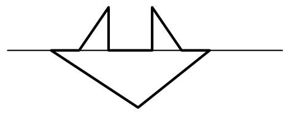{ width=200px }

13. zīm.

# <lo-sample/> LV.SOL.1994.8.3

Desmitstūrim ir $4$ šauri leņķi. Vai var būt, ka visi tā leņķi mazāki par $180^{\circ}$?

<small>
   
* questionType:
* domain:
   
</small>

## Atrisinājums

Nē, nevar. Ja visi desmitstūra leņķi mazāki par $180^{\circ}$, tad desmitstūris ir izliekts, un tā ārējo leņķu summa ir $360^{\circ}$.

Katrā no četrām virsotnēm, kur iekšējais leņķis ir šaurs, ārējais ir lielāks par $90^{\circ}$; tātad kopējā ārējo leņķu summa iznāk lielāka par $360^{\circ}$. Pretruna.

# <lo-sample/> LV.SOL.1994.8.4

Kvadrāts sastāv no $9 \cdot 9$ rūtiņām; katrā rūtiņā ierakstīts skaitlis $1$. Ar vienu gājienu var izvēlēties patvaļīgu $4 \cdot 4$ rūtiņu kvadrātu un visiem skaitļiem tajā pieskaitīt pa skaitlim $1$.

Pierādiet, ka pēc $96$ gājieniem varēs atrast tādu $5 \cdot 5$ rūtiņu kvadrātu, kura četrās stūra rūtiņās ierakstīto skaitļu summa būs tieši $100$.

<small>
   
* questionType:
* domain:
   
</small>

## Atrisinājums

Meklējamā kvadrāta stūra rūtiņas iekrāsotas (skat. 14. zīm.).

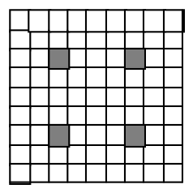{ width=100px }

14. zīm.

Katrā gājienā tiek pieskaitīts $1$ tieši vienai iekrāsotajai rūtiņai; tātad skaitļu summa iekrāsotajās rūtiņās pēc $96$ gājieniem būs $4+96=100$.

# <lo-sample/> LV.SOL.1994.8.5

Pilsētas ielu tīkls veido kvadrātveida režģi, kas sastāv no $8 \cdot 8$ vienādām kvadrātiskām rūtiņām. Katrā no $81$ rūtiņu stūriem ir autobusu pietura; citu pieturu nav.

Kādu vismazāko skaitu autobusa maršrutu jāievieš, lai no katras pieturas varētu aizbraukt uz katru citu, izdarot ne vairāk kā vienu pārsēšanos?

Pa katru maršrutu autobuss kursē abos virzienos; Katrs maršruts drīkst saturēt augstākais vienu pagriezienu.

<small>
   
* questionType:
* domain:
   
</small>

## Atrisinājums

Katrs maršruts iet pa augstākais vienu horizontāli un vienu vertikāli. Ja maršrutu skaits nepārsniedz $8$, tad atrastos vertikāle un horizontāle, pa kurām neiet neviens maršruts; uz šo ielu krustpunktu nevarētu aizbraukt.

Ar $9$ maršrutiem pietiek. Piemēram, var ņemt visus maršrutus, katrs no kuriem satur pilnībā vienu vertikāli un visu augšējās horizontāles daļu pa labi no šīs vertikāles.

# <lo-sample/> LV.SOL.1994.9.1

Vienādojumam $ax^2+bx+c=0$ ir tieši divas dažādas saknes. Cik sakņu var būt vienādojumam $cx^2+bx+a=0$?

<small>
   
* questionType:
* domain:
   
</small>

## Atrisinājums

Ja ņemam vienādojumu $x^2+3x+2=0$, tad otrajam vienādojumam $2x^2+3x+1=0$ arī ir $2$ saknes.

Ja ņemam vienādojumu $x^2+3x+0=0$, tad otrajam vienādojumam $3x+1=0$ ir $1$ sakne.

Citu iespēju nav. Tā kā $a\ne 0$, tad mēs nevaram iegūt vienādojumu, kuram ir bezgalīgi daudz sakņu.

Tā kā abu vienādojumu diskriminanti ir vienādi ar $b^2-4ac$, tad, ja otrajam vienādojumam nebūtu sakņu, to nebūtu arī pirmajam.

Vēl atsevišķi jāaplūko gadījums $c=0$.

# <lo-sample/> LV.SOL.1994.9.2

Vai $(n-1)!$ dalās ar $n$, ja

a) $n=16$,

b) $n=41$,

c) $n=1991$,

d) $n=1993$?

<small>
   
* questionType:
* domain:
   
</small>

## Atrisinājums

a) Jā, jo $16=2\cdot 8$ un $15!$ satur abus šos reizinātājus.

b) Nē, jo $41$ ir pirmskaitlis, bet $40!$ nesatur pirmreizinātājus, lielākus par $40$.

c) Jā, jo $1991=11\cdot 181$.

d) Nē, jo $1993$ ir pirmskaitlis.

# <lo-sample/> LV.SOL.1994.9.3

Paralelogramā $ABCD$ ievilkti trijstūri $AMD$ un $CND$ (skat. 6. zīm.).

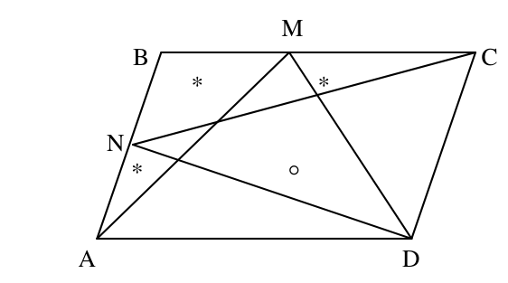{ width=250px }

6. zīm.

Pierādiet, ka ar $*$ apzīmēto laukumu summa vienāda ar tā apgabala laukumu, kas apzīmēts ar $\circ$.

<small>
   
* questionType:
* domain:
   
</small>

## Atrisinājums

Skat. $15.$ zīmējumu.

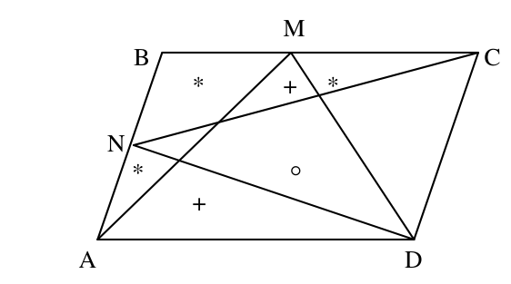{ width=250px }

$15.$ zīm.

Ir spēkā vienādība

$$
S_{AMD}=S_{BCN}+S_{NDA}.
$$

(Abi laukumi ir puse no paralelograma laukuma).

Atņemot divus laukumus, kas atzīmēti ar $+$, iegūsim prasīto vienādību.

# <lo-sample/> LV.SOL.1994.9.4

Aprēķināt izteiksmes vērtību, izsakot to kā decimāldaļskaitli:

$$
\frac{1}{2^{-1993}+1}+\frac{1}{2^{-1992}+1}+\cdots+\frac{1}{2^0+1}+\frac{1}{2^1+1}+\cdots+\frac{1}{2^{1993}+1}.
$$

<small>
   
* questionType:
* domain:
   
</small>

## Atrisinājums

Pierādīsim mums nepieciešamu vienādību

$$
\frac{1}{2^{-a}+1}+\frac{1}{2^a+1}=\frac{1}{\frac{1}{2^a}+1}+\frac{1}{2^a+1}=
$$

$$
\frac{2^a}{2^a+1}+\frac{1}{2^a+1}=1.
$$

Grupējot locekļus pa divi no summas pretējiem galiem, iegūstam $1993$ vieniniekus un vidējo locekli $\dfrac{1}{2^0+1}=\dfrac{1}{2}$.

Tātad meklējamā summa ir vienāda ar $1993,5$.

# <lo-sample/> LV.SOL.1994.9.5

Desmit futbolkomandas katra ar katru spēlēja vienu reizi. Par uzvaru komanda saņem $2$ punktus, par neizšķirtu – $1$ punktu, par zaudējumu – $0$ punktus. "Daugava" ieguva vairāk punktu nekā jebkura cita komanda.

Kāds lielākais zaudējumu skaits varēja būt "Daugavai"?

<small>
   
* questionType:
* domain:
   
</small>

## Atrisinājums

Ja "Daugava" saņēma $x$ punktus, tad visas citas komandas – ne vairāk kā $(x-1)$ punktus. Tā kā kopējais turnīrā izcīnīto punktu skaits ir $90$, tad
$$
x+9(x-1)\ge 90.
$$
No šejienes $x\ge 9,9$. Tā kā $x$ ir vesels skaitlis, tad $x\ge 10$. Tātad "Daugava" varēja zaudēt ne vairāk kā $8$ punktus, t.i. ne vairāk kā $4$ spēles.

Ar piemēru jāparāda, ka tāda situācija ir iespējama.

# <lo-sample/> LV.SOL.1994.10.1

Vai skaitlis $2^{123}+1$ ir pirmskaitlis?

<small>
   
* questionType:
* domain:
   
</small>

## Atrisinājums

Nē, jo $2^{123}+1=\left(2^{41}\right)^3+1^3$ dalās ar $2^{41}+1$.

# <lo-sample/> LV.SOL.1994.10.2

Sekantes $AB$ un $CD$ ir paralēlas un iet caur divu riņķa līniju krustpunktiem (skat. 7. zīm.).

Pierādīt, ka $ABCD$ ir paralelograms.

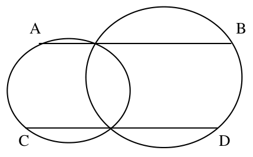{ width=200px }

7. zīm.

<small>
   
* questionType:
* domain:
   
</small>

## Atrisinājums

Skat. 16. zīm.

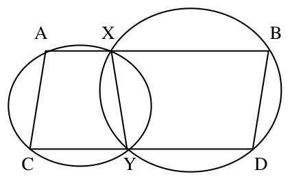{ width=200px }

16. zīm.

Apzīmējam riņķa līniju krustpunktus ar $X$ un $Y$. Tad $AXYC$ un $YXBD$ ir riņķa līnijā ievilktas trapeces, tātad vienādsānu. No šejienes seko, ka
$$
\angle CAX=\angle AXY=180^{\circ}-\angle YXB=\angle BDY.
$$
Tātad $BA\parallel CD$, un $ABDC$ ir paralelograms.

# <lo-sample/> LV.SOL.1994.10.3

Dots, ka $ax=by=cz=10$; visi $6$ skaitļi $a,\ldots,z$ ir pozitīvi.

Pierādiet, ka

$$
(a+b+c)(x+y+z)\ge 90.
$$

<small>
   
* questionType:
* domain:
   
</small>

## Atrisinājums

No nevienādības par vidējo aritmētisko un vidējo ģeometrisko seko, ka
$$
(a+b+c)\cdot(x+y+z)\ge
$$
$$
3\cdot\sqrt[3]{abc}\cdot 3\cdot\sqrt[3]{xyz}=
$$
$$
9\cdot\sqrt[3]{(ax)\cdot(by)\cdot cz}=
$$
$$
9\cdot\sqrt[3]{10\cdot 10\cdot 10}=90.
$$

# <lo-sample/> LV.SOL.1994.10.4

Uzzīmējiet plaknē $8$ punktus tā, lai nekādi trīs no tiem neatrastos uz vienas taisnes un nekādi pieci nebūtu izliekta piecstūra virsotnes.

Pietiek ar vienu piemēru.

<small>
   
* questionType:
* domain:
   
</small>

## Atrisinājums

Skat., piemēram, 17. zīm.

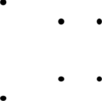{ width=100px }

$17$. zīm.

# <lo-sample/> LV.SOL.1994.10.5

Klasē ir $n$ ($n\ge 2$) skolēnu; daži no tiem draudzējas. Ja divi skolēni nedraudzējas savā starpā, tad var atrast trešo, kas draudzējas ar tiem abiem.

Kāds ir mazākais iespējamais draudzību skaits?

(Uzskatām, ka katrs draugu pāris veido vienu draudzību, pārus $AB$ un $BA$ uzskatām par vienu un to pašu pāri.)

<small>
   
* questionType:
* domain:
   
</small>

## Atrisinājums

Ir iespējams, ka ir $(n-1)$ draudzība. Piemēram, ja viens skolēns draudzējas ar visiem pārējiem, tad uzdevuma nosacījumi izpildās.

Pierādīsim, ka tas ir mazākais iespējamais draudzību skaits. Ņemsim vienu skolēnu $A$. Pieņemsim, ka tas draudzējas ar $B_1, B_2, \ldots, B_k$.

Ja $k=n-1$, tad draudzību skaits ir ne mazāks par $(n-1)$.

Ja $k<n-1$, tad katram skolēnam $X$ no pārējiem $n-(k+1)$ skolēniem, kas nedraudzējas ar $A$, jādraudzējas ar kādu no $B_i$ (tikai šie skolēni var būt tie, kas draudzējas gan ar $A$, gan ar $X$). Tātad pavisam kopā ir ne mazāk par $k+n-(k+1)=n+1$ draudzībām.

# <lo-sample/> LV.SOL.1994.11.1

Izliektā četrstūrī $ABCD$ zināms, ka $\angle ABD = \angle ACD$.

Pierādiet, ka $\angle BCA = \angle BDA$.

<small>
   
* questionType:
* domain:
   
</small>

## Atrisinājums

Skat. $18$. zīm.

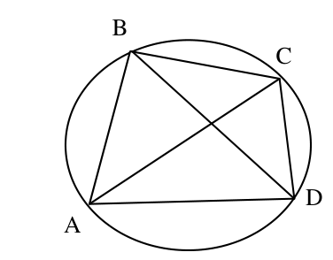{ width=200px }

$18$. zīm.

No dotā seko, ka ap $ABCD$ var apvilkt riņķa līniju. Tātad $\angle BCA=\angle BDA$, kā ievilktie leņķi, kas balstās uz viena loka.

# <lo-sample/> LV.SOL.1994.11.2

Dots, ka $n$ – naturāls skaitlis un $n - 3$ dalās ar $5$.

Kuri no sekojošiem skaitļiem dalās ar $5$:

a) $n - 198$,

b) $n^2 - 1$,

c) $n^2 + 1$?

<small>
   
* questionType:
* domain:
   
</small>

## Atrisinājums

Dots, ka $n=5k+3$. Tātad

a) $n-198=5k-195$ dalās ar $5$;

b) $n^2-1=5k^2+30n+8$ nedalās ar $5$,

c) $n^2+1=5k^2+30n+10$ dalās ar $5$.

# <lo-sample/> LV.SOL.1994.11.3

Pierādiet, ka katram naturālam $n$ pastāv nevienādība

$$
n^n \ge 2^{n-1}\cdot n!
$$

<small>
   
* questionType:
* domain:
   
</small>

## Atrisinājums

Uzrakstīsim nevienādību starp vidējo aritmētisko un vidējo ģeometrisko skaitļiem $1, 2, \ldots, n-1$:

$$
\frac{1+2+\cdots+(n-1)}{n-1}\ge \sqrt[n-1]{1\cdot 2\cdot \ldots \cdot (n-1)}\Rightarrow
$$

$$
\frac{(n-1)\cdot n}{2\cdot(n-1)}\ge \sqrt[n-1]{(n-1)!}\Rightarrow \frac{n^{n-1}}{2^{n-1}}\ge (n-1)!\Rightarrow
$$

$$
n^{n-1}\cdot n\ge 2^{n-1}\cdot (n-1)!\cdot n\Rightarrow n^n\ge 2^{n-1}\cdot n!
$$

Prasītā nevienādība pierādīta.

# <lo-sample/> LV.SOL.1994.11.4

Izliektā piecstūrī katra no četrām diagonālēm paralēla savai piecstūra malai.

Pierādiet, ka arī piektā diagonāle paralēla kādai malai.

<small>
   
* questionType:
* domain:
   
</small>

## Atrisinājums

Skat. $19.$ zīm.

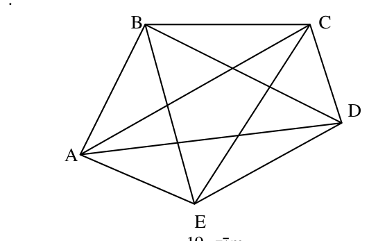{ width=250px }

$19.$ zīm.

Dotas paralelitātes

$$
AB\parallel CE,\quad BC\parallel AD,\quad CD\parallel BE,\quad DE\parallel AC.
$$

No tām seko atbilstošas trijstūru laukumu vienādības:

$$
S_{AEB}=S_{ABC},\quad S_{ABC}=S_{BCD},\quad S_{BCD}=S_{CDE},\quad S_{CDE}=S_{DEA}.
$$

Tātad $S_{AEB}=S_{AED}$. No šīs trijstūru vienādības seko, ka trijstūriem ir vienādi augstumi; tātad $AE\parallel BD$.

# <lo-sample/> LV.SOL.1994.11.5

Klasē ir $n$ ($n \ge 4$) skolēnu; daži no tiem draudzējas. Ja divi skolēni nedraudzējas savā starpā, tad klasē var atrast vismaz $2$ citus skolēnus kas draudzējas ar tiem abiem.

Kāds ir mazākais iespējamais draudzību skaits?

(Uzskatām, ka katrs draugu pāris veido vienu draudzību, pārus $AB$ un $BA$ uzskatām par vienu un to pašu pāri.)

<small>
   
* questionType:
* domain:
   
</small>

## Atrisinājums

Attēlosim skolēnus ar punktiem, bet draudzēšanos ar līnijām. Kā redzams $20.$ zīm., meklējamais skaits var būt $2n-4$.

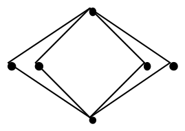{ width=150px }

$20.$ zīm.

Viegli saprast, ka katrs skolēns draudzējas vismaz ar $2$ citiem. Ja katrs draudzētos vismaz ar $4$ citiem, tad draudzību skaits būtu ne mazāks par $\frac{4n}{2}=2n$.

Ja ir skolēns $X$, kas draudzējas tikai ar diviem citiem (teiksim, ar $A$ un $B$). tad $A$ un $B$ ir vienīgie, kas var sasaistīt $X$ ar katru no $(n-3)$ atlikušajiem skolēniem; tāpēc draudzību nav mazāk par $2+2(n-3)=2n-4$.

Līdzīgi gadījumā, ja $X$ draudzējas ar $3$ citiem skolēniem $A$, $B$, $C$, draudzību nav mazāk par $3+2(n-4)=2n-5$. Tomēr draudzību skaits varētu nepārsniegt $2n-5$ tikai tad, ja $n-4$ pārējie skolēni savā starpā nedraudzējas un ar katru no viņiem draudzējas tieši $2$ no skolēniem $A$, $B$, $C$. Pieņemsim, ka ir skolēns $R$, ar kuru draudzējas $A$ un $B$, un skolēns $S$, ar kuru draudzējas $B$ un $C$. Tad priekš $R$ un $S$ nav uzdevumā minēto divu kopīgo draugu. Tāpēc visi $n-4$ "pārējie" skolēni draudzējas ar vieniem un tiem pašiem diviem no $A$, $B$, $C$. Bet tādā gadījumā atlikušajam no šiem trim skolēniem ir tikai viens draugs; tā ir pretruna.

# <lo-sample/> LV.SOL.1994.12.1

Dots, ka $\sin x = \sin y$ un $\sin 2x = \sin 2y$. Pierādīt, ka

$\sin 1993x = \sin 1993y$.

<small>
   
* questionType:
* domain:
   
</small>

## Atrisinājums

Ja $\sin x=\sin y=0$, tad $\sin nx=\sin ny=0$, un prasītais pierādīts.

Ja $\sin x=\sin y\ne 0$, tad no vienādības

$$
\sin 2x=\sin 2y \quad \Longleftrightarrow \quad 2\sin x\cos x=2\sin x\cos y
$$

seko, ka $\cos x=\cos y$. Tātad $y=x+2\pi k$; bet tādā gadījumā

$$
\sin 1993y=\sin(1993x+2\pi k\cdot 1993)=\sin 1993x.
$$

# <lo-sample/> LV.SOL.1994.12.2

Atrodiet visu tādu četrciparu skaitļu summu, kam pirmais cipars vienāds ar pēdējo, bet otrais – ar trešo.

<small>
   
* questionType:
* domain:
   
</small>

## Atrisinājums

Šī summa ir vienāda ar

$$
10\cdot(1+2+\cdots+9)\cdot1001+9\cdot(1+2+\cdots9)\cdot110=495000.
$$

# <lo-sample/> LV.SOL.1994.12.3

Trijstūra iekšpusē ņemts punkts. Pierādīt, ka tā attālumu summa līdz malām nav mazāka par trijstūra mazāko augstumu un nav lielāka par trijstūra lielāko augstumu.

<small>
   
* questionType:
* domain:
   
</small>

## Atrisinājums

Dotā punkta attālumus līdz trijstūra malām apzīmēsim ar $d_1,d_2,d_3$ un atbilstošās trijstūra malas ar $a_1,a_2,a_3$. Tad trijstūra laukumu var aprēķināt pēc šādām formulām:

$$
S=\frac{1}{2}a_{\min}h_{\max}=\frac{1}{2}a_{\max}h_{\min}=\frac{1}{2}(a_1d_1+a_2d_2+a_3d_3).
$$

Tātad

$$
a_{\max}h_{\min}=a_1d_1+a_2d_2+a_3d_3\le(d_1+d_2+d_3)\cdot a_{\max}\Rightarrow
$$

$$
h_{\min}\le(d_1+d_2+d_3).
$$

Līdzīgi

$$
a_{\min}h_{\max}=a_1d_1+a_2d_2+a_3d_3\ge(d_1+d_2+d_3)\cdot a_{\min}\Rightarrow
$$

$$
h_{\max}\ge(d_1+d_2+d_3).
$$

# <lo-sample/> LV.SOL.1994.12.4

Vai eksistē izliekts daudzskaldnis ar divdesmit piecām skaldnēm, kas visas ir četrstūri?

<small>
   
* questionType:
* domain:
   
</small>

## Atrisinājums

Jā eksistē. Piemēram, saliekam ar pamatiem kopā divas vienādas regulāras $10$-stūra piramīdas un izveidojam mazus četrstūrveida šķēlumus pie katras otrās "pamatu gredzena" virsotnes.

# <lo-sample/> LV.SOL.1994.12.5

Klasē ir $n$ ($n \ge 4$) skolēnu; daži no tiem draudzējas. Katriem diviem skolēniem var atrast trešo, kas draudzējas ar tiem abiem. Kāds ir mazākais iespējamais draudzību skaits?

(Uzskatām, ka katrs draugu pāris veido vienu draudzību, pārus $AB$ un $BA$ uzskatām par vienu un to pašu pāri.).

<small>
   
* questionType:
* domain:
   
</small>

## Atrisinājums

Kā redzams $21$. zīm., draudzību skaits var būt $n-1+\left[\dfrac{n}{2}\right]$.

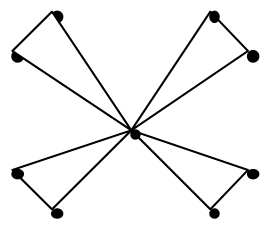{ width=150px }

$n=2k$

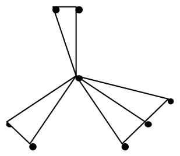{ width=150px }

$n=2k+1$

21. zīm.

Šķirojam divas iespējas.

1) Ja katrs skolēns draudzējas ar vismaz $3$ citiem, tad draudzību skaits nav mazāks par
$$
\frac{3n}{2}>n-1+\left[\frac{n}{2}\right].
$$

2) Eksistē tāds skolēns $A$, kas draudzējas tikai ar diviem citiem $B$ un $C$. Tad $B$ draudzējas ar $C$ (lai apkalpotu pārus $AB$ un $AC$). Katram no pārējiem skolēniem jādraudzējas vai nu ar $B$, vai $C$ (lai būtu apkalpots pāris $AX$). Atzīmēsim katram no pārējiem skolēniem vienu minēto draudzību ar $B$ vai $C$. Lai apkalpotu pārus $BX$ un $CX$, katram no pārējiem (bez $A$, $B$, $C$) jābūt vēl vienai draudzībai; to skaits nav mazāks par $\frac{n-3}{2}$, t.i., nav mazāks par $\left[\frac{n-2}{2}\right]$. Kopā draudzību nav mazāk par
$$
3+(n-3)+\left[\frac{n-2}{2}\right]=n-1+\left[\frac{n}{2}\right].
$$
