# <lo-sample/> LV.SOL.1995.5.1

Ar kādu ciparu beidzas reizinājums

$$11 \cdot 12 \cdot 13 \cdot 14 \cdot 15 \cdot 16 \cdot 17 \cdot 18 \cdot 19 \cdot 20 \cdot 21 \cdot 22 \cdot 23\ ?$$

<small>
   
* questionType:
* domain:
   
</small>

## Atrisinājums

Šis reizinājums dalās ar $10$; tātad tā pēdējais cipars ir $0$.

# <lo-sample/> LV.SOL.1995.5.2

Vai zvaigznīšu vietā (skat. 1. zīmējumu) var ierakstīt pa naturālam skaitlim (daži no tiem var būt arī vienādi) tā, lai katru četru pēc kārtas uzrakstītu skaitļu summa būtu $15$?

$$5\ \ast\ \ast\ \ast\ \ast\ \ast\ \ast\ \ast\ \ast\ \ast\ \ast\ \ast\ 6$$

1. zīm.

<small>
   
* questionType:
* domain:
   
</small>

## Atrisinājums

Nē, nevar. Aplūkosim pirmos $5$ skaitļus: $5$, $a$, $b$, $c$, $d$. Tad

$$5+a+b+c=a+b+c+d=15 \quad \Rightarrow \quad d=5.$$

Līdzīgi pierāda, ka visiem pasvītrotajiem skaitļiem ir jābūt vienādiem ar $5$; taču pēdējais pasvītrotais skaitlis nav $5$; pretruna.

{ width=100px }

7. zīm.

# <lo-sample/> LV.SOL.1995.5.3

Kuras no 2. zīmējumā attēlotajām figūrām var sagriezt $3$ vienādās daļās? Griezumiem jāiet pa rūtiņu līnijām.

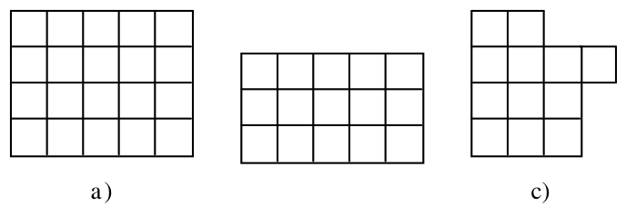{ width=300px }

a)

b)

c)

2. zīm.

<small>
   
* questionType:
* domain:
   
</small>

## Atrisinājums

a) Nē, nevar; rūtiņu skaits nedalās ar $3$.

b) Var. Skat. 8. zīm.

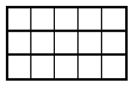{ width=100px }

8. zīm.

c) Var. Skat. 9. zīm.

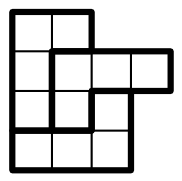{ width=100px }

9. zīm.

# <lo-sample/> LV.SOL.1995.5.4

Uz tāfeles uzrakstīti skaitļi $1, 2, 3, \ldots, 19, 20$. Ar vienu gājienu var izvēlēties jebkurus divus no tiem un abiem pieskaitīt vieninieku. Vai, atkārtojot šādus gājienus, var panākt, lai visi skaitļi kļūtu vienādi?

<small>
   
* questionType:
* domain:
   
</small>

## Atrisinājums

Jā, var. Vispirms izpildām gājienus ar skaitļu pāriem $(1,3)$, $(5,7)$, ..., $(17,19)$. Iegūstam skaitļus $2,2,4,4,6,6,\ldots,20,20$. Tālāk katru vienādo skaitļu pāri ar vairākiem gājieniem papildinām līdz skaitlim $20$.

# <lo-sample/> LV.SOL.1995.5.5

Kvadrāts sastāv no $10 \times 10$ rūtiņām. Desmit rūtiņas ievilkts pa krustiņam tā, ka katrā rindā un katrā kolonnā ir tieši viens krustiņš. Tālāk kvadrāts sadalīts četros $5 \times 5$ rūtiņu kvadrātos (skat. 3. zīm.).

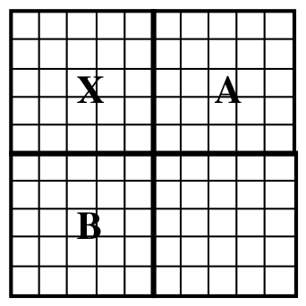{ width=150px }

3. zīm.

Pierādīt, ka daļās $A$ un $B$ ir vienāds skaits krustiņu. Vai tas var būt $1$ katrā no daļām $A$ un $B$?

<small>
   
* questionType:
* domain:
   
</small>

## Atrisinājums

Skat 10. zīm.

{ width=150px }

10. zīm.

Ja daļā $A$ ir $n$ krustiņi, tad daļā $X$ ir $5-n$ krustiņu (jo $5$ augšējās horizontālēs to kopā ir $5$). Aplūkojot vertikāles, konstatējam, ka daļā $B$ ir $5-(5-n)=n$ krustiņi.

Var būt, ka $n=1$, skat. 11. zīm.

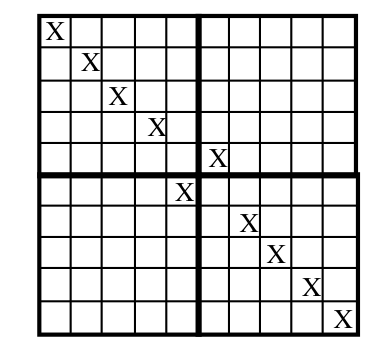{ width=150px }

11. zīm.

# <lo-sample/> LV.SOL.1995.6.1

Summā $12345+67890$ katrā saskaitāmajā ievietot decimālo komatu tā, lai iegūtā summas vērtība pārsniegtu $700$, bet būtu mazāka par $1000$. Atrodiet visas iespējas un pierādiet, ka citu nav.

<small>
   
* questionType:
* domain:
   
</small>

## Atrisinājums

Vienīgā iespēja ir šāda: $123{,}45+678{,}90$. Ar nelielu pārlasi var pārliecināties, ka citu atrisinājumu nav.

# <lo-sample/> LV.SOL.1995.6.2

Parādīt, ka $8\cdot 8$ rūtiņu kvadrātu var sagriezt $12$ dažādos taisnstūros. Pietiek uzrādīt vienu veidu, kā to izdarīt. Griezumiem jāiet pa rūtiņu līnijām.

<small>
   
* questionType:
* domain:
   
</small>

## Atrisinājums

To var izdarīt, piemēram, tā, kā parādīts 12. zīmējumā.

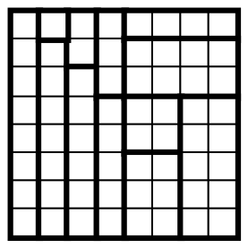{ width=150px }

12. zīm.

# <lo-sample/> LV.SOL.1995.6.3

Virknē izrakstīti $1994$ cipari. Katru divu blakus uzrakstītu ciparu veidotais skaitlis dalās vai nu ar $19$, vai ar $21$.

Pirmais cipars ir $7$. Kāds ir pēdējais?

<small>
   
* questionType:
* domain:
   
</small>

## Atrisinājums

Divciparu skaitļi, kas dalās ar $19$ ir $19$, $38$, $57$, $76$, $95$;

Divciparu skaitļi, kas dalās ar $21$ ir $21$, $42$, $63$, $84$.

Tāpēc virkne ir viennozīmīgi noteikta ar periodu $(7, 6, 3, 8, 4, 2, 1, 9, 5)$. Tā kā $1994=221\cdot 9+5$, tad meklējamais cipars ir $4$.

# <lo-sample/> LV.SOL.1995.6.4

Uz tāfeles uzrakstīti skaitļi $1$, $2$, $3$, $4$, $5$, $6$, $7$, $8$, $9$, $10$. Ar vienu gājienu var izvēlēties jebkurus divus no tiem un abiem pieskaitīt vieninieku. Vai, atkārtojot šādus gājienus, var panākt, lai visi skaitļi kļūtu vienādi?

<small>
   
* questionType:
* domain:
   
</small>

## Atrisinājums

Nē, nevar. Šāda gājiena rezultātā visu skaitļu summa pieaug par $2$. Sākumā šī summa ir vienāda ar $55$ (nepāra skaitlis). Ja visi skaitļi kļūs vienādi, tad šo skaitļu summa $6x$ būs pāra skaitlis; bet tas nav iespējams.

# <lo-sample/> LV.SOL.1995.6.5

Kvadrāts sastāv no $10\cdot 10$ rūtiņām (skat. 4. zīm.).

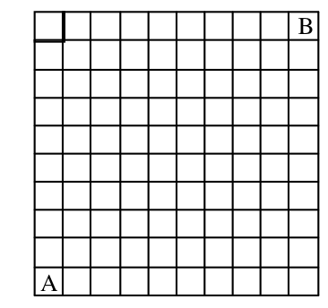{ width=150px }

4. zīm.

No rūtiņas $A$ vienlaicīgi iziet vairāki rūķīši un, virzoties tikai uz augšu un pa labi, aiziet uz rūtiņu $B$. Katrā no pārējām $98$ rūtiņām atrodas pa dārgakmenim. Kāds mazākais rūķīšu skaits pietiekams, lai viņi pa ceļam varētu savākt visus dārgakmeņus?

<small>
   
* questionType:
* domain:
   
</small>

## Atrisinājums

$13.$ zīm. redzams, ka $10$ rūķīši var savākt visus dārgakmeņus.

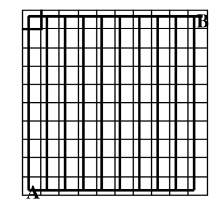{ width=150px }

13. zīm.

Mazāk rūķīšu būt nevar, jo caur katru no $10$ rūtiņām, kas atrodas uz otras diagonāles (skat. $14.$ zīm.) jāiet citam rūķītim.

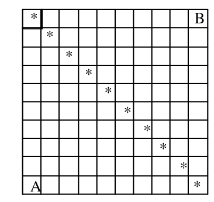{ width=150px }

14. zīm.

# <lo-sample/> LV.SOL.1995.7.1

Parādīt, ka var izvēlēties $8$ skaitļus tā, lai no to summām pa divi tieši sešas būtu negatīvas, bet pārējās – pozitīvas. Pietiek parādīt vienu veidu, kā to izdarīt.

<small>
   
* questionType:
* domain:
   
</small>

## Atrisinājums

Var izvēlēties, piemēram, šādus skaitļus $-1$, $-2$, $-3$, $-4$, $20$, $21$, $21$, $23$. Lai summa iegūtu negatīvu skaitli jāizvēlas divi no četriem negatīviem skaitļiem. Tādu pāru skaits ir $6$.

# <lo-sample/> LV.SOL.1995.7.2

Dots, ka $a$ un $b$ ir divi naturāli skaitļi. Vai var būt, ka to lielākais kopējais dalītājs ir $32$, bet to mazākais kopīgais dalāmais ir $1200$?

<small>
   
* questionType:
* domain:
   
</small>

## Atrisinājums

Nē, nevar būt. Divu skaitļu mazākais kopīgais dalāmais dalās ar katru no dotajiem skaitļiem, tātad dalās arī ar to lielāko kopīgo dalāmo; bet $1200$ nedalās ar $32$.

# <lo-sample/> LV.SOL.1995.7.3

Kvadrātiska režģa veidā izvietoti $16$ punkti (skat. 5. zīm.).

{ width=100px }

5. zīm.

Pierādīt, ka tos visus var pārsvītrot, novelkot slēgtu līniju, kas sastāv no $6$ taisniem posmiem (līniju velkot, zīmuli nedrīkst atraut no papīra; pa vienu un to pašu taisnas līnijas gabalu nedrīkst vilkt divas vai vairāk reizes). Pietiek parādīt vienu veidu, kā to izdarīt.

<small>
   
* questionType:
* domain:
   
</small>

## Atrisinājums

Skat., piemēram, $15.$ zīm.

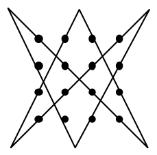{ width=100px }

$15.$ zīm.

# <lo-sample/> LV.SOL.1995.7.4

Kvadrāts sastāv no $4 \cdot 4$ rūtiņām. Vai rūtiņās var ierakstīt naturālus skaitļus no $1$ līdz $16$ (katrā rūtiņā – citu skaitli) tā, lai kolonnās un rindiņās ierakstīto skaitļu summas būtu $8$ viens otram sekojoši naturāli skaitļi?

<small>
   
* questionType:
* domain:
   
</small>

## Atrisinājums

Nē, nevar. Ievērojam, ka $1+2+\cdots+16=136$; tāpēc visu rindiņu un visu kolonnu summa būtu $136\cdot 2=272$. Bet $8$ pēc kārtas ejošu naturālu skaitļu summa nevar būt vienāda ar $272$, jo $30+31+\cdots+37<272$, bet $31+32+\cdots+38>272$.

# <lo-sample/> LV.SOL.1995.7.5

Rūtiņu burtnīcas lapā katra rūtiņa nokrāsota balta vai melna. Zināms, ka katrā kvadrātā $3 \cdot 3$ rūtiņas ir vismaz $7$ melnas rūtiņas. Pierādīt, ka var atrast $2 \cdot 2$ rūtiņu kvadrātu, kurā visas rūtiņas ir melnas.

<small>
   
* questionType:
* domain:
   
</small>

## Atrisinājums

Aplūkosim rūtiņu lapā kvadrātu ar izmēriem $6\times 6$ rūtiņas. To var sadalīt $4$ kvadrātos ar izmēriem $3\times 3$ rūtiņas; katrā no tiem ir vismaz $7$ melnas rūtiņas, tātad lielajā kvadrātā ir vismaz $28$ melnas rūtiņas.

Kvadrātu ar izmēriem $6\times 6$ rūtiņas sadalīsim $9$ kvadrātos ar izmēriem $2\times 2$ rūtiņas. Ja nevienā no tiem nebūtu nokrāsotas visas $4$ rūtiņas, tad melno rūtiņu skaits lielajā kvadrātā nepārsniegtu $9\cdot 3=27$; pretruna. Tātad vismaz vienam no šiem kvadrātiem ar izmēriem $2\times 2$ visas rūtiņas ir melnas.

# <lo-sample/> LV.SOL.1995.8.1

Vai var uzzīmēt $6$ punktus, no kuriem nekādi trīs neatrodas uz vienas taisnes, un novilkt $9$ nogriežņus ar galapunktiem šajos punktos, lai nerastos neviens trijstūris, kam visas virsotnes ir kādi no šiem $6$ punktiem?

<small>
   
* questionType:
* domain:
   
</small>

## Atrisinājums

Jā, var. Skat., piemēram, $16.$ zīm.

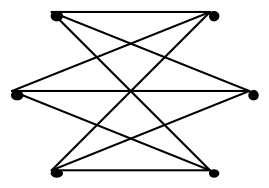{ width=150px }

$16.$ zīm.

# <lo-sample/> LV.SOL.1995.8.2

Naturāla skaitļa $x$ ciparu summa ir $y$; skaitļa $y$ ciparu summa ir $x$. Pierādīt, ka $x = y$.

<small>
   
* questionType:
* domain:
   
</small>

## Atrisinājums

Apzīmēsim skaitļa $n$ ciparu summu ar $S(n)$. Ja skaitlis $n$ satur vairāk nekā $1$ ciparu, tad $S(n)<n$. Tiešām
$$
n=\overline{a_k\ldots a_1a_0}=a_k\cdot 10^k+\cdots+a_1\cdot 10^1+a_0\cdot 10^0>a_k+\cdots+a_1+a_0.
$$
Tātad, ja $x$ satur vairāk nekā $1$ ciparu, tad $x=S(y)\leq y=S(x)<x$. Tātad $x$ ir viencipara skaitlis. Protams, ka tādā gadījumā $y=S(x)=x$.

# <lo-sample/> LV.SOL.1995.8.3

Pierādīt, ka $3^{100} + 4$ nav pirmskaitlis.

<small>
   
* questionType:
* domain:
   
</small>

## Atrisinājums

Šo skaitli var sadalīt reizinātājos, kas ir lielāki par $1$:

$$
\begin{aligned}
3^{100}+4&=\left(3^{25}\right)^4+4\cdot\left(3^{25}\right)^2+4-4\cdot\left(3^{25}\right)^2=\\
&=\left(3^{50}+2\right)^2-\left(2\cdot3^{25}\right)^2=\\
&=\left(3^{50}-2\cdot3^{25}+2\right)\cdot\left(3^{50}+2\cdot3^{25}+2\right).
\end{aligned}
$$

# <lo-sample/> LV.SOL.1995.8.4

Pa apli izrakstīti $99$ skaitļi. Katru triju pēc kārtas uzrakstītu skaitļu summa ir pozitīva. Kāds lielākais daudzums negatīvu skaitļu var būt starp uzrakstītajiem skaitļiem?

<small>
   
* questionType:
* domain:
   
</small>

## Atrisinājums

Var izrakstīt $66$ negatīvus skaitļus $33$ reizes pēc kārtas rakstot skaitļu grupu $(-1,-1,10)$.

Pierādīsim, ka nevar uzrakstīt vairāk par $66$ negatīviem skaitļiem. Sadalīsim visus $99$ skaitļus $33$ grupās pa trim pēc kārtas ņemtiem skaitļiem. Pieņemsim, ka ir ne mazāk par $67$ negatīviem skaitļiem. Tā kā $67>2\cdot33$, tad kādā no šīm grupām ir $3$ negatīvi skaitļi; tad šo trīs skaitļu summa ir negatīva, bet tas ir pretrunā ar uzdevuma nosacījumiem.

# <lo-sample/> LV.SOL.1995.8.5

Uzzīmētas vairākas riņķa līnijas; nekādas divas no tām nekrustojas un neatrodas viena otras iekšpusē. Pierādīt, ka starp tām var atrast tādu riņķa līniju, kas pieskaras ne vairāk kā $6$ citām.

<small>
   
* questionType:
* domain:
   
</small>

## Atrisinājums

Apskatīsim riņķa līniju ar mazāko rādiusu no visām uzzīmētajām (skat. $17.$ zīm.)

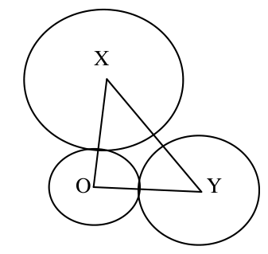{ width=150px }

$17.$ zīm.

Tad $XY\ge OX$ un $XY\ge OY$; tātad $XY$ ir trijstūra $OXY$ garākā mala, un $\angle XOY$ ir trijstūra $OXY$ lielākais leņķis. Tātad $\angle XOY\ge60^{\circ}$; tāpēc šādu leņķu ap punktu $O$ nevar būt vairāk par sešiem.

# <lo-sample/> LV.SOL.1995.9.1

Dots, ka $a + b = 1$. Pierādīt, ka $a^3 + b^3 + 3ab = 1$.

<small>
   
* questionType:
* domain:
   
</small>

## Atrisinājums

Pārveidojot doto izteiksmi, iegūstam:
$$
\begin{aligned}
a^3+b^3+3ab&=(a+b)\cdot(a^2-ab+b^2)+3ab=\\
&=a^2-ab+b^2+3ab=a^2+2ab+b^2=(a+b)^2=1.
\end{aligned}
$$

# <lo-sample/> LV.SOL.1995.9.2

Plaknē uzzīmētas $10$ riņķa līnijas. Pierādīt, ka starp tām var atrast divas, kas pieskaras vienādam skaitam pārējo.

<small>
   
* questionType:
* domain:
   
</small>

## Atrisinājums

Mazākais pieskaršanās punktu skaits vienai riņķa līnijai ir $0$, lielākais — $9$. Tātad pavisam iespējamas $10$ pieskaršanās punktu skaita vērtības $0$, $1$, $2$, ..., $9$. Taču visas šīs vērtības reizē realizēties nevar, jo, ja kāda riņķa līnija nepieskaras nevienai citai (pieskaršanās punktu skaits ir $0$), tad nav riņķa līnijas, kas pieskaras visām pārējām (pieskaršanās punktu skaits ir $9$).

No Dirihlē principa seko, ka starp šīm $10$ riņķa līnijām var atrast divas, kas pieskaras vienādam skaitam pārējo.

# <lo-sample/> LV.SOL.1995.9.3

Vai eksistē $4$ dažādi naturāli skaitļi, kuru summa vienāda ar to reizinājumu?

<small>
   
* questionType:
* domain:
   
</small>

## Atrisinājums

Nē, neeksistē. Ja $a<b<c<d$, tad $b\ge 2$, $c\ge 3$; tāpēc

$$
a+b+c+d<4\cdot d<6\cdot d\le a\cdot b\cdot c\cdot d.
$$

# <lo-sample/> LV.SOL.1995.9.4

Katra no izliekta $4$-stūra diagonālēm sadala to divos trijstūros ar vienādiem laukumiem. Pierādīt, ka šis četrstūris ir paralelograms.

<small>
   
* questionType:
* domain:
   
</small>

## Atrisinājums

Skat. 18. zīm.

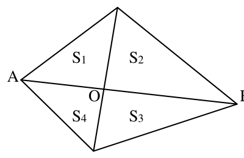{ width=200px }

18. zīm.

No vienādībām $S_1+S_2=S_3+S_4$ un $S_1+S_4=S_2+S_3$ seko, ka

$$
S_1=S_3 \quad \text{un} \quad S_2=S_4.
$$

Trijstūriem ar vienādiem augstumiem laukumi attiecas kā pamati; tāpēc

$$
\frac{S_1}{S_2}=\frac{AO}{OB}=\frac{S_4}{S_3};
$$

No šejienes

$$
S_1^2=S_1\cdot S_3=S_2\cdot S_4=S_2^2 \Rightarrow S_1=S_2 \Rightarrow AO=OB.
$$

Līdzīgi pierāda, ka arī otra diagonāle dalās krustpunktā $O$ uz pusēm. Tātad aplūkojamais četrstūris ir paralelograms.

# <lo-sample/> LV.SOL.1995.9.5

Pierādīt, ka skaitlis

$$(2 + 1) \cdot (2^2 + 1) \cdot (2^4 + 1) \cdot (2^8 + 1) \cdot (2^{16} + 1) + 1$$

ir divnieka pakāpe ar naturālu kāpinātāju.

<small>
   
* questionType:
* domain:
   
</small>

## Atrisinājums

Pareizināsim pirmo saskaitāmo ar $(2-1)$ un atkārtoti pielietosim formulu $(x-y)\cdot(x+y)=x^2-y^2$.

Iegūsim

$$
\begin{aligned}
&(2+1)\cdot(2^2+1)\cdot(2^4+1)\cdot(2^8+1)\cdot(2^{16}+1)+1=\\
&(2-1)\cdot(2+1)\cdot(2^2+1)\cdot(2^4+1)\cdot(2^8+1)\cdot(2^{16}+1)+1=\\
&(2^2-1)\cdot(2^2+1)\cdot(2^4+1)\cdot(2^8+1)\cdot(2^{16}+1)+1=\\
&(2^4-1)\cdot(2^4+1)\cdot(2^8+1)\cdot(2^{16}+1)+1=\\
&(2^8-1)\cdot(2^8+1)\cdot(2^{16}+1)+1=\\
&(2^{16}-1)\cdot(2^{16}+1)+1=\\
&2^{32}-1+1=2^{32}.
\end{aligned}
$$

# <lo-sample/> LV.SOL.1995.10.1

Zināms, ka katram no vienādojumiem

$$x^2+2ax+b^2=0 \qquad \text{un} \qquad x^2+2bx+a^2=0$$

eksistē atrisinājums. Vai noteikti $a=b$?

<small>
   
* questionType:
* domain:
   
</small>

## Atrisinājums

Nē, ne noteikti. Šiem vienādojumiem eksistē atrisinājums, ja to diskriminanti ir nenegatīvi, t.i.

$$
a^2-b^2\ge 0 \quad \text{un} \quad b^2-a^2\ge 0.
$$

Ņemot $a=1$ un $b=-1$, abiem vienādojumiem ir atrisinājumi.

# <lo-sample/> LV.SOL.1995.10.2

Kādiem naturāliem $n$ skaitlis

$$2^n+2$$

ir naturāla skaitļa kvadrāts?

<small>
   
* questionType:
* domain:
   
</small>

## Atrisinājums

Ja $n \ge 2$, tad skaitlis $2^n+2=2\cdot\left(2^{n-1}+1\right)$ dalās ar $2$, bet nedalās ar $4$; tātad nevar būt naturāla skaitļa kvadrāts.

Vērtība $n=1$ der, jo $2^1+2=2^2$.

# <lo-sample/> LV.SOL.1995.10.3

Dots, ka $\angle AMB=\angle ANB=\angle AKB$ (skat. $6.$ zīm.)

Pierādīt, ka šo triju vienādo leņķu bisektrises krustojas vienā punktā.

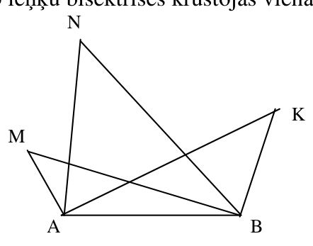{ width=200px }

6. zīm.

<small>
   
* questionType:
* domain:
   
</small>

## Atrisinājums

Skat. $19.$ zīm.

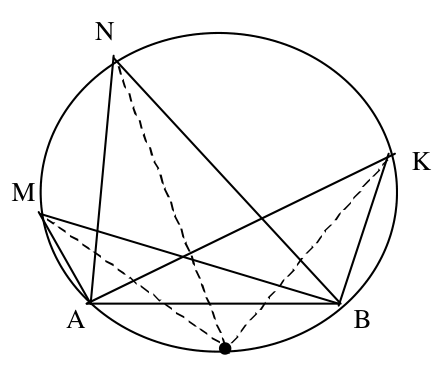{ width=200px }

$19.$ zīm.

No teorēmas par ievilktajiem leņķiem seko, ka visi punkti $A, M, N, K, B$ atrodas uz vienas riņķa līnijas; un leņķu $\angle AMB$, $\angle ANB$, $\angle AKB$ bisektrises iet caur loka $AB$ viduspunktu; tātad krustojas vienā punktā.

# <lo-sample/> LV.SOL.1995.10.4

Dots, ka $a,b,c$ ir pozitīvi skaitļi un $a+b+c=a^2+b^2+c^2$.

Kas lielāks: $a^3+b^3+c^3$ vai $a^4+b^4+c^4$? (Zināms, ka šie lielumi nav vienādi.)

<small>
   
* questionType:
* domain:
   
</small>

## Atrisinājums

Izpildot pārveidojumus, iegūstam:

$$
\left(a^4+b^4+c^4\right)-\left(a^3+b^3+c^3\right)=
$$

$$
\left(a^4+b^4+c^4\right)-\left(a^3+b^3+c^3\right)+\left(a^2+b^2+c^2\right)-\left(a+b+c\right)=
$$

$$
a\cdot(a+1)\cdot(a-1)^2+b\cdot(b+1)\cdot(b-1)^2+c\cdot(c+1)\cdot(c-1)^2\ge 0.
$$

Tātad kubu summa ir mazāka.

# <lo-sample/> LV.SOL.1995.10.5

No regulāra $20$-stūra virsotnēm deviņas nokrāsotas baltas.

Pierādīt, ka var atrast vienādsānu trijstūri, kura visas virsotnes ir baltas.

<small>
   
* questionType:
* domain:
   
</small>

## Atrisinājums

Visas $20$ stūra virsotnes sadalām $4$ regulāru piecstūru virsotņu komplektos; skat. $20.$ zīm.

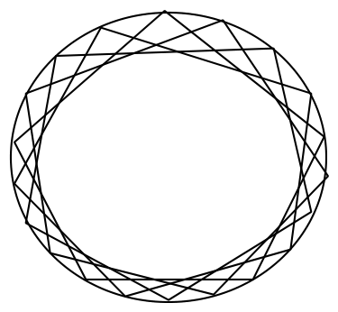{ width=200px }

$20.$ zīm.

Tā kā $9>4\cdot 2$, tad vismaz vienam $5$-stūrim $3$ virsotnes nokrāsotas baltas. Atliek ievērot, ka regulāra piecstūra jebkuras $3$ virsotnes veido vienādsānu trijstūri.

# <lo-sample/> LV.SOL.1995.11.1

Atrisināt vienādojumu

$$|x-1|+|x-3|+|x-5|=3.$$

<small>
   
* questionType:
* domain:
   
</small>

## Atrisinājums

Vienādojumam nav atrisinājumu., jo

$$
\left|x-1\right|+\left|x-3\right|+\left|x-5\right|\ge \left|x-1\right|+\left|x-5\right|\ge
$$

$$
\left|(x-1)-(x-5)\right|=4.
$$

# <lo-sample/> LV.SOL.1995.11.2

Dots, ka $a,b,c$ ir naturāli skaitļi un reizinājums $abc$ dalās ar $3$, bet nedalās ar $9$. Pierādīt, ka $a^2+b^2+c^2$ nedalās ar $3$.

<small>
   
* questionType:
* domain:
   
</small>

## Atrisinājums

No dotā seko, ka viens skaitlis (teiksim $a$) dalās ar $3$, bet pārējie skaitļi ar $3$ nedalās. Tā kā $b,c\in\{1,2\}\pmod{3}$, tad

$$
a^2+b^2+c^2\equiv 0+1+1=2\pmod{3}.
$$

Tātad $a^2+b^2+c^2$ nedalās ar $3$.

# <lo-sample/> LV.SOL.1995.11.3

Pierādīt, ka patvaļīgiem skaitļiem $a$ un $b$ pastāv nevienādība

$$a^2+b^2+2>a+b+ab.$$

<small>
   
* questionType:
* domain:
   
</small>

## Atrisinājums

Ievērojam, ka

$$
a^2+b^2+2-a-b-ab=
$$

$$
\frac{1}{2}(a-b)^2+\frac{1}{2}(a-1)^2+\frac{1}{2}(b-1)^2>0.
$$

# <lo-sample/> LV.SOL.1995.11.4

Izliekta četrstūra abu diagonāļu garumi ir $20$. Pierādīt, ka vismaz viena no tā malām garāka par $14$.

<small>
   
* questionType:
* domain:
   
</small>

## Atrisinājums

Pieņemsim, ka $\alpha\ge 90^{\circ}$ (skat. 21. zīm.)

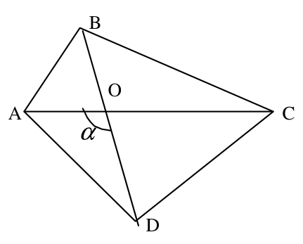{ width=200px }

21. zīm.

Tad

$$
\mathit{AD}^2+\mathit{BC}^2\ge \mathit{AO}^2+\mathit{OD}^2+\mathit{BO}^2+\mathit{OC}^2=
$$

$$
\mathit{AO}^2+\mathit{OD}^2+(20-\mathit{OD})^2+(20-\mathit{AO})^2=
$$

$$
2\cdot \mathit{AO}^2-40\cdot \mathit{AO}+2\cdot \mathit{OD}^2-40\cdot \mathit{OD}+800=
$$

$$
2\cdot(\mathit{AO}-10)^2+2\cdot(\mathit{OD}-10)^2+400\ge 400.
$$

Tāpēc vai nu $\mathit{AD}^2\ge 200$, vai $\mathit{BC}^2\ge 200$, no kurienes seko prasītais.

# <lo-sample/> LV.SOL.1995.11.5

No regulāra $13$-stūra virsotnēm sešas nokrāsotas melnas. Pierādīt, ka var atrast trapeci, kurai visas virsotnes ir melnas.

<small>
   
* questionType:
* domain:
   
</small>

## Atrisinājums

Taisnes, kas savieno regulāra $13$-stūra virsotnes, var iet $13$ dažādos virzienos. Sešus melnos punktus savieno $\frac{6\cdot 5}{2}=15$ nogriežņi. Tātad vismaz divi no tiem $\mathit{AB}$ un $\mathit{DC}$ ir paralēli. Tā kā $13$ ir nepāra skaitlis, tad $\mathit{ABCD}$ nav paralelograms (nav taisnstūris), un ir trapece ar visām melnām virsotnēm.

# <lo-sample/> LV.SOL.1995.12.1

Vai visi skaitļi $\log_a b$, $\log_b c$, $\log_c a$ var būt negatīvi?

<small>
   
* questionType:
* domain:
   
</small>

## Atrisinājums

Nē, nevar būt. Pieņemsim, ka $a>1$ (otrs gadījums ir analoģisks). Tad

$$\log_a b<0 \quad \Rightarrow \quad b<1,$$

Tātad

$$\log_b c<0 \quad \Rightarrow \quad c>1,$$

un

$$\log_c a<0 \quad \Rightarrow \quad a<1.$$

Pretruna, tātad vismaz viens no logaritmiem ir pozitīvs.

# <lo-sample/> LV.SOL.1995.12.2

Izliekts četrstūris $ABCD$ ar perpendikulārām diagonālēm ievilkts riņķa līnijā ar rādiusu $R$. Pierādīt, ka
$$
AB^2+BC^2+CD^2+DA^2=8R^2.
$$

<small>
   
* questionType:
* domain:
   
</small>

## Atrisinājums

Skat. $22.$ zīm.

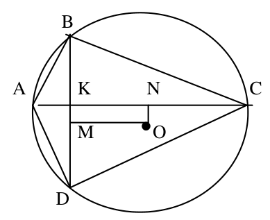{ width=200px }

22. zīm.

Izmantojot Pitagora teorēmu, iegūstām

$$
\begin{aligned}
&AB^2+BC^2+CD^2+DA^2=\\
&2\cdot\left(AK^2+BK^2+CK^2+DK^2\right)=\\
&2\cdot(AN-KN)^2+2\cdot(AN+KN)^2+2\cdot(BM-KM)^2+2\cdot(BM+KM)^2=\\
&4\cdot\left(AN^2+NO^2\right)+4\cdot\left(BM^2+MO^2\right)=\\
&4\cdot AO^2+4\cdot BO^2=8\cdot R^2.
\end{aligned}
$$

# <lo-sample/> LV.SOL.1995.12.3

Naturāli skaitļi $a_1,a_2,\ldots,a_n$ visi ir dažādi, nepāra un nedalās ne ar vienu pirmskaitli, kas lielāks par $5$. Pierādīt, ka
$$
\frac{1}{a_1}+\frac{1}{a_2}+\frac{1}{a_3}+\cdots+\frac{1}{a_n}<2.
$$

<small>
   
* questionType:
* domain:
   
</small>

## Atrisinājums

Visu šādu skaitļu summa ir mazāka par

$$
S=\left(1+\frac{1}{3}+\frac{1}{9}+\cdots+\frac{1}{3^n}+\cdots\right)\cdot\left(1+\frac{1}{5}+\frac{1}{25}+\cdots+\frac{1}{5^n}+\cdots\right)=
$$

$$
\frac{1}{1-\frac{1}{3}}\cdot\frac{1}{1-\frac{1}{5}}=\frac{15}{8}<2
$$

# <lo-sample/> LV.SOL.1995.12.4

Volejbola turnīrā piedalās $9$ komandas. Katra spēlē ar katru vienu reizi; neizšķirtu nav.

Pierādīt: ir iespējama situācija, ka turnīra beigās katrām divām komandām var atrast trešo, kas tās abas uzvarējusi.

<small>
   
* questionType:
* domain:
   
</small>

## Atrisinājums

Šāda shēma ir parādīta $23.$ zīmējumā.

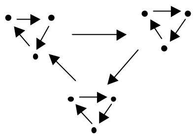{ width=200px }

23. zīm.

# <lo-sample/> LV.SOL.1995.12.5

Riņķis pilnībā pārklāts ar vairākām lentām; par lentu sauc joslu starp divām paralēlām taisnēm.

Pierādīt, ka lentu platumu summa nav mazāka par riņķa diametru.

<small>
   
* questionType:
* domain:
   
</small>

## Atrisinājums

Konstruējam uz riņķa kā ekvatoriāla šķēluma sfēru ar rādiusu $R$; caur lentu malām novelkam plaknes perpendikulāri šim šķēlumam. Ja lentas pārklāj riņķi, tad slāņi starp plaknēm apsedz visu sfēras virsmu. Bet slānis ar biezumu $h$ apsedz virsmu, kas nav lielāka par $2\pi R\cdot h$ (joslas vai segmenta laukums ar augstumu $h$ ir tieši $2\pi R\cdot h$, bet slānis varbūt daļēji iet ārpus sfēras). Tāpēc
$$
\sum 2\pi R\cdot h_i \ge 4\pi R^2,
$$
no kurienes $\sum h_i \ge 2R$.
