# <lo-sample/> LV.SOL.1996.5.1

Ar divciparu skaitli atļauts veikt sekojošas operācijas:

a) mainīt tā ciparus vietām, ja pēc maiņas pirmais cipars nav nulle,

b) pieskaitīt tam $7$, ja rezultāts arī ir divciparu skaitlis.

Vai ar šādiem gājieniem, veicot tos pēc patikas ilgi jebkādā secībā var no $19$ iegūt $95$?

<small>
   
* questionType:
* domain:
   
</small>

## Atrisinājums

Jā, to var izdarīt, piemēram, šādi:

$$19 \to 26 \to 33 \to 40 \to 47 \to 74 \to 81 \to 88 \to 95.$$

# <lo-sample/> LV.SOL.1996.5.2

Ar kādu ciparu beidzas visu naturālo skaitļu summa

a) no $1$ līdz $9$ ieskaitot,

b) no $1$ līdz $99$ ieskaitot ?

<small>
   
* questionType:
* domain:
   
</small>

## Atrisinājums

a) Ar $5$, jo $1+2+\cdots+9=45$.

b) Ar $0$, jo dotā summa sadalās $10$ summās:

no $0$ līdz $9$, no $10$ līdz $19$, no $20$ līdz $29$, $\ldots$, no $90$ līdz $99$.

Visu šo $10$ summu pēdējie cipari ir $5$; tātad visas summas pēdējais cipars ir skaitļa

$$\underbrace{5+5+\cdots+5}_{10\ \text{reizes}}=50$$

pēdējais cipars; tātad nulle.

# <lo-sample/> LV.SOL.1996.5.3

Deju ansamblī ir $5$ zēni un $5$ meitenes. Vai var būt, ka visām meitenēm ir dažāds draugu – zēnu skaits, bet visiem zēniem ir vienāds draudzeņu – meiteņu skaits? Visas draudzības apskatām tikai ansambļa ietvaros.

<small>
   
* questionType:
* domain:
   
</small>

## Atrisinājums

Jā, var būt. Skat, piemēram, $5.$ zīmējumu. Zēni un meitenes apzīmēti ar punktiem, draudzības – ar nogriežņiem.

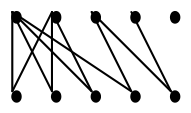{ width=100px }

5. zīm.

Pirmajā rindā atrodas meitenes, otrajā – zēni.

# <lo-sample/> LV.SOL.1996.5.4

Divi velosipēdisti, starp kuriem attālums bija $24$ km, devās viens otram pretī. Pēc stundas attālums starp viņiem bija $12$ km. Kāds attālums starp viņiem būs vēl pēc pusstundas? Velosipēdistu ātrumi ir nemainīgi.

<small>
   
* questionType:
* domain:
   
</small>

## Atrisinājums

Iespējami divi gadījumi.

1) Pēc stundas velosipēdisti nebija viens otru sastapuši. Tā kā stundas laikā attālums samazinājās $2$ reizes no $24$ km līdz $12$, tad nākošās pusstundas laikā tie pietuvosies viens otram attālumā $6$ km.

2) Pēc stundas velosipēdisti pabraukuši viens otram garām; tātad kopā veikuši $24+12=36$ km. Nākošās pusstundas laikā tie attālināsies viens no otra vēl par $18$ km, un attālums starp tiem būs $12+18=30$ km.

# <lo-sample/> LV.SOL.1996.5.5

Kvadrāts sastāv no $4 \cdot 4$ rūtiņām. Vai tajā var $8$ rūtiņas nokrāsot melnas un $8$ – baltas tā, lai katrā rindā un katrā kolonnā būtu $3$ vienas krāsas un $1$ otras krāsas rūtiņa?

<small>
   
* questionType:
* domain:
   
</small>

## Atrisinājums

Jā, to var izdarīt; skat. $6.$ zīm.

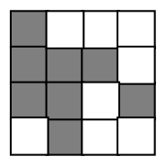{ width=100px }

6. zīm.

# <lo-sample/> LV.SOL.1996.6.1

Saskaitot $6$ dažādus naturālus skaitļus, summā ieguva $24$. Kādi varēja būt saskaitāmie?

<small>
   
* questionType:
* domain:
   
</small>

## Atrisinājums

Saskaitāmie var būt šādi:

$$1+2+3+4+5+9=24,\quad 1+2+3+4+6+8=24,\quad 1+2+3+5+6+7=24.$$

Citu iespēju nav. Ja trešais pēc lieluma saskaitāmais ir lielāks par $3$, tad summa ir ne mazāka par $1+2+4+5+6+7=25$. Tātad pirmie trīs saskaitāmie ir $1$, $2$ un $3$.

Ja ceturtais saskaitāmais ir lielāks par $5$, tad summa ir ne mazāka par $1+2+3+6+7+8=28$.

Aplūkojot divas iespējas (ceturtais saskaitāmais ir $4$ vai $5$), atrodam uzrādītos atrisinājumus.

# <lo-sample/> LV.SOL.1996.6.2

Uzzīmēt trijstūri un četrstūri tā, lai to kopīgā daļa būtu daudzstūris ar $8$ malām.

<small>
   
* questionType:
* domain:
   
</small>

## Atrisinājums

Skat., piemēram, $7$. zīmējumu.

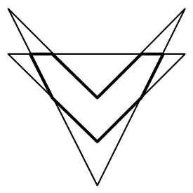{ width=150px }

7. zīm.

# <lo-sample/> LV.SOL.1996.6.3

No skaitļa $1230123012301230$ jāizsvītro vairāki cipari tā, lai iegūtais skaitlis dalītos ar $9$ un būtu maksimāli liels. Kuri cipari jāizsvītro?

<small>
   
* questionType:
* domain:
   
</small>

## Atrisinājums

Tā kā uzrakstītā skaitļa ciparu summa ir $15$, tad, lai atlikušais skaitlis dalītos ar $9$, ir jāizsvītro cipari, kuru summa ir $6$. Protams, lai iegūtu lielāko skaitli ir jāizsvītro pēc iespējas mazāk cipari; tātad jāizsvītro divi trijnieki.

Tā kā vecākās šķiras ir nozīmīgākas, tad jānosvītro abi pēdējie trijnieki.

# <lo-sample/> LV.SOL.1996.6.4

Vai taisne var krustot visas

a) sešstūra malas,

b) septiņstūra malas.

<small>
   
* questionType:
* domain:
   
</small>

## Atrisinājums

a) Jā, var. Skat., piemēram, $8$. zīm.

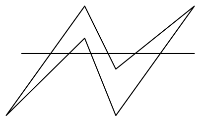{ width=200px }

8. zīm.

b) Nē, nevar. Pieņemsim, ka tāda taisne novilkta; tā sadala plakni divās pusplaknēs (kreisajā un labajā). Sanumurēsim $7$-stūra virsotnes pēc kārtas. Pieņemsim, ka $7$-stūra pirmā virsotne atrodas kreisajā pusplaknē; tad, lai mala, kas savieno pirmo un otro virsotni krustotu doto taisni, otrajai virsotnei jāatrodas labajā pusplaknē, līdzīgi pierāda, ka trešajai virsotnei jāatrodas kreisajā puslodē, ceturtajai – labajā, piektajai – kreisajā, sestajai – labajā, septītajai – kreisajā.  
Bet tādā gadījumā mala, kas savieno septīto un pirmo virsotni nekrusto doto taisni.

# <lo-sample/> LV.SOL.1996.6.5

Pierādīt, ka

$$
1-\frac{1}{2}+\frac{1}{3}-\frac{1}{4}+\frac{1}{5}-\frac{1}{6}+\frac{1}{7}-\frac{1}{8}+\frac{1}{9}-\frac{1}{10}=
\frac{1}{6}+\frac{1}{7}+\frac{1}{8}+\frac{1}{9}+\frac{1}{10}.
$$

<small>
   
* questionType:
* domain:
   
</small>

## Atrisinājums

Pārveidojot, iegūstam:

$$
\begin{aligned}
1-\frac{1}{2}+\frac{1}{3}-\frac{1}{4}+\frac{1}{5}-\frac{1}{6}+\frac{1}{7}-\frac{1}{8}+\frac{1}{9}-\frac{1}{10}
&= \\
1+\frac{1}{2}+\frac{1}{3}+\frac{1}{4}+\frac{1}{5}+\frac{1}{6}+\frac{1}{7}+\frac{1}{8}+\frac{1}{9}+\frac{1}{10}
-2\cdot\left(\frac{1}{2}+\frac{1}{4}+\frac{1}{6}+\frac{1}{8}+\frac{1}{10}\right)
&= \\
1+\frac{1}{2}+\frac{1}{3}+\frac{1}{4}+\frac{1}{5}+\frac{1}{6}+\frac{1}{7}+\frac{1}{8}+\frac{1}{9}+\frac{1}{10}
-\left(\frac{1}{1}+\frac{1}{2}+\frac{1}{3}+\frac{1}{4}+\frac{1}{5}\right)
&= \\
\frac{1}{6}+\frac{1}{7}+\frac{1}{8}+\frac{1}{9}+\frac{1}{10}.
\end{aligned}
$$

# <lo-sample/> LV.SOL.1996.7.1

Jāņa solis par $10$ procentiem īsāks par Pētera soli, bet stundā viņš veic par $11$ procentiem vairāk nekā Pēteris. Kurš no zēniem iet ātrāk?

<small>
   
* questionType:
* domain:
   
</small>

## Atrisinājums

Ievēdīsim apzīmējumus.

$a$ – Jāņa soļa garums;  
$b$ – Pētera soļa garums;  
Pēteris stundā noiet $p$ soļus;  
Jānis stundā noiet $j$ soļus.  
Dots, ka $a=0{,}9b$ un $j=1{,}11p$.

Pēteris stundā noiet attālumu $bp$.  
Jānis stundā noiet attālumu $aj=0{,}9\cdot1{,}11bp=0{,}999bp$.  
Tātad Pēteris iet ātrāk.

# <lo-sample/> LV.SOL.1996.7.2

Kādā valstī ir tikai $5$ dilleru un $4$ dilleru naudas zīmes. Pierādīt, ka ar tām var nopirkt jebkuru mantu, kuras vērtība ir no $1995$ dilleriem līdz $2005$ dilleriem ieskaitot. (Pārdevējiem stingri aizliegts izdot naudu atpakaļ)

<small>
   
* questionType:
* domain:
   
</small>

## Atrisinājums

Parādīsim, kā palielināt nomaksātās summas vērtību par vienu dilleru.  
Ja summā ir $4$-dilleru monētas, tad to aizvieto ar $5$-dilleru monētu.

Ja $4$-dilleru monētu nav, tad summā ir vismaz trīs $5$-dilleru monētas; tad varam aizvietot trīs $5$-dilleru monētas ar četrām $4$-dilleru monētām.

Tādējādi, ja var samaksāt summu $1995$ dilleri, tad var samaksāt arī jebkuru lielāku summu. Tā kā $1995=5\cdot 399$, tad arī visas sekojošās summas ir samaksājamas.

$$
\begin{array}{ll}
1996=5\cdot 396+4\cdot 4, & 1997=5\cdot 397+4\cdot 3\\
1998=5\cdot 398+4\cdot 2, & 1999=5\cdot 399+4\cdot 1\\
2000=5\cdot 400, & 2001=5\cdot 397+4\cdot 4\\
2002=5\cdot 398+4\cdot 3, & 2003=5\cdot 399+4\cdot 2\\
2004=5\cdot 400+4\cdot 1, & 2005=5\cdot 401.
\end{array}
$$

# <lo-sample/> LV.SOL.1996.7.3

Kādu lielāko daudzumu figūru, kāda parādīta $1.$ zīm., var izgriezt no taisnstūra ar izmēriem $5\cdot 6$?

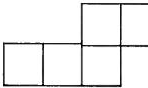{ width=100px }

1.zīm.

<small>
   
* questionType:
* domain:
   
</small>

## Atrisinājums

Tā kā taisnstūrī ar izmēriem $5\times 6$ ir $30$ rūtiņas, bet dotā figūra aizņem $5$ rūtiņas, tad nevar izgriezt vairāk par $6$ figūrām. Ja izgrieztas būtu $6$ figūras, tad visām rūtiņām jābūt aizpildītām. Mēģinot aizpildīt no stūra visas rūtiņas, redzam, ka tas nav iespējams. Kā izgriezt $5$ figūras, parādīts $9.$ zīmējumā.

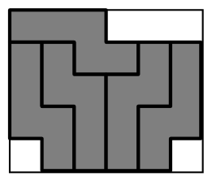{ width=100px }

9. zīm.

# <lo-sample/> LV.SOL.1996.7.4

Pierādīt, ka skaitļu $19951995$ un $19952003$ lielākais kopīgais dalītājs ir $1$.

<small>
   
* questionType:
* domain:
   
</small>

## Atrisinājums

Apzīmēsim ar $d$ doto skaitļu lielāko kopīgo dalītāju. Tad doto skaitļu starpība $8$ dalās ar $d$; tas nozīmē, ka $d$ ir $1$, $2$, $4$ vai $8$. Tā kā $19951995$ ir nepāra skaitlis, tad $d$ arī jābūt nepāra skaitlim. Tas nozīmē, ka $d=1$.

# <lo-sample/> LV.SOL.1996.7.5

Krava sver $10$ tonnas. Tā sapakota kastēs tā, ka nevienas kastes svars nepārsniedz $1$ tonnu. Mūsu rīcībā ir vairākas platformas; katras platformas kravnesība ir $3$ tonnas. Kastes izpakot nedrīkst.

Pierādīt: lai kā arī būtu sapakota krava, to var aizvest ar $5$ platformām, bet var gadīties, ka ar $4$ platformām nepietiek..

<small>
   
* questionType:
* domain:
   
</small>

## Atrisinājums

Vispirms aplūkosim piemēru, kad ar $4$ platformām nepietiek. Pieņemsim, ka mums ir $13$ kastes un katra sver $\frac{10}{13}$ t. Ja šī krava sakrauta $4$ platformās, tad vismaz vienā platformā ir vismaz $4$ kastes (jo $4\cdot 3<13$); bet tad šajā platformā sakrautās kravas svars ir ne mazāks par $4\cdot \frac{10}{13}=\frac{40}{13}>3$ t.

Pierādīsim, ka ar $5$ platformām pietiek. Krausim katrā no $5$ platformām kravu, kamēr tajās vēl var ielikt kādu kasti. Ja platformā iekrautās kravas svars nepārsniedz $2$ t, tad tajā var vēl ievietot jebkuru kasti. Tātad $5$ platformās var iekraut vismaz $2\cdot 5=10$ t kravas.

# <lo-sample/> LV.SOL.1996.8.1

Pierādīt, ka

$$
2^{1995}+2^{1996}+2^{1997}+2^{1998}
$$

dalās ar $15$.

<small>
   
* questionType:
* domain:
   
</small>

## Atrisinājums

No vienādības

$$
2^{1995}+2^{1996}+2^{1997}+2^{1998} =
$$

$$
2^{1995}\cdot(1+2+4+8)=2^{1995}\cdot 15
$$

seko, ka dotais skaitlis dalās ar $15$.

# <lo-sample/> LV.SOL.1996.8.2

Uz baltām, melnām, sarkanām un zaļām kartiņām uzrakstīts pa skaitlim; katra veida kartiņu skaits nav zināms. "Balto" skaitļu vidējais aritmētiskais lielāks par "sarkano" skaitļu vidējo aritmētisko, un "melno" skaitļu vidējais aritmētiskais lielāks par "zaļo" skaitļu vidējo aritmētisko.

Vai var gadīties, ka kopā ņemtu balto un melno skaitļu vidējais aritmētiskais mazāks par kopā ņemtu sarkano un zaļo vidējo aritmētisko?

<small>
   
* questionType:
* domain:
   
</small>

## Atrisinājums

Jā, tā var gadīties; piemēram, ņemsim

vienu balto skaitli $1$;

vienu sarkano skaitli $0$;

vienu melno skaitli $11$;

simts zaļos skaitļus $10$.

Redzam, ka balto skaitļu vidējais aritmētiskais lielāks par sarkano skaitļu vidējo aritmētisko un melno skaitļu vidējais aritmētiskais lielāks par zaļo skaitļu vidējo aritmētisko.

Balto un melno skaitļu vidējais aritmētiskais ir $\frac{1+11}{2}=6$.

Sarkano un zaļo skaitļu vidējais aritmētiskais ir

$$
\frac{0+\underbrace{10+10+\cdots+10}_{100}}{101}=\frac{1000}{101}.
$$

Redzam, ka tas ir lielāks par $6$.

# <lo-sample/> LV.SOL.1996.8.3

Ar $\overline{xyz}$ apzīmēsim trīsciparu skaitli ar cipariem $x$, $y$, $z$. Pierādīt, ka, ja $\overline{abc}$ dalās ar $37$, tad arī $\overline{bca}+\overline{cab}$ dalās ar $37$.

<small>
   
* questionType:
* domain:
   
</small>

## Atrisinājums

Ievērosim, ka

$$
\overline{abc}+\overline{bca}+\overline{cab} =
$$

$$
(100a+10b+c)+(100b+10c+a)+(100c+10a+b)=
$$

$$
111\cdot(a+b+c)=3\cdot 37\cdot(a+b+c).
$$

Tātad

$$
\overline{bca}+\overline{cab}=3\cdot 37\cdot(a+b+c)-\overline{abc}
$$

dalās ar $37$.

# <lo-sample/> LV.SOL.1996.8.4

Vienādmalu trijstūris sagriezts $25$ mazos trijstūrīšos (skat. $2.$ zīm.).

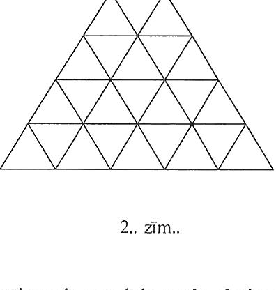{ width=200px }

$2.$ zīm..

<small>
   
* questionType:
* domain:
   
</small>

## Atrisinājums

Izkrāsosim trijstūrīšus baltā un melnā krāsā, kā parādīts $10.$ zīmējumā.

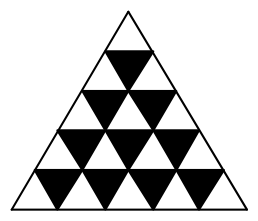{ width=100px }

10. zīm.

Mušu skaits, kas atrodas baltajos trijstūros ir par $5$ lielāks nekā mušu skaits, kas atrodas melnajos trijstūros. Ja muša nolaižas blakus trijstūrī, tad tā nolaižas pretējas krāsas trijstūrī. Tātad vismaz $5$ mušas no baltajiem trijstūriem nolaidīsies baltajos trijstūros (nepietiks vietu melnajos trijstūros); tas nozīmē, ka šīs mušas atgriezīsies iepriekšējos trijstūros.

# <lo-sample/> LV.SOL.1996.8.5

Kāds ir lielākais iespējamais paralēlo malu skaits $1995$-stūrī?

<small>
   
* questionType:
* domain:
   
</small>

## Atrisinājums

Kā redzams $11.$ zīmējuma paralēlo malu skaits var būt $997$.

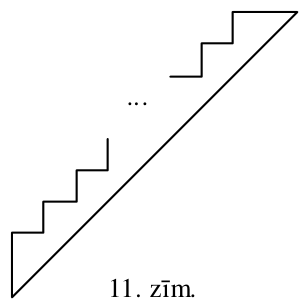{ width=150px }

11. zīm.

Parādīsim, ka tas nevar būt lielāks. Pieņemsim, ka kādam daudzstūrim ir $998$ malas, kas visas paralēlas taisnei $t$. Izvēlēsimies vienu malu, kas nav paralēla $t$. Atlikušās $1994$ malas sadalīsim $997$ blakus esošu malu pāros. Tā kā $998>997$, tad atradīsies divas no $998$ paralēlajām malām, kas pieder vienam pārim. Bet blakus malas nevar būt paralēlas – pretruna.

# <lo-sample/> LV.SOL.1996.9.1

Skaitļi $a$, $b$ un $c$ nav $0$. Pierādīt, ka
$$
\frac{c-b}{a}+\frac{a-c}{b}+\frac{b-a}{c}=\frac{(a-b)(b-c)(c-a)}{abc}.
$$

<small>
   
* questionType:
* domain:
   
</small>

## Atrisinājums

Pārveidojot, iegūstam

$$
\frac{c-b}{a}+\frac{a-c}{b}+\frac{b-a}{c}=
$$

$$
\frac{c-b}{a}+\frac{c\cdot(a-c)+b\cdot(b-a)}{bc}=
$$

$$
\frac{c-b}{a}+\frac{ca-c^2+b^2-ba}{bc}=
$$

$$
\frac{c-b}{a}+\frac{a\cdot(c-b)-(c+b)\cdot(c-b)}{bc}=
$$

$$
\frac{(c-b)\cdot(bc+a^2-ac-ab)}{abc}=
$$

$$
\frac{(a-b)\cdot(b-c)\cdot(c-a)}{abc}.
$$

# <lo-sample/> LV.SOL.1996.9.2

Dotas divas baltas, divas sarkanas un divas zaļas lodītes. Divu krāsu lodītes visas sver pa $100$ gramiem katra, bet vienas krāsas lodītes sver $99$ g un $101$ g. Lietojot sviras svarus bez atsvariem, ar divām svēršanām atrast vieglāko lodīti.

<small>
   
* questionType:
* domain:
   
</small>

## Atrisinājums

Vispirms uzliekam uz viena svaru kausa baltu lodīti, bet uz otra – sarkanu.

$1)$ Ja svari ir līdzsvarā, tad vieglākā lodīte ir starp zaļajām; ar vienu svēršanu, salīdzinot zaļās lodītes, atrodam vieglāko.

2) Ja svari nav līdzsvarā, tad vieglākā lodīte ir vai nu tā, kas atrodas uz vieglākā svaru kausa (teiksim baltā), vai otra no sarkanajām; salīdzinot šīs lodītes, atrodam vieglāko.

# <lo-sample/> LV.SOL.1996.9.3

Atrast visus naturālos divciparu skaitļus, kam piemīt īpašība: saskaitot skaitli ar otru skaitli, kuru iegūst, mainot ciparus vietām, rezultāts ir kāda naturāla skaitļa kvadrāts.

<small>
   
* questionType:
* domain:
   
</small>

## Atrisinājums

Dots, ka
$$
\overline{ab}+\overline{ba}=n^2.
$$
Tātad $n^2=\overline{ab}+\overline{ba}=11\cdot(a+b)$. Tas nozīmē, ka $n$ dalās ar $11$; tā kā
$$
11\cdot(a+b)\le 11\cdot18,
$$
tad $n=11$. Tas nozīmē, ka $a+b=11$; rezultātā iegūstam šādus skaitļus:
$$
29,\ 38,\ 47,\ 56,\ 65,\ 74,\ 83,\ 92.
$$

# <lo-sample/> LV.SOL.1996.9.4

Trijstūrī $ABC$ leņķa $A$ bisektrise krusto malu $BC$ punktā $D$. Uz malas $AB$ ņemts tāds punkts $M$, ka $\angle BDM=\angle BAC$. Pierādīt, ka $DM=DC$.

<small>
   
* questionType:
* domain:
   
</small>

## Atrisinājums

Skat. $12.$ zīm.

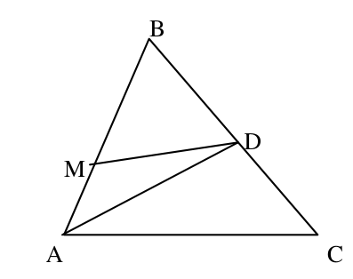{ width=200px }

$12.$ zīm.

No dotā seko
$$
\angle MDC+\angle MAC=\angle MDC+\angle MDB=180^{\circ}.
$$
Tātad ap četrstūri $AMDC$ var apvilkt riņķa līniju.

Tā kā ievilktie leņķi $\angle MAD$ un $\angle DAC$ ir vienādi, tad tie balstās uz vienādām hordām $DM$ un $DC$.

# <lo-sample/> LV.SOL.1996.9.5

Pierādīt, ka pozitīviem $a$ un $b$ pastāv nevienādība
$$
\left(\frac{2a}{b}+1\right)\cdot\left(\frac{2b}{a}+1\right)\ge 9.
$$

<small>
   
* questionType:
* domain:
   
</small>

## Atrisinājums

Pārveidojot, iegūstam
$$
\left(\frac{2a}{b}+1\right)\cdot\left(\frac{2b}{a}+1\right)=
$$
$$
4+\frac{2a}{b}+\frac{2b}{a}+1=5+2\cdot\left(\frac{a}{b}+\frac{b}{a}\right)\ge
$$
$$
5+2\cdot2\cdot\sqrt{\frac{a}{b}\cdot\frac{b}{a}}=9.
$$
Tika izmantota nevienādība starp divu skaitļu vidējo aritmētisko un vidējo ģeometrisko.

# <lo-sample/> LV.SOL.1996.10.1

Aplūkojam kvadrātfunkciju $f(x)=ax^2+bx+c$. Zināms, ka $f(-1)>-1$, $f(0)<0$ un $f(1)>2$. Vai skaitlis $a$ ir pozitīvs vai negatīvs?

<small>
   
* questionType:
* domain:
   
</small>

## Atrisinājums

Dotās nevienādības var pārrakstīt šādā veidā

$$
\begin{cases}
f(-1)=a-b+c>-1\\
f(0)=c<0\\
f(1)=a+b+c>2.
\end{cases}
$$

Saskaitot pirmo un otro nevienādību, iegūstam

$$
(a-b+c)+(a+b+c)=2a+2c>1.
$$

Tā kā $c<0$, tad $2a>1-2c>1$; tātad $a>0$.

# <lo-sample/> LV.SOL.1996.10.2

Pierādīt, ka nav tādu naturālu skaitļu $a$, $x$, $y$, $z$, ka
$$
7^a=7^x+7^y+7^z.
$$

<small>
   
* questionType:
* domain:
   
</small>

## Atrisinājums

Ja dotā vienādība izpildās, tad $a>x$, $a>y$ un $a>z$. Naturāliem skaitļiem no šejienes seko nevienādības $a\ge x+1$, $a\ge y+1$ un $a\ge z+1$.

Tātad

$$
7^a=7\cdot 7^{a-1}=4\cdot 7^{a-1}+7^{a-1}+7^{a-1}+7^{a-1}>7^x+7^y+7^z.
$$

Tas nozīmē, ka prasītā vienādība nav iespējama.

# <lo-sample/> LV.SOL.1996.10.3

Ar $\overline{xyz}$ saprotam trīsciparu skaitli ar cipariem $x$, $y$, $z$. Pierādīt, ka ja $\overline{abc}$ dalās ar $37$, tad arī $\overline{bca}+\overline{cab}$ dalās ar $37$.

<small>
   
* questionType:
* domain:
   
</small>

## Atrisinājums

Ievērosim, ka

$$
\overline{abc}+\overline{bca}+\overline{cab} =
$$

$$
(100a+10b+c)+(100b+10c+a)+(100c+10a+b)=
$$

$$
111\cdot(a+b+c)=3\cdot 37\cdot(a+b+c).
$$

Tātad

$$
\overline{bca}+\overline{cab}=3\cdot 37\cdot(a+b+c)-\overline{abc}
$$

dalās ar $37$.

# <lo-sample/> LV.SOL.1996.10.4

Plaknē uzzīmēts kvadrāts ar izmēriem $3\times 3$. Tas jāpārklāj ar kvadrātiskiem šabloniem, kuru izmēri ir $2\times 2$. Ar kādu mazāko šablonu daudzumu to var izdarīt? Šabloni var savstarpēji pārklāties un iziet ārpus kvadrāta $3\times 3$.

<small>
   
* questionType:
* domain:
   
</small>

## Atrisinājums

Skaidrs, ka pietiek ar $4$ šabloniem; skat. 13. zīm.

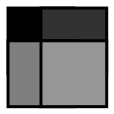{ width=100px }

13. zīm.

Katru no iekrāsotajām figūrām var pārklāt ar šablonu.

Tā kā attālums starp jebkuriem diviem viena šablona punktiem nepārsniedz $2\sqrt{2}$ un $2\sqrt{2}<3$, tad katru kvadrāta virsotni jāpārklāj ar savu šablonu; tātad vajadzīgi ir vismaz $4$ šabloni.

# <lo-sample/> LV.SOL.1996.10.5

Kādā klasē darbojas $5$ pulciņi. Katru pulciņu apmeklē vairāk nekā puse skolēnu. Pierādīt, ka var atrast tādus divus skolēnus $A$ un $B$, ka katru pulciņu apmeklē vismaz viens no viņiem.

<small>
   
* questionType:
* domain:
   
</small>

## Atrisinājums

Apzīmēsim skolēnu skaitu pulciņos $P_1, P_2, P_3, P_4, P_5$ atbilstoši ar $a_1, a_2, a_3, a_4, a_5$, bet skolēnu skaitu klasē ar $n$.

Tad $a_k>\dfrac{n}{2}$; tāpēc

$$
a_1+a_2+a_3+a_4+a_5>5\cdot \frac{n}{2}>2n.
$$

Tātad eksistē skolēns $A$, kas apmeklē vismaz $3$ pulciņus (citādi "apmeklētību" skaits nepārsniegtu $2\cdot n$).

Pieņemsim, ka $A$ apmeklē pulciņus $P_1$, $P_2$, $P_3$. Tā kā

$$
a_4+a_5>2\cdot\frac{n}{2}=n,
$$

tad eksistē skolēns, kas apmeklē pulciņus $P_4$ un $P_5$.

Kopā ar skolēnu $A$ tie veido prasīto pāri.

# <lo-sample/> LV.SOL.1996.11.1

Dots, ka $x+y=a$ un $x^2+y^2=b$. Aprēķināt $x^3+y^3$.

<small>
   
* questionType:
* domain:
   
</small>

## Atrisinājums

Ievērosim, ka

$$
xy=\frac{(x+y)^2-(x^2+y^2)}{2}=\frac{a^2-b}{2}.
$$

Tātad

$$
x^3+y^3=(x+y)^3-3xy(x+y)=
$$

$$
a^3-3\left(\frac{a^2-b}{2}\right)\cdot a=\frac{3}{2}ab-\frac{1}{2}a^3.
$$

# <lo-sample/> LV.SOL.1996.11.2

Vai eksistē $3$ viens otram sekojoši skaitļi, kuru reizinājums ir $19941995199620$?

<small>
   
* questionType:
* domain:
   
</small>

## Atrisinājums

Nē, neeksistē. Šādam reizinājumam jādalās ar $3$, bet dotais skaitlis ar $3$ nedalās.

# <lo-sample/> LV.SOL.1996.11.3

Atrisināt vienādojumu
$$
\sqrt{\sin x-\sqrt{\sin x+\cos x}}=\cos x.
$$

<small>
   
* questionType:
* domain:
   
</small>

## Atrisinājums

Ja dotā vienādība izpildās, tad $\cos x\geq 0$ un $\sin x\geq 0$.

Tā kā $|\sin x|\leq 1$, tad $\sin x\leq\sqrt{\sin x}\leq\sqrt{\sin x+\cos x}$; taču no dotā seko, ka

$$
\sin x\geq\sqrt{\sin x+\cos x}.
$$

Atrisinājums varētu būt vienīgi, ja $\cos x=0$, $\sin x=1$.

Pārbaude parāda, ka šīs vērtības der; tātad $x=\frac{\pi}{2}+2\pi n$, $n\in Z$.

# <lo-sample/> LV.SOL.1996.11.4

Uz paralelograma $ABCD$ malām konstruēti kvadrāti ārpus tā (skat. $3$. zīm.). Pierādīt, ka nogriežņi $DM$ un $DN$ ir vienādi un perpendikulāri.

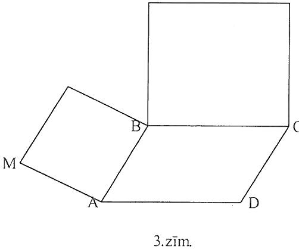{ width=250px }

3. zīm.

<small>
   
* questionType:
* domain:
   
</small>

## Atrisinājums

Skat. $14.$ zīm.

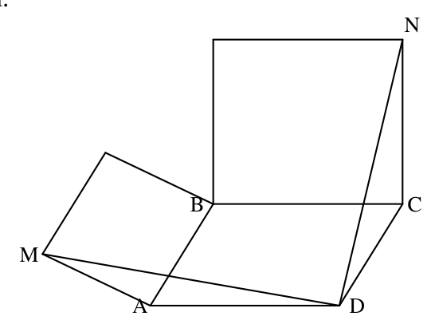{ width=250px }

$14.$zīm.

No dotā seko, ka $NC=BC=AD$ un $MA=AB=CD$;

$\angle MAD=\angle DCN$, kā leņķi ar savstarpēji perpendikulārām malām.

Tātad trijstūri $MAD$ un $NCD$ ir vienādi.

Apzīmēsim paralelograma šauro leņķi ar $\alpha$. Tad

$$
\angle MDN=\angle ADC-\left(\angle ADM+\angle CDN\right)=
$$

$$
180^{\circ}-\alpha-\left(\angle ADM+\angle CDN\right)=180^{\circ}-\alpha-\left(180^{\circ}-\angle DCN\right)=
$$

$$
180^{\circ}-\alpha-\left(180^{\circ}-90^{\circ}-\alpha\right)=90^{\circ}.
$$

Prasītais pierādīts.

# <lo-sample/> LV.SOL.1996.11.5

Kādā valstī ir $n$ pilsētas. Dažas pilsētas dažām citām savieno tieši viens ceļš, uz kura ieviesta vienvirziena satiksme. Ceļu krustojumu ārpus pilsētām nav (izmantoti viadukti). Zināms, ka, izvēloties jebkuras divas pilsētas, vismaz no vienas no tām var aizbraukt uz otru.

Pierādīt, ka ir tāda pilsēta, no kuras var aizbraukt uz visām citām

<small>
   
* questionType:
* domain:
   
</small>

## Atrisinājums

Izvēlēsimies pilsētu $A$, no kuras var aizbraukt uz maksimālo daudzumu citu pilsētu. Ņemam patvaļīgu pilsētu $B$. Ja no $A$ nevar aizbraukt uz $B$, tad ir vienvirziena ceļš no $B$ uz $A$.

Tad no $B$ var aizbraukt uz vairāk pilsētām nekā no $A$ (uz visām tām, uz kurām var aizbraukt no $A$, un arī uz pašu $A$); tā ir pretruna.

Tātad $A$ var kalpot par meklējamo pilsētu.

# <lo-sample/> LV.SOL.1996.12.1

Kāda trijstūra malu garumi ir $a$, $b$, $c$, bet pret tam novilkto augstumu garumi atbilstoši $\alpha$, $\beta$, $\gamma$. Pierādīt, ka

$$(a-\beta)\cdot(b-\gamma)\cdot(c-\alpha)=(a-\gamma)\cdot(b-\alpha)\cdot(c-\beta).$$

<small>
   
* questionType:
* domain:
   
</small>

## Atrisinājums

Ievērosim, ka $a\alpha=b\beta=c\gamma=2\cdot S$. Tātad

$$
(a-\beta)(b-\gamma)(c-\alpha)=
$$

$$
\left(a-\frac{2S}{b}\right)\left(b-\frac{2S}{c}\right)\left(c-\frac{2S}{a}\right)=
$$

$$
\frac{(ab-2S)(bc-2S)(ac-2S)}{abc}=
$$

$$
\left(b-\frac{2S}{a}\right)\left(c-\frac{2S}{b}\right)\left(a-\frac{2S}{c}\right)=
$$

$$
(a-\gamma)(b-\alpha)(c-\beta).
$$

# <lo-sample/> LV.SOL.1996.12.2

Vai $19^{95}+95^{19}$ dalās ar $3$ ?

<small>
   
* questionType:
* domain:
   
</small>

## Atrisinājums

Jā, dalās.

$$
19^{95}+95^{19}\equiv 1^{95}+(-1)^{19}\equiv 1-1\equiv 0\pmod{3}.
$$

# <lo-sample/> LV.SOL.1996.12.3

Dots, ka $|\sin \alpha|+|\sin \beta|+|\sin \gamma|$ ir pāra skaitlis.

Pierādīt, ka $|\cos \alpha|+|\cos \beta|+|\cos \gamma|\geq 1$.

<small>
   
* questionType:
* domain:
   
</small>

## Atrisinājums

Tā kā $\left|\sin x\right|\leq 1$, tad no dotā seko, ka

$$
\left|\sin \alpha\right|+\left|\sin \beta\right|+\left|\sin \gamma\right|\leq 2.
$$

Tā kā $0\leq\left|\sin x\right|,\left|\cos x\right|\leq 1$, tad $\left|\cos x\right|\geq \cos^2 x$ un $\left|\sin x\right|\geq \sin^2 x$. Tāpēc

$$
\left|\sin x\right|+\left|\cos x\right|\geq \sin^2 x+\cos^2 x=1.
$$

No šejienes

$$
\left|\cos \alpha\right|+\left|\cos \beta\right|+\left|\cos \gamma\right|\geq
$$

$$
\left(1-\left|\sin \alpha\right|\right)+\left(1-\left|\sin \beta\right|\right)+\left(1-\left|\sin \gamma\right|\right)=
$$

$$
3-\left(\left|\sin \alpha\right|+\left|\sin \beta\right|+\left|\sin \gamma\right|\right)\geq 3-2=1.
$$

# <lo-sample/> LV.SOL.1996.12.4

Šaurleņķa trijstūrī $ABC$ ar $M$ apzīmējam malas $AC$ viduspunktu, ar $R$ un $S$ -- virsotņu $A$ un $C$ projekcijas uz leņķa $B$ bisektrises (skat. $4$. zīm.).

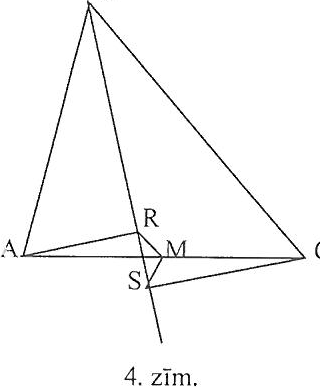{ width=150px }

4. zīm.

Pierādīt, ka $RM=SM$.

<small>
   
* questionType:
* domain:
   
</small>

## Atrisinājums

Skat. $15$. zīm.

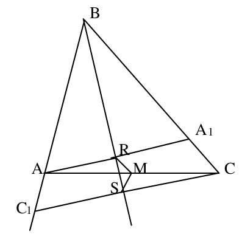{ width=200px }

15. zīm.

Tā kā $BR$ ir trijstūra $ABA_1$ augstums un bisektrise, tad $BR$ ir arī šī trijstūra mediāna; tātad $R$ ir $AA_1$ viduspunkts. Tāpēc $MR$ ir trijstūra $AA_1C$ viduslīnija; un

$$
MR=\frac{1}{2}CA_1.
$$

Līdzīgi pierāda, ka $MS=\frac{1}{2}AC_1$.

Tā kā $C_1AA_1C$ ir vienādsānu trapece, tad prasītais pierādīts.

# <lo-sample/> LV.SOL.1996.12.5

Dotas $2^n$ kartiņas, $n$ – naturāls skaitlis. Tās sakārtotas kaudzītē. Ar vienu gājienu kaudzīti var pārdalīt patvaļīgā vietā un pēc tam abas iegūtās daļas "sajaukt" savā starpā tā, ka iepriekšējās "augšējās" daļas kartīšu savstarpējais novietojums paliek nemainīgs un iepriekšējās "apakšējās" daļas kartīšu savstarpējais novietojums – tāpat.  
Pierādīt, ka ar $n$ gājieniem pietiek, lai iegūtu jebkuru mums vēlamu kartīšu sakārtojumu.

<small>
   
* questionType:
* domain:
   
</small>

## Atrisinājums

Piešķirsim kartiņām numurus $1;2;\ldots;2^n$ tādā kārtībā, kādā tām jāparādās beigās (no apakšas uz augšu). Apskatīsim sākotnējo sakārtojumu no apakšas uz augšu. Kartiņas numuri izvietojušies kaut kādā secībā. Sadalīsim tos monotoni augošos fragmentos; šādu fragmentu sākumā nav vairāk par $2^n$. Pieņemsim, ka fragmentu skaits ir $k$. Sadalīsim kaudzīti divās daļās tā, lai augšējā daļā būtu $\left[\frac{k}{2}\right]$ monotoni fragmenti. Pēc tam daļas apvienojam tā, ka abu daļu apakšējie monotonie fragmenti tagad veido vienu monotonu fragmentu, nākošie abu daļu monotonie fragmenti arī veido vienu monotonu fragmentu nav vairāk par $2^{n-1}$. Atkārtojot šādas operācijas, pēc $n$ gājieniem būs $1$ monotons fragments, t.i., kartiņas būs novietotas vajadzīgajā kārtībā.
