# <lo-sample/> LV.SOL.1997.5.1

Vienādībā

$$16 \cdot 4 = 64$$

katru ciparu izmainīt par $1$ tā, lai atkal iegūtu pareizu vienādību. Pietiek parādīt vienu veidu, kā to izdarīt.

<small>
   
* questionType:
* domain:
   
</small>

## Atrisinājums

Viena no iespējām ir šāda

$$25 \cdot 3 = 75.$$

# <lo-sample/> LV.SOL.1997.5.2

Naturālu skaitli atļauts reizināt ar $2$ vai mainīt tā ciparus vietām (nedrīkst skaitļa sākumā novietot nulli). Vai ar šādām operācijām no $1$ var iegūt

a) $96$,

b) $116$?

<small>
   
* questionType:
* domain:
   
</small>

## Atrisinājums

Ja skaitlis nedalās ar $3$, tad reizinot to ar $2$, tas arī nedalīsies ar $3$; ja skaitlis nedalās ar $3$, tad mainot tā ciparus vietām, tas arī nedalīsies ar $3$. Tā kā $1$ nedalās ar $3$, tad ar dotajām operācijām no $1$ nevar iegūt skaitli $96$.

Skaitli $116$ var iegūt šādi:

$$1 \to 2 \to 4 \to 8 \to 16 \to 32 \to 64 \to 46 \to 92 \to 29 \to 58 \to 116.$$

# <lo-sample/> LV.SOL.1997.5.3

Uz taisnes ik pēc $1$ m sēž sienāži. Brīdi pa brīdim kāds no sienāžiem pārlec pāri otram tā, ka attālums starp tiem nemainās (skat. 1. zīm.)

{ width=200px }

1. zīm.

Pēc kāda laika sienāži ieņēma tās pašas vietas, ko sākumā, tikai bija izvietojušies citā kārtībā. Pierādīt, ka malējie sienāži apmainījušies vietām.

<small>
   
* questionType:
* domain:
   
</small>

## Atrisinājums

Uzskatīsim, ka sākumā sienāži sākumā sēž uz koordinātu ass punktos ar koordinātēm $0$, $1$, $2$. Izpildot vienu lēcienu nemainās sienāža koordinātes paritāte. Tā kā sākumā tieši viens sienāzis atrodas punktā ar nepāra koordināti, tad viņš atgriezīsies savā vietā; tā kā sienāži izvietojušies citā kārtībā, tad malējie sienāži ir samainījušies vietām.

# <lo-sample/> LV.SOL.1997.5.4

Kādu lielāko daudzumu rūtiņu var iekrāsot kvadrātā ar izmēriem $5 \cdot 5$ rūtiņas tā, lai neviens stūrītis (skat 2. zīm.) nebūtu nokrāsots pilnībā?

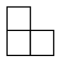{ width=100px }

2. zīm.

<small>
   
* questionType:
* domain:
   
</small>

## Atrisinājums

Var nokrāsot $15$ melnas rūtiņas (skat. $6$. zīm.)

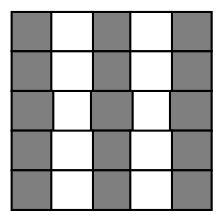{ width=100px }

$6$. zīm.

Lielāku skaitu rūtiņu iekrāsot nevar. Sadalīsim kvadrātu, kā parādīts $7$. zīm.

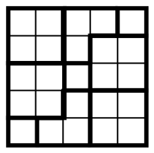{ width=100px }

$7$. zīm.

Katrā no kvadrātiem $2\cdot 2$ un katrā stūrītī var iekrāsot augstākais $2$ rūtiņas, atlikušajos $3$ vienības kvadrātos – vēl $3$ rūtiņas; tātad kopā ne vairāk par $15$ rūtiņām.

# <lo-sample/> LV.SOL.1997.5.5

Vai dažas rūtiņas burtnīcas lapā var nokrāsot melnas tā, lai katrs taisnstūris, kas sastāv no $2 \cdot 4$ rūtiņām, saturētu tieši divas melnas rūtiņas?

<small>
   
* questionType:
* domain:
   
</small>

## Atrisinājums

Jā, to var izdarīt, piemēram, tā, kā parādīts $8.$ zīmējumā.

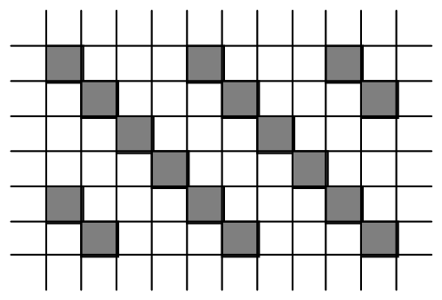{ width=250px }

8. zīm.

# <lo-sample/> LV.SOL.1997.6.1

Vai var izvēlēties $4$ skaitļus (starp tiem var būt arī vienādi) tā, ka katri divi no tiem ir vai nu savstarpēji pretēji, vai savstarpēji apgriezti, pie tam sastopami abu veidu skaitļu pāri ?

<small>
   
* questionType:
* domain:
   
</small>

## Atrisinājums

Jā, to var izdarīt, piemēram, šādi: $\{1,1,-1,-1\}$.

# <lo-sample/> LV.SOL.1997.6.2

Vai skaitlis

$$
\frac{1}{2}+\frac{3}{4}+\frac{7}{8}+\frac{15}{16}+\frac{31}{32}+\frac{63}{64}
$$

ir vesels?

<small>
   
* questionType:
* domain:
   
</small>

## Atrisinājums

Nē, šis skaitlis nav vesels

$$
\begin{aligned}
&\frac{1}{2}+\frac{3}{4}+\frac{7}{8}+\frac{15}{16}+\frac{31}{32}+\frac{63}{64}=\\
&\left(1-\frac{1}{2}\right)+\left(1-\frac{1}{4}\right)+\left(1-\frac{1}{8}\right)+\left(1-\frac{1}{16}\right)+\left(1-\frac{1}{32}\right)+\left(1-\frac{1}{64}\right)=\\
&6-\left(\frac{1}{2}+\frac{1}{4}+\frac{1}{8}+\frac{1}{16}+\frac{1}{32}+\frac{1}{64}\right)=\\
&6-\left(\frac{1}{2}+\frac{1}{4}+\frac{1}{8}+\frac{1}{16}+\frac{1}{32}+\frac{1}{64}+\frac{1}{64}\right)+\frac{1}{64}=\\
&6-\left(\frac{1}{2}+\frac{1}{4}+\frac{1}{8}+\frac{1}{16}+\frac{1}{32}+\frac{1}{32}\right)+\frac{1}{64}=\ldots\\
&6-1+\frac{1}{64}=5\frac{1}{64}.
\end{aligned}
$$

# <lo-sample/> LV.SOL.1997.6.3

Kvadrāts sastāv no $12\times 12$ rūtiņām. No tām $33$ nokrāsotas melnas. Nekādām divām melnām rūtiņām nav kopīgas malas.

Pierādīt, ka var atrast tādu rūtiņu, kurai ir kopīga mala ar vismaz divām melnām rūtiņām.

<small>
   
* questionType:
* domain:
   
</small>

## Atrisinājums

Sadalīsim doto kvadrātu $16$ kvadrātos ar izmēriem $3\cdot 3$. Vismaz viens no tiem satur ne mazāk par $3$ melnām rūtiņām. Viegli pārbaudīt, ka jebkurā gadījumā atradīsies rūtiņa, kurai ir divas kopīgas malas ar melno rūtiņu.

# <lo-sample/> LV.SOL.1997.6.4

Naturālu skaitli katru minūti var vai nu reizināt, vai dalīt vai nu ar $2$, vai $3$. Vai tieši vienas stundas laikā no skaitļa $24$ var iegūt $108$ ?

<small>
   
* questionType:
* domain:
   
</small>

## Atrisinājums

Skaitli $2^3\cdot 3^1$ ir jāpārveido par skaitli $2^2\cdot 3^3$. Katrā gājienā kāpinātāju summa mainās par $1$. Tā kā sākumā šī summa ir $4$ – pāra skaitlis, un mēs izpildīsim $60$ gājienus, tad arī beigās šai summai ir jābūt pāra skaitlim; taču $2+3$ nav pāra skaitlis. Tātad tieši stundas laikā nav iespējams no skaitļa $24$ iegūt skaitli $108$.

# <lo-sample/> LV.SOL.1997.6.5

Vai dažas rūtiņas burtnīcas lapā var nokrāsot melnas tā, lai katrs taisnstūris, kas sastāv no $2\times 4$ rūtiņām, saturētu tieši vienu melnu rūtiņu ?

<small>
   
* questionType:
* domain:
   
</small>

## Atrisinājums

Jā, to var izdarīt, piemēram, tā, kā parādīts $9.$ zīmējumā.

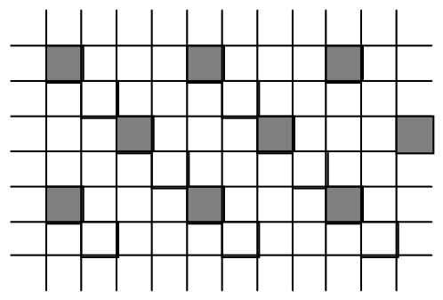{ width=250px }

9. zīm.

# <lo-sample/> LV.SOL.1997.7.1

Uzrakstīt izteiksmi

$$
1-(2-(3-(4-(5-(6-(7-(8-(9-x))))))))
$$

formā $ax+b$, kur $a$ un $b$ – veseli skaitļi.

<small>
   
* questionType:
* domain:
   
</small>

## Atrisinājums

Pārveidojot, iegūstam

$$
\begin{aligned}
&1-(2-(3-(4-(5-(6-(7-(8-(9-x))))))))=\\
&(1-2+3-4+5-6+7-8+9)-x=\\
&(-1)\cdot x+5.
\end{aligned}
$$

# <lo-sample/> LV.SOL.1997.7.2

Vai pastāv tādi naturāli skaitļi $n$ un $k$, ka

$$
n^2=12\cdot k^3\ ?
$$

<small>
   
* questionType:
* domain:
   
</small>

## Atrisinājums

Jā, var izvēlēties, piemēram, skaitļus $n=12^2$, $k=12$.

# <lo-sample/> LV.SOL.1997.7.3

Plaknē doti $5$ punkti. Caur katriem diviem no tiem novilkta taisne. Cik dažādu taisņu novilkts?

Uzrādiet visas iespējas un pamatojiet, ka citu nav.

<small>
   
* questionType:
* domain:
   
</small>

## Atrisinājums

Šķirosim gadījumus, atkarībā no tā kāds lielākais punktu skaits atrodas uz vienas taisnes.

1) Uz vienas taisnes atrodas $5$ punkti; tad citu punktu nav un taisne ir viena (skat. 10. zīm.)

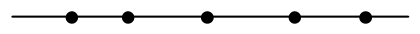{ width=200px }

10. zīm.

2) Uz vienas taisnes atrodas $4$ punkti; tad piektais punkts nepieder šai taisnei un veidojas $5$ taisnes (skat. 11. zīm.)

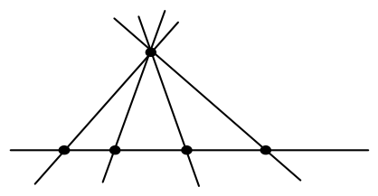{ width=200px }

11. zīm.

3) Uz vienas taisnes atrodas $3$ punkti (teiksim $A$, $B$ un $C$); tad iespējami divi gadījumi:

a) pārējie divi punkti $X$ un $Y$ atrodas uz vienas taisnes ar kādu no minētajiem $3$ punktiem; tad iegūstam $6$ taisnes (skat. 12. zīm.),

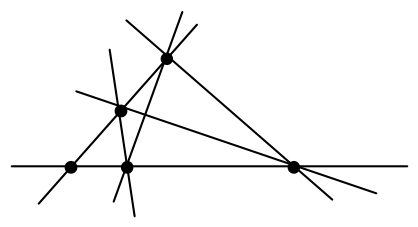{ width=200px }

12. zīm.

b) pārējie divi punkti $X$ un $Y$ neatrodas uz vienas taisnes ar kādu no minētajiem $3$ punktiem; tad iegūstam $8$ taisnes (skat. 13. zīm.).

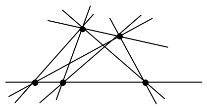{ width=200px }

13. zīm.

4) Nekādi trīs punkti neatrodas uz vienas taisnes; tad veidojas $10$ taisnes (skat. 14. zīm.).

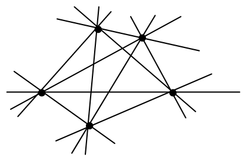{ width=200px }

14. zīm.

# <lo-sample/> LV.SOL.1997.7.4

Jānis un Juris nopirka $100$ litrus "Fanta"-s pudelēs pa $0{,}5\,\mathrm{l}$, $0{,}7\,\mathrm{l}$, un $1\,\mathrm{l}$. Pierādīt, ka viņi noteikti var sadalīt dzērienu divās līdzīgās daļās, neatverot pudeles.

<small>
   
* questionType:
* domain:
   
</small>

## Atrisinājums

Ja $0{,}5$ l un $1$ l pudeles kopā satur ne mazāk kā $50$ l "Fanta"-s, tad ar tām var izveidot $50$ litru daļu Jānim, pārējo atdodot Jurim.

Pretējā gadījumā $0{,}7$ l pudeles kopā satur vairāk par $50$ litriem "Fanta"-s. Tad ar tām var izveidot $49$ l "Fanta"-s. Tā kā ne $100$ l ne $99{,}5$ l nevar izveidot no pudelēm $0{,}7$ l, tad ir vai nu vismaz viena $1$ l pudele, vai divas $0{,}5$ l pudeles; pievienojot $1$ litru $49$ litriem, iegūsim $50$ l "Fanta"-s.

# <lo-sample/> LV.SOL.1997.7.5

Vai kvadrātu ar izmēriem $7\times 7$ rūtiņas var sagriezt kvadrātos, kuru izmēri ir $2\times 2$ un $3\times 3$ rūtiņas?

<small>
   
* questionType:
* domain:
   
</small>

## Atrisinājums

Nē, nevar. Iekrāsosim kvadrāta rūtiņas, kā parādīts 15. zīmējumā.

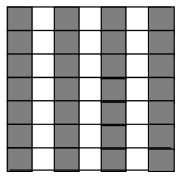{ width=150px }

15. zīm.

Šajā kvadrātā melno rūtiņu ir par $7$ vairāk nekā balto. Katrā kvadrātā $2 \cdot 2$ ir vienāds skaits melno un balto rūtiņu; bet kvadrātā $3 \cdot 3$ vienas krāsas rūtiņu ir par $3$ vairāk nekā otras krāsas rūtiņu. Tā kā $7$ nedalās ar $3$, tad prasītais sadalījums nav iespējams.

# <lo-sample/> LV.SOL.1997.8.1

Saīsināt daļu $\dfrac{x^8-1}{x^2+1}$.

<small>
   
* questionType:
* domain:
   
</small>

## Atrisinājums

Pārveidojot, iegūstam:

$$
\frac{x^8-1}{x^2+1}=\frac{(x^4-1)\cdot(x^4+1)}{x^2+1}=\frac{(x^2-1)\cdot(x^2+1)\cdot(x^4+1)}{x^2+1}=(x^2-1)\cdot(x^4+1)
$$

# <lo-sample/> LV.SOL.1997.8.2

Ciparu virkni veido sekojoši: divi pirmie cipari tajā ir $2$ un $3$, un ar katru kārtējo gājienu aprēķina abu pēdējo virknes ciparu reizinājumu un tā ciparus pievieno virknei. Tātad virknes sākums ir šāds:

$$2, 3, 6, 1, 8, 8, 6, 4, \ldots$$

Vai šajā virknē ir sastopams cipars $7$?

<small>
   
* questionType:
* domain:
   
</small>

## Atrisinājums

Virknes turpinājumu viennozīmīgi nosaka tās pēdējie $2$ cipari (protams jāņem vērā, ka šajā vietā pilnībā uzrakstīts pēdējais skaitlis); uzrakstām virkni:

$$
2, 3, 6, 1, 8, 8, 6, 4, 2, 4, 8, \underline{3, 2}, 6, 1, 2, 2, 4, 8, \underline{3, 2}, \ldots
$$

Redzam, ka virkne tālāk periodiski atkārtosies, un cipara $7$ šajā virknē nav

# <lo-sample/> LV.SOL.1997.8.3

Izliektā četrstūrī $ABCD$ izpildās vienādības

$$\angle A=\angle B,\quad BC=1,\quad AD=3.$$

Pierādīt, ka $CD>2$.

<small>
   
* questionType:
* domain:
   
</small>

## Atrisinājums

Skat. $16.$ zīm.

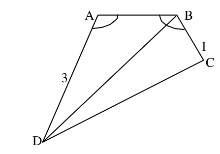{ width=200px }

16. zīm.

No dotā seko, ka $\angle DAB=\angle ABC>\angle ABD$. Tā kā trijstūrī $ABD$ pretī lielākam leņķim atrodas lielāka mala, tad $BD>AD=3$; no šejienes iegūstam prasīto nevienādību:

$$
DC>DB-BC>3-1=2.
$$

# <lo-sample/> LV.SOL.1997.8.4

Doti $17$ dažādi naturāli skaitļi; neviens no tiem nepārsniedz $25$.

Pierādīt, ka no tiem var izvēlēties divus tādus, kuru reizinājums ir vesela skaitļa kvadrāts.

<small>
   
* questionType:
* domain:
   
</small>

## Atrisinājums

Aplūkosim skaitļu grupas

$$
\{1, 4, 9, 16, 25\},\ \{2, 8, 18\},\ \{3, 12\},\ \{5, 20\},\ \{6, 24\}.
$$

Tās kopā satur $14$ skaitļus; ārpus šīm grupām ir $11$ skaitļi no $1$ līdz $25$. Tātad no $17$ izvēlētajiem skaitļiem vismaz $6$ pieder izvēlētajām $5$ grupām. Tas nozīmē, ka vismaz divi no izvēlētajiem skaitļiem pieder vienai grupai; viegli pārbaudīt, ka to reizinājums ir vesela skaitļa kvadrāts.

# <lo-sample/> LV.SOL.1997.8.5

Istabas forma ir astoņstūris (varbūt ieliekts). Pierādīt, ka to var pilnībā apgaismot ar divām lampām.

(Lampas ir punktveida un izstaro uz visām pusēm; ja lampa atrodas pie sienas, tā apgaismo arī visu šo sienu).

<small>
   
* questionType:
* domain:
   
</small>

## Atrisinājums

Astoņstūri ar diagonālēm (kas savā starpā nešķeļas) sadalām $6$ trijstūros. Astoņstūra virsotnes sanumurējam ar skaitļiem $1$, $2$, $3$ tā, lai katrā trijstūrī būtu visi numuri. Vismaz viens no skaitļiem tiks lietots ne vairāk par $2$ reizēm. Virsotnēs, kurās ierakstīts šis skaitlis, ievietojam lampas; acīmredzot viss astoņstūris būs apgaismots.

# <lo-sample/> LV.SOL.1997.9.1

Pierādīt, ka pozitīviem $a$, $b$ un $c$ pastāv identitāte

$$\frac{a}{b(a+b)}+\frac{b}{c(c+b)}+\frac{c}{a(a+c)}=\frac{b}{a(a+b)}+\frac{c}{b(b+c)}+\frac{a}{c(c+a)}.$$

<small>
   
* questionType:
* domain:
   
</small>

## Atrisinājums

Izmantojot identitāti
$$
\frac{1}{x}-\frac{1}{x+y}=\frac{y}{x\cdot(x+y)}
$$
Pārveidojam identitātes kreiso pusi
$$
\frac{a}{b(a+b)}+\frac{b}{c(c+b)}+\frac{c}{a(a+c)}=
$$
$$
\left(\frac{1}{b}-\frac{1}{a+b}\right)+\left(\frac{1}{c}-\frac{1}{c+b}\right)+\left(\frac{1}{a}-\frac{1}{a+c}\right)=
$$
$$
\left(\frac{1}{a}-\frac{1}{a+b}\right)+\left(\frac{1}{b}-\frac{1}{c+b}\right)+\left(\frac{1}{c}-\frac{1}{a+c}\right)=
$$
$$
\frac{b}{a(a+b)}+\frac{c}{b(b+c)}+\frac{a}{c(c+a)}.
$$

# <lo-sample/> LV.SOL.1997.9.2

Kvadrāts sastāv no $3\times 3$ rūtiņām. Vai var rūtiņās ierakstīt naturālus skaitļus no $3$ līdz $11$ (visus dažādus) tā, lai pirmās rindiņas un pirmās kolonnas skaitļu reizinājumi būtu savā starpā vienādi; otrās rindiņas un otrās kolonnas – arī; trešās rindiņas un trešās kolonnas – arī.

<small>
   
* questionType:
* domain:
   
</small>

## Atrisinājums

Jā, var. Skat., piemēram, $17.$ zīmējumu.

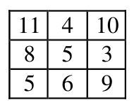{ width=100px }

$17.$ zīm.

# <lo-sample/> LV.SOL.1997.9.3

Kādiem naturāliem $n$ visi trīs skaitļi

$$n-1996,\quad n,\quad n+1996$$

ir pirmskaitļi?

<small>
   
* questionType:
* domain:
   
</small>

## Atrisinājums

Dotie skaitļi, dalot ar $3$, dod dažādus atlikumus; tiešām
$$
n \equiv n \pmod{3},\quad n-1996 \equiv n+2 \pmod{3},\quad n+1996 \equiv n+1 \pmod{3}.
$$
Tātad viens no šiem skaitļiem dalās ar $3$. Šis skaitlis nav pirmskaitlis tikai, ja ir vienāds ar $3$; tātad $n-1996=3$. Bet tādā gadījumā $n+1996=3995$ nav pirmskaitlis, jo dalās ar $5$. Tātad šāda skaitļa $n$ nav.

# <lo-sample/> LV.SOL.1997.9.4

Divu pusriņķu diametri atrodas uz vienas taisnes; horda $MN$ paralēla diametriem un pieskaras mazākajam pusriņķim (skat. 3. zīm.).

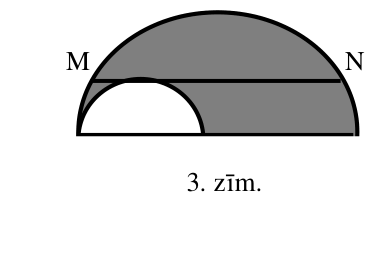{ width=200px }

3. zīm.

Dots, ka $MN=20$. Aprēķināt iesvītrotās daļas laukumu.

<small>
   
* questionType:
* domain:
   
</small>

## Atrisinājums

Skat. $18.$ zīmējumu.

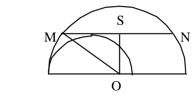{ width=200px }

18. zīm.

No Pitagora teorēmas seko, ka $MS^2=R^2-r^2$, tāpēc meklējamais laukums ir

$$
\frac{1}{2}\pi(R^2-r^2)=\frac{1}{2}\pi\cdot\left(\frac{MN}{2}\right)^2=50\cdot\pi.
$$

# <lo-sample/> LV.SOL.1997.9.5

Jānim ir $5$ lati piecu, desmit un divdesmit santīmu monētās; monētu pavisam ir $39$. Pierādīt, ka divdesmit santīmu monētu ir vairāk nekā piecu santīmu monētu

<small>
   
* questionType:
* domain:
   
</small>

## Atrisinājums

Dotos nosacījumus pierakstīsim vienādojumu sistēmas veidā.

($x$ – $5$ santīmu monētu skaits, $y$ – $10$ santīmu monētu skaits, $z$ – $20$ santīmu monētu skaits.

$$
\begin{cases}
x+y+z=39\\
5x+10y+20z=500.
\end{cases}
$$

Pareizinot pirmo vienādojumu ar $10$ un atņemot no otrā iegūsim:

$$
-5x+10z=110.
$$

Pieņemsim pretējo, ka $x>z$; tad

$$
10z=110+5x>110+5z\Rightarrow 5z>110\Rightarrow z>22;
$$

Taču tad $5x+10y+20z\ge 5z+20z>25\cdot 22>500$. Iegūta pretruna.

# <lo-sample/> LV.SOL.1997.10.1

Pierādīt, ka pozitīviem $a$ un $b$ pastāv nevienādība

$$
a^2b+b^2a \le a^3+b^3.
$$

<small>
   
* questionType:
* domain:
   
</small>

## Atrisinājums

Doto nevienādību var pārveidot formā

$$
a^2b+b^2a\le a^3+b^3 \Leftrightarrow
$$

$$
a^3-a^2b+b^3-b^2a\ge 0 \Leftrightarrow
$$

$$
a^2(a-b)+b^2(b-a)\ge 0 \Leftrightarrow
$$

$$
(a^2-b^2)(a-b)\ge 0 \Leftrightarrow
$$

$$
(a-b)^2(a+b)\ge 0,
$$

kas, protams, ir patiesa.

# <lo-sample/> LV.SOL.1997.10.2

Kvadrātā ievilkta riņķa līnija ar rādiusu $R$. Taisne, kas tai pieskaras, nošķeļ no kvadrāta taisnleņķa trijstūri. Pierādīt, ka tā hipotenūza īsāka par $R$.

<small>
   
* questionType:
* domain:
   
</small>

## Atrisinājums

Skat. $19.$ zīmējumu.

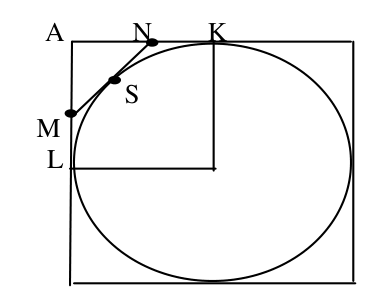{ width=150px }

19. zīm.

No pieskaru īpašības, kas vilktas no viena punkta seko vienādība

$$
AM+AN+MN=(AM+MS)+(AN+NS)=
$$

$$
(AM+ML)+(AN+NK)=2R.
$$

Ievērosim, ka $AM+AN>MN$ ; tātad

$$
MN<R.
$$

# <lo-sample/> LV.SOL.1997.10.3

Vai kvadrātu, kas sastāv no $15 \times 15$ rūtiņām, var pārklāt ar $225$ figūrām, katra no kurām ir vai nu 4.zīm. parādītais paralelograms, vai trijstūris?

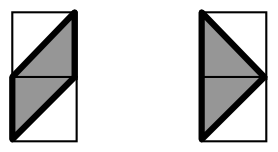{ width=150px }

4. zīm.

<small>
   
* questionType:
* domain:
   
</small>

## Atrisinājums

Nē, nevar. Iekrāsosim doto kvadrātu šaha galdiņa kārtībā. Tad melno un balto lauciņu skaits nav vienāds. Taču katra no dotajām figūrām pārklāj vienādus baltos un melnos laukumus; pretruna.

# <lo-sample/> LV.SOL.1997.10.4

Šaurleņķa trijstūris ievilkts riņķa līnijā. Pierādīt, ka punkti, kas simetriski tā augstumu krustpunktam attiecībā pret malām, atrodas uz riņķa līnijas

<small>
   
* questionType:
* domain:
   
</small>

## Atrisinājums

Apvilksim ap doto trijstūri $ABC$ riņķa līniju (skat. 20. zīm.).

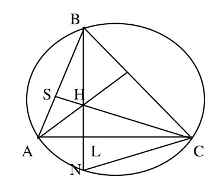{ width=150px }

20. zīm.

Mums ir jāpierāda, ka $HL=NL$. Lai to pierādītu, pierādīsim, ka trijstūri $HLC$ un $NLC$ ir vienādi; tā kā tie ir taisnleņķa trijstūri ar kopīgu kateti, atliek pierādīt, ka leņķi $HCL$ un $NCL$ ir vienādi. Tiešām

$$
\angle HCL=\angle SCA=90^{\circ}-\angle BAC=
$$

$$
\angle ABL=\angle ABN=\angle ACN=\angle LCN.
$$

Izmantota teorēma par ievilktajiem leņķiem.

# <lo-sample/> LV.SOL.1997.10.5

Dots, ka $a$, $b$, $c$, $d$ -- naturāli skaitļi un $ab=cd$.

Pierādīt, ka $a+b+c+d$ nav pirmskaitlis.

<small>
   
* questionType:
* domain:
   
</small>

## Atrisinājums

Pieņemsim pretējo, ka $a+b+c+d$ ir pirmskaitlis. Tad

$$
a\cdot(a+b+c+d)=a^2+ab+ac+ad=
$$

$$
a^2+cd+ac+ad=(a+c)\cdot(a+d).
$$

Tātad $(a+c)\cdot(a+d)$ dalās ar $(a+b+c+d)$. Tā kā $(a+b+c+d)$ ir pirmskaitlis, tad $a+c$ vai $a+d$ dalās ar $(a+b+c+d)$, bet tas nav iespējams, jo dalītājs ir lielāks par dalāmo.

# <lo-sample/> LV.SOL.1997.11.1

a) Pierādīt, ka pozitīviem $x$ izpildās nevienādība $x+\frac{1}{x}\ge 2$.

b) Pierādīt, ka pozitīviem $a$, $b$ un $c$ vismaz viens no skaitļiem
$$
\frac{a}{b}+\frac{b}{c}+\frac{c}{a}\ \text{un}\ \frac{b}{a}+\frac{c}{b}+\frac{a}{c}
$$
nav mazāks par $3$.

<small>
   
* questionType:
* domain:
   
</small>

## Atrisinājums

a) Pielietojam nevienādību par divu skaitļu vidējo aritmētisko un vidējo ģeometrisko.

$$
x+\frac{1}{x}\geq 2\cdot\sqrt{x\cdot\frac{1}{x}}=2.
$$

b) Izmantojot iepriekšējo nevienādību, iegūstam

$$
\left(\frac{a}{b}+\frac{b}{c}+\frac{c}{a}\right)+\left(\frac{b}{a}+\frac{c}{b}+\frac{a}{c}\right)=
$$

$$
\left(\frac{a}{b}+\frac{b}{a}\right)+\left(\frac{b}{c}+\frac{c}{b}\right)+\left(\frac{c}{a}+\frac{a}{c}\right)\ge 2+2+2=6.
$$

Tātad vismaz viens no dotajiem skaitļiem ir ne mazāks par $3$.

Faktiski, izmantojot nevienādību par $3$ skaitļu vidējo aritmētisko un vidējo ģeometrisko, var pierādīt, ka abi dotie skaitļi ir ne mazāki par $3$.

$$
\frac{a}{b}+\frac{b}{c}+\frac{c}{a}\ge 3\cdot \sqrt[3]{\frac{a}{b}\cdot\frac{b}{c}\cdot\frac{c}{a}}=3.
$$

# <lo-sample/> LV.SOL.1997.11.2

Taisnleņķa trijstūra $ABC$ laukums ir $1$. Katrai $ABC$ virsotnei atrodam simetrisko punktu attiecībā pret tās pretmalu. Atrast laukumu trijstūrim, kura virsotnes ir šie trīs simetriskie punkti.

<small>
   
* questionType:
* domain:
   
</small>

## Atrisinājums

Skat. $21.$ zīm.

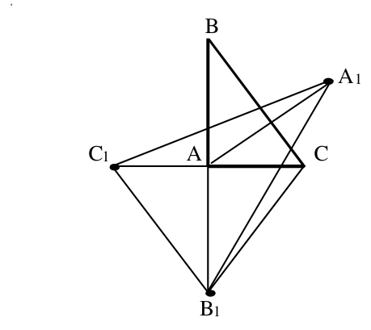{ width=200px }

$21.$ zīm.

Ja trijstūriem ir vienādi pamati un augstumi, tad to laukumi ir vienādi; tāpēc

$$
S_{A_1AB_1}=S_{A_1AB}\quad \text{un}\quad S_{A_1AC_1}=S_{A_1AC}.
$$

No šejienes

$$
S_{A_1AB_1}+S_{A_1AC_1}=S_{ABA_1C}=2\cdot S_{ABC}=2.
$$

Tā kā

$$
S_{AC_1B_1}=S_{ABC}=1,\ \text{tad}
$$

$$
S_{A_1B_1C_1}=2+1=3.
$$

# <lo-sample/> LV.SOL.1997.11.3

Dots, ka $ABCD$ – izliekts četrstūris ar diagonāļu krustpunktu $O$; $M$ un $N$ ir atbilstoši trijstūriem $ABO$ un $CDO$ apvilkto riņķa līniju centri. Pierādīt, ka
$$
MN\ge \frac{AB+CD}{4}.
$$

<small>
   
* questionType:
* domain:
   
</small>

## Atrisinājums

Skat. $22.$ zīm.

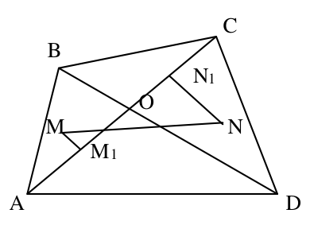{ width=200px }

$22.$ zīm.

$MM_1$ ir nogriežņa $OA$ vidusperpendikuls, $NN_1$ -- nogriežņa $OC$ vidusperpendikuls.

Iegūstam

$$MN\ge M_1N_1=OM_1+ON_1=\frac{1}{2}AC.$$

Līdzīgi pierāda, ka $MN\ge \frac{1}{2}BD$. Tāpēc

$$
\begin{aligned}
MN&\ge \frac{1}{4}(AC+BD)=\frac{1}{4}((AO+BO)+(CO+DO))>\\
&\frac{1}{4}(AB+CD).
\end{aligned}
$$

# <lo-sample/> LV.SOL.1997.11.4

Vai var uz $10$ sarkanām un $1$ zilas kartiņas uzrakstīt pa naturālam skaitlim tā, lai vienlaicīgi izpildās šādas trīs īpašības:

a) nekādu $5$ sarkano skaitļu reizinājums nedalās ar zilo skaitli,

b) katru $6$ sarkano skaitļu reizinājums dalās ar zilo skaitli;

c) nekādi divi sarkanie skaitļi nedalās viens ar otru.

<small>
   
* questionType:
* domain:
   
</small>

## Atrisinājums

Var izvēlēties, piemēram, šādus $10$ sarkanos skaitļus:

$$2p_1, 2p_2,\ldots,2p_{10},$$

kur $p_1$, $p_2,\ldots,p_{10}$ -- dažādi nepāra pirmskaitļi, bet zilo skaitli $2^6$. Viegli pārbaudīt, ka visi uzdevuma nosacījumi izpildās.

# <lo-sample/> LV.SOL.1997.11.5

Mēneša laikā katra klases skolēna draugu skaits mainījās tieši par $1$ (visas draudzības ir abpusējas un tiek apskatītas tikai šīs klases ietvaros). Pierādīt, ka klasē ir pāra skaits skolēnu.

<small>
   
* questionType:
* domain:
   
</small>

## Atrisinājums

Apzīmēsim skolēnu draudzību skaitus mēneša sākumā un beigās attiecīgi ar $a_1$ un $b_1$, $a_2$ un $b_2$, ... , $a_n$ un $b_n$.

Ievērosim, ka $a_1+a_2+\cdots+a_n$ un $b_1+b_2+\cdots+b_n$ ir pāra skaitļi, jo katra draudzība tiek ieskaitīta $2$ reizes. Iegūstam

$$
2k=(a_1-b_1)+(a_2+b_2)+\cdots+(a_n+b_n)=
\underbrace{\pm 1\pm 1\pm\cdots\pm 1}_{n\ \text{reizes}}
$$

No šejienes seko, ka $n$ ir pāra skaitlis.

# <lo-sample/> LV.SOL.1997.12.1

Pierādīt, ka patvaļīgiem $a_1,a_2,\ldots,a_n$ pastāv identitāte
$$
\frac{a_1}{a_2(a_1+a_2)}+\frac{a_2}{a_3(a_2+a_3)}+\cdots+\frac{a_n}{a_1(a_n+a_1)}
=
\frac{a_2}{a_1(a_1+a_2)}+\frac{a_3}{a_2(a_2+a_3)}+\cdots+\frac{a_1}{a_n(a_n+a_1)}.
$$

<small>
   
* questionType:
* domain:
   
</small>

## Atrisinājums

Izmantojot vienādību

$$\frac{1}{x}-\frac{1}{x+y}=\frac{y}{x\cdot(x+y)}$$

pārveidojam prasītās identitātes kreisās puses izteiksmi.

$$
\begin{aligned}
&\frac{a_1}{a_2(a_1+a_2)}+\frac{a_2}{a_3(a_2+a_3)}+\cdots+\frac{a_n}{a_1(a_n+a_1)}=\\
&\left(\frac{1}{a_2}-\frac{1}{a_1+a_2}\right)+\left(\frac{1}{a_3}-\frac{1}{a_2+a_3}\right)+\cdots+\left(\frac{1}{a_1}-\frac{1}{a_n+a_1}\right)=\\
&\left(\frac{1}{a_1}-\frac{1}{a_1+a_2}\right)+\left(\frac{1}{a_2}-\frac{1}{a_2+a_3}\right)+\cdots+\left(\frac{1}{a_n}-\frac{1}{a_n+a_1}\right)=\\
&\frac{a_2}{a_1(a_1+a_2)}+\frac{a_3}{a_2(a_2+a_3)}+\cdots+\frac{a_1}{a_n(a_n+a_1)}.
\end{aligned}
$$

# <lo-sample/> LV.SOL.1997.12.2

Vai tornis var apstaigāt šaha galdiņu tā, lai katru divu rūtiņu kopējo malu šķērsotu tieši vienu reizi?

<small>
   
* questionType:
* domain:
   
</small>

## Atrisinājums

Nē, nevar. Piemēram, rūtiņai $a2$ ir trīs kopīgas malas ar blakus rūtiņām, bet ienākot un izejot no rūtiņas tornis krusto $2$ malas.

# <lo-sample/> LV.SOL.1997.12.3

Ar $[x]$ apzīmē lielāko veselo skaitli, kas nepārsniedz $x$. Pierādīt: ja $p$ un $q$ – naturāli skaitļi, kuru lielākais kopīgais dalītājs ir $1$, tad

$$
\left[\frac{p}{q}\right]+\left[\frac{2p}{q}\right]+\left[\frac{3p}{q}\right]+\cdots+\left[\frac{(q-1)p}{q}\right]=
$$

$$
\left[\frac{q}{p}\right]+\left[\frac{2q}{p}\right]+\left[\frac{3q}{p}\right]+\cdots+\left[\frac{(p-1)q}{p}\right].
$$

<small>
   
* questionType:
* domain:
   
</small>

## Atrisinājums

Pierādījumā izmanto faktu, ka skaitļi $p, 2p, \ldots, (q-1)p$ dod visus nenulles atlikumus pēc moduļa $q$.

# <lo-sample/> LV.SOL.1997.12.4

Skaitļi $a$, $b$, $c$, $d$ atrodas starp $0$ un $1$. Pierādīt, ka var atrast tādu $x$, ka $0<x<1$ un

$$
\frac{1}{|x-a|}+\frac{1}{|x-b|}+\frac{1}{|x-c|}+\frac{1}{|x-d|}<40.
$$

<small>
   
* questionType:
* domain:
   
</small>

## Atrisinājums

Aplūkosim $5$ intervālus $(0; 0{,}2)$, $(0{,}2; 0{,}4)$, $(0{,}4; 0{,}6)$, $(0{,}6; 0{,}8)$, $(0{,}8; 1)$. Tā kā ir doti $4$ punkti, tad vismaz vienā no šiem intervāliem neatradīsies neviens no dotajiem punktiem. Par skaitli $x$ izvēlēsimies šā intervāla viduspunktu (vēl varam uzskatīt, ka ne visi punkti $a$, $b$, $c$, $d$ atrodas šā nogriežņa galapunktos. Tādā gadījumā visi skaitļi $|x-a|, |x-b|, |x-c|, |x-d|$ ir ne mazāki par $0{,}1$ (piedevām vismaz viens no skaitļiem ir lielāks par $0{,}1$); no šejienes seko pierādāmā nevienādība.

# <lo-sample/> LV.SOL.1997.12.5

Saskatiet Pitagora teorēmas pierādījumu 5. zīm. un pierakstiet to ar visiem pierādījumiem ( tā autors ir Leonardo-da Vinči).

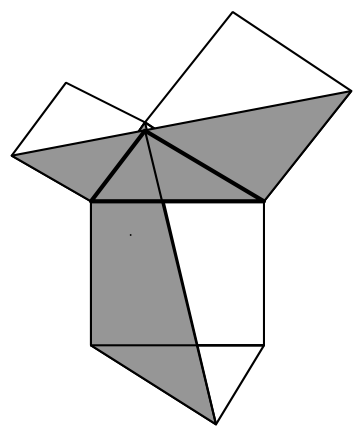{ width=150px }

5. zīm.

<small>
   
* questionType:
* domain:
   
</small>

## Atrisinājums

Apgalvojums seko no tā, ka iesvītrotie četrstūri ir vienādi. Atņemot no to laukumiem dotā taisnleņķa trijstūra laukumu, iegūsim Pitagora teorēmu.
