# <lo-sample/> LV.SOL.1998.5.1

Rindā stāv $12$ rūķīši. Katrs no viņiem vai nu vienmēr runā taisnību, vai vienmēr melo. Katrs rūķītis apgalvo: "no manis pa labi stāv vismaz viens melis". Cik starp rūķīšiem ir meļu?

<small>
   
* questionType:
* domain:
   
</small>

## Atrisinājums

Pats labējais rūķītis noteikti ir melis; tātad visi pārējie rūķīši runā patiesību. Starp rūķīšiem ir tieši viens melis.

# <lo-sample/> LV.SOL.1998.5.2

Kvadrāts sastāv no $3\cdot 3$ vienādām rūtiņām. Vai tās visas var pārsvītrot ar divām taisnēm?

(Taisne pārsvītro rūtiņu, ja tā iet caur kādu rūtiņas iekšēju punktu.)

<small>
   
* questionType:
* domain:
   
</small>

## Atrisinājums

Jā, to var izdarīt; skat. 5. zīm.

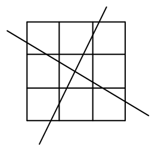{ width=100px }

5. zīm.

# <lo-sample/> LV.SOL.1998.5.3

Jānis izvēlējās naturālu skaitli, pareizināja to ar $11$, nosvītroja rezultāta pēdējo ciparu, iegūto skaitli pareizināja ar $7$, nosvītroja rezultāta pēdējo ciparu un ieguva $11$. Kādu skaitli Jānis sākumā izvēlējās? Atrodiet visas iespējas un pamatojiet, ka citu iespēju nav.

<small>
   
* questionType:
* domain:
   
</small>

## Atrisinājums

Šo uzdevumu jārēķina pretējā virzienā. Pirms pēdējā cipara nosvītrošanas, bija iegūts skaitlis $\overline{11x}$. Tā kā šis skaitlis vienāds ar $7y$, tad tam jādalās ar $7$. No šejienes viegli iegūt, ka šis skaitlis ir $112$ vai $119$.

a) Pirmajā gadījumā $y=16$; tātad pirms tam bija uzrakstīts skaitlis $\overline{16a}$. Tā kā $11z=\overline{16a}$, tad viegli redzēt, ka $z=15$ (jo $11 \cdot 15=165$).

b) Otrajā gadījumā $y=17$; tātad pirms tam bija uzrakstīts skaitlis $\overline{17a}$. Tā kā $11z=\overline{17a}$, tad $z=16$ (jo $11 \cdot 16=176$).

# <lo-sample/> LV.SOL.1998.5.4

Kvadrāts sastāv no $4\cdot 4$ rūtiņām. Vai var katrā rūtiņā nostādīt pa bērnam tā, lai katram zēnam blakus stāvētu tieši $3$ meitenes, bet katrai meitenei blakus stāvētu tieši $1$ zēns?

(Divi bērni stāv blakus, ja tie atrodas rūtiņās ar kopīgu malu.)

<small>
   
* questionType:
* domain:
   
</small>

## Atrisinājums

Jā, to var izdarīt, piemēram, tā, kā parādīts 6. zīmējumā.

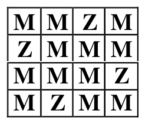{ width=100px }

6. zīm.

# <lo-sample/> LV.SOL.1998.5.5

Katrs no $8$ māksliniekiem nosūtīja katram citam apsveikumu sakarā ar piedalīšanos jebkurā gleznu izstādē.

( Dažādi mākslinieki var piedalīties dažādā skaitā izstāžu).

Vai var gadīties, ka pavisam kopā tiek nosūtīti tieši $1997$ apsveikumi?

<small>
   
* questionType:
* domain:
   
</small>

## Atrisinājums

Katrā gadījumā mākslinieks nosūta tieši $7$ kartiņas. Tātad kopējam apsveikuma kartiņu skaitam ir jādalās ar $7$, bet $1997$ ar $7$ nedalās. Tātad prasītā situācija nav iespējama.

# <lo-sample/> LV.SOL.1998.6.1

Vai var uzzīmēt trīs taisnes nogriežņus tā, lai tiem visiem būtu dažāds krustpunktu skaits ar abiem pārējiem?

Bet vai tā var uzzīmēt trīs patvaļīgas līnijas?

<small>
   
* questionType:
* domain:
   
</small>

## Atrisinājums

a) Nē, nevar. Tā kā diviem nogriežņiem ir ne vairāk par vienu krustpunktu, tad iespējamais krustpunktu skaits katram nogrieznim ir $0$, $1$ vai $2$. Taču, ja kādam nogrieznim ir $0$ krustpunktu ar diviem citiem, tad nav nogriežņa, kam ir $2$ krustpunkti ar citiem (jo ar vienu no tiem tas nekrustojas). Tas nozīmē, ka atliek tikai $2$ vērtības, bet nogriežņu ir $3$.

b) Jā, tādas līnijas var uzzīmēt; skat. $7.$ zīm.

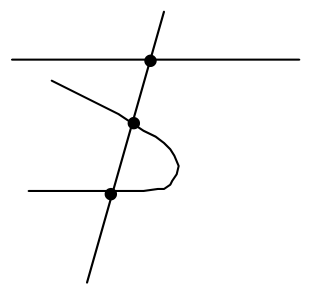{ width=150px }

7. zīm.

# <lo-sample/> LV.SOL.1998.6.2

Saskaitot divus naturālus skaitļus, summā ieguva $9999$. Pierādīt, ka saskaitīšanas procesā neradās neviens pārnesums no vienas šķiras otrā. Vai to var apgalvot, ja summa bija $9998$ ?

<small>
   
* questionType:
* domain:
   
</small>

## Atrisinājums

a) Sākot no labās puses, redzam, ka pārnesumu nevar būt, jo divu ciparu summa nevar būt vienāda ar $19$.

b) Nē, šajā gadījumā iespējams pretpiemērs, kurā ir pārnesumi: $4999+4999=9998$.

# <lo-sample/> LV.SOL.1998.6.3

Piecu naturālu skaitļu reizinājums ir $512$.  
Vai visi dotie skaitļi var būt dažādi?

<small>
   
* questionType:
* domain:
   
</small>

## Atrisinājums

Nē, nevar būt. Tā kā $512=2^9$, tad visi skaitļa $512$ dalītāji ir divnieka pakāpes. Bet pat piecu dažādu mazāko divnieku pakāpju reizinājums
$$
2^0\cdot 2^1\cdot 2^2\cdot 2^3\cdot 2^4=2^{10}=1024
$$
ir lielāks par $512$.

# <lo-sample/> LV.SOL.1998.6.4

Kvadrāts sastāv no $4\cdot 4$ vienādām kvadrātiskām rūtiņām. Katras rūtiņas centrā apmetas rūķītis ar baltu vai melnu cepurīti galvā, pie tam nekādi divi rūķīši ar melnām cepurītēm neredz viens otru (skatu aizsedz rūķīši ar baltām cepurītēm.). Kāds ir lielākais iespējamais rūķīšu skaits ar melnām cepurītēm?

<small>
   
* questionType:
* domain:
   
</small>

## Atrisinājums

Kvadrātā $2\cdot 2$ rūtiņas nevar būt vairāk par vienu tādu rūķīti; tāpēc lielākais iespējamais rūķīšu skaits ar melnajām cepurītēm nepārsniedz $4$ (jo kvadrātu $4\cdot 4$ var sadalīt četros kvadrātos ar izmēriem $2\cdot 2$ rūtiņas).

Tas, ka var būt $4$ rūķīši ar melnām cepurītēm, redzams $8.$ zīmē.

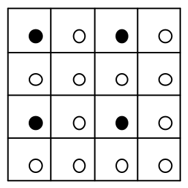{ width=150px }

8. zīm.

# <lo-sample/> LV.SOL.1998.6.5

Naturālu skaitli atļauts reizināt ar $2$, kā arī izsvītrot no tā pieraksta ciparus $0$, $3$, $6$, $9$ (varbūt tikai daļu no tiem). Vai vairākkārt izpildot šādus gājienus, no skaitļa $17$ var iegūt

a) skaitli $1$,

b) skaitli $15$ ?

<small>
   
* questionType:
* domain:
   
</small>

## Atrisinājums

a) Jā, var; piemēram, šādi:

$$17 \to 34 \to 4 \to 8 \to 16 \to 1.$$

b) Nē, nevar. Sākotnējais skaitlis $17$ nedalās ar $3$. Ja skaitlis nedalās ar $3$, tad, izpildot norādītās operācijas, arī rezultāts nedalīsies ar $3$. Tātad arī pēc vairākām operācijām rezultāts nedalīsies ar $3$ (atcerēsimies, ka dalāmība ar $3$ ir atkarīga no tā, vai skaitļa ciparu summa dalās ar $3$). Tas nozīmē, ka skaitli $15$ iegūt nevarēs

# <lo-sample/> LV.SOL.1998.7.1

Doti $3$ skaitļi. Katru divu skaitļu summa ir pozitīva. Vai visu skaitļu summa var būt negatīva?

<small>
   
* questionType:
* domain:
   
</small>

## Atrisinājums

Nē, nevar būt. Vismaz viens no skaitļiem (teiksim $a$) ir pozitīvs. Bet tādā gadījumā

$$a+b+c>b+c>0.$$

# <lo-sample/> LV.SOL.1998.7.2

Pierādīt, ka, vienu reizi salokot trijstūrveida papīra lapu, var iegūt

a) piecstūri,

b) sešstūri,

c) septiņstūri.

Pietiek parādīt vienu lapu, kurai tas iespējams.

<small>
   
* questionType:
* domain:
   
</small>

## Atrisinājums

Piemēri parādīti $9.$ zīmējumā.

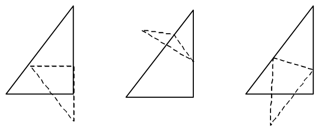{ width=300px }

9. zīm.

# <lo-sample/> LV.SOL.1998.7.3

Pierādīt, ka daļas $\frac{1}{1997}$ mazākais periods satur ne vairāk par divsimt pieciniekiem.

<small>
   
* questionType:
* domain:
   
</small>

## Atrisinājums

Ja dalījumā rodas piecinieks, tas nozīmē, ka iepriekšējais atlikums atrodas starp $0{,}5\cdot 1997$ un $0{,}6\cdot 1997$. Šajā intervālā ir tieši $200$ veseli skaitļi. Tiklīdz atlikumi atkārtojas, periods beidzas.

# <lo-sample/> LV.SOL.1998.7.4

Planētai Mungo ir lodes forma. Uz tās ekvatora aug vienāda garuma koki. Pūšot austrumu vējam, visi koki noliecas pie planētas virsmas, cieši tai piekļaujoties; kopā koki pārklāj tieši pusi ekvatora garuma (varbūt dažus posmus pārklāj vairākkārt). Pūšot rietumu vējam, koki noliecas pretējā virzienā, atkal cieši piekļaujoties planētas virsmai. Pierādīt, ka arī tagad koki pārklāj tieši pusi ekvatora garuma.

<small>
   
* questionType:
* domain:
   
</small>

## Atrisinājums

Otreiz pārklātos ekvatora posmus var iegūt, pirmajā reizē pārklāto daļu "pabīdot" uz austrumiem par viena koka garumu. Tātad arī otrajā reizē koki pārklās tieši pusi no ekvatora garuma.

# <lo-sample/> LV.SOL.1998.7.5

Pa apli izrakstīti $8$ naturāli skaitļi. katram skaitlim aprēķina to četru skaitļu summu, kas tam seko pulksteņa rādītāja virzienā, un pēc tam visus skaitļus aizstāj ar aprēķinātajām summām. Pierādīt, ka $4$ reizes atkārtojot šādas operācijas, visi skaitļi kļūs pāra skaitļi.

<small>
   
* questionType:
* domain:
   
</small>

## Atrisinājums

Apzīmēsim dotos skaitļus ar $a_1,a_2,\ldots,a_8$. Pēc pirmā gājiena iegūstam

$$b_1=a_1+a_2+a_3+a_4$$

(analoģiskas formulas ir pārējiem locekļiem).

Pēc otrā gājiena

$$
\begin{aligned}
c_1&=b_1+b_2+b_3+b_4=\\
&=a_1+2a_2+3a_3+4a_4+3a_5+2a_6+a_7 \equiv\\
&a_1+a_3+a_5+a_7 \pmod{2}.
\end{aligned}
$$

Pēc trešā gājiena

$$
\begin{aligned}
d_1&\equiv (a_1+a_3+a_5+a_7)+\\
&(a_2+a_4+a_6+a_8)+\\
&(a_3+a_5+a_7+a_1)+\\
&(a_4+a_6+a_8+a_2)\equiv 0 \pmod{2}.
\end{aligned}
$$

Tātad jau pēc trešā gājiena visi skaitļi ir pāra skaitļi; protams arī pēc ceturtā gājiena iegūsim pāra skaitļus.

# <lo-sample/> LV.SOL.1998.8.1

Dots, ka $2x+3y=0$. Vai var būt, ka $x+y$ ir

a) pozitīvs skaitlis,

b) negatīvs skaitlis,

c) nulle.

<small>
   
* questionType:
* domain:
   
</small>

## Atrisinājums

Jā, visos gadījumos viegli norādīt atbilstošos piemērus:

a) $2\cdot 3+3\cdot(-2)=0$ un $3+(-2)>0$,

b) $2\cdot(-3)+3\cdot 2=0$ un $(-3)+2<0$,

c) $2\cdot 0+3\cdot 0=0$ un $0+0=0$.

# <lo-sample/> LV.SOL.1998.8.2

Vai var uzzīmēt $5$ riņķa līnijas tā, ka pirmā pieskaras otrajai, otrā – trešajai, ..., piektā – pirmajai? Visas pieskaršanās ir ārējas; citu kopēju punktu bez minētajiem pieskaršanās punktiem riņķa līnijām nav, pie tam tās visas jāvar krustot ar vienu taisni.

<small>
   
* questionType:
* domain:
   
</small>

## Atrisinājums

Jā, to var izdarīt; skat. 10. zīmējumu.

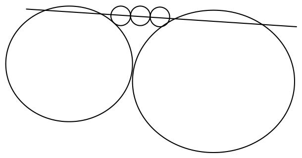{ width=300px }

10. zīm.

# <lo-sample/> LV.SOL.1998.8.3

Vai eksistē tāds naturāls skaitlis $a$, ka

$$
a+\frac{1}{a+\frac{1}{a+\frac{1}{a}}}=\frac{41}{17}\,?
$$

<small>
   
* questionType:
* domain:
   
</small>

## Atrisinājums

Nē, tāds naturāls skaitlis $a$ neeksistē. Tā kā

$$
\frac{1}{a+\frac{1}{a+\frac{1}{a}}}<1,
$$

tad $a$ ir skaitļa $\frac{41}{17}$ veselā daļa; tātad $a=2$. Bet pārbaude parāda, ka

$$
2+\frac{1}{2+\frac{1}{2+\frac{1}{2}}}=\frac{29}{12}\ne\frac{41}{17}.
$$

# <lo-sample/> LV.SOL.1998.8.4

Pierādīt, ka kvadrātā $6 \cdot 6$ rūtiņas katrā rūtiņā var ierakstīt pa naturālam skaitlim tā, lai visu ierakstīto skaitļu summa būtu nepāra skaitlis, bet katrā taisnstūrī $1 \cdot 4$ ierakstīto skaitļu summa būtu pāra skaitlis.

<small>
   
* questionType:
* domain:
   
</small>

## Atrisinājums

To var izdarīt, piemēram, tā, ka parādīts 11. zīmējumā.

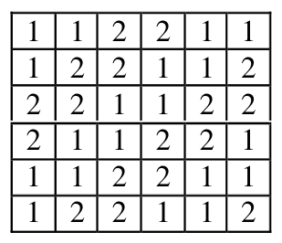{ width=150px }

11. zīm.

# <lo-sample/> LV.SOL.1998.8.5

Vai kvadrātu, kas sastāv no $101 \cdot 101$ rūtiņām, var sagriezt daļās tā, lai katra daļa būtu viena no 1. zīm. attēlotajām daļām?

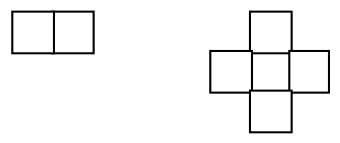{ width=150px }

1. zīm.

<small>
   
* questionType:
* domain:
   
</small>

## Atrisinājums

Izkrāsosim doto kvadrātu šaha galdiņa kārtībā; tad starpība starp melno rūtiņu skaitu un balto rūtiņu skaitu būs $1$. Katra pirmā tipa figūra pārklāj vienādu skaitu balto un melno rūtiņu; bet katra otrā tipa figūra (krusts) pārklāj par trim vienas krāsas rūtiņām vairāk nekā otras krāsas rūtiņas. Tātad, ja pārklāšana būtu iespējama, starpība starp melno un balto pārklāto rūtiņu skaitu dalītos ar $3$, bet šajā gadījumā tā nedalās ar $3$.

# <lo-sample/> LV.SOL.1998.9.1

Dots, ka $a^2+ab+b^2=1$. Pierādīt, ka

$$
a^3+b=b^3+a.
$$

<small>
   
* questionType:
* domain:
   
</small>

## Atrisinājums

Pareizinot doto vienādību ar $a-b$, iegūstam

$$
(a^2+ab+b^2)\cdot(a-b)=a-b \quad \Rightarrow
$$

$$
a^3-b^3=a-b \quad \Rightarrow \quad a^3+b=b^3+a.
$$

# <lo-sample/> LV.SOL.1998.9.2

Skat. $2.$ zīm.

{ width=250px }

$2.$ zīm.

Dots, ka $SA=SB=AN=BM=BN$. Aprēķināt $\angle ASB$.

<small>
   
* questionType:
* domain:
   
</small>

## Atrisinājums

Skat. 12. zīmējumu.

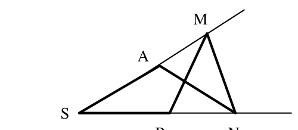{ width=250px }

12. zīm.

Ja $\angle ASB=\alpha$ tad $\angle MAN=2\alpha$, kā vienādsānu trijstūra $SAN$ ārējais leņķis; arī $\angle AMN=2\alpha$, jo trijstūris $ANM$ ir vienādsānu.

Aplūkojot trijstūri $SMN$, iegūstam vienādību:

$$
\alpha+2\alpha+2\alpha=180^{\circ}.
$$

No šejienes seko, ka meklētais leņķis ir $36^{\circ}$.

# <lo-sample/> LV.SOL.1998.9.3

Kvadrāts sastāv no $8\times 8$ rūtiņām. Kāds mazākais daudzums rūtiņu jānokrāso, lai katrā rindā būtu nokrāsots nepāra skaits, bet katrā kolonnā pāra skaits (ne $0$) rūtiņu?

<small>
   
* questionType:
* domain:
   
</small>

## Atrisinājums

Tā kā katrā kolonnā jānokrāso vismaz divas rūtiņas, tad kopējais nokrāsoto rūtiņu skaits ir ne mazāks par $16$. Piemērs ar $16$ nokrāsotām rūtiņām redzams $13$. zīmējumā.

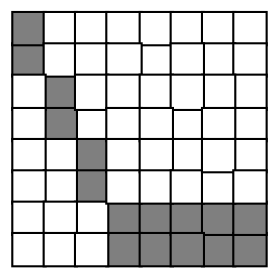{ width=150px }

13. zīm.

# <lo-sample/> LV.SOL.1998.9.4

Uz tāfeles uzrakstīts $1001$ naturāls skaitlis; tie visi ir dažādi un nepārsniedz $1997$. Pierādīt, ka no tiem var izvēlēties divus skaitļus, kuru starpība ir $4$.

<small>
   
* questionType:
* domain:
   
</small>

## Atrisinājums

Izvietosim skaitļus šādā tabulā:

| $1$ | $5$ | $9$ | $\ldots$ | $1993$ | $1997$ |
|---|---|---|---|---|---|
| $2$ | $6$ | $10$ | $\ldots$ | $1994$ |  |
| $3$ | $7$ | $11$ | $\ldots$ | $1995$ |  |
| $4$ | $8$ | $12$ | $\ldots$ | $1996$ |  |

Vismaz vienā rindā ir vismaz $251$ izvēlētais skaitlis (ja katrā rindā būtu ne vairāk par $250$ skaitļiem, tad kopā to būtu ne vairāk par $1000$).

Tā kā rindā ir ne vairāk par $500$ skaitļiem, tad vismaz divi no rindā izvietotajiem skaitļiem atradīsies blakus; šo skaitļu starpība ir $4$.

# <lo-sample/> LV.SOL.1998.9.5

Dots, ka $x^2+xy+y^2=3$. Pierādīt, ka vai nu $x^2+xy\geq 2$, vai arī $y^2+xy\geq 2$, ja $x$ un $y$ – pozitīvi skaitļi.

<small>
   
* questionType:
* domain:
   
</small>

## Atrisinājums

Ja $x \ge y$, tad $x^2 \ge xy \ge y^2$. Tā kā šo trīs skaitļu summa ir vienāda ar $3$, tad divu lielāko skaitļu summa ir ne mazāka par $2$; t.i.
$$
x^2+xy \ge 2.
$$
Ja $x<y$, tad pierādījums analoģisks.

# <lo-sample/> LV.SOL.1998.10.1

Dots, ka $x+y=1$. Vai var būt, ka
$$
x^3+y^3>1997?
$$

<small>
   
* questionType:
* domain:
   
</small>

## Atrisinājums

Jā, var būt. Ja $n$ patvaļīgs skaitlis, tad $(n+1)+(-n)=1$ un skaitlis
$$
(n+1)^3+(-n)^3=3n^2+3n+1
$$
var būt patvaļīgi liels.

# <lo-sample/> LV.SOL.1998.10.2

Skat. $3.$ zīm.

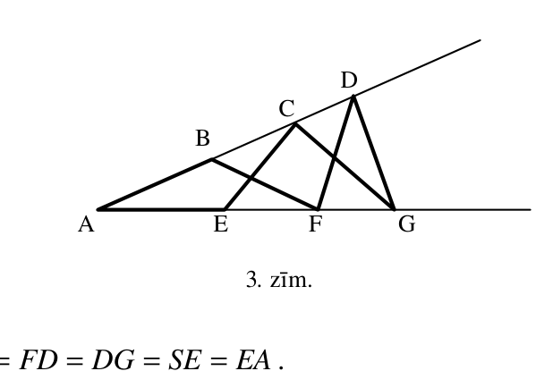{ width=300px }

$3.$ zīm.

Dots, ka $AB=BF=FD=DG=SE=EA$.

Aprēķināt $\angle BAE$.

<small>
   
* questionType:
* domain:
   
</small>

## Atrisinājums

Skat. $14.$ zīmējumu.

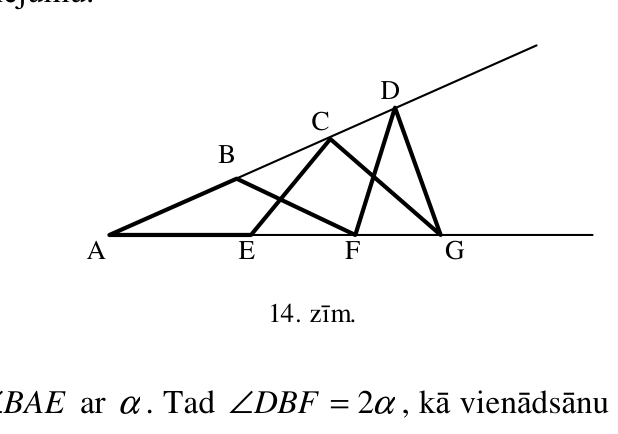{ width=300px }

14. zīm.

Apzīmēsim leņķi $\angle BAE$ ar $\alpha$. Tad $\angle DBF=2\alpha$, kā vienādsānu trijstūra $ABF$ ārējais leņķis.

Tā kā trijstūris $BFD$ ir vienādsānu, tad arī $\angle BDF=2\alpha$.

Trijstūri $DAG$ un $GDF$ ir līdzīgi (vienādsānu trijstūri ar vienādiem leņķiem pie pamata); tāpēc $\angle FDG=\angle DAG=\alpha$.

Aplūkojot trijstūri $ADG$, iegūstam

$$180^{\circ}=\angle DAG+\angle ADG+\angle AGD=\alpha+(2\alpha+\alpha)+(2\alpha+\alpha)=7\alpha.$$

Tātad meklētais leņķis ir vienāds ar $\dfrac{180^{\circ}}{7}$.

# <lo-sample/> LV.SOL.1998.10.3

Kvadrāts sastāv no $8\cdot 8$ rūtiņām. Kādu lielāko daudzumu rūtiņu var nokrāsot, lai katrā rindā būtu nokrāsots nepāra skaits, bet katrā kolonnā būtu nokrāsots pāra skaits rūtiņu?

<small>
   
* questionType:
* domain:
   
</small>

## Atrisinājums

Katrā rindā ir vismaz viena nenokrāsota rūtiņa; tātad nokrāsoto rūtiņu skaits nepārsniedz $64-8=56$.

Tas, ka var nokrāsot $56$ rūtiņas, lai izpildītos uzdevuma nosacījumi, redzams $15.$ zīmējumā.

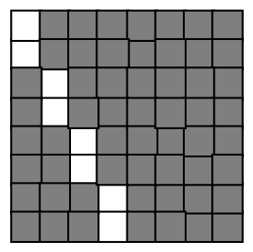{ width=150px }

15. zīm.

# <lo-sample/> LV.SOL.1998.10.4

Dots, ka $a$ – naturāls skaitlis, $p$ – pirmskaitlis, pie tam $3a+1$ un $a-8$ dalās ar $p$. Aprēķināt $p$.

<small>
   
* questionType:
* domain:
   
</small>

## Atrisinājums

No dotā seko, ka arī skaitlis $(3a+1)-3(a-8)=25$ dalās ar pirmskaitli $p$. Tātad $p=5$.

Jāpamato arī, ka eksistē šāds naturāls skaitlis $a$, kuram $3a+1$ un $a-8$ dalās ar $5$. Var, piemēram, izvēlēties skaitli $a=13$.

# <lo-sample/> LV.SOL.1998.10.5

Kvadrāts ar diagonāles garumu $d$ sagriezts $n$ taisnstūros, kuru diagonāļu garumi ir $d_1, d_2, \ldots, d_n$. Pierādīt, ka
$$
d^2 \le d_1^2+d_2^2+\cdots+d_n^2.
$$

<small>
   
* questionType:
* domain:
   
</small>

## Atrisinājums

Apzīmēsim taisnstūru malas ar $x_i$ un $y_i$, bet to laukumus ar $S_i$. Tad

$$
\begin{aligned}
d_1^2+d_2^2+\cdots+d_n^2&=\\
(x_1^2+y_1^2)+(x_2^2+y_2^2)+\cdots+(x_n^2+y_n^2)&\ge\\
(2x_1y_1)+(2x_2y_2)+\cdots+(2x_ny_n)&=\\
2(S_1+S_2+\cdots+S_n)&=2S=d^2.
\end{aligned}
$$

# <lo-sample/> LV.SOL.1998.11.1

Trijstūrī pret malām ar garumiem $a$ un $b$ atrodas leņķi, kuru lielumi ir atbilstoši $\alpha$ un $\beta$. Vai iespējams, ka
$$
(a-b)\cdot(\alpha-\beta)<0.
$$

<small>
   
* questionType:
* domain:
   
</small>

## Atrisinājums

Nē, nav iespējams. Trijstūrī pret lielāku malu atrodas lielāks leņķis. Tātad,

a) ja $a>b$, tad $\alpha>\beta$ un $(a-b)\cdot(\alpha-\beta)>0$;

b) ja $a<b$, tad $\alpha<\beta$ un $(a-b)\cdot(\alpha-\beta)>0$;

c) ja $a=b$, tad $\alpha=\beta$ un $(a-b)\cdot(\alpha-\beta)=0$.

# <lo-sample/> LV.SOL.1998.11.2

Divām riņķa līnijām ar centriem $O_1$ un $O_2$ nav kopīgu punktu. To kopīgā ārējā pieskaras tām atbilstoši punktos $A_1$ un $A_2$, bet nogrieznis $O_1O_2$ krusto tās atbilstoši punktos $B_1$ un $B_2$.

Pierādīt, ka $A_1B_1 \perp A_2B_2$. Skat. $4$. zīm.

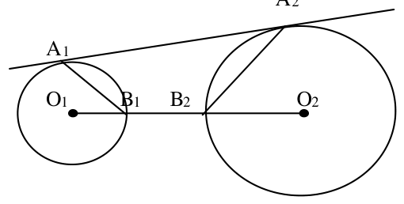{ width=250px }

$4$. zīm.

<small>
   
* questionType:
* domain:
   
</small>

## Atrisinājums

Skat. $16.$ zīmējumu.

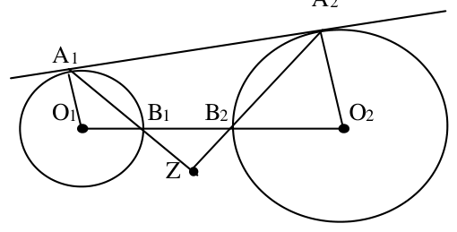{ width=250px }

$16.$ zīm.

Tā kā $\angle A_1O_1B_1+\angle A_2O_2B_2=180^{\circ}$, tad,

$$
\begin{aligned}
\angle B_1ZB_2&=180^{\circ}-(\angle ZB_1B_2+\angle ZB_2B_1)=\\
&=180^{\circ}-(\angle O_1B_1A_1+\angle O_2B_2A_2)=\\
&=180^{\circ}-\left(\frac{180^{\circ}-\angle A_1O_1B_1}{2}+\frac{180^{\circ}-\angle A_2O_2B_2}{2}\right)=\\
&=180^{\circ}-180^{\circ}+\frac{\angle A_1O_1B_1+\angle A_2O_2B_2}{2}=90^{\circ}.
\end{aligned}
$$

Prasītais pierādīts.

# <lo-sample/> LV.SOL.1998.11.3

Dots, ka $a, b, c, d$ – naturāli skaitļi un
$$
\sqrt{a}+\sqrt{b}=\sqrt{c}+\sqrt{d}.
$$
Pierādīt, ka $abcd$ ir naturāla skaitļa kvadrāts.

<small>
   
* questionType:
* domain:
   
</small>

## Atrisinājums

Kāpinot doto vienādību kvadrātā, iegūstam:

$$
a+2\sqrt{a\cdot b}+b=c+2\sqrt{c\cdot d}+d \quad \Rightarrow
$$

$$
2\sqrt{a\cdot b}-2\sqrt{c\cdot d}=c+d-a-b.
$$

Atkal kāpinot šo vienādību kvadrātā, iegūstam:

$$
4a\cdot b+4c\cdot d-8\sqrt{a\cdot b\cdot c\cdot d}=(c+d-a-b)^2.
$$

Tātad $\sqrt{a\cdot b\cdot c\cdot d}$ ir racionāls skaitlis; tas nozīmē, ka $a\cdot b\cdot c\cdot d$ ir racionāla skaitļa kvadrāts.

Naturāls skaitlis, kas ir racionāla skaitļa kvadrāts, ir naturāla skaitļa kvadrāts (tiešām, ja racionāls skaitlis nav vesels $r=\frac{m}{n}$ -- nesaīsināma daļa, $n>1$, tad arī tā kvadrāts $r^2=\frac{m^2}{n^2}$ nav vesels skaitlis).

# <lo-sample/> LV.SOL.1998.11.4

Skaitļu virkni $x_1, x_2, \ldots$ veido sekojoši:
$$
x_1=1,\ x_2=3,\ x_3=5,
$$
$$
x_{n+3}=x_n-\frac{1}{x_{n+1}x_{n+2}}\quad \text{ja } n\ge 1 \text{ un } x_{n+1}\ne 0,\ x_{n+2}\ne 0.
$$

Pierādīt, ka kāds no šīs virknes locekļiem ir nulle.

<small>
   
* questionType:
* domain:
   
</small>

## Atrisinājums

Pareizināsim doto sakarību $x_{n+3}=x_n-\frac{1}{x_{n+1}\cdot x_{n+2}}$ ar $x_{n+1}x_{n+2}$; iegūsim:

$$
x_{n+3}x_{n+2}x_{n+1}=x_{n+2}x_{n+1}x_n-1.
$$

Aplūkosim jaunu virkni $y_n=x_{n+2}x_{n+1}x_n$. No iepriekšējās vienādības seko, ka

$$
y_1=15 \quad \text{un} \quad y_{n+1}=y_n-1.
$$

Tātad $y_{16}=0$; tas nozīmē, ka

$$
x_{18}\cdot x_{17}\cdot x_{16}=0.
$$

Tātad viens no reizinātājiem vienāds ar $0$. Prasītais pierādīts. Bet nav grūti pamatot, ka tieši $x_{18}=0$, jo $x_{17}\cdot x_{16}\cdot x_{15}=y_{15}=1$.

# <lo-sample/> LV.SOL.1998.11.5

Valstī ir $n$ pilsētas. Starp katrām divām pilsētām uzbūvēts tieši viens ceļš, uz kura ieviesta vienvirziena kustība; ceļu krustpunktu ārpus pilsētām nav (izmantoti viadukti).

Pierādīt, ka eksistē tāda pilsēta, uz kuru var aizbraukt no jebkuras citas, braucot pa augstākais diviem ceļiem.

<small>
   
* questionType:
* domain:
   
</small>

## Atrisinājums

Aplūkosim pilsētu $A$, kurā ieiet visvairāk ceļu (šo ceļu skaitu apzīmēsim ar $m$). Pierādīsim, ka tai izpildās uzdevuma prasības.

Pieņemsim pretējo, ka ir tāda pilsēta $B$, no kuras nevar aizbraukt uz $A$ augstākais pa diviem ceļiem. Pilsētu grupā $X$, no kurām iet ceļš uz $A$ ir $m$ pilsētas. Skaidrs, ka no $B$ nevar aizbraukt uz grupas $X$ pilsētu un uz pilsētu $A$; tātad no šīm $m+1$ pilsētām iet ceļš uz $B$, bet tā ir pretruna ar pieņēmumu, ka pilsētā $A$ ieiet visvairāk ceļu. Prasītais pierādīts.

# <lo-sample/> LV.SOL.1998.12.1

Vai var vienlaicīgi izpildīties nevienādības

$$
\begin{cases}
\sin x > \sin y\\
\cos x > \cos y\\
\operatorname{tg} x > \operatorname{tg} y\\
\operatorname{ctg} x > \operatorname{ctg} y.
\end{cases}
$$

<small>
   
* questionType:
* domain:
   
</small>

## Atrisinājums

Jā, visas prasītās nevienādības var izpildīties, piemēram, ja $x=60^{\circ}$ un $y=150^{\circ}$. Tiešām,

$$
\sin 60^{\circ}=\frac{\sqrt{3}}{2}>\frac{1}{2}=\sin 150^{\circ},
$$

$$
\cos 60^{\circ}=\frac{1}{2}>-\frac{\sqrt{3}}{2}=\cos 150^{\circ},
$$

$$
\operatorname{tg} 60^{\circ}=\sqrt{3}>-\frac{\sqrt{3}}{3}=\operatorname{tg} 150^{\circ},
$$

$$
\operatorname{ctg} 60^{\circ}=\frac{\sqrt{3}}{3}>-\sqrt{3}=\operatorname{ctg} 150^{\circ}.
$$

# <lo-sample/> LV.SOL.1998.12.2

Atrisināt vienādojumu

$$
x+3^x+\log_3 x=31.
$$

<small>
   
* questionType:
* domain:
   
</small>

## Atrisinājums

Vienādojuma kreisā puse ir monotoni augoša funkcija; tāpēc katru vērtību (tai skaitā $31$) tā var pieņemt tikai vienu reizi. Vienīgo atrisinājumu var uzminēt: $x=3$. Tiešām, $3+3^3+\log_3 3=31$.

# <lo-sample/> LV.SOL.1998.12.3

Kubs sastāv no $3\cdot 3\cdot 3$ vienādiem kubiņiem. Caur kuba centru perpendikulāri tā vienai diagonālei novilkta plakne.

Cik mazos kubiņus tā šķeļ?

<small>
   
* questionType:
* domain:
   
</small>

## Atrisinājums

Kubs $3\times 3\times 3$ sastāv no trim slāņiem, kuru horizontālās plaknes (tādas ir četras) parādītas $17.$ zīmējumā. Zīmējumā attēloti to šķēlumi ar doto plakni.

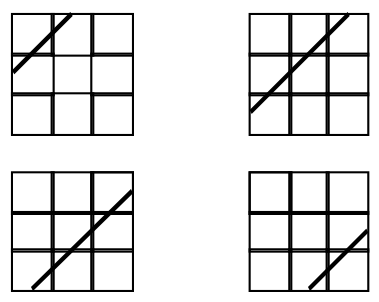{ width=200px }

17. zīm.

No šejienes redzams, ka dotā plakne šķeļ $6$ kubiņus apakšējā un augšējā slānī un $7$ kubiņus vidējā slānī; tātad kopā $19$ kubiņus.

# <lo-sample/> LV.SOL.1998.12.4

Vai eksistē tādi dažādi naturāli skaitļi $x_1,x_2,\ldots,x_n$, ka abas summas

$$
\frac{1}{x_1}+\frac{1}{x_2}+\cdots \frac{1}{x_n}
$$

un

$$
\frac{1}{x_1+1}+\frac{1}{x_2+1}+\cdots \frac{1}{x_n+1}
$$

ir veseli skaitļi?

<small>
   
* questionType:
* domain:
   
</small>

## Atrisinājums

Nē, šādi naturāli skaitļi neeksistē, jo doto summu starpība ir mazāka par $1$; tātad tās abas nevar būt veseli skaitļi. Pierādīsim šo apgalvojumu:

$$
\left(\frac{1}{x_1}+\frac{1}{x_2}+\cdots+\frac{1}{x_n}\right)-\left(\frac{1}{x_1+1}+\frac{1}{x_2+1}+\cdots+\frac{1}{x_n+1}\right)=
$$

$$
\left(\frac{1}{x_1}-\frac{1}{x_1+1}\right)+\left(\frac{1}{x_2}-\frac{1}{x_2+1}\right)+\cdots+\left(\frac{1}{x_n}-\frac{1}{x_n+1}\right)\le
$$

$$
\left(1-\frac{1}{2}\right)+\left(\frac{1}{2}-\frac{1}{3}\right)+\cdots+\left(\frac{1}{M}-\frac{1}{M+1}\right)=1-\frac{1}{M+1}<1.
$$

Ar $M$ apzīmēts lielākais no skaitļiem $x_1, x_2, \ldots, x_n$.

# <lo-sample/> LV.SOL.1998.12.5

Daži no firmas darbiniekiem vienmēr melo, citi vienmēr runā patiesību. Nekādiem diviem darbiniekiem nav ne vienādas algas, ne vienādi atbildīgs darbs. Katrs firmas darbinieks apgalvo divas lietas:

a) " nav ne $10$ darbinieku, kam būtu atbildīgāks darbs nekā man",

b) " vismaz $20$ darbiniekiem ir lielāka alga nekā man".

Cik darbinieku strādā firmā?

<small>
   
* questionType:
* domain:
   
</small>

## Atrisinājums

No uzdevuma nosacījumiem seko, ka tas darbinieks, kam ir visatbildīgākais amats, runā patiesību, bet tas, kam ir vislielākā alga, melo. Tātad starp darbiniekiem ir gan "meļi" gan "patiesi".

Aplūkosim "patiesu" darbinieku ar vislielāko algu starp "patiesajiem" darbiniekiem. No viņa otrā apgalvojuma seko, ka ir vismaz $20$ meļi, kas saņem lielāku algu nekā viņš.

Aplūkosim "melīgu" darbinieku ar mazāko algu starp "meļiem"; viņa otrais apgalvojums ir meli, tātad bez viņa nav vairāk par $19$ meļiem; tātad meļu ir ne vairāk kā $20$. Kopā iegūstam, ka meļu ir tieši $20$.

Līdzīgi pierāda, ka ir tieši $10$ "patiesi" darbinieki. Tātad firmā strādā $30$ darbinieki.
