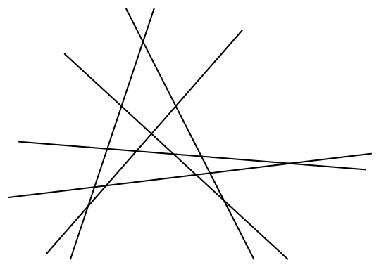
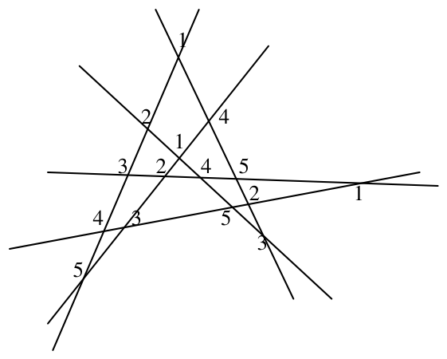
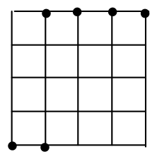
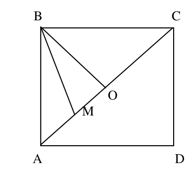
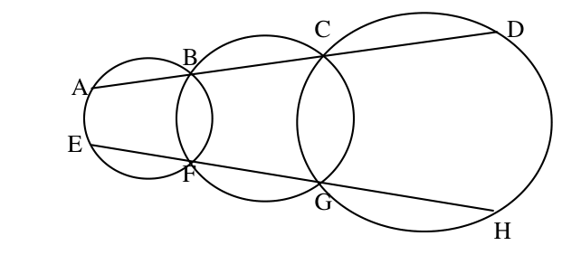
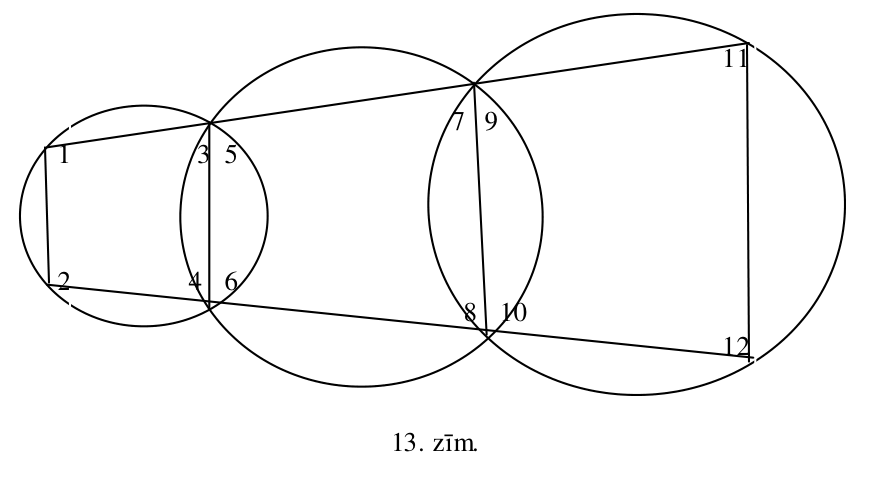
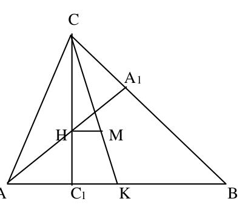

# <lo-sample/> LV.SOL.1999.7.1

Uzrakstīt vienādību, kas satur $x$ un ir pareiza, ja $x$ vietā ievieto jebkuru viencipara naturālu skaitli, bet nav pareiza nekādām citām $x$ vērtībām.

<small>
   
* questionType:
* domain:
   
</small>

## Atrisinājums

Var uzrakstīt, piemēram, šādu vienādību:
$$(x-1)\cdot(x-2)\cdot(x-3)\cdot(x-4)\cdot(x-5)\cdot(x-6)\cdot(x-7)\cdot(x-8)\cdot(x-9)=0.$$

# <lo-sample/> LV.SOL.1999.7.2

Sanumurēt $2.$ zīmējumā parādīto taišņu krustpunktus ar skaitļiem no $1$ līdz $5$ tā, lai uz katras taisnes atrastos visi pieci skaitļi. (Pietiek parādīt vienu veidu, kā to izdarīt)

{ width=250px }

2. zīm.

<small>
   
* questionType:
* domain:
   
</small>

## Atrisinājums

Atrisinājums parādīts $10.$ zīmējumā.

{ width=250px }

10. zīm.

# <lo-sample/> LV.SOL.1999.7.3

Kāds ir lielākais daudzums pēc kārtas ņemtu naturālu trīsciparu skaitļu, no kuriem nevienu nevar izsacīt kā divu (dažādu vai vienādu) divciparu skaitļu reizinājumu?

<small>
   
* questionType:
* domain:
   
</small>

## Atrisinājums

Starp $10$ pēc kārtas ņemtiem trīsciparu skaitļiem viens dalās ar $10$; tātad šis skaitlis $\overline{ab0}=\overline{ab}\cdot 10$ ir divu divciparu skaitļu reizinājums.

No otras puses var uzrādīt $9$ pēc kārtas ņemtus skaitļus $101, 102, \ldots, 109$, kas nav divu divciparu skaitļu reizinājumi (tiešām, vienam no šiem reizinātājiem būtu jābūt ne lielākam par $\sqrt{109}$; vienīgais šāds divciparu skaitlis ir $10$, bet dotie skaitļi ar $10$ nedalās).

Tātad lielākais meklējamo skaitļu skaits ir $9$.

# <lo-sample/> LV.SOL.1999.7.4

Rūtiņas malas garums ir $1$. Kvadrāts, kas sastāv no $50 \times 50$ rūtiņām, sadalīts vairākās daļās, velkot līnijas, kas iet pa rūtiņu malām. Vai visu daļu apkārtmēru (perimetru) summa var būt $1999$ ?

<small>
   
* questionType:
* domain:
   
</small>

## Atrisinājums

Nē, nevar. Perimetru "ārējo" daļu summa ir $200$, bet "iekšējo" perimetra daļu katrs posms ietilpst summā divas reizes; tātad perimetru summai ir jābūt pāra skaitlim, bet $1999$ nav pāra skaitlis.

# <lo-sample/> LV.SOL.1999.7.5

Uz tāfeles uzrakstīti astoņi divnieki. Ar vienu gājienu atļauts nodzēst divus uz tāfeles uzrakstītos skaitļus un to vietā vai nu nodzēsto skaitļu summu, vai to reizinājumu. Vai var panākt, lai pēc $7$ gājieniem uz tāfeles būtu uzrakstīts skaitlis $150$?

<small>
   
* questionType:
* domain:
   
</small>

## Atrisinājums

Nē, nevar. Ievērosim divas īpašības:

a) visi iegūtie skaitļi ir pāra skaitļi,

b) ja pēdējā gājienā izmantota reizināšana, tad iegūtais skaitlis dalās ar $4$,

c) pāra skaitļu reizinājums ir ne mazāks par to summu; ja $x\le y$, tad
$$
x+y\le 2y\le xy.
$$

Tā kā $150$ nedalās ar $4$, tad pēdējā operācija bija saskaitīšana. Tātad iegūtais skaitlis nav lielāks par $\underbrace{2\cdot 2\cdot \ldots \cdot 2}_{n}+\underbrace{2\cdot 2\cdot \ldots \cdot 2}_{8-n}\le 2^7+2<150$.

Tiešām, ja reizinātāji satur ne vairāk par $6$ reizinātājiem, tad summa nepārsniedz $2^6+2^6=128$; ja viens reizinājums satur $7$ divniekus, tad summa ir vienāda ar $2^7+2=130<150$.

# <lo-sample/> LV.SOL.1999.8.1

Pierādīt identitāti

$$
\frac{1}{a(a+1)}+\frac{1}{(a+1)(a+2)}+\frac{1}{(a+2)(a+3)}=\frac{3}{a(a+3)}.
$$

ja $a>0$.

<small>
   
* questionType:
* domain:
   
</small>

## Atrisinājums

Vienādojot saucējus, pierādīsim identitāti:
$$
\frac{1}{x}-\frac{1}{x+1}=\frac{(x+1)-x}{x(x+1)}=\frac{1}{x(x+1)}.
$$

No šejienes iegūstam:

$$
\begin{aligned}
\frac{1}{a\cdot(a+1)}+\frac{1}{(a+1)\cdot(a+2)}+\frac{1}{(a+2)\cdot(a+3)}&=\\
\left(\frac{1}{a}-\frac{1}{a+1}\right)+\left(\frac{1}{a+1}-\frac{1}{a+2}\right)+\left(\frac{1}{a+2}-\frac{1}{a+3}\right)&=\\
\frac{1}{a}-\frac{1}{a+3}&=\frac{3}{a\cdot(a+3)}.
\end{aligned}
$$

# <lo-sample/> LV.SOL.1999.8.2

Kvadrāts sastāv no $4 \times 4$ rūtiņām (skat. 3. zīm.).

{ width=100px }

3. zīm.

<small>
   
* questionType:
* domain:
   
</small>

## Atrisinājums

Skat. 11. zīm.

{ width=100px }

11. zīm.

No paralelogramu īpašībām seko

$$
\begin{aligned}
\angle ACB+\angle ADB+\angle AEB+\angle AFB&=\\
\angle XAC+\angle CAD+\angle DAE+\angle EAF&=\\
\angle XAF&=45^{\circ}.
\end{aligned}
$$

# <lo-sample/> LV.SOL.1999.8.3

Katrs lācis apēda pa spainim ogu; spainī bija gan avenes, gan lācenes (visi spaiņi bija ar vienādu ietilpību). Pekainītis apēda ceturto daļu visu aveņu un sesto daļu visu lāceņu. Cik bija lāču?

(Zināms, ka citu ogu bez avenēm un lācenēm spaiņos nav).

<small>
   
* questionType:
* domain:
   
</small>

## Atrisinājums

Apzīmēsim lāču skaitu ar $n$, bet kopējo apēsto aveņu daudzumu (spaiņos) ar $m$. Tad apēsto lāceņu daudzums (spaiņos) ir $n-m$. Pekainīša apēstais spainis satur $\frac{m}{4}$ spaiņus aveņu un $\frac{n-m}{6}$ spaiņus lāceņu. Tātad

$$
\frac{m}{4}+\frac{n-m}{6}=1.
$$

No šejienes seko, ka $m+2\cdot n=12$.

No uzdevuma nosacījumiem seko, ka $n$ un $m$ ir naturāli skaitļi; turklāt $m\le n$..

Pārbaude parada, ka der tikai vērtības $m=2$, $n=5$.

Tātad pavisam bija $5$ lāči.

# <lo-sample/> LV.SOL.1999.8.4

Turnīrā piedalījās $12$ tenisisti; katrs spēlēja ar katru citu vienu reizi (neizšķirtu nav). Neviens tenisists neuzvarēja visās spēlēs.

Pierādīt, ka var atrast tādus tenisistus $A$, $B$, $C$, ka $A$ uzvarējis pret $B$, $B$ – pret $C$ un $C$ – pret $A$.

<small>
   
* questionType:
* domain:
   
</small>

## Atrisinājums

Uzvaru daudzums vienam tenisistam var būt $0,1,2,\ldots,10$. Tā kā ir $12$ tenisisti, bet uzvaru skaits pieņem tikai $11$ vērtības, tad var atrast divus tenisistus, kam ir vienāds uzvaru skaits. To no viņiem, kas uzvarējis savstarpējā spēlē apzīmēsim ar $A$, otru ar $B$. Ir jābūt tādam tenisistam, kas uzvarējis pret $A$, bet zaudējis pret $B$. Ja $A$ būtu uzvarējis visus tos, ko uzvarējis $B$, tad $A$ būtu vismaz par vienu uzvaru vairāk nekā $B$. Šo tenisistu varam izvēlēties kā $C$.

# <lo-sample/> LV.SOL.1999.8.5

Piecstūra visas malas vienādas un visi leņķi arī vienādi. Vai to var sagriezt četros šaurleņķu trijstūros?

<small>
   
* questionType:
* domain:
   
</small>

## Atrisinājums

Piecstūrim ir piecas malas, bet trijstūri ir tikai četri. Tāpēc vienam trijstūrim malas atrodas uz divām piecstūra malām (skaidrs, ka uz blakus malām); bet šīs malas veido platu leņķi. Tāpēc prasītā sagriešana nav iespējama.

# <lo-sample/> LV.SOL.1999.9.1

Uz kvadrāta $ABCD$ diagonāles $AC$ ņemts punkts $M$. Pierādīt, ka

$$
MA \cdot MC + MB \cdot MD = AB^2.
$$

<small>
   
* questionType:
* domain:
   
</small>

## Atrisinājums

Skat. 12. zīm.

{ width=200px }

12. zīm.

Apzīmēsim kvadrāta diagonāles garumu ar $d$ un nogriežņa $OM$ garumu ar $x$. Tad

$$
\begin{aligned}
MA\cdot MC+MB\cdot MD&=\\
\left(\frac{d}{2}-x\right)\left(\frac{d}{2}+x\right)+MB^2&=\\
\left(\frac{d}{2}\right)^2-x^2+\left(\frac{d}{2}\right)^2+x^2&=\frac{d^2}{2}=AB^2.
\end{aligned}
$$

# <lo-sample/> LV.SOL.1999.9.2

Atrodiet

a) trīs,

b) divpadsmit

dažādus racionālus skaitļus tā, ka neviens no tiem nav vesels, bet katru divu skaitļu reizinājums ir vesels skaitlis.

(Abos gadījumos pietiek uzrādīt piemēru).

<small>
   
* questionType:
* domain:
   
</small>

## Atrisinājums

a) Piemēram, var ņemt skaitļus $\frac{2^2\cdot 3^2}{5}$, $\frac{2^2\cdot 5^2}{3}$, $\frac{3^2\cdot 5^2}{2}$.

b) $n$ skaitļu gadījumā var izvēlēties šādus skaitļus:

$$
\frac{p_1^2p_2^2\cdots p_n^2}{p_i^3},\quad i=1,2,\ldots,n,\quad p_1,p_2,\ldots,p_n\text{ -- dažādi pirmskaitļi.}
$$

# <lo-sample/> LV.SOL.1999.9.3

Pieņemsim, ka $a$, $b$, $c$ ir dažādi skaitļi. Viegli pārbaudīt, ka vienādojumam

$$
\frac{(x-a)(x-b)}{(c-a)(c-b)}+\frac{(x-a)(x-c)}{(b-a)(b-c)}+\frac{(x-b)(x-c)}{(a-b)(a-c)}=1.
$$

ir $3$ saknes $x=a$, $x=b$, $x=c$ (pārbaudi izdara, ievietojot $x$ vērtības vienādojuma kreisajā pusē).

<small>
   
* questionType:
* domain:
   
</small>

## Atrisinājums

Vienādojuma kreisā puse ir identiski vienāda ar $1$; tātad uzrakstītā vienādība nav kvadrātvienādojums, bet vienādība $1=1$.

# <lo-sample/> LV.SOL.1999.9.4

Plkst. $12^{00}$ no Alfas uz Betu izbrauca Lutausis, bet no Betas uz Alfu – Sprīdītis (abi brauc pa vienu un to pašu ceļu). Plkst. $13^{00}$ Lutausis atrodas pusceļā starp Alfu un Sprīdīti.

Cikos Lutausis būs pusceļā starp Betu un Sprīdīti?

(Abu braucēju ātrumi ir nemainīgi un atšķiras ne vairāk kā divas reizes).

<small>
   
* questionType:
* domain:
   
</small>

## Atrisinājums

Ja Lutausis brauktu divreiz ātrāk, tad plkst. $13^{00}$ viņš satiktu Sprīdīti (kura ātrums ir sākotnējais). Tātad, ja Lutausis brauc ar sākotnējo ātrumu, bet Sprīdītis divreiz lēnāk nekā patiesībā, tad viņi satiktos $14^{00}$. Tātad, braucot ar patiesajiem ātrumiem, plkst. $14^{00}$ Lutausis būs pusceļā starp Betu un Sprīdīti.

# <lo-sample/> LV.SOL.1999.9.5

Kvadrāts sastāv no $8 \cdot 8$ kvadrātiskām rūtiņām. Tajās izvietotas $32$ baltas un $32$ melnas figūriņas; katrā rūtiņā pa vienai. Balta un melna figūriņa draudzējas, ja tās atrodas vai nu vienā rindā, vai vienā kolonnā.

Kāds ir lielākais iespējamais draudzību skaits?

<small>
   
* questionType:
* domain:
   
</small>

## Atrisinājums

Ja rindā (kolonnā) ir $n$ baltas un $8-n$ melnas figūriņas, tad šajā rindā (kolonnā) ir $n(8-n)$ draudzības. Tā kā $n(8-n)=16-(n-4)^2\le 16$, tad katrā rindā (kolonnā) ir augstākais $16$ draudzības, un kopējais draudzību skaits nepārsniedz $16\cdot 16=256$. Tas tiek sasniegts, ja figūriņas izvietotas, piemēram, šaha galdiņa krāsojuma kārtībā.

# <lo-sample/> LV.SOL.1999.10.1

Dots, ka $m$ un $n$ ir naturāli skaitļi un $m$ dalās ar $n^2$.

Vai noteikti $m^2$ dalās ar $n^3$?

<small>
   
* questionType:
* domain:
   
</small>

## Atrisinājums

Ja $m$ dalās ar $n^2$, tad $m^2$ dalās ar $n^4$; tātad dalās arī ar $n^3$.

# <lo-sample/> LV.SOL.1999.10.2

Vai var atzīmēt plaknē $10$ punktus tā, lai katri trīs no tiem būtu platleņķa trijstūra virsotnes?

<small>
   
* questionType:
* domain:
   
</small>

## Atrisinājums

Šos $10$ punktus var izvietot, piemēram, uz tāda riņķa līnijas loka, kura leņķiskais lielums mazāks par $180^{\circ}$.

# <lo-sample/> LV.SOL.1999.10.3

Vairākiem rūķīšiem ir vienāds daudzums zelta monētu. Brīdi pa brīdim kāds no rūķīšiem izlemj daļu savu monētu paturēt sev, bet pārējās sadalīt vienādās daļās starp visiem pārējiem. Pēc vairākiem šādām pārdalēm vienam no rūķīšiem bija $64$ monētas, bet otram – $81$ monēta.

Cik pavisam bija rūķīšu?

<small>
   
* questionType:
* domain:
   
</small>

## Atrisinājums

Apzīmēsim rūķīšu skaitu ar $n$. Sākumā katru divu rūķīšu monētu skaitu starpība dalījās ar $n$. Viegli saprast, ka šī īpašība saglabājas, izdarot vienu pārdali, tātad saglabājas vienmēr. Tāpēc $81-64=17$ dalās ar $n$, un $n=1$ vai $n=17$. Tā kā ir vismaz divi rūķīši, tad $n=17$.

# <lo-sample/> LV.SOL.1999.10.4

Dots, ka $a$, $b$, $c$ – reāli skaitļi un

$$
\frac{a}{b+c}=\frac{b}{a+c}=\frac{c}{a+b}=x.
$$

Kādas ir iespējamās $x$ vērtības?

<small>
   
* questionType:
* domain:
   
</small>

## Atrisinājums

Ja kāds no skaitļiem $a$, $b$, $c$ būtu $0$, tad no vienādības seko, ka tie visi ir $0$, bet tā nevar būt. Tāpēc doto vienādību var pārrakstīt kā

$$
\frac{b+c}{a}=\frac{a+c}{b}=\frac{a+b}{c}.
$$

Pieskaitot visām izteiksmēm $1$, iegūstam

$$
\frac{a+b+c}{a}=\frac{a+b+c}{b}=\frac{a+b+c}{c}.
$$

No šejienes vai nu $a+b+c=0$, un tad acīmredzami $x=-1$, vai arī $a=b=c$, un tad $x=\frac{1}{2}$.

# <lo-sample/> LV.SOL.1999.10.5

Atrast visus naturālos skaitļus, kas vienādi ar sava kvadrāta ciparu summu.

<small>
   
* questionType:
* domain:
   
</small>

## Atrisinājums

Ja meklējamais skaitlis $x$ ir $n$-ciparu, tad $x^2$ nav vairāk par $2n$ cipariem, un $x^2$ ciparu summa nepārsniedz $9\cdot 2n=18n$. No otras puses, $n$-ciparu skaitlis ir vismaz $10^{n-1}$. Pie $n\ge 3$ pastāv nevienādība $18n<10^{n-1}$, tāpēc $n=1$ vai $n=2$, un $x\le 18\cdot 2=36$. Tieša pārbaude parāda, ka der tikai $x=1$ un $x=9$.

# <lo-sample/> LV.SOL.1999.11.1

Hokeja mačs starp "Gigantiem" un "Milžiem" beidzās ar rezultātu $9:7$ "Gigantu" labā. Pierādiet, ka mača gaitā bija brīdis, pēc kura "Milži" līdz spēles beigām iesita tikpat vārtus, cik "Giganti" šajā brīdī bija iesituši.

<small>
   
* questionType:
* domain:
   
</small>

## Atrisinājums

Aplūkojam starpību $x-y$, kur $x$ ir to vārtu skaits, kas "Milžiem" vēl jāiesit, bet $y$ ir to vārtu skaits, ko "Giganti" jau iesituši. Spēles sākumā šī starpība ir $7$, bet beigās tā ir $(-9)$. Tā kā starpība mainās tikai par $1$, tad kādā brīdī tā bija $0$.

# <lo-sample/> LV.SOL.1999.11.2

Dots, ka $A$, $B$, $C$, $D$ atrodas uz vienas taisnes un $E$, $F$, $G$, $H$ – tāpat (skat. 4. zīm.).

{ width=300px }

4. zīm.

Pierādīt, ka ap četrstūri $ADHE$ var apvilkt riņķa līniju.

<small>
   
* questionType:
* domain:
   
</small>

## Atrisinājums

Skat. $13$. zīmējumu.

{ width=400px }

13. zīm.

No ievilkta četrstūra īpašības un no tā, ka blakus leņķu summa ir $180^{\circ}$, seko vienādības.

$$\angle 1+\angle 4=\angle 2+\angle 3$$

$$\angle 3+\angle 5=\angle 4+\angle 6$$

$$\angle 6+\angle 7=\angle 5+\angle 8$$

$$\angle 8+\angle 10=\angle 7+\angle 9$$

$$\angle 9+\angle 12=\angle 10+\angle 11.$$

Saskaitot šīs vienādības un savelkot līdzīgos locekļus, iegūstam

$$\angle 1+\angle 12=\angle 2+\angle 11.$$

Tātad ap četrstūri $ADHE$ var apvilkt riņķa līniju.

# <lo-sample/> LV.SOL.1999.11.3

Pierādīt, ka vienādojumam
$$
x^2+y^2+z^2=x^2\cdot y^2
$$
nav atrisinājumu naturālos skaitļos.

<small>
   
* questionType:
* domain:
   
</small>

## Atrisinājums

Pāra skaitļa kvadrāts, dalot ar $4$, dod atlikumu $0$, bet nepāra skaitļa kvadrāts, dalot ar $4$, dod atlikumu $1$.

Starp skaitļiem $x$, $y$, $z$ nevar būt tieši viens nepāra skaitlis, jo tad vienādības kreisā puse ir nepāra skaitlis, bet labā puse pāra skaitlis.

Ja visi skaitļi ir nepāra, tad vienādības kreisā puse, dalot ar $4$, dod atlikumu $3$, bet labā puse – atlikumu $1$.

Ja starp šiem skaitļiem ir divi nepāra skaitļi, tad kreisās puses izteiksme, dalot ar $4$, dod atlikumu $2$, bet labās puses izteiksme vai nu dalās ar $4$, vai dod atlikumu $1$; jebkurā gadījumā vienādība nav iespējama.

Tātad visi skaitļi $x$, $y$, $z$ ir pāra skaitļi.

$$x=2 \cdot x_1,\ y=2 \cdot y_1,\ z=2 \cdot z_1$$

$$x_1^2+y_1^2+z_1^2=4 \cdot x_1^2 \cdot y_1^2.$$

Tā kā vienādības labā puse dalās ar $4$, tad visiem skaitļiem $x_1, y_1, z_1$ jābūt pāra skaitļiem.

$$
x_1=2x_2,\ y_1=2y_2,\ z=2z_2
$$

$$
x_2^2+y_2^2+z_2^2=16x_2^2y_2^2.
$$

Līdzīgi iegūstam, ka visi skaitļi $x_2$, $y_2$, $z_2$ arī ir pāra skaitļi, utt. Bet naturāli skaitļi nevar bezgalīgi ilgi dalīties ar $2$; tātad vienādojumam nav atrisinājumu naturālos skaitļos.

# <lo-sample/> LV.SOL.1999.11.4

Dots, ka $a$, $b$, $c$ ir pozitīvi skaitļi un $a^2+b^2+c^2=2$. Pierādīt, ka
$$
\frac{1}{a}+\frac{1}{b}-\frac{1}{c}\leq \frac{1}{a\cdot b\cdot c}.
$$

<small>
   
* questionType:
* domain:
   
</small>

## Atrisinājums

Pieņemsim pretējo, ka

$$
\frac{1}{a}+\frac{1}{b}-\frac{1}{c}>\frac{1}{abc}.
$$

Pareizinot ar $abc$ iegūstam

$$
ac+bc-ab>1.
$$

No šejienes seko

$$
(a+b-c)^2=a^2+b^2+c^2+2(ab-ac-bc)=
$$

$$
2-2(ac+bc-ab)<0.
$$

Iegūta pretruna.

# <lo-sample/> LV.SOL.1999.11.5

Apspriedē piedalās $9$ dalībnieki. Neviens nepārvalda vairāk nekā trīs valodas. Starp katriem trim dalībniekiem var atrast divus, kas zina kopīgu valodu. Pierādīt, ka ir tāda valoda, kuru prot vismaz $3$ apspriedes dalībnieki.

<small>
   
* questionType:
* domain:
   
</small>

## Atrisinājums

Pieņemsim pretējo, ka nevienu valodu nezina vairāk par $2$ dalībniekiem. Tad dalībniekam $A$ ir kopīga valoda ar augstākais $3$ citiem dalībniekiem; tātad var atrast $5$ dalībniekus $B$, $C$, $D$, $E$, $F$, kam nav kopīgas valodas ar $A$. Apskatot trijnieku $(A,B,C)$ redzam, ka $B$ un $C$ ir kopīga valoda. Līdzīgi iegūstam, ka $B$ ir kopīga valoda arī ar $D$, $E$, $F$. Tātad $B$ ir kopīga valoda ar četriem citiem dalībniekiem. Tā kā $B$ zina ne vairāk kā $3$ valodas, tad ar kādiem diviem no šiem četriem viņš zina vienu un to pašu valodu, un šo valodu zina vismaz $3$ dalībnieki. Iegūta pretruna.

# <lo-sample/> LV.SOL.1999.12.1

Atrisināt pirmskaitļos vienādojumu
$$
x^3-y^3=z.
$$

<small>
   
* questionType:
* domain:
   
</small>

## Atrisinājums

No vienādības

$$
(x-y)\cdot(x^2+xy+y^2)=z
$$

seko, ka $x-y=1$, jo $z$ ir pirmskaitlis. Tā kā $x$ un $y$ arī ir pirmskaitļi un ir tikai viens pāra pirmskaitlis $2$, tad $x=3$ un $y=2$. Atliek pārbaudīt, ka $3^3-2^3=19$ arī ir pirmskaitlis.

# <lo-sample/> LV.SOL.1999.12.2

Šaurleņķu trijstūrī $ABC$ nogrieznis, kas savieno mediānu krustpunktu un augstumu krustpunktu, paralēls malai $AB$. Pierādīt, ka
$$
\operatorname{tg}\angle BAC\cdot \operatorname{tg}\angle ABC=3.
$$

<small>
   
* questionType:
* domain:
   
</small>

## Atrisinājums

Skat. $14.$ zīmējumu.

{ width=200px }

$14.$ zīm.

No trijstūru $CHM$ un $CC_1K$ līdzības un no vienādības $CM:MK=2:1$ seko, ka $CH:HC_1=2:1$. Tāpēc

$$
\operatorname{tg} A \cdot \operatorname{tg} B=\operatorname{tg} A \cdot \operatorname{ctg} \angle HAC_1=
$$

$$
\frac{CC_1}{AC_1}\cdot\frac{AC_1}{HC_1}=\frac{CC_1}{HC_1}=3.
$$

Prasītā vienādība pierādīta.

# <lo-sample/> LV.SOL.1999.12.3

Pierādīt, ka katram reālam $x$ pastāv nevienādība
$$
|\cos x|+|\cos 2x|\geq \frac{\sqrt{2}}{2}.
$$

<small>
   
* questionType:
* domain:
   
</small>

## Atrisinājums

Ievērosim, ka

$$
|\cos x|+|\cos 2x|=
$$

$$
|\cos x|+|2\cos^2 x-1|=y+|2y^2-1|,
$$

kur $0\le y\le 1$.

Ja $y\ge \frac{\sqrt{2}}{2}$, tad nevienādība izpildās; ja $0\le y<\frac{\sqrt{2}}{2}$, tad

$$
y+|2y^2-1|=1+y-2y^2=\frac{9}{8}-2\left(y-\frac{1}{4}\right)^2,
$$

kas sasniedz minimumu pie $y=0$ vai $y=\frac{\sqrt{2}}{2}$. Abas vērtības nav mazākas par $\frac{\sqrt{2}}{2}$.

# <lo-sample/> LV.SOL.1999.12.4

Funkcijas $f(t)$ argumenti un vērtības ir naturāli skaitļi. Ir zināms, ka

a) visiem naturāliem $x$ un $y$ pastāv vienādība

$$f(xy)=f(x)+f(y)-1,$$

b) ir tikai galīgs skaits tādu naturālu $x$, ka

$$f(x)=1,$$

c) $f(30)=4$.

Atrast $f(3600)$.

<small>
   
* questionType:
* domain:
   
</small>

## Atrisinājums

No a) seko, ka $f(x^2)=2f(x)-1$. Ja $f(x)=1$, tad $f(x^2)=1$, $f(x^4)=1$, utt., tāpēc saskaņā ar b) jābūt $x=1$. Tātad, ja $x\ne 1$, tad $f(x)\ge 2$.

Ievērosim, ka $f(30)=f(5)+f(6)-1=f(5)+f(3)+f(2)-2$.

Tātad $f(5)+f(3)+f(2)=6$; tā kā $f(x)\ge 2$, ja $x\ne 1$, tad $f(2)=f(3)=f(5)=2$.

Tāpēc

$$
f(3600)=f(60^2)=2f(60)-1=
$$

$$
2(f(2)+f(30)-1)-1=2\cdot(2+4-1)-1=9.
$$

# <lo-sample/> LV.SOL.1999.12.5

Spēles sākumā dota kaudze, kas satur vismaz $2$ akmeņus. Ar vienu gājienu izvēlas vienu no kaudzēm un sadala to divās vai trijās kaudzēs, katra no kurām satur vismaz vienu akmeni.

Spēlē piedalās divi spēlētāji, gājienus izdara pēc kārtas. Kas nevar izdarīt gājienu, zaudē. Vai pirmais spēlētājs noteikti var uzvarēt?

<small>
   
* questionType:
* domain:
   
</small>

## Atrisinājums

Uzvar pirmais spēlētājs:

a) ja sākumā kaudzē ir $2n$ akmeņi, $n\in N$, viņš ar pirmo gājienu sadala to divās kaudzēs pa $n$ akmeņiem un tālāk "kopē" otrā spēlētāja gājienus,

b) ja sākumā kaudzē ir $2n+1$ akmeņi, $n\in N$, viņš ar pirmo gājienu sadala to trīs kaudzēs ar $1$, $n$, $n$ akmeņiem un tālāk "kopē" otrā spēlētāja gājienus.
