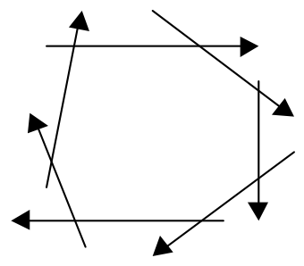
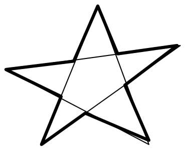
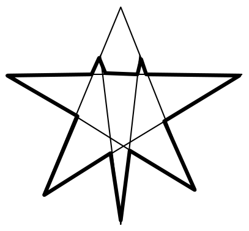
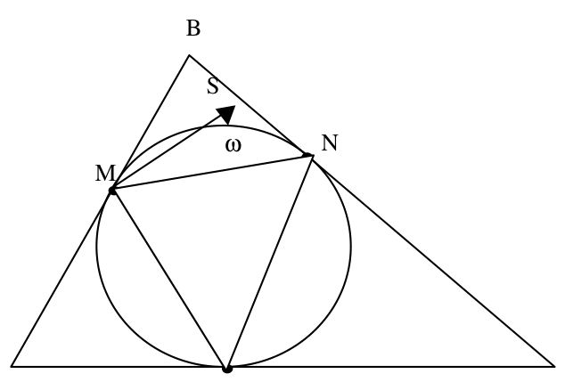
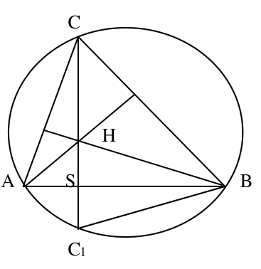
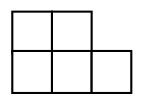
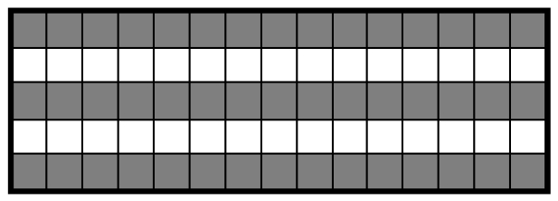
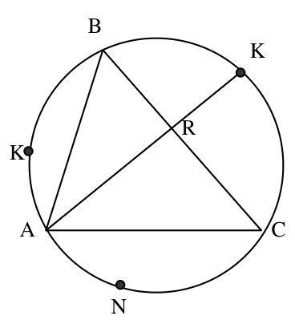
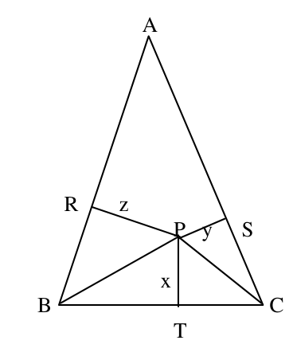
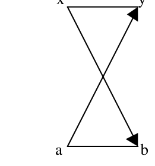

# <lo-sample/> LV.SOL.2000.7.1

Atrast $7$ saliktus trīsciparu skaitļus, katram no kuriem ciparu reizinājums ir $42$.

<small>
   
* questionType:
* domain:
   
</small>

## Atrisinājums

Der skaitļi $237$, $273$, $327$, $372$, $723$, $732$ (tie visi dalās ar $3$, tāpēc nav pirmskaitļi), kā arī $176$, jo $176=11\cdot16$.

# <lo-sample/> LV.SOL.2000.7.2

Vai var uzzīmēt plaknē $7$ starus tā, lai katrs no tiem krustotu tieši divus citus?

<small>
   
* questionType:
* domain:
   
</small>

## Atrisinājums

Jā. Skat., piemēram, $7.$ zīm.

{ width=150px }

7.zīm.

# <lo-sample/> LV.SOL.2000.7.3

Atrisināt vienādojumu
$$
(((((2x-1)\cdot 2-x)\cdot 2-x)\cdot 2-x)\cdot 2-x)\cdot 2-x=1.
$$

<small>
   
* questionType:
* domain:
   
</small>

## Atrisinājums

Vienādojuma kreisās puses izteiksme ir lineāra funkcija $f(x)=ax+b$. Viegli pārbaudīt, ka $f(1)=1$; tātad $1$ ir dotā vienādojuma sakne. Skaidrs, ka $f(2)$ ir pāra skaitlis; tātad $f(2)\ne1$, un $f(x)$ nav konstanta funkcija.

Tas nozīmē, ka dotajam vienādojumam ir tieši viens atrisinājums $x=1$.

# <lo-sample/> LV.SOL.2000.7.4

Pierādīt, ka naturālos skaitļus no $1$ līdz $29$ ieskaitot var tā uzrakstīt pa apli, katru vienu reizi, ka katriem diviem blakus uzrakstītiem skaitļiem atradīsies cipars, kurš izmantots to abu pierakstā.

<small>
   
* questionType:
* domain:
   
</small>

## Atrisinājums

To var izdarīt, piemēram, tā:

$1, 11, 10, 20, 21, 12, 2, 22, 23, 3, 13, 14, 4, 24, 25, 5, 15, 16, 6, 26, 27, 7, 17,$

$18, 8, 28, 29, 9, 19$.

# <lo-sample/> LV.SOL.2000.7.5

Uz tāfeles uzrakstīti skaitļi $2$; $4$; $6$. Ar vienu gājienu atļauts nodzēst vienu no skaitļiem un tā vietā uzrakstīt abu pārējo skaitļu summu, no kuras atņemts vieninieks. Vai var gadīties, ka, izpildot vairākus šādus gājienus pēc kārtas, uz tāfeles atrodas skaitļi $1997$; $1999$; $2001$?

<small>
   
* questionType:
* domain:
   
</small>

## Atrisinājums

$1.$ metode.

Nē, nevar. Pēc jebkura gājiena uz tāfeles ir $2$ pāra un $1$ nepāra skaitlis.

$2.$ metode. Pēc jebkura gājiena uz tāfeles ir uzrakstīts skaitļu trijnieks $a, b, a+b-1$.

Acīmredzami skaitļi $1997$, $1999$, $2001$ šādu trijnieku neveido.

# <lo-sample/> LV.SOL.2000.8.1

Dots, ka $x+y+z=0$ un neviens no skaitļiem $x$, $y$, $z$ nav $0$. Pierādīt, ka
$$
\frac{x}{yz}+\frac{y}{xz}+\frac{z}{xy}+\frac{2}{x}+\frac{2}{y}+\frac{2}{z}=0.
$$

<small>
   
* questionType:
* domain:
   
</small>

## Atrisinājums

Ir vairākas risināšanas iespējas:

a) ievieto izteiksmē $z=-(x+y)$ un savelk līdzīgos locekļus "uz vienas daļsvītras",

b)
$$
\frac{x}{y \cdot z}+\frac{y}{x \cdot z}+\frac{z}{x \cdot y}=\frac{x^2+y^2+z^2}{x \cdot y \cdot z}=\frac{(x+y+z)^2-2 \cdot x \cdot y-2 \cdot x \cdot z-2 \cdot y \cdot z}{x \cdot y \cdot z}=-\frac{2}{z}-\frac{2}{y}-\frac{2}{x}.
$$

# <lo-sample/> LV.SOL.2000.8.2

Vai naturālos skaitļus no $1$ līdz $25$ ieskaitot var izrakstīt rindā katru vienu reizi, tā, lai katri divi blakus uzrakstīti skaitļi atšķirtos viens no otra vai nu par $2$, vai par $3$?

<small>
   
* questionType:
* domain:
   
</small>

## Atrisinājums

Jā, var. Piemēram, šādi:

$1, 3, 5, 2, 4, 6, 8, 10, 7, 9, 11, 13, 15, 12, 14, 16, 18, 20, 17, 19, 21, 23, 25, 22, 24,$

# <lo-sample/> LV.SOL.2000.8.3

Uzzīmēt a) desmitstūri, b) piecpadsmitstūri ar īpašību: uz katras taisnes, uz kuras atrodas kāda uzzīmēta daudzstūra mala, atrodas vēl vismaz viena cita šī daudzstūra mala.

<small>
   
* questionType:
* domain:
   
</small>

## Atrisinājums

Skat., piemēram, 8. zīm.

{ width=150px }

{ width=200px }

8. zīm.

# <lo-sample/> LV.SOL.2000.8.4

Ir iedomāti naturāli skaitļi $x; y; z$.

Ir zināms, ka $2x$ dalās gan ar $y$, gan ar $z$; $2y$ dalās gan ar $x$, gan ar $z$; $2z$ dalās gan ar $x$, gan ar $y$.

Cik no iedomātajiem skaitļiem var būt dažādi?

<small>
   
* questionType:
* domain:
   
</small>

## Atrisinājums

Var būt visi vienādi skaitļi, piemēram, $x=y=z=1$.

Var būt divi vienādi skaitļi un trešais atšķirīgs no tiem: $x=y=1,\ z=2$.

Visi skaitļi nevar būt atšķirīgi. Pieņemsim pretējo, ka $x<y<z$. Tad $\frac{2 \cdot x}{y}$ un $\frac{2 \cdot x}{z}$ ir veseli skaitļi mazāki par $2$; tātad $\frac{2 \cdot x}{y}=\frac{2 \cdot x}{z}=1$. No šejienes seko, ka $y=z$, bet tā ir pretruna.

# <lo-sample/> LV.SOL.2000.8.5

Naturālā skaitlī $x$ katrs nākošais cipars ir lielāks par iepriekšējo. Pierādīt, ka skaitļa $9x$ ciparu summa ir $9$.

<small>
   
* questionType:
* domain:
   
</small>

## Atrisinājums

Ievērosim, ka $9 \cdot x=10 \cdot x-x=\overline{x0}-x$. Apzīmējot $x=\overline{a_1a_2\cdots a_{n-1}a_n}$ un ievērojot, ka ciparu virkne ir augoša, iegūstam

$$
\begin{array}{rccccccc}
 & a_1 & a_2 & a_3 & \cdots & a_{n-1} & a_n & 0\\
- &  & a_1 & a_2 & \cdots & a_{n-2} & a_{n-1} & a_n\\
\hline
 & a_1 & a_2-a_1 & a_3-a_2 & \cdots & a_{n-1}-a_{n-2} & a_n-a_{n-1}-1 & 10-a_n
\end{array}
$$

un rezultātā ciparu summa ir

$$
a_1+(a_2-a_1)+(a_3-a_2)+\cdots+(a_{n-1}-a_{n-2})+(a_n-a_{n-1}-1)+10-a_n=9.
$$

# <lo-sample/> LV.SOL.2000.9.1

Sadalīt reizinātājos izteiksmi
$$(a-b)^3+(b-c)^3+(c-a)^3.$$

<small>
   
* questionType:
* domain:
   
</small>

## Atrisinājums

$$
\begin{aligned}
&\left((a-b)^3+(b-c)^3\right)+(c-a)^3=\\
&(a-b+b-c)\left((a-b)^2-(a-b)(b-c)+(b-c)^2\right)-(c-a)^3=\\
&(a-c)\left(a^2-2ab+b^2-ab+ac+b^2-bc+b^2-2bc+c^2-c^2+2ac-a^2\right)=\\
&(a-c)\left(3b^2-3ab+3ac-3bc\right)=3(a-c)(b-c)(c-a).
\end{aligned}
$$

# <lo-sample/> LV.SOL.2000.9.2

Pierādīt: ja $n \ge 7$ un $n$ – nepāra skaitlis, tad skaitli $n^2$ var izsacīt kā triju saliktu nepāra skaitļu summu.

<small>
   
* questionType:
* domain:
   
</small>

## Atrisinājums

Varam izsacīt $n=a+4$, kur $a$ – nepāra skaitlis, $a\geq 3$. Tad

$$
n^2=(a+4)^2=a^2+8a+16=a^2+3(a+2)+5(a+2).
$$

# <lo-sample/> LV.SOL.2000.9.3

Trīs smagākās loma zivis kopā svēra $35\%$ no visa loma. Pēc to pārdošanas trīs vieglākās zivis kopā svēra $\frac{5}{13}$ no atlikušā loma. Cik zivju bija lomā sākumā?

<small>
   
* questionType:
* domain:
   
</small>

## Atrisinājums

Trīs vieglākās zivis svēra $\frac{5}{13}\cdot 65\%=25\%$ no loma. Tātad "vidējās" zivis svēra $40\%$ no loma. Ja to ir trīs vai mazāk, rodas pretruna ar faktu, ka trīs smagākās zivis svēra $35\%$ loma. Pieņemsim, ka "vidējo" zivju ir $5$ vai vairāk. Apzīmēsim masas (procentos) piecām vieglākajām no tām ar $x\leq y\leq z\leq e\leq f$. Tad $x+y+z+e+f\leq 40$. Jābūt $x+y+z\geq 25$, tāpēc $3z\geq 25$, $z\geq 8\frac{1}{3}$; tad arī $e\geq 8\frac{1}{3}$ un $f\geq 8\frac{1}{3}$. Iznāk, ka

$$
x+y+z+e+f=(x+y+z)+e+f\geq 25+2\cdot 8\frac{1}{3}>41.
$$

Tā ir pretruna. Tātad "vidējo" zivju ir mazāk par $5$. Tā kā to ir vairāk par $3$, tad to ir $4$, un zivju pavisam ir $10$.

# <lo-sample/> LV.SOL.2000.9.4

Trijstūrī $ABC$ ievilktā riņķa līnija pieskaras malām $AB$, $BC$, $CA$ attiecīgi punktos $M, N, K$.

Pierādīt, ka trijstūros $AMK$, $BNM$, $CKN$ ievilkto riņķa līniju centri atrodas uz $ABC$ ievilktās riņķa līnijas.

<small>
   
* questionType:
* domain:
   
</small>

## Atrisinājums

Hordas—pieskares leņķis $\angle BMN$ ietver loku $\overset{\frown}{M\omega N}$ (Skat. $9$.zīm.), tāpēc tā lielums ir $\frac{1}{2}\overset{\frown}{M\omega N}$.

{ width=300px }

9. zīm.

Ja $MS$ ir $\angle BMN$ bisektrise, tad ievilktais leņķis $\angle SMN$ ir puse no $\angle BMN$, tāpēc ka balstās uz puses no $\overset{\frown}{MN}$; tāpēc šī bisektrise iet caur $\overset{\frown}{MN}$ viduspunktu. Tāpat caur šo viduspunktu iet $\angle BNM$ bisektrise. Tātad $\triangle MBN$ bisektrišu krustpunkts – ievilktās riņķa līnijas centrs ir $\overset{\frown}{MN}$ viduspunkts. Apgalvojumu par $\triangle AMK$ un $\triangle CNK$ pierāda līdzīgi.

# <lo-sample/> LV.SOL.2000.9.5

No $10$ cilvēkiem katrs ir ienaidā ar augstākais $4$ citiem. Pierādīt, ka cilvēkus var sadalīt pa pāriem tā, ka nevienā pārī nav ienaidnieki.

<small>
   
* questionType:
* domain:
   
</small>

## Atrisinājums

Apvienosim vispirms cilvēkus pāros, kā pagadās. Sauksim pāri par sliktu, ja tajā ir ienaidnieki un par labu pretējā gadījumā. Pieņemsim, ka ir kāds slikts pāris $(A,B)$. Pieņemsim, ka eksistē tāds pāris $(X,Y)$, ka $A$ nav ienaidā ar $X$ un $B$ nav ienaidā ar $Y$. Tad, izveidojot pāri $(A,B)$ un $(X,Y)$ vietā pārus $(A,X)$ un $(B,Y)$, slikto pāru skaits samazinās. Atkārtojot šādu operāciju vēl un vēl, varam panākt, ka slikto pāru vairs nav, un mūsu mērķis sasniegts.

Atliek pierādīt tāda pāra $(X,Y)$ eksistenci. Ja tāda pāra nebūtu, tad:

- tajos pāros, kur $A$ ir divi draugi, $B$ nav neviena drauga,
- tajos pāros, kur $A$ ir viens draugs, $B$ ir augstākais viens draugs (tas pats, kas ir $A$ draugs).

Tātad $A$ un $B$ kopā $4$ citos pāros būtu ne vairāk kā $8$ draugi, bet viņiem tur vismaz $10$ draugi – pretruna. Tātad vajadzīgais pierādīts.

# <lo-sample/> LV.SOL.2000.10.1

Dots, ka $x+y=a+b$ un $|x-y|>|a-b|$.

Pierādīt, ka $x \cdot y<a \cdot b$.

<small>
   
* questionType:
* domain:
   
</small>

## Atrisinājums

$xy=\frac{1}{4}\left((x+y)^2-(x-y)^2\right)<\frac{1}{4}\left((a+b)^2-(a-b)^2\right)=ab.$

Ievērojiet, ka no šī uzdevuma izriet ļoti noderīgs secinājums: ja divu skaitļu summa ir konstanta, tad to reizinājums ir jo mazāks, jo vairāk šie skaitļi atšķiras viens no otra.

# <lo-sample/> LV.SOL.2000.10.2

Viena trijstūra malu garumi ir $x; y; z$, bet otra trijstūra malu garumi ir $a; b; c$. Ir zināms, ka
$$a^2=x(y+z-x), \quad b^2=y(x+z-y), \quad c^2=z(x+y-z).$$

Pierādīt, ka otrais trijstūris ir šaurleņķu.

<small>
   
* questionType:
* domain:
   
</small>

## Atrisinājums

Saskaņā ar doto

$$a^2+b^2-c^2=xy+xz-x^2+yx+yz-y^2-xz-yz+z^2=2xy-x^2-y^2+z^2=$$

$$z^2-(x-y)^2>0,$$

No kosinusu teorēmas seko, ka $\cos\gamma>0$.

Līdzīgi pierāda, ka $\cos\alpha>0$ un $\cos\beta>0$, tātad trijstūrim ar malu garumiem $a$, $b$, $c$ visi leņķi ir šauri

# <lo-sample/> LV.SOL.2000.10.3

Uz desmit papīra lapiņām uzrakstīts pa naturālam skaitlim (starp tiem var būt arī vienādi). Ņemot visos iespējamos veidos pa $9$ lapiņām un saskaitot uz tām uzrakstītos skaitļus, iegūstam deviņas dažādas summas $82$; $83$; $84$; $85$; $87$; $89$; $90$; $91$; $92$.

Kādi skaitļi bija uzrakstīti uz lapiņām?

<small>
   
* questionType:
* domain:
   
</small>

## Atrisinājums

Apzīmēsim šos skaitļus ar $x_1,x_2,\ldots,x_{10}$, bet to summu ar $S$. No dotajiem skaitļiem pavisam var sastādīt $10$ summas pa deviņiem skaitļiem. Tā kā šīs summas pieņem tikai $9$ dažādas vērtības, tad divas no tām ir vienādas.

Apzīmēsim to summu, kas atkārtojas divreiz, ar $M$. Tad $(S-x_1)+(S-x_2)+\cdots+(S-x_{10})=10\cdot S-(x_1+\cdots+x_{10})=9S$, tātad dalās ar $9$. No otras puses, $(S-x_1)+\cdots+(S-x_{10})=82+83+\cdots+91+92+M=783+M$. Tā kā $783$ dalās ar $9$, tad arī $M$ jādalās ar $9$; vienīgā iespēja ir, ka $M=90$. Tas nozīmē, ka $9S=783+90=873$ un $S=97$.

Tātad uz lapiņām uzrakstītie skaitļi ir $15; 14; 13; 12; 10; 8; 7; 7; 6; 5$.

# <lo-sample/> LV.SOL.2000.10.4

Šaurleņķu trijstūra $ABC$ augstumu krustpunkts ir $H$.

Pierādīt, ka ap trijstūriem $ABC$ un $ABH$ apvilkto riņķa līniju rādiusi ir vienādi savā starpā.

<small>
   
* questionType:
* domain:
   
</small>

## Atrisinājums

Apzīmēsim taisnes $CH$ otru krustpunktu ar vienu riņķa līniju ar $C_1$. Ja mēs pierādīsim, ka $SH=SC_1$, tad $\triangle AHB=\triangle AC_1B$ (simetriski pret $AB$) un tad to apvilkto riņķa līniju rādiusi arī būs vienādi. (Atzīmēsim, ka ap trijstūri $ABC$ apvilktā r.l. sakrīt ar ap trijstūri $ABC$ apvilkto r.l.). Skat. $10.$ zīm.

{ width=150px }

10. zīm.

Ievērojam, ka $\angle ACS=\angle HBS$ (abi vienādi ar $90^{\circ}-\alpha$) un $\angle ACS=\angle SBC_1$ (ievilkti leņķi, kas balstās uz vienu un to pašu loku). Tāpēc $\angle HBS=\angle SBC_1$, no kurienes seko, ka $SH=SC_1$.

# <lo-sample/> LV.SOL.2000.10.5

Taisnstūris sastāv no $5\cdot 15$ vienādām kvadrātiskām rūtiņām. Pierādīt, ka to nevar sagriezt tādos gabalos, kādi attēloti 2. zīm.

{ width=100px }

2. zīm.

<small>
   
* questionType:
* domain:
   
</small>

## Atrisinājums

Izkrāsosim taisnstūra $15$ rūtiņas kā parādīts $11.$ zīmējumā.

{ width=300px }

11. zīm.

Pavisam ir $45$ melnas rūtiņas. Katra no $15$ figūriņām satur augstākais $3$ melnās rūtiņas (pierāda pārbaudot figūras izvietojuma variantus). Tā kā figūru pavisam ir $15$, tad tām visām jāsatur tieši $3$ melnas un $2$ baltas rūtiņas. Pārbaudot visus principiāli dažādos figūras novietojumus, redzam, ka abas baltās rūtiņas atrodas vienā rindā. Tātad baltā rinda sastāv no balto rūtiņu pāriem, bet tā ir pretruna, jo tā satur $15$ rūtiņas.

# <lo-sample/> LV.SOL.2000.11.1

No $8$ policistiem jāizveido $4$ pāri nakts dežūrai. Cik dažādu sadalījumu iespējami?

<small>
   
* questionType:
* domain:
   
</small>

## Atrisinājums

Ņemam vienu policistu $A$; tam var piekomandēt jebkuru no atlikušajiem policistiem (t.i. izdarīt to $7$ veidos). Kad tas izdarīts, ņemam jebkuru no atlikušajiem policistiem $B$; tam var piekārtot pārinieku $5$ veidos. Tālāk ņemam jebkuru no atlikušajiem policistiem $C$; tam var piekārtot pārinieku $3$ veidos. Atlikušie divi policisti veido ceturto pāri.

No reizināšanas likuma kombinatorikā seko ka dažādo iespēju skaits kā izvēlēties $4$ policistu pārus ir $7 \cdot 5 \cdot 3 \cdot 1 = 105$.

# <lo-sample/> LV.SOL.2000.11.2

Ap šaurleņķu trijstūri $ABC$ apvilkta riņķa līnija. Uz tās lokiem $AB$, $BC$, $CA$ atbilstoši ņemti punkti $K$, $M$, $N$ tā, ka $B$ ir loka $KM$ viduspunkts, $C$ ir loka $MN$ viduspunkts un $A$ ir loka $NK$ viduspunkts.

Pierādīt, ka taisnes $AM$, $BN$ un $CK$ krustojas vienā punktā.

<small>
   
* questionType:
* domain:
   
</small>

## Atrisinājums

Skat. $12$. zīm.

{ width=150px }

12. zīm.

Apzīmēsim $\overset{\frown}{BK} = \overset{\frown}{BM} = \beta$, $\overset{\frown}{AK} = \overset{\frown}{AN} = \alpha$, $\overset{\frown}{CM} = \overset{\frown}{CN} = \gamma$.

Tad $\alpha + \beta + \gamma = 180^{\circ}$, un

$$
\angle ARC = \frac{1}{2}\left(\overset{\frown}{BM} + \overset{\frown}{ANC}\right) = \frac{1}{2}(\beta + \alpha + \gamma) = 90^{\circ}.
$$

Tātad $AR$ ir trijstūra $ABC$ augstums, un taisne $AM$ satur šo augstumu. Līdzīgi spriežam par taisnēm $BN$ un $CK$.

Uzdevuma apgalvojums tagad seko no fakta, ka trijstūra augstumi krustojas vienā punktā.

# <lo-sample/> LV.SOL.2000.11.3

Kādiem naturāliem skaitļiem $n$ piemīt īpašība: jebkuriem divu $n$ dalītāju reizinājums ir lielāks par $\frac{n}{6}$?

<small>
   
* questionType:
* domain:
   
</small>

## Atrisinājums

Der visi pirmskaitļi $n$, jo tiem ir tikai $2$ dalītāji $1$ un $n$, un $1 \cdot n > \frac{n}{6}$.

Der arī skaitlis $1$, jo šajā gadījumā nevar sastādīt reizinājumu no diviem dažādiem skaitļa $1$ dalītājiem; bet tas nozīmē, ka jebkuram reizinājumam (faktiski tādu nav) izpildās prasītā nevienādība (uzmanīgi izanalizējiet šo spriedumu).

Ja $n$ ir salikts skaitlis, tad tam eksistē dalītājs $d$, kurš nepārsniedz $\sqrt{n}$. Tātad

$$
\sqrt{n} \ge 1 \cdot d > \frac{n}{6} \Rightarrow n < 36.
$$

Pārbaudot saliktos skaitļus, kas mazāki par $36$, atrodam, ka vēl der arī šādi salikti skaitļi: $4, 6, 8, 9, 10, 15, 25$.

# <lo-sample/> LV.SOL.2000.11.4

Pierādiet, ka visiem reāliem $x$ un $y$ pastāv nevienādība

$$x^2y^2\left(x^2+y^2-3\right)\ge -1.$$

<small>
   
* questionType:
* domain:
   
</small>

## Atrisinājums

Ja $x=0$ vai $y=0$, nevienādība ir acīmredzama.

Ja $x \neq 0$ un $y \neq 0$, dotā nevienādība ir ekvivalenta ar šādu nevienādību:
$$
x^2+y^2+\frac{1}{x^2y^2} \geq 3.
$$

To pierāda, izmantojot nevienādību starp trīs skaitļu vidējo aritmētisko un vidējo ģeometrisko:
$$
\frac{x^2+y^2+\frac{1}{x^2y^2}}{3} \geq \sqrt[3]{x^2 \cdot y^2 \cdot \frac{1}{x^2y^2}} = 1.
$$

Pareizinot šo nevienādību ar $3$, iegūstam prasīto.

# <lo-sample/> LV.SOL.2000.11.5

Divi spēlētāji pamīšus ieraksta vai nu burtu $E$, vai burtu $H$ vienā no regulāra $100$-stūra virsotnēm (katrā virsotnē drīkst ierakstīt tikai vienu burtu). Tas spēlētājs, pēc kura gājiena trijās pēc kārtas virsotnēs parādās burtu virknīte $EHE$, ir uzvarējis.

Pierādiet, ka otrais spēlētājs var panākt, lai pirmais neuzvarētu.

<small>
   
* questionType:
* domain:
   
</small>

## Atrisinājums

Aprakstīsim otrā spēlētāja stratēģiju, kas garantē, ka viņš nezaudēs.

Uz pirmā spēlētāja kārtējo gājienu otrais spēlētājs atbild šādi:

Ja iespējams izveidot trijnieku $EHE$, veido to un uzvar.

Ja tādas iespējas nav, tad atbild ar burta ierakstīšanu simetriskajā (pret riņķa centru) virsotnē, rakstot to pašu burtu, ko pirmais spēlētājs ierakstīja pēdējā gājienā ( to var izdarīt, jo pirms pēdējā pirmā spēlētāja gājiena burtu izvietojums bija centrāli simetrisks).

No pretējā viegli pierādīt: ja pieņemam, ka kādā gājienā pirmais spēlētājs var uzvarēt, tad jau savā iepriekšējā gājienā to varēja izdarīt otrais..

# <lo-sample/> LV.SOL.2000.12.1

a) Dots, ka $\cos x=\cos y$. Pierādīt, ka $\cos 4x=\cos 4y$.

b) Dots, ka $\sin x=\sin y$. Vai noteikti $\sin 4x=\sin 4y$?

<small>
   
* questionType:
* domain:
   
</small>

## Atrisinājums

a) Pakāpeniski iegūstam:
$$
\cos x=\cos y \quad \Rightarrow \quad x=\pm y+2\pi n \quad \Rightarrow
$$
$$
4x=\pm 4y+8\pi n \quad \Rightarrow \quad \cos 4x=\cos 4y.
$$

b) Nē, ne noteikti. Piemēram, ņemot $x=30^{\circ}$, $y=150^{\circ}$, iegūstam
$$
\sin x=\sin y=\frac{1}{2}, \quad \text{bet } \sin 4x=\sin 120^{\circ}=\frac{\sqrt{3}}{2}, \quad \sin 4y=\sin 600^{\circ}=-\frac{\sqrt{3}}{2}.
$$

# <lo-sample/> LV.SOL.2000.12.2

Atrisināt vienādojumu sistēmu
$$
x^5-y^5=x^3-y^3=x-y.
$$

<small>
   
* questionType:
* domain:
   
</small>

## Atrisinājums

Skaidrs, ka der visi vienādu skaitļu pāri: $(r,r)$, kur $r \in R$.

Pieņemsim, ka $x \neq y$, un izdalīsim dotās vienādojumu sistēmas visas izteiksmes ar $(x-y)$; iegūstam:
$$
\begin{cases}
x^2+xy+y^2=1 \\
x^4+x^3y+x^2y^2+xy^3+y^4=1.
\end{cases}
$$

Otro vienādojumu pārveidojam formā
$$
\left(x^2+y^2\right)\left(x^2+xy+y^2\right)-x^2y^2=1,
$$

no kurienes, ņemot vērā, ka $x^2+xy+y^2=1$, iegūstam

$$
x^2+y^2-x^2y^2=1 \quad \Rightarrow \quad \left(x^2-1\right)\left(y^2-1\right)=0.
$$

No šejienes atrodam vēl $6$ atrisinājumus: $\left(\pm 1,0\right)$, $\left(0,\pm 1\right)$, $\left(-1,1\right)$, $\left(1,-1\right)$.

# <lo-sample/> LV.SOL.2000.12.3

Kādiem naturāliem $n$ skaitlis
$$
26^n+10^n-9^n-7^n
$$
dalās ar $323$?

<small>
   
* questionType:
* domain:
   
</small>

## Atrisinājums

Ievērosim, ka $323=18^2-1=17\cdot 19$. Mums jānoskaidro kādiem naturāliem $n$ dotās izteiksmes vērtība dalās ar $17$ un $19$ vienlaicīgi.

Ja $n=2k$, tad

$$
26^n+10^n-9^n-7^n \equiv 9^n+10^n-9^n-7^n \equiv
$$

$$
10^{2k}-\left(-10\right)^{2k} \equiv 0 \pmod{17},
$$

$$
26^n+10^n-9^n-7^n \equiv 7^n+10^n-9^n-7^n \equiv
$$

$$
10^{2k}-\left(-10\right)^{2k} \equiv 0 \pmod{19}.
$$

Tātad, ja $n$ ir pāra skaitlis, dotās izteiksmes vērtība dalās ar $323$.

Ja $n=2k+1$, tad

$$
26^n+10^n-9^n-7^n \equiv 9^n+10^n-9^n-7^n \equiv
$$

$$
10^{2k+1}-\left(-10\right)^{2k+1} \equiv 2\cdot 10^{2k+1} \not\equiv 0 \pmod{17}.
$$

Tātad, ja $n$ ir nepāra skaitlis, tad dotās izteiksmes vērtība nedalās ar $17$ un, protams, arī ar $323$.

Atbilde: $n$ – pāra skaitlis.

# <lo-sample/> LV.SOL.2000.12.4

Dots vienādsānu trijstūris $ABC$, kur $AB=AC$. Tā iekšpusē ņemts punkts $P$, kura attālumi līdz taisnēm $CB$, $AC$, un $AB$ ir atbilstoši $x$, $y$, un $z$. Ir zināms, ka $x^2=y\cdot z$. Pierādīt, ka $\angle CBA+\angle CPB=180^{\circ}$.

<small>
   
* questionType:
* domain:
   
</small>

## Atrisinājums

Skat. $13.$ zīm.

{ width=150px }

$13.$ zīm.

No dotā seko, ka $\dfrac{PS}{PT}=\dfrac{PT}{PR}$. Tā kā četrstūru $BRPT$ un $CTPS$ atbilstošie leņķi ir vienādi, ievērojot iepriekšējo proporciju, secinām, ka šie četrstūri ir līdzīgi. Tāpēc

$$
\begin{aligned}
&\angle PBA=\angle PBR=\angle TCP=\angle BCP \Rightarrow\\
&\angle CBA+\angle CPB=(\angle CBP+\angle PBA)+\angle CPB=\\
&\angle CBP+\angle PCB+\angle CPB=180^{\circ}.
\end{aligned}
$$

# <lo-sample/> LV.SOL.2000.12.5

Regulāra $2n$-stūra virsotnēs ierakstīti naturāli skaitļi no $1$ līdz $2n$ (katrā virsotnē – cits skaitlis). Ja divas malas ir paralēlas, tad to galos ierakstīto skaitļu summas ir vienādas. Vai tas ir iespējams, ja a) $n=5$, b) $n=6$?

<small>
   
* questionType:
* domain:
   
</small>

## Atrisinājums

a) Jā, var. Skaitļus var pa riņķi ierakstīt šādā secībā: $1, 9, 2, 10, 3, 6, 4, 7, 5, 8$.

b) Nē, nevar. Aplūkosim divas pretējās daudzstūra malas (skat. 14. zīm.).

{ width=100px }

14. zīm.

Iegūstam $x+y=a+b \Rightarrow x-b=a-y$, t.i., bultiņu uzrādītās starpības starp skaitļiem, kas ierakstīti diametrāli pretējos punktos, ir vienādas. Izsekojot pēc kārtas bultiņu virzienus uz visiem $6$ "diametriem", iegūstam pretrunu.
