# <lo-sample/> LV.SOL.2001.5.1

Kvadrāts sastāv no $5\cdot 5$ rūtiņām. Vai var rūtiņās ierakstīt naturālus skaitļus no $1$ līdz $25$ (katrā rūtiņā citu skaitli) tā, lai katrs skaitlis būtu vai nu lielāks par visiem blakus rūtiņās ierakstītajiem skaitļiem, vai arī mazāks par visiem blakus rūtiņās ierakstītajiem skaitļiem? (Divas rūtiņas sauc par blakus rūtiņām, ja tām ir kopīga mala.)

<small>
   
* questionType:
* domain:
   
</small>

## Atrisinājums

Skat. piem., $1.$ zīm., kur skaitļi $1\div 13$ rakstīti "melnās" rūtiņās, bet skaitļi $14\div 25$ – "baltās".

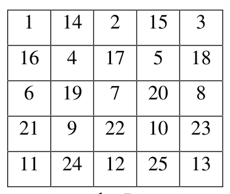{ width=200px }

$1.$ zīm.

# <lo-sample/> LV.SOL.2001.5.2

Gar taisnu ceļu vienādos attālumos cits no cita aug koki. Sākotnēji katrā kokā sēž pa vienam putnam. Brīdi pa brīdim divi putni vienlaicīgi paceļas spārnos un aizlido pretējos virzienos, pie tam katrs no viņiem pārlido uz blakus koku. Vai visi putni var salasīties vienā kokā, ja koku skaits ir  
a) $7$,  
b) $8$?

<small>
   
* questionType:
* domain:
   
</small>

## Atrisinājums

a) acīmredzami, jā (vidējā kokā).  
b) nē. Kopējam pārvietošanās garumam pa kreisi jābūt vienādam ar kopējo pārvietošanās garumu pa labi; bet, savācoties jebkurā kokā, tie atšķirtos (tieši pārbauda visas iespējas).

# <lo-sample/> LV.SOL.2001.5.3

Kvadrāts sastāv no $8\cdot 8$ rūtiņām. Parādiet, ka katru rūtiņu var izkrāsot baltu vai melnu tā, lai nekādas $3$ pēc kārtas ņemtas rūtiņas ne horizontālā, ne vertikālā, ne diagonālā virzienā nebūtu vienā krāsā.

<small>
   
* questionType:
* domain:
   
</small>

## Atrisinājums

Skat., piem., $2.$ zīm.

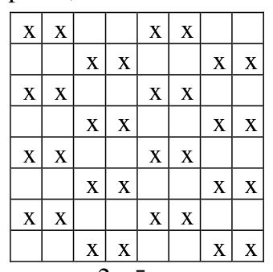{ width=150px }

$2.$ zīm.

# <lo-sample/> LV.SOL.2001.5.4

Apskatām naturālos skaitļus no $1$ līdz $12$. Izsvītrojiet no tiem dažus skaitļus un pārējos novietojiet pa apli tā, lai no katriem diviem blakus novietotiem skaitļiem viens dalītos ar otru. Kādu mazāko skaitļu daudzumu var izsvītrot?

<small>
   
* questionType:
* domain:
   
</small>

## Atrisinājums

Skaitļi $7$ un $11$ var būt blakus tikai ar $1$, tāpēc tie noteikti jāsvītro. Pārējo skaitļu izvietojumu skat. $3.$ zīm.

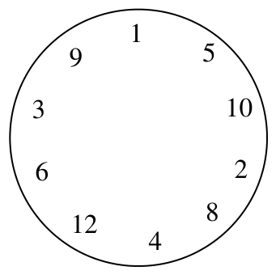{ width=150px }

$3.$ zīm.

# <lo-sample/> LV.SOL.2001.5.5

Vai naturālos skaitļus no $1$ līdz $60$ var sadalīt $3$ grupās pa $20$ skaitļiem katrā tā, lai visās grupās skaitļu summas būtu vienādas?

<small>
   
* questionType:
* domain:
   
</small>

## Atrisinājums

Izveidojam $30$ pārus $(1;60)$, $(2;59)$, $(3;58)$, ..., $(30,31)$ un katrā grupā apvienojam $10$ no šiem pāriem.

# <lo-sample/> LV.SOL.2001.6.1

Kvadrāts sastāv no $4 \cdot 4$ rūtiņām. Katrā rūtiņā ierakstīts naturāls skaitlis. Katrās divās rūtiņās, kurām ir kopīga mala, ierakstītie skaitļi atšķiras viens no otra par $1$. Pierādiet, ka ierakstīto skaitļu summa var būt $2000$.

<small>
   
* questionType:
* domain:
   
</small>

## Atrisinājums

Skat., piem., $4.$ zīm.

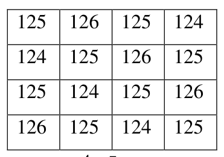{ width=150px }

$4.$ zīm.

# <lo-sample/> LV.SOL.2001.6.2

Naturāla skaitļa $n$ ciparu summa ir $20$, bet skaitļa $11n$ ciparu summa ir $40$.

a) atrodiet kaut vienu tādu skaitli $n$,  
b) kāds ir mazākais iespējamais skaitļa $n$ ciparu skaits?

<small>
   
* questionType:
* domain:
   
</small>

## Atrisinājums

a) skaitlim var būt $5$ cipari: $90209\cdot 11=992299$

b) Ievērojam, ka $11\cdot n=10n+n$. Tāpēc $\overline{ab..cd}\cdot 11=\overline{ab..cd0}+\overline{ab..cd}$. Ja nevienā vietā nerodas pārnesums, tad rezultātā ciparu summa ir $20+20=40$; ja ir kaut viens pārnesums, tad tā ir mazāka.

Ja skaitlim $\overline{ab..cd}$ būtu $4$ cipari (varbūt daži pirmie no tiem $0$), tad vai nu $a+b\ge 10$, vai $c+d\ge 10$, un rodas pārnesums vai nu desmitu, vai tūkstošu šķirā.

# <lo-sample/> LV.SOL.2001.6.3

Vai kvadrātiņus, kas attēloti $1$. zīm., var pārvietot tā, lai tie veidotu $2$. zīm. attēloto "piramīdu" un lai pie tam izpildītos sekojoša īpašība: katriem diviem kvadrātiņiem, kam $1$. zīm. ir kopīga mala, $2$. zīm. ir vismaz viena kopīga virsotne?

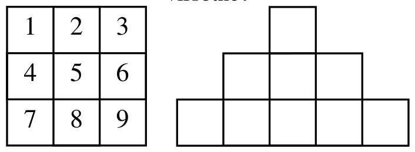{ width=300px }

1. zīm.

2. zīm.

<small>
   
* questionType:
* domain:
   
</small>

## Atrisinājums

Jā, var. Skat. 5. zīm.

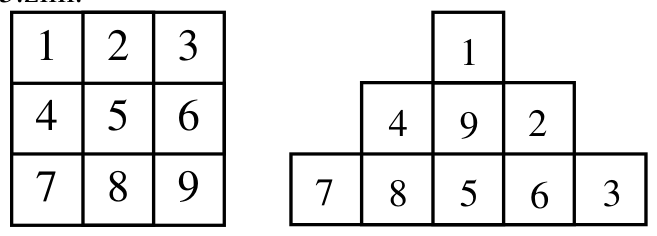{ width=300px }

5. zīm.

# <lo-sample/> LV.SOL.2001.6.4

Gan Jānis, gan Andris zina, ka astoņas pēc ārējā izskata vienādas monētas sver attiecīgi $1$ g, $2$ g, $3$ g, ..., $8$ g. Jānis zina, cik gramus sver katra monēta, bet Andris - nē. Kā Jānis var par vismaz vienu monētu pierādīt Andrim, cik gramus tā sver, lietojot vienu svēršanu uz sviras svariem bez atsvariem?

<small>
   
* questionType:
* domain:
   
</small>

## Atrisinājums

Tā kā $5$ vieglāko monētu summa $1+2+3+4+5=15$ vienāda ar abu smagāko monētu summu $7+8=15$, tad Jānis var nodemonstrēt Andrim šo vienādību, un Andrim jāatzīst, ka vienīgās uz svariem neuzliktās monētas masa var būt tikai $6$ g.

# <lo-sample/> LV.SOL.2001.6.5

Divu kvadrātu kontūrām krustojoties, tās sadalās taisnes nogriežņos (skat. $3$. zīm.) Ar kādu mazāko taišņu skaitu var krustot visus šos nogriežņus? Taisnes nedrīkst iet caur nogriežņu galapunktiem.

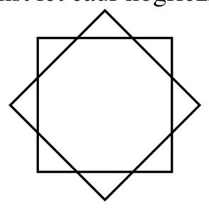{ width=150px }

3. zīm.

<small>
   
* questionType:
* domain:
   
</small>

## Atrisinājums

a) pietiek ar $8$ taisnēm (skat. 6. zīm.).

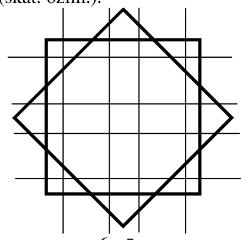{ width=200px }

6. zīm.

b) lai krustotu katru no $3$ malām vienā mazajā trijstūrītī, to jākrusto ar vismaz $2$ taisnēm; tātad rodas $\ge 4$ krustošanās. Tātad kopā ir vismaz $4\cdot 8=32$ krustošanās. Tā kā katra taisne katru kvadrātu var krustot augstākais $2$ punktos, tad taišņu skaits ir vismaz

$$
\frac{32}{4}=8.
$$

# <lo-sample/> LV.SOL.2001.7.1

Dots, ka $x$, $y$, $z$ - trīs dažādi skaitļi. Cik daudzi no skaitļiem $x(x-y)$, $y(y-z)$, $z(z-x)$ var vienlaikus būt negatīvi?

<small>
   
* questionType:
* domain:
   
</small>

## Atrisinājums

Piemērā $x=-2$; $y=-1$; $z=1$ negatīvu skaitļu nav. Piemērā $x=-1$; $y=1$; $z=2$ ir viens negatīvs skaitlis. Piemērā $x=1$, $y=2$; $z=3$ ir divi negatīvi skaitļi.

Pierādīsim, ka $3$ negatīvi skaitļi nevar būt. Varam pieņemt, ka $z$ – lielākais no skaitļiem $x$; $y$; $z$. Tad $z$ jābūt negatīvam (jo $z-x>0$). Tad arī $y$ ir negatīvs, jo $y<z$. Bet tad $y(y-z)>0$.

# <lo-sample/> LV.SOL.2001.7.2

Vai uz kuba skaldnēm var uzrakstīt naturālus skaitļus no $1$ līdz $6$ (uz katras skaldnes - citu skaitli) tā, lai katrs skaitlis būtu visu savu kaimiņu summas dalītājs? (Divus skaitļus sauc par kaimiņiem, ja tie uzrakstīti uz skaldnēm ar kopīgu malu.)

<small>
   
* questionType:
* domain:
   
</small>

## Atrisinājums

Nē, nevar. Pieņemsim, ka skaitļi tā izkārtoti. Tad "$6$" blakus ir četri skaitļi no kopas $1$; $2$; $3$; $4$; $5$. Vienīgā iespēja, kad četru šo skaitļu summa dalās ar $6$, ir, ja tie ir $1$; $2$; $4$; $5$. Tātad "$3$" atrodas "$6$" pretējā skaldnē. Skaitlim "$5$" blakus atrodas $3$, $6$ un divi no skaitļiem $1$; $2$; $4$; tam jābūt blakus $2$ un $4$. Bet tad $4$ ir blakus ar $3$; $6$; $5$; $1$ – pretruna.

# <lo-sample/> LV.SOL.2001.7.3

Pa apli stāv $10$ cilvēki. Katru minūti tieši viens pāris blakus esošu cilvēku var mainīties vietām. Parādiet, kā $20$ minūtēs cilvēki var pārkārtoties aplī pretējā kārtībā.

<small>
   
* questionType:
* domain:
   
</small>

## Atrisinājums

Sadalām cilvēkus divās "virknēs" pa pieciem (skat. 7. zīm.) Grupā pa labi izdarām secīgas maiņas $AB$; $AC$; $AD$; $AE$; $BC$; $BD$; $BE$; $CD$; $CE$; $DE$. Grupā pa kreisi rīkojamies līdzīgi.

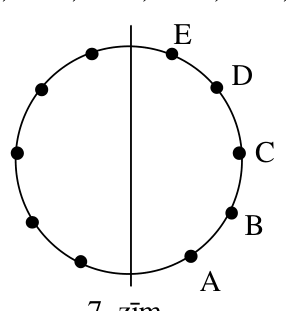{ width=150px }

7. zīm.

# <lo-sample/> LV.SOL.2001.7.4

Ar kādu mazāko taisņu skaitu var krustot visus $4.$ zīm. redzamos nogriežņus? Taisnes nedrīkst iet caur nogriežņu galapunktiem.

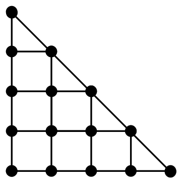{ width=150px }

$4.$ zīm.

<small>
   
* questionType:
* domain:
   
</small>

## Atrisinājums

Pietiek ar $6$ taisnēm (skat. $8.$ zīm.).  
Ar mazāk taisnēm nepietiek, jo katra taisne var krustot augstākais divus no $12$ nogriežņiem $9.$ zīm.

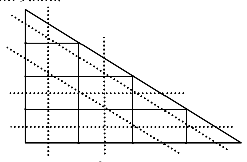{ width=250px }

$8.$ zīm.

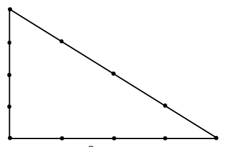{ width=150px }

$9.$ zīm.

# <lo-sample/> LV.SOL.2001.7.5

No $36$ vienādiem maziem trijstūrīšiem salikts viens liels (skat. $5.$ zīm.) Katram mazajam trijstūrītim ir viena balta, viena sarkana un viena zaļa mala. Ja diviem trijstūrīšiem ir kopīga mala, tad abos šajos trijstūrīšos tā ir nokrāsota vienādi. Pierādiet, ka lielā trijstūra kontūrā ir vienāds skaits balto, sarkano un zaļo nogrieznīšu.

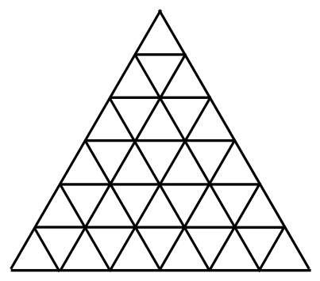{ width=200px }

$5.$ zīm.

<small>
   
* questionType:
* domain:
   
</small>

## Atrisinājums

Ja divi trijstūrīši veido rombu (skat. $10.$ zīm.), tad malu $x$ un $y$ krāsas kopumā ir tādas pašas kā $z$ un $t$ krāsas kopumā.

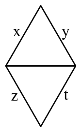{ width=100px }

$10.$ zīm.

Tāpēc "izņemot" no augšas pa vienam no $11.$ zīm. redzamajiem rombiem, palikušās daļas kontūrā balto, sarkano un zaļo nogriežņu skaits nemainās.

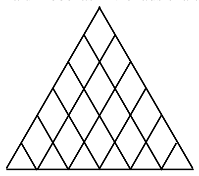{ width=200px }

$11.$ zīm.

Bet, nonākot līdz $12.$ zīm. parādītajai situācijai, ir skaidrs, ka uz robežas ir vienāds skaits balto, sarkano un zaļo nogriežņu.

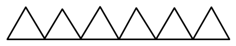{ width=200px }

$12.$ zīm.

# <lo-sample/> LV.SOL.2001.9.1

Dots, ka kvadrātvienādojumam $x^2+p\cdot x+q=0$ nav atrisinājuma reālos skaitļos. Pierādīt, ka arī kvadrātvienādojumam $x^2+p\cdot x+2\cdot q=0$ nav atrisinājuma reālos skaitļos.

<small>
   
* questionType:
* domain:
   
</small>

## Atrisinājums

No dotā seko, ka $\left(\dfrac{p}{2}\right)^2-q<0$, tātad $q>0$. Tāpēc $\left(\dfrac{p}{2}\right)^2-2q<\left(\dfrac{p}{2}\right)^2-q<0$, no kurienes seko vajadzīgais.

# <lo-sample/> LV.SOL.2001.9.2

Pierādīt, ka katram naturālam $n$ skaitlis $n\cdot(n+1)\cdot(2\cdot n+1)$ dalās ar $6$.

<small>
   
* questionType:
* domain:
   
</small>

## Atrisinājums

Vai nu $n$, vai $n+1$ ir pāra skaitlis, tāpēc izteiksme dalās ar $2$. Pārveidojot
$$
n(n+1)(2n+1)=n(n+1)((n+2)+(n-1))=(n-1)n(n+1)+n(n+1)(n+2)
$$
un ievērojot, ka no trim pēc kārtas ņemtiem veseliem skaitļiem viens dalās ar $3$, iegūstam, ka izteiksme dalās ar $3$.

# <lo-sample/> LV.SOL.2001.9.3

Dots, ka eksistē tādi nenegatīvi veseli skaitļi $x$ un $y$, ka $S=x^2+y^2+x\cdot y$. Pierādīt, ka eksistē tādi nenegatīvi veseli skaitļi $u$ un $v$, ka $S=u^2+v^2-u\cdot v$.

<small>
   
* questionType:
* domain:
   
</small>

## Atrisinājums

Viegli pārbaudīt, ka $x^2+y^2+xy=(x+y)^2+y^2-(x+y)\cdot y$.

# <lo-sample/> LV.SOL.2001.9.4

Šaurleņķu trijstūrī $ABC$ novilkts augstums $BH$. Ir zināms, ka $AC=BH$ un četrstūri $AMNH$ un $HCEF$ ir kvadrāti (skat. 6. zīm.) Pierādīt, ka taisnes $AE$, $CM$ un $BH$ krustojas vienā punktā.

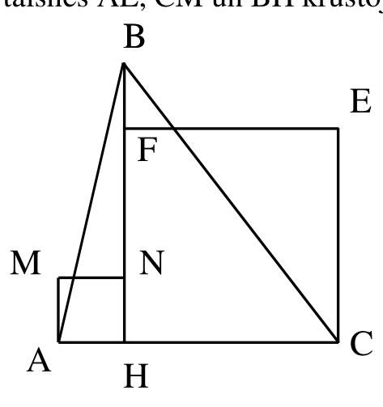{ width=200px }

6. zīm.

<small>
   
* questionType:
* domain:
   
</small>

## Atrisinājums

Pierādīsim, ka $AE\perp BC$. Tad līdzīgi $CM\perp AB$, un vajadzīgais seko no fakta, ka $ABC$ augstumi krustojas vienā punktā. (Skat. $14.$ zīm.).

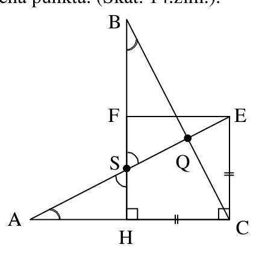{ width=200px }

14. zīm.

No $CE=HC$ un $AC=BH$ seko, ka $\triangle ACE=\triangle BHC$. Tāpēc $\angle QBS=\angle HAS$. Arī $\angle BSQ=\angle ASH$. Tāpēc $\angle BQS=\angle AHS=90^{\circ}$, k.b.j.

# <lo-sample/> LV.SOL.2001.9.5

Uz šaha galdiņa novietotas dažas figūras, katrā lauciņā ne vairāk par vienu. Gan katrā rindiņā gan katrā kolonnā atrodas nepāra skaits figūru. Pierādīt, ka uz melnajiem lauciņiem kopā ir pāra skaits figūru.

<small>
   
* questionType:
* domain:
   
</small>

## Atrisinājums

Apzīmēsim pāra (nepāra) kolonnās kopējo figūru skaitu ar $PK$ ($NK$); līdzīgi ieviešam jēdzienus $PR$ un $NR$. Skaidrs, ka $PK$, $NK$, $PR$, $NR$ ir pāra skaitļi. Viegli pārbaudīt, ka uz melnajām rūtiņām esošo figūru skaits ir $NK+PR-2\cdot S$, kur $S$ – to figūru skaits, kas atrodas vienlaicīgi nepāra kolonnās un pāra rindiņās.

# <lo-sample/> LV.SOL.2001.10.1

Vai eksistē tādi naturāli skaitļi $x$ un $y$, ka  
a) $x^2-7x=y^2$,  
b) $x^2-7x=y^2$ un $x$ - pirmskaitlis?

<small>
   
* questionType:
* domain:
   
</small>

## Atrisinājums

a) jā; piemēram, $x=16$ un $y=12$.

b) nē. Pārveidojam vienādojumu par $x(x-7)=y^2$. Redzam, ka $y^2$ dalās ar $x$. Tā kā $x$ ir pirmskaitlis, tad $y$ dalās ar $x$. Bet tad $y\ge x$ un $y^2\ge x^2>x^2-7x$; iegūta pretruna.

# <lo-sample/> LV.SOL.2001.10.2

Ar kādu $x$ vērtību izteiksme  
$|x-1|+2|x-2|+3|x-3|+4|x-4|+5|x-5|$  
sasniedz savu mazāko vērtību?

<small>
   
* questionType:
* domain:
   
</small>

## Atrisinājums

Ievērojam, ka $|a-b|$ ir attālums starp skaitļu ass punktiem $a$ un $b$.

Ja $x$ pārbīdās pa labi par attālumu $\Delta$, būdams apgabalā $I$, tad pirmais saskaitāmais samazinās par $\Delta$, otrais – par $2\Delta$, ..., piektais – par $5\Delta$. Tātad summa samazinās.

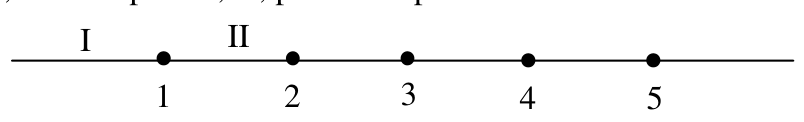{ width=400px }

Ja $x$ pārbīdās pa labi par attālumu $\Delta$, būdams apgabalā II, tad pirmais saskaitāmais palielinās par $\Delta$, otrais samazinās par $2\Delta$, trešais samazinās par $3\Delta$ utt. Tātad summa turpina samazināties. Līdzīgi turpinot, iegūstam, ka summa samazinās, līdz $x$ sasniedz skaitļu ass punktu $4$, un tālāk sāk palielināties. Tātad minimuma punkts ir $x=4$.

# <lo-sample/> LV.SOL.2001.10.3

Uz riņķa līnijas diametra $AB$ atzīmēts punkts $C$. Dots, ka $X$ un $Y$ - divi punkti uz riņķa līnijas, kas nesakrīt ne ar $A$, ne ar $B$. Pierādīt, ka
$$
\frac{\operatorname{tg}\angle AXC}{\operatorname{tg}\angle XAC}=\frac{\operatorname{tg}\angle AYC}{\operatorname{tg}\angle YAC}.
$$

<small>
   
* questionType:
* domain:
   
</small>

## Atrisinājums

Novelkam $CZ\perp AX$ un $BX$ (skat. 15. zīm.). Tā kā $AB$ – diametrs, tad $\angle AXB=90^{\circ}$ un $BX\parallel CZ$. Tā kā $\operatorname{tg}\angle AXC=\dfrac{CZ}{XZ}$ un $\operatorname{tg}\angle XAC=\dfrac{CZ}{AZ}$, tad

$$
\dfrac{\operatorname{tg}\angle AXC}{\operatorname{tg}\angle XAC}=\dfrac{AZ}{ZX}=\dfrac{AC}{CB}.
$$

Līdzīgi

$$
\dfrac{\operatorname{tg}\angle AYC}{\operatorname{tg}\angle YAC}=\dfrac{AC}{CB}.
$$

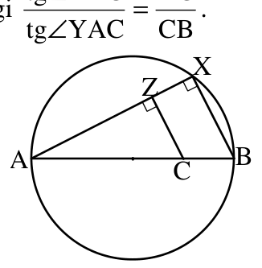{ width=150px }

15. zīm.

# <lo-sample/> LV.SOL.2001.10.4

Kvadrāts ar diagonāles garumu $d$ sagriezts $n$ taisnstūros, kuru diagonāļu garumi ir $d_1$, $d_2$, $\ldots$, $d_n$. Pierādīt, ka $d^2\le d_1^2+d_2^2+\ldots+d_n^2$.

<small>
   
* questionType:
* domain:
   
</small>

## Atrisinājums

Kvadrāta laukums ir $\dfrac{1}{2}d^2$, bet $i$-tā taisnstūra laukums ir $\dfrac{1}{2}d_i^2\sin\varphi_i$, kur $\varphi_i$ – leņķis starp tā diagonālēm. Tā kā kvadrāta laukums vienāds ar taisnstūru laukumu summu, tad

$$
\dfrac{1}{2}d^2=\dfrac{1}{2}d_1^2\sin\varphi_1+\ldots+\dfrac{1}{2}d_n^2\sin\varphi_n\leq\dfrac{1}{2}d_1^2+\dfrac{1}{2}d_2^2+\ldots+\dfrac{1}{2}d_n^2,
$$

no kurienes seko vajadzīgais.

# <lo-sample/> LV.SOL.2001.10.5

Kvadrātā, kas sastāv no $7 \times 7$ rūtiņām, izgriezta augšējās malas otrā rūtiņa no kreisās puses. Pierādīt, ka atlikušo daļu nevar sagriezt gabalos tā, lai izveidotos $1$ tāda figūra, kāda attēlota $7$. zīm., un $15$ tādas figūras, kādas attēlotas $8$. zīm. (Figūras var būt novietotas arī citādi).

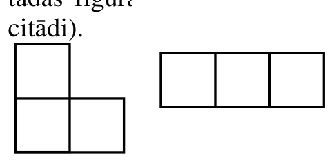{ width=200px }

$7$. zīm.

$8$. zīm.

<small>
   
* questionType:
* domain:
   
</small>

## Atrisinājums

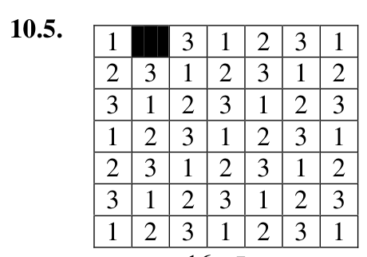{ width=200px }

16. zīm.

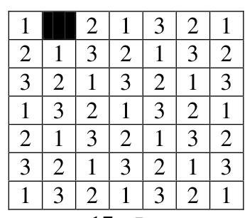{ width=150px }

17. zīm.

Izkrāsojam palikušās rūtiņas, kā redzams 16.zīm. Ir $17$ krāsas "$1$", $15$ krāsas "$2$" un $16$ krāsas "$3$". Katra taisnā figūriņa satur pa vienai katras krāsas rūtiņai. Tāpēc "stūrītim" jāsatur divas rūtiņas krāsā "$1$" un viena krāsā "$3$". Tas iespējams tikai, ja

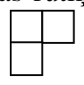{ width=100px }

"stūrītis ir stāvoklī

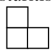{ width=100px }

. Līdzīgi no 17.zīm. seko, ka "stūrītim" jābūt stāvoklī. Iegūta pretruna.

# <lo-sample/> LV.SOL.2001.11.1

Naturālam skaitlim $A$ ir tieši $10$ dalītāju. Pierādīt, ka skaitlim $A^2$ ir mazāk par $100$ dalītājiem. (Apskatām tikai tādus dalītājus, kas ir naturāli skaitļi.)

<small>
   
* questionType:
* domain:
   
</small>

## Atrisinājums

Tā kā $A^2=A\cdot A$, tad katrs $A$ dalītājs $d$ ir izsakāms kā $d=d_1\cdot d_2$, kur $d_1$ ir $A$ "pirmā eksemplāra" dalītājs un $d_2$ ir $A$ "otrā eksemplāra" dalītājs. Tāpēc $A^2$ nekādi nevar būt vairāk par $10\cdot 10=100$ dalītājiem. Tā kā, piemēram, skaitļa $A^2$ dalītājs $A$ ir izsakāms gan kā $1\cdot A$, gan kā $A\cdot 1$, tad $A^2$ dalītāju skaits ir mazāks par $100$.

# <lo-sample/> LV.SOL.2001.11.2

Pierādīt, ka vienādojumam
$$(x-1)(x-2)\ldots(x-1999)(x-2000)+(x+1)(x+2)\ldots(x+1999)(x+2000)=0$$
nav atrisinājumu reālos skaitļos.

<small>
   
* questionType:
* domain:
   
</small>

## Atrisinājums

Viegli redzēt, ka skaitļi $0;\ \pm 1;\ \pm 2;\ \ldots;\ \pm 2000$ nav vienādojuma saknes. No dotā vienādojuma seko: ja $x$ - tā sakne, tad

$$
\left|\frac{x+1}{x-1}\right|\cdot \left|\frac{x+2}{x-2}\right|\cdot \ldots \cdot \left|\frac{x+2000}{x-2000}\right|=1.
$$

Pie $x>0$ katrs no šiem $2000$ reizinātājiem ir lielāks par $1$, pie $x<0$ - mazāks par $1$. Uzdevums atrisināts.

# <lo-sample/> LV.SOL.2001.11.3

Taisne $l$ krusto nogriezni $AB$ punktā $C$. Kā ar cirkuli un lineālu konstruēt centru riņķa līnijai, kas iet caur punktiem $A$ un $B$ un izšķeļ uz taisnes $l$ hordu ar iespējami mazu garumu?

<small>
   
* questionType:
* domain:
   
</small>

## Atrisinājums

Acīmredzami
$$
XY=XC+CY=\sqrt{(XC-CY)^2+4XC\cdot CY}=\sqrt{(XC-CY)^2+4AC\cdot CB}
$$
(skat. $18.$ zīm.). Tātad $XY$ ir vismazākais, ja horda $XY$ punktā $C$ dalās uz pusēm. Tāpēc riņķa līnijas centrs atrodas $AB$ vidusperpendikula krustpunktā ar perpendikulu, kas punktā $C$ vilkts pret taisni $l$.

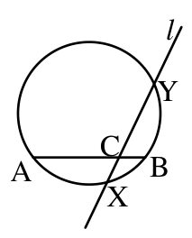{ width=100px }

18. zīm.

# <lo-sample/> LV.SOL.2001.11.4

Pierādīt, ka vienādojumam $\frac{1}{x}+\frac{1}{y}+\frac{1}{z}+\frac{1}{u}+\frac{1}{t}=1$ ir nepāra skaits atrisinājumu naturālos skaitļos. (Varam pieņemt par zināmu to, ka tam ir galīgs skaits atrisinājumu naturālos skaitļos.)

<small>
   
* questionType:
* domain:
   
</small>

## Atrisinājums

Atrisinājumi, kuros $x\ne y$, apvienojas pa pāriem (vienā pārī ir atrisinājumi, kas atšķiras tikai ar to, ka $x$ un $y$ vērtības tajos ir apmainītas vietām). Šos atrisinājumus atmetam. Paliek vienādojums $\frac{2}{x}+\frac{1}{z}+\frac{1}{u}+\frac{1}{t}=1$. Līdzīgi atmetam atrisinājumus, kuros $z\ne u$; paliek vienādojums $\frac{2}{x}+\frac{2}{z}+\frac{1}{t}=1$. Līdzīgi atmetam atrisinājumus, kuros $x\ne z$; paliek vienādojums $\frac{4}{x}+\frac{1}{t}=1$. Tas pārveidojas par $(x-4)(t-1)=4$. Tam ir $3$ (nepāra skaits!) atrisinājumi: $(x-4=1,\ t-1=4)$, $(x-4=2,\ t-1=2)$, $(x-4=4,\ t-1=1)$. tātad arī sākotnējam vienādojumam ir nepāra skaits atrisinājumu naturālos skaitļos.

# <lo-sample/> LV.SOL.2001.11.5

Kādas funkcijas $f(t)$ vienlaicīgi apmierina sekojošas īpašības:  
a) $f(t)$ definēta visiem veseliem skaitļiem, un tās vērtības ir veseli skaitļi  
b) $f(0)=1$,  
c) katram veselam $n$ ir spēkā $f(f(n))=n$,  
d) katram veselam $n$ ir spēkā $f(f(n+2)+2)=n$?

<small>
   
* questionType:
* domain:
   
</small>

## Atrisinājums

No dotā seko $f(n)=f(f(f(n+2)+2))=f(n+2)+2$, tātad $f(n+2)=f(n)-2$. Bez tam $f(1)=f(f(0))=0$. No nosacījumiem $f(0)=1$, $f(1)=0$, $f(n+2)=f(n)-2$ viegli seko, ka $f(n)=1-n$. Pārbaude parāda, ka šī funkcija der par uzdevuma atbildi.
