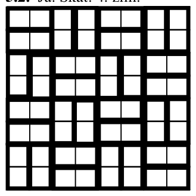
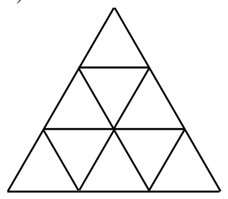
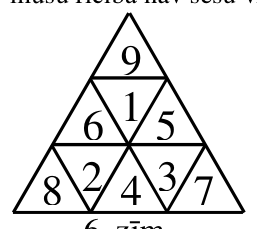
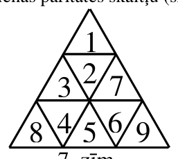
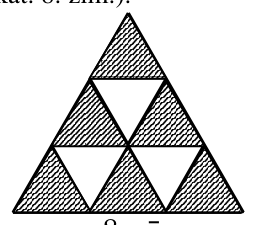
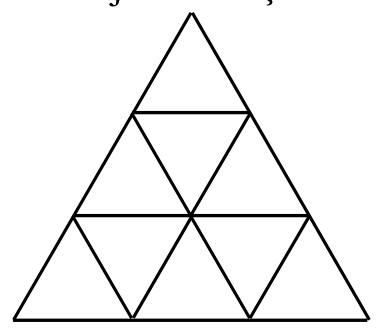
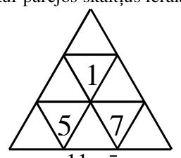
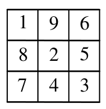
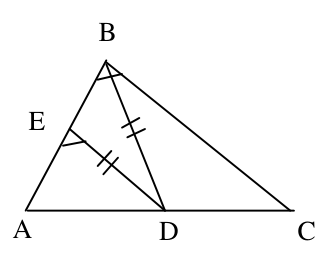
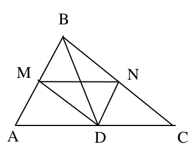

# <lo-sample/> LV.SOL.2002.5.1

Vai eksistē tādi dažādi trīsciparu naturāli skaitļi $A$ un $B$, ka trim skaitļiem $A$, $B$ un $A+B$ ciparu summas visas savā starpā vienādas?

<small>
   
* questionType:
* domain:
   
</small>

## Atrisinājums

Jā; piemēram, $225+117=342$

# <lo-sample/> LV.SOL.2002.5.2

Kvadrāts sastāv no $8 \cdot 8$ vienādām kvadrātiskām rūtiņām. Vai to var sadalīt no divām blakus rūtiņām sastāvošos "ķieģelīšos" tā, lai katrs taisnstūris, kas sastāv no $5$ rūtiņām, vismaz vienu ķieģelīti saturētu pilnībā?

<small>
   
* questionType:
* domain:
   
</small>

## Atrisinājums

Jā. Skat. $4.$ zīm.

{ width=150px }

$4.$ zīm.

# <lo-sample/> LV.SOL.2002.5.3

Gan Jānim, gan Andrim, sākot ar $4$ gadu sasniegšanu, katrā dzimšanas dienā uzdāvināja tik grāmatas, cik gadu zēnam šajā dienā palika. Patlaban viņiem kopā šādā ceļā uzdāvinātas $100$ grāmatas. Cik gadu ir katram zēnam, ja Andris ir vecāks?

<small>
   
* questionType:
* domain:
   
</small>

## Atrisinājums

Viena zēna grāmatu skaits pēc kārtējās grāmatas saņemšanas var būt $4; 9; 15; 22; 30; 39; 49; 60; 72; 85; 99$. Vienīgi $15$ un $85$ summā dod $100$. Tātad Jānim ir $6$ gadi, bet Andrim - $13$ gadi.

# <lo-sample/> LV.SOL.2002.5.4

Katrā no mazajiem trijstūrīšiem (skat. $1.$ zīm.) ierakstīts viencipara naturāls skaitlis; dažādos trijstūrīšos ierakstīti dažādi skaitļi. Aplūkojam visas tādas divu skaitļu summas, kuri ierakstīti trijstūrīšos ar kopīgu malu.  
a) vai var būt, ka neviena no šīm summām nepārsniedz $10$?  
b) kāds mazākais daudzums no šīm summām var būt pāra skaitļi?

{ width=200px }

1. zīm.

<small>
   
* questionType:
* domain:
   
</small>

## Atrisinājums

a) jā, var. Skat. $6.$ zīm.  
b) var būt tikai viena pāra summa (skat. $7.$ zīm.) Visas summas nevar būt nepāra, jo tad visos iesvītrotajos trijstūrīšos ierakstīto skaitļu paritātei jābūt vienai un visos neiesvītrotajos - otrai, bet mūsu rīcībā nav sešu vienas paritātes skaitļu (skat. $8.$ zīm.).

{ width=100px }

$6.$ zīm.

{ width=100px }

$7.$ zīm.

{ width=100px }

$8.$ zīm.

# <lo-sample/> LV.SOL.2002.5.5

Doti $6$ stieņi, katrs $1\ \mathrm{m}$ garš. Vai tos var sagriezt gabalos tā, lai rastos $13$ gabali ar garumu $27\ \mathrm{cm}$ katrs, $8$ gabali ar garumu $15\ \mathrm{cm}$ katrs un $43$ gabali ar garumu $3\ \mathrm{cm}$ katrs?

<small>
   
* questionType:
* domain:
   
</small>

## Atrisinājums

Iegūstamo gabalu kopgarums ir $600\ \mathrm{cm}$, tātad vienāds ar stieņu kopgarumu. Tāpēc, tos iegūstot, jāizmanto viss stieņu materiāls bez atlikuma. Bet visu gabalu garumi centimetros dalās ar $3$, kamēr viena stieņa garums centimetros ar $3$ nedalās. Tātad prasītais nav paveicams.

# <lo-sample/> LV.SOL.2002.7.1

Vai $3.$ zīm. redzamajos trijstūrīšos var ierakstīt $9$ dažādus viencipara naturālus skaitļus, lai katros divos trijstūrīšos ar kopīgu malu ierakstītajiem skaitļiem vienīgais kopīgais pozitīvais dalītājs būtu $1$?

{ width=200px }

3. zīm.

<small>
   
* questionType:
* domain:
   
</small>

## Atrisinājums

Jā. Skat., piem., $11.$ zīm., kur pārējos skaitļus ieraksta patvaļīgi.

{ width=100px }

$11.$ zīm.

# <lo-sample/> LV.SOL.2002.7.2

Vai var plaknē atzīmēt $4$ punktus tā, lai trīs attālumi starp tiem būtu $5$ cm, $6$ cm un $10$ cm, bet pārējie neviens nepārsniegtu $4$ cm?

<small>
   
* questionType:
* domain:
   
</small>

## Atrisinājums

Nē. Ja, piemēram, $\mathrm{AD}=10\ \mathrm{cm}$, tad jābūt $\mathrm{AB}+\mathrm{BD}\geq 10\ \mathrm{cm}$ un $\mathrm{AC}+\mathrm{CD}\geq 10\ \mathrm{cm}$. Bet pat četru lielāko atlikušo attālumu summa nepārsniedz $19\ \mathrm{cm}$.

# <lo-sample/> LV.SOL.2002.7.3

Kvadrāts sastāv no $3 \cdot 3$ rūtiņām. Rūtiņās ierakstīti naturāli skaitļi no $1$ līdz $9$ (katrā rūtiņā cits skaitlis). Katrai rindiņai un katrai kolonnai aplūkojam tajā ierakstīto skaitļu reizinājumu. Vai var būt, ka neviens reizinājums nepārsniedz $90$?

<small>
   
* questionType:
* domain:
   
</small>

## Atrisinājums

Jā, var. Skat. $12.$ zīm.

{ width=100px }

$12.$ zīm.

# <lo-sample/> LV.SOL.2002.7.4

Vai var izvēlēties četrus dažādus naturālus skaitļus tā, ka katru triju izvēlēto skaitļu summa ir pirmskaitlis?

<small>
   
* questionType:
* domain:
   
</small>

## Atrisinājums

Jā, var. Piemēram, der $1;\ 3;\ 7;\ 9$.

# <lo-sample/> LV.SOL.2002.7.5

Kādu lielāko daudzumu skaitļu var izrakstīt rindā tā, lai katru trīs pēc kārtas uzrakstītu skaitļu summa būtu pozitīva, bet katru piecu pēc kārtas uzrakstītu skaitļu summa būtu negatīva?

<small>
   
* questionType:
* domain:
   
</small>

## Atrisinājums

Piemērs $10;\ -18;\ 10;\ 10;\ -18;\ 10$ parāda, ka var uzrakstīt $6$ skaitļus. Pieņemsim, ka uzrakstīti $7$ skaitļi $a;\ b;\ c;\ d;\ e;\ f;\ g$. No $(a+b+c)+(d+e+f)>0$ un $a+b+c+d+e<0$ seko, ka $f>0$. Līdzīgi $b>0$. Tad $b+(c+d+e)+f>0$ - pretruna.

# <lo-sample/> LV.SOL.2002.8.1

Kādu lielāko daudzumu naturālu skaitļu, kas dalās ar $3$, var uzrakstīt, lietojot katru ciparu tieši vienu reizi?

<small>
   
* questionType:
* domain:
   
</small>

## Atrisinājums

Var uzrakstīt $6$ skaitļus $12;\ 3;\ 45;\ 6;\ 78;\ 90$. Viencipara skaitļu nevar būt vairāk par $3$, un no atlikušajiem $7$ cipariem vispār nevar uzrakstīt vairāk nekā $3$ vairākciparu skaitļus. Rakstot viencipara vietā vairākciparu skaitļus, kopējais skaitļu skaits nepalielinās.

# <lo-sample/> LV.SOL.2002.8.2

Punkti $A$, $B$ un $C$ atrodas uz vienas taisnes; $B$ atrodas starp $A$ un $C$. Trijstūri $AMB$ un $BNC$ ir vienādmalu. Pierādiet, ka $AN=CM$.

<small>
   
* questionType:
* domain:
   
</small>

## Atrisinājums

$\triangle MBC=\triangle ABN$ pēc pazīmes mlm; no tā seko vajadzīgais. Jāšķiro gadījumi, kad $M$ un $N$ atrodas vienā vai dažādās pusēs taisnei $\mathrm{AC}$.

# <lo-sample/> LV.SOL.2002.8.3

Izveidojiet iespējami garu nenulles ciparu virkni tā, lai katri divi blakus uzrakstīti cipari veidotu pirmskaitli un visi šie pirmskaitļi būtu dažādi. (Vienas virknes piemērs, kam piemīt šī īpašība, ir $6131$). Nav jāpierāda, ka Jūsu izveidotā virkne ir garākā iespējamā.

<small>
   
* questionType:
* domain:
   
</small>

## Atrisinājums

Virkne $619737131179$ ir garākā iespējamā.

# <lo-sample/> LV.SOL.2002.8.4

Uz tāfeles uzrakstīts skaitlis $6$. Ja uz tāfeles uzrakstīts skaitlis $n$ un $n=a+b$ ($a$ un $b$ - naturāli skaitļi), tad ar vienu gājienu atļauts $n$ nodzēst un tā vietā uzrakstīt reizinājumu $a\cdot b$. Vai, atkārtojot šādus gājienus, var panākt, lai uz tāfeles būtu uzrakstīts skaitlis $123456789$?

<small>
   
* questionType:
* domain:
   
</small>

## Atrisinājums

Pakāpeniski iegūst $6\to 3\cdot 3=9\to 4\cdot 5=20\to 100\to 2500\to \ldots$, kamēr sasniedz skaitli, kas lielāks par beigās iegūstamo. Tā kā $m=1+(m-1)$ un $1\cdot(m-1)=m-1$, tad no $m$ var iegūt $m-1$, ja $m>1$. Pakāpeniski "nolaižamies" līdz $123456789$.

# <lo-sample/> LV.SOL.2002.8.5

Dots, ka $x+y+z+t=0$. Apzīmējam $A=x\cdot y+y\cdot z+z\cdot t$ un $B=x\cdot z+x\cdot t+y\cdot t$. Pierādiet: vai nu $2A+B\le 0$, vai arī $A+2B\le 0$.

<small>
   
* questionType:
* domain:
   
</small>

## Atrisinājums

No dotā seko $x^2+y^2+z^2+t^2+2(xy+xz+xt+yz+yt+zt)=0$. Tāpēc $xy+xz+xt+yz+yt+zt\leq 0$. Bet $(2A+B)+(A+2B)=3(xy+xz+xt+yz+yt+zt)\leq 0$. Tāpēc nevar būt $2A+B>0$ un $A+2B>0$.

# <lo-sample/> LV.SOL.2002.9.1

Pierādiet: katram veselam skaitlim $p$ var atrast bezgalīgi daudzus tādus veselus skaitļus $q$, ka vienādojumam $x^2+p\cdot x+q=0$ ir divas dažādas veselas saknes.

<small>
   
* questionType:
* domain:
   
</small>

## Atrisinājums

Bezgalīgi daudzos veidos var atrast tādus dažādus nenulles skaitļus $a$ un $b$, ka $a+b=-p$. Tad der vienādojumi $x^2+px+ab=0$.

# <lo-sample/> LV.SOL.2002.9.2

Ar kādu lielāko pirmskaitli var dalīties četrciparu naturāls skaitlis, kura trešais cipars $2$ reizes lielāks par pirmo, bet ceturtais cipars $2$ reizes lielāks par otro?

<small>
   
* questionType:
* domain:
   
</small>

## Atrisinājums

Ja meklējamā skaitļa pirmie cipari ir $a$ un $b$, tad tas ir

$1000a+100b+10(2a)+(2b)=102(10a+b)=102\cdot\overline{ab}=2\cdot 3\cdot 17\cdot\overline{ab}$.

Tā kā $a\leq 4$ un $b\leq 4$, tad lielākais iespējamais pirmskaitlis $\overline{ab}$ ir $43$.

# <lo-sample/> LV.SOL.2002.9.3

Vai šaurleņķu trijstūrī mediāna var būt vienāda ar viduslīniju?

<small>
   
* questionType:
* domain:
   
</small>

## Atrisinājums

Nē. Šķirojam divus gadījumus.

a) mediānai un viduslīnijai ir kopīgi galapunkti ($13.$ zīm.) Tad $\angle BED=\angle EBD$ ir šauri kā leņķi pie vienādsānu trijstūra pamata, tāpēc $\angle AED$ ir plats. Bet $\angle ABC=\angle AED$.

{ width=150px }

$13.$ zīm.

{ width=150px }

$14.$ zīm.

b) mediāna krusto viduslīniju ($14.$ zīm.) Tad paralelogramam $\mathrm{MBND}$ ir vienādas diagonāles, tātad tas ir taisnstūris un $\angle ABC=90^{\circ}$.

# <lo-sample/> LV.SOL.2002.9.4

Dotas $25$ pēc ārējā izskata vienādas monētas. Zināms, ka $24$ monētu masas ir vienādas savā starpā, bet vienas monētas masa ir citāda. Kā ar divām svēršanām uz sviras svariem bez atsvariem noskaidrot, vai atšķirīgā monēta ir vieglāka vai smagāka nekā pārējās?

<small>
   
* questionType:
* domain:
   
</small>

## Atrisinājums

Uzliekam uz kausiem pa $8$ monētām. Ja kausi ir līdzsvarā, tad atšķirīgā monēta palikusi malā. Otrajā svēršanā salīdzinām malā palikušās $9$ monētas ar jebkurām $9$ jau svērtajām.

Ja pirmajā svēršanā viens kauss nosveras uz leju, tad atšķirīgā monēta atradusies uz svariem. Otrajā svēršanā salīdzinām uz viena kausa esošās $8$ monētas ar $8$ vēl nesvērtajām.

# <lo-sample/> LV.SOL.2002.9.5

Kvadrāts sastāv no $10\cdot 10$ rūtiņām. Dažas rūtiņas atzīmētas. Katra atzīmēta rūtiņa ir vienīgā atzīmētā vai nu savā rindā, vai savā kolonnā. Kāds lielākais rūtiņu skaits var būt atzīmēts?

<small>
   
* questionType:
* domain:
   
</small>

## Atrisinājums

Var atzīmēt $18$ rūtiņas: $9$ gar apakšējo malu un $9$ gar kreiso malu, neatzīmējot rūtiņu kreisajā apakšējā stūrī.

Pierādīsim, ka vairāk rūtiņu atzīmēt nevar. Pieņemsim, ka $n$ rūtiņas ir vienīgās atzīmētās savā kolonnā. Ja $n=10$, tad citu rūtiņu vispār nav. Ja $n<10$, tad $n\leq 9$. Līdzīgi spriež par rūtiņām, kuras ir vienīgās atzīmētās savā rindiņā, un ievēro, ka $9+9=18$.

# <lo-sample/> LV.SOL.2002.10.1

Naturāli skaitļi $A$ un $B$ kopā satur visus $9$ nenulles ciparus, katru tieši vienu reizi. Vai var gadīties, ka reizinājums $A \cdot B$ dalās ar $3$, bet nedalās ar $9$?

<small>
   
* questionType:
* domain:
   
</small>

## Atrisinājums

Nē. Visu ciparu summa ir $45$. Ja $A\cdot B$ dalās ar $3$, bet ne ar $9$, tad viens no skaitļiem $A$ un $B$ dalās ar $3$, bet otrs nē. Tāpēc vienam no $A$ un $B$ ciparu summa dalās ar $3$, bet otram nē - pretruna.

# <lo-sample/> LV.SOL.2002.10.2

Uz $\angle MON$ malām $OM$ un $ON$ atlikti attiecīgi nogriežņi $OA=AB=BC$ un $OD=DE=EF$. Pierādīt, ka trijstūru $AEC$ un $DBF$ laukumi ir vienādi savā starpā.

<small>
   
* questionType:
* domain:
   
</small>

## Atrisinājums

$\mathrm{L}(AEC)=\mathrm{L}(COE)-\mathrm{L}(AOE)=\dfrac{2}{3}\mathrm{L}(OCF)-\dfrac{2}{9}\mathrm{L}(OCF)=\dfrac{1}{3}\mathrm{L}(OCF)$.

Līdzīgi aprēķina $\mathrm{L}(DBF)$.

# <lo-sample/> LV.SOL.2002.10.3

Dots, ka skaitlis $x$ ir triju veselu nenulles skaitļu kvadrātu summa. Pierādīt, ka arī $x^2$ ir triju veselu nenulles skaitļu kvadrātu summa.

<small>
   
* questionType:
* domain:
   
</small>

## Atrisinājums

Pieņemsim, ka $x=a^2+b^2+c^2$ un $a\geq b\geq c>0$. Tad
$$
x^2=a^4+b^4+c^4+2a^2b^2+2a^2c^2+2b^2c^2=(a^2+b^2-c^2)^2+(2ac)^2+(2bc)^2
$$

# <lo-sample/> LV.SOL.2002.10.4

Pa apli izrakstīti $10$ vieninieki un $10$ divnieki. Nekādi $3$ pēc kārtas izrakstīti skaitļi nav vienādi. Aprēķināti visi triju pēc kārtas uzrakstīto skaitļu reizinājumi (to pavisam ir $20$). Atrast šo $20$ reizinājumu summu.

<small>
   
* questionType:
* domain:
   
</small>

## Atrisinājums

Trīs pēc kārtas uzrakstīti skaitļi var būt $1$; $1$; $2$ vai $1$; $2$; $2$ (varbūt citā kārtībā). Abos gadījumos to reizinājumu $R$ un summu $S$ saista sakarība $R=2S-6$. Tāpēc meklējamā summa ir $\sum(2S-6)=2\sum S-6\cdot 20=2\cdot 3\cdot(10\cdot 1+10\cdot 2)-120=60$.

# <lo-sample/> LV.SOL.2002.10.5

Trīs kaudzes ir attiecīgi $51$, $49$ un $5$ akmeņi. Ar vienu gājienu var apvienot divas kaudzes vienā vai arī sadalīt divās vienādās kaudzēs tādu kaudzi, kurā ir pāra skaits akmeņu. Vai, atkārtojot šādus gājienus, var iegūt $105$ kaudzes pa vienam akmenim katrā?

<small>
   
* questionType:
* domain:
   
</small>

## Atrisinājums

Nē, nevar. Pirmajam gājienam jābūt kaudžu apvienošanai. Pēc tā abās palikušajās kaudzēs akmeņu daudzums dalās ar vienu un to pašu nepāra pirmskaitli ($5$, $7$ vai $3$), un šī īpašība saglabājas.
