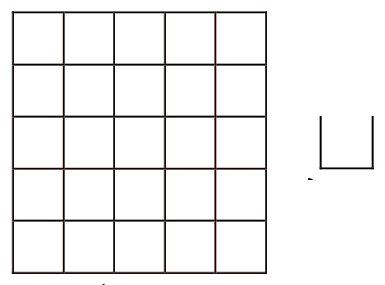
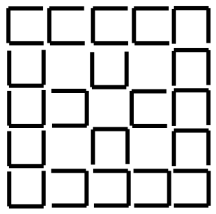
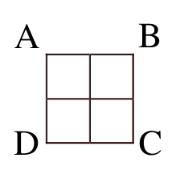
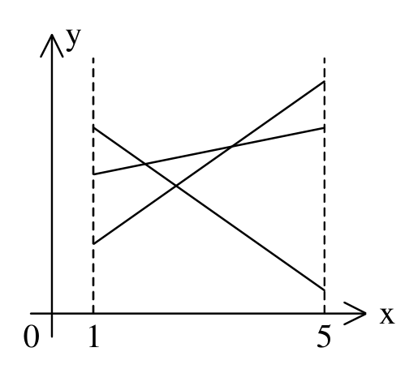
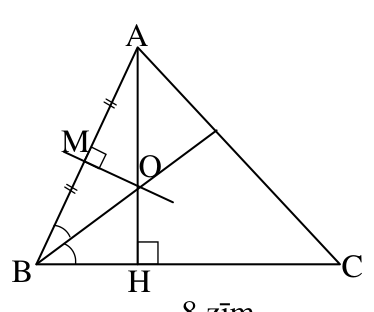
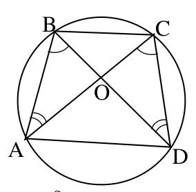
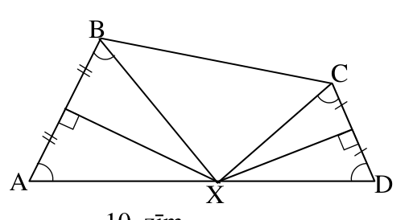
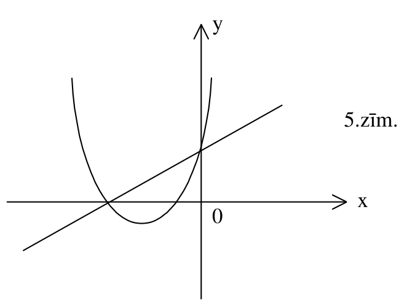
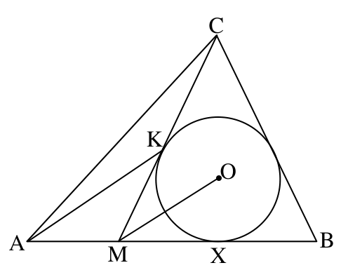
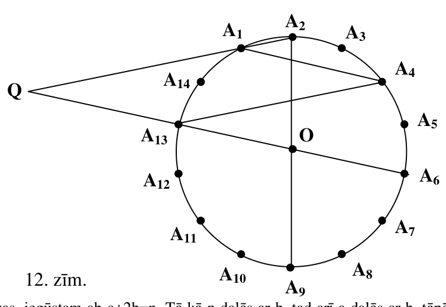

# <lo-sample/> LV.SOL.2004.6.1

Kvadrāts sastāv no $3\cdot 3$ rūtiņām. Katrā rūtiņā ierakstīts kāds skaitlis. Katrai rindiņai un katrai kolonnai aprēķināja tajā ierakstīto skaitļu summu. Vai var gadīties, ka trīs no šīm summām vienādas ar $10$, bet trīs - ar $9$ ?

<small>
   
* questionType:
* domain:
   
</small>

## Atrisinājums

Nē. Tad $(k_1+k_2+k_3)+(r_1+r_2+r_3)=57$, tātad visu ierakstīto skaitļu summa būtu $28,5$. Bet tai jābūt $10$-u un $9$-u summai – pretruna.

# <lo-sample/> LV.SOL.2004.6.2

Andris uzrakstīja rindā citu aiz cita $6$ skaitļus. Pirmos divus viņš izvēlējās patvaļīgi, bet katru nākošo, sākot ar trešo, ieguva kā divu pēdējo šai brīdī uzrakstīto skaitļu summu. Pēc tam Andris paziņoja Jurim visu $6$ skaitļu summu. Vai Juris var noskaidrot vismaz vienu uzrakstīto skaitli?

<small>
   
* questionType:
* domain:
   
</small>

## Atrisinājums

Ja skaitļi ir $a$; $b$; $a+b$; $a+2b$; $2a+3b$; $3a+5b$, tad to summa $S$ ir $8a+12b$. Redzam, ka piektais skaitlis ir
$$
\frac{1}{4}S.
$$

# <lo-sample/> LV.SOL.2004.6.3

Četri trīsciparu skaitļi izveidoti no vieniem un tiem pašiem cipariem. Zināms, ka kaut kādu divu skaitļu summa nedalās ar $3$. Pierādīt, ka arī visu $4$ skaitļu summa nedalās ar $3$.

<small>
   
* questionType:
* domain:
   
</small>

## Atrisinājums

Apzīmējam ciparus ar $a$; $b$; $c$. Tad $\overline{abc}=100a+10b+c=(99a+9b)+(a+b+c)$. Pirmais saskaitāmais noteikti dalās ar $3$; otrais ir viens un tas pats visiem minētajiem trīsciparu skaitļiem. No dotā seko, ka $2(a+b+c)$ nedalās ar $3$. Tāpēc arī $4(a+b+c)$ nedalās ar $3$, no kurienes seko vajadzīgais.

# <lo-sample/> LV.SOL.2004.6.4

Pierādīt, ka eksistē tāds četrciparu skaitlis, kas dod atlikumu $3$, dalot ar vismaz $20$ dažādiem divciparu skaitļiem.

<small>
   
* questionType:
* domain:
   
</small>

## Atrisinājums

Skaitlis $5040=1\cdot 2\cdot 3\cdot 4\cdot 5\cdot 6\cdot 7$ dalās ar divciparu skaitļiem $10$; $12$; $14$; $15$; $18$; $20$; $21$; $24$; $28$; $30$; $35$; $36$; $40$; $42$; $48$; $56$; $60$; $70$; $72$; $84$. Tātad der, piemēram, skaitlis $5043$.

# <lo-sample/> LV.SOL.2004.6.5

Vai $1$.zīm. attēloto režģi var salikt no tādām figūrām, kāda parādīta $2$. zīm.? Saliekot daļas var būt pagrieztas arī citādi, bet nekādām $2$ daļām nedrīkst būt vairāk par $2$ kopējiem punktiem.

{ width=150px }

1.zīm

2.zīm

<small>
   
* questionType:
* domain:
   
</small>

## Atrisinājums

Jā. Skat., piem., $7.$ zīm.

{ width=150px }

$7.$ zīm.

# <lo-sample/> LV.SOL.2004.7.1

Vai a) $10$, b) $11$ pēc kārtas ņemtu veselu skaitļu summa var būt $0$?

<small>
   
* questionType:
* domain:
   
</small>

## Atrisinājums

a) nē, jo summa satur tieši $5$ nepāra saskaitāmos, tātad ir nepāra skaitlis.  
b) jā; $(-5)+(-4)+...+4+5=0$.

# <lo-sample/> LV.SOL.2004.7.2

Kvadrātiskā režģī, kas sastāv no $2 \cdot 2$ rūtiņām (skat. $3.$ zīm.), jāatzīmē trīs rūtiņu virsotnes tā, lai vismaz viena no tām būtu $A$, $B$, $C$ vai $D$. Cik daudzas no trim atzīmētajiem punktiem sastāvošās figūras var iegūt, ja nekādas divas no tām nav savā starpā vienādas?

{ width=100px }

$3.$ zīm.

<small>
   
* questionType:
* domain:
   
</small>

## Atrisinājums

Atbilde: $10$ figūras.

# <lo-sample/> LV.SOL.2004.7.3

Doti $100$ zelta gabali, kuru masas ir $1\text{g}$, $2\text{g}$, $3\text{g}$, $4\text{g}$, ..., $100\text{g}$. Ņurga jau paņēmis sev $25$ no šiem gabaliem. Vai viņš noteikti var paņemt vēl $25$ zelta gabalus tā, lai visu $50$ paņemto zelta gabalu kopējā masa būtu vienāda ar $50$ nepaņemto zelta gabalu kopējo masu?

<small>
   
* questionType:
* domain:
   
</small>

## Atrisinājums

Atbilde: jā.  
Risinājums. Izveidosim $50$ pārus: $(1\mathrm{g}, 100\mathrm{g})$, $(2\mathrm{g}, 99\mathrm{g})$, ..., $(50\mathrm{g}, 51\mathrm{g})$. Katrā pārī zelta gabalu kopējā masa ir $101\mathrm{g}$. pieņemsim, ka Ņurga jau paņēmis $x$ pilnus pārus, tad viņš paņēmis pa vienam zelta gabalam no $25-2x$ pāriem, bet $50-x-(25-2x)=25+x$ pāri vēl vispār nav aiztikti. Tagad Ņurga ņem atlikušos zelta gabalus no tiem pāriem, no kuriem viens gabals jau paņemts (tādu ir $25-2x$) un vēl $x$ pilnus pārus; kopā viņš būs paņēmis $x+(25-2x)+x=25$ pilnus pārus, t.i., $50$ zelta gabalus, kas veido pusi no kopējās masas.

# <lo-sample/> LV.SOL.2004.7.4

Vai eksistē $10$ dažādi naturāli skaitļi ar īpašību: lai kā tos sadalītu divās daļās, vienas daļas visu skaitļu summa dalās ar otras daļas visu skaitļu summu?

<small>
   
* questionType:
* domain:
   
</small>

## Atrisinājums

<u>Atbilde</u>: jā.  
<u>Risinājums.</u> Pietiek atrast $10$ dažādus skaitļus ar īpašību: visu $10$ skaitļu summa dalās ar jebkuras šo skaitļu grupas summu. Tādi skaitļi ir, piemēram, $1$; $2$; $3$; $4$; $5$; $6$; $7$; $8$; $9$ un $45!-45$ (ievērojam, ka $1+2+\ldots+9=45$).

# <lo-sample/> LV.SOL.2004.7.5

Karnevāla zālē karājas $6$ lampas. Dažas no tām savienotas ar lentām (katra lenta savieno $2$ lampas un nepieskaras citām). Pavisam ir vismaz $7$ lentas. No katrām trim lampām vismaz divas savienotas ar lentu; katras $2$ lampas savieno augstākais viena lenta.

Pierādīt: ir tādas trīs lampas, kas visas savienotas ar lentām cita ar citu.

<small>
   
* questionType:
* domain:
   
</small>

## Atrisinājums

Ja katrai lampai būtu piestiprināti ne vairāk kā $2$ lentu gali, tad lentu būtu ne vairāk kā $\frac{6\cdot 2}{2}=6$ – pretruna. Tātad ir lampa $A$, kurai piestiprinātas (vismaz) $3$ lentas; pieņemsim, ka tās iet uz lampām $x$, $y$, $z$. Vismaz divas no lampām $x$, $y$, $z$ savienotas ar lentu; tās kopā ar $A$ veido meklējamo trijnieku.

# <lo-sample/> LV.SOL.2004.8.1

Cik dažādu funkciju grafiki, kas ir taisnes nogriežņi vai lauztas līnijas, redzami $4.$ zīm. ? (Apskatām funkcijas, kas definētas pie $1 \le x \le 5$).

{ width=250px }
4.zīm.

<small>
   
* questionType:
* domain:
   
</small>

## Atrisinājums

<u>Atbilde</u>: $13$ grafiki.

# <lo-sample/> LV.SOL.2004.8.2

Plaknē uzzīmētas $10$ taisnes. Nekādas divas no tām nav paralēlas un nekādas trīs neiet caur vienu punktu.

Vai noteikti uz taisnēm var izvēlēties virzienus tā, lai izpildītos īpašība: sākot kustību no jebkura punkta uz jebkuras taisnes un kustoties tikai pa taisnēm izvēlētajos virzienos, nav iespējams atgriezties izejas punktā?

<small>
   
* questionType:
* domain:
   
</small>

## Atrisinājums

<u>Atbilde</u>: jā, var.  
<u>Risinājums.</u> Novelkam vēl vienu taisni $t$, kas nav ne paralēla, ne perpendikulāra nevienai no dotajām. Uz taisnes $t$ virzienu izvēlamies patvaļīgi, uz citām – tā, lai šie virzieni veidotu šaurus leņķus ar $t$ virzienu. Tad jebkuras kustības gaitā kustīgā objekta projekcija uz $t$ pārvietojas $t$ virzienā, tātad nevar atgriezties kustības sākuma stāvoklī.

# <lo-sample/> LV.SOL.2004.8.3

Šaurleņķu trijstūrī $ABC$ augstums no virsotnes $A$, leņķa $B$ bisektrise un malas $AB$ vidusperpendikuls krustojas vienā punktā. Aprēķināt $\angle ABC$ .

<small>
   
* questionType:
* domain:
   
</small>

## Atrisinājums

{ width=150px }

8.zīm.

Apzīmējam $\angle BAO=\alpha$. Tā kā $\triangle AMO=\triangle BMO$ ($kk$), tad arī $\angle ABO=\alpha$. Tāpēc $\angle ABC=2\alpha$ un no $\triangle ABH$ iegūstam $\alpha+2\alpha+90^{\circ}=180^{\circ}$, $\alpha=30^{\circ}$, $\angle ABC=2\alpha=60^{\circ}$.

# <lo-sample/> LV.SOL.2004.8.4

Kādā klasē ir $25$ skolēni. Sauksim skolēnu par noslēgtu, ja viņam klasē nav vairāk par $20$ draugiem. Pierādīt: klasē ir vai nu divi noslēgti skolēni, kas savā starpā nedraudzējas, vai arī divi draugi, neviens no kuriem nav noslēgts, vai arī abu minēto veidu skolēnu pāri (uzskatām: ja $A$ draudzējas ar $B$, tad arī $B$ draudzējas ar $A$).

<small>
   
* questionType:
* domain:
   
</small>

## Atrisinājums

Sāksim skolēnu, kas nav noslēgts, par atklātu. Pieņemsim pretējo tam, kas jāpierāda. Ja visi skolēni ir noslēgti, tad tie visi savā starpā draudzējas – pretruna, jo katram ir $24$ draugi. Pieņemsim, ka ir kāds atklāts skolnieks $A$. Apskatām viņa draugus; to ir vismaz $21$, un tie visi ir noslēgti. Tāpēc tie visi draudzējas savā starpā. Tāpēc katram no tiem ir vismaz $21$ draugs (pārējie $20$ un $A$), un viņi ir atklāti – pretruna.

# <lo-sample/> LV.SOL.2004.8.5

Vai eksistē tādi naturāli skaitļi $a$, $b$, $c$, $d$, ka no $15$ skaitļiem: $a$; $b$; $c$; $d$; $a+b$; $a+c$; $a+d$; $b+c$; $b+d$; $c+d$; $a+b+c$; $a+b+d$; $a+c+d$; $b+c+d$; $a+b+c+d$ tieši astoņi (ne vairāk un ne mazāk) dalās ar $2003$?

<small>
   
* questionType:
* domain:
   
</small>

## Atrisinājums

<u>Atbilde</u>: nē, neeksistē.  
<u>Risinājums.</u> Šķirojam divus gadījumus:  
$1)$ $a+b+c+d$ dalās ar $2003$. Tad katrā pārī $(a;\ b+c+d)$, $(b;\ a+c+d)$, $(c;\ a+b+d)$, $(d;\ a+b+c)$, $(a+b;\ c+d)$, $(a+c;\ b+d)$, $(a+d;\ b+c)$ vai nu neviens, vai abi skaitļi dalās ar $2003$. Tātad ar $2003$ dalās nepāra daudzums apskatīto skaitļu.  
$2)$ $a+b+c+d$ nedalās ar $2003$. Tad katrā no minētajiem pāriem ne vairāk kā viens skaitlis dalās ar $2003$; tātad ar $2003$ dalās ne vairāk kā $7$ apskatāmie skaitļi.

# <lo-sample/> LV.SOL.2004.9.1

Vai $\sqrt{3+\sqrt{8}}+\sqrt{7-\sqrt{40}}$ lielāks, mazāks vai vienāds ar $\sqrt{6+\sqrt{20}}$?

<small>
   
* questionType:
* domain:
   
</small>

## Atrisinājums

Ievērojam, ka $(\sqrt{2}+1)^2=3+2\sqrt{2}=3+\sqrt{8}$, $(\sqrt{5}-\sqrt{2})^2=7-2\sqrt{10}=7-\sqrt{40}$ un $(\sqrt{5}+1)^2=6+2\sqrt{5}=6+\sqrt{20}$. Tāpēc abas izteiksmes vienādas savā starpā.

# <lo-sample/> LV.SOL.2004.9.2

Apaļa ezera krastā atrodas $4$ pilsētas $A$, $B$, $C$, $D$ (tieši šajā secībā). Pirmdien vienlaicīgi no $A$ uz $B$ un no $D$ uz $C$ devās laivas. Katra laiva brauca pa taisnu maršrutu ar konstantu ātrumu, un tās nonāca galā vienlaicīgi (laivu ātrumi varbūt nebija vienādi savā starpā). Otrdien šīs pašas laivas vienlaicīgi devās no $B$ uz $D$ un no $C$ uz $A$ ar tiem pašiem ātrumiem, atkal kustoties pa taisniem maršrutiem. Pierādīt, ka tās ezerā satikās.

<small>
   
* questionType:
* domain:
   
</small>

## Atrisinājums

Apzīmējam $AC$ un $BD$ krustpunktu ar $O$, bet no $A$ un $D$ izbraucošo laivu ātrumus attiecīgi ar $u$ un $v$.

No uzdevumā dotā seko, ka $\frac{AB}{u}=\frac{DC}{v}$ jeb $\frac{AB}{DC}=\frac{u}{v}$. Ievilkto leņķu vienādības dēļ $\triangle AOB\sim\triangle DOC$, tāpēc $\frac{BO}{CO}=\frac{AB}{DC}$. Tātad $\frac{BO}{CO}=\frac{u}{v}$, t.i., laivas ceļā no $B$ resp. $C$ līdz $O$ pavadīs vienādu laiku.

{ width=150px }

9. zīm.

# <lo-sample/> LV.SOL.2004.9.3

Uz tāfeles uzrakstīti $2003$ vieninieki. Ar vienu gājienu atļauts izvēlēties divus uz tāfeles uzrakstītus skaitļus (apzīmēsim tos ar $a$ un $b$), nodzēst tos un vietā uzrakstīt vienu skaitli $\sqrt{2ab}$. Atkārtojam tādus gājienus, līdz uz tāfeles paliek viens skaitlis. Pierādīt, ka tas ir mazāks par $45$.

<small>
   
* questionType:
* domain:
   
</small>

## Atrisinājums

Tā kā $\left(\sqrt{2ab}\right)^2=2ab\le a^2+b^2$, tad uz tāfeles esošo skaitļu kvadrātu summa gājienu rezultātā nepalielināsies. Sākumā tā ir $2003$. Ja uz tāfeles paliek viens skaitlis $X$, tad $x^2\le 2003<2025=45^2$; tāpēc $x<45$.

# <lo-sample/> LV.SOL.2004.9.4

Izliektā $4$-stūrī $ABCD$ pastāv vienādība $\angle BAD=\angle CDA$. Malu $AB$ un $CD$ vidusperpendikuli krustojas uz malas $AD$. Pierādīt, ka $AC=BD$.

<small>
   
* questionType:
* domain:
   
</small>

## Atrisinājums

{ width=250px }

10. zīm.

Apzīmēsim vidusperpendikulu krustpunktu ar $X$. Tad $\triangle AXB$ un $\triangle DXC$ vienādsānu, tāpēc $XA=XB$ un $XC=XD$. Bez tam $\angle AXB=180^{\circ}-2\angle A=180^{\circ}-2\angle D=\angle CXD$. Tāpēc $\angle AXC=\angle DXB$ un $\triangle AXC=\triangle BXD$ $(mlm)$. Tāpēc arī $AC=BD$.

# <lo-sample/> LV.SOL.2004.9.5

Rindā uzrakstīti naturāli skaitļi no $1$ līdz $100$ ieskaitot, katrs tieši vienu reizi. Katriem trim pēc kārtas uzrakstītiem skaitļiem aprēķinām to summu. Kāds lielākais daudzums šo summu var būt nepāra skaitļi?

<small>
   
* questionType:
* domain:
   
</small>

## Atrisinājums

Pavisam ir $98$ summas. Pieņemsim, ka tās visas ir nepāra skaitļi. Apzīmējot pāra skaitļus ar $p$, bet nepāra – ar $n$, viegli iegūt, ka pastāv tikai šādas iespējas:  
a) $n\,n\,n\,n\,n\,n\,n\ldots$  
b) $n\,p\,p\,n\,p\,p\,n\,p\,p\ldots$  
c) $p\,n\,p\,p\,n\,p\,p\,n\,p\,p\,n\ldots$  
d) $p\,p\,n\,p\,p\,n\,p\,p\,n\,p\ldots$  
Visos gadījumos skaidrs, ka $n$ un $p$ daudzumi atšķiras, bet tiem jābūt vienādiem.

To, lai $97$ summas būtu nepāra skaitļi, var panākt šādi: $\underbrace{nppnpp\ldots npp}_{75\ \text{skaitļi}}\underbrace{nnn\ldots n}_{25\ \text{skaitļi}}$.

# <lo-sample/> LV.SOL.2004.10.1

Vai 5.zīm var būt attēloti funkciju $y=x^2+px+q$ un $y=qx+1$ grafiki?

{ width=300px }

5.zīm.

<small>
   
* questionType:
* domain:
   
</small>

## Atrisinājums

Nē, nevar. Parabola krusto $Oy$ asi punktā $(0;q)$, bet taisne – punktā $(0;1)$; tāpēc $q=1$. Tāpēc taisne krusto $OX$ asi punktā $(-1;0)$. Šis punkts atrodas uz parabolas, tāpēc $(-1)^2+p(-1)+1=0$ un $p=2$. Bet tad parabolas vienādojums ir $y=x^2+2x+1$ jeb $y=(x+1)^2$, un tai ir tikai viens kopīgs punkts ar $Ox$ asi.

# <lo-sample/> LV.SOL.2004.10.2

Dots, ka $p$ un $q$ – reāli skaitļi un vienādojumam $x^4+px+q=0$ ir reāla sakne $c$. Pierādīt, ka $p^2\ge 4c^2q$.

<small>
   
* questionType:
* domain:
   
</small>

## Atrisinājums

Ja $c$ ir vienādojuma $x^4+px+q=0$ sakne, tad $c^4+pc+q=0$; tas nozīmē, ka $c$ ir vienādojuma $c^2\cdot x^2+px+q=0$ sakne. Tātad šī vienādojuma diskriminants nav negatīvs, no kurienes seko vajadzīgais.

# <lo-sample/> LV.SOL.2004.10.3

Atrodiet mazāko pozitīvo veselo skaitli $x$ ar īpašību: $x^2-1$ dalās gan ar $501$, gan ar $1001$, bet nedalās ar $2003$.

<small>
   
* questionType:
* domain:
   
</small>

## Atrisinājums

Skaidrs, ka $x>1$ (citādi $x^2-1$ dalītos ar $2003$). Tā kā $2\cdot 501-1001=1$, tad $LKD(501,1001)=1$. Tāpēc mums jāmeklē tādu $x$, ka $x^2-1$ dalās ar reizinājumu $501\cdot 1001$.

Ievērojam, ka $2003^2-1=(2003-1)(2003+1)=2002\cdot 2004=8\cdot 501\cdot 1001$, un atliek pierādīt, ka skaitļi $n\cdot 501\cdot 1001$, $1\le n\le 7$, nav izsakāmi formā $x^2-1$, $x\in N$, $x>1$. To izdara ar tiešu pārbaudi.

# <lo-sample/> LV.SOL.2004.10.4

Uz trijstūra ABC malas AB ņemts tāds punkts M, ka $AB=3\cdot AM$. Ir zināms, ka $CM=CB$. Trijstūrī MCB ievilktās riņķa līnijas centrs ir O, un tā pieskaras CM punktā K. Pierādīt, ka $AK\parallel MO$.

<small>
   
* questionType:
* domain:
   
</small>

## Atrisinājums

Tā kā $\triangle MCD$ – vienādsānu, tad riņķa līnija pieskaras malai $MB$ tās viduspunktā $X$. Tāpēc $MX=MA$. Bez tam $MX=MK$ kā pieskares. Tāpēc $\angle MAK=\angle MKA=\alpha$. No ārējā leņķa īpašībām $\angle KMX=2\alpha$; tā kā $MO$ ir $\angle KMX$ bisektrise, tad $\angle OMX=\alpha=\angle KAM$, no kurienes seko vajadzīgais.

{ width=250px }

11. zīm.

# <lo-sample/> LV.SOL.2004.10.5

Kvadrāts sastāv no $10\cdot 10$ rūtiņām. Desmit rūtiņas nokrāsotas melnas tā, ka katrā rindā un katrā kolonnā nokrāsota tieši viena rūtiņa. Vai var gadīties, ka nenokrāsoto kvadrāta daļu var sagriezt $45$ taisnstūros, katrs no kuriem sastāv no $2$ rūtiņām?

<small>
   
* questionType:
* domain:
   
</small>

## Atrisinājums

Atbilde: nē, nevar.

Risinājums. Sanumurējam rindiņas no lejas uz augšu un kolonnas no kreisās uz labo ar skaitļiem $1$; $2$; $3$; ...; $9$; $10$. Nokrāsoto rūtiņu visu „koordinātu” summa ir $2\cdot(1+2+\ldots+10)=110$. Tāpēc visu atlikušo rūtiņu koordinātu summa ir $10\cdot(1+2+\ldots+10)+10\cdot(1+2+\ldots+10)-110$, t.i., pāra skaitlis. Katram $1\cdot2$ rūtiņu taisnstūrim visu koordinātu summa ir nepāra skaitlis un šo taisnstūru skaitam jābūt $45$ – nepāra skaitlim. Tātad visu $45$ taisnstūru visu rūtiņu visu koordinātu summai jābūt nepāra skaitlim – pretruna.

# <lo-sample/> LV.SOL.2004.11.1

Definējam $F_1=1$, $F_2=1$, $F_{n+2}=F_n+F_{n+1}$ pie $n\geq 1$. Pierādīt, ka katram naturālam $n$ pastāv vienādība
$$
\frac{1}{F_1\cdot F_3}+\frac{1}{F_2\cdot F_4}+\ldots+\frac{1}{F_n\cdot F_{n+2}}=1-\frac{1}{F_{n+1}\cdot F_{n+2}}.
$$

<small>
   
* questionType:
* domain:
   
</small>

## Atrisinājums

Ievērojam, ka pie $k\geq1$

$$
\frac{1}{F_kF_{k+2}}=\frac{F_{k+1}}{F_kF_{k+1}F_{k+2}}=\frac{F_{k+2}-F_k}{F_kF_{k+1}F_{k+2}}=\frac{1}{F_kF_{k+1}}-\frac{1}{F_{k+1}F_{k+2}}.
$$

Tāpēc vienādības kreisā puse pārveidojas par

$$
\frac{1}{F_1F_2}-\frac{1}{F_2F_3}+\frac{1}{F_2F_3}-\frac{1}{F_3F_4}+\ldots+\frac{1}{F_nF_{n+1}}-\frac{1}{F_{n+1}F_{n+2}}=\frac{1}{F_1F_2}-\frac{1}{F_{n+1}F_{n+2}}=1-\frac{1}{F_{n+1}F_{n+2}},
$$

k.b.j. Var lietot arī matemātisko indukciju.

# <lo-sample/> LV.SOL.2004.11.2

Riņķī ar rādiusu $R$ ievilkts regulārs $14$-stūris $A_1A_2\ldots A_{14}$. Pierādīt, ka $A_1A_2+A_1A_6=A_1A_4+R$.

<small>
   
* questionType:
* domain:
   
</small>

## Atrisinājums

Skaidrs, ka $OA_1A_4A_{13}$ ir paralelograms. Tāpēc $OA_1=A_4A_{13}$ un $OA_{13}=A_1A_4$. Tā kā $\angle A_1A_2A_9=\angle A_2OA_{13}$, seko $OQ=A_2Q$. Tāpēc $R+QA_{13}=A_1A_2+QA_1$ jeb $R+A_1A_4=A_1A_2+A_4A_{13}=A_1A_2+A_1A_6$, k.b.j.

{ width=350px }

12. zīm.

# <lo-sample/> LV.SOL.2004.11.3

Naturālam skaitlim $n$ ir tādi divi dažādi naturāli dalītāji $a$ un $b$, ka $(a+2)\cdot(b-1)=n-2$. Pierādīt, ka skaitlis $2\cdot n$ ir kāda naturāla skaitļa kvadrāts.

<small>
   
* questionType:
* domain:
   
</small>

## Atrisinājums

Atverot iekavas, iegūstam $a\cdot b-a+2\cdot b=n$. Tā kā $n$ dalās ar $b$, tad arī $a$ dalās ar $b$, tāpēc $a>b$ (atceramies, ka $a\neq b$); tātad $a\geq2\cdot b$. Tā kā $n$ dalās ar $a$, tad $2\cdot b$ dalās ar $a$; tāpēc $2\cdot b\geq a$. Skaidrs, ka $a=2\cdot b$. Tad $n=a\cdot b-a+2\cdot b=2\cdot b^2-2\cdot b+2\cdot b=2\cdot b^2$ un $2\cdot n=4\cdot b^2=(2\cdot b)^2$.

# <lo-sample/> LV.SOL.2004.11.4

Aļģirds un Benedikts katrs uzrakstīja vairākus naturālus skaitļus. Katrs no viņiem izmantoja katru nenulles ciparu tieši vienu reizi un neizmantoja ciparu $0$. Pierādīt: var atrast tādus divus ciparus $x$ un $y$, ka Aļģirds tos iekļāvis vienāda garuma skaitļos un arī Benedikts tos iekļāvis vienāda garuma skaitļos.

<small>
   
* questionType:
* domain:
   
</small>

## Atrisinājums

Pieņemsim pretējo. Ar $a(n)$ resp. $b(n)$ apzīmēsim ciparu skaitu Aļģirda resp. Benedikta uzrakstītajā skaitlī, kas satur ciparu $n$. Tā kā jau četru mazāko naturālo skaitļu summa $1+2+3+4=10$ ir lielāka par $9$ – nenulles ciparu skaitu, tad $a(n)$ iespējamas augstākais $3$ dažādas vērtības; tas pats attiecas uz $b(n)$. Tāpēc iespējami augstākais $9$ dažādi pāri $(a(n), b(n))$. Tā kā saskaņā ar pieņēmumu dažādiem nenulles cipariem $n$ ir dažādi pāri $(a(n),b(n))$, tad katrs iespējamais pāris $(a(n), b(n))$ sastopams tieši vienu reizi. Tāpēc $a(n)$ ir trīs dažādas vērtības, katra tieši trim dažādiem cipariem $n$. Ja būtu $a(n)\ge 4$, tad tieši trīs cipari būtu četrciparu vai vēl garākos skaitļos – pretruna. Ja būtu $a(n)=2$, tad tieši trīs cipari būtu divciparu skaitļos – pretruna. Tāpēc $a(n)$ iespējamas tikai divas vērtības $1$ un $3$ – pretruna.

# <lo-sample/> LV.SOL.2004.11.5

Funkcija $f(x,y)$ definēta veseliem pozitīviem $x$ un $y$, un tās vērtības ir veseli pozitīvi skaitļi. Neviens vesels pozitīvs skaitlis nav $f(x,y)$ vērtība vairāk nekā $2003$ dažādiem pāriem $(x,y)$. Pierādīt: eksistē tādi veseli pozitīvi skaitļi $m$ un $n$, ka $f(m,n)>m\cdot n$.

<small>
   
* questionType:
* domain:
   
</small>

## Atrisinājums

Katram pozitīvam veselam $A$ ir augstākais $2003\cdot A$ pāri $(x,y)$, kam izpildās nosacījums $f(x,y)=A$. Pieņemsim, ka visiem $m$ un $n$ pastāv nevienādība $f(m,n)\le m\cdot n$. Tad no $m\cdot n\le A$ seko $f(m,n)\le A$. Tāpēc no $m\cdot n\le A$ seko, ka vai nu $f(m,n)=1$ vai $f(m,n)=2$, ..., vai $f(m,n)=A$. Tātad tādu pāru $(m,n)$, kam izpildās $m\cdot n\le A$, ir ne vairāk par $2003\cdot A$. Bet pie fiksēta $m$ ir $\left[\frac{A}{m}\right]$ tādu pāru $(m,n)$, ka $m\cdot n\le A$. Tāpēc

$$
\left[\frac{A}{1}\right]+\left[\frac{A}{2}\right]+\ldots+\left[\frac{A}{A}\right]\le 2003\cdot A.
$$

Tā kā $\left[x\right]\ge x-1$, iegūstam

$$
A\left(\frac{1}{1}+\frac{1}{2}+\ldots+\frac{1}{A}\right)-A\le 2003\cdot A
$$

un

$$
\frac{1}{1}+\frac{1}{2}+\ldots+\frac{1}{A}\le 2004
$$

katram veselam pozitīvam $A$. Bet tā ir pretruna ar labi zināmu faktu, ka $\frac{1}{1}+\frac{1}{2}+\ldots+\frac{1}{A}$ neierobežoti aug, augot $A$.
