# <lo-sample/> LV.SOL.2005.5.1

Vai var pa apli uzrakstīt visus naturālos skaitļus no $1$ līdz $15$, katru tieši vienu reizi, tā, lai katri divi blakus uzrakstīti skaitļi atšķirtos viens no otra vai nu par $1$, vai par $2$?

<small>
   
* questionType:
* domain:
   
</small>

## Atrisinājums

Jā, var. Skat., piem., $5.$ zīm.

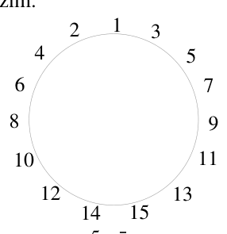{ width=150px }

$5.$ zīm.

# <lo-sample/> LV.SOL.2005.5.2

Kvadrāts sastāv no $3 \cdot 3$ rūtiņām. Sākumā tās visas ir tukšas. Vai var dažās rūtiņās iezīmēt pa krustiņam tā, lai blakus katrai rūtiņai (vienalga – tukšai vai tādai, kas satur krustiņu) būtu tieši viens krustiņš?

<small>
   
* questionType:
* domain:
   
</small>

## Atrisinājums

**Atbilde:** nē, nevar.  
**Pierādījums.** Blakus centrālajai rūtiņai jābūt tieši vienam krustiņam. Varam uzskatīt, ka situācija attēlota $6.$ zīm. (“$\bullet$” nozīmē, ka krustiņa attiecīgajā rūtiņā nav). Līdz ar to ar A apzīmētajai rūtiņai uzdevuma nosacījumi neizpildās.

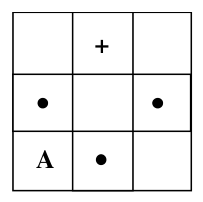{ width=100px }

$6.$ zīm.

# <lo-sample/> LV.SOL.2005.5.3

Taisnstūris sastāv no $3 \cdot 4$ rūtiņām. Vai rūtiņās var ierakstīt naturālos skaitļus no $1$ līdz $12$ (katru - tieši vienā rūtiņā) tā, lai  
**a)** visās $3$ rindās ierakstīto skaitļu summas būtu vienādas?  
**b)** visās $4$ kolonnās ierakstīto skaitļu summas būtu vienādas?

<small>
   
* questionType:
* domain:
   
</small>

## Atrisinājums

a) jā, var; skat., piem., $7.$ zīm.  
b) nē, nevar, jo summa $1+2+\ldots+12=78$ nedalās ar $4$.

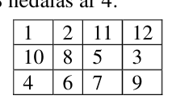{ width=100px }

$7.$ zīm.

# <lo-sample/> LV.SOL.2005.5.4

Klasē ir $8$ zēni un $5$ meitenes. Katrs zēns draudzējas ar tieši $2$ meitenēm. Pierādīt, ka ir tāda meitene, kas draudzējas ar vismaz $4$ zēniem.

<small>
   
* questionType:
* domain:
   
</small>

## Atrisinājums

Pastāv $8\cdot 2=16$ draudzības “zēns-meitene”. Ja uz katru meiteni attiektos ne vairāk par $3$ no tām, tad šādu draudzību skaits nepārsniegtu $5\cdot 3=15$ – pretruna.

# <lo-sample/> LV.SOL.2005.5.5

Kvadrāts sastāv no $3 \cdot 3$ rūtiņām. Andris rūtiņās ierakstījis naturālos skaitļus no $1$ līdz $9$ (katru skaitli tieši vienā rūtiņā). Jānis neredz ierakstītos skaitļus. Viņš ar vienu jautājumu var norādīt Andrim uz jebkuru kvadrātu, kas sastāv no $1$ vai $4$ rūtiņām, un uzzināt, kuri skaitļi ierakstīti šajā kvadrātā (bet ne to, kurš skaitlis kurā kvadrāta rūtiņā ierakstīts, ja runa ir par $4$ rūtiņu kvadrātu.) Vai Jānis ar $4$ jautājumiem var par visām rūtiņām uzzināt, kurš skaitlis kurā no tām ir ierakstīts?

<small>
   
* questionType:
* domain:
   
</small>

## Atrisinājums

**Atbilde:** jā, var.  
**Pierādījums.** Jānis uzdod jautājumus par četriem no $4$ rūtiņām sastāvošiem kvadrātiem. Īsuma labad apzīmēsim šos jautājumus ar A, B, C, D atkarībā no tā, kuru no kvadrāta stūra rūtiņām attiecīgais jautājums “ietver” (skat. $8.$ zīm.). Tālāk Jānis spriež sekojoši:  
$1)$ rūtiņā A ierakstīts tas skaitlis, kas parādās tikai atbildē uz jautājumu A, bet neparādās atbildēs uz jautājumiem B, C, D (līdzīgi par B, C, D).  
$2)$ rūtiņā x ierakstīts tas skaitlis, kas parādās atbildēs uz jautājumiem A un B, bet neparādās atbildēs uz jautājumiem C un D (līdzīgi par rūtiņām y, t, u).  
$3)$ rūtiņā z ierakstīts atlikušais skaitlis.

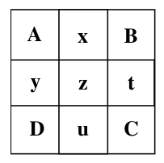{ width=100px }

$8.$ zīm.

# <lo-sample/> LV.SOL.2005.6.1

Aukla sākotnēji bija $10$ km gara. To sagrieza $2$m, $3$m un $5$m gabalos tā, ka kopā sanāca $4219$ gabali. Šos gabalus tālāk sagriezīs $1$m garos gabalos. Cik griezumus vēl vajadzēs izdarīt?

<small>
   
* questionType:
* domain:
   
</small>

## Atrisinājums

Pašreiz ir izdarīti $4219-1=4218$ griezumi. Lai beigās iznāktu $10000$ gabali, pavisam jāizdara $10000-1=9999$ griezumi. Tātad vēl jāizdara $9999-4218=5781$ griezumi.

# <lo-sample/> LV.SOL.2005.6.2

Par naturāla skaitļa $n$ faktoriālu sauc visu naturālo skaitļu reizinājumu no $1$ līdz $n$ ieskaitot (to apzīmē ar $n!$). Piemēram, $3! = 1 \cdot 2 \cdot 3 = 6$; $5! = 1 \cdot 2 \cdot 3 \cdot 4 \cdot 5 = 120$; $1! = 1$. Kāds ir mazākais daudzums faktoriālu, kuru summa var būt $2004!$ ? (Starp šiem faktoriāliem drīkst būt vienādi, un to skaitam jābūt lielākam par $1$.)

<small>
   
* questionType:
* domain:
   
</small>

## Atrisinājums

**Atbilde:** $2004$.  
**Risinājums.** a) tā kā
$$
\underbrace{2003!+2003!+\ldots+2003!}_{2004\ \text{reizes}}=2004\cdot 2003!=2004!\quad (*)
$$
tad ar $2004$ saskaitāmajiem pietiek.  
b) ja kādu no saskaitāmajiem vienādībā $(*)$ aizstās ar mazāku, tad kreisās puses vērtība samazināsies, tāpēc būs jāpievieno vēl kāds saskaitāmais un to skaits augs. Tāpēc $2004$ ir mazākais iespējamais saskaitāmo skaits.

# <lo-sample/> LV.SOL.2005.6.3

Klasē ir $31$ skolēns. Katrs no viņiem nosūtīja apsveikumu vai nu $2$ vai $4$, vai $10$ klases biedriem. Katrs saņēma tieši $5$ apsveikumus. Pierādīt, ka kāds apsveikums mērķi nesasniedza.

<small>
   
* questionType:
* domain:
   
</small>

## Atrisinājums

Kopējais nosūtīto apsveikumu skaits ir pāra skaitlis, bet kopējais saņemto apsveikumu skaits – nepāra.

# <lo-sample/> LV.SOL.2005.6.4

Seši laupītāji dala $23$ zelta monētas. To masas ir $79$g, $80$g, $81$g, ..., $100$g, $101$g. Vai var gadīties, ka katrs saņem vismaz $301$ gramu zelta? (Monētas nedrīkst lauzt gabalos, pārkausēt utml.)

<small>
   
* questionType:
* domain:
   
</small>

## Atrisinājums

Tā kā $6\cdot 4=24>23$, tad kāds no laupītājiem saņēma augstākais $3$ monētas. Bet pat $3$ smagākās monētas kopā sver tikai $300$ g. Tāpēc atbilde ir “nē”.

# <lo-sample/> LV.SOL.2005.6.5

Andris, Dzintars, Juliata un Gunārs katrs sadalīja $1$. zīm. redzamo figūru $2$ gabalos tā, ka katrs gabals sastāv no $5$ rūtiņām. Vai var gadīties, ka starp iegūtajiem gabaliem var atrast $6$ dažādus? (Ja divi gabali atšķiras tikai ar novietojumu plaknē vai ir viens otra spoguļattēli, tad tos uzskata par vienādiem.)

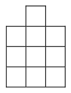{ width=100px }

1.zīm.

<small>
   
* questionType:
* domain:
   
</small>

## Atrisinājums

Jā, var. Skat. $9.$ zīm.

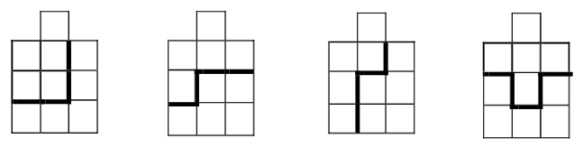{ width=300px }

$9.$ zīm.

# <lo-sample/> LV.SOL.2005.7.1

Atrisināt vienādojumu

$$
1-(2-(3-(4-(5-\ldots-(2003-(2004-x\underbrace{)\ldots)}_{\substack{2003\\ \text{iekavas}}}=2005
$$

<small>
   
* questionType:
* domain:
   
</small>

## Atrisinājums

Atverot iekavas, iegūstam vienādojumu

$$(1-2)+(3-4)+...+(2003-2004)+x=2005$$

$$(-1)\cdot 1002+x=2005$$

$$x=3007$$

# <lo-sample/> LV.SOL.2005.7.2

Gatavojoties olimpiādei, Andris $5$ nedēļas risināja uzdevumus. Katru nākošo nedēļu viņš izrēķināja par vienu un to pašu uzdevumu skaitu vairāk nekā iepriekšējā nedēļā. Vai var gadīties, ka Andris pavisam kopā izrēķināja a) $2004$ uzdevumus, b) $2005$ uzdevumus?

<small>
   
* questionType:
* domain:
   
</small>

## Atrisinājums

Ja Andra atrisināto uzdevumu daudzumi minētajās nedēļās ir $x$; $x+y$; $x+2y$; $x+3y$; $x+4y$, tad kopējais atrisināto uzdevumu daudzums ir $5x+10y=5(x+2y)$.

a) $2004$ nedalās ar $5$, tāpēc tas nav iespējams;

b) ir iespējams; uzdevumu daudzums minētajās nedēļās var būt, piemēram, $399$; $400$; $401$; $402$; $403$.

# <lo-sample/> LV.SOL.2005.7.3

Andris, Dzintars un Gunārs katrs sadalīja vienu un to pašu riņķa līniju $2$ vienādās daļās. Vai var gadīties, ka Andra daļas atšķiras no Dzintara daļām, Dzintara daļas – no Gunāra daļām un Gunāra daļas – no Andra daļām? Vai līdzīga situācija varētu rasties, ja dalīšanā piedalītos $2004$ zēni?

<small>
   
* questionType:
* domain:
   
</small>

## Atrisinājums

Skat., piem., $10.$ zīm.

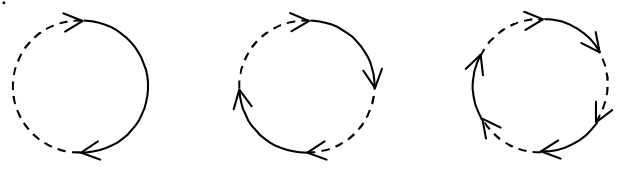{ width=300px }

$10.$ zīm.

# <lo-sample/> LV.SOL.2005.7.4

Kādu lielāko daudzumu naturālo skaitļu no $1$ līdz $2004$ var izvēlēties tā, lai nekādu divu izvēlēto skaitļu summa nedalītos ar $3$?

<small>
   
* questionType:
* domain:
   
</small>

## Atrisinājums

Drīkst būt ne vairāk kā viens skaitlis, kas dalās ar $3$, un no katra pāra $(1;2)$, $(4;5)$, $(7;8)$, ..., $(2002;2003)$ arī drīkst būt ne vairāk kā viens skaitlis. Tātad kopējais skaits nevar pārsniegt $1+\dfrac{2004}{3}=669$. Šādu skaitļu daudzumu var sasniegt, piemēram, izvēloties skaitli $3$ un visus tos skaitļus, kas, dalot ar $3$, dod atlikumu $1$ (t.i., skaitļus $1$; $4$; $7$; ...; $2002$).

# <lo-sample/> LV.SOL.2005.7.5

Futbola turnīrā piedalījās vismaz $5$ komandas; katra ar katru citu spēlēja tieši vienu reizi. Jebkurām $3$ komandām $A$, $B$, $C$ ir spēkā sekojošais: ja $A$ nezaudēja pret $B$ un $B$ nezaudēja pret $C$, tad $C$ nezaudēja pret $A$. Pierādiet, ka visas spēles turnīrā beidzās neizšķirti.

<small>
   
* questionType:
* domain:
   
</small>

## Atrisinājums

To, ka $X$ uzvarējusi pret $Y$, apzīmēsim ar $X\to Y$; to, ka $X$ un $Y$ nospēlējušas neizšķirti, apzīmēsim ar $X\sim Y$; to, ka $X$ nezaudēja pret $Y$, apzīmēsim ar $X\nleftarrow Y$.

**Lemma.** Nevienai komandai nav vairāk par $1$ uzvaru un nav vairāk par $1$ zaudējumu.

**Pierādījums.** Pieņemam, ka $X\to Y$ un $X\to Z$. Vai nu $Y\nleftarrow Z$, vai $Z\nleftarrow Y$. Varam pieņemt, ka $Y\nleftarrow Z$. Tad $X\nleftarrow Y$ un $Y\nleftarrow Z$, tāpēc jābūt $Z\nleftarrow X$ – pretruna.

Lemmas otro daļu pierāda līdzīgi.

Pieņemam pretējo tam, kas jāpierāda: eksistē tādas komandas $A$ un $B$, ka $A\to B$. Ir vēl vismaz $3$ citas komandas $X$, $Y$, $Z$. Saskaņā ar lemmu ne pret vienu no tām $A$ nav uzvarējusi un augstākais pret vienu no tām $A$ ir zaudējusi. Tāpēc ar vismaz divām no tām $A$ spēlējusi neizšķirti. Varam pieņemt, ka $A\sim X$ un $A\sim Y$. Tā kā $X\nleftarrow A$ un $A\nleftarrow B$, tad $B\nleftarrow X$; līdzīgi $B\nleftarrow Y$. Ar vismaz vienu no $X$ un $Y$ $B$ nospēlēja neizšķirti; pieņemsim, ka $B\sim X$. Iegūstam $A\nleftarrow X$, $X\nleftarrow B$, $B\leftarrow A$ – pretruna ar uzdevuma nosacījumiem.

# <lo-sample/> LV.SOL.2005.8.1

Vai divu lineāru funkciju $y=k_1\cdot x+a_1$ un $y=k_2\cdot x+a_2$ grafiki var veidot taisnu leņķi viens ar otru, ja $k_1>0$ un $k_2>0$?

<small>
   
* questionType:
* domain:
   
</small>

## Atrisinājums

Nē, nevar. Novelkam abiem grafikiem paralēlas taisnes caur $(0;0)$. Tās abas iet caur I un III kvadrantu, tātad divi leņķi starp tām ir šauri, divi – plati. Bet leņķi starp tām ir vienādi ar leņķiem starp doto funkciju grafikiem.

# <lo-sample/> LV.SOL.2005.8.2

Vai visi skaitļi $x+y-z$, $2\cdot x-3\cdot y+z$ un $-8\cdot x+7\cdot y-z$ var vienlaicīgi būt pozitīvi?

<small>
   
* questionType:
* domain:
   
</small>

## Atrisinājums

Nē, jo $2(x+y-z)+3(2x-3y+z)+(-8x+7y-z)=0$.

# <lo-sample/> LV.SOL.2005.8.3

Vai eksistē $2$ izliekti četrstūri, katram no kuriem katra mala atrodas uz kādas otrā četrstūra malas vidusperpendikula?

<small>
   
* questionType:
* domain:
   
</small>

## Atrisinājums

Jā. Skat. $11.$ zīm., kur attēloti divi vienādi rombi ar kopīgu centru un šaurajiem leņķiem $45^{\circ}$; rombi pagriezti viens attiecībā pret otru par $90^{\circ}$.

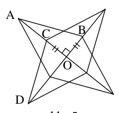{ width=100px }

$11.$ zīm.

Pierādīsim, ka $AC=BC$ (skat. $12.$ zīm.).

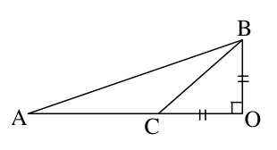{ width=150px }

$12.$ zīm.

Tā kā $\angle BAO=\frac{1}{2}\cdot45^{\circ}=22^{\circ}30'$, tad $\angle ABO=90^{\circ}-22^{\circ}30'=67^{\circ}30'$. Tāpēc $\angle ABC=67^{\circ}30'-45^{\circ}=22^{\circ}30'=\angle BAC$. Tāpēc $\triangle ABC$ - vienādsānu un $AC=BC$. Tātad $C$ atrodas uz $BC$ vidusperpendikula. Tā kā $CD\perp AB$, tad arī $CD$ atrodas uz $AB$ vidusperpendikula.

# <lo-sample/> LV.SOL.2005.8.4

Tabula sastāv no $4\cdot4$ rūtiņām. Katrā rūtiņā ierakstīts $1$ vai $0$, pie tam katrā $2\cdot2$ rūtiņu kvadrātā trīs skaitļi savā starpā vienādi, bet ceturtais no tiem atšķiras.  
Kāda var būt visu tabulā ierakstīto skaitļu summa?

<small>
   
* questionType:
* domain:
   
</small>

## Atrisinājums

Sadalām kvadrātu četros mazākos kvadrātos ar izmēriem $2\cdot2$. Katrā no tiem ierakstīto skaitļu summa ir vai nu $1$, vai $3$. Tātad visai summai nevar būt citas vērtības kā $4\cdot1+0\cdot3=4$; $3\cdot1+1\cdot3=6$; $2\cdot1+2\cdot3=8$; $1\cdot1+3\cdot3=10$; $0\cdot1+4\cdot3=12$. To, ka visas šīs summas iespējamas, skat. $13.$ zīm.

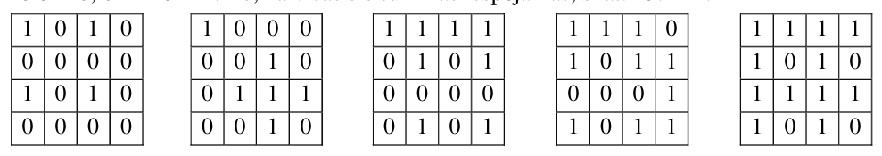{ width=450px }

$13.$ zīm.

# <lo-sample/> LV.SOL.2005.8.5

Sarunājas Andris un Dzintars. Andris saka: “Es esmu iedomājies $3$ naturālus skaitļus (starp tiem var būt arī vienādi). To reizinājums ir $2450$, bet summa divreiz lielāka par Tavu vecumu.” Dzintars padomājis atbild: “Es nezinu un nevaru zināt, kādus skaitļus Tu esi iedomājies.” Andris turpina: “Mans vecums ir lielāks nekā jebkurš no iedomātajiem skaitļiem.” Dzintars atbild (viņš zina, cik gadu ir Andrim): “Tagad es zinu, kādus skaitļus Tu esi iedomājies.”  
Cik vecs ir Dzintars, cik – Andris? (Vecumu mēra veselos gados.)

<small>
   
* questionType:
* domain:
   
</small>

## Atrisinājums

Ja iedomātie skaitļi ir $x\ge y\ge z$, tad $xyz=2450$ un $x+y+z=2d$, kur $d$ – Dzintara vecums. Acīmredzot šai sistēmai ir vairāk nekā viens atrisinājums naturālos skaitļos $(x,\ y,\ z)$, citādi Dzintars uzreiz varētu noskaidrot $x,\ y,\ z$ vērtības. Pārbaudot visas iespējas, kā var rasties reizinājums $x\cdot y\cdot z=2450$, redzams, ka tikai divos gadījumos summai $x+y+z$ ir vienāda (pāra) vērtība: $(50;\ 7;\ 7)$ un $(49;\ 10;\ 5)$. Tātad Dzintaram ir $(50+7+7):2=32$ gadi. Ja Andra vecums būtu mazāks par $50$ gadiem, uzdevumam nebūtu atrisinājuma. Ja Andra vecums būtu lielāks par $50$ gadiem, Andra otrais paziņojums nepalīdzētu Dzintaram izšķirties starp abām iespējām. Tātad Andrim ir $50$ gadi (un iedomātie skaitļi ir $49;\ 10;\ 5$).

# <lo-sample/> LV.SOL.2005.9.1

Atrisināt reālos skaitļos vienādojumu $(4x+3)^2(2x+1)(x+1)=9$.

<small>
   
* questionType:
* domain:
   
</small>

## Atrisinājums

Pārveidojam vienādojumu par $(16x^2+24x+9)(2x^2+3x+1)=9$

Apzīmējam $2x^2+3x+1=y$; iegūstam

$$
(8y+1)\cdot y=9
$$

$$
8y^2+y-9=0,
$$

no kurienes $y_1=1$; $y_2=-\frac{9}{8}$.

No $2x^2+3x+1=1$ iegūstam $x_1=0$; $x_2=-\frac{3}{2}$.

No $2x^2+3x+1=-\frac{9}{8}$ iegūstam

$$
2x^2+3x+\frac{17}{8}=0
$$

$$
16x^2+24x+17=0.
$$

Tā kā $D<0$, atrisinājuma nav.

# <lo-sample/> LV.SOL.2005.9.2

No sākuma uz tāfeles uzrakstīts skaitlis $2$. Ar $1.$, $3.$, $5.$, ... gājieniem uz tāfeles uzrakstītajam skaitlim pieskaita vai nu $2$, vai $5$; ar $2.$, $4.$, $6.$, ... gājieniem uz tāfeles uzrakstīto skaitli reizina vai nu ar $2$, vai ar $5$. Vai iespējams iegūt skaitli $200420042004$?

<small>
   
* questionType:
* domain:
   
</small>

## Atrisinājums

Nē, jo pamīšus iegūst skaitļus, kas dalot ar $3$, dod atlikumus $1$ un $2$, bet iegūstamais skaitlis dalās ar $3$.

# <lo-sample/> LV.SOL.2005.9.3

Dots, ka $\angle AOD=90^{\circ}$, $AB=x$, $CD=y$, $M$-$BC$ viduspunkts, $N$-$AD$ viduspunkts. Izteikt $MN$ ar $x$ un $y$ (skat. $2.$ zīm.).

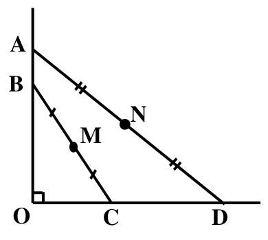{ width=200px }

2.zīm.

<small>
   
* questionType:
* domain:
   
</small>

## Atrisinājums

Ar $T$ apzīmējam $BD$ viduspunktu (skat. $14.$ zīm.). Tad no viduslīniju īpašībām

$$
MN^2=MT^2+NT^2=\left(\frac{1}{2}y\right)^2+\left(\frac{1}{2}x\right)^2,\ \text{tāpēc } MN=\frac{1}{2}\sqrt{x^2+y^2}.
$$

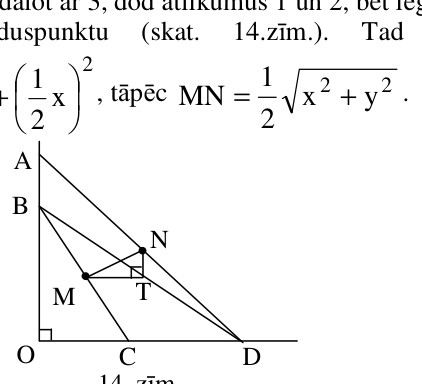{ width=200px }

$14.$ zīm.

# <lo-sample/> LV.SOL.2005.9.4

Uz klases vecāku sapulci atnāca $18$ tēti un $24$ māmiņas, pie tam katram bērnam ieradās vismaz viens no vecākiem. Tieši $10$ zēniem un $8$ meitenēm atnāca abi vecāki, tieši $4$ zēniem un $3$ meitenēm – tikai māmiņa, tieši $1$ zēnam un $1$ meitenei – tikai tētis.  
Cik klasē ir tādu bērnu, kam šajā pašā klasē mācās vai nu brālis, vai māsa?

<small>
   
* questionType:
* domain:
   
</small>

## Atrisinājums

Iedalām skolēnus $3$ grupās:  
$1.$grupa – tie, kam atnāca abi vecāki  
$2.$grupa – tie, kam atnāca tikai māmiņa.  
$3.$grupa – tie, kam atnāca tikai tētis.  
Attiecīgos māmiņu (tētu) skaitus apzīmējam ar $m_1$, $t_1$, $m_2$, $t_2$, $m_3$, $t_3$. Tad $1\le t_3\le2$, pie tam $t_3=1$ tad un tikai tad, ja $3.$ grupā ir brālis un māsa; $t_1=m_1$. Tā kā $t_1+t_2+t_3=18$ un $t_3\ge1$, tad $t_1\le17$. Pierādīsim, ka $t_1=17$. Tiešām, ja $t_1\le16$, tad arī $m_1\le16$. Tā kā $m_2\le3+4=7$, tad $m_1+m_2\le23$. Bet tā nevar būt, jo $m_1+m_2=24$. Tātad $t_1=17$; tātad arī $m_1=17$, $t_3=1$ (jo $t_2=0$), $m_2=7$ (jo $m_3=0$). Tātad $3.$ grupā ir brālis un māsa, un arī $1.$ grupā ir divi bērni no vienas ģimenes. Tātad uzdevuma atbilde – $4$ bērni.

# <lo-sample/> LV.SOL.2005.9.5

Dots, ka $a>0$, $b>0$, $c>0$ un $a+b+c=1$.

Pierādīt, ka
$$
\frac{a^2}{a+b}+\frac{b^2}{b+c}+\frac{c^2}{c+a}\ge \frac{1}{2}
$$

<small>
   
* questionType:
* domain:
   
</small>

## Atrisinājums

Viegli pārbaudīt, ka pozitīviem $x$ un $y$ pastāv nevienādība $\frac{2xy}{x+y}\le\frac{x+y}{2}$ $(*)$ (nevienādība starp vidējo harmonisko un vidējo aritmētisko).

Pārveidojam pierādāmo nevienādību:
$$
\left(a-\frac{ab}{a+b}\right)+\left(b-\frac{bc}{b+c}\right)+\left(c-\frac{ca}{c+a}\right)\ge\frac{1}{2}
$$
$$
\frac{ab}{a+b}+\frac{bc}{b+c}+\frac{ca}{c+a}\le\frac{1}{2}\quad(\text{jo }a+b+c=1)
$$
$$
\frac{2ab}{a+b}+\frac{2bc}{b+c}+\frac{2ca}{c+a}\le1
$$
$$
\frac{2ab}{a+b}+\frac{2bc}{b+c}+\frac{2ca}{c+a}\le\frac{a+b}{2}+\frac{b+c}{2}+\frac{c+a}{2}
$$
Šīs nevienādības pareizība ir acīmredzama saskaņā ar $(*)$.

# <lo-sample/> LV.SOL.2005.10.1

Vai eksistē tādi skaitļi $a, b, c, d$, ka $3.$ zīm. attēlots funkcijas

$$y=a|x+1|+b|x-1|+cx+d$$

grafiks? (Ordinātu ass atrašanās vieta nav noteikta.)

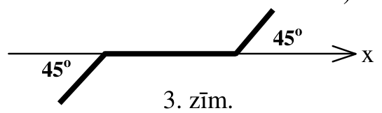{ width=250px }

3. zīm.

<small>
   
* questionType:
* domain:
   
</small>

## Atrisinājums

Jā, eksistē; piemēram, $y=-\frac{1}{2}|x+1|+\frac{1}{2}|x-1|+x$. (Var pierādīt, ka citu iespēju nav.)

# <lo-sample/> LV.SOL.2005.10.2

Atrisināt naturālos skaitļos vienādojumu:

$$10^x-3^y=7$$

<small>
   
* questionType:
* domain:
   
</small>

## Atrisinājums

Pārrakstām vienādojumu formā $\underbrace{999\ldots9}_{x}-3^y=6$.

Ja $x\ge2$ un $y\ge2$, tad kreisā puse dalās ar $9$, bet labā – nē. Ja $x=1$, tad $y=1$, un otrādi. Tātad vienīgais atrisinājums ir $x=y=1$.

# <lo-sample/> LV.SOL.2005.10.3

Trijstūrī $ABC$ punkts $M$ ir malas $AB$ viduspunkts, punkts $N$ ir malas $AC$ viduspunkts. Uz nogriežņa $MB$ ņemts tāds punkts $K$, ka $\angle ACK=\angle MBC$. Pierādīt, ka trijstūri $KNC$ un $BMC$ līdzīgi savā starpā.

<small>
   
* questionType:
* domain:
   
</small>

## Atrisinājums

$MN$ ir $\triangle BAC$ viduslīnija, tāpēc $\angle NMA=\angle NCK$. Tāpēc $\angle NCK+\angle NMK=180^{\circ}$ un ap $MNCK$ var apvilkt riņķa līniju. No tā seko, ka $\angle CNK=\angle CMK$ kā ievilkti leņķi, kas balstās uz vienu un to pašu loku. Prasītā līdzība seko pēc pazīmes (II).

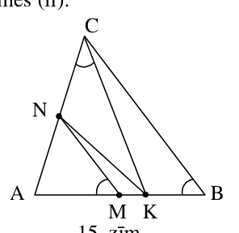{ width=150px }

$15.$ zīm.

# <lo-sample/> LV.SOL.2005.10.4

Kādiem naturāliem $n$ kubu ar izmēriem $n\times n\times n$ var salikt no klucīšiem ar izmēriem $1\times 2\times 4$?

<small>
   
* questionType:
* domain:
   
</small>

## Atrisinājums

Tā kā klucīša tilpums ir $8$, tad $n^3$ jādalās ar $8$, tātad $n$ noteikti jābūt pāra skaitlim, $n=2k$.  
**Pierādīsim, ka der tās un tikai tās pāra $n$ vērtības, kuras dalās ar $4$.**  
$1.$ Ja $n$ dalās ar $4$, tad $n\cdot n\cdot n$ kubu var sadalīt fragmentos ar izmēriem $4\cdot4\cdot4$; katru no tiem, protams, var sadalīt klucīšos.  
$2.$ Ja $n$ – pāra skaitlis, kas nedalās ar $4$, tad sadalām $n\cdot n\cdot n$ kubu “kastītēs” ar izmēriem $2\cdot2\cdot2$ un izkrāsojam kastītes “šaha galdiņa kārtībā”. Katrs klucītis satur $2$ baltus un $2$ melnus kubiņus, tāpēc, ja salikšana būtu iespējama, kopējam melno kubiņu skaitam jābūt vienādam ar kopējo balto kubiņu skaitu. Bet kastīšu skaits ir nepāra skaitlis, tāpēc tas nav iespējams.

# <lo-sample/> LV.SOL.2005.10.5

Profesors Cipariņš izdomājis jaunu barjerskriešanas disciplīnu. Sacensības notiek $n$ paralēlos celiņos. Dažās vietās uz robežas starp blakus esošiem celiņiem atrodas karodziņi; visi karodziņi ir dažādos attālumos no starta līnijas. Aizskrienot līdz karodziņiem, sportists sāniski pārlec tam pāri un turpina skriet pa jauno celiņu. (Piemēram, $4.$ zīm. ir $5$ celiņi un $8$ karodziņi.) Pierādīt: ja katrā celiņā startē viens sportists, tad katrā celiņā arī finišē viens sportists.

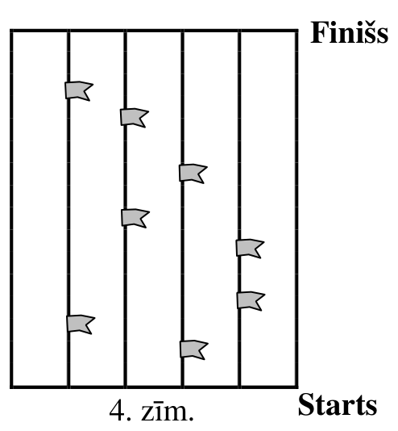{ width=250px }

4. zīm.

<small>
   
* questionType:
* domain:
   
</small>

## Atrisinājums

Acīmredzot uz uzdevumā minēto efektu sportistu ātrumi neatstāj nekādu iespaidu. Tāpēc varam uzskatīt, ka tie visi ir vienādi. Tad pie katra karodziņa divi sportisti vienkārši maina celiņus, tāpēc **visu laiku** (tātad arī beigās) katrā celiņā ir pa vienam sportistam.

# <lo-sample/> LV.SOL.2005.11.1

Dots, ka $\dfrac{x}{x^2+x+1}=a$. Izteikt $\dfrac{x^2}{x^4+x^2+1}$ ar $a$ palīdzību kā racionālu daļu.

<small>
   
* questionType:
* domain:
   
</small>

## Atrisinājums

Ja $x\ne0$ un $a\ne0$, tad
$$
\frac{x^4+x^2+1}{x^2}=x^2+\frac{1}{x^2}+1=\left(x+\frac{1}{x}\right)^2-1=\left(\frac{1}{a}-1\right)^2-1=\frac{1-2a}{a^2},
$$
tātad
$$
\frac{x^2}{x^4+x^2+1}=\frac{a^2}{1-2a}.
$$
Viegli pārbaudīt, ka šī atbilde der arī, ja $a=0\Leftrightarrow x=0$.

# <lo-sample/> LV.SOL.2005.11.2

Dots, ka $0<a,b,c<1$. Pierādīt, ka

$$
\sqrt{abc}+\sqrt{(1-a)(1-b)(1-c)}<1
$$

<small>
   
* questionType:
* domain:
   
</small>

## Atrisinājums

Ievērojam, ka
$$
\sqrt{abc}+\sqrt{(1-a)(1-b)(1-c)}\le\sqrt[3]{abc}+\sqrt[3]{(1-a)(1-b)(1-c)}\le\frac{a+b+c}{3}+\frac{1-a+1-b+1-c}{3}=1
$$
pēc nevienādības starp vidējo aritmētisko un vidējo ģeometrisko.

# <lo-sample/> LV.SOL.2005.11.3

Kādam mazākajam naturālajam $n$ skaitlis

$$
(n+1)(n+2)(n+3)\ldots(3n-1)(3n)
$$

dalās ar $3^{2004}$?

<small>
   
* questionType:
* domain:
   
</small>

## Atrisinājums

Viegli saprast, ka
$$
(n+1)\cdot(n+2)\cdot\ldots\cdot(3n-1)\cdot3n=\frac{(3n)!}{n!}=
$$
$$
=1\cdot2\cdot\frac{3}{1}\cdot4\cdot5\cdot\frac{6}{2}\cdot\ldots\cdot(3n-2)\cdot(3n-1)\cdot\frac{3n}{n}=
$$
$$
=1\cdot2\cdot4\cdot5\cdot\ldots\cdot(3n-2)\cdot(3n-1)\cdot3^n.
$$
Tāpēc atbilde ir: $2004$.

# <lo-sample/> LV.SOL.2005.11.4

Trijstūra piramīdas $SABC$ sānu skaldnēm novilktas bisektrises skaldņu leņķos, kas atrodas pie virsotnes $S$. Tās krusto malas $AB$, $BC$, $CA$ attiecīgi punktos $C_1$, $A_1$, $B_1$.

Pierādīt, ka taisnes $AA_1$, $BB_1$, $CC_1$ krustojas vienā punktā.

<small>
   
* questionType:
* domain:
   
</small>

## Atrisinājums

Saskaņā ar leņķa bisektrises īpašību
$$
\frac{AC_1}{C_1B}=\frac{SA}{SB},\quad \frac{BA_1}{A_1C}=\frac{SB}{SC},\quad \frac{CB_1}{B_1A}=\frac{SC}{SA}.
$$
Tāpēc $\frac{AC_1}{C_1B}\cdot\frac{BA_1}{A_1C}\cdot\frac{CB_1}{B_1A}=1$ un prasītais seko no Čevas teorēmas.

# <lo-sample/> LV.SOL.2005.11.5

Katra no $n$-stūra prizmas virsotnēm jānokrāso balta, sarkana vai zaļa. Jāpanāk, lai katrai virsotnei $A$ tās trīs kaimiņi (t.i. virsotnes, kas savienotas ar $A$ ar šķautni) būtu nokrāsotas dažādās krāsās. Kādiem $n$ tas iespējams?

<small>
   
* questionType:
* domain:
   
</small>

## Atrisinājums

**Atbilde:** tiem $n$, kas dalās ar $3$.

a) ja $n$ dalās ar $3$, tad, nokrāsojot katra pamata virsotnes cikliski $3$ krāsās tā, ka virsotnes uz katras sānu šķautnes nokrāsotas vienādi, iegūstam vajadzīgo krāsojumu.

b) pieņemsim, ka uzdevuma prasības izpildītas un ir $s$ sarkanas virsotnes. Katra no tām ir $3$ virsotņu “kaimiņš”, un katrai no tām šie kaimiņi ir citi. Tātad pavisam $3s$ virsotnēm ir pa sarkanam kaimiņam. Tāpēc $2n=3s$, no kurienes seko, ka $n$ dalās ar $3$.

# <lo-sample/> LV.SOL.2005.12.1

Funkcija $f(x)$ definēta visiem reāliem skaitļiem $x$, pieņem reālas vērtības un katram reālam $x$ apmierina sakarību
$$
f(x)+2f(-x)=x
$$
Atrast visas šādas funkcijas $f$ un pierādīt, ka citu bez atrastajām nav.

<small>
   
* questionType:
* domain:
   
</small>

## Atrisinājums

Ievietojot “$x$” vietā “$-x$”, iegūstam vienādību $f(-x)+2f(x)=-x$. No sistēmas
$$
\begin{cases}
f(x)+2f(-x)=x,\\
f(-x)+2f(x)=-x
\end{cases}
$$
viegli iegūstam $f(x)=-x$, $f(-x)=x$.

# <lo-sample/> LV.SOL.2005.12.2

Kādam mazākajam naturālam $n$ skaitlis $9^n+2^n$ dalās ar $11^3$?

<small>
   
* questionType:
* domain:
   
</small>

## Atrisinājums

**Atbilde:** $n=121$.

Viegli pārbaudīt, ka $n=1$ un $n=2$ neder, tātad $n\ge3$. Pēc Ņūtona binoma formulas iegūstam
$$
9^n+2^n=(11-2)^n+2^n=2^n+(-1)^n\cdot(2-11)^n=
$$
$$
=2^n+(-1)^n\cdot\left(2^n-C_n^1\cdot2^{n-1}\cdot11+C_n^2\cdot2^{n-2}\cdot11^2+Q\cdot11^3\right),
$$
kur $Q$ – vesels skaitlis. Tātad jānoskaidro, kādam mazākajam naturālam $n$ izteiksme
$$
2^n+(-1)^n\cdot\left(2^n-C_n^1\cdot2^{n-1}\cdot11+C_n^2\cdot2^{n-2}\cdot11^2\right)
$$
dalās ar $11^3$. Ja $n$ – pāra skaitlis, tad šī izteiksme nedalās pat ar $11$; tāpēc $n$ – nepāra. Tad mums jāpēta izteiksme
$$
C_n^2\cdot2^{n-2}\cdot11^2-C_n^1\cdot2^{n-1}\cdot11=n(n-1)\cdot2^{n-3}\cdot11^2-n\cdot2^{n-1}\cdot11=
$$
$$
=11n\cdot\left[11\cdot2^{n-3}\cdot(n-1)-2^{n-1}\right]
$$
Iekavas acīmredzot ar $11$ nedalās, tātad $n$ jādalās ar $11^2$. Mazākā šāda vērtība (tā ir arī nepāra) ir $n=121$.

# <lo-sample/> LV.SOL.2005.12.3

Regulārā tetraedrā katras šķautnes garums ir $1$. Projicējam šo tetraedru patvaļīgā plaknē. Kāds ir lielākais iespējamais projekcijas laukums?

<small>
   
* questionType:
* domain:
   
</small>

## Atrisinājums

{ width=100px }

Projekcija ir vai nu trijstūris, kura laukums nepārsniedz skaldnes laukumu (tas ir $\frac{\sqrt{3}}{4}$), vai arī četrstūris, kura diagonāļu garumi nepārsniedz $1$ (tā laukums ir $\frac{1}{2} d_1 d_2 \sin \varphi \leq \frac{1}{2}$). Tā kā $\frac{\sqrt{3}}{4} < \frac{1}{2}$, tad lielākais iespējamais laukums ir $\frac{1}{2}$; to iegūst, projicējot tetraedru plaknē, kas paralēla divām šķērsām šķautnēm.

# <lo-sample/> LV.SOL.2005.12.4

Katrai kuba šķautnei izvēloties virzienu, tā pārvēršas par vektoru; atrodam visu šo $12$ vektoru summu.

Cik dažādus summas vektorus var iegūt?

<small>
   
* questionType:
* domain:
   
</small>

## Atrisinājums

**Atbilde:** $125$ vektorus.  
**Risinājums:** Ieviešam koordinātu sistēmu telpā tā, ka asis paralēlas kuba šķautnēm, bet vienības nogrieznis vienāds ar kuba šķautni. Katra šķautnes vektora katra komponente katras ass virzienā ir “$-1$”, “$0$” vai “$+1$”, pie tam katru komponenti summas vektoram ietekmē $4$ šķautņu vektori (katru komponenti – citi $4$ šķautņu vektori). Tāpēc komponenšu skaitliskās vērtības var būt $-4$; $-2$; $0$; $2$; $4$, t.i. tām var būt $5$ dažādas vērtības. Tā kā komponenšu vērtības ir neatkarīgas viena no otras, tad varam iegūt $5 \cdot 5 \cdot 5 = 125$ dažādus summas vektorus.

# <lo-sample/> LV.SOL.2005.12.5

Skaitļu virknes $x_1$, $x_2$, $x_3$, ... un $y_1$, $y_2$, $y_3$, ... veido sekojoši:
$$
x_1=\frac{12}{13},\quad y_1=\frac{5}{13};\ \text{pie } n\ge 1\quad x_{n+1}=0{,}8x_n+0{,}6y_n,\quad y_{n+1}=0{,}6x_n-0{,}8y_n.
$$

Pierādīt, ka $|x_{2004}|\le 1$.

<small>
   
* questionType:
* domain:
   
</small>

## Atrisinājums

Viegli pārbaudīt, ka $x_1^2 + y_1^2 = 1$ un

$$
x_{n+1}^2 + y_{n+1}^2 = (0{,}8x_n + 0{,}6y_n)^2 + (0{,}6x_n - 0{,}8y_n)^2 =
$$

$$
0{,}64x_n^2 + 0{,}96x_n y_n + 0{,}36y_n^2 + 0{,}36x_n^2 - 0{,}96x_n y_n + 0{,}64y_n^2 = x_n^2 + y_n^2.
$$

Tāpēc visiem $n \geq 1$ ir spēkā $x_n^2 + y_n^2 = 1$, no kurienes seko vajadzīgais.
