# <lo-sample/> LV.SOL.2006.5.1

Rindā uzrakstīti visi naturālie skaitļi no $1$ līdz $1000$ ieskaitot, katrs tieši vienu reizi. Vai vairāk uzrakstīts pāra ciparu vai nepāra ciparu?

<small>
   
* questionType:
* domain:
   
</small>

## Atrisinājums

Ciparu virknēs no $000$ līdz $999$ pāra un nepāra ciparu ir vienāds daudzums („simetrijas pēc”). Tā kā $000$ vispār nav jāapskata un nulles skaitļa priekšā netiek rakstītas, tad starp „īstajiem” cipariem nepāra ciparu ir vairāk nekā par $100$ vairāk nekā pāra ciparu. Šo faktu negroza arī skaitlis $1000$, kurā pāra ciparu ir par $2$ vairāk nekā nepāra ciparu.

# <lo-sample/> LV.SOL.2006.5.2

Naturālam trīsciparu skaitlim pirmo ciparu palielināja par $3$, otro - par $2$, trešo - par $1$. Ieguva trīsciparu skaitli, kas $4$ reizes lielāks par sākotnējo. Atrast sākotnējo skaitli.

<small>
   
* questionType:
* domain:
   
</small>

## Atrisinājums

Sākotnējam skaitlim $x$ pieskaitīja $321$, tātad $3\cdot x=321$ un $x=107$. Pārbaude (obligāta!) $107\cdot4=428$ parāda, ka šī atbilde der.

# <lo-sample/> LV.SOL.2006.5.3

Naturālā desmitciparu skaitlī vienādus ciparus aizstāja ar vienādiem burtiem, bet dažādus - ar dažādiem; ieguva pierakstu KRIZANTĒMA. Zināms, ka šis skaitlis dalās ar $18$. Kāds cipars aizstāts ar burtu A?

<small>
   
* questionType:
* domain:
   
</small>

## Atrisinājums

Vārdā KRIZANTĒMA ir pavisam $10$ burti, no tiem $9$ dažādi. Apzīmēsim skaitlī iztrūkstošo ciparu ar $X$. Tad **$K+R+I+Z+A+N+T+\text{Ē}+M+X=0+1+\ldots+9=45$**.  
Saskaņā ar uzdevuma nosacījumiem $A$ ir pāra cipars un **$K+R+I+Z+A+N+T+\text{Ē}+M+A$ dalās ar $9$**. No abiem izceltajiem faktiem seko, ka $X-A$ dalās ar $9$. Tā kā $X-A\ne0$, tad $|X-A|\ge9$, un $|X-A|=9$ iespējams tikai tad, ja $X$ un $A$ ir $0$ un $9$. Tā kā $A$ - pāra cipars, tad $A=0$.

# <lo-sample/> LV.SOL.2006.5.4

Kvadrātisks režģis sastāv no $4\cdot4$ vienādām kvadrātiskām rūtiņām; rūtiņas malas garums ir $1$ (skat. $1$.zīm.). Šis režģis jāpārkrāso sarkans, krāsojot vai nu rūtiņu kontūras, vai "kāsīšus" (skat. $2$.zīm.): kāsītis sastāv no $2$ nogriežņiem ar garumu $1$ un var būt arī pagriezts citādi. Krāsas pietiek, lai nokrāsotu līnijas ar kopējo garumu $40$. Pierādīt, ka jākrāso vismaz $8$ kāsīši.

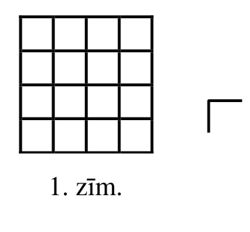{ width=150px }

$1$. zīm.

$2$. zīm.

<small>
   
* questionType:
* domain:
   
</small>

## Atrisinājums

Režģa līniju kopgarums ir $40$, tāpēc katrs tā posms jākrāso tieši vienu reizi.

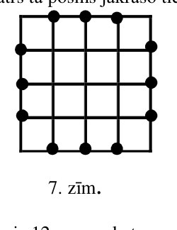{ width=100px }

7. zīm.

Apskatām 7.zīm. izceltos punktus; to ir $12$, un no katra no tiem iziet $3$ krāsojami nogriežņi. Rūtiņas kontūrs, kas satur izcelto punktu, vai kāsītis, kura viduspunkts ir šajā punktā, satur divus no tiem; tāpēc katrā izceltajā punktā jābeidzas vienam kāsītim. Tikai $4$ no kāsīšiem (stūros) var beigties divos izceltos punktos katrs; tāpēc vajag vismaz $4+(12-4\cdot2)=8$ kāsīšus. (Lasītājs var viegli pārbaudīt, ka ar $8$ kāsīšiem var iztikt, lai gan uzdevums to neprasa.)

# <lo-sample/> LV.SOL.2006.5.5

Kuba virsotnēs jāieraksta naturāli skaitļi no $1$ līdz $8$, katrs tieši vienu reizi. Pie tam nepieciešams, lai visās skaldnēs ierakstīto skaitļu summas būtu vienādas savā starpā.

a) Pierādīt, ka šīs summas var būt $18$.  
b) Vai tās var būt citādas?

<small>
   
* questionType:
* domain:
   
</small>

## Atrisinājums

a) skat. 8.zīm.

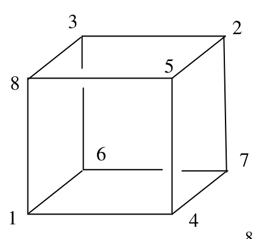{ width=200px }

8.zīm.

b) apzīmēsim vienas skaldnes skaitļu summu ar $S$. Tad $6\cdot S=3\cdot(1+2+3+4+5+6+7+8)$ (katra virsotne pieder $3$ skaldnēm), tāpēc $S=18$.

# <lo-sample/> LV.SOL.2006.6.1

Vai kvadrātu, kas sastāv no $7 \cdot 7$ rūtiņām, var sagriezt kvadrātos, kuru izmēri ir $2 \cdot 2$ rūtiņas un $3 \cdot 3$ rūtiņas?

<small>
   
* questionType:
* domain:
   
</small>

## Atrisinājums

Apzīmēsim $2\cdot2$ kvadrātu skaitu ar $x$, bet $3\cdot3$ kvadrātu skaitu ar $y$. Tad $4\cdot x+9\cdot y=49$, $x\ge0$, $y\ge0$, $x$ un $y$ – veseli skaitļi. Pārbaudot $x=0;\ 1;\ \ldots;\ 12$ (lielākas $x$ vērtības nav jāpārbauda, jo tad $y$ iznāk negatīvs), redzam, ka varētu derēt tikai $x=1;\ y=5$ un $x=10;\ y=1$. Pirmajā gadījumā ir $\ge2$ lielā kvadrāta malas, kas nesatur nevienu $2\cdot2$ kvadrāta malu - pretruna, jo $7$ nedalās ar $3$. Otro gadījumu apskata līdzīgi. Tātad minētā sagriešana nav iespējama.

# <lo-sample/> LV.SOL.2006.6.2

Krūzē ir tīra kafija un piens vienādās daļās. Profesors Cipariņš nodzēra no tās vienu malku un piepildīja krūzi atkal pilnu, pielejot pienu. Pēc tam viņš nodzēra vēl vienu malku un piepildīja krūzi atkal pilnu, pielejot tīru kafiju. Vai tagad krūzē ir vairāk kafijas vai piena? (Abi malki saturēja vienādus daudzumus dzēriena.)

<small>
   
* questionType:
* domain:
   
</small>

## Atrisinājums

Kafijas krūzē ir vairāk.

Cipariņš kopā izmanto vienādus daudzumus kafijas un piena. Pirmajā izdzertajā malkā kafijas ir tikpat, cik piena, bet otrajā – mazāk. Tāpēc pēc otrā malka izdzēršanas atlikušās kafijas ir vairāk nekā atlikušā piena.

# <lo-sample/> LV.SOL.2006.6.3

Kvadrāts sastāv no $4 \cdot 4$ rūtiņām. Tajās jāieraksta naturāli nepāra skaitļi $1; 3; 5; \ldots; 29; 31$ (katrs tieši vienu reizi) tā, lai visos kvadrātos, kas sastāv no $3 \cdot 3$ rūtiņām, ierakstīto skaitļu reizinājumi būtu vienādi. Vai to var izdarīt?

<small>
   
* questionType:
* domain:
   
</small>

## Atrisinājums

Nē, nevar.

Starp ierakstāmajiem skaitļiem ir arī pirmskaitļi $17$; $19$; $23$; $29$; $31$. Ar tiem nedalās neviens cits ierakstāmais skaitlis. Tāpēc tiem jāietilpst visos apskatāmajos reizinājumos. Bet ir tikai $4$ (centrālās) rūtiņas, kas pieder visiem apskatāmajiem $3 \cdot 3$ rūtiņu kvadrātiem.

# <lo-sample/> LV.SOL.2006.6.4

Kādā klasē katrs zēns vai nu vienmēr melo, vai vienmēr runā patiesību. Visi zēni ir dažāda auguma. Šorīt katrs no viņiem izteica divus apgalvojumus:

"Neviens zēns klasē nav īsāks par mani.",  
"Klasē ir vairāk nekā $10$ zēnu, kas garāki par mani."  
Cik klasē ir zēnu, un cik no viņiem ir meļi?

<small>
   
* questionType:
* domain:
   
</small>

## Atrisinājums

Pirmais apgalvojums ir patiess tikai visīsākā zēna mutē. Tāpēc klasē ir tikai viens patiess zēns, bet visi citi ir meļi, un patiesais zēns $X$ ir visīsākais. Tāpēc citu zēnu tiešām ir $\ge 11$. Ja to būtu $>12$, tad otrā īsākā zēna otrais apgalvojums būtu patiess; tā nevar būt. Tāpēc citu zēnu ir tieši $11$, un pavisam klasē ir $12$ zēnu. (Pārbaude parāda, ka iegūtā situācija apmierina uzdevuma nosacījumus.)

# <lo-sample/> LV.SOL.2006.6.5

Klasē ir $34$ skolēni. Visi sēž $17$ divvietīgos solos. Ir zināms, ka tieši puse meiteņu sēž kopā ar zēniem. Pierādīt, ka skolēnus nevar pārsēdināt tā, lai tieši puse zēnu sēdētu kopā ar meitenēm.

<small>
   
* questionType:
* domain:
   
</small>

## Atrisinājums

Ja puse meiteņu sēž ar zēniem, tad otrā puse meiteņu sēž ar meitenēm; tātad šī „otrā puse” sastāv no pāra skaita meiteņu. Tāpēc meiteņu kopējais skaits dalās ar $4$. Ja uzdevumā minētā pārsēdināšana būtu iespējama, tad arī zēnu skaits dalītos ar $4$; tad arī kopējais skolēnu skaits dalītos ar $4$. Bet $34$ ar $4$ nedalās - pretruna.

# <lo-sample/> LV.SOL.2006.7.1

Dots, ka $a$, $b$, $c$ - dažādi pozitīvi skaitļi. Vai var eksistēt tāds skaitlis $x$, ka vienlaicīgi pastāv vienādības $ax+b=c$, $bx+c=a$ un $cx+a=b$?

<small>
   
* questionType:
* domain:
   
</small>

## Atrisinājums

Ja tāds skaitlis $x$ būtu, tad vienlaicīgi jāpastāv sakarībām $x=\frac{c-b}{a}$, $x=\frac{a-c}{b}$, $x=\frac{b-a}{c}$. Tā kā $(c-b)+(a-c)+(b-a)=0$ un neviens no skaitļiem $c-b$; $a-c$; $b-a$ nav $0$, tad kāds no tiem ir negatīvs, bet kāds cits – pozitīvs. Tāpēc arī kāda no iegūtajām izteiksmēm pieņem pozitīvu vērtību, bet kāda cita – negatīvu; tas nav iespējams.

# <lo-sample/> LV.SOL.2006.7.2

Kvadrāts sastāv no $3 \cdot 3$ rūtiņām. Rūtiņās jāieraksta naturāli skaitļi no $1$ līdz $9$, katrs tieši vienu reizi.

a) Vai to var izdarīt tā, lai katrā rindiņā un katrā kolonnā ierakstīto skaitļu summa būtu nepāra skaitlis?  
b) Vai to var izdarīt tā, lai katrā rindiņā un katrā kolonnā ierakstīto skaitļu summa būtu pāra skaitlis?

<small>
   
* questionType:
* domain:
   
</small>

## Atrisinājums

a) jā; skat., piem., $9.$zīm.

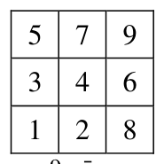{ width=100px }

9. zīm.

b) nē. Ja tā notiktu, tad visu triju rindiņu summu summai būtu jābūt pāra skaitlim. Bet $1+2+\ldots+9=45$ – pretruna.

# <lo-sample/> LV.SOL.2006.7.3

Andris uzrakstīja piecciparu skaitli, izsvītroja no tā vienu ciparu un iegūto četrciparu skaitli saskaitīja ar sākotnējo. Rezultātā viņš ieguva summu $38207$. Kādu skaitli Andris uzrakstīja sākumā?

<small>
   
* questionType:
* domain:
   
</small>

## Atrisinājums

Ja Andris būtu izsvītrojis citu ciparu, nevis pēdējo, tad summai būtu jābūt pāra skaitlim. Tātad Andris izsvītrojis pēdējo ciparu. Apzīmēsim sākotnējo skaitli ar $\overline{abcde}$; tātad $\overline{abcde}+\overline{abcd}=38207$. Tā kā $\overline{abcde}=10 \cdot \overline{abcd}+e$, iegūstam $11 \cdot \overline{abcd}+e=38207$. Tā kā $0 \le e \le 9$, tad $e$ ir atlikums, kuru iegūst, $38207$ dalot ar $11$; tātad $e=4$; $\overline{abcd}=(38207-4):11=3473$ un Andra sākotnēji uzrakstītais skaitlis ir $34734$.

# <lo-sample/> LV.SOL.2006.7.4

Kvadrāts sastāv no $9 \cdot 9$ rūtiņām. Tajā atzīmētas $9$ rūtiņas tā, ka katrā rindā un katrā kolonnā atzīmēta tieši viena rūtiņa. Pierādīt: katrā $5 \cdot 5$ rūtiņu kvadrātā ir vismaz viena atzīmēta rūtiņa.

<small>
   
* questionType:
* domain:
   
</small>

## Atrisinājums

Pieņemsim pretējo: ir tāds $5 \cdot 5$ rūtiņu kvadrāts, kurā nav nevienas atzīmētās rūtiņas. Tad visas $9$ atzīmētās rūtiņas katra pieder rindai vai kolonnai, kas neiet caur šo kvadrātu; tādu kopā ir $8$. Tāpēc divas atzīmētās rūtiņas pieder vai nu vienai rindai, vai vienai kolonnai – pretruna.

# <lo-sample/> LV.SOL.2006.7.5

Plaknē uzzīmēti $6$ nogriežņi. Nekādi divi no tiem neatrodas uz vienas taisnes un nekādiem diviem nav kopēja galapunkta. Dzintars atzīmēja visus nogriežņu krustpunktus; izrādījās, ka katrs atzīmētais punkts pieder tieši $2$ nogriežņiem. Uz viena nogriežņa atzīmēti $3$ punkti, uz otra - $4$ punkti, uz trim citiem - pa $5$ punktiem. Cik punktu atzīmēti uz sestā nogriežņa?

<small>
   
* questionType:
* domain:
   
</small>

## Atrisinājums

Katrs nogrieznis var krustot augstākais $5$ citus un katru no tiem – tikai vienā punktā. Nodzēsīsim tos $3$ nogriežņus, kas katrs krusto visus piecus citus; līdz ar to pazudīs arī attiecīgie krustpunkti. Paliks $3$ nogriežņi; uz viena no tiem būs palicis $1$ krustpunkts, uz otra – neviens. Tāpēc uz trešā palikušā nogriežņa būs palicis $1$ krustpunkts. Tātad sākotnēji uz tā bija $1+3=4$ krustpunkti.

# <lo-sample/> LV.SOL.2006.8.1

Uz sakarības $y=\frac{1}{x}$ grafika ņemti $2$ punkti $A$ un $B$ un no tiem novilkti perpendikuli pret koordinātu asīm (sk. 3.zīm.) Pierādīt, ka iesvītroto četrstūru laukumi ir vienādi.

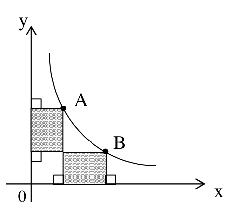{ width=200px }

3. zīm.

<small>
   
* questionType:
* domain:
   
</small>

## Atrisinājums

Taisnstūriem, kam diagonāles ir $OA$ un $OB$, katram laukums ir $1$ saskaņā ar $A$ un $B$ izvēli. Atņemot to kopīgās daļas laukumu, iegūstam vajadzīgo.

# <lo-sample/> LV.SOL.2006.8.2

Vai eksistē $100$ dažādi veseli skaitļi, kuru summa vienāda ar to reizinājumu?

<small>
   
* questionType:
* domain:
   
</small>

## Atrisinājums

Jā. Piemēram:

$$0;\ 4;\ -1;\ -3;\ \pm 5;\ \pm 6;\ \pm 7;\ \ldots;\ \pm 52.$$

Gan summa, gan reizinājums ir $0$.

# <lo-sample/> LV.SOL.2006.8.3

Trijstūra $MNK$ malas vienādas ar trijstūra $ABC$ mediānām (katra mala - ar citu mediānu). Vai trijstūri $MNK$ un $ABC$ var būt vienādi savā starpā?

<small>
   
* questionType:
* domain:
   
</small>

## Atrisinājums

Pieņemsim, ka $X$ ir $\triangle ABC$ malas $AC$ ir viduspunkts ($10.$zīm.)

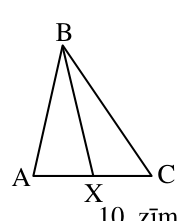{ width=100px }

10. zīm.

Tā kā $\angle AXB+\angle CXB=180^{\circ}$, tad vai nu $\angle AXB\ge 90^{\circ}$; vai $\angle CXB\ge 90^{\circ}$; varam pieņemt, ka $\angle CXB\ge 90^{\circ}$. Tāpēc $\angle CXB$ ir lielākais leņķis trijstūrī $CXB$; tātad $BC$ ir lielākā mala šajā trijstūrī, un $BC>BX$. Secinām, ka $\triangle ABC$ **garākā** mala ir garāka par visām $\triangle ABC$ mediānām; tāpēc $\triangle ABC$ garākā mala ir garāka par visām $\triangle MNK$ malām, un tāpēc šie trijstūri nav vienādi.

# <lo-sample/> LV.SOL.2006.8.4

Ar $\operatorname{LKD}(x,y)$ apzīmēsim divu naturālu skaitļu $x$ un $y$ lielāko kopīgo dalītāju. Vai var vienlaicīgi pastāvēt sakarības

$$\operatorname{LKD}(x,y)=52;\ \operatorname{LKD}(x,z)=54;\ \operatorname{LKD}(y,z)=56?$$

<small>
   
* questionType:
* domain:
   
</small>

## Atrisinājums

**Atbilde:** nē, nevar.

Pieņemsim, ka tādi skaitļi eksistē. Tā kā $x$ un $y$ dalās ar $52$, tad $x$ un $y$ dalās ar $4$; tā kā $y$ un $z$ dalās ar $56$, tad $y$ un $z$ dalās ar $4$. Tātad $x$ un $z$ abi dalās ar $4$. Bet tad nevar būt $\operatorname{LKD}(x,z)=54$, jo $54$ nedalās ar $4$.

# <lo-sample/> LV.SOL.2006.8.5

Kvadrāts sastāv no $11\times 11$ rūtiņām. Tajā iezīmētas $28$ tādas figūras, kāda parādīta 4. zīm. (figūras var būt arī pagrieztas vai apgrieztas otrādi). Pierādīt: ir tāda rūtiņa, kas pieder vismaz a) trim, b) četrām iezīmētajām figūrām.

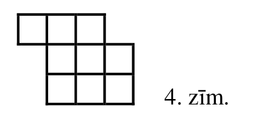{ width=200px }

4. zīm.

<small>
   
* questionType:
* domain:
   
</small>

## Atrisinājums

**a)** apgalvojums seko no tā, ka $28\cdot 9=252$ un $252>121\cdot 2$.

**b)** ievērosim, ka jebkura figūra satur vienu no $9$ iesvītrotām rūtiņām ($11.$zīm.). Uzdevuma apgalvojums seko no tā, ka $28>9\cdot 3$.

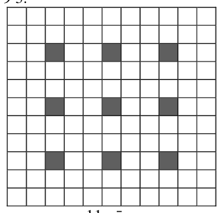{ width=200px }

11. zīm.

# <lo-sample/> LV.SOL.2006.9.1

Uz koordinātu asīm nav uzrādīti mērogi. Vai var gadīties, ka 5.zīm. attēloti funkciju $y=a\cdot x^2+b\cdot x+c$, $y=b\cdot x^2+c\cdot x+a$ un $y=c\cdot x^2+a\cdot x+b$ grafiki?

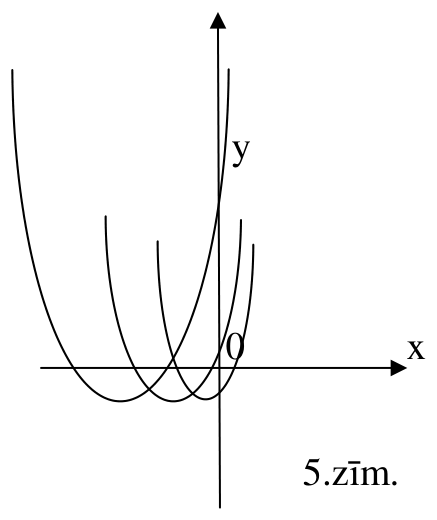{ width=200px }

5.zīm.

<small>
   
* questionType:
* domain:
   
</small>

## Atrisinājums

Nē. Tā kā visām parabolām zari vērsti „uz augšu”, tad $a>0$, $b>0$, $c>0$. Bet tad neviena no parabolām nevar krustot ordinātu asi (kur $x=0$) punktā, kurā $y<0$.

# <lo-sample/> LV.SOL.2006.9.2

Pierādīt: trijstūra $ABC$ tā ārējā leņķa bisektrise, kas atrodas pie virsotnes $B$, krusto apvilkto riņķa līniju loka $\cup ABC$ viduspunktā (zināms, ka $AB\neq BC$).

<small>
   
* questionType:
* domain:
   
</small>

## Atrisinājums

Novelkam arī iekšējā leņķa bisektrisi, kas krusto riņķa līniju punktā $N$. Tā kā $\overset{\frown}{AN}=2\beta=\overset{\frown}{NC}$, tad $N$ ir $\overset{\frown}{AC}$ viduspunkts.

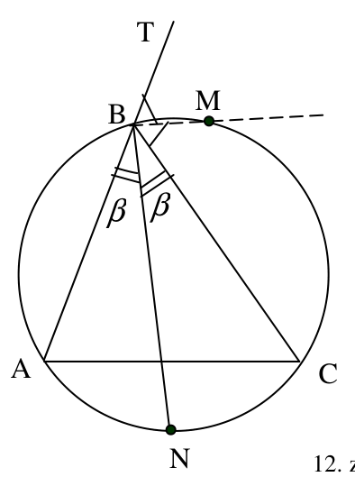{ width=200px }

12. zīm.

Tā kā $\angle MBN=\angle MBC+\angle CBN=\frac{1}{2}\angle TBC+\frac{1}{2}\angle CBA=\frac{1}{2}(\angle TBC+\angle CBA)=\frac{1}{2}\cdot 180^{\circ}=90^{\circ}$, tad M un N ir diametrāli pretēji punkti. Tātad $\overset{\frown}{NAM}=\overset{\frown}{NCM}$. Atņemot no šīs vienādības vienādību $\overset{\frown}{AN}=\overset{\frown}{NC}$, iegūstam $\overset{\frown}{AM}=\overset{\frown}{CM}$, k.b.j.

# <lo-sample/> LV.SOL.2006.9.3

Dots, ka $p$ – pirmskaitlis. Pierādīt, ka $p^4-1$ dalās vai nu ar $15$, vai ar $16$.

<small>
   
* questionType:
* domain:
   
</small>

## Atrisinājums

Ja $p=2$, tad $p^4-1=15$. Ja $p>2$, tad $p$ – nepāra skaitlis. Ievērojam, ka  
$p^4-1=(p^2-1)(p^2+1)=(p-1)(p+1)(p^2+1)$.  
Skaitļi $p-1$ un $p+1$ ir divi viens otram sekojoši pāra skaitļi, tāpēc viens no tiem dalās ar $2$, bet otrs ar $4$; $p^2+1$ ir pāra skaitlis. Tāpēc $p^4-1$ dalās ar $2\cdot 4\cdot 2=16$.

# <lo-sample/> LV.SOL.2006.9.4

Riņķa līnija ar rādiusu $R$ pieskaras $\triangle ABC$ malām $AB$ un $BC$, bet tās centrs atrodas uz malas $AC$. Pierādīt, ka $R<2\cdot r$, kur $r$ - $\triangle ABC$ ievilktās riņķa līnijas rādiuss.

<small>
   
* questionType:
* domain:
   
</small>

## Atrisinājums

Ievērosim, ka $L(ABC)=L(ABO)+L(CBO)=\frac{1}{2}AB\cdot R+\frac{1}{2}BC\cdot R=\frac{1}{2}(AB+BC)\cdot R$ un

$L(ABC)=\frac{1}{2}(AB+BC+CA)\cdot r$.

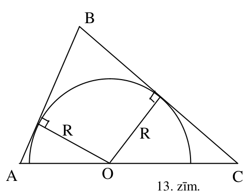{ width=250px }

13. zīm.

No abu laukuma izteiksmju vienādības seko $\frac{r}{R}=\frac{AB+BC}{AB+BC+CA}>\frac{AB+BC}{(AB+BC)+(AB+BC)}=\frac{1}{2}$, k.b.j.

# <lo-sample/> LV.SOL.2006.9.5

Kvadrātisks režģis sastāv no $5\cdot5$ vienādām kvadrātiskām rūtiņām (skat. 6.zīm.). Ar vienu gājienu var nokrāsot sarkanā krāsā jebkura viena kvadrāta kontūru. Ar kādu mazāko gājienu skaitu var nokrāsot sarkanas visas režģa līnijas?

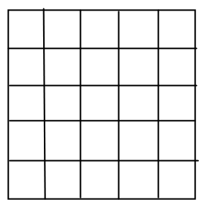{ width=150px }

6.zīm.

<small>
   
* questionType:
* domain:
   
</small>

## Atrisinājums

**Atbilde:** Ar $8$ gājieniem.  
**Risinājums.** Viegli redzēt, ka prasītais sasniedzams, nokrāsojot kvadrātus, kuru diagonāles ir $AE$; $AD$; $CF$; $BF$; $HL$; $IL$; $JG$; $KG$ (skat. 14.zīm.).

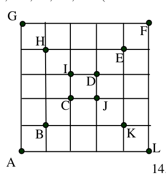{ width=150px }

14. zīm.

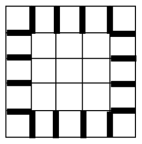{ width=150px }

15. zīm.

Tāpat viegli saprast, ka ar vienu gājienu var nokrāsot augstākais divus no 15.zīm. izceltajiem $16$ nogriežņiem. Tāpēc nepieciešami vismaz $\frac{16}{2}=8$ gājieni.

# <lo-sample/> LV.SOL.2006.10.1

Dots, ka $a>0$ un $b>0$. Pierādīt: taisne, kuras vienādojums ir $\frac{x}{a}+\frac{y}{b}=1$, atšķeļ no koordinātu asu „pozitīvajiem” stariem $\overrightarrow{Ox}$ un $\overrightarrow{Oy}$ nogriežņus, kuru garumi ir attiecīgi $a$ un $b$.

<small>
   
* questionType:
* domain:
   
</small>

## Atrisinājums

Punktu $(a;\ 0)$ un $(0;\ b)$ koordinātas apmierina vienādojumu $\frac{x}{a}+\frac{y}{b}=1$, tātad šie punkti atrodas uz uzdevumā minētās taisnes.

# <lo-sample/> LV.SOL.2006.10.2

Vai eksistē tādi racionāli skaitļi $x$ un $y$, ka vienlaicīgi $x\ne0$, $y\ne0$ un $x^2+y^2=13xy$?

<small>
   
* questionType:
* domain:
   
</small>

## Atrisinājums

Nē. Ja $x^2+y^2=13xy$, tad $\left(\frac{x}{y}\right)^2-13\cdot\left(\frac{x}{y}\right)+1=0$ un $\frac{x}{y}=\frac{13}{2}\pm\frac{\sqrt{165}}{2}$. Bet $\sqrt{165}$ ir iracionāls skaitlis, tāpēc arī iegūtās $\frac{x}{y}$ vērtības ir iracionālas – pretruna.

# <lo-sample/> LV.SOL.2006.10.3

Uz taisnes $t$ atlikti punkti $A_1$, $A_2$, $A_3$, $A_4$ (tieši šādā secībā); punkts $B$ nepieder taisnei $t$. Ar $R_{ij}$ apzīmēsim tās riņķa līnijas rādiusu, kas apvilkta ap trijstūri $BA_iA_j$ ($i\ne j$; $1\le i,\ j\le4$). Pierādīt, ka

$$R_{12}\cdot R_{34}=R_{13}\cdot R_{24}.$$

<small>
   
* questionType:
* domain:
   
</small>

## Atrisinājums

$R_{12}=\frac{BA_2}{2\sin\alpha_1}=\frac{h}{2\sin\alpha_1\sin\alpha_2};$ līdzīgi $R_{34}=\frac{h}{2\sin\alpha_3\sin\alpha_4};$ $R_{13}=\frac{h}{2\sin\alpha_1\sin\alpha_3}$ un $R_{24}=\frac{h}{2\sin\alpha_2\sin\alpha_4}$. No tā seko vajadzīgais. (Ievērojam, ka punktu kārtība uz taisnes nav svarīga.)

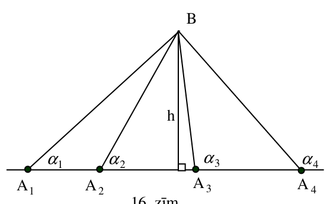{ width=250px }

16. zīm.

# <lo-sample/> LV.SOL.2006.10.4

Dots, ka $a$, $b$, $c$ – pozitīvi skaitļi un $abc=1$. Pierādīt, ka $a^2+b^2+c^2\ge a+1+\frac{1}{a}$.

<small>
   
* questionType:
* domain:
   
</small>

## Atrisinājums

Ievērojam, ka $a^2+b^2+c^2\geq a^2+2bc=a^2+\frac{2}{a}$. Tāpēc pietiek pierādīt, ka $a^2+\frac{2}{a}\geq a+\frac{1}{a}+1$ jeb $a^2-a-1+\frac{1}{a}\geq 0\Leftrightarrow \frac{a^3-a^2-a+1}{a}\geq 0\Leftrightarrow \frac{(a^2-1)(a-1)}{a}\geq 0\Leftrightarrow \frac{(a-1)^2(a+1)}{a}\geq 0$, kas ir acīmredzams.

# <lo-sample/> LV.SOL.2006.10.5

Klasē ir $6$ aktīvisti. Katri divi aktīvisti veido tieši vienu komisiju. Atrast mazāko skaitli $n$ ar īpašību: no jebkurām $n$ komisijām var izvēlēties $3$ tādas komisijas, kas kopā satur visus $6$ aktīvistus.

<small>
   
* questionType:
* domain:
   
</small>

## Atrisinājums

Atbilde: $n=11$  
Risinājums. Apzīmēsim aktīvistus ar $A$; $B$; $C$; $D$; $E$; $F$. Desmit komisiju piemērs $AB$; $AC$; $AD$; $AE$; $BC$; $BD$; $BE$; $CD$; $CE$; $DE$ parāda, ka jābūt $n>10$. Pieņemsim, ka $n=11$. Sadalām visas komisijas $5$ grupās:

$AB$, $CF$, $DE$  
$AC$, $BD$, $EF$  
$AD$, $BF$, $CE$  
$AE$, $BC$, $DF$  
$AF$, $BE$, $CD$.

No jebkurām $11$ komisijām atradīsies $3$, kas ir vienā grupā (jo $2\cdot5=10<11$), un tās kopā saturēs visus aktīvistus.

# <lo-sample/> LV.SOL.2006.11.1

Divas paralēlas taisnes krusto funkcijas $y=x^2$ grafiku: viena taisne - punktos $A$ un $B$, otra taisne – punktos $C$ un $D$. Pierādīt: taisne, kas iet caur nogriežņu $AB$ un $CD$ viduspunktiem, paralēla $Oy$ asij.

<small>
   
* questionType:
* domain:
   
</small>

## Atrisinājums

Apzīmēsim taisņu vienādojumus ar $y=kx+b_1$ un $y=kx+b_2$. Tad punktu $A$ un $B$ abscisas ir vienādojuma $x^2=kx+b_1$ saknes, bet punktu $C$ un $D$ abscisas ir vienādojuma $x^2=kx+b_2$ saknes. Pēc Vjeta teorēmas $x_A+x_B=k$ un $x_C+x_D=k$, tātad $\frac{x_A+x_B}{2}=\frac{x_C+x_D}{2}$. Tāpēc $AB$ un $CD$ viduspunktiem ir vienādas abscisas, no kā seko vajadzīgais.

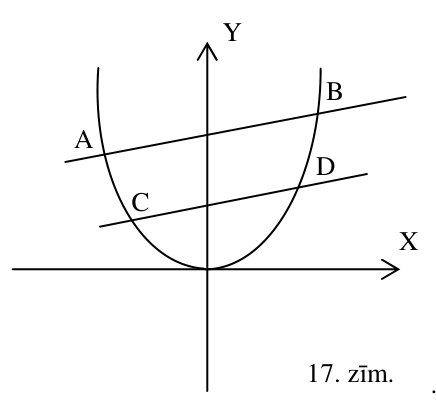{ width=200px }

17. zīm.

# <lo-sample/> LV.SOL.2006.11.2

Klasē ir $5$ aktīvisti. Viņi izveidojuši vairākas komisijas. Katrā komisijā ir vismaz viens loceklis, un nekādas divas komisijas sastāva ziņā nesakrīt. Bez tam katrām divām komisijām ir vismaz viens kopējs loceklis. Kāds lielākais komisiju skaits var būt izveidots?

<small>
   
* questionType:
* domain:
   
</small>

## Atrisinājums

**Atbilde:** $16$ komisijas.

**Risinājums.** Var ņemt kopas $\{A;B;C;D;E\}$ visas iespējamās apakškopas, kas satur aktīvistu $A$; tādu ir $2^4=16$. Tā kā pavisam ir $2^5=32$ apakškopas (viena no tām – tukša), tad tās var sadalīt $32:2=16$ pāros tā, ka neviena pāra apakškopām nav kopīgu locekļu un tās abas kopā satur visus $5$ aktīvistus. Ja tiks veidotas vairāk nekā $16$ komisijas, tad divas no tām būs no viena pāra, un tām nebūs kopīgu locekļu.

# <lo-sample/> LV.SOL.2006.11.3

Riņķa līnijas $W_1$ un $W_2$ krustojas punktos $A$ un $B$. Riņķa līnijas $W_1$ pieskare, kas novilkta punktā $A$, krusto $W_2$ vēl punktā $C$; riņķa līnijas $W_2$ pieskare, kas novilkta punktā $B$, krusto $W_1$ vēl punktā $D$. Pierādīt, ka $AD\parallel BC$.

<small>
   
* questionType:
* domain:
   
</small>

## Atrisinājums

No hordas – pieskares leņķa un ievilkta leņķa īpašībām $\angle XBC=\dfrac{1}{2}\overset{\frown}{BC}=\angle BAC=\dfrac{1}{2}\overset{\frown}{BmA}=\angle BDA$. No tā un no kāpšļu leņķu īpašībām seko vajadzīgais.

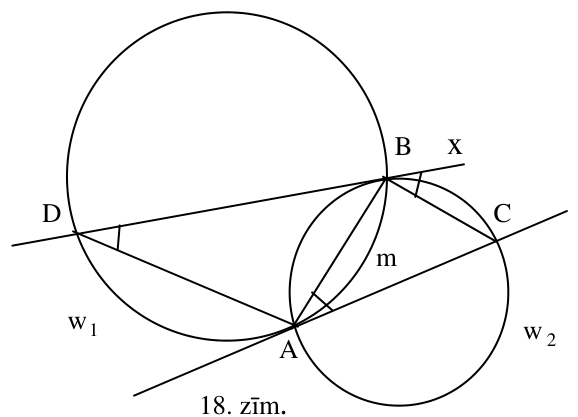{ width=250px }

18. zīm.

# <lo-sample/> LV.SOL.2006.11.4

Dots, ka $\alpha,\beta,\gamma,\delta$ ir šauri leņķi un $\alpha+\beta+\gamma+\delta=90^{\circ}$.

Pierādīt, ka

$\sin(\alpha+\beta)\cdot \sin(\beta+\gamma)\cdot \sin(\gamma+\delta)\cdot \sin(\delta+\alpha)>4\sin\alpha\cdot \sin\beta\cdot \sin\gamma\cdot \sin\delta$.

<small>
   
* questionType:
* domain:
   
</small>

## Atrisinājums

Apskatām trijstūri, kura divu leņķu lielumi ir $\alpha$ un $\beta$. Tad trešā leņķa lielums ir $\gamma+\delta+90^{\circ}$, tāpēc trijstūris ir platleņķa. No sinusu teorēmas tā malu garumi ir $2R\sin\alpha$; $2R\sin\beta$; $2R\sin(\alpha+\beta)$. No kosinusu teorēmas $(2R\sin(\alpha+\beta))^2>(2R\sin\alpha)^2+(2R\sin\beta)^2$, tāpēc $\sin^2(\alpha+\beta)>\sin^2\alpha+\sin^2\beta\geq 2\sin\alpha\sin\beta$

Līdzīgi iegūstam

$\sin^2(\beta+\gamma)>2\sin\beta\sin\gamma$

$\sin^2(\gamma+\delta)>2\sin\gamma\sin\delta$

$\sin^2(\delta+\alpha)>2\sin\delta\sin\alpha$.

Sareizinot šīs $4$ nevienādības un velkot kvadrātsakni, iegūstam vajadzīgo.

# <lo-sample/> LV.SOL.2006.11.5

Vai eksistē $8$-ciparu naturāls skaitlis $M$ ar īpašību:

ja $n$- patvaļīgs piecciparu naturāls skaitlis, tad $M$ ciparus var pārkārtot tādā secībā, lai iegūtais $8$-ciparu skaitlis $M_1$ dalītos ar $n$? (Skaitlis $M_1$ var sākties arī ar vienu vai vairākām nullēm.)

<small>
   
* questionType:
* domain:
   
</small>

## Atrisinājums

**Atbilde:** nē, neeksistē.

**Risinājums.** Pieņemsim, ka tāds skaitlis $M$ eksistē. No tā jāvar iegūt $M_1$, kas dalās ar $10000$; tāpēc $M$ satur vismaz $4$ nulles. No $M$ jāvar iegūt arī skaitli $\overline{abcdefgh}$, kas dalās ar $99999$. Ievērojam, ka $\overline{abcdefgh}=\overline{abc}\cdot 10^5+\overline{defgh}=\overline{abc}\cdot 99999+(\overline{abc}+\overline{defgh})$, tāpēc $\overline{abc}+\overline{defgh}$ jādalās ar $99999$.

Tā kā $\overline{abc}+\overline{defgh}<2\cdot 99999$, tad jābūt $\overline{abc}+\overline{defgh}=99999$. Tāpēc $d\neq 0$, $e\neq 0$ un $a+f=b+g=c+h=9$. Bet tā nevar būt, jo vismaz $4$ no cipariem $a; f; b; g; c; h$ ir $0$.

# <lo-sample/> LV.SOL.2006.12.1

Dots, ka $a$, $b$, $c$ – reāli skaitļi un $|a-b|<c<a+b$. Vai noteikti $|a-c|<b<a+c$?

<small>
   
* questionType:
* domain:
   
</small>

## Atrisinājums

Jā. Dotās nevienādības ir ekvivalentas sistēmai $a-b<c$, $b-a<c$, $c<a+b$, kas reducējas par $a+b>c$, $b+c>a$, $c+a>b$. Uz to pašu reducējas pierādāmās nevienādības.

# <lo-sample/> LV.SOL.2006.12.2

Vai eksistē tādi naturāli skaitļi $x$ un $y$, ka abi skaitļi $7^x \cdot 2^y-1$ un $7^x \cdot 2^y+1$ ir pirmskaitļi?

<small>
   
* questionType:
* domain:
   
</small>

## Atrisinājums

Nē. Viens no trim pēc kārtas sekojošiem naturāliem skaitļiem $7^x\cdot 2^y-1$, $7^x\cdot 2^y$ un $7^x\cdot 2^y+1$ dalās ar $3$. Tā kā tas nav $7^x\cdot 2^y$, tad viens no abiem apskatāmajiem skaitļiem dalās ar $3$. Tā kā tas ir vismaz $13$, tad tas nav pirmskaitlis.

# <lo-sample/> LV.SOL.2006.12.3

Dots, ka $ABCDE$ ir izliekts piecstūris, pie tam $AB\parallel CE$, $BC\parallel AD$, $CD\parallel BE$ un $AE\parallel BD$. Nogriezņi $AC$ un $BE$ krustojas punktā $D_1$, bet nogriežņi $AD$ un $BE$ krustojas punktā $C_1$. Pierādīt, ka $BD_1=C_1E$.

<small>
   
* questionType:
* domain:
   
</small>

## Atrisinājums

Vispirms pierādīsim, ka $AC\parallel DE$. Ja patvaļīgas figūras $F$ laukumu apzīmējam ar $L(F)$, tad no dotā seko $L(AED)=L(AEB)=L(ACB)=L(DCB)=L(DCE)$; bet no $L(AED)=L(DCE)$ seko $AC\parallel DE$. Tātad $DCD_1E$ un $DCBC_1$ ir paralelogrami; tātad $BC_1=CD=ED_1$. No $BC_1=ED_1$ seko vajadzīgais.

# <lo-sample/> LV.SOL.2006.12.4

Kādiem naturāliem $n$ eksistē polinoms $P(t)$ ar īpašību:

$$
P\left(x-\frac{1}{x}\right)=x^n-\frac{1}{x^n}\text{ visiem reāliem }x\ne 0?
$$

<small>
   
* questionType:
* domain:
   
</small>

## Atrisinājums

**Atbilde:** nepāra naturālie $n$.

**Risinājums.** Pieņemsim, ka $n$ ir pāra skaitlis un šāds polinoms $P(t)$ eksistē. Tad patvaļīgam $a\ne 0$ pie $x=a$ un $x=-\dfrac{1}{a}$ iegūstam $P\left(a-\dfrac{1}{a}\right)=a^n-\dfrac{1}{a^n}$ un $P\left(-\dfrac{1}{a}+a\right)=\dfrac{1}{a^n}-a^n$, tātad $a^n-\dfrac{1}{a^n}=\dfrac{1}{a^n}-a^n$ un $2a^n=\dfrac{2}{a^n}$, no kurienes $a^{2n}=1$. Skaidrs, ka tas nav spēkā visiem apskatāmajiem $a$. Iegūta pretruna.

Parādīsim, ka katram nepāra naturālam $n$ šāds polinoms $P_n$ eksistē. Viegli pārbaudīt, ka pie $n=1$ der $P_1(t)=t$ un pie $n=3$ der $P_3(t)=t^3+3t$. Mēs apgalvojam: ja $P_n(t)$ un $P_{n+2}(t)$ apmierina uzdevuma prasības nepāra skaitļiem $n$ un $n+2$, tad

$$
P_{n+4}(t)=(t^2+2)\cdot P_{n+2}(t)-P_n(t)
$$

apmierina uzdevuma prasības nepāra skaitlim $n+4$. Tiešām,

$$
P_{n+4}\left(x-\frac{1}{x}\right)=\left(\left(x-\frac{1}{x}\right)^2+2\right)\cdot \left(x^{n+2}-\frac{1}{x^{n+2}}\right)-\left(x^n-\frac{1}{x^n}\right)=
$$

$$
=\left(x^2+\frac{1}{x^2}\right)\left(x^{n+2}-\frac{1}{x^{n+2}}\right)-\left(x^n-\frac{1}{x^n}\right)=x^{n+4}-\frac{1}{x^{n+4}}.
$$

# <lo-sample/> LV.SOL.2006.12.5

Futbola turnīrā piedalījās $28$ komandas, katra ar katru citu spēlēja tieši vienu reizi. Par uzvaru komanda iegūst $2$ punktus, par neizšķirtu – $1$ punktu, par zaudējumu – $0$ punktus. Vairāk nekā $75\%$ spēļu beidzās neizšķirti. Pierādīt: vismaz divām komandām turnīra noslēgumā bija vienāds punktu skaits.

<small>
   
* questionType:
* domain:
   
</small>

## Atrisinājums

Pavisam tiek izspēlētas $C_{28}^2=\dfrac{28\cdot 27}{2}=378$ spēles. Tā kā $378\cdot \dfrac{3}{4}=283,5$, tad vismaz $284$ spēles beidzas neizšķirti. Tāpēc turnīrā pavisam izcīnītas ne vairāk kā $378-284=94$ uzvaras un piedzīvoti ne vairāk kā $94$ zaudējumi.

Aprēķināsim katrai komandai starpību starp tās uzvaru skaitu un zaudējumu skaitu. Pieņemsim, ka turnīra beigās visām komandām ir dažāds punktu skaits; tad visām $28$ aprēķinātajām starpībām jābūt dažādām. Tāpēc ne vairāk kā viena no tām ir $0$, un ir vismaz $27$ nenulles starpības. Starp tām var izvēlēties vai nu $\ge 14$ pozitīvas, vai $\ge 14$ negatīvas. Pieņemsim, ka var atrast $14$ pozitīvas starpības; otrs gadījums ir pilnīgi „simetrisks”.

Ievērosim, ka katrai komandai nav mazāk uzvaru nekā viņai aprēķinātā starpība. Tāpēc apskatāmajām $14$ komandām kopā nav mazāk par $1+2+\ldots+14=(14\cdot 15)\cdot \dfrac{1}{2}=105$ uzvarām (saskaitījām četrpadsmit mazākos naturālos skaitļus). Tā ir pretruna ar sākumā aprēķināto, ka turnīrā nav vairāk par $94$ uzvarām.

Tātad mūsu pieņēmums ir nepareizs, k.b.j.
