# <lo-sample/> LV.SOL.2007.5.1

Kvadrāts sastāv no $4\cdot 4$ rūtiņām. Vai var dažas rūtiņas nokrāsot melnas un pārējās - baltas tā, lai katrai melnai rūtiņai būtu tieši $3$ baltas blakus rūtiņas, bet katrai baltai rūtiņai – tieši $1$ melna blakus rūtiņa? (Divas rūtiņas sauc par blakus rūtiņām, ja tām ir kopīga mala.)

<small>
   
* questionType:
* domain:
   
</small>

## Atrisinājums

Jā, var. Skat. 8. zīm.

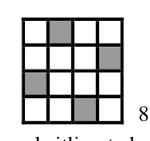{ width=100px }

8. zīm.

# <lo-sample/> LV.SOL.2007.5.2

Piecu veselu skaitļu summa ir $2006$. Vai to reizinājums var būt $200620062007$?

<small>
   
* questionType:
* domain:
   
</small>

## Atrisinājums

Nē, nevar. Tā kā summa ir pāra skaitlis, tad vismaz viens no pieciem (nepāra daudzuma) saskaitāmajiem arī ir pāra skaitlis. Bet tad reizinājums ir pāra skaitlis.

# <lo-sample/> LV.SOL.2007.5.3

Vai var aizstāt vienādus burtus ar vienādiem cipariem, bet dažādus – ar dažādiem tā, lai iegūtu pareizu saskaitīšanas piemēru

$$
\begin{array}{rrrrrrr}
 & & D & I & V & I & \\
+ & & D & I & V & I & ?\\
\hline
 & P & I & E & C & I &
\end{array}
$$

<small>
   
* questionType:
* domain:
   
</small>

## Atrisinājums

**Atbilde:** nē, nevar.

**Risinājums.** No vienu šķiras redzam, ka $I=0$. Tā kā $E\ne I$, tad $E=1$ (vieninieks, kas rodas pārnesumā no desmitu šķiras). Tātad uz tūkstošu šķiru pārnesuma nav; tāpēc jābūt vai nu $D=0$ (pretruna, jo tad $D=I$), vai arī $D=5$ (pretruna, jo tad $P=1$, tātad $P=I$). Tātad nevar būt, ka $2+2=5$. ☺

# <lo-sample/> LV.SOL.2007.5.4

Pilnīgi tumšā istabā uz galda atrodas $10$ monētas. Divas no tām ir ar ciparu uz augšu, pārējās – ar ģerboni uz augšu. Andris grib sadalīt monētas divās kaudzītēs tā, lai abās būtu vienāds daudzums monētu ar ciparu uz augšu (varbūt neviena). Kā to panākt? (Dažas monētas drīkst apgriezt otrādi. Ieslēgt gaismu vai atšķirt monētu puses pēc taustes nav iespējams.)

<small>
   
* questionType:
* domain:
   
</small>

## Atrisinājums

Andris atdala $2$ monētas un apgriež tās otrādi. Mēs apgalvojam, ka tagad starp šīm divām monētām ir tikpat monētu ar ciparu uz augšu, cik starp pārējām. Pierādījumā apskata visas $3$ iespējas, cik sākumā starp tām bija monētu ar ciparu uz augšu.

# <lo-sample/> LV.SOL.2007.5.5

Kādu lielāko daudzumu dažādu naturālu skaitļu var uzrakstīt, lai vienlaicīgi izpildītos šādas īpašības:

- katrā skaitlī visi cipari ir dažādi un izvietoti augošā kārtībā;
- nav izmantoti citi cipari kā tikai $1; 2; 3; 4$;
- katriem diviem skaitļiem ir vismaz viens kopīgs cipars (varbūt atšķirīgās vietās);
- nav tāda cipara, kas būtu sastopams visos skaitļos vienlaikus?

<small>
   
* questionType:
* domain:
   
</small>

## Atrisinājums

**Atbilde:** astoņus skaitļus.

**Risinājums.** a) Var uzrakstīt, piemēram, skaitļus $1234$; $123$; $124$; $134$; $234$; $12$; $13$; $14$.

b) Visus iespējamos skaitļus sadalām $8$ grupās:

|  |  |  |
|---|---|---|
| $1234$; | $134$ un $2$; | $13$ un $24$; |
| $123$ un $4$; | $234$ un $1$; | $14$ un $23$. |
| $124$ un $3$; | $12$ un $34$; |  |

Tā kā no katras grupas var paņemt augstākais vienu skaitli (diviem skaitļiem vienā grupā nav kopīgu ciparu), tad vairāk par $8$ skaitļiem paņemt nevar.

# <lo-sample/> LV.SOL.2007.6.1

Vai figūru, kas attēlota 1.zīm., var sagriezt trijās pēc formas un izmēriem vienādās daļās? Griezumiem jāiet pa rūtiņu līnijām.

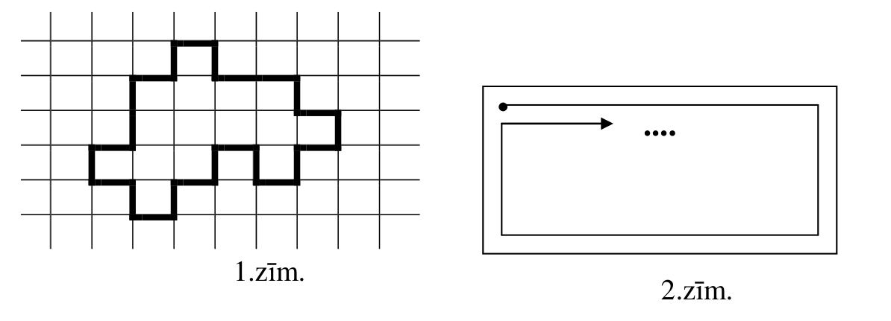{ width=500px }

1.zīm.

2.zīm.

<small>
   
* questionType:
* domain:
   
</small>

## Atrisinājums

Jā, var. Skat. 9. zīm.

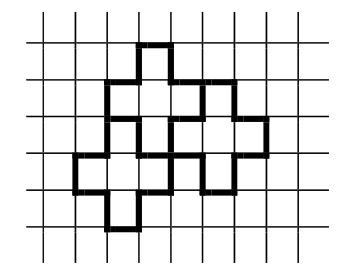{ width=150px }

9.zīm.

# <lo-sample/> LV.SOL.2007.6.2

Dots, ka $n$ - pāra skaitlis. Pierādiet, ka skaitļu $\frac{n}{2}$ un $5n$ ciparu summas ir vienādas.

<small>
   
* questionType:
* domain:
   
</small>

## Atrisinājums

Skaitlis $\frac{n}{2}$ ir vesels skaitlis. Pareizinot to ar $10$, iegūst skaitli ar tādu pašu ciparu summu. Bet

$$\frac{n}{2}\cdot 10=5n.$$

# <lo-sample/> LV.SOL.2007.6.3

Taisnstūris sadalīts vienādās kvadrātiskās rūtiņās (tā platums ir $100$ rūtiņas, augstums – $50$ rūtiņas). Rūtiņas krāso pa vienai, sākot ar kreiso augšējo rūtiņu un virzoties pa spirāli (skat. 2.zīm.). Kuru rūtiņu nokrāsos pēdējo?

<small>
   
* questionType:
* domain:
   
</small>

## Atrisinājums

Kad būs nokrāsoti $24$ pilni spirāles loki, nenokrāsotas būs palikušas tikai rūtiņas $25.$ un $26.$ rindā (skaitot no augšas), un kreisās no tām būs $25.$ kolonnā (skaitot no kreisās puses). Tāpēc kā pēdējo nokrāsos rūtiņu, kas atrodas $26.$ rindā no augšas un $25.$ kolonnā no kreisās puses.

# <lo-sample/> LV.SOL.2007.6.4

Vai naturālos skaitļus no $1$ līdz $20$ ieskaitot var sadalīt $5$ grupās tā, lai visām grupām būtu vienādas summas? Bet skaitļus no $1$ līdz $21$ ieskaitot?

<small>
   
* questionType:
* domain:
   
</small>

## Atrisinājums

**Atbilde:** a) var; b) nevar.

**Risinājums.** a) piemēram, tā: $\{1,10,11,20\}$; $\{2,9,12,19\}$; $\{3,8,13,18\}$; $\{4,7,14,17\}$; $\{5,6,15,16\}$.

b) visu skaitļu summa $1+2+\ldots+20+21=231$ nedalās ar $5$, tāpēc prasītais nav iespējams.

# <lo-sample/> LV.SOL.2007.6.5

Astoņi skolēni risināja $8$ uzdevumus. Katru uzdevumu atrisināja tieši $5$ skolēni. Neviens skolēns neatrisināja vairāk par $5$ uzdevumiem.

a) pierādīt, ka katrs skolēns atrisināja tieši $5$ uzdevumus,

b) pierādīt, ka var atrast divus skolēnus, kas abi kopā atrisinājuši visus uzdevumus.

<small>
   
* questionType:
* domain:
   
</small>

## Atrisinājums

a) Apzīmēsim skolēnu iesniegto atrisinājumu daudzumus ar $x_1$, $x_2...$ $x_8$. Saskaņā ar doto $x_1\le 5$; $x_2\le 5...$; $x_8\le 5$ un $x_1+x_2+\ldots+x_8=5\cdot 8=40$. Tāpēc $x_1=x_2=\ldots=x_8=5$ (ja kaut viens $x_i<5$, tad $x_1+\ldots+x_8<40$).

b) Pieņemsim, ka viens no skolēniem atrisinājis uzdevumus $A$, $B$, $C$, $D$, $E$. Apzīmēsim pēdējos $3$ uzdevumus $F$, $G$, $H$. Ja neviens no pārējiem $7$ skolēniem nav atrisinājis $F$, $G$ un $H$, tad katrs no viņiem atrisinājis ne vairāk kā divus no šiem uzdevumiem, tātad katrs no viņiem atrisinājis vismaz trīs no uzdevumiem $A$, $B$, $C$, $D$, $E$. Tāpēc uzdevumiem $A$, $B$, $C$, $D$, $E$ kopā iesniegti vismaz $7\cdot 3+5=26$ atrisinājumi – pretruna, jo katru no tiem atrisināja tieši $5$ skolēni.

# <lo-sample/> LV.SOL.2007.7.1

Nezinītis izgudrojis dalāmības pazīmi ar $27$: ja naturāla skaitļa ciparu summa dalās ar $27$, tad pats skaitlis dalās ar $27$. Pierādīt, ka šī pazīme nav pareiza.

<small>
   
* questionType:
* domain:
   
</small>

## Atrisinājums

**Pretpiemērs:** $1989$ vai, piemēram, $135135126$.

# <lo-sample/> LV.SOL.2007.7.2

Tabulā ar izmēriem $3 \cdot 3$ rūtiņas katrā rūtiņā ierakstīts pozitīvs skaitlis. Gan katrā rindiņā, gan katrā kolonnā ierakstīto skaitļu reizinājums ir $1$. Katrā $2 \cdot 2$ rūtiņu kvadrātā ierakstīto skaitļu reizinājums ir $2$. Kāds skaitlis ierakstīts centrā? (Tabulu ar šādām īpašībām uzrādīt nevajag.)

<small>
   
* questionType:
* domain:
   
</small>

## Atrisinājums

Tā kā $adg\cdot beh=1\cdot 1=1$ un $degh=2$, tad $ab=\frac{1}{2}$. Līdzīgi $cf=ih=gd=\frac{1}{2}$. Visu $9$ skaitļu reizinājums ir $1$ (kā triju vieninieku reizinājums). Tāpēc $e=16$.

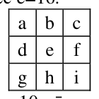{ width=100px }

10. zīm.

# <lo-sample/> LV.SOL.2007.7.3

Kādam naturālam skaitlim $30$ reizes pieskaitīja naturālus skaitļus robežās no $1$ līdz $10$ ieskaitot. Vai var gadīties, ka gan sākotnējais skaitlis, gan katrs iegūtais rezultāts dalās vai nu ar $22$, vai ar $25$?

<small>
   
* questionType:
* domain:
   
</small>

## Atrisinājums

Visu pieskaitīšanu rezultātā skaitlis palielinājās ne vairāk kā par $300$. Visu $31$ skaitļu virknē (sākotnējais un iegūtie) ir vai nu $\geq 16$ skaitļi, kas dalās ar $22$, vai $\geq 16$ skaitļi, kas dalās ar $25$. Pirmajā gadījumā katrs nākošais no šiem skaitļiem pārsniedz iepriekšējo par vismaz $22$, tāpēc starpība starp pirmo un pēdējo no tiem ir vismaz $15\cdot 22=330>300$ - pretruna. Otro gadījumu apskata līdzīgi.

# <lo-sample/> LV.SOL.2007.7.4

Ievietojiet vienādībā $1:2:3:4:5:6:7:8:9:10=7$ iekavas tā, lai tā kļūtu pareiza. (Pietiek parādīt vienu veidu, kā to izdarīt.)

<small>
   
* questionType:
* domain:
   
</small>

## Atrisinājums

Piemēram, $1:((2:3):((4:((5:6):(7:8))):(9:10)))$.

# <lo-sample/> LV.SOL.2007.7.5

Kvadrāts sastāv no $5 \cdot 5$ rūtiņām. Katrā rūtiņā ierakstīts viens no burtiem $a$, $b$, $c$, $d$. Katrā $2 \cdot 2$ rūtiņu kvadrātā visi burti ir dažādi. Kāds ir lielākais iespējamais burtu „$a$” skaits?

<small>
   
* questionType:
* domain:
   
</small>

## Atrisinājums

**Atbilde:** $9$.

**Risinājums.** a) Piemēru skat. 11. zīm.

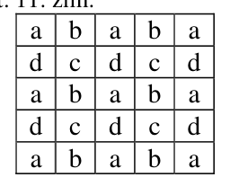{ width=100px }

11.zīm.

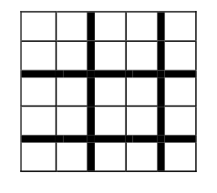{ width=100px }

12.zīm.

b) nevienā no 12.zīm. redzamajām $9$ daļām nedrīkst būt vairāk par vienu burtu $a$. Tāpēc to kopskaits nevar pārsniegt $9$.

# <lo-sample/> LV.SOL.2007.9.1

Kvadrātvienādojuma $x^2+px+q=0$ saknes atšķiras viena no otras vismaz par $6$. Pierādīt, ka kvadrātvienādojuma $x^2+2px+3q=0$ saknes atšķiras viena no otras vismaz par $10$.

<small>
   
* questionType:
* domain:
   
</small>

## Atrisinājums

No dotā seko, ka $\sqrt{p^2-4q}\ge 6\Leftrightarrow p^2-4q\ge 36$. Starpība starp otrā kvadrātvienādojuma saknēm ir

$$\sqrt{4p^2-12q}=\sqrt{p^2+3\cdot(p^2-4q)}\ge\sqrt{3\cdot36}=\sqrt{108}>10.$$

# <lo-sample/> LV.SOL.2007.9.2

Andrim un Maijai bija vienāds daudzums konfekšu. Andris apēda $8$ reizes mazāk konfekšu nekā Maija, un viņam palika $9$ reizes vairāk konfekšu nekā Maijai. Pierādīt, ka Andra sākotnējais konfekšu skaits dalījās ar $71$.

<small>
   
* questionType:
* domain:
   
</small>

## Atrisinājums

Pieņemsim, ka Andrim bija $a$ konfekšu un viņš apēda $x$ konfektes; tad Maija apēda $8\cdot x$ konfektes, un $a-x=9\cdot(a-8\cdot x)\Rightarrow 8\cdot a=71\cdot x$. Tātad $8\cdot a$ dalās ar $71$. Tā kā $\operatorname{LKD}(8,71)=1$, tad $a$ dalās ar $71$, kas bija jāpierāda.

# <lo-sample/> LV.SOL.2007.9.3

Uz taisnleņķa trijstūra $ABC$ hipotenūzas $AC$ atlikts tāds punkts $D$, ka $CD=CB$. Uz katetes $BC$ atlikts tāds punkts $E$, ka $DE=CE$. Pierādīt, ka $AD+BE=DE$.

<small>
   
* questionType:
* domain:
   
</small>

## Atrisinājums

Skat. $15.$ zīm.

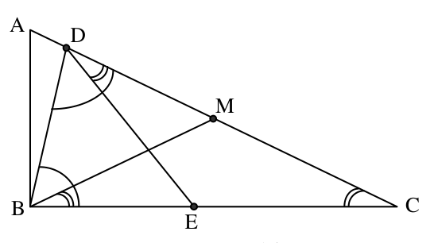{ width=250px }

15. zīm.

Apzīmējam hipotenūzas $AC$ viduspunktu ar $M$; tad $MA=MB=MC$. Tāpēc $\angle MBC=\angle MCB=\angle DCE=\angle EDC$ (vienādsānu trijstūru leņķi pie pamata). No vienādsānu trijstūra $BCD$ seko $\angle BDC=\angle DBC$. Tāpēc $\angle BDE=\angle BDC-\angle EDC=\angle DBC-\angle MBC=\angle DBM$. Tāpēc $\triangle EBD=\triangle MDB$ (lml), tātad $EB=MD$ un $ED=MB$. Tāpēc

$$AD+BE=AD+DM=AM=BM=DE,\ \text{k.b.j.}$$

# <lo-sample/> LV.SOL.2007.9.4

Kvadrāts sastāv no $3\cdot 3$ rūtiņām. Katra rūtiņa jānokrāso kādā krāsā. Nepieciešams, lai katrām divām dažādām krāsām varētu atrast divas rūtiņas ar kopēju malu, kuras nokrāsotas šajās krāsās. Kāds ir lielākais iespējamais krāsu skaits?

<small>
   
* questionType:
* domain:
   
</small>

## Atrisinājums

**Atbilde:** $5$ krāsas.  
**Risinājums.** Piemēru ar $5$ krāsām skat. $16.$ zīm. Ja krāsu būtu vismaz $6$, tad dažādu krāsu pāru būtu vismaz $15$, bet ir tikai $12$ rūtiņu malas, pa kurām rūtiņas var saskarties.

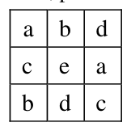{ width=100px }

16. zīm.

# <lo-sample/> LV.SOL.2007.9.5

Tabula aizpildīta ar skaitļiem, kā parādīts $4.$ zīm. Ar vienu gājienu var izvēlēties patvaļīgu pozitīvu skaitli $k$ un pareizināt vai nu visus vienas rindas, vai visus vienas kolonnas skaitļus ar $k$. Vai, atkārtojot šādus gājienus, var iegūt $5.$ zīm. attēloto situāciju?

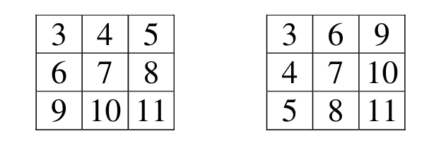{ width=300px }

4.zīm.

5.zīm.

<small>
   
* questionType:
* domain:
   
</small>

## Atrisinājums

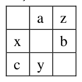{ width=100px }

17. zīm.

Izdarāmo gājienu rezultātā lielums $\frac{abc}{xyz}$ (skat. $17.$ zīm.) nemainās. Tā kā sākotnējā un iegūstamajā tabulā tam ir dažādas vērtības, prasītā pārveidošana nav iespējama.

# <lo-sample/> LV.SOL.2007.10.1

Dots, ka $a$, $b$ un $c$ apmierina sakarību $(a+b+c)(9a-3b+c)<0$, pie tam $a\ne 0$. Pierādīt, ka vienādojumam $ax^2+bx+c=0$ ir divas dažādas saknes.

<small>
   
* questionType:
* domain:
   
</small>

## Atrisinājums

Apzīmējam $f(x)=a\cdot x^2+b\cdot x+c$. No dotā seko, ka $f(1)\cdot f(-3)<0$, tāpēc $f(x)$ maina zīmi intervālā $(-3;1)$, t.i., funkcijas grafiks krusto $Ox$ asi starp punktiem $(-3)$ un $1$. Tāpēc šai parabolai ir vēl otrs krustpunkts ar $Ox$ asi.

# <lo-sample/> LV.SOL.2007.10.2

Vienu un to pašu naturālo skaitli dalīja ar atlikumu ar $3$, ar $24$ un ar $50$ (varbūt kāds atlikums bija $0$). Iegūto triju atlikumu summa bija $17$. Pierādīt, ka, dalot ar $3$, ieguva atlikumu $1$.

<small>
   
* questionType:
* domain:
   
</small>

## Atrisinājums

Skaitļi $24$ un $50$ abi ir pāra skaitļi. Tāpēc, dalot ar tiem, vai nu abi atlikumi ir pāra skaitļi, vai arī abi ir nepāra skaitļi. Tāpēc atlikums, dalot ar $3$, ir nepāra skaitlis. Tāpēc tas ir $1$.

# <lo-sample/> LV.SOL.2007.10.3

Trijstūra augstumu garumi ir $24$, $30$ un $40$. Aprēķināt tā laukumu.

<small>
   
* questionType:
* domain:
   
</small>

## Atrisinājums

Ja trijstūra laukums ir $L$, tad tā malu garumi ir $\frac{2\cdot L}{24}$, $\frac{2\cdot L}{30}$ un $\frac{2\cdot L}{40}$. Trijstūris, kura malu garumi ir $\frac{60}{L}$ reizes lielāki nekā pētāmajam, ir tam līdzīgs; bet tā malu garumi ir $5$, $4$ un $3$, tātad tas ir taisnleņķa. Tātad arī dotais trijstūris ir taisnleņķa; tāpēc tā divi garākie augstumi ir tā katetes, un tā laukums ir $\frac{1}{2}\cdot 30\cdot 40=600$.

# <lo-sample/> LV.SOL.2007.10.4

Šaurleņķu trijstūrī $ABC$ novilkts augstums $BD$. No punkta $D$ novilkti perpendikuli pret malām $AB$ un $CB$; to pamati ir attiecīgi $M$ un $N$. Pierādīt, ka punkti $A$, $M$, $N$, $C$ atrodas uz vienas riņķa līnijas.

<small>
   
* questionType:
* domain:
   
</small>

## Atrisinājums

Tā kā $\angle BMD+\angle BND=90^{\circ}+90^{\circ}=180^{\circ}$, tad ap $BNDM$ var apvilkt riņķa līniju. Tāpēc $\angle BMN=\angle BDN$ (ievilkti leņķi, kas balstās uz vienu un to pašu loku). Bet $\angle NCD=90^{\circ}-\angle NDC=\angle BDN$, tātad $\angle NCD=\angle BMN$. Tāpēc

$\angle AMN+\angle ACN=\angle AMN+\angle BMN=180^{\circ}$, no kā seko prasītais.

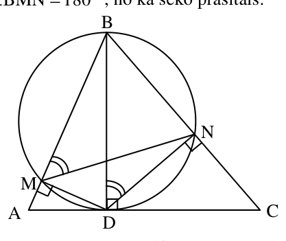{ width=200px }

18. zīm.

# <lo-sample/> LV.SOL.2007.10.5

Vai eksistē tāds naturāls skaitlis $n$ un polinomi $P_1(x)$, $P_2(x)$, ..., $P_n(x)$, ka visiem $x$ pastāv sakarība

$$x=(P_1(x))^3+(P_2(x))^3+\ldots+(P_n(x))^3?$$

Vai šis apgalvojums paliek spēkā, ja vienādības kreisajā pusē $x$ aizstāj ar $x^{2006}$?

<small>
   
* questionType:
* domain:
   
</small>

## Atrisinājums

Viegli pārbaudīt, ka $x=\left(-\sqrt[3]{2\cdot x}\right)^3+\left(x-\frac{1}{\sqrt{6}}\right)^3+\left(x+\frac{1}{\sqrt{6}}\right)^3$.

Ceļot šo vienādību $2006.$ pakāpē (un labajā pusē atstājot visus kubu reizinājumus), iegūstam vajadzīgo izteiksmi pakāpei $x^{2006}$ (labajā pusē ir $3^{2006}$ kubi).

# <lo-sample/> LV.SOL.2007.11.1

Dots, ka $a$ un $b$ - pozitīvi skaitļi. Funkciju $f(x)=ax^2+6x+b$ un $g(x)=bx^2+6x+a$ minimālo vērtību summa ir $0$. Pierādīt, ka katra no šīm minimālajām vērtībām atsevišķi ir $0$.

<small>
   
* questionType:
* domain:
   
</small>

## Atrisinājums

Abām funkcijām diskriminanti ir vienādi. Tas nozīmē, ka abiem vienādojumiem $f(x)=0$ un $g(x)=0$ vai nu abiem ir pa divām saknēm, vai abiem – pa vienai saknei, vai abiem sakņu nav. Tāpēc vai nu abas minimālās vērtības ir pozitīvas, vai abas – negatīvas, vai abas – nulle. No šejienes seko vajadzīgais.

# <lo-sample/> LV.SOL.2007.11.2

Naturāls skaitlis $n$ ir $20$ dažādu naturālu skaitļu reizinājums. Kāds ir mazākais iespējamais $n$ naturālo dalītāju skaits?

<small>
   
* questionType:
* domain:
   
</small>

## Atrisinājums

**Atbilde:** $191$.

**Risinājums.** Vismaz $19$ no minētajiem skaitļiem nav $1$. Pieņemsim, ka tie ir $d_1<d_2<\ldots<d_{18}<d_{19}$.

Tad dalītāji

$$
\begin{gathered}
1<\\
<d_1<d_2<\ldots<d_{19}<\\
<d_1\cdot d_{19}<d_2\cdot d_{19}<\ldots<d_{18}\cdot d_{19}<\\
<d_1\cdot d_{18}\cdot d_{19}<d_2\cdot d_{18}\cdot d_{19}<\ldots<d_{17}\cdot d_{18}\cdot d_{19}<\\
\ldots\\
<d_1\cdot d_3\cdot d_4\cdot \ldots \cdot d_{18}\cdot d_{19}<d_2\cdot d_3\cdot d_4\cdot \ldots \cdot d_{18}\cdot d_{19}<\\
<d_1\cdot d_2\cdot d_3\cdot d_4\cdot \ldots \cdot d_{18}\cdot d_{19}
\end{gathered}
$$

visi ir dažādi, jo katrs nākošais lielāks par iepriekšējo, un to skaits ir $1+(19+18+17+\ldots+2+1)=191$.

Ja $n=1\cdot 2^1\cdot 2^2\cdot \ldots \cdot 2^{19}=2^{190}$, tad skaitlim $n$ ir tieši $191$ dažāds naturāls dalītājs.

# <lo-sample/> LV.SOL.2007.11.3

Stari $Om$ un $On$ krusto divas riņķa līnijas, kā parādīts 6. zīm.

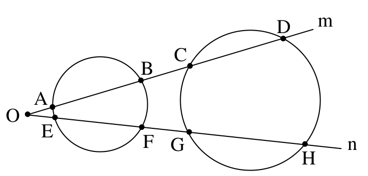{ width=350px }

6. zīm.

Dots, ka $B$, $C$, $G$, $F$ atrodas uz vienas riņķa līnijas. Pierādīt, ka arī $A$, $D$, $H$, $E$ atrodas uz vienas riņķa līnijas.

<small>
   
* questionType:
* domain:
   
</small>

## Atrisinājums

Gan $B$, $C$, $G$, $F$, gan arī $A$, $D$, $H$, $E$ atrodas uz vienas riņķa līnijas tad un tikai tad, ja $\alpha+\beta=180^{\circ}$ (skat. 19. zīm.).

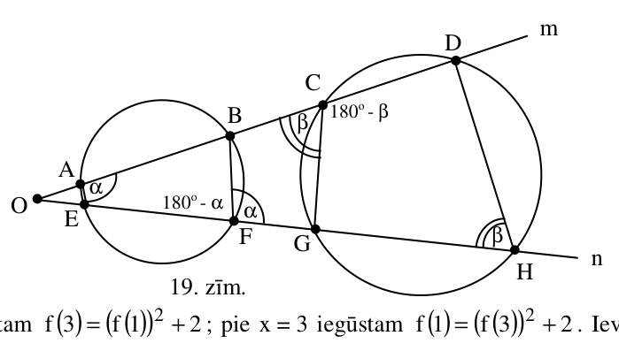{ width=350px }

19. zīm.

# <lo-sample/> LV.SOL.2007.11.4

Vai eksistē funkcija $f(x)$, kas definēta visiem reāliem $x$, pieņem reālas vērtības un visiem reāliem $x$ apmierina sakarību

$$
f(-x^2+3x+1)=(f(x))^2+2?
$$

<small>
   
* questionType:
* domain:
   
</small>

## Atrisinājums

Pie $x=1$ iegūstam $f(3)=(f(1))^2+2$; pie $x=3$ iegūstam $f(1)=(f(3))^2+2$. Ievietojot (un apzīmējot $f(1)=a$), iegūstam

$$a=\left(a^2+2\right)^2+2.$$

Tas nav iespējams. Tiešām, ja tā būtu, tad $a>2$; bet tad $a^2+2>a>2$ un

$$a=\left(a^2+2\right)^2+2>\left(a^2+2\right)^2>a^2+2>a$$

– pretruna.

# <lo-sample/> LV.SOL.2007.11.5

Apskatām tabulu ar izmēriem $2\times n$ rūtiņas (skat. 7. zīm.).

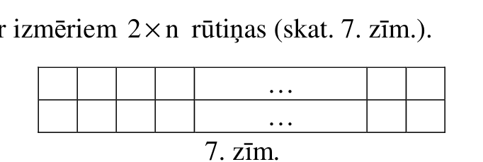{ width=300px }

7. zīm.

Visās rūtiņās kopā kaut kā izvietotas $2^n$ monētas. Ar vienu gājienu var izvēlēties rūtiņu, kurā ir vismaz $2$ monētas, vienu no šīm monētām aizvākt no tabulas, bet otru pārbīdīt vai nu vienu vietu uz augšu (ja to iespējams izdarīt), vai vienu vietu pa labi. Pierādiet: var panākt, lai labējās kolonnas augšējā rūtiņā atrastos kāda monēta.

<small>
   
* questionType:
* domain:
   
</small>

## Atrisinājums

**Lemma.** Ja tabulā ir $1$ rindiņa ar $n$ rūtiņām un tajā izvietotas $\ge 2^{n-1}$ monētas, tad var panākt, lai pēdējā rūtiņā atrastos kāda monēta.  
Lemmu pierāda ar matemātisko indukciju. Bāze $n=1$ ir triviāla. Apskatām pāreju. Ja sākumā pēdējā rūtiņā jau ir kāda monēta, viss kārtībā. Pretējā gadījumā apskatām $1\cdot(n-1)$ tabulu, kurā ir **divi komplekti** monētu, katrā pa $\ge 2^{n-2}$ monētām; saskaņā ar induktīvo hipotēzi katrs no šiem komplektiem var „nogādāt” $(n-1)$-ā rūtiņā vismaz vienu monētu. Tās abas izmantojot, iegūst vajadzīgo tabulai $1\cdot n$. Lemma pierādīta.  
Piešķiram rūtiņām koordinātas, kā parādīts 20. zīmējumā.

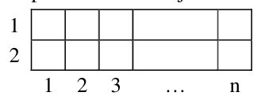{ width=150px }

20. zīm.

Risinām ar indukciju sākotnējo uzdevumu. Pie $n=1$ apgalvojums ir acīmredzams (ir tikai $3$ sākuma konfigurācijas). Pieņemsim, ka tas patiess tabulām $2\cdot(n-1)$. Apskatām tabulu $2\cdot n$. Šķirojam iespējas:  
a) $n$-jā kolonnā ir $\ge 2$ monētas; viss acīmredzams  
b) $n$-jā kolonnā ir $1$ monēta. Ja tā ir rūtiņā $(1,n)$, viss jau ir kārtībā. Ja tā ir rūtiņā $(2,n)$, tad tabulā $2\cdot(n-1)$ ir $2^n-1$ monētas. Ir divi apakšgadījumi:

$b_1$) $1.$ rindiņā ir $\ge 2^{n-1}$ monētas; lietojam lemmu tabulas $2\cdot n$ augšējai rindiņai.

$b_2$) $1.$ rindiņā ir $<2^{n-1}$ monētas; tad $2.$ rindiņā ir $\ge 2^{n-1}$ monētas. Lietojot lemmu, nogādājam vienu no tām rūtiņā $(2,n)$ un ar nākošo gājienu sasniedzam vajadzīgo.

c) $n$-jā kolonnā monētu nav. Tad tabulā $2\cdot(n-1)$ ir divi komplekti, katrā pa $2^{n-1}$ monētām. Saskaņā ar induktīvo hipotēzi nogādājam rūtiņā $(1,n-1)$ $2$ monētas, un ar nākošo gājienu sasniedzam mērķi.

# <lo-sample/> LV.SOL.2007.12.1

Kādu lielāko daudzumu komisiju var izveidot no $6$ cilvēkiem, ja katrā komisijā ir vismaz viens cilvēks, neviens cilvēks nav visās komisijās, katrām divām komisijām ir vismaz viens kopējs loceklis un nekādas divas komisijas pēc sastāva nesakrīt?

<small>
   
* questionType:
* domain:
   
</small>

## Atrisinājums

Sešu elementu kopai ir $2^6=64$ apakškopas. Sadalām tās pāros tā, ka katra kopa ir pārī ar savu papildinājumu; pavisam ir $32$ pāri. Abas apakškopas no viena pāra nevar veidot komisijas, jo tām nav kopīga elementa; tātad komisiju nevar būt vairāk par $32$. Lai izveidotu $32$ komisijas, var rīkoties šādi:

ņemam $1$ komisiju, kas satur visus sešus cilvēkus;  
ņemam $6$ komisijas, kas satur pa pieciem cilvēkiem;  
ņemam $C_6^2=15$ komisijas, kas satur pa četriem cilvēkiem;

ņemam $C_5^2=10$ komisijas, kas satur pa trim cilvēkiem;  
pie tam viens no tiem visās $10$ komisijās ir viens un tas pats cilvēks $A$.  
Ievērojam, ka $1+6+15+10=32$.  
Konstrukcijas pareizības pārbaudē lietderīgi ievērot faktu: ja divās komisijās kopā ir vairāk par $6$ locekļiem, tad tām noteikti ir kopējs loceklis.

# <lo-sample/> LV.SOL.2007.12.2

Trijstūris $ABC$ ir regulārs. Tam apvilkta riņķa līnija. Uz loka $BC$, kas nesatur virsotni $A$, ņemts punkts $M$. Pierādīt, ka $MA=MB+MC$.

<small>
   
* questionType:
* domain:
   
</small>

## Atrisinājums

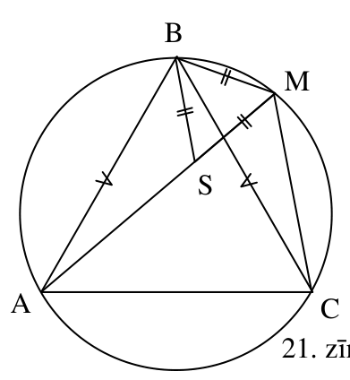{ width=200px }

$21.$ zīm.

Ievērojam, ka $\angle BMA=\angle BCA=60^{\circ}$. Atliekam $MS=MB$; tad $\triangle BMS$ ir vienādsānu ar virsotnes leņķi $60^{\circ}$, tātad regulārs. Tāpēc $BS=BM$. Ievērojam arī, ka $BA=BC$ un $\angle ABS=60^{\circ}-\angle SBC=\angle CBM$. Tāpēc $\triangle ABS=\triangle CBM$ (mlm), tātad $AS=CM$; tāpēc $CM+BM=AS+SM=AM$, k. b. j.

# <lo-sample/> LV.SOL.2007.12.3

Vai pastāv tādi naturāli skaitļi $n$ un $k$, ka

$$(1+2+3+\ldots+n)+2=k^2?$$

<small>
   
* questionType:
* domain:
   
</small>

## Atrisinājums

Vienādība pārveidojas par $\dfrac{n(n+1)}{2}+2=k^2$ un tālāk par $n(n+1)=2k^2-4$. Kreisā puse dod atlikumus $0; 2; 6; 3; 2; 3; 6; 2; 0$, dalot ar $9$; labā puse dod atlikumus $5; 7; 4; 5; 1; 1; 5; 4; 7$, dalot ar $9$. Tāpēc vienādība nav iespējama.

# <lo-sample/> LV.SOL.2007.12.4

Dots, ka $a$, $b$, $c$ - pozitīvi skaitļi. Pierādīt, ka

$$a^3+b^3+c^3+15 \cdot a \cdot b \cdot c \leq 2 \cdot (a+b+c) \cdot (a^2+b^2+c^2).$$

<small>
   
* questionType:
* domain:
   
</small>

## Atrisinājums

Atverot iekavas, nevienādība pārveidojas par

$$15\cdot a\cdot b\cdot c \le a^3+b^3+c^3+a^2\cdot b+a^2\cdot b+a\cdot b^2+a\cdot b^2+a^2\cdot c+a^2\cdot c+a\cdot c^2+a\cdot c^2+b^2\cdot c+b^2\cdot c+b\cdot c^2+b\cdot c^2,$$

kas seko no nevienādības starp $15$ skaitļu vidējo aritmētisko un vidējo ģeometrisko.

# <lo-sample/> LV.SOL.2007.12.5

Par ķieģeli sauksim figūru, kas sastāv no $5$ vienādiem kubiņiem; četri no tiem izvietoti kvadrāta formā, bet piektais saskaras ar vienu no šiem četriem pa veselu skaldni, pie tam neatrodas tai pašā „slānī”, kur pārējie četri (skat. $8.$ zīm.).

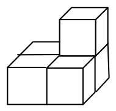{ width=100px }

$8.$ zīm.

a) pierādīt, ka no vairākiem vienādiem ķieģeļiem var salikt kubu,

b) kāds ir mazākais iespējamais ķieģeļu skaits šādā kubā?

<small>
   
* questionType:
* domain:
   
</small>

## Atrisinājums

a) No diviem ķieģeļiem var salikt figūru, kāda parādīta $22.$ zīm., no divām tādām figūrām - taisnstūra paralēlskaldni ar izmēriem $2\mathrm{x}2\mathrm{x}5$, no $50$ tādiem paralēlskaldņiem - kubu ar izmēriem $10\mathrm{x}10\mathrm{x}10$.

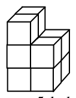{ width=100px }

$22.$ zīm.

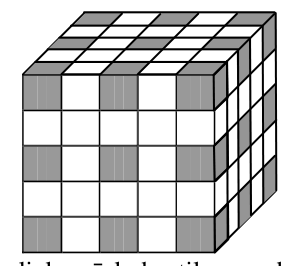{ width=150px }

$23.$ zīm.

b) tā kā ķieģelis satur $5$ kubiņus, tad saliekamā kuba tilpums dalās ar $5$ (pieņemot kubiņa šķautnes garumu par $1$). Tāpēc vienīgais kubs, kas ir mazāks par $10\mathrm{x}10\mathrm{x}10$ un ko varbūt varētu salikt no ķieģeļiem, ir kubs ar izmēriem $5\mathrm{x}5\mathrm{x}5$; tad tas sastāvētu no $25$ ķieģeļiem. Nokrāsosim šajā kubā $27$ kubiņus pēc $23.$ zīm. redzamās shēmas. Viens ķieģelis var saturēt augstākais $1$ nokrāsoto kubiņu; tāpēc $23.$ zīm. redzamo kubu no ķieģeļiem salikt nevar.
