# <lo-sample/> LV.SOL.2008.5.1

Rūtiņas malas garums ir $1$ cm (skat. $1.$ zīm.). Parādiet, kā var uzzīmēt $1.$ zīm. attēloto figūru, neatraujot zīmuli no papīra un novelkot līniju ar garumu $14$ cm (pa dažām vietām līnija drīkst iet vairākas reizes).

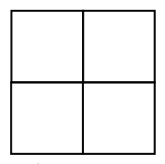{ width=100px }

$1.$ zīm.

<small>
   
* questionType:
* domain:
   
</small>

## Atrisinājums

Skat. $5.$zīm.

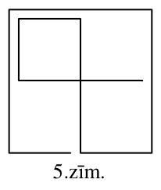{ width=100px }

5.zīm.

# <lo-sample/> LV.SOL.2008.5.2

Katrīnai ir $9$ zīmuļi; vismaz viens no tiem ir zils. Ir zināms, ka vienlaicīgi izpildās šādas īpašības:

a) no katriem $5$ zīmuļiem var izvēlēties ne vairāk kā $3$ dažādu krāsu zīmuļus,

b) no katriem četriem zīmuļiem ne vairāk kā $3$ ir vienā un tai pašā krāsā.

Cik zilu zīmuļu ir Katrīnai?

<small>
   
* questionType:
* domain:
   
</small>

## Atrisinājums

No a) seko: **krāsu nav vairāk kā $3$.**

No b) seko: **nevienā krāsā nav vairāk kā $3$ zīmuļi.**

Tātad ir tieši $3$ krāsas un katrā no tām (arī zilajā) – tieši $3$ zīmuļi (citādi kopējais zīmuļu skaits būtu mazāks nekā $9$).

# <lo-sample/> LV.SOL.2008.5.3

Zvaigznītes jāaizstāj ar dažādiem cipariem tā, lai iegūtu pareizu vienādību:

$$2\ast 8\ast+48\ast 7=2\ast 1\ast+39\ast 2.$$

Atrodiet iespējami daudzus veidus, kā to izdarīt. Pacentieties pamatot, kāpēc citu veidu bez jūsu atrastajiem nav.

<small>
   
* questionType:
* domain:
   
</small>

## Atrisinājums

Mazākā iespējamā kreisās puses vērtība ir $2082+4817=6899$; lielākā iespējamā labās puses vērtība ir $2917+3982=6899$.

Tātad vienīgā iespēja izpildīt uzdevumu ir

$$2082+4817=2917+3982.$$

# <lo-sample/> LV.SOL.2008.5.4

Jūrnieka krekls sastāv no $25$ melnām un $24$ baltām joslām, kas izvietotas pamīšus. Ar vienu gājienu vienu joslu var pārkrāsot pretējā krāsā. Ja pēc tam divas vai vairākas pēc kārtas esošas joslas ir vienā krāsā, tās turpmāk uzskata par vienu joslu.

Ar kādu mazāko gājienu skaitu var panākt, lai viss krekls būtu vienā krāsā?

<small>
   
* questionType:
* domain:
   
</small>

## Atrisinājums

Nokrāsojot melnu katru no sākotnējām baltajām joslām, viss krekls kļūst melns $24$ gājienos. Sākumā joslu ir $49$; beigās ir tikai viena „josla”. Ar katru gājienu joslu skaits samazinās ne vairāk kā par $2$. Tātad nepieciešami vismaz $(49-1):2=24$ gājieni.

# <lo-sample/> LV.SOL.2008.5.5

Andrim ir $16$ kastītes. Tajās ir attiecīgi $1; 2; 3; \ldots; 15; 16$ konfektes. Katru dienu Andris izvēlas dažas kastītes un apēd vienādu daudzumu konfekšu no tām visām.

Parādiet, kā Andris var $5$ dienās apēst visas konfektes.

<small>
   
* questionType:
* domain:
   
</small>

## Atrisinājums

Piemēram, tā:

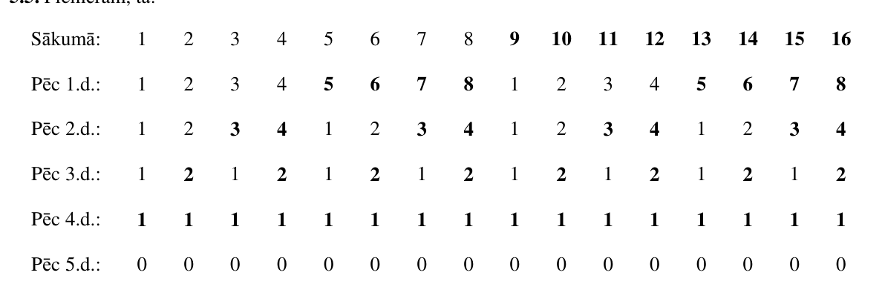{ width=500px }

# <lo-sample/> LV.SOL.2008.6.1

Rūtiņas malas garums ir $1$ cm (skat. 2. zīm.). Parādiet, kā var uzzīmēt 2. zīm. attēloto figūru, neatraujot zīmuli no papīra un novelkot līniju ar garumu $27$ cm (pa dažām vietām līnija drīkst iet vairākas reizes).

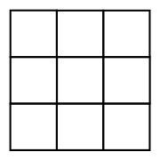{ width=100px }

2. zīm.

<small>
   
* questionType:
* domain:
   
</small>

## Atrisinājums

Skat. $6.$zīm.

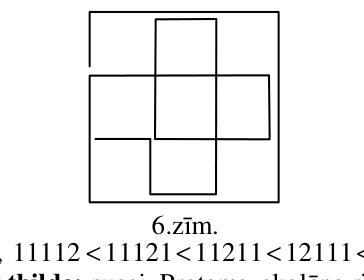{ width=150px }

6.zīm.

# <lo-sample/> LV.SOL.2008.6.2

Ja $x$ – naturāls skaitlis, kas nedalās ar $10$, tad ar $x'$ apzīmēsim skaitli, kas iegūts, uzrakstot $x$ ciparus pretējā kārtībā. Vai var atrast tādus $5$ naturālus skaitļus $a$, $b$, $c$, $d$, $e$, ka vienlaicīgi $a<b<c<d<e$ un $a'>b'>c'>d'>e'$?

<small>
   
* questionType:
* domain:
   
</small>

## Atrisinājums

Jā; piemēram, $11112<11121<11211<12111<21111$.

# <lo-sample/> LV.SOL.2008.6.3

Dažiem skolēniem klasē patīk matemātika, dažiem vēsture; pie tam dažiem patīk gan matemātika, gan vēsture, un katram patīk vismaz viens no šiem priekšmetiem. Ceturtdaļai no tiem, kam patīk matemātika, patīk arī vēsture; piektdaļai no tiem, kam patīk vēsture, patīk arī matemātika.

Kādai daļai skolēnu patīk matemātika?

<small>
   
* questionType:
* domain:
   
</small>

## Atrisinājums

Skat. $7.$zīm.

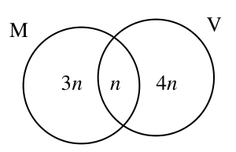{ width=150px }

7.zīm.

**Atbilde:** pusei. Protams, skolēna risinājumā nepieciešami sīkāki paskaidrojumi.

# <lo-sample/> LV.SOL.2008.6.4

Katri divi no $6$ profesoriem savā starpā sarakstās vai nu angliski, vai latviski (tikai vienā no šīm valodām). Ir zināms, ka nav tādu trīs profesoru, kas visi savā starpā sarakstās angliski. Pierādīt: ir tādi $3$ profesori, kas visi savā starpā sarakstās latviski.

<small>
   
* questionType:
* domain:
   
</small>

## Atrisinājums

Izvēlēsimies vienu profesoru $A$. Viņš sarakstās ar $5$ citiem. Tā kā $5>2\cdot 2$, tad vai nu var atrast $3$ profesorus, ar kuriem viņš sarakstās angliski, vai arī var atrast $3$ profesorus, ar kuriem viņš sarakstās latviski. Apskatīsim abas iespējas atsevišķi.

$1.$ $A$ sarakstās angliski ar $B$; $C$; $D$. Saskaņā ar uzdevumā doto $B$, $C$, $D$ visi savā starpā sarakstās latviski.

$2.$ $A$ sarakstās latviski ar $B$; $C$; $D$. Ne visi profesori $B$; $C$; $D$ savā starpā sarakstās angliski; tie no viņiem, kas sarakstās latviski, kopā ar $A$ veido meklējamo trijnieku.

# <lo-sample/> LV.SOL.2008.6.5

Kuru rūtiņu virsotni jāizvēlas, lai attālumu summa no tās līdz atzīmētajiem $11$ punktiem būtu vismazākā iespējamā? Režģis sastāv no vienādām kvadrātiskām rūtiņām; attālumus mēra pa rūtiņu līnijām (skat. 3. zīm.).

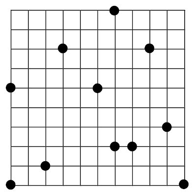{ width=200px }

3. zīm.

<small>
   
* questionType:
* domain:
   
</small>

## Atrisinājums

Veicamie ceļi sastāv no horizontāliem un vertikāliem nogriežņiem. Minimizēsim horizontālo posmu garumu summu. Projicēsim visus dotos punktus uz taisnstūra apakšējās malas:

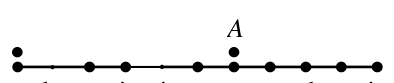{ width=200px }

Viegli pārliecināties, ka horizontālo pārvietojumu summa būs vismazākā, ja „satikšanās vieta” būs uz vertikāles $A$.

Līdzīgi analizējot vertikālos pārvietojumus, atrodam, ka „satikšanās vietai” jābūt ar aplīti apvilktajā virsotnē (skat. $8.$ zīm.) – kā redzams, nebūt ne „centrā”.

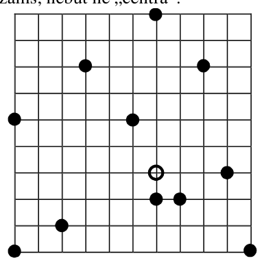{ width=200px }

$8.$ zīm.

# <lo-sample/> LV.SOL.2008.7.1

Dots, ka $a$, $b$ un $c$ ir dažādi naturāli skaitļi, $c$ dalās ar $a$ un $(a-b)(b-c)>0$. Kurš no šiem skaitļiem ir vislielākais, kurš – vismazākais?

<small>
   
* questionType:
* domain:
   
</small>

## Atrisinājums

No $c:a$ seko, ka $c>a$; no nevienādības seko, ka $b$ ir starp $a$ un $c$. Tātad skaitļu secība ir $a<b<c$.

# <lo-sample/> LV.SOL.2008.7.2

Plaknē novilktas $6$ taisnes. Vai var gadīties, ka ir tieši $16$ punkti (ne vairāk un ne mazāk), katrs no kuriem pieder vismaz divām taisnēm? Vai var gadīties, ka ir tieši $14$ šādi punkti?

<small>
   
* questionType:
* domain:
   
</small>

## Atrisinājums

a) nē; taisnes nedrīkst sakrist, un $6$ dažādām taisnēm pa pāriem var būt augstākais $15$ krustpunkti ($ab$, $ac$, $ad$, $ae$, $af$, $bc$, $bd$, $be$, $bf$, $cd$, $ce$, $cf$, $de$, $df$, $ef$).

b) jā; divas taisnes paralēlas, citu paralelitāšu nav un visi krustpunkti dažādi.

# <lo-sample/> LV.SOL.2008.7.3

Tabula sastāv no $5\cdot 5$ vienādām kvadrātiskām rūtiņām. Vai var rūtiņās ierakstīt dažādus naturālus skaitļus tā, lai katrās divās rūtiņās ar kopīgu malu ierakstītie skaitļi atšķirtos viens no otra vai nu par $5$, vai par $7$?

<small>
   
* questionType:
* domain:
   
</small>

## Atrisinājums

Skat., piem., $9.$ zīm.

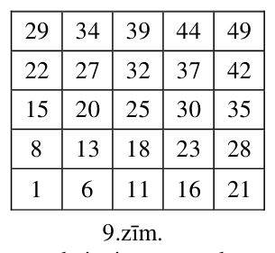{ width=150px }

$9.$ zīm.

# <lo-sample/> LV.SOL.2008.7.4

Apļveida šosejas garums ir $100$ km. Blakus tai atrodas $10$ ciemati. Katra ciemata iedzīvotāji izmērīja attālumu pa šoseju līdz tuvākajam no abiem kaimiņu ciematiem; visu mērījumu summa ir $30$ km. Pierādiet, ka uz šosejas ir tāds $14$ km garš posms, kurā nav neviena ciemata. (Ciematus uzskatām par punktiem.)

<small>
   
* questionType:
* domain:
   
</small>

## Atrisinājums

Apskatīsim $1.$ $3.$ $5.$ $7.$ $9.$ ciematus un saskaitīsim tos attālumus, kurus izmērīja šo ciematu iedzīvotāji. Šie attālumi ir **nepārklājošos** šoseju posmu garumi, tāpēc to summa mazāka par $30$ km. Tāpēc piecu atlikušo šosejas posmu garumu summa ir lielāka par $100-30=70$ (km). Tāpēc vismaz viens no tiem ir garāks par $70:5=14$ (km).

# <lo-sample/> LV.SOL.2008.7.5

Kvadrāts sastāv no $8\cdot 8$ vienādām kvadrātiskām rūtiņām. Katra rūtiņa var būt vai nu balta, vai melna; sākumā visas rūtiņas ir baltas. Ar vienu gājienu atļauts izvēlēties vai nu vienu rindiņu, vai vienu kolonnu un visas rūtiņas tajā pārkrāsot pretējā krāsā. Vai, atkārtojot šādus gājienus, var panākt, lai kvadrātā būtu

a) tieši $17$ melnas rūtiņas,

b) tieši $6$ melnas rūtiņas?

<small>
   
* questionType:
* domain:
   
</small>

## Atrisinājums

Abos gadījumos atbilde ir „nē”.

a) ievērosim, ka ar katru gājienu, pārkrāsojot $x$ melnas rūtiņas baltas un $(8-x)$ baltas rūtiņas melnas, melno rūtiņu skaits kvadrātā mainās par $|x-(8-x)|=|2x-8|$, t.i., par pāra skaitli. Tā kā sākumā tas ir $0$, tad tas nevar kļūt $17$;

b) pieņemsim, ka tas izdarīts. Tad ir vismaz $2$ baltas rindas. Koncentrēsimies uz vienu baltu rindu $r$. Pastāv divas iespējas:

b1) šī rinda mainīta pāra skaitu reižu un **visas** kolonnas – arī pāra skaitu reižu,

b2) šī rinda mainīta nepāra skaitu reižu un visas kolonnas – arī nepāra skaitu reižu.

Skaidrs, ka rezultāts nav atkarīgs no tā, kādā secībā izdara gājienus. Varam pieņemt, ka vispirms izdarītas visas maiņas kolonnās (pēc tam vai nu visa tabula ir balta, vai visa – melna), un pēc tam – maiņas rindās. Bet, izdarot maiņas rindās, balto rūtiņu skaits visu laiku mainās par $8$; tāpēc, sākot no $0$ vai $64$, tas nevar kļūt $6$. Iegūta pretruna.

# <lo-sample/> LV.SOL.2008.10.1

Dots, ka $n$ – naturāls skaitlis. Apzīmēsim $R = n(n + 1)(n + 2)(n + 4)(n + 6)$.

a) pierādīt, ka $R$ dalās ar $2$,

b) pierādīt: ja $\frac{R}{n + 1}$ dalās ar $2$, tad tas dalās ar $128$.

<small>
   
* questionType:
* domain:
   
</small>

## Atrisinājums

a) vai nu $n$, vai $n+1$ ir pāra skaitlis;

b) $\dfrac{R}{n+1}=n(n+2)(n+4)(n+6)$. Ja $\dfrac{R}{n+1}$ dalās ar $2$, tad vismaz viens (un tātad visi) no skaitļiem $n$; $n+2$; $n+4$; $n+6$ ir pāra skaitļi. Tā kā tie ir pēc kārtas ņemti pāra skaitļi, tad divi no tiem dalās ar $4$; viens no šiem abiem skaitļiem (kas ir pēc kārtas ņemti ar $4$ dalošies skaitļi) dalās ar $8$. Tātad reizinājums dalās ar $2\cdot 2\cdot 4\cdot 8=128$, k.b.j.

# <lo-sample/> LV.SOL.2008.10.2

Dots, ka $a$, $b$, $c$ – kāda trijstūra malu garumi. Pierādīt: vienādojumam $ax^2 + bx - c = 0$ intervālā $[0; 1]$ ir tieši viena sakne.

<small>
   
* questionType:
* domain:
   
</small>

## Atrisinājums

Apskatām funkciju $f(x)=ax^2+bx-c$. Tā kā $f(0)=-c<0$ un $f(1)=a+b-c>0$ (trijstūra nevienādība), tad starp $0$ un $1$ eksistē tāds $x_0$, ka $f(x_0)=0$; otra sakne ir negatīva, jo sakņu reizinājums ir $-\dfrac{c}{a}<0$.

# <lo-sample/> LV.SOL.2008.10.3

Uz trijstūra ABC malām AB un BC ņemti attiecīgi punkti X un Y, kas nav trijstūra virsotnes. Dots, ka $AX = BY$ un $\angle XYB = \angle BAC$. Leņķa ABC bisektrise krusto malu AC punktā Z. Pierādīt, ka $XZ \parallel YC$.

<small>
   
* questionType:
* domain:
   
</small>

## Atrisinājums

No dotā seko $\mathrm{AX}:\mathrm{XB}=\mathrm{BY}:\mathrm{XB}$.

No trijstūru $\mathrm{XYB}$ un $\mathrm{CAB}$ līdzības (ll) seko $\mathrm{BY}:\mathrm{XB}=\mathrm{AB}:\mathrm{BC}$

No bisektrises īpašības seko $AB:BC=AZ:ZC$

Iegūstam $AX:XB=AZ:ZC$.

No Talesa teorēmas seko vajadzīgais.

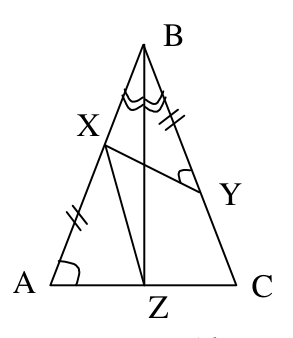{ width=150px }

$16.$ zīm.

# <lo-sample/> LV.SOL.2008.10.4

Kvadrāts sastāv no $101 \cdot 101$ vienādām kvadrātiskām rūtiņām. Tas sadalīts mazākos kvadrātos ar izmēriem $2 \cdot 2$ un $3 \cdot 3$ rūtiņas. Pierādīt: eksistē tāda rūtiņu rinda, kas krusto nepāra skaitu dalījuma kvadrātu.

<small>
   
* questionType:
* domain:
   
</small>

## Atrisinājums

Pieņemsim pretējo: katra rindiņa krusto pāra skaitu dalījumu kvadrātu. Tā kā rindā ir nepāra skaits rūtiņu, tad tā krusto nepāra skaitu $3 \cdot 3$ kvadrātu, tātad arī nepāra skaitu $2 \cdot 2$ kvadrātu. Tātad rinda satur nepāra skaitu „domino kauliņu” $1 \cdot 2$. Tā kā tas attiecas uz katru rindu, tad kvadrātā kopā ir nepāra skaits šādu „domino kauliņu”. Bet tā nevar būt, jo no katra $2 \cdot 2$ kvadrāta rodas divi šādi „domino kauliņi”.

# <lo-sample/> LV.SOL.2008.10.5

Uz šaha galdiņa novietotas vairākas figūriņas; katra no tām pilnībā aizņem vienu lauciņu. Ar vienu gājienu var vienu (jebkuru) figūriņu pārvietot uz jebkuru lauciņu, kas attiecīgajā brīdī ir brīvs. Pēc kāda laika izrādījās, ka katra figūriņa nonākusi katrā šaha galdiņa lauciņā tieši vienreiz un ar savu pēdējo gājienu atgriezusies tajā lauciņā, kurā tā atradās sākumā. Pierādīt: bija tāds brīdis, kad neviena figūriņa neatradās savā sākotnējā lauciņā.

<small>
   
* questionType:
* domain:
   
</small>

## Atrisinājums

Aplūkosim **pirmo** figūriņu $F$, kas atgriežas savā sākotnējā pozīcijā. **Vienu gājienu pirms brīža, kad tas notiek,**

a) visas figūriņas **jau ir** aizgājušas no sākotnējām pozīcijām, jo $F$ ir nonākusi visās rūtiņās (izņemot savu galamērķi),

b) neviena figūriņa **vēl nav** atgriezusies sākotnējā pozīcijā, jo $F$ būs pirmā, kas to izdarīs.

Tātad šis brīdis der par meklējamo.

# <lo-sample/> LV.SOL.2008.11.1

Regulārā $10$-stūrī atzīmētas $5$ virsotnes. Pierādīt: ir tādas $3$ atzīmētas virsotnes, kuru veidotais trijstūris ir vienādsānu.

<small>
   
* questionType:
* domain:
   
</small>

## Atrisinājums

Sadalīsim $10$-stūra virsotnes divos regulāru piecstūru virsotņu komplektos. Viens no šiem komplektiem satur vismaz trīs atzīmētas virsotnes. Bet **katras** $3$ regulāra piecstūra virsotnes veido vienādsānu trijstūri.

# <lo-sample/> LV.SOL.2008.11.2

Pierādīt: ir bezgalīgi daudz tādu naturālu skaitļu, kas nav izsakāmi kā vesela skaitļa kvadrāta un pirmskaitļa summa.

<small>
   
* questionType:
* domain:
   
</small>

## Atrisinājums

Piemēram, tādi ir visi skaitļi formā $(3n+2)^2$, $n \in \mathbb{N}$. Tiešām, ja būtu $(3n+2)^2=x^2+p$, kur $x \geq 0$, $x \in \mathbb{Z}$, tad $(3n+2)^2-x^2=p$ un $(3n+2+x)(3n+2-x)=p$.

Tas iespējams tikai tad, ja $3n+2-x=1$ un $3n+2+x=p$; tad $x=3n+1$ un $p=6n+3=3(2n+1)$, tātad $p$ nav pirmskaitlis – pretruna.

# <lo-sample/> LV.SOL.2008.11.3

Trapeces $ABCD$ pamati ir $AD$ un $BC$. Uz malas $AB$ atzīmēts tāds punkts $E$, ka $AE:BE=AD:BC$. Punkts $H$ ir nogriežņa $CE$ iekšējs punkts, un $DH \perp CE$. Pierādīt, ka $AH=AD$.

<small>
   
* questionType:
* domain:
   
</small>

## Atrisinājums

Pagarināsim $CE$ līdz krustpunktam $M$ ar $AD$ pagarinājumu.

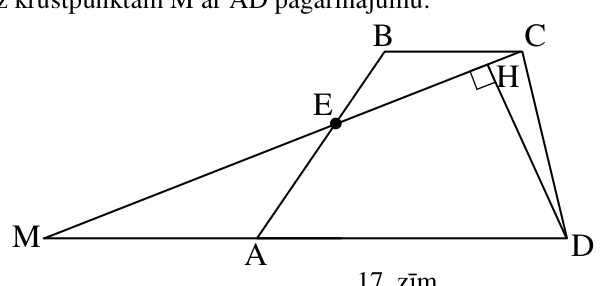{ width=300px }

$17.$ zīm.

Tā kā $\triangle AME \sim \triangle BCE$, tad $AM:BC=AE:BE$. Tāpēc $AM:BC=AD:BC$, no kurienes seko $AM=AD$.

Tāpēc taisnleņķa trijstūrī $MHD$ $AH$ ir mediāna pret hipotenūzu un $AD$ – puse no hipotenūzas; tātad $AH=AD$, k.b.j.

# <lo-sample/> LV.SOL.2008.11.4

Apskatām kvadrātfunkciju $f(x)=ax^2-x+c$, $a \ne 0$. Ir dots, ka vienādojumam $f(f(x))=x$ nav sakņu. Pierādīt, ka $a \cdot c>1$.

<small>
   
* questionType:
* domain:
   
</small>

## Atrisinājums

Pieņemsim, ka vienādojumam $f(x)=x$ ir sakne $x_0$; tad $f(x_0)=x_0$ un arī $f(f(x_0))=f(x_0)=x_0$ – pretruna ar doto. Tātad vienādojumam $ax^2-x+c=x$ jeb $ax^2-2x+c=0$ nav sakņu; no tā seko vajadzīgais.

# <lo-sample/> LV.SOL.2008.11.5

Dotās $20$ pēc ārējā izskata vienādas monētas; vairāk nekā puse no tām ir īstas. Visu īsto monētu masas ir vienādas; viltoto monētu masas ir citādas nekā īsto monētu masas, turklāt tās var arī atšķirties savā starpā. Pierādīt, ka ar $17$ svēršanām uz sviras svariem bez atsvariem var atrast vismaz vienu īstu monētu. (Katrā svēršanā uz katra svaru kausa drīkst likt tikai vienu monētu.)

<small>
   
* questionType:
* domain:
   
</small>

## Atrisinājums

Saliksim visas monētas vienā kaudzē. Mēs apskatīsim procesu, kura gaitā monētas varēs

a) palikt kaudzē,

b) nonākt kabatā,

c) tikt vispār izslēgtas no turpmākās analīzes.

{ width=100px }

Vispirms salīdzināsim savā starpā divas monētas. Ja tās ir ar vienādām masām, ieliekam tās abas kabatā. Ja tās ir ar dažādām masām, izslēdzam tās no tālākas analīzes: vismaz viena no tām ir viltota, tāpēc mums joprojām analīzei paliek vairāk īstu monētu nekā viltotu.

Ar katru nākošo gājienu  
a) ja kabatā ir kaut viena monēta, salīdzinām to ar kādu monētu no kaudzes,  
b) ja kabatā nav nevienas monētas, salīdzinām divas monētas no kaudzes,  
un atkarībā no svēršanas rezultāta rīkojamies, kā iepriekš aprakstīts.

Ievērosim: $1$) ja kabatā vispār ir kādas monētas, tad tām visām masas ir vienādas, $2$) vairāk nekā puse no vēl neizslēgtajām monētām vienmēr ir īstas, $3$) kabatā un kaudzē esošo monētu daudzumu paritātes vienmēr ir vienādas, jo monētas „izslēdz” pa pāriem, $4$) kaudzē esošo monētu daudzums katrā gājienā samazinās par $2$ vai par $1$.

Mēs apgalvojam, ka iestāsies brīdis, kad kaudzē būs tieši $2$ monētas. Tiešām, saskaņā ar $4$) pienāks brīdis, kad kaudzē ir $3$ vai $2$ monētas. Ja tur ir $3$ monētas, tad ar kārtējo gājienu monētu skaits kaudzē var kļūt $1$ (tādējādi „pārlecot” vērtībai $2$) tikai tad, ja kabatā nav nevienas monētas; bet saskaņā ar $3$) tā nevar būt.

Šķirojam vairākas iespējas.

I. Kabatā monētu nav. Tad saskaņā ar $2$) abas monētas kaudzē ir īstas.

II. Kabatā ir vismaz $2$ monētas (visas tur esošās monētas ir ar vienādu masu). Saskaņā ar $2$) visas kabatā esošās monētas ir īstas.

Gadījums, kad kabatā ir tieši viena monēta, saskaņā ar $3$) nav iespējams.

Tā kā ar pirmo gājienu no kaudzes izņēma $2$ monētas, ar katru nākošo – vismaz vienu un monētu kopējais skaits kaudzē samazinājās par $20-2=18$, tad netika izdarīti vairāk kā $17$ gājieni.

# <lo-sample/> LV.SOL.2008.12.1

Pierādīt: ja $n$ – naturāls skaitlis, tad $n^2+n+4$ nedalās ar $9$.

<small>
   
* questionType:
* domain:
   
</small>

## Atrisinājums

Ievērosim, ka $x^2+x+4=(x-1)\cdot(x+2)+6$. Ja $x^2+x+4$ dalās ar $9$, tad tas dalās arī ar $3$. Tāpēc $(x-1)\cdot(x+2)$ dalās ar $3$. Tāpēc vai nu $x-1$, vai $x+2$ dalās ar $3$; bet $(x+2)-(x-1)=3$, tāpēc abi reizinātāji $x-1$ un $x+2$ dalās ar $3$. Tāpēc $(x-1)\cdot(x+2)$ dalās ar $9$. Bet tad $(x-1)\cdot(x+2)+6$ ar $9$ nedalās – pretruna.

# <lo-sample/> LV.SOL.2008.12.2

Dots, ka $ABCD$ – trijstūra piramīda, $\angle ABC=\angle ADC=90^{\circ}$ un $AC<2$. Pierādīt, ka $BD<2$.

<small>
   
* questionType:
* domain:
   
</small>

## Atrisinājums

No dotā seko, ka $AC$ ir ap sfēru apvilktas lodes diametrs, t.i., visgarākā horda. No tā seko vajadzīgais.

# <lo-sample/> LV.SOL.2008.12.3

Pierādīt, ka $a^6-6ab^5+5b^6\geq 0$ visiem reāliem $a$ un $b$.

<small>
   
* questionType:
* domain:
   
</small>

## Atrisinājums

Saskaņā ar nevienādību starp nenegatīvu skaitļu vidējo aritmētisko un vidējo ģeometrisko  
$a^6+5b^6=a^6+b^6+b^6+b^6+b^6+b^6\ge 6\cdot\sqrt[6]{a^6\cdot b^6\cdot b^6\cdot b^6\cdot b^6\cdot b^6}=6\cdot a\cdot b^5$, k.b.j.

# <lo-sample/> LV.SOL.2008.12.4

Šaurleņķu trijstūrī $ABC$ punkts $O$ ir apvilktās riņķa līnijas centrs, $H$ – augstumu krustpunkts, $AA_1$ un $CC_1$ – augstumi. Dots, ka $\angle ABC=45^{\circ}$. Pierādīt, ka taisne $A_1C_1$ iet caur nogriežņa $OH$ viduspunktu.

<small>
   
* questionType:
* domain:
   
</small>

## Atrisinājums

Tā kā $\angle ABC=45^{\circ}$, tad $\triangle BA_1A$ ir vienādsānu un $A_1$ atrodas uz $AB$ vidusperpendikula. Līdzīgi $C_1$ atrodas uz $BC$ vidusperpendikula.

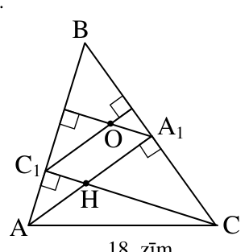{ width=150px }

18. zīm.

Tāpēc $O$ (skat. zīm.) ir $\triangle ABC$ apvilktās riņķa līnijas centrs. Tā kā $C_1OA_1H$ ir paralelograms (pretējās malas pa pāriem paralēlas) un paralelograma diagonāles krustpunktā dalās uz pusēm, vajadzīgais pierādīts.

# <lo-sample/> LV.SOL.2008.12.5

Regulārā $2007$-stūrī katrā virsotnē un katrā diagonāļu krustpunktā ierakstīts „$1$”. Ar vienu gājienu var mainīt skaitļus uz pretējiem visos punktos, kas atrodas uz vienas malas vai uz vienas diagonāles: „$+1$” aizstāt ar „$-1$”, bet „$-1$” – ar „$+1$”. Vai, atkārtojot šādus gājienus, var panākt, lai vienlaicīgi visās virsotnēs un visos diagonāļu krustpunktos būtu ierakstīts „$-1$”?

<small>
   
* questionType:
* domain:
   
</small>

## Atrisinājums

Nē, jo „$+1$” skaits uz $2007$-stūra ar katru gājienu mainās par $2$ vai arī nemainās vispār.
