# <lo-sample/> LV.SOL.2009.5.1

Vai var no cipariem $1$; $2$; $3$; $4$; $5$; $6$; $7$; $8$; $9$, lietojot katru no tiem tieši vienu reizi, izveidot vairākus naturālus skaitļus tā, lai to visu summā visi cipari būtu nepāra?

<small>
   
* questionType:
* domain:
   
</small>

## Atrisinājums

Jā, var. Piemēram: $35+6+47+28+19=135$.

# <lo-sample/> LV.SOL.2009.5.2

Kuba šķautnes (malas) garums ir $1$. No četriem šādiem kubiem saliktu figūru, kas redzama 1.zīm., sauc par ķieģeli.

Vai no ķieģeļiem var salikt a) kubu ar izmēriem $4 \cdot 4 \cdot 4$,

b) kubu ar izmēriem $5 \cdot 5 \cdot 5$?

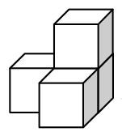{ width=100px }

1.zīm.

<small>
   
* questionType:
* domain:
   
</small>

## Atrisinājums

a) no diviem ķieģeļiem var salikt kubu $2 \cdot 2 \cdot 2$, no astoņiem šādiem kubiem – prasīto.  
b) nē; mazo kubiņu kopskaits $125$ nedalās ar $4$ – kubiņu skaitu vienā ķieģelī.

# <lo-sample/> LV.SOL.2009.5.3

Kāds ir mazākais rūtiņu daudzums, kādu var atzīmēt 2.zīm. attēlotajā figūrā, lai jebkurā tādā šīs figūras gabalā, kāds redzams 3.zīm. (tas var būt pagriezts arī citā virzienā) būtu vismaz viena atzīmēta rūtiņa?

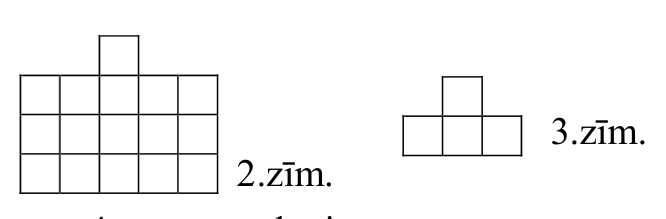{ width=300px }

2.zīm.

3.zīm.

<small>
   
* questionType:
* domain:
   
</small>

## Atrisinājums

**Atbilde:** $4$. Skat. 1.zīm. Katrā no tur redzamajām $4$ daļām jābūt atzīmētai vismaz vienai rūtiņai. Savukārt $4$ atzīmētas rūtiņas apmierina uzdevuma prasības.

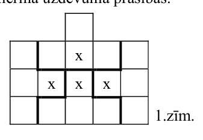{ width=150px }

1.zīm.

# <lo-sample/> LV.SOL.2009.5.4

Apzīmējiet katrā no 4.zīm. parādītajām figūrām punktus ar burtiem $A$; $B$; $C$; $D$; $E$; $F$ tā, lai abās figūrās ar līnijām būtu savienoti vieni un tie paši burtu pāri. Pietiek parādīt vienu veidu, kā to izdarīt.

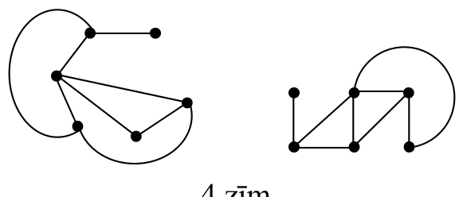{ width=250px }

4.zīm.

<small>
   
* questionType:
* domain:
   
</small>

## Atrisinājums

Skat., piem., 2.zīm.

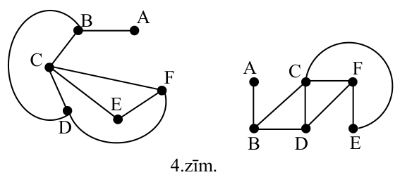{ width=250px }

2.zīm.

# <lo-sample/> LV.SOL.2009.5.5

Doti $5$ spaiņi. Katra spaiņa ietilpība ir $15$ litri. Sākotnēji spaiņos ir attiecīgi $1\ l$; $2\ l$; $3\ l$; $4\ l$; $5\ l$ ūdens. Ar vienu gājienu var izvēlēties divus spaiņus un no spaiņa, kurā ūdens nav mazāk kā otrā, pārliet otrā spainī tik ūdens, cik tur jau ir.

Kādu lielāko ūdens daudzumu var savākt vienā spainī, izpildot, ja vajadzīgs, vairākus gājienus?

<small>
   
* questionType:
* domain:
   
</small>

## Atrisinājums

**Atbilde:** $14\,l$.  
**Risinājums.** Skaidrs, ka katrā spainī vienmēr ir vesels skaits litru. Sadalījums nevar būt $0; 0; 15$, jo tad pēdējā gājienā tiktu salieti kopā divi ūdens daudzumi pa $7\frac{1}{2}\,l$ katrs. Kā savākt $14\,l$ vienā spainī, skat., piem., pievienoto tabulu 3.zīm.

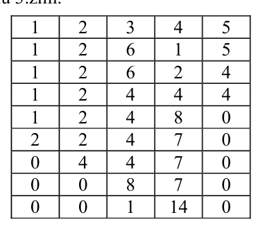{ width=200px }

3.zīm.

# <lo-sample/> LV.SOL.2009.6.1

Doti $11$ dažādi naturāli skaitļi. Pierādīt, ka no tiem var izvēlēties divus skaitļus, kuru starpība dalās ar $10$.

<small>
   
* questionType:
* domain:
   
</small>

## Atrisinājums

Iespējami pavisam $10$ dažādi pēdējie cipari. Tā kā $11>10$, tad diviem skaitļiem pēdējie cipari ir vienādi. Tos var ņemt par meklējamiem.

# <lo-sample/> LV.SOL.2009.6.2

Kvadrāts sastāv no $8 \times 8$ rūtiņām. Sākotnēji tās visas ir baltas. Andris un Katrīna pamīšus izdara gājienus. Andris ar savu gājienu pārkrāso melnā krāsā vienu (jebkuru) baltu rūtiņu. Katrīna ar savu gājienu pārkrāso melnā krāsā vienu (jebkuru) no baltām rūtiņām sastāvošu figūriņu, kāda redzama 5.zīm. (tā var būt novietota arī citādi). Sāk Andris. Kas nevar izdarīt gājienu, zaudē. Kurš no bērniem uzvar, pareizi spēlējot?

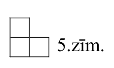{ width=100px }

5.zīm.

<small>
   
* questionType:
* domain:
   
</small>

## Atrisinājums

**Atbilde:** uzvar Katrīna.  
Katrīna domās sadala lielo kvadrātu daļās ar izmēriem $2 \cdot 2$. Tikko Andris nokrāso rūtiņu kādā no šīm daļām, Katrīna nokrāso atlikušās rūtiņas šai daļā.

# <lo-sample/> LV.SOL.2009.6.3

Uz galda atrodas trauks ar $10$ zilām, $10$ zaļām un $10$ sarkanām konfektēm. Ar vienu gājienu atļaut apēst jebkādas divas dažādu krāsu konfektes, to vietā ieliekot traukā vienu trešās krāsas konfekti. Vai var gadīties, ka traukā paliek tikai viena konfekte?

<small>
   
* questionType:
* domain:
   
</small>

## Atrisinājums

Nē, nevar. Viegli saprast, ka pēc katra gājiena visu konfekšu daudzumi ir vienas paritātes skaitļi (vai nu visi pāra, vai visi nepāra). Tāpēc nevar iegūt situāciju $(0; 0; 1)$.

# <lo-sample/> LV.SOL.2009.6.4

Pie eglītes sapulcējušies $10$ rūķīši – votivapas un šillišallas. Votivapas vienmēr melo; šillišallas vienmēr runā patiesību. Seši rūķīši uz jautājumu: „Ja Tevi neskaita, tad vai starp pārējiem rūķīšiem būtu vairāk votivapu vai šillišallu?” atbildēja, ka votivapu būtu vairāk. Cik ir votivapu un cik – šillišallu?

<small>
   
* questionType:
* domain:
   
</small>

## Atrisinājums

Viegli saprast: jebkurā gadījumā visi šillišallas atbild vienādi, visi votivapas – arī. Ja šillišallu būtu vairāk, tad viņu pārsvars būtu vismaz $6:4$. Tad starp aptaujātajiem būtu vismaz viens šillišalla, un viņa atbilde būtu aplama – pretruna. Līdzīgi iegūst pretrunu, pieņemot, ka vairāk ir votivapu. Tāpēc atliek tikai iespējams, ka gan vienu, gan otru ir tieši pieci. Pārbaude parāda, ka tas apmierina uzdevuma nosacījumus.

# <lo-sample/> LV.SOL.2009.6.5

Katrā kuba skaldnē (t.i., katrā no $6$ kvadrātiem, kas to norobežo) novilkta viena diagonāle. Ja divām diagonālēm ir kopīgs galapunkts, tad saka, ka tās draudzējas. Kāds ir lielākais iespējamais draudzību skaits?

<small>
   
* questionType:
* domain:
   
</small>

## Atrisinājums

**Atbilde:** $12$.  
Piemēru skat. 4.zīm.; katrā no $4$ virsotnēm ir pa $3$ draudzībām. Pavisam novilktas $6$ diagonāles $a$, $b$, $c$, $d$, $e$, $f$. Pavisam no tām var izveidot $15$ pārus: $ab$, $ac$, $ad$, $ae$, $af$, $bc$, $bd$, $be$, $bf$, $cd$, $ce$, $cf$, $de$, $df$, $ef$. Bet trijos pāros diagonāles nevar būt draudzīgas, jo diagonālēm, kas atrodas kuba pretējās skaldnēs, kopīgu punktu nav. Tāpēc draudzību skaits nepārsniedz $15-3=12$.

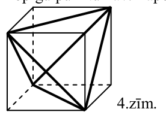{ width=150px }

4.zīm.

# <lo-sample/> LV.SOL.2009.7.1

Izteiksmē $1:2:3:4:5:6$ ievietotas iekavas tā, ka izteiksmes vērtība ir pirmskaitlis. Vai tas var būt

a) $3$,

b) $5$?

<small>
   
* questionType:
* domain:
   
</small>

## Atrisinājums

Starp skaitļu pirmreizinātājiem ir tieši $2$ trijnieki: skaitlī $3$ un skaitlī $6$. Viens no tiem nevar „noīsināties”, „nenoīsinoties” arī otram. Tāpēc vērtība „$3$” nav iespējama.  
Izteiksmes $1:(2:3:4:(5:6))$ vērtība ir $5$.

# <lo-sample/> LV.SOL.2009.7.2

Andris un Maija uzzīmēja pa vienam trijstūriem (varbūt tie pilnīgi vai daļēji pārklājas), bet Katrīna abus trijstūrus izkrāsoja melnus. Vai melnais apgabals var būt

a) septiņstūris,

b) desmitstūris?

<small>
   
* questionType:
* domain:
   
</small>

## Atrisinājums

Skat. 5.zīm.

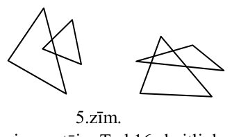{ width=150px }

5.zīm.

# <lo-sample/> LV.SOL.2009.7.3

Kvadrāts sastāv no $6\cdot 6$ rūtiņām. Katrā rūtiņā ierakstīts naturāls skaitlis no $1$ līdz $36$; četru rūtiņu „saturs” attēlots $6.$ zīm. Nekādās divās rūtiņās ar kopīgu malu ierakstītie skaitļi neatšķiras viens no otra vairāk kā par $15$. Pierādīt, ka vismaz divās rūtiņās ierakstīti vienādi skaitļi.

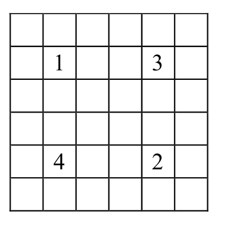{ width=200px }

$6.$ zīm.

<small>
   
* questionType:
* domain:
   
</small>

## Atrisinājums

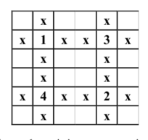{ width=150px }

6.zīm.

Pieņemsim pretējo. Tad $16$ skaitļi, kas 6.zīm. atrodas ar krustiņiem atzīmētajās rūtiņās, visi ir dažādi un lielāki par $4$. Lielākais no tiem tātad ir $\ge 20$. Tā starpība ar to no skaitļiem $1; 2; 3; 4$, kam tas atrodas blakus, ir vismaz $16$ – pretruna.

# <lo-sample/> LV.SOL.2009.7.4

Rindā novietotas $4$ monētas $A$, $B$, $C$, $D$ (tieši šādā secībā). Ar vienu gājienu var mainīt vietām divas blakus esošas monētas. Vai monētas var pārkārtot secībā $D$, $C$, $B$, $A$, izdarot tieši

a) $4$ gājienus,

b) $99$ gājienus?

<small>
   
* questionType:
* domain:
   
</small>

## Atrisinājums

**Atbilde: a)** nē, **b)** nē.  
**Risinājums. a)** Lai katra no monētām $A$ un $D$ nonāktu rindas otrā galā, tai jāpiedalās $3$ maiņās, pat visu laiku virzoties vienā virzienā; ja kāda monēta izdara „soli atpakaļ”, gājienu skaits jau ir vismaz $5$. Tātad $A$ un $D$ kopā izdara vismaz $3+3=6$ gājienus; tikai viens no tiem ir kopīgs, tātad jau $A$ un $D$ kopā jāizdara vismaz $5$ gājieni.  
**b)** Iedomāsimies, ka monētas ir punkti, kas kustas pa skaitļu asi, un apzīmēsim to attēlotos skaitļus attiecīgi ar $a; b; c; d$. Apskatām izteiksmi
$$
R=(a-b)(a-c)(a-d)(b-c)(b-d)(c-d).
$$
Katrā gājienā tieši viena iekava maina zīmi, tāpēc zīmi maina arī $R$. Tātad pēc $99$ gājieniem $R$ būs pretēja zīme nekā sākumā. Bet, ja monētas būtu pārkārtojušās pretējā secībā, tad **visas** iekavas būtu mainījušas zīmi, tātad $R$ zīme būtu tāda pati kā sākumā. Iegūta pretruna.

# <lo-sample/> LV.SOL.2009.7.5

Vai kvadrātā, kas sastāv no $4\cdot 4$ rūtiņām, var ierakstīt naturālos skaitļus no $1$ līdz $16$ (katrā rūtiņā – citu skaitli) tā, lai rindās un kolonnās ierakstīto skaitļu summas būtu $8$ dažādi naturāli skaitļi, kas visi dalās ar $4$?

<small>
   
* questionType:
* domain:
   
</small>

## Atrisinājums

Jā, var. Skat., piem., 7.zīm.

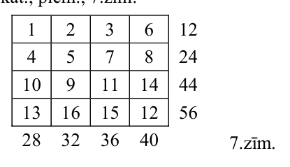{ width=200px }

7.zīm.

# <lo-sample/> LV.SOL.2009.8.1

Kādu lielāko daudzumu no naturāliem skaitļiem $1; 2; 3; 4; 5; 6; 7; 8; 9; 10; 11; 12$ var sadalīt divās grupās tā, lai abās grupās ietilpstošo skaitļu reizinājumi būtu vienādi savā starpā?

<small>
   
* questionType:
* domain:
   
</small>

## Atrisinājums

Pirmskaitļi $7$ un $11$ nevar būt starp šiem skaitļiem, jo tikai vienas grupas skaitļu reizinājums var dalīties ar $7$ resp. $11$. Atlikušajos skaitļos kopā ir $5$ – nepāra skaits – pirmreizinātāji „$3$”, tāpēc vismaz vēl viens skaitlis jāizslēdz. Tāpēc sadalīti var tikt ne vairāk kā $12-3=9$ skaitļi. Piemērs
$$
1\cdot 3\cdot 5\cdot 6\cdot 8=2\cdot 4\cdot 9\cdot 10
$$
parāda, ka $9$ skaitļus var sadalīt tā, kā prasīts uzdevumā.

# <lo-sample/> LV.SOL.2009.8.2

Taisnes $m$, $n$ un $t$ ir attiecīgi četrstūra $ABCD$ malu $AB$, $BC$, $CD$ vidusperpendikuli (skat. 7.zīm.). Ar $O$ apzīmēts $n$ un $AD$ krustpunkts. Pierādīt, ka $OA > OD$.

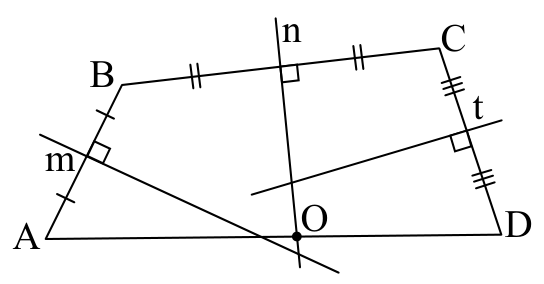{ width=250px }

7.zīm.

<small>
   
* questionType:
* domain:
   
</small>

## Atrisinājums

Atcerēsimies vispārzināmu faktu: ja punkts $M$ atrodas uz to pašu pusi no nogriežņa $XY$ vidusperpendikula kā $X$, tad $MX<MY$.  
Tiešām (skat. 8.zīm.) $MX<MS+SX=MS+SY=MY$.

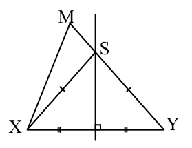{ width=150px }

8.zīm.

Pamatojoties uz šo faktu un zīmējuma elementu izvietojumu, iegūstam
$$
OA>OB=OC>OD,
$$
k.b.j.

# <lo-sample/> LV.SOL.2009.8.3

Uzzīmējiet kaut vienu piecstūri, kuram nekādas divas diagonāles nekrustojas viena ar otru.

<small>
   
* questionType:
* domain:
   
</small>

## Atrisinājums

Skat., piem., $9.$zīm. Piecstūra malas zīmētas ar resnākām, diagonāles – ar tievākām līnijām.

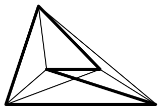{ width=150px }

$9.$zīm.

# <lo-sample/> LV.SOL.2009.8.4

Vai kuba virsotnes un šķautnes var sanumurēt ar naturāliem skaitļiem no $1$ līdz $20$ (visiem numuriem jābūt dažādiem), lai katras šķautnes numurs būtu vienāds ar tās galapunktu numuru summu?

<small>
   
* questionType:
* domain:
   
</small>

## Atrisinājums

Nē, nevar. No katras virsotnes iziet $3$ šķautnes. Tāpēc, aprēķinot visu virsotņu un visu šķautņu numuru summu, iegūtajā rezultātā katras virsotnes numurs ieiet kā saskaitāmais tieši $4$ reizes, un citu saskaitāmo nebūtu, bet summa $1+2+3+\ldots+19+20=210$ nedalās ar $4$.

# <lo-sample/> LV.SOL.2009.8.5

Sniegbaltītes pulkstenim ir stundu, minūšu un sekunžu rādītāji; pulkstenis iet absolūti precīzi. Kādu dienu tieši $12:00$ uz katra rādītāja nosēdās pa rūķītim. Brīdī, kad viens rādītājs apdzen otru, uz tiem sēdošie rūķīši mainās vietām. Pulksten $24:00$ tai pašā dienā katrs rūķītis pateica Sniegbaltītei, cik pilnus apļus viņš novizinājies. Kādus trīs skaitļus dzirdēja Sniegbaltīte? (Varam uzskatīt par zināmu, ka šajā laika posmā nenotika neviena „divkāršā apdzīšana”.)

<small>
   
* questionType:
* domain:
   
</small>

## Atrisinājums

Rūķīši cits citu neapdzen. Tāpēc katru divu rūķīšu veikto pilno apļu daudzumi neatšķiras viens no otra vairāk kā par $1$. Kopējais veikto pilno apļu daudzums ir $1+12+12\cdot60=733=3\cdot244+1$. No šejienes viegli saprast, ka Sniegbaltītei tika pateikti skaitļi $244$; $244$; $245$.

# <lo-sample/> LV.SOL.2009.9.1

Dots, ka $a<b<c<d<e$, $a+b=10$, $d+e=18$; visi skaitļi $a$; $b$; $c$; $d$; $e$ ir naturāli. Aprēķināt $a+b+c+d+e$.

<small>
   
* questionType:
* domain:
   
</small>

## Atrisinājums

Pierādīsim, ka $c=7$. Ja būtu $c\le6$, tad $a+b\le4+5=9$ - pretruna. Ja būtu $c\ge8$, tad $d+e\ge9+10=19$ - pretruna. Tātad $a+b+c+d+e=(a+b)+c+(d+e)=10+7+18=35$.

# <lo-sample/> LV.SOL.2009.9.2

Uz trijstūra $ABC$ malas $BC$ atzīmēts punkts $M$, bet uz malas $AC$ – punkts $N$. Dots, ka $\angle BCA=20^{\circ}$ un $CM=MN=NB=BA$. Pierādīt, ka $AN=BN$.

<small>
   
* questionType:
* domain:
   
</small>

## Atrisinājums

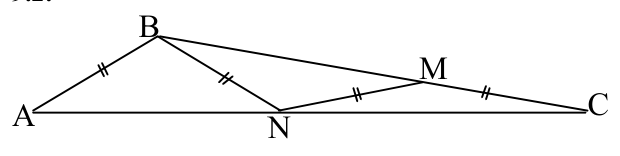{ width=300px }

Vairākas reizes lietojot vienādsānu trijstūra un trijstūra ārējā leņķa īpašības, pakāpeniski iegūstam:  
$\angle MNC=20^{\circ}$;  
$\angle BMN=20^{\circ}+20^{\circ}=40^{\circ}$; $\angle MBN=40^{\circ}$;  
$\angle BNM=180^{\circ}-2\cdot40^{\circ}=100^{\circ}$;  
$\angle BNA=180^{\circ}-100^{\circ}-20^{\circ}=60^{\circ}$; $\angle BAN=60^{\circ}$. Tātad $\triangle ABN$ ir regulārs, no kā seko vajadzīgais.

# <lo-sample/> LV.SOL.2009.9.3

Skaitļa $n$ decimālais pieraksts sastāv no $11$ vieniniekiem, $11$ divniekiem, $11$ trijniekiem un $11$ četriniekiem. Vai skaitlis $n+4$ var būt pirmskaitlis?

<small>
   
* questionType:
* domain:
   
</small>

## Atrisinājums

Skaitlim $n$ pieskaitot $4$, pārnesumi nerodas. Tāpēc $n+4$ ciparu summa ir $11(1+2+3+4)+4=114$. Tā kā $114$ dalās ar $3$, tad arī $n+4$ dalās ar $3$. Tā kā $n+4>3$, tad tas nav pirmskaitlis.

# <lo-sample/> LV.SOL.2009.9.4

Profesoram Cipariņam uzdāvinātas $5$ pēc ārējā izskata vienādas zelta monētas; tām visām ir dažādas masas. Ja Cipariņš norāda uz jebkurām $3$ monētām, dāvinātājs pasaka, kura no tām ir pēc masas vidējā. Kā Cipariņš var noskaidrot, kura ir pēc masas vidējā no visām $5$ monētām, izmantojot tikai šādus jautājumus un atbildes?

<small>
   
* questionType:
* domain:
   
</small>

## Atrisinājums

Vispirms uzdodam $3$ jautājumus un pēc katras atbildes „noliekam malā” norādīto vidējo monētu (tā vairs nepiedalās nākošajos no šiem $3$ jautājumiem). Palikušās, malā nenoliktās divas monētas ir smagākā un vieglākā no visām (mēs nezinām, „kura ir kura”). Tagad meklēto monētu atrodam ar vienu jautājumu par „malā noliktajām” monētām.

# <lo-sample/> LV.SOL.2009.9.5

Katrs vesels skaitlis nokrāsots vai nu balts, vai sarkans, pie tam skaitļi $5$ un $6$ nokrāsoti dažādi. Pierādīt, ka var atrast tādus trīs vienādi nokrāsotus skaitļus, kuru summa ir nulle.

<small>
   
* questionType:
* domain:
   
</small>

## Atrisinājums

To, ka skaitlis $n$ ir nokrāsots balts/sarkans, pierakstīsim kā $n\sim b/n\sim s$; varam uzskatīt, ka $5\sim b$ un $6\sim s$. Tagad pieņemsim no pretējā, ka uzdevuma apgalvojums nav spēkā. Šķirojam divus gadījumus.

**A:** $0\sim s$

| Apskatām summu, kas ir $0$ | Secinām |
|---|---|
| $(-6)+0+6$ | $(-6)\sim b$ |
| $1+5+(-6)$ | $1\sim s$ |
| $(-1)+0+1$ | $(-1)\sim b$ |
| $(-4)+(-1)+5$ | $(-4)\sim s$ |
| $(-2)+(-4)+6$ | $(-2)\sim b$ |
| $4+0+(-4)$ | $4\sim b$ |
| $2+4+(-6)$ | $2\sim s$ |
| $(-2)+0+2$ | $(-2)\sim b$ |
| $3+(-1)+(-2)$ | $3\sim s$ |
| $(-3)+0+3$ | $(-3)\sim b$ |

Iegūta pretruna, jo $(-3)+(-2)+5=0$.

**B:** $0\sim b$

| Apskatām summu, kas ir $0$ | Secinām |
|---|---|
| $(-5)+0+5$ | $(-5)\sim s$ |
| $(-1)+(-5)+6$ | $(-1)\sim b$ |
| $1+0+(-1)$ | $1\sim s$ |
| $4+1+(-5)$ | $4\sim b$ |
| $(-4)+0+4$ | $(-4)\sim s$ |
| $3+(-4)+1$ | $3\sim b$ |
| $(-3)+0+3$ | $(-3)\sim s$ |
| $2+(-3)+1$ | $2\sim b$ |
| $(-2)+0+2$ | $(-2)\sim s$ |

Iegūta pretruna, jo $(-2)+(-4)+6=0$.

# <lo-sample/> LV.SOL.2009.10.1

Kādām $a$ vērtībām vienādojumam $x^3+ax-2(a+4)=0$ ir tieši $2$ dažādas saknes?

<small>
   
* questionType:
* domain:
   
</small>

## Atrisinājums

**Atbilde:** $a=-3$ un $a=-12$.

Vienādojumu var pārveidot par $(x-2)(x^2+2x+(a+4))=0$. Šķirojam $2$ iespējas.

**A.** $x=2$ ir vienkārtīga sakne. Tad kvadrātvienādojumam $D=0 \Rightarrow a=-3$, tad divkārtīgā sakne iznāk $x=-1$. Tātad šī $a$ vērtība der.

**B.** $x=2$ ir divkārtīga sakne. Tad $x=2$ ir arī kvadrāttrinoma sakne $\Rightarrow a=-12$. Otra sakne kvadrāttrinomam iznāk $x=-4$. Tātad arī šī $a$ vērtība der.

# <lo-sample/> LV.SOL.2009.10.2

Izliektā četrstūrī $ABCD$ diagonāles $AC$ vidusperpendikuls krusto diagonāli $BD$ (nevis tās pagarinājumu!) Vai var gadīties, ka četrstūrī $ABCD$ var ievilkt riņķa līniju?

<small>
   
* questionType:
* domain:
   
</small>

## Atrisinājums

Saskaņā ar doto $B$ un $D$ atrodas dažādās pusēs vidusperpendikulam (skat. zīm.) Tad $BA<BC$ un $DC<DA$, tāpēc $BA+DC<BC+DA$.

Bet, ja $ABCD$ varētu ievilkt riņķa līniju, tad būtu $BA+DC=BC+DA$ - pretruna.

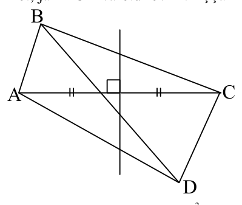{ width=200px }

# <lo-sample/> LV.SOL.2009.10.3

Pierādīt, ka skaitļi $2n^3+4n$ un $n^3+5n$ dalās ar $3$ pie vienām un tām pašām $n$ vērtībām.

<small>
   
* questionType:
* domain:
   
</small>

## Atrisinājums

Abu izteiksmju starpība $(2n^3+4n)-(n^3+5n)=n^3-n=(n-1)n(n+1)$ dalās ar $3$ kā triju pēc kārtas ņemtu veselu skaitļu reizinājums.

# <lo-sample/> LV.SOL.2009.10.4

Visa plakne sadalīta vienādos kvadrātiņos kā rūtiņu lapa. Divi spēlētāji pamīšus krāso pa vienam vēl nenokrāsotam kvadrātiņam: viens – zaļā krāsā, otrs – sarkanā krāsā. Uzvar tas, kurš pirmais nokrāso savā krāsā kādu no $4$ rūtiņām sastāvošu kvadrātu. Vai pirmais spēlētājs var garantēt sev uzvaru?

<small>
   
* questionType:
* domain:
   
</small>

## Atrisinājums

**Atbilde:** nē, nevar.

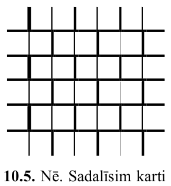{ width=150px }

Otrais spēlētājs var domās sadalīt rūtiņas „ķieģeļu sienas” formā (skat. zīm.) un uz katru pirmā spēlētāja gājienu atbildēt ar gājienu tai pašā „ķieģelī”. Tā kā katrs četru rūtiņu kvadrāts vienu „ķieģeli” satur pilnībā, tad tas saturēs arī vismaz vienu otrā spēlētāja nokrāsoto rūtiņu.

# <lo-sample/> LV.SOL.2009.10.5

Vai kubiskā kastē ar izmēriem $6 \cdot 6 \cdot 6$ var ievietot $53$ klucīšus ar izmēriem $1 \cdot 1 \cdot 4$ tā, lai klucīšu šķautnes būtu paralēlas kastes šķautnēm un kasti varētu aizvērt?

<small>
   
* questionType:
* domain:
   
</small>

## Atrisinājums

Nē. Sadalīsim kasti $27$ kubos ar izmēriem $2\times 2\times 2$ un izkrāsosim šos kubus „šaha galdiņa kārtībā”. Varam uzskatīt, ka ir $13$ melni kubi, tātad $13\cdot 8=104$ melni kubiņi. Bet katrs klucītis satur $2$ melnus kubiņus, tātad kopā jābūt vismaz $53\cdot 2=106$ melniem kubiņiem.

# <lo-sample/> LV.SOL.2009.11.1

Dots, ka $a$ un $b$ – pozitīvi skaitļi. Pierādīt, ka $3a^8+5b^8 \ge 8a^3b^5$.

<small>
   
* questionType:
* domain:
   
</small>

## Atrisinājums

Saskaņā ar nevienādību starp vidējo aritmētisko un vidējo ģeometrisko

$$
3a^8+5b^8=a^8+a^8+a^8+b^8+b^8+b^8+b^8+b^8\ge
$$

$$
\ge 8\cdot \sqrt[8]{(a^8)^3\cdot (b^8)^5}=8a^3b^5.
$$

# <lo-sample/> LV.SOL.2009.11.2

Trijstūra $ABC$ virsotnes leņķa $A$ bisektrise krusto apvilkto riņķa līniju punktā $M$. Ar $I$ apzīmējam $\triangle ABC$ ievilktās riņķa līnijas centru. Pierādīt, ka $MB=MC=MI$.

<small>
   
* questionType:
* domain:
   
</small>

## Atrisinājums

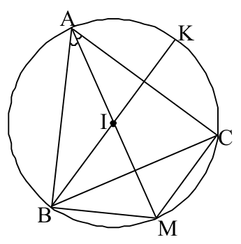{ width=150px }

Tā kā $\angle BAM=\angle CAM$, tad $\overset{\frown}{BM}=\overset{\frown}{CM}$. Vienādiem lokiem atbilst vienādas hordas, tāpēc $MB=MC$. Novelkam $\angle B$ bisektrisi. Lai pierādītu, ka $MB=MI$, pierādīsim, ka $\angle IBM=\angle BIM$. Tā ir, jo

**a)** $\angle IBM=\dfrac{1}{2}\left(\overset{\frown}{KC}+\overset{\frown}{CM}\right),$

b) $\angle BIM=\frac{1}{2}\left(\overset{\frown}{AK}+\overset{\frown}{BM}\right)$,

c) $\overset{\frown}{KC}=\overset{\frown}{AK}$ un $\overset{\frown}{CM}=\overset{\frown}{BM}$.

# <lo-sample/> LV.SOL.2009.11.3

Dots, ka $a$, $b$ un $c$ ir naturāli skaitļi, bet reizinājumi $ab$, $bc$ un $ca$ ir naturālu skaitļu kubi. Pierādīt, ka arī paši skaitļi $a$, $b$ un $c$ ir naturālu skaitļu kubi.

<small>
   
* questionType:
* domain:
   
</small>

## Atrisinājums

Apzīmēsim $ab=\alpha^3$, $bc=\beta^3$, $ca=\gamma^3$, kur $\alpha,\beta,\gamma$ - naturāli skaitļi. Tad

$$
a^2=\frac{(ab)\cdot(ac)}{bc}=\frac{\alpha^3\cdot\gamma^3}{\beta^3}=\left(\frac{\alpha\cdot\gamma}{\beta}\right)^3
$$

ir racionāla skaitļa kubs. Tā kā $a^2$ pats ir naturāls skaitlis, tad $k=\frac{\alpha\cdot\gamma}{\beta}$ ir naturāls skaitlis (ja $k$ būtu nesaīsināma daļa ar saucēju $>1$, tad arī $k^3$ būtu nesaīsināma daļa ar saucēju $>1$). Tātad $a^2=k^3$, $k\in N$. Tātad $a^2$ katru savu pirmreizinātāju satur ar kāpinātāju, kas dalās ar $3$. Šis kāpinātājs ir $2$ reizes lielāks par kāpinātāju, ar kuru attiecīgo pirmreizinātāju satur $a$. Tātad attiecīgais kāpinātājs skaitlī $a$ dalās ar $3$. No tā seko vajadzīgais par $a$. Apgalvojumu skaitļiem $b$ un $c$ pierāda līdzīgi.

# <lo-sample/> LV.SOL.2009.11.4

Kvadrāts sastāv no $3 \cdot 3$ rūtiņām. Sākumā visās rūtiņās ierakstīti vieninieki. Ar vienu gājienu drīkst izvēlēties divas rūtiņas ar kopēju malu un abiem tajās ierakstītajiem skaitļiem pieskaitīt pa vieniniekam vai arī no tiem abiem atņemt pa vieniniekam. Pēc kāda laika skaitļi visās rūtiņās bija vienādi. Pierādīt, ka šajā brīdī bija izdarīts pāra skaits gājienu.

<small>
   
* questionType:
* domain:
   
</small>

## Atrisinājums

Dabīgā veidā ieviešam jēdzienus „horizontāls gājiens” ($hg$) un „vertikāls gājiens” ($vg$). Katrs $vg$ pirmās un trešās kolonnas summu maina par $0$ vai par $2$, katrs $hg$ – par $1$. Procesa beigās šī summa mainījusies par pāra skaitli (no pāra skaitļa uz pāra skaitli). Tāpēc izdarīts pāra skaits $hg$. Līdzīgi pierāda, ka izdarīts pāra skaits $vg$.

# <lo-sample/> LV.SOL.2009.11.5

Katrā kuba skaldnē novilkta viena diagonāle. Ja divām novilktajām diagonālēm ir kopīgs galapunkts, teiksim, ka šīs divas diagonāles draudzējas. Kāds ir mazākais iespējamais draudzību skaits?

<small>
   
* questionType:
* domain:
   
</small>

## Atrisinājums

**Atbilde:** $4$.

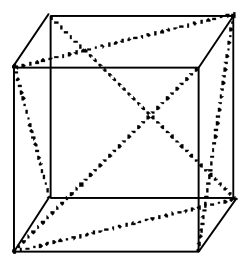{ width=100px }

Piemēru ar $4$ draudzībām skat. zīm.

Pieņemsim, ka draudzību skaits $\leq 3$. Ja ir virsotne, no kuras iziet $3$ diagonāles, tad tajā ir $3$ draudzības; tāpēc no pārējām virsotnēm iziet $\leq 1$ diagonāle no katras. Tad novilkto diagonāļu galapunktu skaits ir $\leq 7\cdot1+1\cdot3=10$ - pretruna. Ja virsotnes, no kuras iziet $3$ diagonāles, nav, tad ir $\leq 3$ virsotnes ar $2$ diagonālēm katrā. Galapunktu skaits nepārsniedz $3\cdot2+5\cdot1=11$ - pretruna.

# <lo-sample/> LV.SOL.2009.12.1

Atrisināt pozitīvos skaitļos vienādojumu sistēmu

$$
\begin{cases}
x^{x+y}=y^{x-y}\\
x^2y=1
\end{cases}
$$

<small>
   
* questionType:
* domain:
   
</small>

## Atrisinājums

Ievietojot $y=x^{-2}$ pirmajā vienādojumā, iegūstam $x^{x+x^{-2}}=x^{-2(x-x^{-2})}$.

Pastāv $2$ iespējas:

a) $x=1$; tad no $2.$ vienādojuma $y=1$. Pārbaude $1.$ vienādojumā rāda, ka šis atrisinājums der.

b) $x\ne1$. Tad

$$
x+x^{-2}=-2\left(x-x^{-2}\right)\Rightarrow 3x=x^{-2}\Rightarrow 3x^3=1.
$$

Tātad $x=\frac{1}{\sqrt[3]{3}}$ un no $2.$ vienādojuma $y=\sqrt[3]{9}$. Pārbaude $1.$ vienādojumā rāda, ka šis atrisinājums der.

# <lo-sample/> LV.SOL.2009.12.2

Šaurleņķu trijstūrī $ABC$ novilkts augstums $BD$. Uz malām $AB$ un $CB$ attiecīgi ņemti tādi punkti $M$ un $N$, ka $HM \perp AB$ un $HN \perp CB$. Pierādīt, ka punkti $A$; $M$; $N$; $C$ atrodas uz vienas riņķa līnijas.

<small>
   
* questionType:
* domain:
   
</small>

## Atrisinājums

Tā kā $\angle BMD+\angle BND=180^{\circ}$, ap $MBND$ var apvilkt riņķa līniju. Tāpēc $\angle BMN=\angle BDN$. Tātad

$$
\angle AMN+\angle ACN=(180^{\circ}-\angle BMN)+(90^{\circ}-\angle NDC)=180^{\circ}-\angle BMN+\angle BDN=180^{\circ},
$$

no kā seko vajadzīgais.

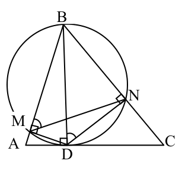{ width=150px }

# <lo-sample/> LV.SOL.2009.12.3

Dots, ka $n$ ir naturāls skaitlis un skaitļa $A=n^2+2008n$ pēdējais cipars ir $4$. Atrast skaitļa $A$ priekšpēdējo ciparu.

<small>
   
* questionType:
* domain:
   
</small>

## Atrisinājums

Skaitļa $A=n^2+2008n$ vietā varam apskatīt $B=n^2+8n=(n+4)^2-16$. Tā kā $B$ beidzas ar $4$, tad $(n+4)^2$ beidzas ar $0$; tāpēc $(n+4)^2$ beidzas ar $00$ un $B$ beidzas ar $84$. Tātad $A$ priekšpēdējais cipars ir $8$.

# <lo-sample/> LV.SOL.2009.12.4

Plakne sadalīta vienādos kvadrātiņos kā rūtiņu lapa. Tajā novietoti bezgalīgi daudzi taisnstūri tā, ka katrs taisnstūris pārklāj tieši divus kvadrātiņus. Nekādi divi taisnstūri ne pārklājas, ne saskaras. Vai atlikušo plaknes daļu noteikti var pārklāt ar tādiem pašiem taisnstūriem tā, lai nekādi divi taisnstūri nepārklātos, bet **visas** rūtiņas būtu pārklātas?

<small>
   
* questionType:
* domain:
   
</small>

## Atrisinājums

Jā, var. Sauksim jau novietotos taisnstūrus par melniem. Sadalām plakni $2 \times 2$ rūtiņu lielos kvadrātos. Tad sākumā katrs kvadrāts satur $0$, $1$ vai $2$ melnas rūtiņas.

- Ja kvadrātā nav melnu rūtiņu, tajā ievieto $2$ taisnstūrus.
- Ja kvadrātā ir $2$ melnas rūtiņas, tad tās atrodas blakus; kvadrātā var ievietot vēl $1$ taisnstūri.
- Ja kvadrātā jau ir tieši $1$ melna rūtiņa, apskatām šo kvadrātu un to blakus esošo, kurā ir atbilstošā taisnstūra otrā melnā rūtiņa; tad tā arī ir vienīgā šajā otrajā kvadrātā. Balto daļu šajos abos kvadrātos pārklājam, kā parādīts zīmējumā.

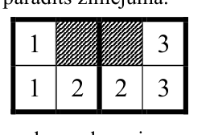{ width=100px }

# <lo-sample/> LV.SOL.2009.12.5

Klasē ir $z$ zēni un $m$ meitenes. Katriem diviem zēniem var atrast meiteni, kas vienam no viņiem patīk, bet otram nepatīk. Pierādīt, ka $2^m \ge z$.

<small>
   
* questionType:
* domain:
   
</small>

## Atrisinājums

Katram zēnam piekārtosim to meiteņu kopu, kas viņam patīk. Tad visas šīs kopas ir dažādas. Tātad meiteņu kopas apakškopu nevar būt mazāk nekā zēnu. Kopai ar $m$ elementiem ir $2^m$ apakškopu. Tāpēc $2^m \ge z$, k.b.j.
