# <lo-sample/> LV.SOL.2010.5.1

Sagriezt katru no $1.$zīm. attēlotajām figūrām divās daļās, kas ir vienādas gan pēc formas, gan pēc izmēriem. Griezumiem nav noteikti jāiet pa rūtiņu līnijām. Pietiek parādīt vienu veidu katrai figūrai.

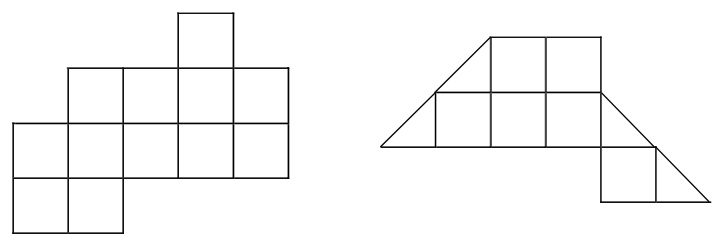{ width=350px }

$1.$zīm.

<small>
   
* questionType:
* domain:
   
</small>

## Atrisinājums

Skat., piem., 1. zīm.

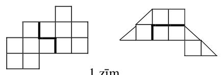{ width=200px }

1.zīm.

# <lo-sample/> LV.SOL.2010.5.2

Kvadrāts sastāv no $3\cdot 3$ rūtiņām. Vai var katrā rūtiņā ierakstīt veselu skaitli no $1$ līdz $9$ (tiem visiem jābūt dažādiem) tā, lai katrās divās rūtiņās ar kopīgu malu ierakstīto skaitļu starpība būtu vismaz $3$?

<small>
   
* questionType:
* domain:
   
</small>

## Atrisinājums

Skat., piem., 2.zīm.

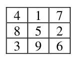{ width=100px }

2.zīm.

# <lo-sample/> LV.SOL.2010.5.3

Pa apli izrakstīti naturāli skaitļi no $11$ līdz $20$, katrs tieši vienu reizi. Katriem diviem blakus uzrakstītiem skaitļiem aprēķināja to reizinājumu. Cik no šiem reizinājumiem var dalīties ar $3$?

<small>
   
* questionType:
* domain:
   
</small>

## Atrisinājums

No uzrakstītajiem skaitļiem tieši $3$ ($12$; $15$; $18$) dalās ar $3$. Pastāv trīs iespējas:  
a) nekādi divi no tiem nav blakus; meklējamo reizinājumu ir $6$;  
b) divi no tiem ir blakus, viens – „citur”; meklējamo reizinājumu ir $5$;  
c) visi tie ir pēc kārtas; meklējamo reizinājumu ir $4$.

# <lo-sample/> LV.SOL.2010.5.4

Kvadrāts sastāv no $7\cdot 7$ rūtiņām. No tām $11$ rūtiņas nokrāsotas. Pierādīt: kvadrātā var atrast tādu taisnstūri, kas sastāv no $3\cdot 4$ rūtiņām un kurā nokrāsotas ne vairāk kā $2$ rūtiņas. Vai uzdevuma apgalvojums paliek spēkā, ja kvadrātā nokrāsotas $12$ rūtiņas?

<small>
   
* questionType:
* domain:
   
</small>

## Atrisinājums

Skat. 3.zīm.; četros taisnstūros kopā ir ne vairāk kā $11$ rūtiņas, un $4\cdot 3=12>11$.

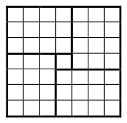{ width=100px }

3.zīm.

Otrajā gadījumā apgalvojums var nebūt spēkā; skat. 4.zīm.

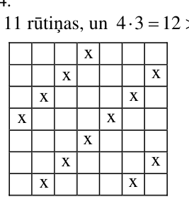{ width=100px }

4.zīm.

# <lo-sample/> LV.SOL.2010.5.5

Tabulā ierakstīti skaitļi, kā parādīts $2.$zīm. ar vienu gājienu var mainīt vietām vai nu divas rūtiņas vai divas kolonnas. Vai, vairākkārt izpildot šādus gājienus, var iegūt tādu tabulu, kāda redzama $3.$zīm.?

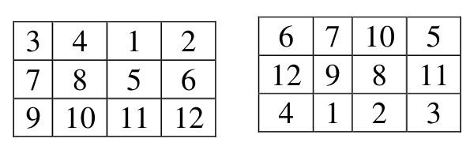{ width=250px }

$2.$zīm.

$3.$zīm.

<small>
   
* questionType:
* domain:
   
</small>

## Atrisinājums

Nē. Skaitļi $7$ un $8$, kas sākotnēji ir vienā rindā, nevar nonākt dažādās rindās.

# <lo-sample/> LV.SOL.2010.6.1

Vai $4.$ zīm. parādīto figūru var sagriezt divās daļās, no kurām var salikt kvadrātu? Griezumiem nav noteikti jāiet pa rūtiņu līnijām. Daļas saliekot nedrīkst pārklāties.

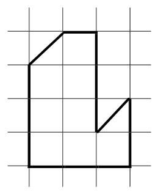{ width=100px }

$4.$zīm.

<small>
   
* questionType:
* domain:
   
</small>

## Atrisinājums

Jā, skat., piem., 5.zīm.

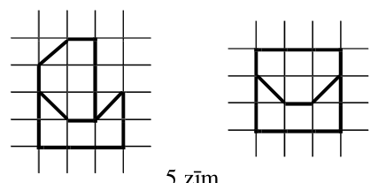{ width=200px }

5.zīm.

# <lo-sample/> LV.SOL.2010.6.2

Cik ir tādu desmitciparu naturālu skaitļu, kas dalās ar $9$ un kuru pierakstā nav citu ciparu kā vien varbūt $0$ un $7$?

<small>
   
* questionType:
* domain:
   
</small>

## Atrisinājums

Ja skaitlī ir $n$ ciparu „$7$”, tad tā ciparu summa ir $7n$. Lai tā dalītos ar $9$, skaitlim $n$ jādalās ar $9$. Tātad mūsu skaitlī ir deviņi septītnieki un viena nulle. Nulle var būt jebkurā pozīcijā, izņemot pirmo. Tātad pavisam ir $9$ tādi skaitļi.

# <lo-sample/> LV.SOL.2010.6.3

Vai var kvadrātā, kas sastāv no $3 \times 3$ rūtiņām, katrā rūtiņā ierakstīt veselu skaitli no $1$ līdz $9$ (tiem visiem jābūt dažādiem) tā, lai katrās divās rūtiņās ar kopīgu malu ierakstīto skaitļu starpība būtu vismaz $4$?

<small>
   
* questionType:
* domain:
   
</small>

## Atrisinājums

Nē, nevar. Ja to varētu izdarīt, tad $5$ varētu būt blakus tikai ar $1$ un ar $9$, $4$ – tikai ar $8$ un $9$, $6$ – tikai ar $1$ un $2$. Tāpēc izvietojumam būtu jābūt tādam, kā redzams 6.zīm. Bet tad $3$ jābūt blakus ar $2$ – pretruna.

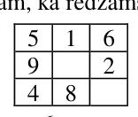{ width=100px }

6.zīm.

# <lo-sample/> LV.SOL.2010.6.4

Vai kāds naturāls skaitlis, kuram katrs nākošais cipars (izņemot pirmo) ir mazāks par iepriekšējo, dalās ar $111$?

<small>
   
* questionType:
* domain:
   
</small>

## Atrisinājums

Nē. Ja tāds būtu, apskatām mazāko no tiem $x$. Ir divas iespējas:

a) $x$ dalās ar $10$. Tad, nosvītrojot $0$ skaitļa $x$ galā, iegūstam skaitli $\frac{x}{10}$ ar tādu pašu īpašību; pretruna, jo $x$ nav mazākais;  
b) $x$ nedalās ar $10$. Tad skaitlis $(x-111)$ ir ar tādu pašu īpašību – pretruna, jo $x$ nav mazākais.

Iespējami daudzi citi atrisinājumi, analizējot dalīšanas procesu.

# <lo-sample/> LV.SOL.2010.6.5

Kvadrāts sastāv no $8 \times 8$ rūtiņām. Sprīdītis sāk ceļu vienā no tām. Viņam atļauti divu veidu gājieni: „taisni” (no rūtiņas uz citu rūtiņu, kurai ar pašreizējo ir kopīga mala) un „slīpi” (no rūtiņas uz citu rūtiņu, kurai ar pašreizējo ir kopīgs stūris, bet ne kopīga mala). „Taisnos” un „slīpos” gājienus jāizdara pamīšus; ar $64$-o gājienu Sprīdītim jāatgriežas sākotnējā rūtiņā un jābūt apmeklējušam visas rūtiņas. Vai Sprīdītis to var izdarīt?

<small>
   
* questionType:
* domain:
   
</small>

## Atrisinājums

Skat., piem., 7.zīm.

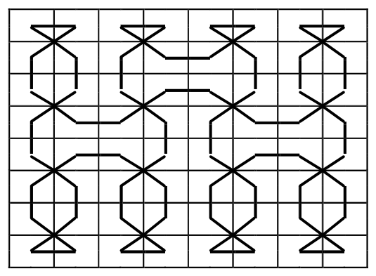{ width=250px }

7.zīm.

# <lo-sample/> LV.SOL.2010.8.1

Ar $\max(s;t)$ saprotam lielāko no skaitļiem $s$ un $t$. Piemēram, $\max(3;5)=5$; $\max(4;4)=4$.

Dots, ka $a$, $b$, $c$, $d$ – konstantes un funkcija $y=\max(ax+b;cx+d)$ ir lineāra funkcija (ar argumentu $x$). Pierādīt, ka $a=c$.

<small>
   
* questionType:
* domain:
   
</small>

## Atrisinājums

Ja $a=c$, tad funkciju $a\cdot x+b$ un $c\cdot x+d$ grafiki ir paralēlas taisnes, un $y=a\cdot x+b$ vai $y=c\cdot x+d$ visiem $x$; tātad $y$ ir lineāra funkcija. Ja $a\neq c$, minētie grafiki krustojas; tātad $y$ grafiks ir lauzta līnija, un tātad $y$ nav lineāra funkcija.

# <lo-sample/> LV.SOL.2010.8.2

Ir zināms, ka no apgalvojumiem „$x^3$ dalās ar $2$”; „$x^3$ dalās ar $4$”, „$x^3$ dalās ar $8$”, „$x^3$ dalās ar $16$” vismaz viens ir patiess un vismaz viens ir aplams ($x$ ir naturāls skaitlis). Kuri apgalvojumi ir patiesi, kuri – aplami?

<small>
   
* questionType:
* domain:
   
</small>

## Atrisinājums

No visiem apgalvojumiem seko, ka $x$ ir pāra skaitlis, tātad tā arī ir. No tā savukārt seko, ka $x^3$ dalās ar $2$, ar $4$ un ar $8$. Tāpēc **vienīgais** aplamais apgalvojums var būt „$x^3$ dalās ar $16$”. Tā var gadīties, piem., ja $x=2$.

# <lo-sample/> LV.SOL.2010.8.3

Trijstūra $ABC$ iekšpusē atrodas tāds punkts $O$, ka $AO=BO=CO$. Pierādīt, ka $\angle AOB=2\cdot \angle ACB$.

<small>
   
* questionType:
* domain:
   
</small>

## Atrisinājums

$\angle AOC=180^{\circ}-2\cdot x;$  
$\angle BOC=180^{\circ}-2\cdot y.$  
Tāpēc

$\angle AOB=360^{\circ}-\angle AOC-\angle BOC=2x+2y=2(x+y)=2\angle ACB$, k.b.j.

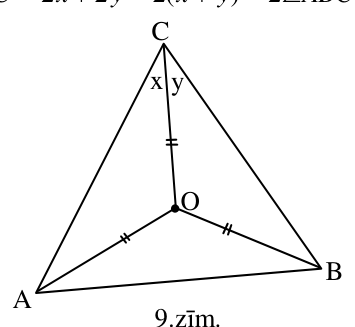{ width=150px }

9.zīm.

# <lo-sample/> LV.SOL.2010.8.4

Dotas $2010$ pēc ārējā izskata vienādas monētas; to masas visas ir atšķirīgas. Doti arī sviras svari bez atsvariem. Uz katra kausa uzliekot pa vienai monētai, smagākā no tām nosveras uz leju.

**a)** Pierādīt, ka gan smagāko monētu vienu pašu, gan vieglāko monētu vienu pašu var atrast, izdarot $2009$ svēršanas.

**b)** Vai **abas** šīs monētas – gan smagāko, gan vieglāko – var atrast, izdarot mazāk nekā $4000$ svēršanas?

<small>
   
* questionType:
* domain:
   
</small>

## Atrisinājums

a) Salīdzinām divas monētas; vieglāko atliekam malā, bet palikušo salīdzinām ar nākošo, utt. Kad malā atliktas $2009$ monētas (t.i. pēc $2009$ svēršanām), vienīgā palikusi ir smagākā no visām. Līdzīgi atrodam vieglāko monētu no visām.  
b) Sadalām $2010$ monētas $1005$ pāros. Katra pāra monētas salīdzinām savā starpā. Pēc tam līdzīgi kā a) punktā ar $1004$ svēršanām atrodam „smagāko no smagajām” un ar $1004$ svēršanām – „vieglāko no vieglajām”. Tās arī ir meklētās. Patērētas $1005+1004+1004=3013<4000$ svēršanas.  
**Piezīme:** var pierādīt, ka ar mazāku svēršanu skaitu uzdevumā prasīto garantēti izdarīt nevar.

# <lo-sample/> LV.SOL.2010.8.5

Dots, ka $0<x<1$, $0<y<1$, $0<z<1$, $0<t<1$. Pierādīt, ka vismaz viens no skaitļiem $x(1-y)$, $y(1-z)$, $z(1-t)$, $t(1-x)$ nepārsniedz $\frac{1}{4}$.

<small>
   
* questionType:
* domain:
   
</small>

## Atrisinājums

Pieņemsim pretējo. Tad $x(1-y)>\frac{1}{4}$, $y(1-z)>\frac{1}{4}$, $z(1-t)>\frac{1}{4}$, $t(1-x)>\frac{1}{4}$. Sareizinot šīs nevienādības, iegūstam $[x(1-x)][y(1-y)][z(1-z)][t(1-t)]>\left(\frac{1}{4}\right)^4$.

Bet $0<x(1-x)=\frac{1}{4}-\left(\frac{1}{2}-x\right)^2\le\frac{1}{4}$ u.tml.; iegūstam pretrunu.

# <lo-sample/> LV.SOL.2010.9.1

Dots, ka $x$ un $y$ – reāli skaitļi. Pierādīt, ka

$$x^2 + y^2 + 1 \ge 2(xy - x + y).$$

<small>
   
* questionType:
* domain:
   
</small>

## Atrisinājums

Nevienādību var identiski pārveidot par $(x-y+1)^2\ge0$.

# <lo-sample/> LV.SOL.2010.9.2

Dots, ka $x<y<z<t<v$. Andris aprēķināja šo piecu skaitļu summas pa diviem. Trīs mazākās summas iznāca $32$; $36$; $37$, bet divas lielākās iznāca $48$ un $51$.

Kādas ir iespējamās $x$; $y$; $z$; $t$; $v$ vērtības?

<small>
   
* questionType:
* domain:
   
</small>

## Atrisinājums

Acīmredzot $x+y=32$; $x+z=36$; $z+v=48$; $t+v=51$. Iegūstam $z-y=4$; $t-z=3$; no šīm abām sakarībām $t-y=7$. Tāpēc $x+t=(x+y)+(t-y)=39$. Tāpēc $37=y+z$. Tātad $2x=(x+y)+(x+z)-(y+z)=32+36-37=31$. No šejienes $x=15\frac{1}{2}$; $y=16\frac{1}{2}$; $z=20\frac{1}{2}$; $v=27\frac{1}{2}$; $t=23\frac{1}{2}$. Pārbaude (**nepieciešama!**) parāda, ka uzdevuma nosacījumi ir apmierināti. Tāpēc vienīgās iespējamās vērtības ir atrastas.

# <lo-sample/> LV.SOL.2010.9.3

Kvadrāta $ABCD$ centrs ir $O$. Ārpus kvadrāta konstruēti divi vienādi vienādsānu trijstūri $BCJ$ un $CDK$ ($BJ=CJ$ un $CK=DK$). Ar $M$ apzīmējam $CJ$ viduspunktu.

Pierādīt, ka $OM \perp BK$.

<small>
   
* questionType:
* domain:
   
</small>

## Atrisinājums

Tā kā $AB=BC$, $BJ=CK$ un $\angle ABJ=90^{\circ}+\angle CBJ=90^{\circ}+\angle DCK=\angle BCK$, tad $\triangle ABJ=\triangle BCK$. Tāpēc $AJ\perp BK$. Bet $OM\parallel AJ$ kā viduslīnija trijstūrī $ACJ$. Tāpēc arī $OM\perp BK$.

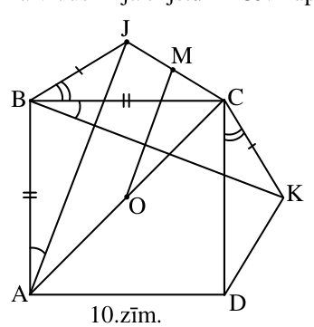{ width=150px }

10.zīm.

# <lo-sample/> LV.SOL.2010.9.4

Uz galda atrodas $7$ kartītes; uz tām uzrakstīti cipari $0$; $1$; $2$; $3$; $4$; $5$; $6$ (uz katras kartītes cits cipars). Divi spēlētāji pēc kārtas ņem pa vienai kartītei. Tas, kurš pirmais var no savām kartītēm izveidot veselu pozitīvu skaitli, kas dalās ar $17$, uzvar. Kurš uzvar pareizi spēlējot – tas, kas izdara pirmo, vai tas, kas izdara otro gājienu, vai arī spēle beidzas neizšķirti?

<small>
   
* questionType:
* domain:
   
</small>

## Atrisinājums

Uzvar pirmais „p”. Viņš ņem $3$; otrajam „o” jāņem $4$. Tagad jau skaidrs, ka „o” ar otro gājienu neuzvarēs. Tālāk „p” ņem $1$; „o” jāņem $5$. Tagad „p” ņem $6$ un uzvar, jo $136$ dalās ar $17$.

# <lo-sample/> LV.SOL.2010.9.5

Kuri naturālie skaitļi $x$ apmierina vienlaicīgi visas sekojošās prasības:

- $x \le 2009$,
- $x$ dalās ar $5$,
- $x+1$ dalās ar $7$,
- $x+2$ dalās ar $9$,
- $x+3$ dalās ar $11$?

<small>
   
* questionType:
* domain:
   
</small>

## Atrisinājums

No uzdevumā dotajām pēdējām $4$ prasībām seko, ka $2\cdot x-5$ dalās ar $5$; ar $7$; ar $9$; ar $11$ (piemēram, $2\cdot x-5=2\cdot (x+1)-7$ dalās ar $7$ u.tml.). Tā kā $5$; $7$; $9$; $11$ pa pāriem ir savstarpēji pirmskaitļi, tad $2\cdot x-5$ dalās ar $5\cdot 7\cdot 9\cdot 11=3465$. Tā kā $1\le x\le 2009$, tad $-3\le 2\cdot x-5\le 4013$. Šajās robežās ar $3465$ dalās tikai $0$ un $3465$. Bet $2\cdot x-5=0$ naturālam $x$ nav iespējams, tāpēc $2\cdot x-5=3465$ un $\mathbf{x=1735}$.

# <lo-sample/> LV.SOL.2010.10.1

Vai eksistē naturāls skaitlis $n$, kura visus naturālos dalītājus (ieskaitot $1$ un $n$) var sadalīt $4$ grupās tā, lai dalītāju reizinājumi visās grupās būtu vienādi savā starpā? Bet ja dalītājus būtu jādala $13$ grupās?

<small>
   
* questionType:
* domain:
   
</small>

## Atrisinājums

Ja naturālam skaitlim ir $2\cdot n$ dalītāji (tāds ir, piemēram, jebkurš skaitlis $p^{2n-1}$, $p$ – pirmskaitlis) $d_1<d_2<\ldots<d_{2n}$, tad $d_1\cdot d_{2n}=d_2\cdot d_{2n-1}=\ldots=d_n\cdot d_{n+1}$. Tātad var izveidot $n$ prasītā tipa grupas.

# <lo-sample/> LV.SOL.2010.10.2

Četrstūrī $ABCD$ var ievilkt riņķa līniju ar centru $O$. Taisne $t$, kas iet caur $O$, dala $ABCD$ perimetru uz pusēm. Pierādīt, ka tā dala uz pusēm arī $ABCD$ laukumu.

<small>
   
* questionType:
* domain:
   
</small>

## Atrisinājums

Pierādāmās nevienādības $\frac{1}{2}\cdot AM\cdot R+\frac{1}{2}\cdot AD\cdot R+\frac{1}{2}\cdot DN\cdot R=\frac{1}{2}\cdot MB\cdot R+\frac{1}{2}\cdot BC\cdot R+\frac{1}{2}\cdot CN\cdot R$ abas puses dala ar $\frac{1}{2}\cdot R$ ($R$ – rādiuss).

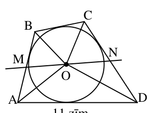{ width=150px }

11.zīm.

# <lo-sample/> LV.SOL.2010.10.3

Dots, ka $x$ un $y$ – pozitīvi skaitļi. Pierādīt, ka

$$
xy^{2}+x+y+x^{2}y \ge 4xy.
$$

<small>
   
* questionType:
* domain:
   
</small>

## Atrisinājums

Nevienādību pārveido par $x(y-1)^2+y(x-1)^2\ge 0$.

# <lo-sample/> LV.SOL.2010.10.4

Ir $100$ pēc ārējā izskata vienādas monētas. Dažas (vismaz viena) ir īstas un dažas (vismaz viena) ir viltotas. Visām īstajām monētām ir vienādas masas; arī visām viltotajām monētām ir vienādas masas. Viltotās monētas ir vieglākas par īstajām. Kā, izmantojot sviras svarus bez atsvariem, ar $51$ svēršanām noskaidrot, cik ir viltoto monētu?

<small>
   
* questionType:
* domain:
   
</small>

## Atrisinājums

Salīdzinām divas monētas $A$ un $B$. Pastāv divas iespējas.

1. $A$ un $B$ ir dažādas masas. Tad viena no tām ir viltota, otra – īsta. Sadalām atlikušās $98$ monētas $49$ pāros un katru no tiem salīdzinām ar pāri $(A,B)$. Katrā svēršanā mēs noskaidrosim, cik viltoto monētu ir konkrētajā pārī. Pavisam tiks izmantotas $1+49=50$ svēršanas.
2. $A$ un $B$ ir vienādas masas. Kā iepriekš salīdzinām pāri $(A,B)$ ar citiem monētu pāriem, kamēr atrodam pāri $(C,D)$, kura masa atšķiras no $(A,B)$ masas. Pieņemsim, ka $(C,D)$ kopējā masa ir mazāka nekā $(A,B)$ kopējā masa (otrs gadījums ir „simetrisks”). Tad $A$ un $B$, kā arī visas citas līdz šim svērtās monētas ir īstas. Salīdzinām $C$ un $D$. Rezultātā mēs atrodam vismaz vienu monētu no pāra $(C,D)$, kura ir viltota. Tagad izveidojam pāri (īsta monēta, viltota monēta) un turpinām kā $1.$ gadījumā. Pavisam tiks izmantotas $1+49+1=51$ svēršanas.

# <lo-sample/> LV.SOL.2010.10.5

Kvadrāts sastāv no $n \times n$ vienādām kvadrātiskām rūtiņām. Ir zināms, ka to var sagriezt tādos gabalos, kādi parādīti $5.$zīm., pie tam abu veidu gabali ir vienādā skaitā. Atrast mazāko iespējamo $n$ vērtību.

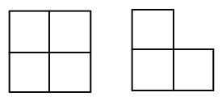{ width=150px }

$5.$ zīm.

<small>
   
* questionType:
* domain:
   
</small>

## Atrisinājums

Ja katra veida figūru ir $k$, tad kopējais rūtiņu skaits tajās ir $4k+3k=7k$; tātad $n^2=7k$ un $n$ jādalās ar $7$. Mazākās iespējamās $n$ vērtības ir $n=7$ un $n=14$.

**A.** Pie $n=7$ uzdevuma prasības nav izpildāmas. Pieņemsim, ka tas izdevies, un izkrāsosim rūtiņas, kā parādīts $12.$ zīm. Katrs no $7$ kvadrātiem satur $2$ melnas rūtiņas, tāpēc $7$ „stūrīši” kopā satur $28-14=14$ melnas rūtiņas. Tāpēc katrs „stūrītis” satur tieši $2$ melnas un $1$ baltu rūtiņu (jo katrs stūrītis noteikti satur ne vairāk kā $2$ melnas rūtiņas). Bet melnās rūtiņas nevar sadalīties pa pāriem, kas ietilpst kvadrātos un stūrīšos, jo katrā rindiņā, kurā tās vispār ir, tās ir nepāra skaitā.

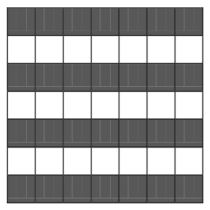{ width=150px }

12. zīm.

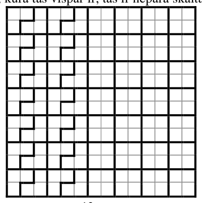{ width=200px }

13. zīm.

**B.** Risinājumu pie $n=14$ skat. $13.$ zīm.

# <lo-sample/> LV.SOL.2010.11.1

Atrisināt naturālos skaitļos vienādojumu

$$x^2+15x=2^y$$

<small>
   
* questionType:
* domain:
   
</small>

## Atrisinājums

No vienādības $x(x+15)=2^y$ seko, ka katrs no skaitļiem $x$ un $x+15$ vai nu vieninieks, vai divnieka pakāpe ar naturālu kāpinātāju. Virkne $1; 2; 4; 8; 16; 32; \ldots$ vienīgie skaitļi, kuru starpība ir $15$, ir $1$ un $16$ (nepieciešams pamatojums!). Tāpēc $x=1$ un $y=4$.

# <lo-sample/> LV.SOL.2010.11.2

Dots, ka $x$ un $y$ – pozitīvi skaitļi un pastāv sakarības $x+y\ge 4$ un $y-x\ge -2$.

Atrast izteiksmes $\dfrac{y}{x}$ mazāko iespējamo vērtību.

<small>
   
* questionType:
* domain:
   
</small>

## Atrisinājums

Uzzīmējam attiecīgo $(x;y)$ punktu apgabalu koordinātu plaknē ($14.$ zīm.).

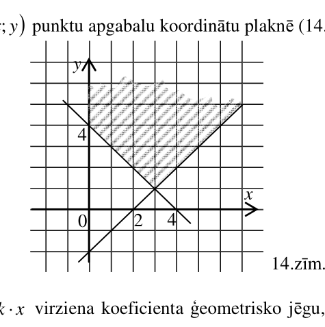{ width=200px }

$14.$ zīm.

Atceroties taisnes $y=k\cdot x$ virziena koeficienta ģeometrisko jēgu, redzam, ka $\frac{y}{x}\geq\frac{1}{3}$ un vērtība $\frac{1}{3}$ tiek sasniegta tad un tikai tad, ja $x=3$ un $y=1$.

# <lo-sample/> LV.SOL.2010.11.3

Četrstūris $ABCD$ ievilkts riņķa līnijā; $BM\parallel AD$ un $AN\parallel BC$. Pierādīt, ka punkti $A; B; M; N$ atrodas uz vienas riņķa līnijas (skat. $6.$zīm.).

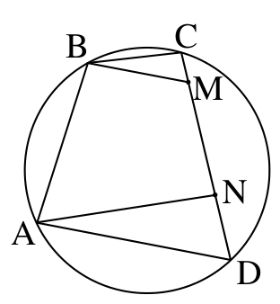{ width=150px }

$6.$zīm.

<small>
   
* questionType:
* domain:
   
</small>

## Atrisinājums

Skaidrs, ka $\angle CBM=\angle NAD$ (leņķi ar savstarpēji paralēlām un vienādi vērstām malām). Tāpēc loki $\overset{\frown}{CK}$ un $\overset{\frown}{LD}$ ir vienādi. Tāpēc $KL\parallel CD$. Prasītais seko no vienādībām $\angle BAN+\angle BMN=\angle BAN+\angle BKL=180^{\circ}$

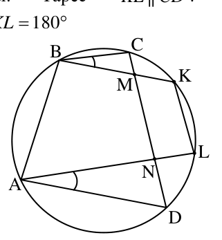{ width=150px }

$15.$ zīm.

# <lo-sample/> LV.SOL.2010.11.4

Kādā klasē ir $n$ zēni un $n$ meitenes. Katrai meitenei patīk $x$ zēni. Katram zēnam patīk $y$ meitenes. Pierādīt, ka:

**a)** ja $x+y>n$, tad noteikti var atrast tādu zēnu un tādu meiteni, kas patīk viens otram,

**b)** ja $x+y\le n$, tad var gadīties, ka šādu zēnu un meiteni atrast neizdodas.

<small>
   
* questionType:
* domain:
   
</small>

## Atrisinājums

a) Pieņemsim, ka tāda pāra nav. Lūgsim katram zēnam uzrakstīt $y$ dažādas kartītes – katru ar savu vārdu un kādu tās meitenes vārdu, kas viņam patīk. Līdzīgu darbu lūgsim izdarīt meitenēm. Tā kā savstarpēju simpātiju nav, tad nav divu kartīšu, uz kurām būtu vienādi uzraksti; tāpēc kartīšu nav vairāk par $n\cdot n=n^2$. No otras puses, kartīšu ir $x\cdot n+y\cdot n=(x+y)\cdot n>n\cdot n=n^2$ – pretruna.

b) Attēlosim meitenes ar punktiem riņķa līnijas iekšpusē, bet zēnus – ar punktiem riņķa līnijas ārpusē (skat. $16.$ zīm., kur $n=9$).

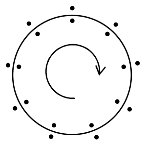{ width=150px }

$16.$ zīm.

Ja katrai meitenei patīk $x$ zēni pulksteņa rādītāja kustības virzienā, sākot ar to, kurš stāv viņai blakus, bet katram zēnam – $y$ meitenes pulksteņa rādītāja kustības virzienā, sākot ar to, kura stāv viņam vienu pozīciju priekšā, tad savstarpēju simpātiju nav.

# <lo-sample/> LV.SOL.2010.11.5

Kvadrāts ar izmēriem $1\cdot 1$ sadalīts dažos izliektos četrstūros. Pierādīt, ka visu četrstūru visu malu kvadrātu summa nav mazāka par $4$.

<small>
   
* questionType:
* domain:
   
</small>

## Atrisinājums

Ja četrstūra pēc kārtas ņemtas malas ir $a; b; c; d$, tad

$$
L=\frac{1}{2}ab\sin\alpha+\frac{1}{2}cd\sin\beta\leq\frac{1}{2}ab+\frac{1}{2}cd\leq\frac{a^2+b^2}{4}+\frac{c^2+d^2}{4}=\frac{a^2+b^2+c^2+d^2}{4}.
$$

Saskaitot šīs nevienādības visiem sadalījumā izveidotajiem četrstūriem, iegūstam vajadzīgo.

# <lo-sample/> LV.SOL.2010.12.1

Kādu mazāko daudzumu rūtiņu jāatzīmē kvadrātā, kas sastāv no $5 \times 5$ rūtiņām, lai katra 7.zīm. attēlotā figūra (tās var būt novietotas arī citādi) saturētu vismaz vienu atzīmētu rūtiņu?

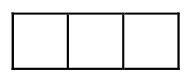{ width=100px }

7. zīm.

<small>
   
* questionType:
* domain:
   
</small>

## Atrisinājums

To, ka pietiek ar $8$, bet ne mazāk rūtiņām, skat $17.$zīm.

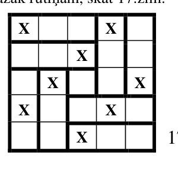{ width=150px }

$17.$zīm.

# <lo-sample/> LV.SOL.2010.12.2

Atrisināt veselos skaitļos vienādojumu

$$
x+y+xy=2010
$$

<small>
   
* questionType:
* domain:
   
</small>

## Atrisinājums

Pārveidojam vienādojumu par

$$
(1+x)(1+y)=2011
$$

Tā kā $2011$ ir pirmskaitlis, tad $1+x$ var būt tikai viens no skaitļiem $1; -1; 2011; -2011$. Iegūstam

$$(x;y)=(0;2010),\ (-2;-2012),\ (2010;0),\ (-2012;-2).$$

# <lo-sample/> LV.SOL.2010.12.3

Dots, ka $\triangle ABC$ ir regulārs; riņķa līnija krusto tā malas, kā parādīts 8.zīm. Pierādīt, ka

$$
AM+BK+CS=AT+CL+BN.
$$

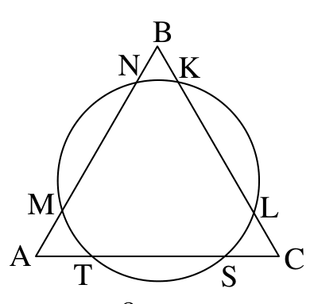{ width=200px }

8.zīm.

<small>
   
* questionType:
* domain:
   
</small>

## Atrisinājums

No teorēmas par sekanšu nogriežņu reizinājumiem iegūstam

$$
\begin{aligned}
AM\cdot(a-BN)&=AT\cdot(a-CS)\\
BK\cdot(a-CL)&=BN\cdot(a-AM)\\
CS\cdot(a-AT)&=CL\cdot(a-BK),
\end{aligned}
$$

kur $a$ – $\triangle ABC$ malas garums.

Saskaitot šīs vienādības, pēc identiskiem pārveidojumiem iegūstam vajadzīgo.

# <lo-sample/> LV.SOL.2010.12.4

Dots, ka $a, b, c > 1$ un $\frac{1}{a}+\frac{1}{b}+\frac{1}{c}=2$.

Pierādīt, ka $\sqrt{a+b+c} \ge \sqrt{a-1}+\sqrt{b-1}+\sqrt{c-1}$.

<small>
   
* questionType:
* domain:
   
</small>

## Atrisinājums

Atceramies Košī – Buņjakovska nevienādību: katriem diviem „vektoriem” $(x_1;x_2;x_3)$ un $(y_1;y_2;y_3)$ ir spēkā

$$
(x_1^2+x_2^2+x_3^2)(y_1^2+y_2^2+y_3^2)\geq(x_1y_1+x_2y_2+x_3y_3)^2.
$$

Pielietosim to „vektoriem” $(\sqrt{a};\sqrt{b};\sqrt{c})$ un $\left(\sqrt{\frac{a-1}{a}};\sqrt{\frac{b-1}{b}};\sqrt{\frac{c-1}{c}}\right)$.

Iegūstam

$$
(a+b+c)\left(\frac{a-1}{a}+\frac{b-1}{b}+\frac{c-1}{c}\right)\geq\left(\sqrt{a-1}+\sqrt{b-1}+\sqrt{c-1}\right)^2.
$$

Tā kā

$$
\frac{a-1}{a}+\frac{b-1}{b}+\frac{c-1}{c}=3-\left(\frac{1}{a}+\frac{1}{b}+\frac{1}{c}\right)=1,
$$

seko vajadzīgais.

# <lo-sample/> LV.SOL.2010.12.5

Izstrādāt paņēmienu, kā no patvaļīgiem reāliem skaitļiem $a$, $b$, $c$, $d$ iegūt izteiksmju $ac-bd$ un $ad+bc$ skaitliskās vērtības, izmantojot tikai trīs reizināšanas operācijas. Saskaitīšanu un atņemšanu daudzums var būt patvaļīgs; dalīšana nav pieļauta.

<small>
   
* questionType:
* domain:
   
</small>

## Atrisinājums

Aprēķinām $x=(a+b)(c+d)$, $y=ac$, $z=bd$. Tad $ad+bc=x-y-z$ un $ac-bd=y-z$.
