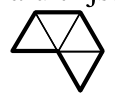
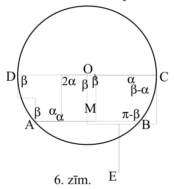
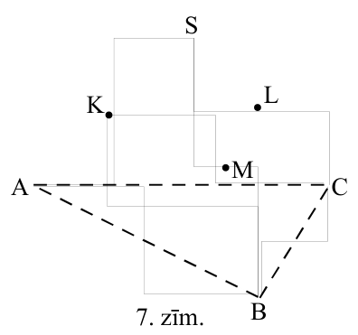
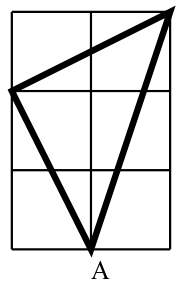

# <lo-sample/> LV.SOL.2011.8.1

Dots, ka $a$ un $b$ – reāli pozitīvi skaitļi. Pierādiet, ka $\frac{a}{a+1}+\frac{b}{b+1}>\frac{a+b}{a+b+1}$.

<small>
   
* questionType:
* domain:
   
</small>

## Atrisinājums

Acīmredzami, ka $\frac{a}{a+1}>\frac{a}{a+b+1}$ (skaitītāji vienādi, otrajai daļai saucējs lielāks) un arī $\frac{b}{b+1}>\frac{b}{a+b+1}$. Saskaitot abas šīs nevienādības, iegūstam prasīto.

# <lo-sample/> LV.SOL.2011.8.2

Trisstūrī $ABC$ malu $AB$, $BC$ un $AC$ viduspunkti ir attiecīgi punkti $D$, $E$ un $F$. No punktiem $D$ un $E$ pret malu $AC$ ir vilkti perpendikuli, kas krusto malu $AC$ (vai tās pagarinājumu) attiecīgi punktos $G$ un $H$. Pierādiet, ka $GF=CH$.

<small>
   
* questionType:
* domain:
   
</small>

## Atrisinājums

$\triangle ADF=\triangle FEC$ $(mmm)$, jo $AD=FE$, $DF=EC$ un $AF=FC$. $DG$ un $EH$ ir atbilstošie augstumi šajos trijstūros, tātad punkti $G$ un $H$ ir atbilstošie augstumu pamati, tātad $GF$ un $HC$ ir atbilstošie nogriežņi, tāpēc ir vienādi.

# <lo-sample/> LV.SOL.2011.8.3

Kādiem $n$ regulāru sešstūri ar malas garumu $n$ var sagriezt tādās figūrās, kā parādīts $5.$ zīmējumā; figūra sastāv no $4$ vienādmalu trijstūriem ar malas garumu $1$.

{ width=100px }

5. zīm.

<small>
   
* questionType:
* domain:
   
</small>

## Atrisinājums

**Atbilde:** var sagriezt tad un tikai tad, ja $n$ ir pāra skaitlis.

Regulārs sešstūris ar malas garumu $n$ sastāv no $6n^2$ vienādmalu trijstūrīšiem ar malas garumu $1$. Ja $n$ ir nepāra skaitlis, tad $6n^2$ nedalās ar $4$, tāpēc regulāru sešstūri, kura malas garums ir nepāra skaitlis, nevar sagriezt dotā veida figūriņās.

Regulāru sešstūri, kura malas garums ir pāra skaitlis, vienmēr var sagriezt dotā veida figūriņās, skat. $7.4.$ uzdevuma risinājumu.

# <lo-sample/> LV.SOL.2011.8.4

Rindā uzrakstīti $2010$ cipari tā, ka katrs divciparu skaitlis, ko veido divi blakus esošie cipari (tādā secībā, kā uzrakstīti), dalās vai nu ar $17$, vai ar $23$. Kāds šajā rindā ir  
a) pēdējais cipars, ja pirmais cipars ir $9$  
b) pirmais cipars, ja pēdējais cipars ir $1$?

<small>
   
* questionType:
* domain:
   
</small>

## Atrisinājums

**Atbilde: a)** $6$; **b)** $4$.

Uzrakstīsim visus divciparu skaitļus, kas dalās ar $17$ vai $23$. Tie ir $17$, $23$, $34$, $46$, $51$, $68$, $69$, $85$, $92$.

Ja pirmais ir $9$, tad nākamie cipari noteikti ir $92346\ldots$ Pēc sešinieka var nākt vai nu $8$ vai $9$.

Ja $8$, tad nākamie cipari ir $\ldots 8517$ un virkni turpināt vairs nevar. Tātad, ja aiz $6$ ir vismaz $5$ cipari, tad tie var būt tikai $\ldots 692346\ldots$ Redzam, ka virkne ir periodiska ar periodu $5$, tātad $2010.$ cipars tāpat kā $5.$ ir $6$.

Ja pēdējais cipars ir $1$, tad iepriekšējie cipari nosakās vienā vienīgā veidā un tie ir $\ldots 692346851$. Redzams, ka $(92346)$ būs periods, tātad pirmais skaitlis būs tāds pats, kā $2006.$, tas ir $4$.

# <lo-sample/> LV.SOL.2011.8.5

Pie sienas ir lampiņas, kas pēc kārtas sanumurētas ar naturāliem skaitļiem no $2$ līdz $N$. Vadības panelī ir slēdži, kuri numuri ir pēc kārtas sekojoši pirmskaitļi, sākot no $2$ (pēdējā slēdža numurs ir pirmskaitlis, kas pārsniedz $N$). Kad pārslēdz slēdzi ar numuru $K$, visas lampiņas, kuru numuri dalās ar $K$, maina savu stāvokli (no ieslēgtas uz izslēgtu vai no izslēgtas uz ieslēgtu). Sākumā visas lampiņas ir izslēgtas. Zināms, ka ar slēdžu palīdzību var panākt, ka visas lampiņas vienlaicīgi ir ieslēgtas. Kādai lielākajai $N$ vērtībai tas ir iespējams?

<small>
   
* questionType:
* domain:
   
</small>

## Atrisinājums

**Atbilde:** $N=5$.

Lampiņas ar numuriem $2$, $3$ un $6$ nevar vienlaicīgi būt ieslēgtas, jo lampiņa ar numuru $2$, būs ieslēgta tikai tad, ja slēdzis ar numuru $2$ būs slēgts nepāra skaitu reižu, tāpat arī lampiņa $3$ būs ieslēgta tikai tad, ja slēdzis ar numuru būs slēgts nepāra skaitu reižu. Ja lampiņas Nr. $2$ un $3$ ir ieslēgtas, tad slēdži ar numuriem $2$ un $3$ kopā ir slēgti pāra skaitu reižu. Katra no šīm pārslēgšanām ietekmē arī lampiņu $6$, tāpēc tā būs izslēgta.

Lai ieslēgtu visas lampiņas no $2$ līdz $5$, pa vienai reizei jāieslēdz slēdži $2$, $3$ un $5$.

# <lo-sample/> LV.SOL.2011.10.1

Dots, ka $a^2 + ab + ac < 0$. Pierādiet, ka $b^2 > 4ac$.

<small>
   
* questionType:
* domain:
   
</small>

## Atrisinājums

Aplūkojam kvadrātfunkciju $f(x)=cx^2+bx+a$. No dotā seko, ka $f(0)\cdot f(1)<0$. Tātad šim polinomam eksistē divas saknes, un tā diskriminants $b^2-4ac$ ir pozitīvs.

# <lo-sample/> LV.SOL.2011.10.2

Vai var rindā uzrakstīt $2010$ dažādus skaitļus $a_1$, $a_2$, ..., $a_{2010}$ tā, ka vienlaicīgi izpildās šādas divas īpašības:

• katrs no tiem ir kādam naturālam skaitlim apgrieztais skaitlis,

• $a_2 - a_1 = a_3 - a_2 = a_4 - a_3 = \ldots = a_{2010} - a_{2009}$.

<small>
   
* questionType:
* domain:
   
</small>

## Atrisinājums

Jā, der piemēram skaitļi $\frac{1}{2010!}$, $\frac{2}{2010!}$, $\frac{3}{2010!}$, ..., $\frac{2010}{2010!}$. Tiem visiem saucējs dalās ar skaitītāju, tātad ar skaitītāju var saīsināt un iegūt daļu, kuras skaitītājā ir $1$. Acīmredzami spēkā arī otrs nosacījums: $a_{i+1}-a_i=\frac{1}{2010!}$ visiem $i$.

# <lo-sample/> LV.SOL.2011.10.3

Atrodiet visus naturālos skaitļus $n$, kuriem izpildās vienādība

$$n = pqrs = 2p^{10} - 38 \quad (p, q, r, s \text{ – dažādi pirmskaitļi}).$$

<small>
   
* questionType:
* domain:
   
</small>

## Atrisinājums

No vienādības $38=p(2p^9-qrs)$ seko, ka $38$ dalās ar $p$. Tātad pastāv divas iespējas:

1) $n=2\cdot2^{10}-38=2\cdot3\cdot5\cdot67=2010$.

2) $n=2\cdot(19^{10}-19)$ dalās ar $4$, tātad nav dažādu pirmskaitļu reizinājums.

# <lo-sample/> LV.SOL.2011.10.4

Piramīdas pamats ir daudzstūris ar nepāra skaitu malu. Vai uz visām tās šķautnēm var izvēlēties virzienus tā, lai iegūto vektoru summa būtu $\vec{0}$?

<small>
   
* questionType:
* domain:
   
</small>

## Atrisinājums

**Atbilde:** nevar.  
Projicējam visus vektorus uz taisni, kas perpendikulāra piramīdas pamata plaknei. Tad pamata plaknes vektori projicējas nulles vektoros, bet sānu šķautņu vektori vienāda garuma paralēlos vektoros. Tā kā šo vektoru skaits ir nepāra skaitlis, tad summā iegūt nulles vektoru nevar.

# <lo-sample/> LV.SOL.2011.10.5

Ir deviņas lampiņas, kas pēc kārtas sanumurētas ar naturāliem skaitļiem no $2$ līdz $10$. Sākumā visas lampiņas ir izslēgtas. Vadības panelī ir četri slēdži, kuru numuri ir $2$, $3$, $5$ un $7$. Kad pārslēdz slēdzi ar numuru $K$, visas lampiņas, kuru numuri ir $K$ daudzkārtņi, tiek pārslēgtas uz pretējo (ieslēdz, ja bija izslēgta, vai izslēdz, ja bija ieslēgta). Kāds lielākais lampiņu skaits vienlaicīgi var būt ieslēgtas?

<small>
   
* questionType:
* domain:
   
</small>

## Atrisinājums

**Atbilde:** $7$ lampiņas.  
Vispirms ievērosim, ka katru slēdzi ir vērts pārslēgt ne vairāk kā vienreiz. Aplūkosim trīs lampiņu grupas: [$2$, $3$ un $6$], [$2$, $5$ un $10$], [$4$ un $8$]. Katrā no tām iespējams ieslēgt ne vairāk kā divas lampiņas. Ja ieslēgta ir lampiņa ar numuru $2$, tad ieslēgtas ir arī abas trešās grupas lampiņas un šajās trijās grupās kopā ir ne vairāk kā četras ieslēgtas lampiņas. Savukārt, ja $2$. lampiņa ir ieslēgta, tad abas trešās grupas lampiņas ir ieslēgtas un pa visām trim grupām kopā ir vismaz divas izslēgtas lampiņas (viena pirmajā un viena – otrajā grupā). Tātad iespējams ieslēgt ne vairāk kā septiņas lampiņas.  
Ja ieslēdz slēdžus $2$, $3$ un $7$, tad ieslēgtas ir septiņas lampiņas $2$, $3$, $4$, $7$, $8$, $9$, $10$.

# <lo-sample/> LV.SOL.2011.11.1

Atrisināt naturālos skaitļos vienādojumu

$$7^x+8^y=13^z$$

<small>
   
* questionType:
* domain:
   
</small>

## Atrisinājums

Pēc moduļa $3$ iegūstam kongruenci $1^x+(-1)^y\equiv1^z\pmod{3}$, kurai nav atrisinājumu. Tātad nav atrisinājumu arī dotajam vienādojumam.

# <lo-sample/> LV.SOL.2011.11.2

Riņķa līnijā $\omega_1$ ar centru punktā $O_1$ novilkta horda $AB$ un tai paralēls rādiuss $O_1C$ ($CB<AC$). Riņķa līniju, kas iet caur punktiem $A$, $O_1$ un $C$, apzīmēsim ar $\omega_2$. Pierādiet, ka $\omega_2$ centrs $O_2$ atrodas uz taisnes, kas iet caur punktiem $B$ un $C$.

<small>
   
* questionType:
* domain:
   
</small>

## Atrisinājums

Pagarinām rādiusu $O_1C$ līdz diametram $CD$ (skat. $6$. zīm.). Veidojas vienādsānu trapece $ABCD$. Novelkam leņķa $AO_1C$ bisektrisi, tās krustpunktu ar taisni $CB$ apzīmējam ar $E$. Apzīmējam $\angle ADC=\angle DCB=\beta$, $\angle DO_1A=2\alpha=\pi-2\beta$. Tad $\angle AO_1C=2\beta$ un $\angle EO_1C=\beta$. Tātad $\Delta O_1EC$ ir vienādsānu, $EC=EO_1$. Vienādsānu trijstūrī $\Delta AO_1C$ taisne $O_1E$ satur leņķa $AO_1C$ bisektrisi, tad tā satur arī augstumu un mediānu. Tātad $O_1E\perp AC$ un $AM=MC$. Nogrieznis $EM$ trijstūrī $ACE$ ir gan

{ width=150px }

6. zīm.

augstums, gan mediāna, tāpēc $\triangle AEC$ ir vienādsānu trijstūris un $EC=EA$. Tātad punkts $E$ ir $\omega_2$ centrs, kas pēc konstrukcijas atrodas uz taisnes $BC$.

# <lo-sample/> LV.SOL.2011.11.3

Dota virkne $x_0>1$, $x_{n+1}=x_n+\dfrac{1}{x_n^2}$ ($n=0, 1, 2 \ldots$). Pierādiet, ka $x_{333}>10$.

<small>
   
* questionType:
* domain:
   
</small>

## Atrisinājums

$x_{n+1}^{3}=x_n^{3}+3+a$, kur $a>0$. Aplūkojam virkni $y_n=x_n^{3}$. Tad $y_{333}>1000$, no tā seko, ka $x_{333}>10$.

# <lo-sample/> LV.SOL.2011.11.4

Dota kvadrātveida tabula ar izmēriem $15 \times 15$ rūtiņas. Katra tās rūtiņa nokrāsota vienā no trīs dažādām krāsām. Pierādiet, ka atradīsies vismaz divas tādas rindiņas, kurās vismaz vienas krāsas rūtiņu skaits ir vienāds.

<small>
   
* questionType:
* domain:
   
</small>

## Atrisinājums

Pieņemsim pretējo. Tad pirmās krāsas skaits jebkurās divās rindiņās ir dažāds. Tātad pirmajā krāsā nokrāsoto rūtiņu skaits ir ne mazāks par $0+1+2+\cdots+13+14=105$. Analoģiski arī pārējām krāsām. Tātad tabulā jābūt ne mazāk kā $3\cdot 105=315$ rūtiņām, bet tabula ir tikai $225$ rūtiņas. Iegūta pretruna.

# <lo-sample/> LV.SOL.2011.11.5

Plaknē doti $100$ zili un $100$ sarkani punkti, nekādi trīs no tiem neatrodas uz vienas taisnes. Pierādīt, ka tos pa pāriem var savienot ar $100$ nogriežņiem tā, ka katram nogrieznim vienā galā ir zils punkts, otrā – sarkans un nogriežņi nekrustojas.

<small>
   
* questionType:
* domain:
   
</small>

## Atrisinājums

Aplūkosim tādu punktu sadalījumu pa pāriem, ka visu $100$ nogriežņu garumu summa ir pati mazākā iespējamā. Pierādīsim, ka šajā gadījumā nogriežņi nekrustojas.

Pieņemsim pretējo, ka ir divi nogriežņi $AC$ un $BD$, kas krustojas punktā $O$. Pieņemsim arī, ka $A$ un $B$ ir zili punkti, bet $C$ un $D$ – sarkani. Tad, nogriežņu $AC$ un $BD$ vietā novelkot nogriežņus $AD$ un $BC$, to garumu summa ir mazāka nekā sākumā (pamatojums seko no trijstūra nevienādības: $AC+BD=(AO+OC)+(BO+OD)=(AO+OD)+(BO+OC)>AD+BC$), kas ir pretrunā ar to, ka apskatāmajā sadalījumā garumu summa bija minimālā iespējamā.

# <lo-sample/> LV.SOL.2011.12.1

Vai eksistē tāda $a$ vērtība, ka vienādojumam $\sin x=ax$ ir tieši $2010$ dažādas saknes?

<small>
   
* questionType:
* domain:
   
</small>

## Atrisinājums

**Atbilde:** Nē, neeksistē.

Vienādojumam $\sin x=ax$ ir sakne $x=0$, kā arī, ja $x$ ir tā sakne, tad arī $-x$ ir sakne, jo $\sin(-x)=-\sin x$. Tātad šī vienādojuma sakņu skaits vienmēr būs nepāra skaitlis.

# <lo-sample/> LV.SOL.2011.12.2

Vai eksistē tāda trijstūra piramīda, kurā no katras sānu šķautnes viduspunkta pretēja šķautne redzama taisnā leņķī?

<small>
   
* questionType:
* domain:
   
</small>

## Atrisinājums

**Atbilde:** Nē, neeksistē.

Pieņemsim, ka tāda piramīda eksistē, apzīmēsim to ar $SABC$. Sānu šķautņu viduspunktus apzīmēsim ar $K$, $L$, $M$ (skat. 7. zīm.). Apzīmēsim vektorus $\overrightarrow{SA}=\vec a$, $\overrightarrow{SB}=\vec b$ un $\overrightarrow{SC}=\vec c$. Tad $\overrightarrow{BK}=-\vec b+\frac{\vec a}{2}$ un $\overrightarrow{CK}=-\vec c+\frac{\vec a}{2}$. Pieņemot, ka $\angle BKC=90^{\circ}$, t.i., $BK\perp KC$, šo vektoru skalārais reizinājums ir $0$. Tātad

$$
\left(-\vec b+\frac{\vec a}{2}\right)\cdot\left(-\vec c+\frac{\vec a}{2}\right)=\vec b\cdot\vec c-\frac{1}{2}(\vec b+\vec c)\cdot\vec a+\frac{1}{4}\vec a\cdot\vec a=0.
$$

{ width=200px }

7. zīm.

Līdzīgi, apskatot situāciju pie punktiem $L$ un $M$, iegūstam

$$
\vec a\cdot\vec b-\frac{1}{2}(\vec a+\vec b)\cdot\vec c+\frac{1}{4}\vec c\cdot\vec c=0
\quad \text{un} \quad
\vec a\cdot\vec c-\frac{1}{2}(\vec a+\vec c)\cdot\vec b+\frac{1}{4}\vec b\cdot\vec b=0.
$$

Saskaitot iegūtās vienādības, iegūstam

$$
\frac{1}{4}(\vec a\cdot\vec a+\vec b\cdot\vec b+\vec c\cdot\vec c)=0,
$$

kas ir aplams. Tātad vismaz viens no leņķiem $BKC$, $ALB$ un $AMC$ nav taisns.

# <lo-sample/> LV.SOL.2011.12.3

Aprēķiniet izteiksmes $\operatorname{arctg}1+\operatorname{arctg}2+\operatorname{arctg}3$ vērtību.

<small>
   
* questionType:
* domain:
   
</small>

## Atrisinājums

**Atbilde:** $\pi$.

Skat., piem., 8. zīm.; dotie saskaitāmie atbilst leņķiem ar virsotni $A$; to summa ir $\pi$.

{ width=100px }

8. zīm.

# <lo-sample/> LV.SOL.2011.12.4

Dots, ka naturāls skaitlis $n=2\cdot(10^k+5)$ dalās ar $67$ ($k$ – vesels skaitlis), un tam ir tieši $16$ naturāli dalītāji. Atrodiet skaitli $n$.

<small>
   
* questionType:
* domain:
   
</small>

## Atrisinājums

**Atbilde:** $n=2010$.

Naturālam skaitlim $x=p_1^{k_1}p_2^{k_2}\cdots p_m^{k_m}$ ($p_i$ – dažādi pirmskaitļi) pavisam ir $(k_1+1)(k_2+1)\ldots(k_m+1)$ dažādi dalītāji.

(1) Tā kā $16=2^4$, tad meklējamais skaitlis $n$ var būt izsakāms vai nu kā $n=p_1\cdot p_2\cdot p_3\cdot p_4$, vai $n=p_1^3\cdot p_2\cdot p_3$, vai $n=p_1^3\cdot p_2^3$, vai $n=p_1^7\cdot p_2$, vai $n=p_1^{15}$ ($p_i$ – dažādi pirmskaitļi).

(2) No dotā $n=2\cdot 5\cdot(2\cdot 10^{k-1}+1)$ un $n$ dalās ar $67$, kā arī viegli ievērot, ka $2\cdot 10^{k-1}+1$ dalās ar $3$ visiem $k\geq 1$ (tā kā šīs izteiksmes vērtība dalās ar $67$, $k>1$). Tātad skaitlim $n$ ir vismaz četri dažādi pirmreizinātāji: $2$, $3$, $5$ un $67$.

Tātad, saskaņā ar (1) secinājumu $n=2\cdot 3\cdot 5\cdot 67=2010=2(10^3+5)$.

# <lo-sample/> LV.SOL.2011.12.5

Kalkulators strādā ar skaitļu četriniekiem un izpilda tikai divas operācijas:  
$1)$ ja tiek ievadīts $(a,b,c,d)$, kalkulators to pārveido par $(a+1,b+d,c-1,d+1)$;  
$2)$ ja tiek ievadīts $(a,b,c,d)$, kalkulators to pārveido par $(a,b-1,c+2,d+1)$.  
Vai ar šo kalkulatoru, lietojot to vairākkārt, no četrinieka $(3,4,2,1)$ var iegūt četrinieku $(6,5,7,8)$?

<small>
   
* questionType:
* domain:
   
</small>

## Atrisinājums

**Atbilde:** nevar.

Pieņemsim, ka to izdevies izdarīt. Skatoties uz ceturto koordināti $d$, redzam, ka jāizpilda $7$ operācijas. Tā kā skaitli $a$ izmaina tikai pirmā operācija, tad jāizpilda trīs reizes pirmā operācija un četras reizes otrā. Izpildot otro operāciju četras reizes, $b$ samazinās par $4$. Tā kā pēc jebkuras operācijas izpildīšanas $d$ palielinās par $1$, tad, pielietojot pirmo operāciju trīs reizes, mēs palielināsim $b$ vismaz par $1+2+3=6$, t.i. $b$ beigu lielums pārsniedz sākotnējo vismaz par $6-4=2$, kas ir pretrunā ar nosacījumiem.
