# <lo-sample/> LV.SOL.2012.5.1

Atrast mazāko naturālo skaitli, kura ciparu reizinājums ir lielāks vai vienāds ar $2012$ un kura visi cipari ir dažādi.

<small>
   
* questionType:
* domain:
   
</small>

## Atrisinājums

Meklētajam jābūt četrciparu skaitlim, jo lielākā trīsciparu skaitļa ciparu reizinājums ir $9\cdot 9\cdot 9=729<2012$. Vismazākajam no atbilstošajiem četrciparu skaitļiem cipari ir sakārtoti augošā secībā.

Noskaidrosim, kāds var būt mazākais cipars skaitļa pierakstā. Ja tas ir mazāks nekā $4$, tad atlikušo trīs ciparu reizinājums nepārsniedz $7\cdot 8\cdot 9=504$, un visu četru ciparu reizinājums nepārsniedz $3\cdot 504=1512<2011$. Tātad pirmais cipars ir vismaz $4$.

Ja otrais cipars ir mazāks nekā $7$, tad visu četru ciparu reizinājums ir ne lielāks kā $4\cdot 6\cdot 8\cdot 9=1728<2012$. Vēl trūkst divi dažādi cipari, kas lielāki nekā $7$, tātad trešais un ceturtais cipars ir attiecīgi $8$ un $9$. Tātad mazākais skaitlis, kura ciparu reizinājums ir vismaz $2012$, ir **$4789$**.

# <lo-sample/> LV.SOL.2012.5.2

Mūzikas akadēmijas absolventi katrs māk spēlēt vismaz vienu mūzikas instrumentu – klavieres, vijoli vai bungas. Zināms, ka klavieres māk spēlēt $37$, vijoli – $30$, bet bungas – $43$ absolventi. Tikai vienu mūzikas instrumentu māk spēlēt $32$ absolventi. Tieši divus mūzikas instrumentus māk spēlēt $33$ absolventi. Cik absolventi māk spēlēt visus trīs mūzikas instrumentus?

<small>
   
* questionType:
* domain:
   
</small>

## Atrisinājums

Apzīmēsim to absolventu skaitu, kas māk spēlēt klavieres, ar $k$, kas māks spēlēt vijoli – ar $v$, un tos, kas spēlē bungas – ar $b$. Apskatīsim Eilera – Venna diagrammu ($1$. zīm.).

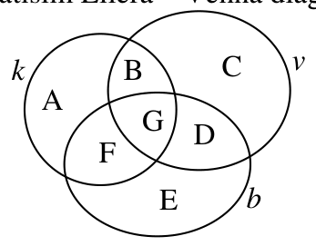{ width=150px }

1. zīm.

Summā $37+30+43$ apgabali $A$, $C$ un $E$ (tajos kopā ir $32$ absolventi, kas prot spēlēt tikai vienu instrumentu) ir ieskaitīti vienreiz, apgabali $B$, $D$ un $F$ (tajos kopā ir $33$ absolventi, kas māk spēlēt tieši divus instrumentus) ieskaitīti divreiz, bet apgabals $G$ (tie, kas māk spēlēt visus trīs instrumentus) tiek ieskaitīts trīs reizes.

Tātad $37+30+43-32-2\cdot 33=12=3\cdot G$ un $G=4$, t.i. visus trīs mūzikas instrumentus prot spēlēt **četri absolventi**.

# <lo-sample/> LV.SOL.2012.5.3

Atrast kvadrātu, ko var salikt no $1.$ zīmējumā parādītajām figūriņām. Jāizmanto vismaz viena katra veida figūriņa. Kvadrātam jābūt noklātam pilnībā un figūriņas nedrīkst pārklāties.  
Parādīt zīmējumā, kā to var izdarīt.

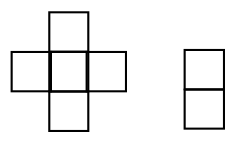{ width=100px }

$1.$ zīm.

<small>
   
* questionType:
* domain:
   
</small>

## Atrisinājums

Mazākais kvadrāts, ko var izveidot atbilstoši uzdevuma nosacījumiem, ir $6\times 6$ rūtiņas, skat., piem., $2$. zīm.

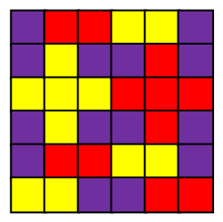{ width=100px }

2. zīm.

# <lo-sample/> LV.SOL.2012.5.4

Vienā gadā bija tikpat trešdienu, cik piektdienu. Vai noteikti šajā gadā bija arī tikpat ceturtdienu? Vai atbilde ir atkarīga no tā, vai gads ir īsais vai garais?

<small>
   
* questionType:
* domain:
   
</small>

## Atrisinājums

a) **Atbilde:** ne obligāti. Īsajā gadā ir $365$ dienas jeb $52$ pilnas nedēļas un viena diena. Ja $1$. janvāris ir ceturtdiena, tad arī $31$. decembris ir ceturtdiena un ceturtdienu skaits gada laikā būs par vienu lielāks nekā trešdienu un piektdienu skaits.

b) Garajā gadā ir $366$ dienas – $52$ pilnas nedēļas un vēl $2$ dienas, tāpēc a) punktā aprakstītā situācija nav iespējama. Tāpēc, ja trešdienu un piektdienu skaits ir vienāds (t.i., $52$), arī ceturtdienu skaits būs tāds pats.

# <lo-sample/> LV.SOL.2012.5.5

Aizmežu tirgū tirdzniecība notiek izmantojot $1$, $2$, $5$, $10$ un $20$ santīmu monētas, pie tam katras preces pirkšanas/pārdošanas laikā ir jāizmanto **tieši trīs monētas, starp kurām nav divu vienādu.** (Piemēram, ja prece maksā $17$ santīmus, tad to var nopirkt vai nu samaksājot ar $10$, $5$ un $2$ santīmu monētām, vai arī maksājot ar $20$ santīmu monētu, atlikumā saņemot $1$ un $2$ santīmu monētas, vai arī maksājot ar $20$ un $2$ santīmu monētām, atlikumā saņemot $5$ santīmu monētu.) Katra prece maksā veselu skaitu santīmu, ko ir iespējams samaksāt iepriekš aprakstītajā veidā. Piemēram, neviena prece nemaksā $1$ santīmu (jo tās pirkšanas procesā nevar izmantot tieši trīs dažādas vērtības monētas). Kāda ir nākamā mazākā cena, ko nav iespējams samaksāt pēc Aizmežu tirgus likumiem?

<small>
   
* questionType:
* domain:
   
</small>

## Atrisinājums

Visas naudas summas no $2$ līdz $9$ santīmiem var izteikt ar tieši trīs dažādu monētu palīdzību: $2=5-2-1$, $3=10-5-2$; $4=5+1-2$; $5=20-10-5$; $6=5+2-1$; $7=10-2-1$; $8=5+2+1$; $9=10+1-2$.

Pamatosim, ka $10$ santīmus nevar samaksāt ar trīs dažādu monētu palīdzību. Vispirms ievērosim, ka summu $0$ nevar iegūt ar vienas vai divu dažādu monētu palīdzību. Līdz ar to pircējs nevar izmantot $10$ santīmu monētu. No divām vai trim monētām, kuru vērtība ir mazāka nekā $10$, nevar izveidot summu, kas vienāda ar $10$. Ja pircējs maksā ar $10$ santīmu un vēl vienu monētu, tad pārdevējam jāizdod tāda pati monēta, bet tad tiek izmantotas tikai divas dažādas monētas. Ja pircējs maksā ar $20$ santīmu monētu, tad pārdevējam jāizdod $10$ santīmu monēta, bet to nevar izdarīt ar tieši divu monētu palīdzību. Ja pircējs maksā ar $20$ santīmu monētu un vēl vienu monētu, tad pārdevējam ar vienu monētu jāizdod vairāk nekā $10$ santīmi, bet to nevar izdarīt.

# <lo-sample/> LV.SOL.2012.6.1

Cik ir tādu naturālu skaitļu, kuru decimālā pieraksta ciparu reizinājums ir $20$, bet summa $11$?

<small>
   
* questionType:
* domain:
   
</small>

## Atrisinājums

Aplūkosim skaitļa $20$ dalītājus – viencipara skaitļus: tie ir $1$, $2$, $4$ un $5$. Skaitli $1$ kā reizinātāju var izmantot patvaļīgu skaitu reižu – tas nemaina reizinājuma vērtību. Tātad skaitli $20$ kā vienciparu skaitļu reizinājumu, kuru summa ir $11$, var izteikt divos veidos: a) $5\cdot4\cdot1\cdot1$ vai b) $5\cdot2\cdot2\cdot1\cdot1$.

No a) varianta cipariem var izveidot $12$ dažādus skaitļus (piecinieks var atrasties jebkurā no $4$ vietām, četrinieks – jebkurā no trim atlikušajām vietām, bet pārējās vietās viennozīmīgi jāieraksta vieninieki). Līdzīgi noskaidro, ka no b) varianta cipariem var izveidot $30$ dažādus skaitļus. Tātad pavisam ir **$42$ skaitļi** ar meklētajām īpašībām.

# <lo-sample/> LV.SOL.2012.6.2

Par *palindromu* sauc naturālu skaitli, kas vienādi lasāms no abiem galiem. Piemēram, $5$, $313$ un $4482844$ ir *palindromi*, bet $17$, $3313$ – nav.  
Visi septiņciparu *palindromi* sakārtoti augošā secībā. Noteikt, kurš *palindroms* šajā rindā pēc kārtas ir $2011$-ais?

<small>
   
* questionType:
* domain:
   
</small>

## Atrisinājums

Septiņciparu *palindroms* uzrakstāms formā $\overline{abcdcba}$, kur $a$, $b$, $c$, $d$ ir cipari (varbūt vienādi; $a\neq0$). Jo mazāks ir četrciparu skaitlis $\overline{abcd}$, jo mazāks ir *palindroms* $\overline{abcdcba}$, tāpēc pietiek apskatīt visus četrciparu skaitļus un noskaidrot, kurš no tiem pēc kārtas ir $2011$-ais. Pirmais četrciparu skaitlis ir $1000$, $2001$-ais – $3000$, tātad $2011$-ais četrciparu skaitlis ir $3010$ un meklētais septiņciparu *palindroms* ir **$3010103$**.

# <lo-sample/> LV.SOL.2012.6.3

Atrast taisnstūri, ko var salikt no $2.$ zīmējumā parādītajām figūriņām. Jāizmanto vismaz viena katra veida figūriņa. Taisnstūrim jābūt noklātam pilnībā un figūriņas nedrīkst pārklāties.  
Parādīt zīmējumā, kā to var izdarīt.

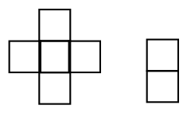{ width=100px }

2. zīm.

<small>
   
* questionType:
* domain:
   
</small>

## Atrisinājums

Mazākais taisnstūris, ko var izveidot atbilstoši uzdevuma nosacījumiem, ir $5\cdot6$ rūtiņas, skat. 3. zīm.

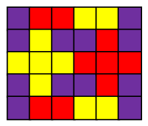{ width=100px }

3. zīm.

# <lo-sample/> LV.SOL.2012.6.4

Piecstūra un sešstūra malu garumi centimetros ir pēc kārtas sekojoši naturāli skaitļi. Zināms, ka abu daudzstūru perimetri ir vienādi un piecstūra īsākās malas garums ir vienāds ar sešstūra garākās malas garumu. Kāds ir sešstūra īsākās malas garums?

<small>
   
* questionType:
* domain:
   
</small>

## Atrisinājums

Apzīmēsim piecstūra īsākās malas garumu ar $a$, tad sešstūra garākās malas garums arī ir $a$. Tad piecstūra perimetrs ir $a+(a+1)+(a+2)+(a+3)+(a+4)=5a+10$, bet sešstūra perimetrs ir $a+(a-1)+(a-2)+(a-3)+(a-4)+(a-5)=6a-15$. Tātad $5a+10=6a-15$ un sešstūra garākā mala $a=25$ cm, bet sešstūra īsākā mala ir **$a-5=20$ cm**.

# <lo-sample/> LV.SOL.2012.6.5

Dotas četras dārglietu lādītes, kas katra nokrāsota citā krāsā. Zināms, ka vienā no lādītēm atrodas dimants. Uz katras no lādītēm ir uzrakstīts viens apgalvojums:  
uz sarkanās lādītes: „Dimants atrodas šajā lādītē”;  
uz dzeltenās: „Dimants atrodas vai nu sarkanajā vai brūnajā lādītē”;  
uz zaļās: „Dimants neatrodas šajā lādītē”;  
uz brūnās: „Dimants neatrodas sarkanajā lādītē”.  
Noteikt, kurā no lādītēm atrodas dimants, ja tikai viens no šiem apgalvojumiem ir patiess.

<small>
   
* questionType:
* domain:
   
</small>

## Atrisinājums

Aplūkosim, kuri apgalvojumi ir patiesi, ja dimants atrodas noteiktas krāsas lādītē.

| *Dimants/Apgalvojums* | *Uz sarkanās lādītes* | *Uz dzeltenās lādītes* | *Uz zaļās lādītes* | *Uz brūnās lādītes* |
|---|---|---|---|---|
| *Sarkanajā lādītē* | Patiess | Patiess | Patiess | Aplams |
| *Dzeltenajā lādītē* | Aplams | Aplams | Patiess | Patiess |
| *Zaļajā lādītē* | Aplams | Aplams | Aplams | Patiess |
| *Brūnajā lādītē* | Aplams | Patiess | Patiess | Patiess |

Kā redzam, tikai tad, ja dimants atrodas **zaļajā** lādītē, patiess ir tieši viens apgalvojums.

# <lo-sample/> LV.SOL.2012.7.1

Apskatām vienādojumu $ax+b=cx+d$, kur $a$, $b$, $c$, $d$ katrs ir ar vērtību $1$, $2$ vai $3$.  
a) Uzrādīt vienu no šādiem vienādojumiem, kuram ir sakne $0$.  
b) Uzrādīt vienu no šādiem vienādojumiem, kuram nav sakņu.  
c) Cik starp šiem vienādojumiem ir tādu, kuriem nav sakņu?

<small>
   
* questionType:
* domain:
   
</small>

## Atrisinājums

a) Piemēram, $3x+1=2x+1$.

b) Piemēram, $3x+1=3x+2$.

c) Lai vienādojumam nebūtu sakņu, jābūt $a=c$ un $b\neq d$. $a=c$ var izvēlēties $3$ veidos, katram no tiem $b$ un $d$ var izvēlēties $6$ veidos. Tātad pavisam ir $3\cdot6=18$ vienādojumi, kuriem nav atrisinājuma.

# <lo-sample/> LV.SOL.2012.7.2

Zināms, ka nekādas trīs no dotajām taisnēm nekrustojas viena punktā, bet katras divas savā starpā krustojas. Cik dažādu krustpunktu rodas, ja pavisam ir uzzīmētas:  
a) $5$ taisnes,  
b) $2011$ taisnes?

<small>
   
* questionType:
* domain:
   
</small>

## Atrisinājums

Apskatīsim uzdevuma atrisinājumu vispārīgajā gadījumā, ja plaknē ir dotas $n$ taisnes. Tad katra taisne krusto visas pārējās $n-1$ taisnes, katru citā punktā. Tā kā katrs krustpunkts šādā veidā tiek ieskaitīts tieši divas reizes (uz katras no abām taisnēm, kas krustojas šajā punktā), tad pavisam dažādo krustpunktu skaits ir $\dfrac{n(n-1)}{2}$.

a) Ja $n=5$, tad krustpunktu skaits ir $\dfrac{5\cdot 4}{2}=10$.

b) Ja $n=2011$, tad krustpunktu skaits ir $\dfrac{2011\cdot 2010}{2}=2021055$.

# <lo-sample/> LV.SOL.2012.7.3

Dota virkne $u_{1},u_{2},\ldots$, kur $u_{1}=u_{2}=1$ un katrs nākamais virknes loceklis, sākot ar trešo, ir visu iepriekšējo virknes locekļu kvadrātu summa. Vai $u_{2011}$ dalās ar $7$?

<small>
   
* questionType:
* domain:
   
</small>

## Atrisinājums

Saskaņā ar virknes veidošanas likumu

$$
u_{n+1}=\underbrace{u_1^2+u_2^2+u_3^2+\ldots+u_{n-1}^2}_{u_n}+u_n^2=u_n+u_n^2=u_n(1+u_n).
$$

Tātad, ja kāds virknes loceklis dalās ar $7$, tad arī nākamais virknes loceklis dalīsies ar $7$. Apskatīsim virknes pirmos locekļus: $u_1=1$, $u_2=1$, $u_3=2$, $u_4=6$, $u_5=42$, $\ldots$ . Redzam, ka $u_5$ dalās ar $7$, tāpēc visi nākamie virknes locekļi, t.sk., $u_{2011}$ dalās ar $7$.

# <lo-sample/> LV.SOL.2012.7.4

Vienādmalu trijstūra, kura malas garums ir $2$ cm, iekšpusē atzīmēti pieci sarkani punkti. Pierādīt, ka var izvēlēties divus tādus sarkanos punktus, attālums starp kuriem nepārsniedz $1$ cm.

<small>
   
* questionType:
* domain:
   
</small>

## Atrisinājums

Sadalām doto trijstūri četros vienādos vienādmalu trijstūros kā parādīts $4.$ zīmējumā. Katra trijstūra visu malu garumi ir $1$ cm, tāpēc attālums starp diviem punktiem, kas atrodas viena trijstūra iekšpusē vai uz tā kontūra, nepārsniedz malas garumu, t.i., $1$ cm. Tā kā ir atzīmēti $5$ sarkani punkti, tad vismaz divi sarkanie punkti būs atzīmēti viena trijstūra iekšpusē vai uz tā kontūra. Tie arī ir meklētie divi punkti.

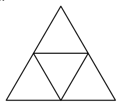{ width=100px }

4. zīm.

# <lo-sample/> LV.SOL.2012.7.5

Dotas sešas pēc kārtas novietotas rūtiņas. Jānis un Pēteris spēlē sekojošu spēli. Viena gājiena laikā vienā no tukšajām rūtiņām jāieraksta viens cipars. Gājienus spēlētāji izdara pēc kārtas, Jānis sāk.  
Pēteris uzvar, ja sešciparu skaitlis, kas izveidojas beigās, dalās ar $13$. Vai Pēteris vienmēr var uzvarēt, neatkarīgi no tā, kā spēlē Jānis?

<small>
   
* questionType:
* domain:
   
</small>

## Atrisinājums

Jā, Pēteris var uzvarēt. Atbildot uz Jāņa gājieniem, Pēteris raksta ciparus tā, lai izveidotos skaitlis $\overline{abcabc}=1001\cdot \overline{abc}$. Šis skaitlis dalās ar $1001=13\cdot 11\cdot 7$, tātad tas dalās arī ar $13$.

# <lo-sample/> LV.SOL.2012.8.1

Koordinātu plaknē konstruēti funkciju $y=a\cdot x+k$ un $y=b\cdot x+m$ grafiki (skat. $3.$ zīm.). Pierādīt, ka $(b-a)\cdot(k-m)>0$.

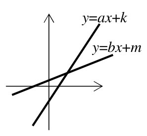{ width=150px }

3. zīm.

<small>
   
* questionType:
* domain:
   
</small>

## Atrisinājums

Skaitļi $k$ un $m$ norāda taišņu krustpunktu ar $Oy$ asi $y$ koordinātu, tātad $k<m$. Taišņu virziena koeficienti $a$ un $b$ norāda taišņu „slīpumu”, tātad $a>b$. No tā seko, ka $b-a<0$ un $k-m<0$, tāpēc $(b-a)(k-m)>0$.

# <lo-sample/> LV.SOL.2012.8.2

Divi vienādsānu trīsstūri $ABC$ ($AB=AC$) un $DEF$ ($DE=DF$) savstarpēji novietoti tā, kā redzams $4.$ zīmējumā. Zināms, ka $BC\parallel EF$ un $\angle BAC=\angle DEF=32^{\circ}$. Aprēķināt leņķa $AGE$ lielumu!

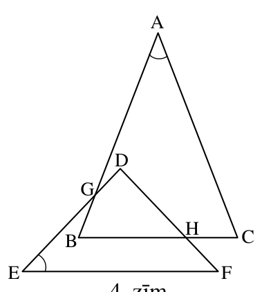{ width=200px }

4. zīm.

<small>
   
* questionType:
* domain:
   
</small>

## Atrisinājums

Dots, ka $\angle BAC=\angle DEF=32^{\circ}$ (skat. $5.$ zīm.). $\angle AGE=\angle BGD$ kā krustleņķi. No četrstūra $BGDH$ leņķu summas iegūstam, ka $\angle BGD=360^{\circ}-\angle EDF-\angle DHB-\angle HBG$.

$$
\angle GBC=\frac{1}{2}(180^{\circ}-\angle BAC)=\frac{1}{2}(180^{\circ}-32^{\circ})=\frac{1}{2}\cdot 148^{\circ}=74^{\circ}.
$$

$\angle DHB=\angle DFE=\angle DEF=32^{\circ}$ (kā kāpšļu leņķi pie paralēlām taisnēm $BC$ un $EF$).

$\angle EDF=180^{\circ}-2\cdot \angle DEF=116^{\circ}$.

Tātad $\angle AGE=\angle BGD=360^{\circ}-116^{\circ}-32^{\circ}-74^{\circ}=\mathbf{138}^{\circ}$

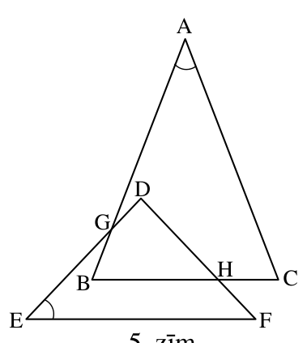{ width=200px }

$5.$ zīm.

# <lo-sample/> LV.SOL.2012.8.3

Skaitļi $a_1,a_2,\ldots,a_n$ ir visi naturālie skaitļi no $1$ līdz $n$ kaut kādā secībā. Pierādīt: ja $n$ ir nepāra skaitlis, tad reizinājums $(a_1-1)(a_2-2)\ldots(a_n-n)$ vienmēr ir pāra skaitlis.

<small>
   
* questionType:
* domain:
   
</small>

## Atrisinājums

Lai reizinājums būtu nepāra skaitlis, visiem reizinātājiem jābūt nepāra skaitļiem. Divu skaitļu starpība ir nepāra skaitlis tikai tad, ja viens no skaitļiem ir pāra skaitlis, bet otrs – nepāra skaitlis. Ņemot pēc kārtas nepāra skaitu naturālu skaitļu, gan starp skaitļiem $1$, $2$, $\ldots$, $n$, gan starp skaitļiem $a_1$, $a_2$, $\ldots$, $a_n$ nepāra skaitļu būs par vienu vairāk nekā pāra skaitļu. Tātad nav iespējams sadalīt šos skaitļus $n$ pāros tā, ka katrā pārī viens skaitlis ir pāra skaitlis, bet otrs – nepāra. Tātad vismaz vienās iekavās būs divu nepāra skaitļu starpība, kas dod pāra skaitli, līdz ar to reizinājums arī būs pāra skaitlis.

# <lo-sample/> LV.SOL.2012.8.4

Augošas naturālu skaitļu virknes $1, 7, 11, 13,\ldots$ locekļi ir visi tie skaitļi, kas nedalās ne ar $2$, ne ar $3$, ne ar $5$. Atrast, kāds skaitlis atrodas šīs virknes $2011.$ vietā.

<small>
   
* questionType:
* domain:
   
</small>

## Atrisinājums

Ja jebkurai veselai nenulles skaitļa $k$ vērtībai aplūko skaitļus intervālā $[30k; 30k+29]$, tad viegli pamanīt, ka ar $2$, $3$ vai $5$ nedalās astoņi no šiem skaitļiem: $30k+1$, $30k+7$, $30k+11$, $30k+13$, $30k+17$, $30k+19$, $30k+23$ un $30k+29$. Tātad, lai noteiktu prasīto virknes locekļu vērtības, nepieciešams noteikt 1) kurai grupai tas pieder – atrast attiecīgo $k$ vērtību ($k=0$, $1$, $2$, $\ldots$) un 2) kurš pēc kārtas elements grupā tas ir.

$2011=8\cdot 251+3$. Tātad $k=251$ un tas ir trešais skaitlis savā intervālā. Tātad $a_{2011}=251\cdot 30+11=7541$.

# <lo-sample/> LV.SOL.2012.8.5

Draugu portālā ir reģistrējušies $N$ zēni un $M$ meitenes. Katrs zēns draudzējas ar trīs citiem zēniem un septiņām meitenēm, bet katra meitene – ar četrām citām meitenēm un pieciem zēniem. Kādas ir mazākās iespējamās $N$ un $M$ vērtības?

<small>
   
* questionType:
* domain:
   
</small>

## Atrisinājums

No uzdevuma nosacījumiem seko, ka zēnu savstarpējo draudzību skaits ir $\dfrac{3N}{2}$. Tātad $N$ ir pāra skaitlis.

Apskatīsim, kāds ir kopējais draudzības saišu skaits zēnu un meiteņu starpā: $7N=5M$. Tātad mazākās $N$ un $M$ vērtības, kas der par uzdevuma atrisinājumu, ir $N=10$ un $M=14$.

Atliek parādīt piemēru, kā uzdevuma nosacījumus var realizēt.

Zēnu draudzību tabula:

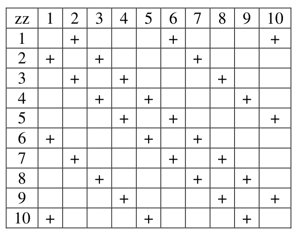{ width=300px }

Meiteņu draudzību tabula:

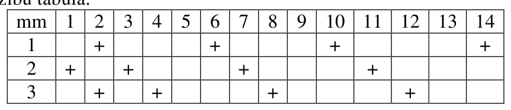{ width=400px }

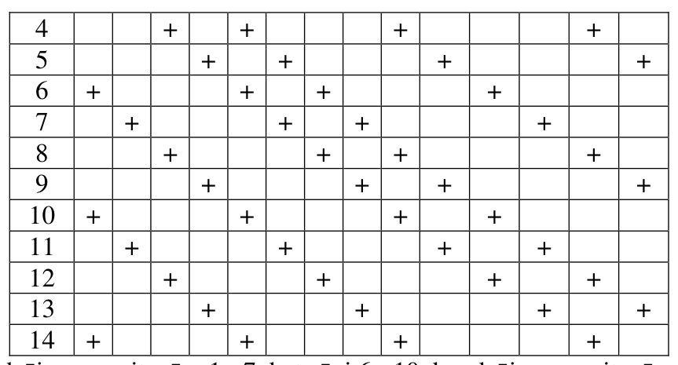{ width=400px }

Zēni $1$ - $5$ draudzējas ar meitenēm $1$ - $7$, bet zēni $6$ - $10$ draudzējas ar meitenēm $8$ - $14$.

# <lo-sample/> LV.SOL.2012.10.1

Dots, ka $x$, $y$, $z$, $t$ ir pozitīvi skaitļi un $x^2<y$, $y^2<z$, $z^2<t$ un $t^2<x$. Pierādīt, ka vismaz viens no skaitļiem $x$, $y$, $z$, $t$ ir mazāks nekā $1$.

<small>
   
* questionType:
* domain:
   
</small>

## Atrisinājums

Tā kā visu doto nevienādību abās puses ir pozitīvi skaitļi, varam visas četras nevienādības sareizināt. Tādējādi iegūstam, ka $x^2y^2z^2t^2<xyzt$. Izdalot iegūtās nevienādības abas puses ar $xyzt>0$, iegūstam $xyzt<1$, no kurienes seko, ka $x$, $y$, $z$, $t$ visi reizē nevar būt lielāki vai vienādi ar $1$.

# <lo-sample/> LV.SOL.2012.10.2

Šaurleņķu trijstūrī $ABC$ uz malas $AB$ atzīmēts tās viduspunkts $D$. No virsotnes $B$ pret malu $AC$ vilktais augstums $BE$ krusto mediānu $CD$ tās viduspunktā. Pierādīt, ka $S_{ABE}=2S_{BEC}$.

<small>
   
* questionType:
* domain:
   
</small>

## Atrisinājums

No punkta D novelkam perpendikulu pret BE, apzīmējam $DG=a$ (skat. $9.$ zīm.). $DF=CF$ un $\angle GFD=\angle EFC$, tāpēc taisnleņķa trijstūri DGF un EFC ir vienādi (pēc pazīmes „kl”). Vienādu trijstūru atbilstošie elementi ir vienādi, tātad $GF=EF=x$. No Talesa teorēmas seko $\frac{BD}{DA}=\frac{BG}{EG}=1$ un no līdzīgiem trijstūriem BDG un BAE seko, ka $\frac{DG}{AE}=\frac{BD}{BA}=\frac{1}{2}$. Tātad $BG=EG=2x$ un $AE=2a$.

Ja $S_{\mathrm{DGF}}=S_{\mathrm{EFC}}=\frac{ax}{2}=S$, tad $S_{\mathrm{DGB}}=\frac{a\cdot 2x}{2}=2S$, $S_{\mathrm{BFC}}=S_{\mathrm{BDF}}=\frac{BF\cdot DG}{2}=\frac{3x\cdot a}{2}=3S$ (jo mediāna BF sadala trijstūri DBC divos vienlielos trijstūros), $S_{\mathrm{ABE}}=\frac{2a\cdot 4x}{2}=8S$, $S_{\mathrm{BEC}}=S_{\mathrm{BFC}}+S_{\mathrm{EFC}}=4S$.

Tātad $S_{\mathrm{ABE}}=2S_{\mathrm{BEC}}$ k.b.j.

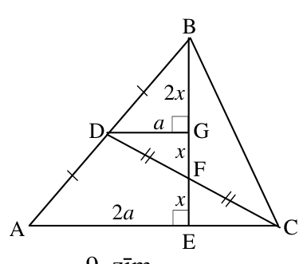{ width=200px }

9. zīm.

# <lo-sample/> LV.SOL.2012.10.3

Vienādojuma $x^2-27x+113=0$ saknes ir taisnleņķa trijstūra katešu garumi, izteikti centimetros. Aprēķināt šī trijstūra laukumu!

<small>
   
* questionType:
* domain:
   
</small>

## Atrisinājums

Ja dotā vienādojuma saknes – katešu garumi – ir $x_1$ un $x_2$, tad trijstūra laukums ir $S=\frac{x_1x_2}{2}$.

Pēc Vjeta teorēmas $x_1x_2=113$, tātad $S=\frac{113}{2}=56,5\ \mathrm{cm}^2$.

# <lo-sample/> LV.SOL.2012.10.4

Atrisināt vienādojumu sistēmu veselos skaitļos
$$
\begin{cases}
xy+z=10 \\
x+yz=11
\end{cases}.
$$

<small>
   
* questionType:
* domain:
   
</small>

## Atrisinājums

Atņemot no otrā vienādojuma pirmo, iegūstam $x(1-y)-z(1-y)=1$ jeb $(1-y)(x-z)=1$. Skaitli $1$ kā divu veselu skaitļu reizinājumu var izteikt divos veidos: $1=1\cdot 1=(-1)\cdot(-1)$.

Tātad $\begin{cases}1-y=1\\x-z=1\end{cases}$ vai $\begin{cases}1-y=-1\\x-z=-1\end{cases}$.

Pirmajā gadījumā iegūstam $y=0$, ko, ievietojot dotajā sistēmā, iegūstam $\begin{cases}z=10\\x=11\end{cases}$.

Otrajā gadījumā $y=2$ un $\begin{cases}2x+z=10\\x+2z=11\end{cases}$, no kurienes iegūst $z=4$ un $x=3$.

Tātad dotajai sistēmai veselos skaitļos ir divi atrisinājumi $(11;\ 0;\ 10)$ un $(3;\ 2;\ 4)$.

# <lo-sample/> LV.SOL.2012.10.5

Pukstiņš un Svirpulnieks spēlē šādu spēli: vispirms Pukstiņš sadala $7\times 7$ rūtiņas lielu kvadrātu vienu rūtiņu platās un vismaz divas rūtiņas garās strēmelēs. Pēc tam Svirpulnieks aplūko sadalīto kvadrātu un nosauc skaitli $k$ ($2\le k\le 7$) un paņem visas strēmeles, kuru garums ir $k$.

Atrast lielāko strēmeļu kopgarumu, kuru Svirpulnieks var paņemt, neatkarīgi no tā, kā laukumu sagriezis Pukstiņš.

<small>
   
* questionType:
* domain:
   
</small>

## Atrisinājums

Ja lielākais strēmeļu kopgarums būtu $9$, tad maksimālais dažāda garuma strēmeļu skaits būtu $1\cdot 7+1\cdot 6+1\cdot 5+2\cdot 4+3\cdot 3+4\cdot 2=43<49$, tātad ar šo kopgarumu nepietiek, lai noklātu visu laukumu.  
Ja lielākais strēmeļu kopgarums būtu $10$ vai $11$, tad maksimālais dažāda garuma strēmeļu skaits būtu $1\cdot 7+1\cdot 6+2\cdot 5+2\cdot 4+3\cdot 3+5\cdot 2=50$. Lai dotais kvadrāts būtu sadalīts pilnībā, tad šāds dalījums neder, jo viena rūtiņa ir par daudz. Bet tas nozīmē, ka kādam garumam strēmeļu skaits ir mazāks par maksimāli iespējamo, bet šis liekais garums ir sadalīts starp cita garuma strēmelēm, tādējādi palielinot šīs grupas kopgarumu un pārsniedzot maksimāli pieļaujamo summu.  
Tātad lielākais garantētais viena garuma strēmeļu kopgarums ir vismaz $12$. Parādīsim, ka tas arī ir meklētais garums. Ja izvēlas strēmeles $2\cdot 6+1\cdot 5+2\cdot 4+4\cdot 3+6\cdot 2$, tad viena garuma strēmeļu kopgarums ir ne vairāk kā $12$. Kā salikt kvadrātu, skat., piem., 10. zīm.:

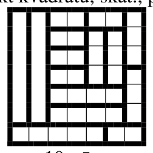{ width=100px }

10. zīm.

# <lo-sample/> LV.SOL.2012.11.1

Doti tādi veseli skaitļi $a$ un $b$, ka $3a+5b$ dalās ar $11$. Pierādīt, ka skaitlis $5a+b$ arī dalās ar $11$.

<small>
   
* questionType:
* domain:
   
</small>

## Atrisinājums

Ievērosim, ka $(5a+b)=11(a+b)-2(3a+5b)$. Labās puses katrs saskaitāmais dalās ar $11$, tātad arī kreisās puses izteiksmei jādalās ar $11$, k.b.j.

# <lo-sample/> LV.SOL.2012.11.2

Uz regulāra sešstūra $ABCDEF$ malas $AB$ atlikts punkts $G$, bet uz malas $BC$ punkts $H$ tā, ka $AG=BH$ (skat. $7.$ zīm.). Pierādīt, ka $S_{\mathrm{EGBH}}=\frac{S_{\mathrm{ABCDEF}}}{3}$.

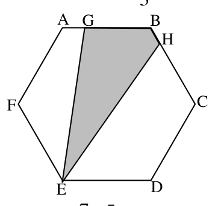{ width=150px }

$7.$ zīm.

<small>
   
* questionType:
* domain:
   
</small>

## Atrisinājums

Apzīmēsim sešstūra malas garumu ar $a$, $\mathrm{AE}=\mathrm{EC}=h$, $\mathrm{AE}\perp \mathrm{AB}$, $\mathrm{EC}\perp \mathrm{BC}$ (skat. 11. zīm.). Tad

$$
S_{\mathrm{EGBH}}=S_{\mathrm{EGB}}+S_{\mathrm{EBH}}=\frac{1}{2}(\mathrm{GB}\cdot \mathrm{EA}+\mathrm{BH}\cdot \mathrm{EC})=\frac{1}{2}(h\cdot \mathrm{GB}+h\cdot \mathrm{BH})=\frac{1}{2}h(\mathrm{GB}+\mathrm{BH})=\frac{1}{2}ha.
$$

$h=\sqrt{3}a$, tātad $S_{\mathrm{EGBH}}=\frac{\sqrt{3}}{2}a^2$. $S_{\mathrm{ABCDEF}}=\frac{3\sqrt{3}}{2}a^2$, tātad $S_{\mathrm{EGBH}}=\frac{S_{\mathrm{ABCDEF}}}{3}$.

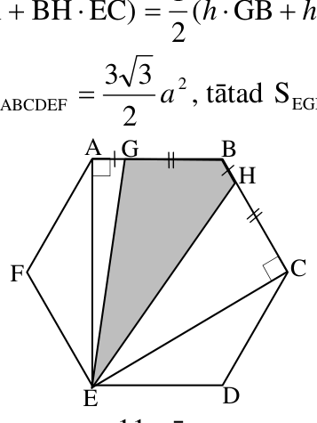{ width=150px }

11. zīm.

# <lo-sample/> LV.SOL.2012.11.3

Zināms, ka $a$ un $\frac{a^2+a-1}{2a+1}$ ir veseli skaitļi. Atrast visas iespējamās $a$ vērtības!

<small>
   
* questionType:
* domain:
   
</small>

## Atrisinājums

Ja $\frac{a^2+a-1}{2a+1}$ ir vesels skaitlis, tad arī $\frac{4(a^2+a-1)}{2a+1}=\frac{4a^2+4a-4}{2a+1}$ ir vesels skaitlis. Bet

$$
\frac{4a^2+4a-4}{2a+1}=\frac{(4a^2+4a+1)-5}{2a+1}=\frac{(2a+1)^2-5}{2a+1}=2a+1-\frac{5}{2a+1}.
$$

Tātad $5$ dalās ar $2a+1$, bet $5$ dalās tikai ar $\pm 1$ un $\pm 5$. Tātad

$2a+1=5 \Rightarrow a=2,$  
$2a+1=1 \Rightarrow a=0,$  
$2a+1=-1 \Rightarrow a=-1,$  
$2a+1=-5 \Rightarrow a=-3.$

Tātad, veicot pārbaudi, iegūstam, ka iespējamās $a$ vērtības ir $-3$, $-1$, $0$ un $2$.

# <lo-sample/> LV.SOL.2012.11.4

Dota virkne $a_1, a_2, \ldots$, kur $a_1=a_2=1$ un $a_{n+2}=a_{n+1}+2a_n$, $n \ge 1$.

Vai nevienādība $a_n>\frac{2^n}{3}$ ir patiesa, ja 1) $n=2011$; 2) $n=2012$?

<small>
   
* questionType:
* domain:
   
</small>

## Atrisinājums

Ievērosim, ka skaitļus $a_n$ var uzdot ar formulu $a_n=\frac{2^n-(-1)^n}{3}$.

Pārbaude: $a_1=\frac{2^1-(-1)^1}{3}=1$, $a_2=\frac{2^2-(-1)^2}{3}=1$. Formulas $a_{n+2}=a_{n+1}+2a_n$ pareizība izriet no tā, ka $2^{n+2}=2^{n+1}+2\cdot 2^n$ un $(-1)^{n+2}=(-1)^{n+1}+2(-1)^n$.

Ja $n$ ir nepāra skaitlis, tad $3a_n=2^n+1>2^n$. Savukārt, ja $n$ ir pāra skaitlis, tad $3a_n=2^n-1<2^n$. Tātad 1) gadījumā nevienādība ir patiesa, bet 2) – aplama.

# <lo-sample/> LV.SOL.2012.11.5

Pukstiņš un Svirpulnieks spēlē šādu spēli: vispirms Pukstiņš sadala $9 \cdot 9$ rūtiņas lielu kvadrātu vienu rūtiņu platās un vismaz trīs rūtiņas garās strēmelēs. Pēc tam Svirpulnieks aplūko sadalīto kvadrātu un nosauc skaitli $k$ ($3 \le k \le 9$) un paņem visas strēmeles, kuru garums ir $k$. Atrast lielāko strēmeļu kopgarumu, kuru Svirpulnieks var paņemt, neatkarīgi no tā, kā laukumu sagriezīs Pukstiņš!

<small>
   
* questionType:
* domain:
   
</small>

## Atrisinājums

Ja lielākais strēmeļu kopgarums būtu $14$, tad maksimālais dažāda garuma strēmeļu skaits būtu $1\cdot 9+1\cdot 8+2\cdot 7+2\cdot 6+2\cdot 5+3\cdot 4+4\cdot 3=77<81$, tātad ar šo kopgarumu nepietiek, lai noklātu visu laukumu.

Tātad lielākais garantētais viena garuma strēmeļu kopgarums ir vismaz $15$. Parādīsim, ka tas arī ir meklētais garums. Ja izvēlas strēmeles $1\cdot 9+1\cdot 8+2\cdot 7+2\cdot 6+3\cdot 5+2\cdot 4+5\cdot 3$, tad viena garuma strēmeļu kopgarums ir ne vairāk kā $15$. Šādās strēmelēs kvadrātu var sadalīt (skat. 12. zīm.).

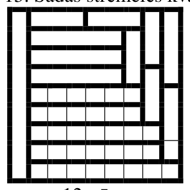{ width=150px }

12. zīm.

# <lo-sample/> LV.SOL.2012.12.1

Kādām reālām parametra $a$ vērtībām vienādojumiem
$$
ax^2-2x+1=0 \text{ un } x\cdot \cos a=1
$$
ir vienāds sakņu skaits?

<small>
   
* questionType:
* domain:
   
</small>

## Atrisinājums

Kvadrātvienādojumu apzīmēsim ar $V_1$ un otru vienādojumu – ar $V_2$.

Ja $a=0$, tad $V_1$ ir lineārs vienādojums ar vienu sakni $x=\frac{1}{2}$ un $V_2$ arī ir viena sakne $x=1$.

Ja $a\ne 0$, tad $V_1$ ir kvadrātvienādojums, kura sakņu skaits ir atkarīgs no diskriminanta $D=4-4a=4(1-a)$ vērtības, savukārt $V_2$ ir $0$ vai $1$ sakne.

Ja $a<1$ un $a\ne 0$, tad $V_1$ ir $2$ saknes, bet $V_2$ ir mazāk nekā $2$ saknes, tātad sakņu skaits atšķiras.

Ja $a=1$, tad $V_1$ ir $1$ sakne un $V_2$ arī ir viena sakne, jo $\cos 1\ne 0$.

Ja $a>1$, tad $D<0$ un $V_1$ sakņu nav. Vienādojuma $V_2$ sakņu nav, kad $\cos a=0$. Ja $a>1$ un $\cos a=0$, tad $a=\frac{\pi(2k-1)}{2}$, $k\in\mathbb{N}$.

**Atbilde:** meklētās $a$ vērtības ir $0$, $1$ un $\frac{\pi(2k-1)}{2}$, $k\in\mathbb{N}$.

# <lo-sample/> LV.SOL.2012.12.2

Šaurleņķu trijstūrī $\mathrm{ABC}$ augstumi ir $\mathrm{AD}$, $\mathrm{BE}$ un $\mathrm{CF}$. Pierādīt, ka $\mathrm{DA}$, $\mathrm{EB}$ un $\mathrm{FC}$ ir trijstūra $\mathrm{DEF}$ bisektrises.

<small>
   
* questionType:
* domain:
   
</small>

## Atrisinājums

Uz katras trijstūra malas kā diametra konstruēsim riņķa līniju (skat. $13.$ zīm.). Apzīmēsim riņķa līniju, kuras diametrs ir $AB$ ar $w_1$, riņķa līniju, kuras diametrs ir $AC$, – ar $w_2$ un to, kuras diametrs ir $BC$, – ar $w_3$. Šīs riņķa līnijas katra iet caur attiecīgās malas galapunktiem un caur to augstumu pamatiem, kas atrodas uz divām pārējām malām, t.i., $w_1$ iet caur punktiem $A$, $B$, $D$ un $E$; $w_2$ – caur $A$, $C$, $D$ un $F$, bet $w_3$ – caur $B$, $C$, $E$ un $F$.

$\angle DBE=\angle DAE$ (ievilktie leņķi, kas balstās uz loku $DE$ riņķa līnijā $w_1$). Līdzīgi $\angle DAC=\angle DFC$ (r.l. $w_2$) un $\angle CBE=\angle CFE$ (r.l. $w_3$).

No šīm sakarībām un ievērojot, ka $\angle CBE=\angle DBE$ un $\angle DAE=\angle DAC$, un iegūstam, ka $\angle DFC=\angle CFE$ – tātad $FC$ ir $\angle DFE$ bisektrise.

Līdzīgi $\angle DAF=\angle DCF$ (no $w_2$), $\angle BAD=\angle BED$ (no $w_1$) un $\angle BCF=\angle BEF$ (r.l. $w_3$). Ievērojot, ka $\angle DAF=\angle BAD$ un $\angle BCF=\angle DCF$, iegūstam, ka $\angle BEF=\angle BED$, jeb $EB$ ir $\angle DEF$ bisektrise.

Tā kā $FC$ un $EB$ krustojas vienā punktā ar $DA$, tad arī $DA$ ir $\angle EDF$ bisektrise.

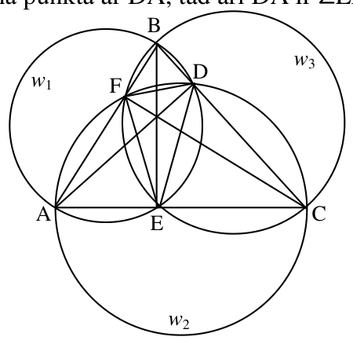{ width=200px }

$13.$ zīm.

# <lo-sample/> LV.SOL.2012.12.3

Zināms, ka $x$, $y$ un $z$ ir naturāli skaitļi, $7x^2-3y^2+4z^2=8$ un $16x^2-7y^2+9z^2=-3$. Kāda ir $x^2+y^2+z^2$ vērtība?

<small>
   
* questionType:
* domain:
   
</small>

## Atrisinājums

Pārveidosim dotos vienādojumus:

$$
\begin{cases}
3(x^2-y^2)+4(x^2+z^2)=8,\\
7(x^2-y^2)+9(x^2+z^2)=-3.
\end{cases}
$$

No tā iegūstam

$$
\begin{cases}
x^2+z^2=65,\\
x^2-y^2=-84.
\end{cases}
$$

Tā kā $x$, $y$ un $z$ ir naturāli skaitļi, apskatām pirmā vienādojuma iespējamos atrisinājumus, attiecīgi no otra vienādojuma aprēķinot arī $y$.

Aplūkosim, vai katrā no šiem gadījumiem atrisinājums ir arī otrajam vienādojumam:

| $x^2$ | $z^2$ | $y^2$ |
|---|---|---|
| $1$ | $64$ | $85 \Rightarrow y$ nav naturāls skaitlis |
| **$16$** | **$49$** | **$100$** |
| $49$ | $16$ | $133 \Rightarrow y$ nav naturāls skaitlis |
| $64$ | $1$ | $148 \Rightarrow y$ nav naturāls skaitlis |

Tātad $x^2+y^2+z^2=165$.

# <lo-sample/> LV.SOL.2012.12.4

Uz gludas grīdas nolikts taisnstūra paralēlskaldņa formas dzelzsbetona klucis, kura pamata izmēri ir $13\ \text{cm}\cdot 25\ \text{cm}$, bet augstums – $h\ \text{cm}$.

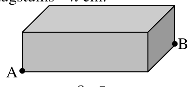{ width=200px }

$8.$ zīm.

Skudra atrodas punktā $\mathrm{A}$ (skat. $8.$ zīm.) un viņai jānonāk punktā $\mathrm{B}$. Skudra var iet gan apkārt klucim, gan pāri, bet nevar izlīst pa apakšu. Noteikt, kāds ir īsākā ceļa no punkta $\mathrm{A}$ uz punktu $\mathrm{B}$ garums, ja a) $h=7\ \text{cm}$, b) $h=13\ \text{cm}$.

<small>
   
* questionType:
* domain:
   
</small>

## Atrisinājums

Ja skudra virzās tikai pa zemi apkārt klucim, tad īsākais ceļš no $A$ līdz $B$ ir $s=13+25=38$ cm.

Ja skudra neizmanto augšējo skaldni, tad tas arī ir īsākais ceļš. Aplūkosim, kas notiek, ja augšējā skaldne tiek izmantota. Apskatīsim kluča virsmas izklājumu bez apakšējās skaldnes. Izklājumā punktiem $A$ un $B$ atbilst pa diviem punktiem, attiecīgi $A_1$ un $A_2$, $B_1$ un $B_2$. Tādā gadījumā īsākais varētu būt viens no variantiem: $A_1B_1$, $A_1B_2=A_2B_1$, $A_2B_2$ (skat. $14.$ zīm.).

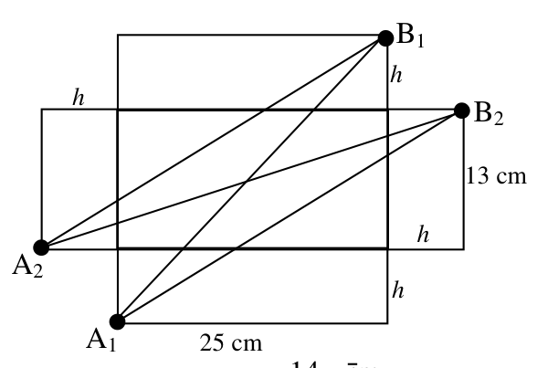{ width=250px }

$14.$ zīm.

$$A_1B_1^2=25^2+(13+2h)^2,\quad A_1B_2^2=A_2B_1^2=(25+h)^2+(13+h)^2,\quad A_2B_2^2=(25+2h)^2+13^2$$

a) Ja $h=7$ cm, tad $A_1B_1^2=25^2+27^2=1354$, $A_1B_2^2=A_2B_1^2=32^2+20^2=1424$, $A_2B_2^2=39^2+13^2>38^2$, $s^2=38^2=1444$, tātad īsākais ceļš ir $A_1B_1=\sqrt{1354}$ cm.

b) Ja $h=13$ cm, tad $A_1B_1^2=25^2+39^2>38^2$, $A_1B_2^2=A_2B_1^2=38^2+26^2>38^2$, $A_2B_2^2=51^2+13^2>38^2$, tātad īsākais ceļš ir $38$ cm, ejot apkārt klucim pa zemi.

# <lo-sample/> LV.SOL.2012.12.5

Laura un Dace no naturālu skaitļu kopas $A=\{1,\,2,\,3,\,4,\,6,\,8,\,12,\,16,\,24,\,48\}$ visos iespējamos veidos izvēlas četrus dažādus skaitļus un aprēķina to reizinājumu. Ja reizinājums ir mazāks nekā $2012$, Laura saņem vienu konfekti, bet, ja lielāks, tad konfekti saņem Dace. Kurai no meitenēm beigās būs vairāk konfekšu?

<small>
   
* questionType:
* domain:
   
</small>

## Atrisinājums

Sadalīsim visus skaitļus pa pāriem tā, ka katra pāra reizinājums ir $48$: $\{1, 48\}$, $\{2, 24\}$, $\{3, 16\}$, $\{4, 12\}$, $\{6, 8\}$.

Ja meitenes izvēlas divus pilnus pārus, tad četru skaitļu reizinājums ir $48^2=2304$ un konfektes šajos gadījumos saņem Dace. Divus pilnus pārus var izvēlēties $C_5^2=10$ veidos.

Ja skaitļi tiek izvēlēti tā, ka nav paņemti divi pilni pāri, tad katram četru skaitļu komplektam $\{a, b, c, d\}$ varam piekārtot citu četru skaitļu komplektu $\left\{\frac{48}{a}, \frac{48}{b}, \frac{48}{c}, \frac{48}{d}\right\}$. Tā kā nav izvēlēti divi pilni pāri, tad abi šie četrinieki ir atšķirīgi.

Aplūkosim šos komplektus pa pāriem kopā. Šo divu komplektu skaitļu reizinājums ir $48^4$. Tātad abu komplektu skaitļu reizinājums vienlaicīgi nevar būt mazāks nekā $2012$ (jo $2012^2<48^4$). Tas nozīmē, ka pēc šo divu komplektu skaitļu reizinājumu aprēķināšanas vai nu abas meitenes saņems pa konfektei, vai arī abas konfektes saņems Dace. Tāpēc arī beigās Dacei būs vairāk konfekšu nekā Laurai.
