# <lo-sample/> LV.SOL.2013.5.1

Vilks kopā ar trim sivēntiņiem Nif-Nifu, Naf-Nafu un Nuf-Nufu ir sarakstījis grāmatu *„Izturīgās būves”*, bet kopā ar Sarkangalvīti un viņas vecmāmiņu – grāmatu *„Visvisādi pīrādziņi”*. Izdevniecība par katru grāmatu maksā honorāru, kas jāsadala vienādās daļās starp attiecīgās grāmatas autoriem. Pēc tam, kad Naf-Nafs bija saņēmis savu honorāra daļu, par abām grāmatām neizmaksātais honorārs bija $2520$ lati. Cik liela naudas summa par abām grāmatām pienākas Vilkam?  
Par katru grāmatu izmaksājamā honorāra lielums var atšķirties.

<small>
   
* questionType:
* domain:
   
</small>

## Atrisinājums

Pieņemsim, ka par grāmatu „Izturīgās būves” katram autoram pienākas $a$ latu liels honorārs (kopējais honorārs par grāmatu ir $4a$ Ls), bet par grāmatu „Visvisādi pīrādziņi” katram autoram ir $b$ latu liels honorārs (kopējais honorārs par šo grāmatu ir $3b$ Ls). Pēc tam, kad Naf-Nafs saņēma savu daļu, t.i., $a$ latus, neizņemti ir $3a+3b=3\cdot(a+b)=2520$ lati. Vilkam pienākas $a+b$ lati, kas ir trešā daļa no atlikušās summas jeb **$840$ lati**.

# <lo-sample/> LV.SOL.2013.5.2

Tirmantiņš ir izcepis dīvainas formas torti (skat. $1.$ zīm.) un vēlas to sagriezt četrās pilnīgi vienādās (gan pēc formas, gan pēc laukuma) daļās. Parādi zīmējumā, kā to var izdarīt! Gabali attiecībā viens pret otru drīkst būt gan pagriezti, gan „apgriezti otrādi”.

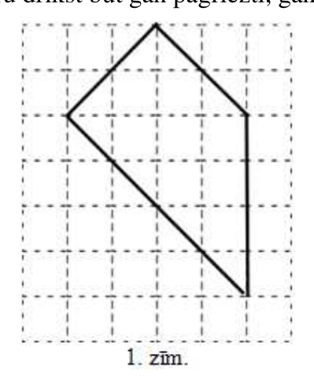{ width=200px }

1. zīm.

<small>
   
* questionType:
* domain:
   
</small>

## Atrisinājums

Skat., piem., $1.$ zīm.

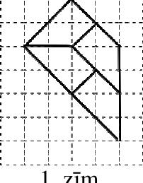{ width=100px }

$1.$ zīm.

# <lo-sample/> LV.SOL.2013.5.3

Kādu dienu Robinsons izrēķināja, ka nākamajās $1000$ dienās ceturtdienu būs vairāk nekā piektdienu. Kurā nedēļas dienā Robinsons veica šos aprēķinus?

<small>
   
* questionType:
* domain:
   
</small>

## Atrisinājums

Tā kā nedēļā ir septiņas dienas un $1000=7\cdot142+6$, tad visās pilnajās nedēļās ir vienāds ceturtdienu un piektdienu skaits, bet nepilnajā nedēļā pietrūkst viena diena (visas pārējās ir vienādā skaitā). Tātad trūkstošā diena ir **piektdiena**, tāpēc tā arī ir diena, kad Robinsons veica aprēķinus.

# <lo-sample/> LV.SOL.2013.5.4

Septiņciparu skaitļa $A$ ciparu summa ir divciparu skaitlis $B$, kura ciparu summa, savukārt, ir viencipara skaitlis $C$. Šo trīs skaitļu pierakstā tiek lietoti visi cipari no $0$ līdz $9$, un neviens cipars neatkārtojas. Kāds ir skaitlis $C$?

<small>
   
* questionType:
* domain:
   
</small>

## Atrisinājums

Ar $S(N)$ apzīmēsim skaitļa $N$ ciparu summu. Tad $B=S(A)$ un $C=S(B)$. Tā kā $C$ ir vienciparu, tad $C=S(C)$. Tā kā visi skaitļus $A$, $B$ un $C$ veidojošie cipari ir atšķirīgi un to pierakstā ir izmantoti visi desmit cipari $0$, $1$, $2$, $3$, $4$, $5$, $6$, $7$, $8$ un $9$ (to summa ir $45$), iegūstam vienādību $S(A)+S(B)+S(C)=B+C+C=B+2C=45$ jeb $B=45-2C$. Pārbaudīsim visas iespējamās $C$ vērtības.

| $C$ | $B=45-2C$ | Pārbaude: $S(B)=C$ |
|---|---|---|
| $0$ | $45$ | $9\ne0$, neder |
| $1$ | $43$ | $7\ne1$, neder |
| $2$ | $41$ | $5\ne2$, neder |
| $3$ | $39$ | $12\ne3$, neder |
| $4$ | $37$ | $10\ne4$, neder |
| $5$ | $35$ | $8\ne5$, neder |
| $6$ | $33$ | $6=6$, $B$ satur divus vienādus ciparus - neder |
| $7$ | $31$ | $4\ne7$, neder |
| $8$ | $29$ | $11\ne8$, neder |
| $9$ | $27$ | $9=9$, piemēram, $A=1345680$, $B=27$, $C=9$ der kā atrisinājums |

Tātad vienīgā iespēja, ka **$C=9$**.

# <lo-sample/> LV.SOL.2013.5.5

Noteikt, cik dažādos veidos no rūtiņas $A$ var nonākt rūtiņā $B$ (skat. $2.$ zīm.), ja katrā solī drīkst iet vienu rūtiņu pa labi vai vienu rūtiņu uz augšu. (Iekrāsotajās rūtiņās ieiet nedrīkst.)

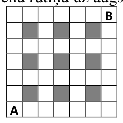{ width=100px }

2. zīm.

<small>
   
* questionType:
* domain:
   
</small>

## Atrisinājums

Katrā rūtiņā ierakstīsim, cik dažādos veidos tajā var nonākt. Sākotnējā ($A$) rūtiņā ierakstīsim $1$ (sākuma rūtiņā „var nonākt” vienā veidā). Katrā no pārējām rūtiņām var nonākt tikai no blakus rūtiņas pa kreisi vai blakus rūtiņas apakšā, tad kopējais veidu skaits, kā var tajā nonākt, ir vienāds ar šajās blakus rūtiņās ierakstīto skaitļu summu. Šādā veidā aizpildot visu tabulu, iegūstam, ka rūtiņā $B$ var nonākt $20$ veidos (skat. $2.$ zīm.).

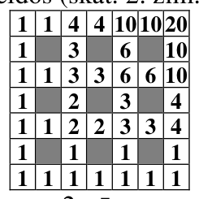{ width=100px }

$2.$ zīm.

# <lo-sample/> LV.SOL.2013.6.1

Ar kādu mazāko naturālo skaitli jāreizina skaitlis $315$, lai reizinājumā iegūtu skaitli, kas ir **a)** kāda naturāla skaitļa $n$ reizinājums pašam ar sevi, t.i., $n\cdot n$, **b)** kāda naturāla skaitļa $n$ reizinājums pašam ar sevi trīs reizes, t.i., $n\cdot n\cdot n$?

<small>
   
* questionType:
* domain:
   
</small>

## Atrisinājums

Vispirms sadalīsim skaitli $315$ pirmreizinātājos: $315=3\cdot 3\cdot 5\cdot 7$.

**a)** Ja skaitlis ir naturāla skaitļa reizinājums pašam ar sevi, tad visi tajā ietilpstošie pirmreizinātāji sastopami pāra skaitu reižu. Tātad skaitli $315$ vēl jāpiereizina vismaz viens skaitlis $5$ un vismaz viens skaitlis $7$; tātad mazākais skaitlis, ar kuru pareizinot skaitli $315$, iegūsim naturāla skaitļa reizinājumu pašam ar sevi, ir $5\cdot 7=35$, un iegūtais reizinājums ir $11025=105\cdot 105$.

**b)** Ja skaitlis ir naturāla skaitļa reizinājums pašam ar sevi trīs reizes, tad visi tajā ietilpstošie pirmreizinātāji sastopami $3$, $6$, $9\ldots$ reizes. Tātad mazākais skaitlis, ar kuru piereizinot $315$, iegūsim šādu situāciju, ir $3\cdot 5\cdot 5\cdot 7\cdot 7=3675$, un iegūtais reizinājums ir $1157625=105\cdot 105\cdot 105$.

# <lo-sample/> LV.SOL.2013.6.2

Vinnijs Pūks un Sivēntiņš ir sadalījuši savā starpā torti. Pēc abu daļu apskates Sivēntiņš sacēla brēku, ka viņa gabals ir acīmredzami mazāks. Vinnijs Pūks atdeva Sivēntiņam ceturto daļu no sava gabala, kā rezultātā Sivēntiņa daļa palielinājās septiņas reizes. Kāda tortes daļa sākumā bija iedalīta Vinnijam Pūkam un kāda – Sivēntiņam?

<small>
   
* questionType:
* domain:
   
</small>

## Atrisinājums

Ja Sivēntiņa daļa palielinājās septiņas reizes, tad tas nozīmē, ka no Vinnija Pūka viņš saņēma sešreiz lielāku tortes daļu nekā viņam jau bija. Tā kā šis saņemtais gabals bija ceturtā daļa no Vinnija Pūka sākotnējā gabala, tad sākumā Vinnijam Pūkam bija $24$ reizes lielāks gabals nekā Sivēntiņam. Tātad sākumā Vinnijam Pūkam bija $\frac{24}{25}$ tortes un Sivēntiņam $\frac{1}{25}$ tortes.

# <lo-sample/> LV.SOL.2013.6.3

Taisnstūrveida zemes gabala katras malas garums izsakāms veselā skaitā metru, turklāt zināms, ka viena mala ir par $7$ metriem garāka nekā otra. Šī zemes gabala trīs malu garumu summa ir $2012$ metri. Kāds ir šī zemes gabala perimetrs?

<small>
   
* questionType:
* domain:
   
</small>

## Atrisinājums

Taisnstūra garākās malas garumu metros apzīmēsim ar $a$, tad otras malas garums ir $a-7$ metri. Tā kā nav teikts, kuras trīs malas summā dod $2012\,m$, iespējami divi gadījumi:

$$
\begin{array}{ll}
1)\ a+a+(a-7)=2012 & \text{vai}\quad 2)\ a+(a-7)+(a-7)=2012\\
3\cdot a-7=2012 & 3\cdot a-14=2012\\
3\cdot a=2019 & 3\cdot a=2026\\
a=673\ \text{un}\ a-7=666 & a\ \text{nav vesels skaitlis.}
\end{array}
$$

Tātad dotā zemes gabala perimetrs ir $2(673+666)=2678$ metri.

# <lo-sample/> LV.SOL.2013.6.4

Tirmantiņš ir izcepis dīvainas formas torti (skat. $3.$ zīm.) un vēlas to sagriezt piecās pilnīgi vienādās (gan pēc formas, gan pēc laukuma) daļās. Gabali attiecībā viens pret otru drīkst būt pagriezti, bet nedrīkst būt „spoguļattēlā?”. Parādi, kā to var izdarīt!

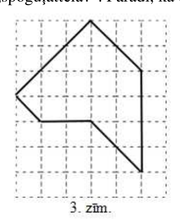{ width=150px }

$3.$ zīm.

<small>
   
* questionType:
* domain:
   
</small>

## Atrisinājums

Skat., piem., 3. zīm.

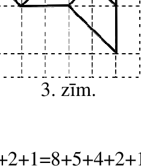{ width=100px }

3. zīm.

# <lo-sample/> LV.SOL.2013.6.5

Mazākais naturālais skaitlis, kuru var izteikt kā piecu dažādu naturālu skaitļu summu, ir $15=1+2+3+4+5$. Cik dažādos veidos kā piecu dažādu naturālu skaitļu summu var izteikt skaitli $20$? (Divus veidus, kas atšķiras tikai ar saskaitāmo secību, uzskatām par vienādiem.)

<small>
   
* questionType:
* domain:
   
</small>

## Atrisinājums

**Atbilde:** $7$ veidos:

$20=10+4+3+2+1=9+5+3+2+1=8+6+3+2+1=8+5+4+2+1=7+6+4+2+1=7+5+4+3+1=6+5+4+3+2$.

Var ievērot, ka lielākais saskaitāmais šajās summās nepārsniedz $10$ (jo pārējo četru skaitļu summa nevar būt mazāka kā $10$) un nav mazāks nekā $6$ (jo pārējo četru skaitļu summa nepārsniedz $5+4+3+2=14$). Tālāk atliek aplūkot iespējamos variantus.

# <lo-sample/> LV.SOL.2013.7.1

Daļskaitļa skaitītājs un saucējs ir naturāli skaitļi, kuru summa ir $2012$. Zināms, ka daļskaitļa vērtība nepārsniedz $\frac{1}{7}$. Atrodi lielāko iespējamo šāda daļskaitļa vērtību!

<small>
   
* questionType:
* domain:
   
</small>

## Atrisinājums

Tā kā skaitītāja un saucēja summa ir konstanta, tad lielāka vērtība ir daļai ar pēc iespējas lielāku skaitītāja vērtību – jāatrod pēc iespējas lielāka $n$ vērtība, kurai $\frac{n}{2012-n}<\frac{1}{7}$, jeb $8n<2012$, tātad $n\le 251$. Tātad lielākā iespējamā šāda daļskaitļa vērtība ir $\frac{251}{1761}$.

# <lo-sample/> LV.SOL.2013.7.2

Uzzīmē slēgtu lauztu līniju, kurai ir a) $6$, b) $7$ posmi un kas pati sevi krusto tieši $7$ dažādos punktos.

<small>
   
* questionType:
* domain:
   
</small>

## Atrisinājums

Skat., piem., 4. un 5. zīm.

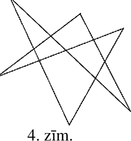{ width=100px }

4. zīm.

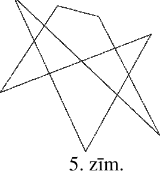{ width=150px }

5. zīm.

# <lo-sample/> LV.SOL.2013.7.3

Rūtiņu lapā uzzīmēts taisnstūris, kura malas iet pa rūtiņu malām. Šī taisnstūra visas rūtiņas var apstaigāt ar šaha zirdziņu, katrā rūtiņā nonākot tieši vienu reizi. Kāds ir mazākais iespējamais šāda taisnstūra laukums?  
*Piezīme:* Šaha zirdziņš no rūtiņas $A$ ar vienu gājienu var nonākt tikai kādā no rūtiņām, kas apzīmētas ar $*$ (ja tās atrodas taisnstūra iekšpusē), skat. $4$. zīm.

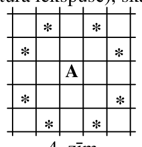{ width=100px }

4. zīm.

<small>
   
* questionType:
* domain:
   
</small>

## Atrisinājums

Minimālā taisnstūra izmēri ir $3 \times 4$ rūtiņas, skat., piem., $6.$ zīm.

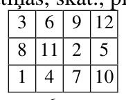{ width=100px }

6. zīm.

Viegli redzēt, ka neder ne kvadrāts $3 \times 3$ rūtiņas (tajā ne no vienas citas rūtiņas nevar nonākt centrālajā rūtiņā), ne arī taisnstūri, kam vienas malas garums ir $2$ rūtiņas (tajā var nokļūt tikai katrā ceturtajā rūtiņā katrā rindā).

# <lo-sample/> LV.SOL.2013.7.4

Divos televīzijas kanālos vienlaicīgi sāka demonstrēt vienu un to pašu filmu. Pirmajā kanālā filma bija sadalīta $26$ minūšu fragmentos un starp katriem diviem fragmentiem bija divas minūtes gara reklāma. Savukārt, otrajā kanālā filma bija sadalīta $13$ minūšu fragmentos un starp katriem diviem fragmentiem bija vienu minūti gara reklāma. Kurā kanālā filma beigsies agrāk? Atbildi pamatot!

<small>
   
* questionType:
* domain:
   
</small>

## Atrisinājums

Pēc katrām $28$ minūtēm abos kanālos vienlaicīgi sāksies jauns filmas fragments. No brīža, kad pirmais kanāls sāks rādīt pēdējo fragmentu, paies $26$ minūtes. Savukārt, otrajā kanālā filma beigsies pēc $13+1+13=27$ minūtēm. Tātad **pirmajā kanālā** filma beigsies par vienu minūti **ātrāk.**

# <lo-sample/> LV.SOL.2013.7.5

Vai naturāla skaitļa kvadrāts (reizinājums pašam ar sevi) var būt skaitlis a) $\overline{AABB}$, b) $\overline{ABAB}$, kur $A$ un $B$ ir dažādi cipari.  
Pieraksts $\overline{KLM}$ nozīmē, ka skaitlī ir $M$ vieni, $L$ desmiti un $K$ simti; $K$, $L$, $M$ ir cipari.

<small>
   
* questionType:
* domain:
   
</small>

## Atrisinājums

a) $\overline{AABB}=\overline{A0B}\cdot 11$. Lai $\overline{AABB}$ būtu naturāla skaitļa kvadrāts, skaitlim $\overline{A0B}$ jābūt naturāla skaitļa kvadrāta reizinājumam ar $11$. Skaitlis $\overline{A0B}=100A+B=110A-10A+11B-10B=11(10A+B)-10(A+B)$ dalās ar $11$, $11(10A+B)$ dalās ar $11$, tātad $A+B$ dalās ar $11$. Tā kā $A$ un $B$ ir cipari, tad $A+B=0$ (t.i. $A=B=0$ – neder, jo $A$ un $B$ jābūt dažādiem cipariem) vai $A+B=11$. Tātad $\overline{A0B}=11(10A+B)-10\cdot 11=11(10(A-1)+B)$ un divciparu skaitlis $10(A-1)+B$ ir naturāla skaitļa kvadrāts. No visiem diviparu skaitļiem, kas ir veselu skaitļu kvadrāti, nosacījumus apmierina tikai $64$, t.i. $B=4$ un $A=7$. Tātad uzdevuma prasības apmierina skaitlis $7744=88^2$.

b) $\overline{ABAB}=\overline{AB}\cdot 101$. Skaitlis $101$ ir pirmskaitlis. Tā kā divciparu skaitlis $\overline{AB}$ nevar dalīties ar $101$, tad $\overline{ABAB}$ nevar būt naturāla skaitļa kvadrāts.

# <lo-sample/> LV.SOL.2013.8.1

Cik starp pirmajiem $2012$ naturālajiem skaitļiem ir tādi, kas nedalās ne ar $5$, ne ar $7$?

<small>
   
* questionType:
* domain:
   
</small>

## Atrisinājums

No $1$ līdz $2012$ pavisam ir $2010:5=402$ skaitļi, kas dalās ar $5$, $2009:7=287$ skaitļi, kas dalās ar $7$, un $1995:35=57$ skaitļi, kas dalās gan ar $5$, gan ar $7$. Tātad tādu skaitļu, kas nedalās ne ar $5$, ne ar $7$, ir $2012-402-287+57=\mathbf{1380}$.

# <lo-sample/> LV.SOL.2013.8.2

Uz tāfeles uzrakstīti $n$ ($n>1$) dažādi naturāli skaitļi. Lielākais no tiem ir $11$. Visu uzrakstīto skaitļu vidējais aritmētiskais arī ir naturāls skaitlis. Ja skaitli $11$ nodzēš, tad atlikušo skaitļu vidējais aritmētiskais arī ir naturāls skaitlis. Kādai lielākajai $n$ vērtībai tas ir iespējams? Kādi skaitļi šajā gadījumā sākumā bija uzrakstīti uz tāfeles? Pietiek uzrādīt vienu piemēru.

<small>
   
* questionType:
* domain:
   
</small>

## Atrisinājums

Ja visu uzrakstīto skaitļu summa ir $S$ un visu uzrakstīto skaitļu vidējais aritmētiskais ir $k_1$, tad $S=n\cdot k_1$. Pēc skaitļa $11$ nodzēšanas, atlikušo skaitļu vidējo aritmētisko apzīmēsim ar $k_2$. Tad $S-11=(n-1)k_2$. Pārveidojot, iegūstam $nk_1=(n-1)k_2+11$ jeb $n(k_1-k_2)=11-k_2$ un $k_1-k_2=\frac{11-k_2}{n}$.

Nepieciešams atrast pēc iespējas lielāku $n$ vērtību.

Ja $k_2=1$, tad $k_1-1=\frac{10}{n}$. Tā kā $k_2$ ir $n-1$ sākotnējo skaitļu bez skaitļa $11$ vidējais aritmētiskais, tad tas var atbilst tikai vienam pašam skaitlim $1$ un $n$ nevar pārsniegt $2$ (uz tāfeles bija uzrakstīti skaitļi $1$ un $11$);

Ja $k_2=2$, tad $k_1-2=\frac{9}{n}$. Lai dažādu naturālu skaitļu vidējais aritmētiskais būtu $2$, tad lielākais šādu skaitļu skaits ir $3$: $1$, $2$, $3$, tad $n \le 4$ un tas ir skaitļa $9$ dalītājs, tātad $n=3$. Iegūstam, ka $k_1=5$, $S=15$ un uz tāfeles uzrakstītie skaitļi $1$, $3$ un $11$.

Ja $k_2=3$, tad $k_1-3=\frac{8}{n}$. Spriežot līdzīgi kā iepriekš, $n-1$ vērtība nepārsniedz $5$ (skaitļi no $1$ līdz $5$). Tātad lielākā $n$ vērtība, kas ir skaitļa $8$ dalītājs un nepārsniedz $5$, ir $4$. Tad $k_1=5$, $S=20$ un uz tāfeles uzrakstītie skaitļi varēja būt $1$, $3$, $5$, $11$ vai $2$, $3$, $4$, $11$.

Ja $k_2=4$, tad $k_1-4=\frac{7}{n}$. $n-1$ vērtība nepārsniedz $7$ (skaitļi no $1$ līdz $7$) un lielākā derīgā $n$ **vērtība ir $7$**. Tad $k_1=5$, $S=35$ ($S-11=24$) un uz tāfeles uzrakstītie skaitļi varēja būt **$1$, $2$, $3$, $5$, $6$, $7$, $11$** vai **$1$, $2$, $3$, $4$, $6$, $8$, $11$**, vai **$1$, $2$, $3$, $4$, $5$, $9$, $11$**.

Ja $k_2>4$, tad $11-k_2<7$, un tā kā $n$ ir skaitļa $11-k_2$ dalītājs, tad $n<7$. Tāpēc $n=7$ ir lielākā iespējamā vērtība.

# <lo-sample/> LV.SOL.2013.8.3

Kvadrātisku rūtiņu lapā atzīmētas piecas virsotnes $A$, $B$, $C$, $D$ un $E$ (skat. $5.$ zīm.). Salīdzini leņķus $\angle ACB$ un $\angle BDE$ (nosaki, kurš no tiem ir lielāks vai arī pamato, ka tie ir vienādi)!

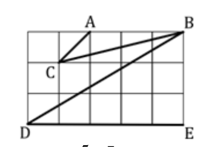{ width=150px }

5. zīm.

<small>
   
* questionType:
* domain:
   
</small>

## Atrisinājums

Pagarinām $CA$ līdz $CF$ tā, ka $\triangle CFB$ ir taisnleņķa trijstūris (skat. $7.$ zīm.). Tad $\frac{CF}{BF}=\frac{DE}{BE}=\frac{5}{3}$

un abi trijstūri $CFB$ un $DBE$ ir taisnleņķa. Tāpēc tie ir līdzīgi un to atbilstošie leņķi $\angle ACB$ un

$\angle BDE$ ir vienādi.

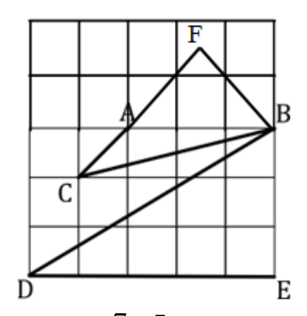{ width=150px }

7. zīm.

# <lo-sample/> LV.SOL.2013.8.4

Tūrists pārgājienā pavadīja $4{,}5$ stundas. Katrā vienu stundu garā laika sprīdī viņš nogāja tieši $4$ kilometrus. Vai noteikti tūrista vidējais ātrums visā pārgājienā bija $4 \, km/h$? Ja nē, tad kāds ir mazākais iespējamais un lielākais iespējamais tūrista vidējais ātrums visā pārgājienā? Atbildi pamatot!

<small>
   
* questionType:
* domain:
   
</small>

## Atrisinājums

Ne obligāti vidējais ātrums visā pārgājienā bija $4$ km/h.

Pēc četrām stundām tūrists noteikti ir veicis $16$ km (jo katrā $1$ stundu garā laika sprīdī ir veikti tieši $4$ km). Pēdējā pusstundā tūrists var veikt jebkuru attālumu no $0$ km līdz $4$ km (vairāk nevar, jo tad pēdējās stundas laikā būtu veikts vairāk nekā $4$ km). Līdz ar to kopējais pārgājienā veiktais attālums var būt jebkurš attālums no $16$ km līdz $20$ km, tātad vidējais ātrums var būt jebkurš no $\frac{16}{4{,}5}=\frac{32}{9}=3\frac{5}{9}$ km/h līdz $\frac{20}{4{,}5}=\frac{40}{9}=4\frac{4}{9}$ km/h. Mazāko no šīm vērtībām var sasniegt, ja, piemēram, pirmajā, trešajā, piektajā, septītajā un devītajā pusstundā nepārvietojas (veic $0$ km), bet otrajā, ceturtajā, sestajā un astotajā pusstundā veic $4$ km. Lielāko vidējā ātruma vērtību var sasniegt, ja, piemēram, pirmajā, trešajā, piektajā, septītajā un devītajā pusstundā veic $4$ km, bet otrajā, ceturtajā, sestajā un astotajā pusstundā nepārvietojas.

# <lo-sample/> LV.SOL.2013.8.5

Cik dažādos veidos $6.$ zīm. var izlasīt vārdu BRĪDINĀJUMS, ja jāsāk lasīt no trijstūra augšējā lauciņa, un visu laiku jāpārvietojas uz blakus lauciņu?  
Par blakus lauciņiem sauc lauciņus, kam ir kopīga mala.

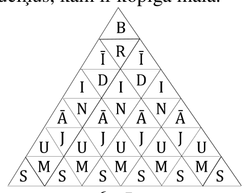{ width=200px }

6. zīm.

<small>
   
* questionType:
* domain:
   
</small>

## Atrisinājums

Ievērosim, ka dažos gadījumos ir iespējama tikai viena pāreja ($\text{B-R}$, $\text{Ī-D}$, $\text{I-N}$, $\text{Ā-J}$, $\text{U-M}$), bet visos citos gadījumos – divas. Ja nodzēsīsim viennozīmīgās robežas, tad iegūsim $8.$ zīmējumu.

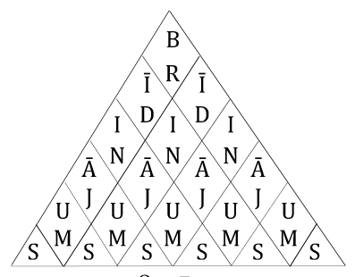{ width=200px }

$8.$ zīm.

Tagad no katra rombiņa ir divi iespējami gājieni. Tā kā pilna vārda izveidošanai nepieciešami pieci gājieni, tad kopējais variantu skaits ir $2^5=32$.

# <lo-sample/> LV.SOL.2013.9.1

Pieci veseli skaitļi $a$, $b$, $c$, $d$ un $e$ ir pēc kārtas sekojoši aritmētiskās progresijas locekļi. Zināms, ka $a$ nav $0$ un ka $b$ un $d$ ir kvadrātvienādojuma $a x^2 + c x + e = 0$ saknes. Noteikt skaitļu $a$, $b$, $c$, $d$ un $e$ vērtības!  
*Paskaidrojums.* Par aritmētisko progresiju sauc skaitļu virkni, kurā katru nākamo locekli iegūst iepriekšējam pieskaitot vienu un to pašu skaitli.

<small>
   
* questionType:
* domain:
   
</small>

## Atrisinājums

No aritmētiskās progresijas definīcijas izteiksim $b$, $c$, $d$ un $e$, izmantojot $a$ un aritmētiskās progresijas diferenci $d$: $b=a+d$, $c=a+2d$, $d=a+3d$ un $e=a+4d$. Tātad dotais kvadrātvienādojums ir $ax^2+(a+2d)x+a+4d=0$ un tā saknes ir $x_1=a+d$, $x_2=a+3d$.

Vienādojuma saknes ir tās $x$ vērtības, kuras ievietojot vienādojumā $x$ vietā, iegūst identitātes. Tātad

$$
a(a+d)^2+(a+2d)(a+d)+a+4d=0 \qquad (*)
$$

$$
a(a+3d)^2+(a+2d)(a+3d)+a+4d=0
$$

No otrā vienādojuma atņemot pirmo, iegūstam

$$
a(2a+4d)\cdot 2d+(a+2d)\cdot 2d=0
$$

jeb

$$
2d(a+2d)(2a+1)=0
$$

Lai reizinājuma vērtība būtu $0$, kādam no reizinātājiem jābūt $0$.

Iespējami trīs gadījumi:

I) $d=0$. Tad no $(*)$ iegūst, ka $a(a^2+a+1)=0$. Tā kā izteiksme iekavās vienmēr ir pozitīva, tad $a=0$, kas ir pretrunā ar uzdevuma nosacījumos doto, ka $a$ nav $0$.

II) $2a+1=0$ jeb $a=-\frac{1}{2}$, kas ir pretrunā ar doto, ka $a$ ir vesels skaitlis.

III) $a+2d=0$ jeb $a=-2d$. Ievietojot $(*)$, iegūstam $(-2d)d^2+2d=0$ jeb $2d(1-d^2)=0$

$d$ nevar būt $0$ (skat I), tāpēc ir divi atrisinājumi: $d_1=1$ un $d_2=-1$.

Atbilstošās doto piecu skaitļu vērtības ir

$1)$ ja $d=1$, tad $a=-2$, $b=-1$, $c=0$, $d=1$ un $e=2$,

$2)$ ja $d=-1$, tad $a=2$, $b=1$, $c=0$, $d=-1$ un $e=-2$.

# <lo-sample/> LV.SOL.2013.9.2

Trijstūrī $ABC$ izvēlēts malas $AB$ iekšējs punkts $D$ un novilkts nogrieznis $CD$. Dots, ka $AB = BC$ un $BD = DC = CA$. Aprēķināt leņķi $\angle ABC$.

<small>
   
* questionType:
* domain:
   
</small>

## Atrisinājums

Apzīmēsim $\angle ABC=x$ un $\angle BAC=y$ (skat. $9.$ zīm.). Tā kā $\triangle ABC$ ir vienādsānu, tad $\angle BCA=\angle BAC=y$; tā kā $\triangle ACD$ ir vienādsānu, tad $\angle CDA=\angle BAC=y$; tā kā $\triangle BDC$ ir vienādsānu, tad $\angle BCD=\angle ABC=x$. $\angle CDA$ ir $\triangle BDC$ ārējais leņķis, tātad $\angle CDA=\angle BCD+\angle DBC$ jeb $y=x+x=2x$. Trijstūra $ABC$ leņķu summa ir $180^{\circ}=y+y+x=2\cdot 2x+x=5x$ un $x=\angle ABC=36^{\circ}$.

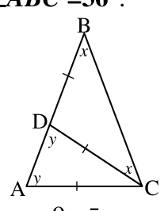{ width=100px }

$9.$ zīm.

# <lo-sample/> LV.SOL.2013.9.3

Ar kādu lielāko skaitļa $2013$ pakāpi dalās skaitlis $1 \cdot 2 \cdot 3 \cdot \ldots \cdot 2012$?

<small>
   
* questionType:
* domain:
   
</small>

## Atrisinājums

Sadalīsim skaitli $2013$ pirmreizinātājos: $2013=3\cdot 11\cdot 61$. Lai noteiktu, ar kādu lielāko $2013$ pakāpi dalās skaitlis $1\cdot 2\cdot 3\cdot \ldots \cdot 2012=2012!$, pietiek noteikt, ar kādu lielāko skaitļa $61$ pakāpi dalās $2012!$ (jo šajā reizinājumā gan skaitļa $3$, gan skaitļa $11$ pakāpes nebūs mazākas par skaitļa $61$ pakāpi). No pirmajiem $2012$ naturālajiem skaitļiem, kas ietilpst reizinājumā $2012!$, ar $61$ dalās $32$ skaitļi: $61$, $122$, ..., $1952$. Neviens no šiem skaitļiem nedalās ar $61^2$ vai augstāku pakāpi. Tātad skaitļa $2013$ lielākā pakāpe, ar kuru dalās $2012!$, ir $32$.

# <lo-sample/> LV.SOL.2013.9.4

Kvadrātveida tabulā ar izmēriem $5 \cdot 5$ rūtiņas katrā rūtiņā ir ierakstīts viens skaitlis. Visu tabulā ierakstīto skaitļu summa ir pozitīvs skaitlis. Pierādīt, ka tabulā var izvēlēties piecas rūtiņas tā, ka nekādas divas neatrodas ne vienā rindiņā ne vienā kolonā, un tajās ierakstīto skaitļu summa ir pozitīva.

<small>
   
* questionType:
* domain:
   
</small>

## Atrisinājums

Nokrāsosim visas tabulas rūtiņas piecās krāsās tā, lai katrā krāsā būtu nokrāsotas tieši $5$ rūtiņas un nekādas divas vienā krāsā nokrāsotās rūtiņas neatrastos vienā rindiņā vai vienā kolonnā (skat., piem., $10.$ zīm.; katra krāsa ir apzīmēta ar citu burtu).  
Ar $a$ apzīmēsim visu piecu A krāsas rūtiņās ierakstīto skaitļu summu, ar $b$ – B krāsas rūtiņās ierakstīto skaitļu summu, ar $c$ – C krāsas rūtiņās ierakstīto skaitļu summu, ar $d$ – D krāsas rūtiņās ierakstīto skaitļu summu un ar $e$ – E krāsas rūtiņās ierakstīto skaitļu summu. Pieņemsim, ka $a\le 0$, $b\le 0$, $c\le 0$, $d\le 0$ un $e\le 0$, tad $a+b+c+d+e\le 0$.  
Bet $a+b+c+d+e>0$, jo tā ir visu tabulā ierakstīto skaitļu summa. Tātad pieņēmums ir aplams un vismaz viens no skaitļiem $a$, $b$, $c$, $d$ vai $e$ ir pozitīvs. Atbilstošās krāsas rūtiņas būs meklētās piecas rūtiņas.

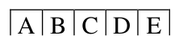{ width=100px }

# <lo-sample/> LV.SOL.2013.9.5

Iedomāsimies, ka uz Zemes ieradušies citplanētieši, un viņiem ir pastāstīts, ka uz Zemes laiku mēra gados, dienās un mēnešos. Pie tam ir zināms, ka:  
$1$) gada ilgums ir $365$ dienas,  
$2$) gads ir sadalīts $28$, $30$ vai $31$ dienu garos mēnešos.  
Vai, zinot **tikai šo informāciju**, citplanētieši var viennozīmīgi noteikt **a)** mēnešu skaitu gadā, **b)** katra veida mēnešu skaitu?

<small>
   
* questionType:
* domain:
   
</small>

## Atrisinājums

a) **Jā, var.** Ja pieņemtu, ka visos mēnešos ir lielākais iespējamais dienu skaits ($31$), tad $11$ šādos mēnešos kopējais dienu skaits būtu $341<365$. Tātad, mēnešu skaits ir lielāks nekā $11$.  
Ja ar $a$ apzīmēsim to mēnešu skaitu, kuros ir $28$ dienas, ar $b$ – to, kuros $30$ dienas, un ar $c$ – to, kuros $31$ diena, tad $13$ mēnešos kopā ir $28(a+b+c)+2b+3c\ge 28\cdot 13+5=369>365$ dienas. Tātad gadā ir tieši **$12$ mēneši**.  
b) **Nevar viennozīmīgi noteikt.** Izmantosim a) gadījumā ieviestos apzīmējumus. Tad $31(a+b+c)-3a-b=365$ jeb $3a+b=31\cdot 12-365=7$. Iespējami divi atrisinājumi: $a=1$, $b=4$, $c=7$ un $a=2$, $b=1$, $c=9$. Tātad viennozīmīgi katra veida mēnešu skaitu noteikt nav iespējams.

# <lo-sample/> LV.SOL.2013.10.1

Atrisināt veselos skaitļos vienādojumu $x^3+y^3-x^2y-xy^2+x^2-y^2-10=0$.

<small>
   
* questionType:
* domain:
   
</small>

## Atrisinājums

Pārveidosim doto vienādojumu.
$$
\begin{aligned}
x^3+y^3-x^2y-xy^2+x^2-y^2&=10\\
(x+y)(x^2-xy+y^2)-xy(x+y)+(x-y)(x+y)&=10\\
(x+y)(x^2-xy+y^2-xy+x-y)&=10\\
(x+y)(x^2-2xy+y^2+x-y)&=10\\
(x+y)((x-y)^2+(x-y))&=10\\
(x+y)(x-y)(x-y+1)&=10
\end{aligned}
$$
*(Pārveidojumus varēja veikt arī, piem., ar grupēšanas paņēmienu.)*  
Tā kā $x$ un $y$ ir veseli skaitļi, tad katrs reizinātājs ir vesels skaitlis. Skaitli $10$ kā trīs veselu skaitļu reizinājumu (līdz precizitātei ar reizinātāju secību) var izteikt septiņos veidos:
$$
10=1\cdot 2\cdot 5=(-1)\cdot(-2)\cdot 5=(-1)\cdot 2\cdot(-5)=1\cdot(-2)\cdot(-5)=
$$
$$
=1\cdot 1\cdot 10=(-1)\cdot(-1)\cdot 10=1\cdot(-1)\cdot(-10)
$$
Ievērosim, ka $(x-y+1)-(x-y)=1$, tātad der tikai tie sadalījumi, kuros ir divi reizinātāji, kas atšķiras par $1$, tādi ir tikai pirmie divi gadījumi. Apskatīsim katru no tiem.
$$
1)\ \begin{cases}
x-y=1\\
x-y+1=2\Rightarrow 2x=6\Rightarrow x=3,\ y=2.\\
x+y=5
\end{cases}
$$
$$
2)\ \begin{cases}
x-y=-2\\
x-y+1=-1\Rightarrow 2x=3\Rightarrow x=1{,}5\text{ – nav vesels skaitlis}.\\
x+y=5
\end{cases}
$$
**Atbilde.** Dotajam vienādojumam ir tikai viens atrisinājums veselos skaitļos $x=3$, $y=2$.

# <lo-sample/> LV.SOL.2013.10.2

Taisnstūra $ABCD$ diagonāle $BD$ ir taisnstūra $BDEF$ mala. Punkts $C$ atrodas uz $EF$. Pierādīt, ka $S_{ABD}=S_{CDE}+S_{BCF}$!

<small>
   
* questionType:
* domain:
   
</small>

## Atrisinājums

Novelkam $CG\perp BD$ (skat. $11.$ zīm.). Tad esam ieguvuši taisnstūrus $BFCG$ un $CEDG$. Jebkura taisnstūra diagonāle sadala to divos vienlielos trijstūros. Tātad $S_{ABD}=S_{BCD}=S_{DCG}+S_{BCG}=S_{CDE}+S_{BCF}$, k.b.j.

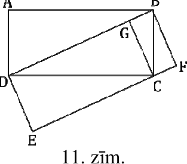{ width=150px }

$11.$ zīm.

# <lo-sample/> LV.SOL.2013.10.3

Pierādīt, ka izteiksmes $19\cdot 8^n+17$ vērtība nav pirmskaitlis nevienai veselai nenegatīvai $n$ vērtībai!

<small>
   
* questionType:
* domain:
   
</small>

## Atrisinājums

Ievērosim, ka visām veselām nenegatīvām $n$ vērtībām $19\cdot 8^n+17\ge 19+17=36$.

Aplūkosim izteiksmes vērtību pēc moduļa $9$: $19\cdot 8^n+17\equiv 1\cdot (9-1)^n-1\equiv (9-1)^n-1\pmod{9}$.

Ja $n=2k$, tad dotās izteiksmes vērtība dalās ar $9$.

Aplūkosim izteiksmes vērtību, ja $n=2k+1$. Tad $19\cdot 8\cdot 64^k+17=152\cdot 64^k+17$.

Apskatīsim šīs izteiksmes vērtību pēc moduļa $13$: $152\cdot 64^k+17\equiv 9\cdot (65-1)^k+4\pmod{13}$

Ja $k$ ir pāra skaitlis, tad izteiksme dalās ar $13$.

Apskatīsim šīs izteiksmes vērtību pēc moduļa $5$: $152\cdot 64^k+17\equiv 2\cdot (65-1)^k+2\pmod{5}$.

Ja $k$ ir nepāra skaitlis, tad izteiksme dalās ar $5$.

Tātad nevienai veselai nenegatīvai $n$ vērtībai izteiksmes vērtība nav pirmskaitlis.

# <lo-sample/> LV.SOL.2013.10.4

Atrast visus naturālos skaitļus, kuros ir vairāk nekā četri cipari, kas beidzas ar $2013$ un, ja šim skaitlim nodzēš pēdējos četrus ciparus, tad tas samazinās veselu skaitu reižu!

<small>
   
* questionType:
* domain:
   
</small>

## Atrisinājums

Apzīmēsim meklējamo skaitli ar $a\cdot 10^4+2013$ ($a$ – naturāls skaitlis), tad pēc nodzēšanas paliek skaitlis $a$. $\frac{a\cdot 10^4+2013}{a}=10^4+\frac{2013}{a}$. Tātad skaitlim $a$ jābūt skaitļa $2013$ dalītājam. $2013=3\cdot 11\cdot 61$, tātad skaitļa $2013$ visi dalītāji ir $1$, $3$, $11$, $33$, $61$, $183$, $671$, $2013$ un meklētie skaitļi ir **$12013$**, **$32013$**, **$112013$**, **$332013$**, **$612013$**, **$1832013$**, **$6712013$** un **$20132013$**.

# <lo-sample/> LV.SOL.2013.10.5

Tabulā ar izmēriem $4 \times 4$ rūtiņas katrā rūtiņā ir ierakstīts skaitlis $1$, $2$ vai $3$. Ja divās rūtiņās ar kopīgu malu vai stūri ir ierakstīts viens un tas pats skaitlis, tad teiksim, ka veidojas *pāris*. Noskaidrot, kāds var būt minimālais *pāru* skaits šajā tabulā.

<small>
   
* questionType:
* domain:
   
</small>

## Atrisinājums

Katrā tabulas $2\times 2$ rūtiņu kvadrātā būs vismaz $2$ vienādi skaitļi (seko no Dirihlē principa), tāpēc būs vismaz $1$ pāris. Katros divos $2\times 2$ rūtiņu kvadrātos, kuriem nav vairāk par $1$ kopīgu rūtiņu, būs vismaz $2$ pāri. Tāpēc visā $4\times 4$ rūtiņu tabulā būs vismaz $5$ pāri (pa vienam katrā $2\times 2$ rūtiņu kvadrātā, kas satur kādu stūra rūtiņu un $2\times 2$ rūtiņu “centrālajā” kvadrātā). Tabulā var būt tieši $5$ pāri, kā redzams $12.$ zīmējumā. Tas arī ir mazākais iespējamai pāru skaits.

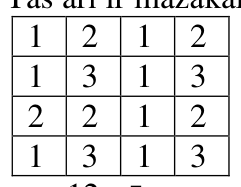{ width=100px }

$12.$ zīm.

# <lo-sample/> LV.SOL.2013.11.1

Pierādīt, ka nav tādas ģeometriskās progresijas, kas satur visus trīs skaitļus $1$, $\sqrt{2}$ un $\sqrt[3]{3}$.

<small>
   
* questionType:
* domain:
   
</small>

## Atrisinājums

Pieņemsim, ka ir tāda ģeometriskā progresija, kuras locekļi ir visi trīs dotie skaitļi. Tā kā $1<\sqrt{2}<\sqrt[3]{3}$, tad varam uzskatīt, ka $b_1=1$. Tad no ģeometriskās progresijas vispārīgā locekļa formulas $b_{n+1}=b_1q^n$ seko, ka $\sqrt{2}=q^a$ un $\sqrt[3]{3}=q^b$, kur $q$ ir kvocients un $a$, $b$ – naturāli skaitļi.

No pirmās vienādības izriet, ka $q=2^{\frac{1}{2a}}$. Ievietojot šo sakarību vienādībā $\sqrt[3]{3}=q^b$, iegūstam $\sqrt[3]{3}=2^{\frac{b}{2a}}$. Izteiksim mainīgo $b$: $\frac{b}{2a}=\log_2\sqrt[3]{3}$ jeb $b=\frac{2}{3}a\log_2 3$. Tā kā $a$ ir naturāls skaitlis, bet $\log_2 3$ nav racionāls skaitlis, tad $b$ nav naturāls skaitlis, pretruna.

Tātad nav tādas ģeometriskās progresijas, kas satur visus trīs skaitļus $1$, $\sqrt{2}$ un $\sqrt[3]{3}$.

# <lo-sample/> LV.SOL.2013.11.2

Četrstūris $ABCD$ ievilkts riņķa līnijā. Tā diagonāles $AC$ un $BD$ vienlaikus ir attiecīgi leņķu $\angle BAD$ un $\angle CDA$ bisektrises. Vai $ABCD$ noteikti ir kvadrāts?

<small>
   
* questionType:
* domain:
   
</small>

## Atrisinājums

**Nē, ne obligāti.** Šī īpašība ir spēkā arī vienādsānu trapecēm, kuru īsākais pamats ir vienāds ar sānu malu garumu (skat. 13. zīm.).

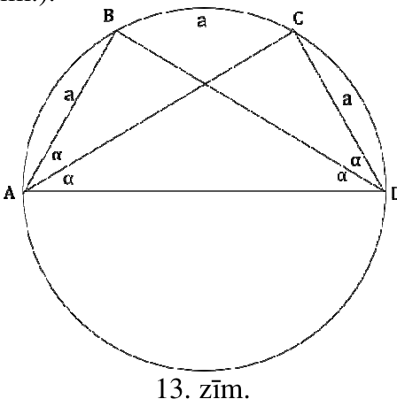{ width=200px }

13. zīm.

# <lo-sample/> LV.SOL.2013.11.3

Pierādīt, ka ir bezgalīgi daudz tādu naturālu skaitļu $k$, ka $11k-2$ ir skaitļa $3$ pakāpe.

<small>
   
* questionType:
* domain:
   
</small>

## Atrisinājums

Aplūkosim, kādi ir trijnieka pakāpju atlikumi pēc moduļa $11$.  
$3^1 \equiv 3 \pmod{11}$, $3^2 \equiv 9 \pmod{11}$, $3^3 \equiv 5 \pmod{11}$, $3^4 \equiv 4 \pmod{11}$, $3^5 \equiv 1 \pmod{11}$, tālāk pakāpju vērtības cikliski atkārtosies un katram naturālam $m$ pakāpes $3^{5m-3} \equiv 9 \pmod{11}$ jeb $3^{5m-3}+2$ dalās ar $11$ un šis dalījums ir atbilstošā $k$ vērtība. Tā kā $m$ vērtība var būt jebkurš naturāls skaitlis, tad arī atbilstošo $k$ vērtību ir bezgalīgi daudz.

# <lo-sample/> LV.SOL.2013.11.4

Regulāra trijstūra režģa (skat. 7. zīm.) katra no desmit virsotnēm nokrāsota sarkanā vai zaļā krāsā. Pierādīt, ka ir iespējams atrast regulāru trijstūri, kura visas virsotnes ir nokrāsotas vienā krāsā! Trīsstūra malas var nebūt paralēlas režģa malām.

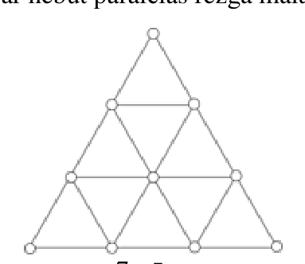{ width=200px }

7. zīm.

<small>
   
* questionType:
* domain:
   
</small>

## Atrisinājums

Tā kā virsotnes $2$, $6$ un $8$ atrodas viena regulāra trijstūra virsotnēs, tad divām no tām jābūt vienā, bet vienai – otrā krāsā (skat. 14. zīm.). Simetrijas dēļ var pieņemt, ka virsotnes $2$ un $6$ ir krāsā $A$, bet virsotne $8$ – krāsā $B$. Aplūkosim, kādā krāsā var būt virsotne $3$.  
1) Virsotne $3$ ir krāsā $A$. Lai virsotnes $2$, $3$ un $5$ nebūtu vienā krāsā, tad $5$ jābūt krāsā $B$. Lai virsotnes $5$, $8$ un $9$ nebūtu vienā krāsā, virsotnei $9$ jābūt krāsā $A$. Lai $5$, $8$ un $4$ nebūtu vienā krāsā, virsotnei $4$ jābūt krāsā $A$. Bet tad virsotnes $3$, $4$ un $9$ veido regulāru trijstūri, kur visas virsotnes ir krāsā $A$.  
2) Virsotne $3$ ir krāsā $B$. Vismaz vienai no virsotnēm $4$ un $9$ ir jābūt krāsā $A$ (citādi veidosies vienkrāsains trijstūris ar virsotnēm $3$, $4$, $9$). Lai neveidotos vienkrāsains trijstūris ar virsotnēm $8$, $4$, $5$ vai $8$, $9$, $5$, virsotnei $5$ jābūt krāsā $B$. Lai neveidotos vienkrāsaini trijstūri $8$, $4$, $5$ un $8$, $9$, $5$, gan $4$, gan $9$ jābūt krāsā $A$. Atkarībā no virsotnes $10$ krāsas veidojas vienkrāsains regulārs trijstūris $10$, $6$, $9$ (ja $10$ ir krāsā $A$) vai $10$, $3$, $8$, (ja $10$ ir krāsā $B$).

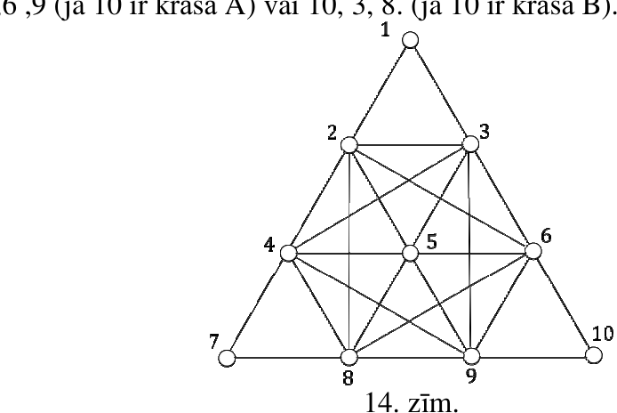{ width=300px }

14. zīm.

# <lo-sample/> LV.SOL.2013.11.5

Pierādīt, ka bezgalīgā rūtiņu lapā var novilkt riņķa līniju, kuras iekšpusē atrodas tieši $2012$ rūtiņu virsotnes.

<small>
   
* questionType:
* domain:
   
</small>

## Atrisinājums

Rūtiņu lapā ieviesīsim koordinātu sistēmu tā, ka punkts $(0;0)$ atrodas kādas rūtiņas virsotnē, koordinātu asis paralēlas rūtiņu malām un rūtiņas malas garums ir $1$ vienība, tad visām rūtiņu virsotnēm abas koordinātas ir veseli skaitļi. Apskatīsim riņķa līniju, kuras centrs punktā $A(\sqrt{2};\sqrt{3})$ un rādiuss ir $0{,}01$; šīs riņķa līnijas iekšpusē neatrodas neviena rūtiņu virsotne. Pakāpeniski „izpletīsim” šo riņķa līniju, nemainot tās centru, bet tikai nepārtraukti palielinot rādiusu. Pamatosim, ka šādā procesā **riņķa līnijas iekšpusē vienā laika momentā var „ienākt” ne vairāk kā viena rūtiņas virsotne.**

Vienlaicīgi riņķa līnijas iekšpusē varētu ienākt divas vai vairāk virsotnes tikai tad, ja būtu divas vai vairāk virsotnes, attālumi līdz kurām no punkta $A$ būtu vienādi. Pieņemsim pretējo, ka ir tādas divas dažādas rūtiņu virsotnes $M(a;b)$ un $N(c;d)$ ($a$, $b$, $c$, $d$ – veseli skaitļi, pie tam $a\ne c$ vai $b\ne d$), ka $MA=NA$.

$MA^2=(a-\sqrt{2})^2+(b-\sqrt{3})^2$ un $NA^2=(c-\sqrt{2})^2+(d-\sqrt{3})^2$, tad

$$(a-\sqrt{2})^2+(b-\sqrt{3})^2=(c-\sqrt{2})^2+(d-\sqrt{3})^2$$

$$a^2-2a\sqrt{2}+2+b^2-2b\sqrt{3}+3=c^2-2c\sqrt{2}+2+d^2-2d\sqrt{3}+3$$

$$a^2+b^2-c^2-d^2=2\sqrt{2}(a-c)+2\sqrt{3}(b-d)$$

Pēdējās vienādības kreisās puses izteiksme ir vesels skaitlis, bet labās puses izteiksme ir vesels skaitlis tikai tad, ja vienlaicīgi $a=c$ un $b=d$, t.i., punkti $M$ un $N$ sakrīt – pretruna.

Tātad augstāk aprakstītā procesa rezultātā kaut kad iestāsies tāds brīdis, kad riņķa līnijas iekšpusē atradīsies tieši $2012$ punkti.

# <lo-sample/> LV.SOL.2013.12.1

Kāda ir izteiksmes $\frac{a}{b+1}+\frac{b}{a+1}$ mazākā iespējamā vērtība, ja $a$ un $b$ ir naturāli skaitļi?

<small>
   
* questionType:
* domain:
   
</small>

## Atrisinājums

Minimālā vērtība ir $1$, ko iegūst ņemot $a=b=1$. Var pieņemt, ka $b\ge a$. Tad

$$\frac{b}{a+1}\ge\frac{b}{b+1}\Rightarrow\frac{a}{b+1}+\frac{b}{a+1}\ge\frac{1}{b+1}+\frac{b}{b+1}=1.$$

# <lo-sample/> LV.SOL.2013.12.2

Uz paralelograma $ABCD$ malas $AB$ izvēlēts punkts $E$, bet uz malas $BC$ – punkts $F$ (skat. $8.$ zīm.). Nogriežņu $DE$ un $AF$ krustpunkts ir $G$, bet $EC$ krustpunkti ar $AF$ un $DF$ ir attiecīgi punkti $H$ un $I$. Pierādīt, ka $S_{DGHI}=S_{AGE}+S_{EBFH}+S_{CFI}$.

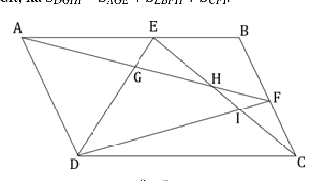{ width=300px }

$8.$ zīm.

<small>
   
* questionType:
* domain:
   
</small>

## Atrisinājums

$$S_{AFD}=\frac{S_{ABCD}}{2}=S_{AED}+S_{EBC}$$

$$S_{AFD}=S_{AGD}+S_{DGHI}+S_{FHI}$$

$$S_{AED}+S_{EBC}=S_{AGD}+S_{AGE}+S_{EBFH}+S_{FHI}+S_{CFI}$$

$$S_{AGD}+S_{DGHI}+S_{FHI}=S_{AGD}+S_{AGE}+S_{EBFH}+S_{FHI}+S_{CFI}$$

Vienkāršojot, iegūstam:

$$S_{DGHI}=S_{AGE}+S_{EBFH}+S_{CFI},$$

k.b.j.

# <lo-sample/> LV.SOL.2013.12.3

Naturālu skaitļu virknes pirmie trīs locekļi ir vienādi ar $1$, bet katrs nākamais loceklis ir vienāds ar trīs iepriekšējo skaitļu summu. Vai ar $5$ dalās šīs virknes a) $111.$; b) $2012.$ loceklis?

<small>
   
* questionType:
* domain:
   
</small>

## Atrisinājums

Aplūkosim, kāds ir virknes katra elementa atlikums, dalot ar $5$:

$$1,\ 1,\ 1,\ 3,\ 0,\ 4,\ 2,\ 1,\ 2,\ 0,\ 3,\ 0,\ 3,\ 1,\ 4,\ 3,\ 3,\ 0,\ 1,\ 4,\ 0,\ 0,\ 4,\ 4,\ 3,\ 1,\ 3,\ 2,\ 1,\ 1,\ 4,\ 1,\ 1,\ 1,\ldots$$

Tātad atlikumu virkne ir periodiska ar periodu $31$. Tas nozīmē, ka dotās virknes $111.$ locekļa atlikums sakrīt ar virknes $18.$ locekļa atlikumu, tas ir $0$, bet virknes $2012.$ locekļa atlikums sakrīt ar $28.$ locekļa atlikumu, tas ir $2$. Tātad dotās virknes $111.$ loceklis dalās ar $5$, bet $2012.$ loceklis – **nedalās**.

# <lo-sample/> LV.SOL.2013.12.4

Lauka forma ir taisnstūris ar malu garumiem $4\ \mathrm{km}$ un $6\ \mathrm{km}$. Tajā ir uzceltas $5$ mājas. Pierādīt, ka, neatkarīgi no māju izvietojuma, varēs uzbūvēt ceļus, pa kuriem no jebkuras mājas var nokļūt uz jebkuru citu un ceļu kopējais garums nepārsniegs $15\ \mathrm{km}$.

<small>
   
* questionType:
* domain:
   
</small>

## Atrisinājums

Apskatām nogriezni, kas savieno taisnstūra to malu, kuru garums ir $4$ km, viduspunktus. Gadījumā, ja kādas mājas attālums līdz šim nogrieznim nepārsniedz $1$ km, tad, uzbūvējot ceļu pa šo nogriezni, un no katras mājas īsāko ceļu līdz šim nogrieznim, kopējais izbūvēto ceļu garums nepārsniegs $6+1+4\cdot2=15$ km. Ja attālums no katras mājas līdz novilktajam nogrieznim pārsniedz $1$ km, tad nogriezni pārbīdīsim par $1$ km uz to pusi, kur ir vairāk māju (nogriežņa vienā pusē būs vismaz $3$ mājas). Uzbūvējot no katras mājas īsāko nogriezni līdz šim nogrieznim, kopējais garums nepārsniegs $6+3\cdot1+2\cdot3=15$ km.

# <lo-sample/> LV.SOL.2013.12.5

Naturālu skaitli sauksim par *jokainu*, ja tā pieraksts sastāv tikai no cipariem $1$, $3$, $5$, $7$ un $9$, pie tam jebkuru divu blakus ciparu starpība ir tieši $2$. Piemēram, skaitļi $5797$, $31353575$ un $9$ ir *jokaini*. Aprēķināt, cik ir *jokainu* a) $11$-ciparu, b) $2012$-ciparu skaitļu!

<small>
   
* questionType:
* domain:
   
</small>

## Atrisinājums

Zināms, ka ir pieci jokaini viencipara skaitļi: $1$, $3$, $5$, $7$ un $9$. Varam uzskatīt, ka ir pa vienam viencipara skaitlim, kas **beidzas** ar katru no nepāra cipariem. Jokainais $n$-ciparu skaitlis var beigties ar $1$ tikai tad, ja $n-1$ ciparu skaitlis beidzas ar $3$ (pie tam $n-1$ ciparu skaitlim arī jābūt jokainam); $n$-ciparu skaitlis var beigties ar $3$ tikai tad, ja $n-1$ ciparu skaitlis beidzas ar $1$ vai $5$, utt. Pieņemsim, ka $a$ ir $k$-ciparu jokaino skaitļu skaits, kas beidzas ar $1$ vai $9$, $b$ ir $k$-ciparu skaitļu skaits, kas beidzas ar $3$ vai $7$ un $c$ ir $k$-ciparu skaitļu skaits, kas beidzas ar $5$. Pierakstīsim to šādi:

$$
\begin{pmatrix}
a\\
b\\
c\\
b\\
a
\end{pmatrix}
$$

$i$-tajā rindā rakstīts to skaitļu skaits, kas beidzas ar $2i-1$.

Aplūkosim, cik ir $k+1$, $k+2$ un $k+3$ ciparu jokaino skaitļu, kas beidzas attiecīgi ar cipariem $1$, $3$, $5$, $7$, $9$:

$$
\underbrace{
\begin{pmatrix}
a\\
b\\
c\\
b\\
a
\end{pmatrix}
}_{k\ \text{ciparu sk.}}
\Rightarrow
\underbrace{
\begin{pmatrix}
b\\
a+c\\
2b\\
a+c\\
b
\end{pmatrix}
}_{k+1\ \text{ciparu sk.}}
\Rightarrow
\underbrace{
\begin{pmatrix}
a+c\\
3b\\
2a+2c\\
3b\\
a+c
\end{pmatrix}
}_{k+2\ \text{ciparu sk.}}
\Rightarrow
\underbrace{
\begin{pmatrix}
3b\\
3(a+c)\\
6b\\
3(a+c)\\
3b
\end{pmatrix}
}_{k+3\ \text{ciparu sk.}}
$$

Viegli ievērot, ka īpašības „skaitļu, kas beidzas ar $1$ vai ar $9$, skaits ir vienāds” un „skaitļu, kas beidzas ar $3$ vai ar $7$, skaits ir vienāds” saglabājas arī pieaugot skaitļa ciparu skaitam. Ievērosim arī, ka skaitļu skaits, kas beidzas ar noteiktu ciparu, $k+3$ ciparu skaitļu gadījumā ir tieši trīs reizes lielāks kā $k+1$ ciparu skaitļu gadījumā. Tāpat $k+5$ ciparu jokaino skaitļu būs trīsreiz vairāk kā $k+3$ ciparu jokaino skaitļu, utt.

Tātad $(k+2m+1)$–ciparu jokaino skaitļu ($m \ge 0$) skaits ar noteiktu pēdējo ciparu būs
$3^m
\begin{pmatrix}
b\\
a+c\\
2b\\
a+c\\
b
\end{pmatrix}$

un kopējais jokaino skaitļu skaits ir

$$
2(a+2b+c)3^m, \tag{1}
$$

bet $(k+2m+2)$–ciparu jokaino skaitļu ($m \ge 0$) skaits ar noteiktu pēdējo ciparu būs
$3^m
\begin{pmatrix}
a+c\\
3b\\
2a+2c\\
3b\\
a+c
\end{pmatrix}$

un kopējais jokaino skaitļu skaits ir

$$
2(2a+3b+2c)3^m. \tag{2}
$$

Ja $k=1$, tad jokaino viencipara skaitļu skaits ir
$\begin{pmatrix}
1\\
1\\
1\\
1\\
1
\end{pmatrix}$, jeb $a=b=c=1$ un ir spēkā visi iepriekš izteiktie spriedumi.

Ja $n=11$ un $k=1$, tad $m=4$, un pēc formulas $(2)$ iegūstam, ka kopējais jokaino $11$-ciparu skaitļu skaits ir $2(2+3+2)3^4=14\cdot 81=1134$.

Ja $n=2012$ un $k=1$, tad $m=1005$ un pēc formulas $(1)$ iegūstam, ka kopējais jokaino $2012$-ciparu skaitļu skaits ir $2(1+2+1)3^{1005}=8\cdot 3^{1005}$.
