# <lo-sample/> LV.SOL.2014.7.1

Cik dažādos veidos var izvēlēties veselus skaitļus $a$ un $b$ tā, ka
$$|a|+|b|<6\ ?$$

<small>
   
* questionType:
* domain:
   
</small>

## Atrisinājums

Ja $a=0$, tad $b$ var pieņemt $11$ vērtības $0$, $\pm 1$, $\pm 2$, $\pm 3$, $\pm 4$, $\pm 5$.

Ja $a=\pm 1$, tad $b$ var pieņemt $9$ vērtības.

Ja $a=\pm 2$, tad $b$ var pieņemt $7$ vērtības, utt.

Tātad dažādo iespēju skaits ir $11+2\cdot 9+2\cdot 7+2\cdot 5+2\cdot 3+2\cdot 1=61$.

# <lo-sample/> LV.SOL.2014.7.2

Sagriez $1.$ zīm. attēloto figūru divās vienādās daļās (iekrāsotā rūtiņa ir caurums). Par vienādām uzskatāmas arī tādas figūras, kuras var iegūt vienu no otras „apgāžot otrādi”.

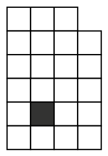{ width=100px }

$1.$ zīm.

<small>
   
* questionType:
* domain:
   
</small>

## Atrisinājums

Skat. 3. zīm.

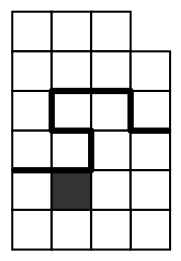{ width=100px }

3. zīm.

# <lo-sample/> LV.SOL.2014.7.3

Vai var atrast tādus trīs naturālus skaitļus $a$, $b$ un $c$, ka $(a+b)(b+c)(c+a)=20142013$?

<small>
   
* questionType:
* domain:
   
</small>

## Atrisinājums

Nē, šādus skaitļus atrast nevar.

Tā kā vismaz divi no skaitļiem $a$, $b$, $c$ ir ar vienādu paritāti, tad vismaz viens no reizinātājiem $a+b$, $b+c$ vai $c+a$ ir pāra skaitlis. Tātad arī reizinājums ir pāra skaitlis. Iegūta pretruna, jo $20142013$ ir nepāra skaitlis.

# <lo-sample/> LV.SOL.2014.7.4

Dotas $8$ pēc ārējā izskata vienādas monētas. No tām $7$ ir ar vienādu masu, bet vienas monētas masa ir citāda. Doti arī sviras svari bez atsvariem. Kā ar $3$ svēršanu palīdzību atrast atšķirīgo monētu?

<small>
   
* questionType:
* domain:
   
</small>

## Atrisinājums

Novietojam uz katra svaru kausa pa divām monētām. Ja kausi nav līdzsvarā, tad atšķirīgā monēta ir starp šīm četrām. Ja ir līdzsvarā, tad starp atlikušajām četrām. Atrastas četras monētas, starp kurām ir atšķirīgā.

Novietojam uz kausiem pa vienai no tām. Ja kausi nav līdzsvarā, tad atšķirīgā monēta ir starp šīm divām. Ja ir līdzsvarā, tad starp atlikušajām divām. Atrastas divas monētas, starp kurām ir atšķirīga.  
Vienu no tām salīdzinām ar kādu no atrastajām īstajām un noskaidrojam, kura no atlikušajām divām ir atšķirīga.

# <lo-sample/> LV.SOL.2014.7.5

Konferencē piedalījās $17$ zinātnieki. Katrs no viņiem konstatēja, ka konferencē vismaz $8$ zinātnieki ir viņa radinieki. Pierādīt, ka visi $17$ zinātnieki ir radinieki.

<small>
   
* questionType:
* domain:
   
</small>

## Atrisinājums

Aplūkosim divus zinātniekus $A$ un $B$. Pierādīsim, ka viņi ir radinieki. Pieņemsim pretējo, ka $A$ un $B$ nav radinieki. Tad atlikuši ir $15$ zinātnieki, starp kuriem ir $8$ $A$ radinieki un $8$ $B$ radinieki; tā kā kopā sanāk $16$ cilvēki, tad starp tiem ir kopīgs zinātnieks $C$ – viņš ir gan $A$ radinieks, gan $B$ radinieks. Bet tādā gadījumā arī $A$ un $B$ ir radinieki. Iegūta pretruna; tātad jebkuri divi zinātnieki konferencē ir radinieki.

# <lo-sample/> LV.SOL.2014.8.1

Vai naturālos skaitļus no $1$ līdz $25$ ieskaitot var izrakstīt rindā katru vienu reizi, tā, lai katri divi blakus uzrakstīti skaitļi atšķirtos viens no otra vai nu par $2$, vai par $3$?

<small>
   
* questionType:
* domain:
   
</small>

## Atrisinājums

Jā, var. Piemēram, šādi:  
$1, 3, 5, 2, 4, 6, 8, 10, 7, 9, 11, 13, 15, 12, 14, 16, 18, 20, 17, 19, 21, 23, 25, 22, 24$.

# <lo-sample/> LV.SOL.2014.8.2

Katram no trijstūriem $ABC$ un $ADE$ visi leņķi ir $60^{\circ}$ lieli (skat. $2$. zīm.). Pierādīt, ka $BD=CE$.

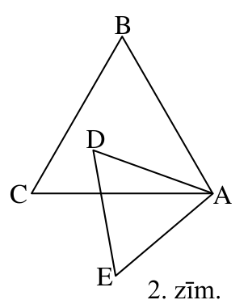{ width=150px }

2. zīm.

<small>
   
* questionType:
* domain:
   
</small>

## Atrisinājums

Tā kā trijstūrī pret vienādiem leņķiem atrodas vienādas malas, tad $AE=AD$ un $AC=AB$ (skat. 4. zīm.). Bez tam $\angle EAC=60^{\circ}-\angle CAD=\angle DAB$. Tāpēc $\triangle EAC=\triangle DAB$ pēc pazīmes „mlm”, un no tā seko, ka $EC=DB$.

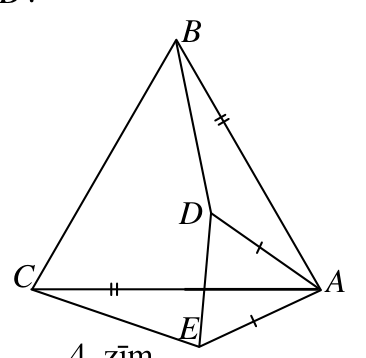{ width=150px }

4. zīm.

# <lo-sample/> LV.SOL.2014.8.3

Haotiskais profesors no somas izvelk caurspīdīgu kodoskopa plēvi, uz kuras ir tāds attēls kā parādīts $3$. zīm. Viņš zina, ka no attēlotajām taisnēm divas ir koordinātu asis, bet pārējās – funkciju $y=2x$, $y=x$, $y=-x$, $y=\frac{1}{2}x$ grafiki. Profesors ir aizmirsis, kuras ir asis, kā arī kura ir plēves augšpuse.  
Par kurām funkcijām var noteikti pateikt, kurš no dotajiem ir tās grafiks?

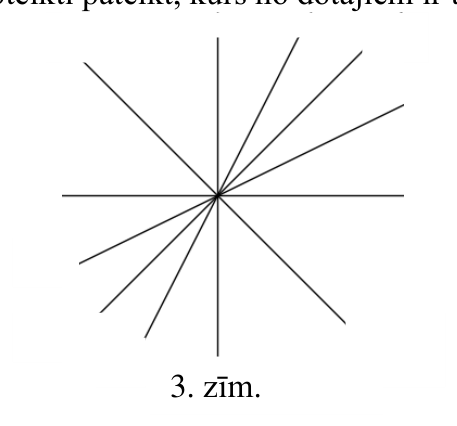{ width=200px }

3. zīm.

<small>
   
* questionType:
* domain:
   
</small>

## Atrisinājums

Apzīmēsim visas taisnes (skat. 5. zīm.).

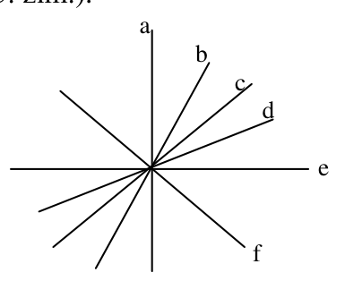{ width=200px }

5. zīm.

Koordinātu asu pāris var būt tikai $(a,e)$ vai $(c,f)$ (jo tie ir vienīgie savstarpēji perpendikulārie taisņu pāri). Otrais gadījums nav iespējams, jo triju funkciju grafikiem jāiet caur pirmo un trešo kvadrantu.  
Tātad koordinātu asis ir $a$ un $e$. Skaidrs, ka $c$ ir funkcijas $y=x$ grafiks un $f$ ir funkcijas $y=-x$ grafiks.  
Kura no taisnēm $b$ un $d$ ir kuras atlikušās funkcijas grafiks, noskaidrot nevar, jo nav zināms, kura no taisnēm $a$ vai $e$ ir abscisu ass (jo kodoskopa plēve ir caurspīdīga un to var apskatīt no abām pusēm).

# <lo-sample/> LV.SOL.2014.8.4

Ar $\overline{xyz}$ apzīmēsim trīsciparu skaitli ar cipariem $x$ (simti), $y$ (desmiti) un $z$ (vieni). Pierādīt: ja $\overline{abc}$ dalās ar $37$, tad arī $\overline{bca}+\overline{cab}$ dalās ar $37$.

<small>
   
* questionType:
* domain:
   
</small>

## Atrisinājums

Ievērosim, ka
$$
\overline{abc}+\overline{bca}+\overline{cab}=
$$
$$
=(100a+10b+c)+(100b+10c+a)+(100c+10a+b)=
$$
$$
=111\cdot(a+b+c)=3\cdot37\cdot(a+b+c).
$$
Tātad $\overline{bca}+\overline{cab}=3\cdot37\cdot(a+b+c)-\overline{abc}$ dalās ar $37$.

# <lo-sample/> LV.SOL.2014.8.5

Vairākās kaudzītēs kopā ir $58$ sērkociņi; nevienā kaudzītē nav mazāk kā $1$ sērkociņš un nav vairāk kā $12$ sērkociņi.  
Pierādīt: vai nu ir divas kaudzītes, kurās ir vienāds sērkociņu skaits, vai arī ir divas kaudzītes, kurās kopā ir tieši $13$ sērkociņi.

<small>
   
* questionType:
* domain:
   
</small>

## Atrisinājums

Pieņemam pretējo tam, kas jāpierāda. Tad no katra skaitļu pāra $(1; 12)$, $(2; 11)$, $(3; 10)$, $(4; 9)$, $(5; 8)$, $(6; 7)$ augstākais viens var būt sērkociņu skaits kādā kaudzītē. Tāpēc sērkociņu nav vairāk kā $7+8+9+10+11+12=57$ – pretruna.

# <lo-sample/> LV.SOL.2014.9.1

Pierādīt, ka
$$
\frac{1}{1 \cdot 2}+\frac{1}{2 \cdot 3}+\frac{1}{3 \cdot 4}+\frac{1}{4 \cdot 5}+\frac{1}{5 \cdot 6}+\frac{1}{6 \cdot 7}+\frac{1}{7 \cdot 8}+\frac{1}{8 \cdot 9}+\frac{1}{9 \cdot 10}=\frac{9}{10}.
$$

<small>
   
* questionType:
* domain:
   
</small>

## Atrisinājums

Visiem skaitļiem $n$ izpildās vienādība
$$
\frac{1}{n\cdot(n+1)}=\frac{1}{n}-\frac{1}{n+1}.
$$
Tāpēc
$$
\frac{1}{1\cdot2}+\frac{1}{2\cdot3}+\frac{1}{3\cdot4}+\cdots+\frac{1}{9\cdot10}=
$$
$$
\left(\frac{1}{1}-\frac{1}{2}\right)+\left(\frac{1}{2}-\frac{1}{3}\right)+\left(\frac{1}{3}-\frac{1}{4}\right)+\cdots+\left(\frac{1}{9}-\frac{1}{10}\right)=\frac{1}{1}-\frac{1}{10}=\frac{9}{10}.
$$
Pārējās daļas saīsinās.

# <lo-sample/> LV.SOL.2014.9.2

Šaurleņķu trijstūrī $ABC$ novilkts augstums $BH$. Ir zināms, ka $AC=BH$ un četrstūri $AMNH$ un $HCEF$ ir kvadrāti (skat. 4. zīm.) Pierādīt, ka taisnes $AE$, $CM$ un $BH$ krustojas vienā punktā.

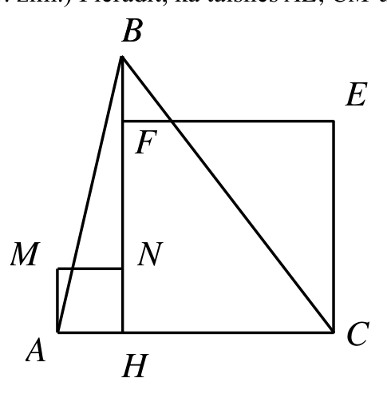{ width=250px }

4. zīm.

<small>
   
* questionType:
* domain:
   
</small>

## Atrisinājums

Pierādīsim, ka $AE\perp BC$ (skat. $6.$ zīm.).

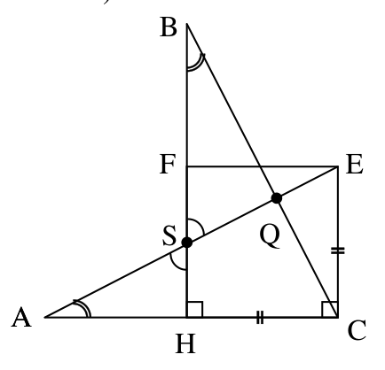{ width=200px }

$6.$ zīm.

No $CE=HC$ un $AC=BH$ seko, ka $\triangle ACE=\triangle BHC$ (pēc taisnleņķu trijstūru vienādības pazīmes „$kk$”). Tāpēc $\angle QBS=\angle HAS$ kā atbilstošie leņķi vienādos trijstūros. $\angle BSQ=\angle ASH$ kā krustleņķi. Tāpēc $\angle BQS=\angle AHS=90^{\circ}$. Tātad $AE\perp BC$ jeb $AQ$ ir trijstūra $ABC$ augstums. Līdzīgi pierāda, ka $CM\perp AB$ un $CM$ ir trijstūra $ABC$ augstums. Vajadzīgais seko no fakta, ka trijstūra augstumi krustojas vienā punktā.

# <lo-sample/> LV.SOL.2014.9.3

Dots, ka $a$ un $b$ ir naturāli skaitļi un $a+b=210$. Pierādīt, ka $ab$ nedalās ar $210$.

<small>
   
* questionType:
* domain:
   
</small>

## Atrisinājums

Pieņemsim pretējo, ka $a\cdot b$ dalās ar $210$.

Ievērosim, ka $210=2\cdot3\cdot5\cdot7$. Ar $p$ apzīmēsim jebkuru no pirmskaitļiem $2$, $3$, $5$, $7$. Tad $a\cdot b$ dalās ar $p$. Tātad vismaz viens no skaitļiem $a$, $b$ dalās ar $p$. Tā kā $a+b=210$ dalās ar $p$, tad arī otrs skaitlis dalās ar $p$.

Tātad gan $a$, gan $b$ dalās ar $2\cdot3\cdot5\cdot7=210$, bet tādā gadījumā $a\geq210$, $b\geq210$ un $a+b>210$. Iegūta pretruna.

# <lo-sample/> LV.SOL.2014.9.4

Dots, ka $x$ un $y$ – naturāli skaitļi un $x+y$ ir nepāra skaitlis. Zināms, ka katrā skaitļu ass punktā ar veselu koordināti dzīvo pa rūķītim: dažos punktos – votivapas, pārējos – šillišallas. Pierādīt, ka eksistē tādi divi vienas cilts rūķīši, starp kuriem attālums ir vai nu $x$, vai $y$.

<small>
   
* questionType:
* domain:
   
</small>

## Atrisinājums

Pieņemsim pretējo. Viens no skaitļiem $x$ un $y$ ir pāra, otrs – nepāra; pieņemsim, ka $x$ – pāra, $y$ – nepāra.

Ja punktā $0$ dzīvo votivapa, punktā $1\cdot x$ dzīvo šillišalla, punktā $2\cdot x$ – votivapa, punktā $3\cdot x$ – šillišalla, ..., punktā $y\cdot x$ – šillišalla. No otras puses, punktā $1\cdot y$ dzīvo šillišalla, punktā $2\cdot y$ – votivapa, ..., punktā $x\cdot y$ – votivapa. Iegūta pretruna. Līdzīgi iegūst pretrunu, ja punktā $0$ dzīvo šillišalla.

# <lo-sample/> LV.SOL.2014.9.5

Vairākās kaudzēs kopā ir $n$ konfektes. Ar vienu gājienu atļauts izvēlēties jebkuras $2$ kaudzes un no lielākās pārlikt mazākajā tik konfekšu, cik mazākajā jau ir (vai apvienot abas kaudzes vienā kaudzē, ja tajās ir vienāds konfekšu daudzums).  
Vai taisnība, ka visas konfektes var apvienot vienā kaudzē neatkarīgi no to sākotnējā sadalījuma, ja  
a) $n=64$,  
b) $n=100$?

<small>
   
* questionType:
* domain:
   
</small>

## Atrisinājums

a) Tas ir iespējams. Sākumā kaudzīšu ar nepāra skaitu konfekšu ir pāra skaits. Apvienojam tās pa pāriem un no lielākās kaudzītes pārliekam mazākajā kaudzītē atbilstošo konfekšu skaitu. Tagad visās kaudzītēs ir pāra skaits konfekšu. Uzskatīsim, ka mums tagad ir $32$ dubultkonfektes, kuras turpmāk neatdalīsim. Tagad mums ir pāra skaits kaudzīšu, kurās ir nepāra skaits dubultkonfekšu. Atkārtojot iepriekšējo operāciju, iegūstam kaudzītes, kurās kopā ir $16$ kvadrokonfektes. Atkārtojot iepriekšējo operāciju, iegūstam kaudzītes, kurās kopā ir $8$ oktāvkonfektes ($8$ apvienotas konfektes). Līdzīgi iegūstam $4$ $16$-konfektes, $2$ $32$-konfektes un vienu kaudzi ar $64$ konfektēm.

b) Nē, ne vienmēr. Pieņemsim, ka sākumā mums ir $5$ kaudzītes pa $20$ konfektēm katrā. Lai visas konfektes pēdējā gājienā apvienotu vienā kaudzē, iepriekšējā gājienā jāiegūst divas kaudzes ar $50$ konfektēm katrā. Taču visās kaudzēs konfekšu skaits visu laiku dalīsies ar $20$, bet $50$ ar $20$ nedalās.

# <lo-sample/> LV.SOL.2014.10.1

Atrisināt vienādojumu $x^2+y^2+4x-6y+13=0$.

<small>
   
* questionType:
* domain:
   
</small>

## Atrisinājums

Atdalām pilnos kvadrātus:

$$
(x^2+4x+4)+(y^2-6y+9)=0,
$$

$$
(x+2)^2+(y-3)^2=0.
$$

Divu kvadrātu summa ir $0$ tad un tikai tad, ja abu saskaitāmo vērtības ir $0$.

Tātad $x+2=0$ un $y-3=0$ jeb $x=-2$ un $y=3$.

# <lo-sample/> LV.SOL.2014.10.2

Šaurleņķu trijstūrī $ABC$ novilkts augstums $BD$. No punkta $D$ novilkti perpendikuli pret malām $AB$ un $CB$; to pamati ir attiecīgi $M$ un $N$. Pierādīt, ka punkti $A$, $M$, $N$, $C$ atrodas uz vienas riņķa līnijas.

<small>
   
* questionType:
* domain:
   
</small>

## Atrisinājums

Tā kā $\angle BMD+\angle BND=90^{\circ}+90^{\circ}=180^{\circ}$, tad ap $BNDM$ var apvilkt riņķa līniju (skat. $7.$ zīm.). Tāpēc $\angle BMN=\angle BDN$ (ievilkti leņķi, kas balstās uz vienu un to pašu loku). Bet $\angle NCD=90^{\circ}-\angle NDC=\angle BDN$, tātad $\angle NCD=\angle BMN$.

Tāpēc $\angle AMN+\angle ACN=\angle AMN+\angle BMN=180^{\circ}$ jeb punkti $A$, $M$, $N$, $C$ atrodas uz vienas riņķa līnijas, kas arī bija jāpierāda.

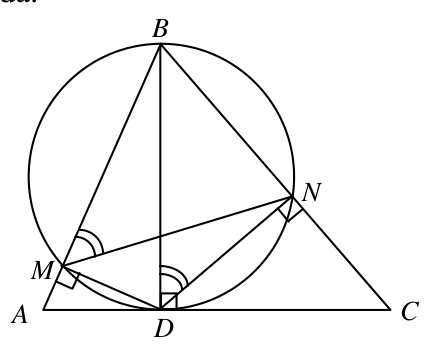{ width=200px }

7. zīm.

# <lo-sample/> LV.SOL.2014.10.3

Kāda ir lielākā iespējamā ciparu summa septiņciparu naturālam skaitlim, kas dalās ar $8$?

<small>
   
* questionType:
* domain:
   
</small>

## Atrisinājums

Septiņciparu naturāls skaitlis dalās ar $8$ tad un tikai tad, ja tā pēdējo $3$ ciparu veidotais skaitlis dalās ar $8$ (jo $\ldots abc=\ldots 000+\overline{abc}=\ldots\cdot 10^3+\overline{abc}$).

Ja pirmie $4$ cipari ir $9$ un $\overline{abc}=888$, ciparu summa ir $4\cdot 9+3\cdot 8=60$. Pierādīsim, ka $\overline{abc}$ ciparu summa nevar būt lielāka kā $24$. Lai tā būtu lielāka nekā $24$, pastāv šādas iespējas:

1) viens no cipariem $a$, $b$, $c$ ir $9$, bet divi – $8$,

2) divi no cipariem $a$, $b$, $c$ ir $9$, bet viens – $8$,

3) visi cipari $a$, $b$, $c$ ir $9$,

4) divi no cipariem $a$, $b$, $c$ ir $9$, bet viens – $7$.

Viegli pārbaudīt, ka neviens no šādiem skaitļiem nedalās ar $8$.

Tātad lielākā iespējamā septiņciparu skaitļa, kas dalās ar $8$, ciparu summa ir $60$.

# <lo-sample/> LV.SOL.2014.10.4

Kādu lielāko skaitu dažādu komisiju var izveidot no $4$ cilvēkiem tā, lai katrām divām komisijām būtu vismaz viens kopīgs loceklis?  
Nekādas divas komisijas nesastāv no vieniem un tiem pašiem cilvēkiem. Komisija var sastāvēt arī no viena dalībnieka.

<small>
   
* questionType:
* domain:
   
</small>

## Atrisinājums

Apzīmēsim cilvēkus ar $A$, $B$, $C$, $D$. Lai izpildītos uzdevuma nosacījumi, var izveidot $8$ komisijas:

$$
A,\ AB,\ AC,\ AD,\ ABC,\ ABD,\ ACD,\ ABCD.
$$

Vairāk komisijas izveidot nevar: $4$ elementu kopai ir $2^4=16$ apakškopas, un, ja kādu apakškopu izvēlas par komisiju, tad tās papildinājumu par komisiju ņemt vairs nevar.

# <lo-sample/> LV.SOL.2014.10.5

Gunārs un Dzintars pamīšus raksta uz tāfeles pa vienam naturālam skaitlim, kas nepārsniedz $1000$. Sāk Dzintars, uzrakstot skaitli $1$. Neviens jau uzrakstīts skaitlis netiek nodzēsts; nevienu skaitli nedrīkst rakstīt otreiz.  
Ja kaut kāds skaitlis $x$ jau ir uz tāfeles, tad ar kārtējo gājienu drīkst uzrakstīt vai nu $x+1$, vai $2x$ (ja izvēlētais rakstāmais skaitlis nepārsniedz $1000$). Uzvar tas, kurš uzraksta $1000$. Kurš no zēniem uzvar, pareizi spēlējot?

<small>
   
* questionType:
* domain:
   
</small>

## Atrisinājums

Uzvar Gunārs.

Tā kā pēdējais (uzvarošais) gājiens tiek izdarīts vai nu no pozīcijas $500$, vai no pozīcijas $999$, tad zaudē tas, kurš uzraksta vienu no šiem skaitļiem. Pieņemsim, ka zaudētājs uzraksta $500$. Tas tiek darīts tāpēc, ka citu iespēju (izņemot varbūt rakstīt $999$) viņam nav. Tas nozīmē, ka visi skaitļi $1$; $2$; $3$; $\ldots$; $499$ jau ir uzrakstīti (citādi varētu rakstīt mazāko vēl neuzrakstīto no tiem) un tātad arī divas reizes lielākie skaitļi $502$; $504$; $\ldots$ $998$ ir uzrakstīti; no tā savukārt seko, ka arī $503$; $505$; $\ldots$; $997$ ir jau uzrakstīti. Savukārt $999$ vēl nav uzrakstīts (citādi spēle būtu beigusies jau ātrāk) un arī $501$ vēl nav uzrakstīts (citādi jau iepriekš būtu uzrakstīts $500$, un spēle būtu beigusies ātrāk). Tātad brīdī, kad zaudētājs uzrakstījis $500$, uz tāfeles atrodas $997$ skaitļi (ieskaitot $500$). Tāpēc skaitli $500$ uzraksta sācējs, proti, Dzintars. Tāpēc viņš zaudē.  
Gadījumu, ja „zaudējošais gājiens” ir $999$ uzrakstīšana, analizē līdzīgi.

# <lo-sample/> LV.SOL.2014.11.1

Atrisināt vienādojumu $x^2+5y^2+2xy+4y+1=0$.

<small>
   
* questionType:
* domain:
   
</small>

## Atrisinājums

Atdalām pilnos kvadrātus:

$$
(x^2+2xy+y^2)+(4y^2+4y+1)=0,
$$

$$
(x+y)^2+(2y+1)^2=0.
$$

Divu kvadrātu summa ir $0$ tad un tikai tad, ja abu saskaitāmo vērtības ir $0$.

Tātad $x+y=0$ un $2y+1=0$ jeb $y=-\frac{1}{2}$ un $x=\frac{1}{2}$.

# <lo-sample/> LV.SOL.2014.11.2

a) Vai var 5. zīm. parādītās tabulas rūtiņās ierakstīt naturālus skaitļus no $1$ līdz $9$ (katrā rūtiņā – citu skaitli) tā, lai izpildītos īpašība: ja rinda un kolonna apzīmētas ar vienādiem burtiem, tad tajās ierakstīto skaitļu reizinājumi ir vienādi?  
b) Vai var 6.zīm. parādītās tabulas rūtiņās ierakstīt naturālus skaitļus no $1$ līdz $81$ (katrā rūtiņā – citu skaitli) tā, lai izpildītos tāda pati īpašība?

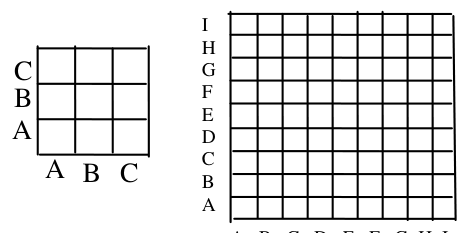{ width=200px }

5. zīm.

6. zīm.

<small>
   
* questionType:
* domain:
   
</small>

## Atrisinājums

a) jā, skat., piemēram, $8.$ zīm.

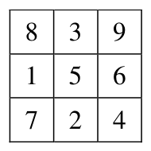{ width=100px }

$8.$ zīm.

b) nē. Apskatīsim pirmskaitļus $41$; $43$; $47$; $53$; $59$; $61$; $67$; $71$; $73$; $79$. Tā kā tie visi lielāki nekā $\frac{1}{2}\cdot 81$, tad neviens cits ierakstāmais skaitlis ne ar vienu no tiem nedalās. Tāpēc šiem skaitļiem jābūt uz diagonāles (ja kāds pirmskaitlis sastopams rindiņas elementu reizinājumā, tad tam jābūt sastopamam arī atbilstošās kolonnas elementu reizinājumā). Bet šo pirmskaitļu pavisam ir $10$, un tie jāizvieto $9$ vietās – pretruna.

# <lo-sample/> LV.SOL.2014.11.3

Pierādīt, ka punkti, kas ir simetriski trijstūra augstumu krustpunktam attiecībā pret trijstūra malām, atrodas uz trijstūrim apvilktās riņķa līnijas.  
(Punktu $A_1$ sauc par punktam $A$ simetrisku punktu attiecībā pret taisni $a$, ja $AA_1 \perp a$ un $AO=OA_1$, kur $O$ ir $AA_1$ un $a$ krustpunkts.)

<small>
   
* questionType:
* domain:
   
</small>

## Atrisinājums

Tā kā punkti $H$ un $D$ ir simetriski attiecībā pret taisni $BC$ (skat. $9.$ zīm.), tad $\angle CDA=\angle CHA_1$, bet $\angle CHA_1=\angle CBA$ kā leņķi ar savstarpēji perpendikulārām malām. Tātad $\angle CDA=\angle CBA$ un tāpēc punkts $D$ atrodas uz riņķa līnijas. Līdzīgi pierāda, ka arī pārējie punkti atrodas uz trijstūrim $ABC$ apvilktās riņķa līnijas.

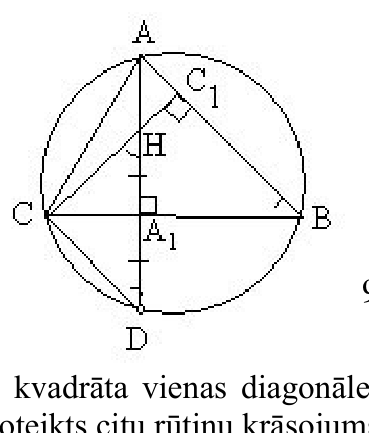{ width=150px }

$9.$ zīm.

# <lo-sample/> LV.SOL.2014.11.4

Kvadrāts sastāv no $4 \cdot 4$ vienādām kvadrātiskām rūtiņām. Katrā rūtiņā novelk vienu diagonāli un vienu no iegūtajiem trijstūriem nokrāso baltu, otru – melnu. Nekādiem diviem vienādi nokrāsotiem trijstūriem nedrīkst būt kopīga mala. Cik dažādi kvadrāta krāsojumi iespējami?

<small>
   
* questionType:
* domain:
   
</small>

## Atrisinājums

Ievērosim, ka rūtiņas uz kvadrāta vienas diagonāles var nokrāsot patvaļīgi. Pamatosim, ka šādā gadījumā tiek pilnībā noteikts citu rūtiņu krāsojums. Apskatīsim, kā jākrāso rūtiņas pēc tam, kad diagonāles rūtiņas jau ir nokrāsotas. Gadījumā, kad vēl nenokrāsotai rūtiņai ir divas kopīgas blakus malas ar jau nokrāsotām rūtiņām, ir noteikts, kādam jābūt nenokrāsotās rūtiņas krāsojumam. Jāapskata divi atšķirīgi gadījumi:

* Abas blakusesošās rūtiņas ir jau nokrāsotas un tas izdarīts tā, ka abas malas, kas kopīgas vēl nenokrāsotai rūtiņai ar jau nokrāsotajām, ir vienā krāsā (abas melnas vai abas baltas). Jāvelk tā diagonāle, kas kvadrātiņu sadala tā, lai abas nokrāsoto rūtiņu malas būtu vienā trijstūrī, piemēru skat. $10.$ zīm.
* Abas blakusesošās rūtiņas ir jau nokrāsotas un tas izdarīts tā, ka malas, kas kopīgas vēl nenokrāsotai rūtiņai ar jau nokrāsotajām, ir dažādās krāsās (viena melna, otra balta). Jāvelk tā diagonāle, kas kvadrātiņu sadala tā, lai abas nokrāsoto rūtiņu malas būtu dažādos trijstūros, piemēru skat. $11.$ zīm.

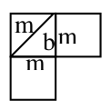{ width=100px }

10. zīm.

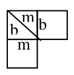{ width=100px }

11. zīm.

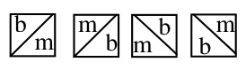{ width=150px }

12. zīm.

Tātad esam pamatojuši, ka nokrāsota diagonāle viennozīmīgi nosaka pārējo rūtiņu krāsojumu. Apskatīsim, cik veidos iespējams nokrāsot diagonāli. Skaidrs, ka katru diagonāles rūtiņu iespējams nokrāsot $4$ dažādos veidos: skat. $12.$ zīm. Bet, tā kā vienas diagonāles rūtiņas nokrāsošana neietekmē pārējo diagonāles rūtiņu krāsošanu, tad kopā iespējami $4^4=256$ dažādi diagonāles krāsojumi. Tātad arī kopējais kvadrāta krāsojumu skaits ir $256$.

# <lo-sample/> LV.SOL.2014.11.5

Dots, ka $n$ – naturāls skaitlis un skaitļi $2n+1$ un $3n+1$ ir veselu skaitļu kvadrāti.  
a) atrodiet kaut vienu tādu $n$,  
b) vai $5n+3$ var būt pirmskaitlis?

<small>
   
* questionType:
* domain:
   
</small>

## Atrisinājums

a) piemēram, $n=40$.

b) nē, nevar. Tiešām, apzīmēsim $2n+1=x^2$, $3n+1=y^2$. Tad $x>1$, $y>1$ un $5n+3=4(2n+1)-(3n+1)=4x^2-y^2=(2x-y)(2x+y)$. Tā kā $x$ un $y$ ir naturāli skaitļi un $5n+3$ - pirmskaitlis, tad jābūt $2x-y=1$ un $2x+y=5n+3$. No šejienes $2y=5n+2$. Tāpēc $4y^2=25n^2+20n+4>12n+4=4(3n+1)=4y^2$ - pretruna.

# <lo-sample/> LV.SOL.2014.12.1

Pierādīt, ka

$$
\frac{1}{1 \cdot 2}+\frac{1}{2 \cdot 3}+\frac{1}{3 \cdot 4}+\ldots+\frac{1}{2013 \cdot 2014}=\frac{2013}{2014}.
$$

<small>
   
* questionType:
* domain:
   
</small>

## Atrisinājums

Visiem skaitļiem $n$ izpildās vienādība

$$
\frac{1}{n\cdot(n+1)}=\frac{1}{n}-\frac{1}{n+1}.
$$

Tāpēc

$$
\frac{1}{1\cdot2}+\frac{1}{2\cdot3}+\frac{1}{3\cdot4}+\cdots+\frac{1}{2013\cdot2014}=
$$

$$
=\left(\frac{1}{1}-\frac{1}{2}\right)+\left(\frac{1}{2}-\frac{1}{3}\right)+\left(\frac{1}{3}-\frac{1}{4}\right)+\cdots+\left(\frac{1}{2013}-\frac{1}{2014}\right)=\frac{1}{1}-\frac{1}{2014}=\frac{2013}{2014}.
$$

Pārējās daļas saīsinās.

# <lo-sample/> LV.SOL.2014.12.2

Trijstūrī $ABC$ visas malas dažāda garuma un $\angle B = 60^{\circ}$. Uz stariem $AB$ un $CB$ attiecīgi atlikti tādi punkti $X$ un $Y$, ka $AX = CY = AC$. Pierādīt, ka taisne $XY$ iet caur $\triangle ABC$ ievilktās riņķa līnijas centru.

<small>
   
* questionType:
* domain:
   
</small>

## Atrisinājums

Apzīmējam $\triangle ABC$ ievilktās riņķa līnijas centru ar $I$ (skat. $13.$ zīm.). Tad $\angle AIC=180^{\circ}-\frac{1}{2}(\angle A+\angle C)=180^{\circ}-\frac{1}{2}(180^{\circ}-60^{\circ})=120^{\circ}$. Tā kā $\triangle ACI=\triangle YCI$ (pēc pazīmes „mlm”), tad arī $\angle CIY=120^{\circ}$. Līdzīgi pierāda, ka $\angle AIX=120^{\circ}$. Bet no tā seko, ka stari $IY$ un $IX$ sakrīt. No tā seko, ka $X$, $Y$ un $I$ atrodas uz vienas taisnes jeb $I$ atrodas uz taisnes $XY$, kas arī bija jāpierāda.

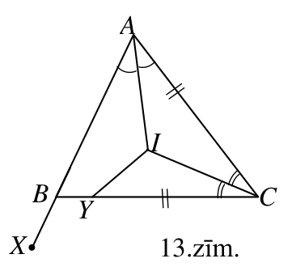{ width=150px }

13.zīm.

# <lo-sample/> LV.SOL.2014.12.3

Vai eksistē tāds naturāls skaitlis $n$, ka $6^n - 1$ dalās ar $4^n - 1$?

<small>
   
* questionType:
* domain:
   
</small>

## Atrisinājums

Pieņemsim, ka $6^n-1$ dalās ar $4^n-1$. Tad arī $(6^n-1)-(4^n-1)=6^n-4^n=2^n(3^n-2^n)$ dalās ar $4^n-1$. Tad $3^n-2^n$ jādalās ar $4^n-1$ (jo reizinātājs $2^n$ neiespaido dalīšanos ar nepāra skaitli $4^n-1$). Bet $3^n-2^n<3^n-1<4^n-1$ un tāpēc $3^n-2^n$ nevar dalīties ar $4^n-1$. Iegūta pretruna.

*Piezīme.* Uzdevumu var atrisināt arī pamatojot, ka $4^n-1=(2^n-1)(2^n+1)$ dalās ar $3$, bet $6^n-1=3^n\cdot 2^n-1$ ar $3$ nedalās, līdz ar to $6^n-1$ nedalās ar $4^n-1$.

# <lo-sample/> LV.SOL.2014.12.4

Ja uz tāfeles uzrakstīti polinomi $f$ un $g$, tad tur drīkst uzrakstīt arī polinomus $f + g$, $f - g$ un $f \cdot g$ (par $f$ un $g$ var ņemt arī vienu un to pašu polinomu). Vai var iegūt uz tāfeles polinomu $x$, ja sākotnēji uz tāfeles uzrakstīti polinomi

a) $x^2 + x$ un $x^2 + 2$,

b) $x^2 + x$ un $x^2 - 2$?

<small>
   
* questionType:
* domain:
   
</small>

## Atrisinājums

a) nevar. Pie $x=2$ abu sākotnējo polinomu vērtības dalās ar $3$, tāpēc ar $3$ jādalās arī visu iegūstamo polinomu vērtībām. Bet polinoms $x$ nedalās ar $3$, ja $x=2$.

b) var. Ja $x^2+x=f$ un $x^2-2=g$, tad $x=(f-g)(f-g)+2g-3f$, jo
$$
\begin{aligned}
(f-g)(f-g)+2g-3f&=\\
&=((x^2+x)-(x^2-2))((x^2+x)-(x^2-2))+2(x^2-2)-3(x^2+x)=\\
&=(x^2+x-x^2+2)(x^2+x-x^2+2)+2x^2-4-3x^2-3x=\\
&=(x+2)(x+2)-4-x^2-3x=x^2+4x+4-4-x^2-3x=x.
\end{aligned}
$$

# <lo-sample/> LV.SOL.2014.12.5

Rindā ir $12$ krēsli; uz katra no tiem sēž pa skolēnam. Skolēniem vienu reizi atļauts piecelties un apsēsties citā secībā, pie tam katrs drīkst apsēsties vai nu iepriekšējā vietā, vai tieši blakus iepriekšējai vietai.  
Cik dažādi skolēnu izvietojumi iespējami pēc pārkārtošanās?

<small>
   
* questionType:
* domain:
   
</small>

## Atrisinājums

Apzīmēsim atbilstošu pārkārtojumu skaitu $n$ skolēnu gadījumā ar $a_n$. Acīmredzami, $a_1=1$ un $a_2=2$.

Apskatīsim $n+2$ skolēnus un meklēsim formulu, kas izsaka $a_{n+2}$ ar $a_n$ un $a_{n+1}$. Visi pārvietojumi iedalās divās daļās:

a) pirmais skolēns paliek uz vietas. Tad pārkārtojas tikai atlikušie $n+1$ skolēni. Šādu pārkārtojumu pēc definīcijas ir $a_{n+1}$.

b) pirmais skolēns pāriet uz otro krēslu. Tad uz pirmo krēslu pāriet skolēns no otrā krēsla. Pārējie $n$ skolēni pārkārtojas "savā starpā". Tādu pārkārtojumu pēc definīcijas ir $a_n$.

Tātad $a_{n+2}=a_{n+1}+a_n$. Iegūstam $a_3=1+2=3$, $a_4=5$, $a_5=8$, $a_6=13$, $a_7=21$, $a_8=34$, $a_9=55$, $a_{10}=89$, $a_{11}=144$, $a_{12}=233$.
