# <lo-sample/> LV.SOL.2015.5.1

Rindā uzrakstīti veselie skaitļi $1$, $2$, $3$, $\ldots$, $2014$, katrs vienu reizi. Cik ciparu uzrakstīts?

<small>
   
* questionType:
* domain:
   
</small>

## Atrisinājums

Pavisam ir $9$ viencipara skaitļi, $90$ divciparu skaitļi, $900$ trīsciparu skaitļi un $1015$ četrciparu skaitļi; tāpēc kopējais ciparu skaits ir

$$9 \cdot 1 + 90 \cdot 2 + 900 \cdot 3 + 1015 \cdot 4 = 6949.$$

# <lo-sample/> LV.SOL.2015.5.2

Kvadrāts sastāv no $3 \cdot 3$ vienādām rūtiņām. Vai tās visas var pārsvītrot ar divām taisnēm? (Taisne pārsvītro rūtiņu, ja tā iet caur kādu rūtiņas iekšēju punktu.)

<small>
   
* questionType:
* domain:
   
</small>

## Atrisinājums

Jā, to var izdarīt (skat. A1. zīm.).

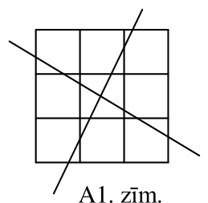{ width=100px }

A1. zīm.

# <lo-sample/> LV.SOL.2015.5.3

Uz vecmāmiņas galda uzklāta divu krāsu sedziņa, kas sadalīta sešos laukumos (skat. $1.$ zīm.). Uz tās atrodas divas piparkūkas. Ieva izdomāja spēlēt tādu spēli: katrā gājienā viņa drīkst divos blakus laukumos palielināt piparkūku skaitu par $1$. Vai Ieva var panākt, ka pēc vairākiem gājieniem visos laukumos būs vienāds skaits piparkūku?

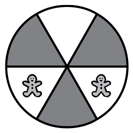{ width=100px }

$1.$ zīm.

<small>
   
* questionType:
* domain:
   
</small>

## Atrisinājums

Saskaitīsim piparkūku skaitu laukumos: melnajos - tas ir $2$, bet baltajos - $0$. Starpība starp piparkūku skaitu melnajos un baltajos laukumos ir $2$. Ar katru gājienu par $1$ palielinās piparkūku skaits gan melnajos, gan baltajos laukumos, tātad starpība starp piparkūku skaitu dažādu krāsu laukumos paliek $2$, un nevarēs iegūt vienādu piparkūku skaitu visos laukumos.

# <lo-sample/> LV.SOL.2015.6.1

a) Vai var atrast tādu skaitli, kas dalot ar $11$, dod atlikumu $5$, bet, dalot ar $13$, dod atlikumu $9$?  
b) Vai var atrast tādu skaitli, kas dalot ar $4$, dod atlikumu $1$, bet, dalot ar $8$, dod atlikumu $2$?

<small>
   
* questionType:
* domain:
   
</small>

## Atrisinājums

a) Jā, var. Tāds ir, piemēram, skaitlis $126$.

b) Nē, nevar. No $1.$ nosacījuma (dalot ar $4$, dod atlikumu $1$) seko, ka tam jābūt nepāra, bet no $2.$ nosacījuma (dalot ar $8$, dod atlikumu $2$) - pāra skaitlim.

# <lo-sample/> LV.SOL.2015.6.2

Vai var uzzīmēt plaknē $7$ starus tā, lai katrs no tiem krustotu tieši divus citus?

<small>
   
* questionType:
* domain:
   
</small>

## Atrisinājums

Jā, var (skat., piemēram, A$2$. zīm.).

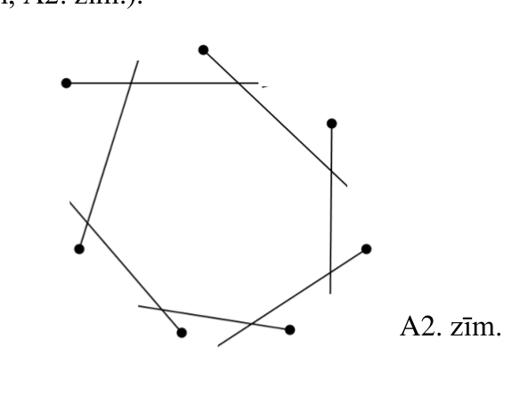{ width=250px }

A$2$. zīm.

# <lo-sample/> LV.SOL.2015.6.3

Elfi spēlējas ar ziemeļbriežiem. Pie staļļa ir seši mieti, pie diviem no tiem piesieti ziemeļbrieži (skat. $2.$ zīm.). Ar vienu gājienu drīkst piesiet pa ziemeļbriedim pie jebkura mieta, kas savienoti ar nogriezni. Vai elfi var panākt, ka pēc vairākiem gājieniem pie visiem mietiem būtu piesiets vienāds skaits ziemeļbriežu?

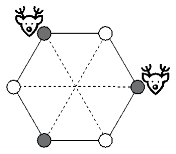{ width=150px }

$2.$ zīm.

<small>
   
* questionType:
* domain:
   
</small>

## Atrisinājums

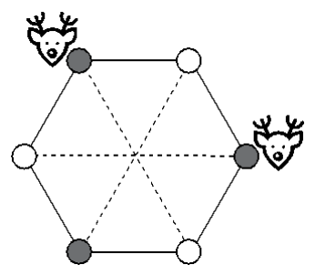{ width=150px }

$2$. zīm.

Pierādīsim, ka uzdevumā prasīto nevar izdarīt. Ar katru gājienu par $1$ palielinās gan pie pelēkajiem, gan pie baltajiem mietiem piesieto ziemeļbriežu kopējais skaits. Sākumā pie pelēkajiem mietiem kopā bija piesieti $2$ ziemeļbrieži, bet pie baltajiem - $0$. Ievērojam, ka pēc katra gājiena starpība starp pie pelēkajiem un pie baltajiem mietiem piesieto ziemeļbriežu kopējo skaitu paliek nemainīga, t. i., $2$. Ja pie visiem mietiem piesieto ziemeļbriežu skaits būtu vienāds, tad arī abām kopējām summām jābūt vienādām. Tātad kopējais ziemeļbriežu skaits pie dažādu krāsu mietiem nekad nekļūs vienāds.

# <lo-sample/> LV.SOL.2015.7.1

Apskatām $10$ dažādus skaitļus un visas to starpības (no lielākā skaitļa atņem mazāko). Kāds ir mazākais dažādo starpību skaits, kāds var izveidoties?

<small>
   
* questionType:
* domain:
   
</small>

## Atrisinājums

Mazākais dažādo starpību skaits ir deviņas. Piemēram, var izvēlēties skaitļus $1$, $2$, $3$, ..., $10$, tad iegūs starpības $1$, $2$, $3$, $4$, $5$, $6$, $7$, $8$, $9$.

Mazāk kā deviņas starpības nevar iegūt. Tā kā visi desmit skaitļi ir dažādi, tad, no lielākā skaitļa atņemot visus citus skaitļus, iegūst dažādas starpības.

# <lo-sample/> LV.SOL.2015.7.2

Vai var uzzīmēt trīs nogriežņus tā, lai tiem visiem būtu dažāds krustpunktu skaits ar abiem pārējiem?  
Vai tā var uzzīmēt trīs patvaļīgas līnijas?

<small>
   
* questionType:
* domain:
   
</small>

## Atrisinājums

a) Nē, nevar. Tā kā diviem nogriežņiem ir ne vairāk kā viens krustpunkts, tad iespējamais krustpunktu skaits katram nogrieznim ir $0$, $1$ vai $2$. Ja kādam nogrieznim ir $2$ krustpunkti, tad tas krustojas ar abiem pārējiem, bet tad nav nogriežņa, kas nekrustojas ne ar vienu no abiem pārējiem. Tas nozīmē, ka atliek tikai $2$ vērtības, bet nogriežņu skaits ir $3$.

b) Jā, tādas līnijas var uzzīmēt (skat., piemēram, A3. zīm.).

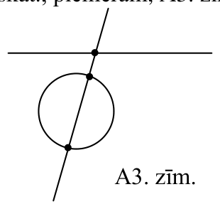{ width=150px }

A3. zīm.

# <lo-sample/> LV.SOL.2015.7.3

Rūķīši uz grīdas ir uzzīmējuši spēļu laukumu un spēlējas ar dāvanām. Sākumā uz laukuma atrodas divas dāvanas (skat. $3.$ zīm.). Vienā gājienā ir atļauts divos trijstūrīšos, kam ir kopīga mala, pievienot pa vienai dāvanai. Vai rūķīši var panākt, ka pēc vairākiem gājieniem visos trijstūrīšos būs novietots vienāds skaits dāvanu?

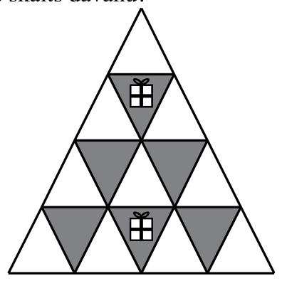{ width=200px }

3. zīm.

<small>
   
* questionType:
* domain:
   
</small>

## Atrisinājums

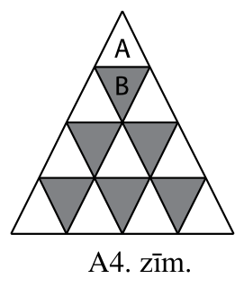{ width=150px }

A4. zīm.

Pierādīsim, ka uzdevumā prasīto nevar izdarīt.

*Pirmais risinājums.* Ar katru gājienu par $1$ palielinās gan melnajos, gan baltajos trijstūrīšos novietoto dāvanu kopējais skaits.

Sākumā visos melnajos trijstūrīšos novietoto dāvanu kopējais skaits ir $2$, bet visos baltajos trijstūrīšos novietoto dāvanu kopējais skaits ir $0$. Tātad baltajos trijstūrīšos novietoto dāvanu kopējais skaits nekad nekļūs lielāks kā melnajos trijstūrīšos novietoto dāvanu kopējais skaits, bet, ja visos trijstūros novietoto dāvanu skaits būtu vienāds, tad otrajai summai jābūt lielākai, jo balto trijstūrīšu ir vairāk.

*Otrais risinājums.* Apskatām trijstūrus A un B (skat. A4. zīm.). Sākumā trijstūrī B novietots lielāks dāvanu skaits nekā trijstūrī A. Trijstūrī B novietoto dāvanu skaitu var palielināt, vienlaicīgi nepalielinot A novietoto dāvanu skaitu; turpretī palielinot A novietoto dāvanu skaitu par $1$, par $1$ palielinās arī B novietoto dāvanu skaits. Tāpēc B novietoto dāvanu skaits vienmēr būs lielāks nekā A novietoto dāvanu skaits.

# <lo-sample/> LV.SOL.2015.8.1

Cik ir tādu funkciju, kurām definīcijas kopa sastāv no četriem elementiem: $0$, $1$, $2$, $4$, bet vērtību kopa sastāv no diviem elementiem: $0$, $1$?

<small>
   
* questionType:
* domain:
   
</small>

## Atrisinājums

Katrā no četriem definīcijas apgabala punktiem funkcija var pieņemt jebkuru no divām vērtībām. Tātad pavisam iespējamas $2\cdot2\cdot2\cdot2=16$ dažādas funkcijas.

# <lo-sample/> LV.SOL.2015.8.2

Dots, ka $SA = SB = AN = BM = MN$ (skat. 4. zīm.). Aprēķināt $\angle ASB$.

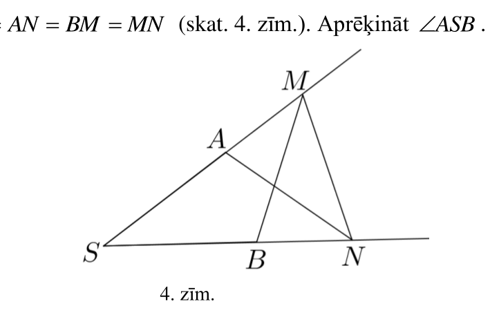{ width=350px }

4. zīm.

<small>
   
* questionType:
* domain:
   
</small>

## Atrisinājums

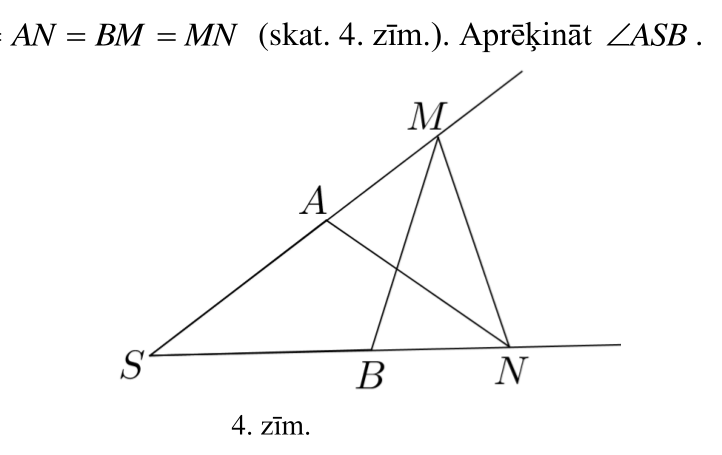{ width=350px }

$4.$ zīm.

Apzīmēsim $\angle ASB=\alpha$ (skat. $4.$ zīm.). Tā kā $\triangle SAN$ ir vienādsānu, tad $\angle SNA=\alpha$ un $\angle SAN=180^{\circ}-2\alpha$, un $\triangle SAN$ leņķis $\angle MAN=2\alpha$ (pēc blakusleņķu īpašības). Arī $\angle AMN=2\alpha$, jo $\triangle ANM$ ir vienādsānu.

Tā kā $\triangle SBM$ ir vienādsānu, tad $\angle SMB=\alpha$ un $\angle MBN=2\alpha$ (pēc blakusleņķu īpašības). $\triangle BMN$ ir vienādsānu, tātad $\angle BNM=2\alpha$.

Aplūkojot trijstūra $SMN$ iekšējo leņķu summu, iegūstam vienādību:

$$
\alpha+2\alpha+2\alpha=180^{\circ}.
$$

No šejienes seko, ka meklētais leņķis ir $\angle ASB=36^{\circ}$.

# <lo-sample/> LV.SOL.2015.8.3

Katrā no mazajiem trijstūrīšiem (skat. 5. zīm.) ierakstīts viencipara naturāls skaitlis; dažādos trijstūros ierakstīti dažādi skaitļi. Aplūkojam visas tādas divu skaitļu summas, kuri ierakstīti trijstūrīšos ar kopīgu malu.  
a) Vai var būt, ka neviena no šīm summām nepārsniedz $10$?  
b) Kāds mazākais skaits no šīm summām var būt pāra skaitļi?

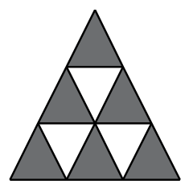{ width=100px }

5. zīm.

<small>
   
* questionType:
* domain:
   
</small>

## Atrisinājums

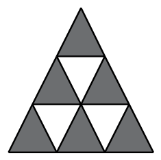{ width=100px }

$5.$ zīm.

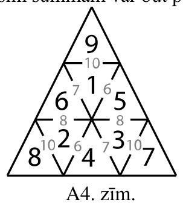{ width=150px }

A$4.$ zīm.

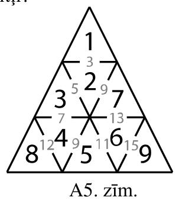{ width=150px }

A$5.$ zīm.

a) Jā, var (skat., piemēram, A$4.$ zīm.).  
b) Viena no summām var būt pāra skaitlis (skat. A$5.$ zīm.). Pierādīsim, ka visas summas nevar būt nepāra skaitļi. Lai divu skaitļu summa būtu nepāra skaitlis, tad jāsaskaita dažādas paritātes skaitļi (viens pāra un otrs nepāra). Tātad visos pelēkajos trijstūrīšos (skat. $5.$ zīm.) ierakstīto skaitļu paritātei jābūt vienai un visos baltajos – otrai, bet no $1$ līdz $9$ nav sešu (tik, cik pelēko trijstūru) vienas paritātes skaitļu.

# <lo-sample/> LV.SOL.2015.9.1

Turnīrā piedalās $10$ komandas, katrai ar katru jāizspēlē viena spēle. Vai var gadīties tāds brīdis, kad visas komandas izspēlējušas dažādu spēļu skaitu?

<small>
   
* questionType:
* domain:
   
</small>

## Atrisinājums

Komandas izspēlēto spēļu skaits var būt tikai $0, 1, 2, \ldots, 9$ (desmit dažādas vērtības). Ja visas $10$ komandas izspēlējušas dažādu spēļu skaitu, tad ir komanda, kas izspēlējusi $9$ spēles - tātad spēlējusi ar visām pārējām komandām. Tas nozīmē, ka nav komandas, kura ir izspēlējusi $0$ spēles. Tātad nav tāda brīža, kad visas komandas ir izspēlējušas dažādu spēļu skaitu.

# <lo-sample/> LV.SOL.2015.9.2

Šaurleņķu trijstūrī $ABC$ augstums no virsotnes $A$, leņķa $B$ bisektrise un malas $AB$ vidusperpendikuls krustojas vienā punktā. Aprēķināt $\angle ABC$.

<small>
   
* questionType:
* domain:
   
</small>

## Atrisinājums

Apzīmējam $\angle BAO = \alpha$ (skat. A6. zīm.). Ievērojam, ka $\triangle AMO = \triangle BMO$ (pēc pazīmes „$m\ell m$”), jo $BM = MA$, $\angle AMO = \angle BMO = 90^{\circ}$ un mala $MO$ kopīga. Tad $\angle ABO = \angle BAO = \alpha$ kā atbilstošie leņķi vienādos trijstūros. No bisektrises īpašības seko, ka $\angle ABC = 2\alpha$. No $\triangle ABH$ iekšējo leņķu summas iegūstam $\alpha + 2\alpha + 90^{\circ} = 180^{\circ}$ jeb $\alpha = 30^{\circ}$. Tātad $\angle ABC = 2\alpha = 60^{\circ}$.

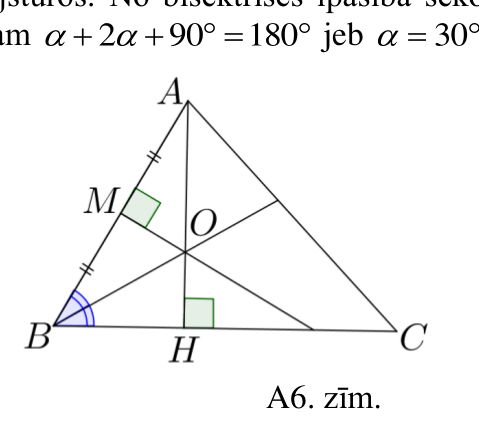{ width=200px }

A6. zīm.

# <lo-sample/> LV.SOL.2015.9.3

Katrā mazajā trijstūrītī (skat. 6. zīm.) ierakstīts naturāls skaitlis no $1$ līdz $9$ (visi skaitļi dažādi). Katriem diviem trijstūrīšiem ar kopīgu malu aprēķina tajos ierakstīto skaitļu summu. Kāds lielākais skaits no šīm summām var būt pirmskaitļi?

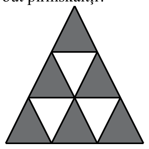{ width=150px }

6. zīm.

<small>
   
* questionType:
* domain:
   
</small>

## Atrisinājums

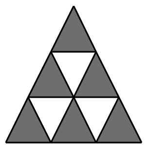{ width=150px }

6. zīm.

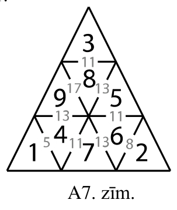{ width=150px }

A7. zīm.

Pavisam ir $9$ summas. Starp šīm summām var būt $8$ pirmskaitļi (skat. A7. zīm.).

Pierādīsim, ka visas $9$ summas nevar būt pirmskaitļi. Ja visas summas būtu pirmskaitļi, tad šīs summas būtu nepāra skaitļi; tāpēc blakus esošiem skaitļiem būtu jābūt dažādas paritātes skaitļiem. Tātad vienas paritātes skaitļiem jāatrodas baltajos lauciņos, bet otras paritātes skaitļiem – pelēkajos lauciņos (skat. $5.$ zīm.). Tas nav iespējams, jo ir $5$ nepāra skaitļi un $4$ pāra skaitļi, bet pelēko lauciņu skaits ir $6$.

# <lo-sample/> LV.SOL.2015.10.1

Dots, ka $x$ un $y$ naturāli skaitļi. Kāds ir mazākais skaits dažādu pirmskaitļu, ar kuriem var dalīties izteiksme

$$3\cdot x(x+2\cdot y+1)(7\cdot y+1)?$$

<small>
   
* questionType:
* domain:
   
</small>

## Atrisinājums

Dotā izteiksme dalās ar $3$ neatkarīgi no $x$ un $y$, jo satur reizinātāju $3$.

Parādīsim, ka tā nav trijnieka pakāpe. Izteiksme var būt trijnieka pakāpe tikai divos gadījumos:

* ja $x=1$, tad $x+2y+1$ ir pāra skaitlis, kas dalās ar $2$;
* ja $x$ ir trijnieka pakāpe, tad $x$ ir nepāra skaitlis un $x+2y+1$ ir pāra skaitlis, kas dalās ar $2$.

Tātad dotā izteiksme satur vismaz divus pirmreizinātājus $2$ un $3$. Ja $x=24$ un $y=1$, tad dotā izteiksme satur tieši divus dažādus pirmreizinātājus, kas ir pirmskaitļi:

$$3x(x+2y+1)(7y+1)=3\cdot 24(24+2\cdot 1+1)(7\cdot 1+1)=3\cdot 24\cdot 27\cdot 8=2^6\cdot 3^5.$$

# <lo-sample/> LV.SOL.2015.10.2

Uz kvadrāta $ABCD$ diagonāles $AC$ atlikts punkts $M$. Pierādīt, ka

$$MA\cdot MC+MB\cdot MD=AB^2.$$

<small>
   
* questionType:
* domain:
   
</small>

## Atrisinājums

Apzīmējam $AC=d$ un $OM=x$ (skat. A8. zīm.). Diagonāle $AC$ sadala kvadrātu divos vienādos trijstūros $ABC$ un $ADC$, tāpēc $BM=MD$.

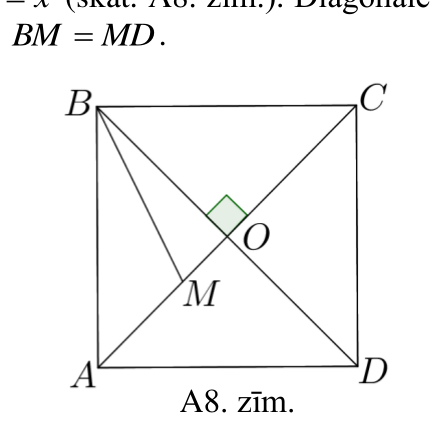{ width=200px }

A8. zīm.

Kvadrāta diagonāles ir perpendikulāras un krustpunktā dalās uz pusēm, tāpēc trijstūrī $MBO$ var izmantot Pitagora teorēmu: $MB^2=OB^2+OM^2=\left(\dfrac{d}{2}\right)^2+x^2$. Tad

$$MA\cdot MC+MB\cdot MD=(AO-OM)(OC+OM)+MB^2=$$

$$=\left(\dfrac{d}{2}-x\right)\left(\dfrac{d}{2}+x\right)+MB^2=$$

$$=\left(\dfrac{d}{2}\right)^2-x^2+\left(\dfrac{d}{2}\right)^2+x^2=\dfrac{d^2}{2}.$$

Izmantojot Pitagora teorēmu vienādsānu $\triangle ABC$, iegūstam:

$$AB^2+BC^2=AC^2;$$

$$2AB^2=d^2;$$

$$AB^2=\dfrac{d^2}{2}.$$

Līdz ar to esam ieguvuši, ka $MA\cdot MC+MB\cdot MD=\dfrac{d^2}{2}=AB^2$, kas arī bija jāpierāda.

# <lo-sample/> LV.SOL.2015.10.3

Kvadrātos ir ierakstīti skaitļi $1$, $2$, $3$, $4$, $5$, $6$ (skat. 7. zīm.). Vienā gājienā ir atļauts izvēlēties jebkurus divus skaitļus, kurus savieno nogrieznis, un pie katra no tiem pieskaitīt vienu un to pašu veselu skaitli (šis skaitlis katrā gājienā var būt cits). Vai, veicot šādus gājienus, varēs iegūt 8. zīm. parādīto skaitļu izvietojumu?

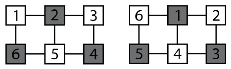{ width=200px }

7. zīm.

8. zīm.

<small>
   
* questionType:
* domain:
   
</small>

## Atrisinājums

Apzīmējam skaitļus (skat. A$9.$ zīm.). Apskatām starpību $S=(a+b+c)-(A+B+C)$. Tā kā katrā gājienā katrai izteiksmei $a+b+c$ un $A+B+C$ pieskaita vienu un to pašu skaitli, tad $S$ nemainās. Sākumā (skat. $7.$ zīm.) šī starpība ir $S_1=(1+5+3)-(6+2+4)=9-12=-3$. Beigās (skat. $8.$ zīm.) starpība ir: $S_2=(6+4+2)-(5+1+3)=12-9=3$. Tā kā $S_1\ne S_2$, tad uzdevumā prasīto nevarēs izdarīt.

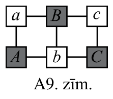{ width=100px }

A$9.$ zīm.

# <lo-sample/> LV.SOL.2015.11.1

Šaha turnīrā piedalās $9$ spēlētāji, kuri katrs ar katru spēlē tieši vienu reizi. Katrā spēlē uzvarētājs saņem vienu punktu, zaudētājs – $0$ punktus, bet par neizšķirtu katrs spēlētājs saņem $\frac{1}{2}$ punkta.

Turnīra beigās katrs spēlētājs bija saņēmis vienādu punktu skaitu.  
**a)** Vai ir iespējams, ka katrs spēlētājs nospēlēja neizšķirti atšķirīgu skaitu reižu?  
**b)** Vai ir iespējams, ka katram spēlētājam ir atšķirīgs zaudējumu skaits?

<small>
   
* questionType:
* domain:
   
</small>

## Atrisinājums

Pavisam notika $C_9^2=\frac{8\cdot 9}{2}=36$ spēles, katrs spēlētājs spēlēja $8$ spēles. Tā kā beigās visi spēlētāji bija ieguvuši vienādu punktu skaitu, tad katrs spēlētājs ieguva $36:9=4$ punktus.

**a)** Ja spēlētājs ir savācis $4$ punktus, tad viņš ir nospēlējis neizšķirti pāra skaitu reižu: $0$, $2$, $4$, $6$ vai $8$. Redzam, ka $9$ spēlētājiem ir $5$ iespējas, tātad turnīrā atradīsies tādi spēlētāji, kas būs nospēlējuši neizšķirti vienādu skaitu reižu.

**b)** Pierādīsim, ka uzdevumā prasītais nav iespējams. Pieņemsim pretējo, ka visiem spēlētājiem ir atšķirīgs zaudējumu skaits. Tad spēlētājs var būt zaudējis $0$, $1$, $2$, $3$, ..., $8$ reizes. Tā kā ir $9$ dažādas zaudējumu skaita vērtības un katram spēlētājam ir jābūt atšķirīgam zaudējumu skaitam, tad ir spēlētājs, kas zaudējis $8$ reizes, ir spēlētājs, kas zaudējis $7$ reizes, utt. Spēlētājs, kas turnīrā zaudējis $8$ reizes, turnīrā ir ieguvis $0$ punktus, kas ir pretrunā ar uzdevuma nosacījumiem. Līdz ar to esam ieguvuši, ka eksistē vismaz divi spēlētāji, kam ir vienāds zaudējumu skaits.

# <lo-sample/> LV.SOL.2015.11.2

Izliektam četrstūrim novilktas visu astoņu ārējo leņķu bisektrises. Pierādīt, ka tās veido četrstūri, kuram var apvilkt riņķa līniju.

<small>
   
* questionType:
* domain:
   
</small>

## Atrisinājums

Jāpierāda, ka ap četrstūri $EFGH$ var apvilkt riņķa līniju (skat. A10. zīm.). Izmantosim, ka

- ap četrstūri var apvilkt riņķa līniju, ja tā pretējo leņķu summa ir $180^{\circ}$;
- četrstūra četru dažādo (kas atrodas pie dažādām četrstūra virsotnēm) ārējo leņķu summa ir $360^{\circ}$.

Apskatām četrstūra $EFGH$ divu pretējo leņķu summu:
$$
\angle E+\angle G=180^{\circ}-\angle EAB-\angle EBA+180^{\circ}-\angle GCD-\angle GDC=
$$
$$
=360^{\circ}-\angle EAB-\angle EBA-\angle GCD-\angle GDC=360^{\circ}-180^{\circ}=180^{\circ}.
$$
Pārveidojumos izmantojam, ka $\angle EAB+\angle EBA+\angle GCD+\angle GDC=180^{\circ}$, jo šo četru leņķu lielumu summa ir puse no četrstūra $ABCD$ dažādo ārējo leņķu lielumu summas.

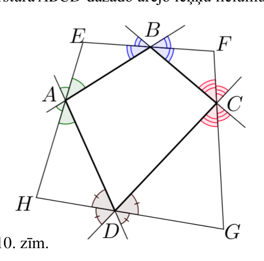{ width=250px }

A10. zīm.

# <lo-sample/> LV.SOL.2015.11.3

Tabulas $3\times 3$ rūtiņās ierakstītas nulles. Vienā gājienā atļauts dotajā tabulā izvēlēties kvadrātu ar izmēriem $2\times 2$ rūtiņas un palielināt par $1$ visus tajā ierakstītos skaitļus. Pierādīt, ka pēc vairākiem šādiem gājieniem nevarēs iegūt 9. zīm. doto tabulu.

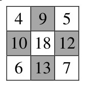{ width=100px }

9. zīm.

<small>
   
* questionType:
* domain:
   
</small>

## Atrisinājums

Izpētīsim, kā ir veidota gala rezultātā iegūtā tabula. Redzam, ka kvadrātā $2 \times 2$, kurš atrodas kreisajā augšējā stūrī, visi skaitļi palielināti par $1$ četras reizes, jo pašā stūrī atrodas skaitlis $4$. Labajā augšējā stūrī atrodas skaitlis $5$, tātad atbilstošajā kvadrātā $2 \times 2$ visus skaitļus palielina par $1$ piecas reizes, bet apakšējos kvadrātos - attiecīgi $6$ un $7$ reizes.

Apskatīsim A11.zīm., kā tiek aizpildīts kvadrāts $3 \times 3$ rūtiņas, ar mazajiem kvadrātiņiem $2 \times 2$ rūtiņas.

No šejienes redzami: par cik palielinās stūra rūtiņās ierakstīto skaitļu summa $S$, par tik palielinās arī centrālajā rūtiņā ierakstītais skaitlis $c$. Tātad lielums $(S-c)$ ir nemainīgs. Sākumā $S-c=0$.

Beigās jāiegūst, ka $S-c=22-18=4$. Tā kā $0 \ne 4$, tad nevar iegūt 9. zīm. redzamo tabulu.

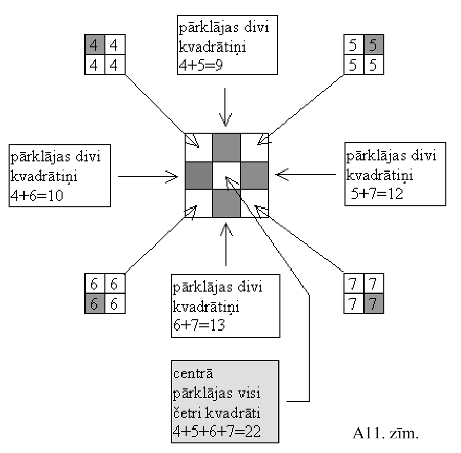{ width=450px }

A11. zīm.

# <lo-sample/> LV.SOL.2015.12.1

Deviņciparu naturāla skaitļa $n$ ciparu summa ir $3$. Kāda var būt $n^3$ ciparu summa?

<small>
   
* questionType:
* domain:
   
</small>

## Atrisinājums

Lai skaitļa ciparu summa būtu $3$, tad skaitlis var saturēt:
- trīs vieniniekus un pārējās nulles;
- vienu vieninieku, vienu divnieku un pārējās nulles;
- vienu trijnieku un pārējās nulles.

Tātad deviņciparu skaitli, kura ciparu summa ir $3$, var pierakstīt formā $n=10^8+10^a+10^b$, $a,b=0,1,2,\ldots,8$ ($a$ un $b$ var arī būt vienādi).

Tādā gadījumā $n^3=(10^8+10^a+10^b)^3$. Atverot iekavas, iegūsim summu, kas sastāv no $3\cdot 3\cdot 3=27$ saskaitāmajiem, un katra saskaitāmā ciparu summa ir $1$. Skaitļa $n^3$ ciparu summa nevar pārsniegt skaitli, ko iegūstam, saskaitot šo $27$ saskaitāmo ciparu summas. Tātad tā nepārsniedz $27$.

Skaitlis $n$ dalās ar $3$, jo tā ciparu summa dalās ar $3$. Tāpēc skaitlis $n^3$ dalās ar $3^3=27$. Ja skaitlis dalās ar $27$, tad tas dalās arī ar $9$, tāpēc arī tā ciparu summa dalās ar $9$. Ciparu summa noteikti ir naturāls skaitlis (vienīgais skaitlis, kura ciparu summa ir $0$, ir skaitlis $0$). Vienīgie naturālie skaitļi, kas nepārsniedz $27$ un dalās ar $9$, ir $9$, $18$ un $27$. Visi šie skaitļi var būt $n^3$ ciparu summa:
- ja $n=300000000$, tad $n^3$ ciparu summa ir $9$;
- ja $n=210000000$, tad $n^3$ ciparu summa ir $18$;
- ja $n=111000000$, tad $n^3$ ciparu summa ir $27$.

# <lo-sample/> LV.SOL.2015.12.2

Trapeces diagonāles ir vienādas. Pierādīt, ka ap šo trapeci var apvilkt riņķa līniju.

<small>
   
* questionType:
* domain:
   
</small>

## Atrisinājums

Ievērojam, ka $\triangle ACF=\triangle DBE$ (pēc pazīmes "katete-hipotenūza"), jo $BE=CF$ kā trapeces augstumi un $BD=AC$ pēc dotā. Tad $\angle CAD=\angle ADB$ kā atbilstošie leņķi vienādos trijstūros (skat. A12. zīm.). Tā kā $\angle ADB=\angle DBC$ (iekšējie šķērsleņķi pie paralēlām taisnēm $AD$ un $BC$), tad $\angle DAC=\angle DBC$ un ap trapeci $ABCD$ var apvilkt riņķa līniju.

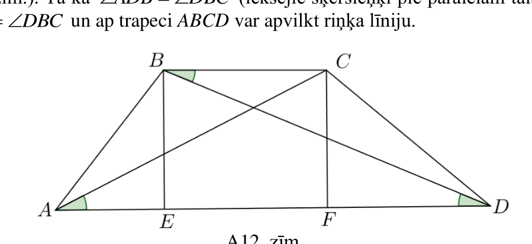{ width=400px }

A12. zīm.

# <lo-sample/> LV.SOL.2015.12.3

Deviņi rūķīši izvietoti kvadrātā ar izmēriem $3 \cdot 3$ rūtiņas, kas atrodas šaha galdiņa, $8 \cdot 8$ rūtiņas kreisajā apakšējā stūrī. Katrs rūķītis var pārlēkt pāri tam rūķītim, kas atrodas blakus, ja tur ir brīvs lauciņš. Lēkt var gan vertikāli, gan horizontāli, gan arī pa diagonāli.  
Vai var pārvietot rūķīšus citā kvadrātā ar izmēriem $3 \cdot 3$ rūtiņas, kas atrodas šaha galdiņa

a) kreisajā augšējā stūrī;  
b) labajā augšējā stūrī?

<small>
   
* questionType:
* domain:
   
</small>

## Atrisinājums

**a)** Aplūkosim sākumā doto kvadrātu $3 \cdot 3$ rūtiņas; tajā $5$ rūķīši atrodas uz melnajiem lauciņiem un $4$ - uz baltajiem lauciņiem. Tā kā rūķīši pārvietojoties paliek uz tās pašas krāsas lauciņiem, tad rūķīši nevar izvietoties kreisajā augšējā $3 \cdot 3$ kvadrātā, jo tur ir $4$ melnie un $5$ baltie lauciņi (skat. A$13$. zīm.).

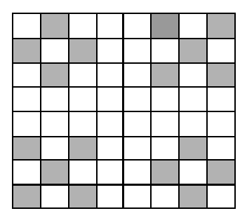{ width=150px }

A$13$. zīm.

**b)** Ievērojam, ka sākotnējā $3 \cdot 3$ rūtiņu kvadrātā, skaitot no kreisās puses, $6$ rūķīši atrodas nepāra vertikālēs un $3$ - pāra vertikālēs. Rūķīšiem pārvietojoties, tie rūķīši, kas atrodas nepāra vertikālēs, tādās arī paliek, bet tie rūķīši, kas atrodas pāra vertikālēs - tādās arī paliek. Labējā augšējā kvadrātā ir $6$ lauciņi pāra vertikālēs un $3$ lauciņi nepāra vertikālēs, tātad rūķīšus nevarēs pārvietot uz labējo augšējo kvadrātu.
