# <lo-sample/> LV.SOL.2016.5.1

Katrā lodziņā ieraksti “$+$” vai “$-$” zīmi tā, lai iegūtu patiesu vienādību!

$$64 \square 32 \square 16 \square 8 \square 4 \square 2 \square 1 = 81$$

<small>
   
* questionType:
* domain:
   
</small>

## Atrisinājums

Zīmes jāizvēlas šādi: $64 + 32 - 16 + 8 - 4 - 2 - 1 = 81$.

# <lo-sample/> LV.SOL.2016.5.2

Nosaki izmērus visiem tādiem taisnstūriem, kuru malas iet pa rūtiņu līnijām un kuru laukums ir tikpat liels kā $1.$ att. dotā četrstūra laukums!

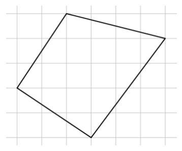{ width=150px }

1. att.

<small>
   
* questionType:
* domain:
   
</small>

## Atrisinājums

Lai aprēķinātu dotā četrstūra laukumu, ievietosim to taisnstūrī $KLMN$ (skat. 2. att.). Tad

$$
\begin{aligned}
S_{ABCD} &= S_{KLMN} - S_{AKB} - S_{BLC} - S_{CMD} - S_{DNA} = \\
&= 5 \cdot 6 - \frac{3 \cdot 2}{2} - \frac{4 \cdot 1}{2} - \frac{4 \cdot 3}{2} - \frac{3 \cdot 2}{2} = 30 - 3 - 2 - 6 - 3 = 16
\end{aligned}
$$

Tātad taisnstūru izmēri var būt $1 \cdot 16$, $2 \cdot 8$, $4 \cdot 4$.

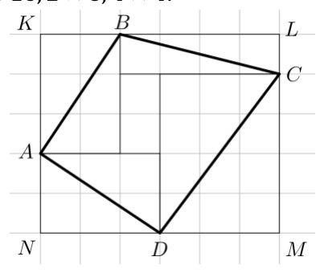{ width=200px }

2. att.

*Piezīme.* Četrstūra $ABCD$ laukumu var aprēķināt arī saskaitot četru trijstūru un taisnstūra laukumu.

# <lo-sample/> LV.SOL.2016.5.3

Atrodi lielāko piecciparu skaitli, kas dalās ar $3$ un kam visi cipari ir dažādi!

<small>
   
* questionType:
* domain:
   
</small>

## Atrisinājums

Lielākais piecciparu skaitlis, kuram visi cipari ir dažādi, ir $98765$, taču, to dalot ar $3$, atlikumā ir $2$. Nākamais lielākais piecciparu skaitlis, kuram visi cipari ir dažādi, ir $98764$, bet, to dalot ar $3$, atlikumā ir $1$. Nākamais lielākais piecciparu skaitlis, kuram visi cipari ir dažādi, ir **$98763$** un tas dalās ar $3$, tātad ir meklētais skaitlis.

# <lo-sample/> LV.SOL.2016.5.4

Vai astoņstūra virsotnēs var ierakstīt naturālus skaitļus no $1$ līdz $8$ (katrā virsotnē citu skaitli) tā, lai, katrai malai, aprēķinot tās galos ierakstīto skaitļu starpību, visas astoņas iegūtās starpības būtu dažādas?

<small>
   
* questionType:
* domain:
   
</small>

## Atrisinājums

Ir iespējamas septiņas dažādas starpības: no $1$ (ja blakus virsotnēs ierakstīti divi pēc kārtas sekojoši naturāli skaitļi) līdz $7$ (ja blakus virsotnēs ierakstīti skaitļi $8$ un $1$). Tā kā astoņstūrim ir astoņas malas, tad kopā būs astoņas starpības, bet tas nozīmē, ka vismaz divas no tām būs vienādas. (Dirihlē princips.)

# <lo-sample/> LV.SOL.2016.5.5

Kādā mēnesī trīs trešdienas bija pāra datumos. Kāda nedēļas diena bija šī mēneša $18.$ datums?

<small>
   
* questionType:
* domain:
   
</small>

## Atrisinājums

Ja kādai no mēneša trešdienām ir pāra datums, tad nākamajā nedēļā trešdienai ir nepāra datums, un otrādi. Datumu tai mēneša trešdienai, kurai pirmajai datums ir pāra skaitlis, apzīmēsim ar $n$. Tad nākamā “pāra” trešdiena ir pēc divām nedēļām un tās datums ir $n + 14$. Līdzīgi trešās “pāra” trešdienas datums ir $n + 28$. Tā kā vienā mēnesī nav vairāk kā $31$ diena, tad $n$ nav lielāks kā $3$, un tā kā $n$ ir pāra skaitlis, tad $n = 2$. Tātad mēneša $2.$ un $16.$ datums ir trešdiena, bet $18.$ datums ir piektdiena.

# <lo-sample/> LV.SOL.2016.6.1

Atrodi tādu skaitli, kas dalot ar $11$, dod atlikumu $5$, bet, dalot ar $13$, dod atlikumu $9$.

<small>
   
* questionType:
* domain:
   
</small>

## Atrisinājums

Der, piemēram, skaitlis $126$, jo $126 : 11 = 11$, atl. $5$ un $126 : 13 = 9$, atl. $9$.

# <lo-sample/> LV.SOL.2016.6.2

Kādā valstī ir tikai $15$-solāru un $20$-solāru monētas. Makvīnam bija dažas monētas. Divas monētas jeb piekto daļu savas naudas viņš atdeva māsai, bet pusi no atlikušās naudas jeb trīs monētas samaksāja par saldumiem. Cik naudas Makvīnam bija sākumā?

<small>
   
* questionType:
* domain:
   
</small>

## Atrisinājums

Iespējami trīs gadījumi, kādas divas monētas Makvīns varētu atdot māsai.

$1)$ Ja viņš atdotu divas $15$-solāru monētas, tad sākumā viņam būtu bijuši $2 \cdot 15 \cdot 5 = 150$ solāri. Pēc atdošanas viņam atliktu $120$ solāri un puse no atlikuma ir $60$ solāri, ko var samaksāt ar trīs $20$-solāru monētām.

$2)$ Ja viņš atdotu vienu $15$-solāru un vienu $20$-solāru monētu, tad sākumā viņam būtu bijuši $(15 + 20) \cdot 5 = 175$ solāri. Pēc atdošanas viņam atliktu $175 - 35 = 140$ solāri, bet puse no atlikuma ir $70$ solāri, ko nevar samaksāt ar trīs monētām. Tātad šis gadījums neder.

$3)$ Ja viņš atdotu divas $20$-solāru monētas, tad sākumā viņam būtu bijuši $2 \cdot 20 \cdot 5 = 200$ solāri. Pēc atdošanas viņam atliktu $160$ solāri, bet puse no atlikuma ir $80$ solāri, ko nevar samaksāt ar trīs monētām.

Tātad vienīgā iespēja, ka sākumā Makvīnam bija $150$ solāri.

# <lo-sample/> LV.SOL.2016.6.3

Uz rūtiņu lapas, rūtiņu virsotnēs atzīmēti $49$ punkti (skat. $2.$ att.). Cik ir tādu kvadrātu, kuru virsotnes ir šajos punktos un kuru malas iet pa rūtiņu līnijām?

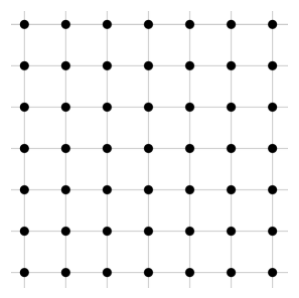{ width=150px }

2. att.

<small>
   
* questionType:
* domain:
   
</small>

## Atrisinājums

Kvadrātu ar izmēriem $1 \cdot 1$ augšējā kreisā virsotne var atrasties jebkurā no $6 \cdot 6 = 36$ melnajiem punktiem (skat. $4.$ att.). Tātad pavisam ir $36$ kvadrāti ar izmēriem $1 \cdot 1$.

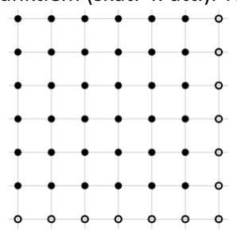{ width=150px }

$4.$ att.

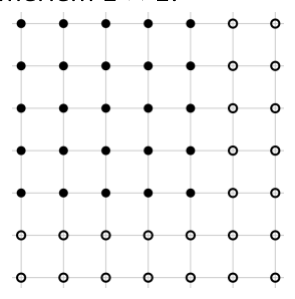{ width=150px }

$5.$ att.

Kvadrātu ar izmēriem $2 \cdot 2$ augšējā kreisā virsotne var atrasties jebkurā no $5 \cdot 5 = 25$ melnajiem punktiem (skat. $5.$ att.). Tātad pavisam ir $25$ kvadrāti ar izmēriem $2 \cdot 2$. Līdzīgi iegūst, ka ir $16$ kvadrāti ar izmēriem $3 \cdot 3$, deviņi kvadrāti ar izmēriem $4 \cdot 4$, četri kvadrāti ar izmēriem $5 \cdot 5$ un viens kvadrāts ar izmēriem $6 \cdot 6$. Tātad pavisam kopā ir $36 + 25 + 16 + 9 + 4 + 1 = 91$ kvadrāts ar uzdevumā aprakstītajām īpašībām.

# <lo-sample/> LV.SOL.2016.6.4

Kāds ir lielākais iespējamais svētdienu skaits gadā?

<small>
   
* questionType:
* domain:
   
</small>

## Atrisinājums

Tā kā gadā nav vairāk kā $366$ dienas, tad gadā nav vairāk kā $52$ pilnas nedēļas, jo $7 \cdot 52 = 364$. Ja svētdiena ir arī gada pirmā diena, tad gadā būs $53$ svētdienas, vairāk svētdienu nevar būt.

# <lo-sample/> LV.SOL.2016.6.5

Vai kubu var sagriezt $20$ mazākos kubos?

<small>
   
* questionType:
* domain:
   
</small>

## Atrisinājums

Jā, to var izdarīt, skat. $6.$ att., kurā dots kubs, kas sagriezts $19$ kubiņos ar izmēriem $1\cdot1\cdot1$ un vienā kubā ar izmēriem $2\cdot2\cdot2$.

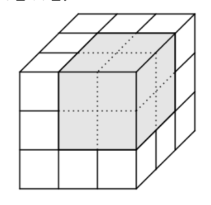{ width=150px }

6. att.

# <lo-sample/> LV.SOL.2016.7.1

Apskata visus tādus vienādojumus $ax+b=cx+d$, kur $a, b, c, d$ katrs ir ar vērtību $1$, $2$ vai $3$.

a) Uzraksti vienu šādu vienādojumu, kuram nav sakņu!

b) Cik starp šiem vienādojumiem ir tādu, kuriem nav sakņu?

<small>
   
* questionType:
* domain:
   
</small>

## Atrisinājums

**a)** Piemēram, der vienādojums $3x+1=3x+2$.

**b)** Lai dotajam vienādojumam nebūtu sakņu, jāizpildās $a=c$ un $b\ne d$. Vienādība $a=c$ var izpildīties trīs veidos: vai nu $a=c=1$, vai $a=c=2$, vai $a=c=3$. Katrā no šiem gadījumiem $b$ un $d$ var izvēlēties sešos veidos. Tātad pavisam kopā tādu vienādojumu ir $3\cdot6=18$.

# <lo-sample/> LV.SOL.2016.7.2

Pierādi, ka blakusleņķu bisektrises ir perpendikulāras!

<small>
   
* questionType:
* domain:
   
</small>

## Atrisinājums

Dots, ka $\angle AOB$ un $\angle BOC$ ir blakusleņķi, $KO$ ir $\angle AOB$ bisektrise un $OL$ ir $\angle BOC$ bisektrise (skat. $7.$ att.). No blakusleņķu īpašības izriet, ka $\angle AOB+\angle BOC=180^{\circ}$. Tā kā $\angle KOB=\frac{1}{2}\angle AOB$ un $\angle BOL=\frac{1}{2}\angle BOC$ (bisektrises definīcija), tad $\angle KOB+\angle BOL=180^{\circ}:2=90^{\circ}$. Tātad $KO\perp OL$, kas arī bija jāpierāda.

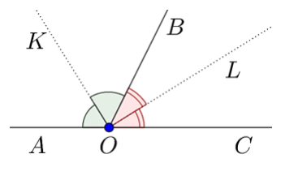{ width=150px }

7. att.

# <lo-sample/> LV.SOL.2016.7.3

Atrodi visus tādus trīsciparu skaitļus, kuriem vienlaicīgi izpildās šādas īpašības:

- visi cipari ir dažādi,
- pirmais cipars ir vislielākais un pēdējais – vismazākais,
- ciparu summa ir pāra skaitlis,
- starpība starp pirmo un otro ciparu ir $3$ reizes lielāka nekā starpība starp otro un trešu ciparu!

<small>
   
* questionType:
* domain:
   
</small>

## Atrisinājums

Apzīmēsim doto skaitli ar $\overline{abc}$, $a>b>c$.

Aplūkosim gadījumus, kāda var būt starpība starp otro un trešo ciparu, tas ir, $b-c$.

1) Ja $b-c=1$ jeb $b=c+1$, tad $a-b=3$ jeb $a=b+3$. Pēc kārtas ievietojot $c$ vietā visus iespējamos ciparus, iegūstam skaitļus $410$, $521$, $632$, $743$, $854$, $965$. Tā kā ciparu summai ir jābūt pāra skaitlim, tad der tikai skaitļi $521$, $743$ un $965$.

2) Ja $b-c=2$ jeb $b=c+2$, tad $a-b=6$ jeb $a=b+6$. Pēc kārtas ievietojot $c$ vietā visus iespējamos ciparus, iegūstam skaitļus $820$ un $931$. Der tikai skaitlis $820$, jo tā ciparu summa ir pāra skaitlis.

3) Ja $b-c\ge3$, tad $a-b\ge9$, taču tā kā $a$ un $b$ ir cipari, tad vienīgā iespēja, ka $a=9$ un $b=0$, bet tas neder, jo tad nav tāds cipars $c$, ka $c<b$.

Tātad meklētie skaitļi ir $521$, $743$, $820$ un $965$.

# <lo-sample/> LV.SOL.2016.7.4

Vai kubu var sagriezt $148$ mazākos kubos?

<small>
   
* questionType:
* domain:
   
</small>

## Atrisinājums

Jā, to var izdarīt. Sākumā sadalām kubu $4 \cdot 4 \cdot 4 = 64$ vienādos kubos. Tad vienu no mazajiem kubiem vēlreiz sadalām $64$ mazākos kubiņos. Kubiņu skaits palielinās par $63$ (rodas $64$ jauni kubiņi, bet pazūd viens iepriekšējais). Tātad tagad kubs ir sadalīts $64 + 63 = 127$ kubos. Vēl pietrūkst $148 - 127 = 21$ kubiņš. Tos var iegūt, sadalot vēl trīs kubus pa $2 \cdot 2 \cdot 2 = 8$ mazākiem kubiņiem, jo tad radīsies $3 \cdot 8 = 24$ jauni kubiņi, bet pazudīs trīs iepriekšējie. (Skat. 8. att.)

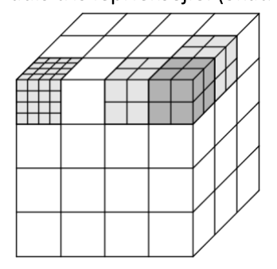{ width=150px }

8. att.

# <lo-sample/> LV.SOL.2016.7.5

Sešas figūriņas novietotas tā, kā parādīts $3.$ att.

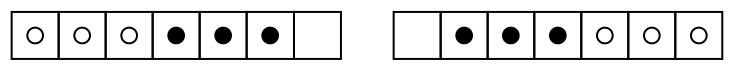{ width=350px }

$3.$ att.

$4.$ att.

Vienā gājienā vienu figūriņu var pārbīdīt uz blakus rūtiņu, ja tā ir tukša, vai arī pārcelt pāri vienai, divām vai trim figūriņām, ja rūtiņa, uz kuru to pārceļ, ir tukša. Jāiegūst $4.$ att. parādītais figūriņu izvietojums.

a) Parādi, kā to var izdarīt, izmantojot $5$ gājienus!

b) Vai to var izdarīt, izmantojot tikai $4$ gājienus?

<small>
   
* questionType:
* domain:
   
</small>

## Atrisinājums

**a)** Piecos gājienos to var izdarīt tā, kā parādīts 11. att.

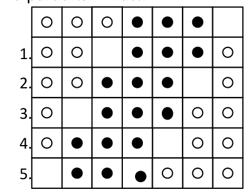{ width=200px }

11. att.

**b)** Nē, četros gājienos to nevar izdarīt. Sākumā visas trīs baltās figūras atrodas lauciņos, kuros beigās tās neatradīsies, tātad katra baltā figūra tiks pārvietota uz citu rūtiņu un tam nepieciešami trīs gājieni. Arī divas melnās figūras atrodas lauciņos, kuros beigu stāvoklī tās neatradīsies, tātad arī abu melno figūru pārvietošanai uz citu rūtiņu nepieciešami divi gājieni. Līdz ar to pavisam kopā tiks izdarīti vismaz pieci gājieni.

# <lo-sample/> LV.SOL.2016.8.1

Doti astoņi skaitļi: $1$, $2$, $3$, $4$, $5$, $6$, $7$, $8$. Sadali tos divās grupās tā, lai pirmās grupas skaitļu summa būtu vienāda ar otrās grupas skaitļu summu un pirmās grupas skaitļu kvadrātu summa būtu vienāda ar otrās grupas skaitļu kvadrātu summu!

<small>
   
* questionType:
* domain:
   
</small>

## Atrisinājums

Der šādas skaitļu grupas: $\{1; 4; 6; 7\}$ un $\{2; 3; 5; 8\}$. Skaitļu summa abās grupās ir $18$, bet skaitļu kvadrātu summa ir $102$.

# <lo-sample/> LV.SOL.2016.8.2

Vienādojumam $ax=b$, kur $a$ un $b$ – kaut kādi doti skaitļi, $x$ – mainīgais, nav atrisinājuma. Cik atrisinājumu ir vienādojumam $bx=a$?

<small>
   
* questionType:
* domain:
   
</small>

## Atrisinājums

Tā kā vienādojumam $ax = b$ nav atrisinājuma, tad $a = 0$ un $b \ne 0$. Tātad vienādojumam $bx = a$ jeb $bx = 0$ ir viens atrisinājums $x = 0$.

# <lo-sample/> LV.SOL.2016.8.3

Cik virsotņu ir izliektam daudzstūrim, kuram diagonāļu ir $14$ reizes vairāk nekā malu?

<small>
   
* questionType:
* domain:
   
</small>

## Atrisinājums

**1. atrisinājums.** Ja daudzstūrim diagonāļu ir $14$ reizes vairāk nekā malu, tad arī no katras virsotnes iziet $14$ reizes vairāk diagonāļu nekā malu. Tātad no vienas virsotnes iziet $28$ diagonāles. Tātad daudzstūrim ir $31$ virsotne (izejas virsotne, divu izejošo malu galapunkti, $28$ izejošo diagonāļu galapunkti).

**2. atrisinājums.** Daudzstūra diagonāļu skaitu var aprēķināt pēc sakarības $\frac{m\cdot(m-3)}{2}$, kur $m$ – daudzstūra malu skaits. Tā kā daudzstūrim diagonāļu ir $14$ reizes vairāk nekā malu, tad $14m=\frac{m\cdot(m-3)}{2}$. Reizinot abas vienādojuma puses ar $2$ un izdalot ar $m\ne0$, iegūsim $m-3=28$ jeb $m=31$.

# <lo-sample/> LV.SOL.2016.8.4

Rūtiņu virsotnēs atzīmēti $16$ balti punkti (skat. $5.$ att.).

a) Vai dažus punktus var nokrāsot melnus tā, lai nekādi trīs vienā krāsā nokrāsoti punkti neatrastos uz vienas taisnes?

b) Vai to var izdarīt, ja melnā krāsā jānokrāso tieši septiņi punkti?

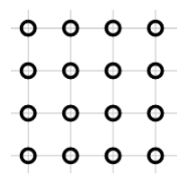{ width=100px }

$5.$ att.

<small>
   
* questionType:
* domain:
   
</small>

## Atrisinājums

**a)** Jā, to var izdarīt, skat., piemēram, 13. att.

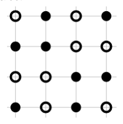{ width=100px }

13. att.

**b)** Nē, to nevar izdarīt. Ja melnā krāsā nokrāsoti septiņi punkti, tad paliek deviņi balti punkti. Tā kā visi punkti izvietoti četrās rindās, tad kādā no šīm rindām būs vismaz trīs balti punkti (Dirihlē princips), bet tas ir pretrunā ar uzdevuma nosacījumiem.

# <lo-sample/> LV.SOL.2016.8.5

Uz lapas uzrakstīti vairāki naturāli skaitļi, kas katrs dalās ar $3$. Visi šie skaitļi kopā satur visus ciparus, katru tieši vienu reizi. Kāds ir lielākais iespējamais uzrakstīto skaitļu skaits?

<small>
   
* questionType:
* domain:
   
</small>

## Atrisinājums

Var uzrakstīt sešus skaitļus, piemēram, $3$; $6$; $9$; $12$; $45$; $780$. Pamatosim, ka tas ir lielākais skaits. Ir trīs viencipara naturāli skaitļi, kas dalās ar $3$. No atlikušajiem septiņiem cipariem nevar uzrakstīt vairāk kā trīs skaitļus, kuriem ir vismaz divi cipari. Rakstot viencipara skaitļu vietā skaitļus ar vairāk cipariem, kopējais iespējamais skaitļu skaits nepalielinās.

# <lo-sample/> LV.SOL.2016.9.1

Kvadrātvienādojuma $3x^2+3ax+(x-1)b=0$ saknes ir $1$ un $2$. Noteikt skaitļus $a$ un $b$.

<small>
   
* questionType:
* domain:
   
</small>

## Atrisinājums

Tā kā $x=1$ ir vienādojuma sakne, tad, ievietojot to dotajā vienādojumā, iegūst patiesu vienādību $3+3a=0$ jeb $a=-1$.

Ievietojot iegūto $a$ vērtību un $x=2$ dotajā vienādojumā, iegūst $3\cdot4+6\cdot(-1)+b=0$ jeb $b=-6$.

# <lo-sample/> LV.SOL.2016.9.2

Vai kvadrātu var sadalīt piecās daļās, no kurām viena ir trijstūris, otra – četrstūris, trešā – piecstūris, ceturtā – sešstūris un piektā – septiņstūris?

<small>
   
* questionType:
* domain:
   
</small>

## Atrisinājums

To var izdarīt, piemēram tā, kā parādīts 14. att.

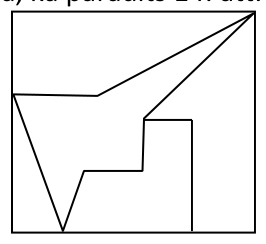{ width=100px }

14. att.

# <lo-sample/> LV.SOL.2016.9.3

Atrast naturālu skaitli $n$, kam vienlaicīgi izpildās šādas divas īpašības:

- $n$ nedalās ne ar vienu no skaitļiem $2, 3, 4, 5, 6, 7, 8, 9, 10$;
- $n-1$ dalās ar katru no skaitļiem $2, 3, 4, 5, 6, 7, 8, 9, 10$.

<small>
   
* questionType:
* domain:
   
</small>

## Atrisinājums

Ja skaitlis $n-1$ dalās ar katru no skaitļiem $2, 3, 4, 5, 6, 7, 8, 9, 10$, tad skaitlis $n$ nedalās ne ar vienu no šiem skaitļiem. Skaitli $n-1$ var izvēlēties kā norādīto skaitļu mazāko kopīgo dalāmo:

$$
\operatorname{MKD}(2; 3; 4; 5; 6; 7; 8; 9; 10)=2^3\cdot 3^2\cdot 5\cdot 7=2520.
$$

Tātad der skaitlis $n=2521$.

*Piezīme.* Mazākā kopīgā dalāmā vietā var ņemt, piemēram, arī doto skaitļu reizinājumu.

# <lo-sample/> LV.SOL.2016.9.4

Četrstūrī $ABCD$ novilkti nogriežņi, kas savieno pretējo malu viduspunktus (skat. $6.$ att.). Pierādīt, ka iekrāsoto laukumu summa ir puse no četrstūra $ABCD$ laukuma!

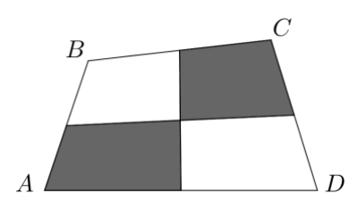{ width=200px }

6. att.

<small>
   
* questionType:
* domain:
   
</small>

## Atrisinājums

Ar $O$ apzīmējam vidusperpendikulu krustpunktu un novelkam nogriežņus $OA, OB, OC, OD$ (skat. $16$. att.). Tā kā $S_{\Delta}=\frac{1}{2}a\cdot h_a$, tad trijstūriem, kuru pamati ir vienādi un augstumi pret šiem pamatiem ir vienādi, ir vienādi arī laukumi. No šī apgalvojuma izriet, ka

$$
S_{AOS}=S_{DOS}, \qquad S_{COR}=S_{ROD}, \qquad S_{COQ}=S_{BOQ}, \qquad S_{AOP}=S_{BOP}.
$$

Saskaitot šīs vienādības, iegūstam, ka $S_{AOS}+S_{COR}+S_{COQ}+S_{AOP}=S_{DOS}+S_{ROD}+S_{BOQ}+S_{BOP}$ jeb iekrāsoto laukumu summa ir vienāda ar neiekrāsoto laukumu summu, tātad iekrāsoto laukumu summa ir puse no četrstūra $ABCD$ laukuma.

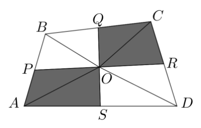{ width=200px }

$16$. att.

# <lo-sample/> LV.SOL.2016.9.5

Futbola turnīrā piedalījās piecas komandas: $A, B, C, D, E$. Katra ar katru spēlēja vienu spēli. Par uzvaru komanda saņēma $2$ punktus, par neizšķirtu $1$ punktu, par zaudējumu $0$ punktus. Komanda $A$ nezaudēja nevienu spēli, bet $B$ un $E$ savā starpā spēlēja neizšķirti. Turnīra beigās komandai $A$ bija $6$ punkti, komandai $B$ – $6$ punkti, $C$ – $5$ punkti, $D$ – $2$ punkti, $E$ – $1$ punkts. Noskaidrot, kā beidzās visas turnīra spēles!

<small>
   
* questionType:
* domain:
   
</small>

## Atrisinājums

Tā kā $B$ ar $E$ spēlēja neizšķirti, tad, lai savāktu $6$ punktus, $B$ ar $A$ spēlēja neizšķirti (jo $A$ nezaudēja nevienu spēli), pārējās komandas $B$ uzvarēja. Tā kā $E$ ieguva $1$ punktu un ar $B$ spēlēja neizšķirti, tad pārējām komandām $E$ zaudēja. Iegūstam šādu turnīra tabulu:

|  | $A$ | $B$ | $C$ | $D$ | $E$ |
|---|---|---|---|---|---|
| $A$ | --- | $1$ |  |  | $2$ |
| $B$ | $1$ | --- | $2$ | $2$ | $1$ |
| $C$ |  | $0$ | --- |  | $2$ |
| $D$ |  | $0$ |  | --- | $2$ |
| $E$ | $0$ | $1$ | $0$ | $0$ | --- |

Ņemot vērā, ka $D$ ieguva $2$ punktus, tad $D$ zaudēja gan $A$, gan $C$. No šejienes secinām, ka $A$ ar $C$ spēlēja neizšķirti.

# <lo-sample/> LV.SOL.2016.10.1

Īsta pozitīva daļskaitļa skaitītājs ir $3$ reizes mazāks nekā saucējs. Ja skaitītājam pieskaita $1$, bet no saucēja atņem $1$, iegūst skaitli $1$. Atrast sākumā doto daļskaitli!

<small>
   
* questionType:
* domain:
   
</small>

## Atrisinājums

Daļas skaitītāju apzīmējam ar $x$, tad daļas saucējs ir $3x$. Izmantojot doto, iegūstam vienādojumu $\frac{x+1}{3x-1}=1$. Līdz ar to $x+1=3x-1$ jeb $x=1$. Šī $x$ vērtība der, jo vienādojuma definīcijas kopa $D(x)=(-\infty;\frac{1}{3})\cup(\frac{1}{3};+\infty)$. Tātad sākumā dotais daļskaitlis ir $\frac{1}{3}$.

# <lo-sample/> LV.SOL.2016.10.2

Sacensībās piedalās sešas komandas. Katrai komandai ar katru citu komandu jāspēlē viena spēle. Katra komanda jau ir izspēlējusi divas spēles. Cik spēlēm vēl jānotiek?

<small>
   
* questionType:
* domain:
   
</small>

## Atrisinājums

Katru komandu attēlojam ar punktu, bet to savstarpēji izspēlētās spēles – ar nogriežņiem, kas savieno šos punktus. No tā, ka turnīra gaitā katrai komandai jāizspēlē ar katru, secinām, ka ikvienā punktā ieiet tieši $5$ līniju gali. Tā kā ir $6$ komandas jeb $6$ punkti, un katrā ieiet tieši $5$ līniju gali, tad kopā ir $6\cdot 5=30$ līniju gali. Katrai līnijai ir $2$ gali, un pavisam ir $30:2=15$ līnijas. Tas nozīmē, ka kopā jāizspēlē $15$ spēles.

Ja katra komanda ir izspēlējusi divas spēles, tad tas nozīmē, ka no katra punkta iziet divi līniju gali. Tā kā punktu skaits ir $6$, tad kopējais novilkto līniju galu skaits ir $6\cdot 2=12$, bet līniju skaits ir divas reizes mazāks, tas ir, $6$ līnijas. Tāpēc vēl nepieciešams novilkt $9$ citas līnijas un vēl jāizspēlē $9$ spēles.

# <lo-sample/> LV.SOL.2016.10.3

Izliekta četrstūra diagonāļu garumi ir $d_1$ un $d_2$, bet šaurais leņķis starp diagonālēm ir $\beta$. Pierādīt, ka četrstūra laukums ir $\frac{1}{2}d_1d_2\sin\beta$.

<small>
   
* questionType:
* domain:
   
</small>

## Atrisinājums

Apskatām četrstūri $ABCD$ (skat. $17.$ att.).

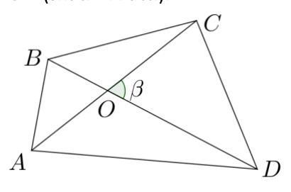{ width=200px }

$17.$ att.

Izmantojot vienādību $\sin(180^{\circ}-\alpha)=\sin\alpha$ un trijstūra laukuma formulu $S_{\Delta}=\frac{1}{2}ab\sin\alpha$, iegūstam

$$
\begin{aligned}
S_{ABCD}&=S_{AOB}+S_{BOC}+S_{COD}+S_{DOA}=\\
&=\frac{1}{2}AO\cdot BO\cdot\sin\beta+\frac{1}{2}BO\cdot CO\cdot\sin(180^{\circ}-\beta)+\frac{1}{2}CO\cdot DO\cdot\sin\beta+\frac{1}{2}DO\cdot AO\cdot\sin(180^{\circ}-\beta)=\\
&=\frac{1}{2}\sin\beta(AO\cdot BO+BO\cdot CO+CO\cdot DO+DO\cdot AO)=\\
&=\frac{1}{2}\sin\beta(BO\cdot(AO+CO)+DO\cdot(CO+AO))=\\
&=\frac{1}{2}\sin\beta(AO+CO)\cdot(BO+DO)=\frac{1}{2}d_1d_2\sin\beta.
\end{aligned}
$$

# <lo-sample/> LV.SOL.2016.10.4

Vai eksistē tāds naturāls skaitlis $n$, ka gan skaitļa $n$, gan skaitļa $n+1$ ciparu summa dalās ar $13$?

<small>
   
* questionType:
* domain:
   
</small>

## Atrisinājums

Jā, eksistē, piemēram, skaitlis $66999$. Šis skaitlis der, jo tā ciparu summa ir $6+6+9+9+9=39=13\cdot 3$ un skaitļa $67000$ ciparu summa ir $6+7+0+0+0=13$.

# <lo-sample/> LV.SOL.2016.10.5

Pa apli stāv $24$ cilvēki; katrs no tiem vai nu vienmēr runā patiesību, vai vienmēr melo. Katrs no viņiem apgalvo: „Nākamie $11$ cilvēki, kas stāv aiz manis pulksteņa rādītāja kustības virzienā, ir meļi.” Cik meļu stāv aplī?

<small>
   
* questionType:
* domain:
   
</small>

## Atrisinājums

Visi nevar būt meļi, jo tad iznāktu, ka visi runā patiesību – pretruna ar doto. Izvēlēsimies vienu cilvēku, kurš vienmēr runā patiesību, un apzīmēsim to ar $C_1$; nākamos cilvēkus pulksteņa rādītāja kustības virzienā apzīmēsim ar $C_2,C_3,\ldots,C_{23},C_{24}$. Tad $C_2,C_3,\ldots,C_{12}$ ir meļi (to apgalvo $C_1$) un arī $C_{24},C_{23},\ldots,C_{14}$ ir meļi, jo viņi samelojuši attiecībā uz $C_1$. Ja $C_{13}$ būtu melis, tad $C_2$ būtu runājis patiesību – pretruna; tātad $C_{13}$ runā patiesību. Pārbaude parāda, ka visas uzdevuma prasības izpildītas. Tātad aplī stāv $22$ meļi.

# <lo-sample/> LV.SOL.2016.11.1

Dots, ka $a$, $b$ un $c$ ir dažādi skaitļi. Pierādīt, ka vienādojumam

$$(x-a)(x-b)+(x-a)(x-c)+(x-b)(x-c)=0$$

ir divas dažādas saknes!

<small>
   
* questionType:
* domain:
   
</small>

## Atrisinājums

Nezaudējot vispārīgumu, var pieņemt, ka $a<b<c$. Vienādojuma kreisās puses izteiksmi apzīmēsim ar $f(x)$. Tad

$$\begin{aligned}
f(a)&=(a-b)(a-c)>0;\\
f(b)&=(b-a)(b-c)<0;\\
f(c)&=(c-a)(c-b)>0.
\end{aligned}$$

Tātad polinomam $f(x)$ un līdz ar to arī dotajam vienādojumam ir divas saknes ; viena – intervālā $(a; b)$ , otra – intervālā $(b; c)$.

# <lo-sample/> LV.SOL.2016.11.2

Dots izliekts četrstūris $ABCD$. Zināms, ka $\angle BAD = \angle CDA$. Malu $AB$ un $CD$ vidusperpendikulu krustpunkts $X$ atrodas uz malas $AD$. Pierādīt, ka $AC = BD$.

<small>
   
* questionType:
* domain:
   
</small>

## Atrisinājums

Apzīmējam vidusperpendikulu krustpunktu ar $X$ (skat. $18.$ att.). Pēc vidusperpendikula īpašības iegūstam, ka $XA=XB$ un $XD=XC$.

Ievērojam, ka $\angle AXB=180^{\circ}-2\angle BAD=180^{\circ}-2\angle CDA=\angle CXD$.

Tāpēc $\angle AXC=\angle AXB+\angle BXC=\angle CXD+\angle BXC=\angle BXD$ un $\triangle AXC=\triangle BXD$ pēc pazīmes $mlm$. Tātad $AC=BD$ kā atbilstošas malas vienādos trijstūros.

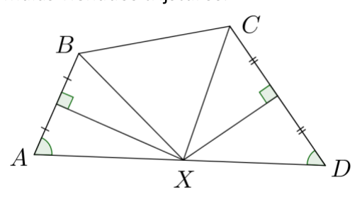{ width=250px }

18. att.

# <lo-sample/> LV.SOL.2016.11.3

Cik dažādos veidos skaitli $40$ var izteikt kā trīs naturālu skaitļu summu?

*Piezīme.* Divi veidi, kas atšķiras tikai ar saskaitāmo secību, arī tiek uzskatīti par dažādiem.

<small>
   
* questionType:
* domain:
   
</small>

## Atrisinājums

Rindā atliekam $40$ punktus, kas “ilustrē” skaitli $40$. Starp šiem $40$ punktiem ir $39$ atstarpes. Divās no šīm atstarpēm ievilksim vertikālu svītru. Sadalījums ar vertikālajām svītrām norāda, kā skaitlis $40$ ir sadalīts kā trīs naturālu skaitļu summa. Ievērojam, ka pirmo vertikālo svītru var novilkt jebkurā no $39$ atstarpēm, bet otru – jebkurā no $38$ atlikušajām atstarpēm. Tā kā nav svarīga secība, kādā novelkam svītras, tad pavisam ir $\frac{39 \cdot 38}{2}=741$ dažāds vertikālo svītru izvietojums. Līdz ar to skaitli $40$ kā trīs naturālu skaitļu summu var izteikt $741$ veidā.

# <lo-sample/> LV.SOL.2016.11.4

Uzrakstīti visi desmitciparu skaitļi, kas katrs satur visus ciparus. Kāds ir lielākais skaitlis, ar kuru dalās katrs no uzrakstītajiem skaitļiem?

<small>
   
* questionType:
* domain:
   
</small>

## Atrisinājums

Meklējamais skaitlis ir $9$. Ar $9$ dalās visi skaitļi, kas satur katru ciparu tieši vienu reizi, jo katra šāda skaitļa ciparu summa ir $0+1+2+3+4+5+6+7+8+9=45$, kas dalās ar $9$.

Vēl jāpierāda, ka lielāku skaitli, kas apmierina uzdevuma nosacījumus, nevar atrast. Ja $k$ ir skaitlis, ar kuru dalās visi uzrakstītie skaitļi, tad ar $k$ dalās arī skaitļi $9876543210$ un $9876543201$, tātad ar $k$ dalās arī šo skaitļu starpība – skaitlis $9$. Tātad $k\leq 9$.

# <lo-sample/> LV.SOL.2016.11.5

Pa apli izvietotas $10$ monētas (skat. $7.$ att.). Vienā gājienā atļauts samainīt vietām jebkuras divas monētas, starp kurām atrodas tieši viena cita. Vai, vairākas reizes veicot šādus gājienus, monētas var sakārtot tā, lai to numuri augošā secībā būtu sakārtoti pretēji pulksteņa rādītāju kustības virzienam?

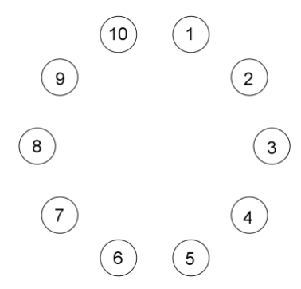{ width=200px }

$7.$ att.

<small>
   
* questionType:
* domain:
   
</small>

## Atrisinājums

Jā, monētas var sakārtot prasītajā veidā. Divu monētu $x$ un $y$ apmainīšanu vietām apzīmēsim šādi ar $x \leftrightarrow y$. Veicot monētu maiņas $2 \leftrightarrow 10$, $1 \leftrightarrow 3$, $3 \leftrightarrow 9$, $1 \leftrightarrow 9$, iegūstam $20.$ att. doto monētu izvietojumu. Tālāk veicot maiņas $5 \leftrightarrow 7$, $4 \leftrightarrow 6$, $4 \leftrightarrow 8$, $6 \leftrightarrow 8$, iegūst prasīto monētu izvietojumu.

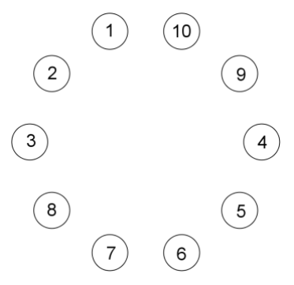{ width=150px }

$20.$ att.

# <lo-sample/> LV.SOL.2016.12.1

Pierādīt, ka pozitīviem skaitļiem $x$ un $y$ ir spēkā nevienādība

$$x^6y+xy^6 \geq x^5y^2+x^2y^5.$$

<small>
   
* questionType:
* domain:
   
</small>

## Atrisinājums

Nevienādības abas puses izdalot ar $xy>0$, iegūstam ekvivalentu nevienādību
$$
x^5+y^5 \ge x^4y+xy^4.
$$

Veicam ekvivalentus pārveidojumus:
$$
\begin{gathered}
x^5+y^5-x^4y-xy^4 \ge 0;\\
x^4(x-y)-y^4(x-y) \ge 0;\\
(x^4-y^4)(x-y) \ge 0;\\
(x^2-y^2)(x^2+y^2)(x-y) \ge 0;\\
(x-y)(x+y)(x^2+y^2)(x-y) \ge 0;\\
(x-y)^2(x+y)(x^2+y^2) \ge 0.
\end{gathered}
$$

Pēdējās nevienādības pirmais reizinātājs ir nenegatīvs, jo tas ir kvadrāts; pārējie divi reizinātāji ir pozitīvi, jo pēc dotā $x$ un $y$ ir pozitīvi skaitļi. Tātad reizinājums arī ir nenegatīvs. Tā kā tika veikti ekvivalenti pārveidojumi un iegūta patiesa nevienādība, tad arī dotā nevienādība ir patiesa.

# <lo-sample/> LV.SOL.2016.12.2

Trijstūrī $ABC$ punkts $A_1$ ir malas $BC$ iekšējs punkts, $B_1$ ir malas $AC$ iekšējs punkts, $C_1$ ir malas $AB$ iekšējs punkts. Ap trijstūriem $AB_1C_1$, $CB_1A_1$, $BA_1C_1$ apvilktas riņķa līnijas. Pierādīt, ka tās visas krustojas vienā punktā!

<small>
   
* questionType:
* domain:
   
</small>

## Atrisinājums

Krustpunktu riņķa līnijām, kas apvilktas ap trijstūriem $AC_1B_1$ un $CA_1B_1$, apzīmējam ar $O$ (skat. $21.$ att.). No teorēmas par ievilktā četrstūra leņķiem iegūstam
$$
\begin{aligned}
\angle C_1OA_1 &= 360^{\circ}-\angle C_1OB_1-\angle B_1OA_1=\\
&=360^{\circ}-(180^{\circ}-\angle A_1CB_1)-(180^{\circ}-\angle B_1AC_1)=\\
&=\angle A_1CB_1+\angle B_1AC_1=180^{\circ}-\angle C_1BA_1.
\end{aligned}
$$

Tātad ap četrstūri $C_1BA_1O$ var apvilkt riņķa līniju. Tas nozīmē, ka visas trīs dotās riņķa līnijas krustojas vienā punktā $O$.

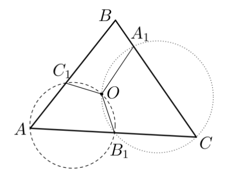{ width=200px }

21. att.

# <lo-sample/> LV.SOL.2016.12.3

Pa apli stāv $100$ bērni: $50$ zēni un $50$ meitenes. Divi zēni stāv blakus $17$ vietās. Cik vietās blakus stāv meitenes?

<small>
   
* questionType:
* domain:
   
</small>

## Atrisinājums

Apzīmējam zēnus ar melniem punktiem, bet meitenes – ar baltiem. Blakus esošos punktus savienojam ar nogriežņiem. Tā kā ir $50$ zēni un $50$ meitenes, tad gan melno, gan balto punktu skaits ir $50$. No katra punkta iziet divi nogriežņi. Ņemot vērā, ka melno un balto punktu skaits ir vienāds, vienāds ir arī nogriežņu galu skaits, kas iziet no baltiem un melniem punktiem. Sauksim tos attiecīgi par baltiem un melniem nogriežņu galiem. Pavisam ir $100$ balti un $100$ melni nogriežņu gali. Ja $17$ vietās blakus stāv divi zēni, tas nozīmē, ka ir tieši $17$ nogriežņi, kam abi gali ir melni. Šādiem nogriežņiem ir $34$ melni gali. Noteikti jābūt $66$ nogriežņiem, kam viens gals ir melns, bet otrs – balts. Tas nozīmē, ka pārējie baltie gali ir nogriežņiem, kas savieno divus baltos punktus. Tā kā šādiem nogriežņiem ir $34$ baltie gali, tad ir tieši $17$ šādi nogriežņi. Tātad divas meitenes blakus stāv $17$ vietās.

# <lo-sample/> LV.SOL.2016.12.4

Dots naturāls skaitlis $n$. Pierādīt, ka abi skaitļi $2n+5$ un $3n+8$ vienlaicīgi nedalās ne ar kādu naturālu skaitli, kas lielāks nekā $1$.

<small>
   
* questionType:
* domain:
   
</small>

## Atrisinājums

Pieņemsim, ka $2n+5$ un $3n+8$ dalās ar kādu naturālu skaitli $m$. Tad ar $m$ dalās arī skaitlis $2\cdot(3n+8)-3\cdot(2n+5)=1$. Tātad $m=1$ un abi dotie skaitļi vienlaicīgi dalās tikai ar skaitli $1$ jeb tie vienlaicīgi nedalās ne ar kādu naturālu skaitli, kas lielāks nekā $1$.

# <lo-sample/> LV.SOL.2016.12.5

Kvadrāts sadalīts $10 \times 10$ vienādās kvadrātiskās rūtiņās. Katrā rūtiņā dzīvo pa rūķītim. Katrs rūķītis vai nu vienmēr melo, vai vienmēr runā patiesību. Katrs no viņiem apgalvo, ka vienā kolonnā ar viņu ir vairāk meļu nekā vienā rindā ar viņu. Pierādīt, ka meļu skaits kvadrātā dalās ar $10$.

<small>
   
* questionType:
* domain:
   
</small>

## Atrisinājums

Pierādīsim, ka katrā rindā vai nu visi rūķīši vienmēr runā patiesību, vai visi rūķīši vienmēr melo. No tā izrietēs uzdevuma apgalvojums. Pieņemsim pretējo, ka katrā rindā vienā rūtiņā dzīvo rūķītis, kas runā patiesību, bet citā – melis (skat. $22.$ att.).

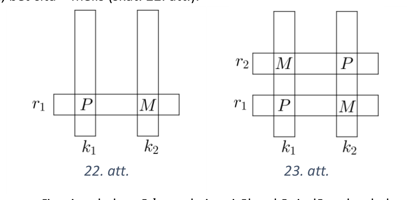{ width=400px }

22. att.

{ width=400px }

23. att.

Tad pēc uzdevuma nosacījumiem kolonnā $k_1$ meļu ir vairāk nekā rindā $r_1$, bet kolonnā $k_2$ meļu ir ne vairāk kā rindā $r_1$. Tātad kolonnā $k_1$ meļu ir vairāk nekā kolonnā $k_2$. Tāpēc eksistē tāda rinda $r_2$, kurā kolonnā $k_1$ dzīvo melis, bet kolonnā $k_2$ – rūķītis, kas runā patiesību (skat. $23.$ att.).

Spriežot par šiem rūķīšiem tāpat kā par rūķīšiem rindā $r_1$, iegūstam, ka kolonnā $k_2$ meļu ir vairāk nekā kolonnā $k_1$. Iegūta pretruna, tātad pieņēmums bija aplams. Līdz ar to katrā rindā vai nu visi rūķīši vienmēr runā patiesību, vai visi rūķīši vienmēr melo. Tā kā katrā rindā dzīvo $10$ rūķīši, tad meļu skaits kvadrātā dalās ar $10$.
