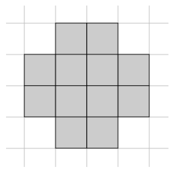
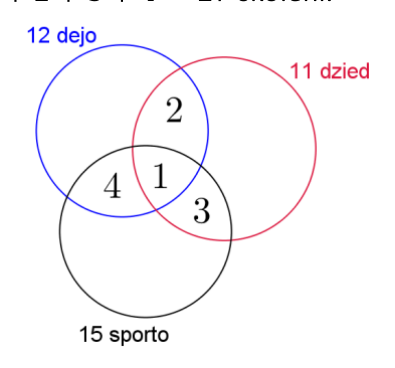
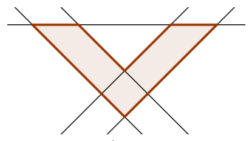
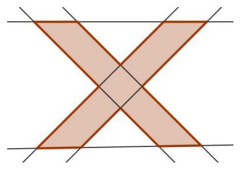
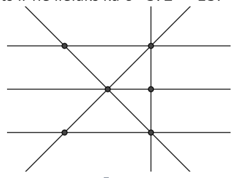
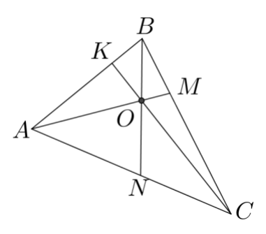
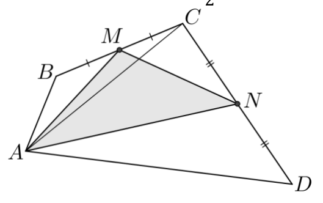
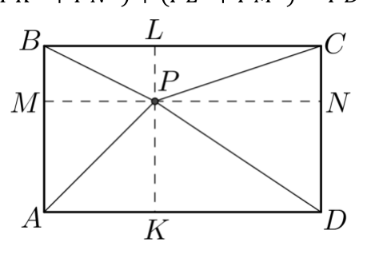
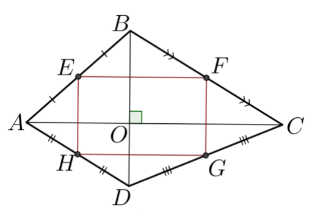
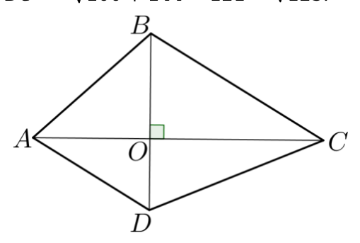

# <lo-sample/> LV.SOL.2017.5.1

Atrast naturālu skaitli, kura ciparu summa dalās ar $27$, bet pats ar $27$ nedalās.

<small>
   
* questionType:
* domain:
   
</small>

## Atrisinājums

Der, piemēram, skaitlis $9981$. Tā ciparu summa ir $9 + 9 + 8 + 1 = 27$, bet $9981 : 27 = 369$, atl. $18$.

# <lo-sample/> LV.SOL.2017.5.2

Parādi vienu piemēru, kā rūtiņu burtnīcas lapā nokrāsot dažas rūtiņas melnā krāsā tā, lai katrai melnai rūtiņai būtu vismaz četras melnas blakus rūtiņas! Divas rūtiņas sauksim par blakus rūtiņām, ja tām ir kopīga mala vai kopīga virsotne.

<small>
   
* questionType:
* domain:
   
</small>

## Atrisinājums

Piemēram, var nokrāsot rūtiņas kā $1.$ att.

{ width=150px }

1. att.

# <lo-sample/> LV.SOL.2017.5.3

Zināms, ka katrs klases skolēns nodarbojas ar vismaz vienu no trim aktivitātēm: dejo tautas dejas, dzied korī vai sporto. Ir tikai viens skolēns, kas gan dejo, gan dzied, gan sporto. No visiem klases skolēniem $12$ dejo tautas dejas, $11$ skolēni dzied korī, $15$ skolēni sporto. Ir $3$ skolēni, kas gan dejo, gan dzied. Ir $4$ skolēni, kas gan dzied, gan sporto. Ir $5$ skolēni, kas gan dejo, gan sporto. Cik skolēnu ir klasē?

<small>
   
* questionType:
* domain:
   
</small>

## Atrisinājums

Izmantojot Eilera riņķus, attēlojam uzdevumā doto (skat. $2.$ att.). Aprēķinām, cik ir tādu skolēnu, kas

- tikai dejo $12 - 4 - 1 - 2 = 5$;
- tikai dzied $11 - 2 - 1 - 3 = 5$;
- tikai sporto $15 - 4 - 1 - 3 = 7$.

Tātad klasē mācās $5 + 5 + 7 + 1 + 2 + 3 + 4 = 27$ skolēni.

{ width=200px }

2. att.

# <lo-sample/> LV.SOL.2017.6.1

Uzzīmē divpadsmitstūri, kura visas malas novietotas uz $6$ taisnēm! Piemēram, 1. att. dotajam sešstūrim visas $6$ malas ir novietotas uz $5$ taisnēm. Ievēro, ka no katras divpadsmitstūra virsotnes drīkst *iziet* tieši divas malas!

{ width=200px }

1. att.

<small>
   
* questionType:
* domain:
   
</small>

## Atrisinājums

Skat., piemēram, 4. att.

{ width=200px }

4. att.

# <lo-sample/> LV.SOL.2017.6.2

Sniedzei ir $54$ piparkūkas un $10$ dāvanu maisiņi. Vai viņa var salikt piparkūkas šajos maisiņos tā, lai katrā maisiņā būtu vismaz viena piparkūka un nekādos divos maisiņos nebūtu vienāds piparkūku skaits?

<small>
   
* questionType:
* domain:
   
</small>

## Atrisinājums

Nē, nevar. Apskatām gadījumu, kad katrā maisiņā Sniedze ieliek mazāko iespējamo piparkūku skaitu. Tad vienā maisiņā būs $1$ piparkūka, otrā – $2$ piparkūkas, trešā – $3$ piparkūkas, ..., desmitajā maisiņā – $10$ piparkūkas. Taču tādā gadījumā visos maisiņos kopā jau būs $1+2+3+4+5+6+7+8+9+10=55$ piparkūkas, bet Sniedzei ir tikai $54$ piparkūkas.

# <lo-sample/> LV.SOL.2017.6.3

Vai naturāla skaitļa ciparu reizinājums var būt $6930$?

<small>
   
* questionType:
* domain:
   
</small>

## Atrisinājums

Nē, nevar. Sadalām skaitli $6930$ pirmreizinātājos $6930=2\cdot3\cdot3\cdot5\cdot7\cdot11$. Tā kā $11$ ir skaitļa $6930$ pirmreizinātājs, tad meklētajam skaitlim būtu jāsatur cipars $11$, bet $11$ nav cipars.

# <lo-sample/> LV.SOL.2017.7.1

Skaitļa $n$ pierakstā izmantoti tikai cipari $1$ un $2$. Vieninieku ir $7$ reizes vairāk nekā divnieku. Pierādīt, ka $n+2017$ nedalās ar $3$.

<small>
   
* questionType:
* domain:
   
</small>

## Atrisinājums

Ja skaitļa $n$ pierakstā ir $x$ divnieki, tad tā pierakstā ir $7x$ vieninieki. Līdz ar to skaitļa $n$ ciparu summa ir $2x+7x=9x$. Tātad skaitļa $n$ ciparu summa dalās ar $3$ un arī pats skaitlis $n$ dalās ar $3$. Skaitlis $2017$ ar $3$ nedalās (jo tā ciparu summa ir $2+0+1+7=10$), tātad $n+2017$ nedalās ar $3$.

# <lo-sample/> LV.SOL.2017.7.2

Ekskursijā piedalījās $15$ skolēni. Visiem kopā līdzi bija ne mazāk kā $122$ eiro. Turklāt katram skolēnam bija vesels skaits eiro. Pierādīt, ka vismaz vienam skolēnam līdzi bija ne mazāk kā $9$ eiro!

<small>
   
* questionType:
* domain:
   
</small>

## Atrisinājums

Pieņemam pretējo, ka katram skolēnam līdzi bija mazāk nekā $9$ eiro. Tā kā katram skolēnam līdzi bija vesels skaits eiro, tad katram līdzi bija $8$ eiro vai mazāk. Līdz ar to $15$ skolēniem kopā līdzi bija ne vairāk kā $15\cdot8=120$ eiro. Iegūta pretruna, tātad pieņēmums ir aplams. Līdz ar to vismaz vienam skolēnam līdzi bija ne mazāk kā $9$ eiro.

# <lo-sample/> LV.SOL.2017.7.3

Vai var uzzīmēt sešas taisnes tā, lai tām būtu tieši a) $6$ krustpunkti, b) $16$ krustpunkti?

<small>
   
* questionType:
* domain:
   
</small>

## Atrisinājums

**a)** Jā, var uzzīmēt, piemēram, skat. 5. att. **b)** Pamatosim, ka $6$ taisnēm nevar būt tieši $16$ krustpunkti. Divām taisnēm var būt $0$ krustpunkti (tās nekrustojas), tieši $1$ krustpunkts vai bezgalīgi daudz krustpunkti (taisnes sakrīt). Tātad katra no $6$ taisnēm var krustot katru no pārējām $5$ taisnēm augstākais $1$ punktā. Tātad krustpunktu skaits ir ne lielāks kā $6\cdot5:2=15$.

{ width=200px }

5. att.

# <lo-sample/> LV.SOL.2017.8.1

Atrast mazāko naturālo skaitli, kura ciparu reizinājums ir $210$ un kas dalās ar $9$.

<small>
   
* questionType:
* domain:
   
</small>

## Atrisinājums

Mazākais naturālais skaitlis, kas atbilst uzdevuma nosacījumiem, ir $567$. Pamatosim, ka mazāku iegūt nevar. Sadalām skaitli $210$ pirmreizinātājos $210=2\cdot3\cdot5\cdot7$. Meklētais skaitlis noteikti saturēs ciparu $5$ un $7$, jo reizinot šos skaitļus ar jebkuru citu no iegūtajiem pirmreizinātājiem, iegūsim divciparu skaitli nevis ciparu. Meklētā skaitļa ciparu reizinājums dalās ar $2$ un ar $3$. Tā kā ir jāatrod mazākais skaitlis, tad tam jāsatur pēc iespējas mazāk ciparu. Ja skaitlis satur ciparu $6=2\cdot 3$, tad mazākais skaitlis, ko var izveidot no cipariem $5, 6, 7$, ir $567$. Tā kā $5+6+7=18$, kas dalās ar $9$, tad arī skaitlis $567$ dalās ar $9$.

# <lo-sample/> LV.SOL.2017.8.2

Ekskursijā piedalījās $15$ skolēni. Visiem kopā līdzi bija ne mazāk kā $122$ eiro. Turklāt centu monētas bija tikai diviem skolēniem; visiem pārējiem bija tikai eiro monētas vai papīra nauda. Pierādīt, ka vismaz vienam skolēnam līdzi bija ne mazāk kā $9$ eiro.

<small>
   
* questionType:
* domain:
   
</small>

## Atrisinājums

Pieņemam pretējo, ka katram skolēnam līdzi bija mazāk nekā $9$ eiro. Tādā gadījumā tiem $13$ skolēniem, kam bija tikai eiro monētas vai papīra nauda, katram bija ne vairāk kā $8$ eiro, bet atlikušajiem diviem skolēniem – katram ne vairāk kā $8$ eiro un $99$ centi. Tāpēc kopējā naudas summa nav lielāka kā $13\cdot 8+2\cdot 8{,}99=121{,}98$ eiro. Iegūta pretruna, tātad pieņēmums ir aplams. Līdz ar to vismaz vienam skolēnam līdzi bija ne mazāk kā $9$ eiro.

# <lo-sample/> LV.SOL.2017.8.3

Trijstūrī $ABC$ no virsotnēm novilkti nogriežņi $AM$, $BN$ un $CK$, kas krustojas vienā punktā $O$. Punkti $K$, $M$, $N$ atrodas attiecīgi uz trijstūra malām $AB$, $BC$, $AC$. Pierādīt, ka $AM+BN+CK>\frac{1}{2}(AB+BC+CA)$.

<small>
   
* questionType:
* domain:
   
</small>

## Atrisinājums

No trijstūra nevienādības izriet (skat. $6$. att.)

- $AO+ON>AN$ ($\triangle AON$);
- $CO+OM>CM$ ($\triangle COM$);
- $BO+OK>BK$ ($\triangle BOK$).

{ width=200px }

6. att.

Saskaitām iegūtās nevienādības:

$$
\begin{aligned}
AO+ON+CO+OM+BO+OK &> AN+CM+BK;\\
AO+OM+CO+OK+BO+ON &> AN+CM+BK;\\
AM+CK+BN &> AN+CM+BK.
\end{aligned}
\tag{1}
$$

Līdzīgi (apskatot $\triangle NOC$, $\triangle MOB$, $\triangle KOA$) iegūst, ka

$$
AM+BN+CK>NC+MB+KA.
\tag{2}
$$

Saskaitot nevienādības $(1)$ un $(2)$, iegūstam

$$
2AM+2CK+2BN>AN+CM+BK+NC+MB+KA;
$$

$$
2(AM+CK+BN)>AC+CB+BA;
$$

$$
AM+BN+CK>\frac{1}{2}(AB+BC+CA).
$$

# <lo-sample/> LV.SOL.2017.9.1

a) Vai noteikti visiem reāliem skaitļiem $x$ izpildās $3x^2 - 0{,}25x + 0{,}005 > 0$?  
**b)** Vai noteikti visiem reāliem skaitļiem $x$ izpildās $9x^2 + 12x + 5 > 0$?

<small>
   
* questionType:
* domain:
   
</small>

## Atrisinājums

a) Nē, dotā nevienādība neizpildās visiem reāliem skaitļiem $x$, piemēram, ja $x=\frac{1}{20}$, tad $\frac{3}{400}-\frac{1}{4}\cdot\frac{1}{20}+\frac{1}{200}=0$. Tā kā $0$ nav lielāka kā $0$, tad dotā nevienādība neizpildās.

b) Ekvivalenti pārveidojam dotās nevienādības kreisās puses izteiksmi:

$$
9x^2+12x+5=9x^2+12x+4+1=(3x)^2+2\cdot 3x\cdot 2+2^2+1=(3x+2)^2+1.
$$

Izteiksme $(3x+2)^2+1>0$, jo skaitļa kvadrāts vienmēr ir nenegatīvs un, tam pieskaitot $1$, iegūst pozitīvu skaitli. Līdz ar to esam pierādījuši, ka visiem reāliem skaitļiem $x$ izpildās $9x^2+12x+5>0$.

*Piezīme.* Risinājumā var apskatīt kvadrāttrinoma diskriminanta izteiksmi un izdarīt secinājumus par kvadrātfunkcijas grafika novietojumu attiecībā pret $x$ asi.

# <lo-sample/> LV.SOL.2017.9.2

Ar naturālu skaitli atļauts izdarīt šādas operācijas:  
1) pieskaitīt tam $6$;  
2) dalīt ar $2$, ja tas ir pāra skaitlis;  
3) mainīt vietām tā ciparus (skaitļa priekšā nedrīkst nonākt nulle).  
Par kādu vismazāko skaitli, veicot tikai atļautās operācijas, var pārveidot skaitli a) $76$; b) $15$?

<small>
   
* questionType:
* domain:
   
</small>

## Atrisinājums

Izpildot atļautās trīs operācijas, nevar iegūt negatīvus skaitļus un $0$.

a) Skaitli $76$ var pārveidot par skaitli $1$:
$$76 \xrightarrow{2)} 38 \xrightarrow{1)} 44 \xrightarrow{2)} 22 \xrightarrow{2)} 11 \xrightarrow{1)} 17 \xrightarrow{1)} 23 \xrightarrow{3)} 32 \xrightarrow{2)} 16 \xrightarrow{2)} 8 \xrightarrow{2)} 4 \xrightarrow{2)} 2 \xrightarrow{2)} 1.$$
Līdz ar to esam ieguvuši, ka mazākais skaitlis, par ko var pārveidot skaitli $76$, ir $1$.

b) Ja skaitlis $x$ dalās ar $3$, tad, izpildot jebkuru no atļautajām operācijām, iegūtais skaitlis arī dalās ar $3$. Tātad mazākais skaitlis, ko varētu iegūt no skaitļa $15$, ir $3$. Piemēram, skaitli $3$ var iegūt šādi:
$$15 \xrightarrow{1)} 21 \xrightarrow{3)} 12 \xrightarrow{2)} 6 \xrightarrow{2)} 3.$$

# <lo-sample/> LV.SOL.2017.9.3

Izliektā četrstūrī $ABCD$ punkts $M$ ir malas $BC$ viduspunkts un punkts $N$ ir malas $CD$ viduspunkts. Pierādīt, ka $S_{AMN} < \frac{1}{2}S_{ABCD}$.

<small>
   
* questionType:
* domain:
   
</small>

## Atrisinājums

Trijstūru $AMB$ un $AMC$ laukumi ir vienādi, jo tiem ir vienādi pamati $BM$ un $MC$ un to augstumi sakrīt; arī trijstūru $CAN$ un $AND$ laukumi ir vienādi (skat. $7$. att.). Tātad
$$S_{AMN}<S_{AMCN}=S_{AMC}+S_{ACN}=\frac{1}{2}(S_{ABC}+S_{ACD})=\frac{1}{2}S_{ABCD}.$$

{ width=250px }

$7$. att.

# <lo-sample/> LV.SOL.2017.10.1

Pierādīt, ka $a^2 + b^2 + \frac{1}{2} \ge a + b$.

<small>
   
* questionType:
* domain:
   
</small>

## Atrisinājums

Ekvivalenti pārveidojam doto nevienādību:
$$a^2-a+\frac{1}{4}+b^2-b+\frac{1}{4}\ge 0;$$
$$\left(a-\frac{1}{2}\right)^2+\left(b-\frac{1}{2}\right)^2\ge 0.$$
Skaitļa kvadrāts vienmēr ir nenegatīvs un divu nenegatīvu skaitļu summa ir nenegatīvs skaitlis, tātad pēdējā nevienādība ir patiesa. Tā kā tika veikti ekvivalenti pārveidojumi, tad arī dotā nevienādība ir patiesa.

# <lo-sample/> LV.SOL.2017.10.2

Trīs no aritmētiskās progresijas locekļiem ir $41$; $113$; $193$. Atrast lielāko iespējamo diferences vērtību, ja zināms, ka diference ir vesels skaitlis!

<small>
   
* questionType:
* domain:
   
</small>

## Atrisinājums

Jebkuru divu aritmētiskās progresijas locekļu starpība dalās ar diferenci $d$. Tātad $113-41=72$ dalās ar $d$ un $193-113=80$ dalās ar $d$. Līdz ar to arī šo skaitļu starpība $80-72=8$ dalās ar $d$. Tas nozīmē, ka $d\le 8$. Diferences vērtība var būt $8$, piemēram, aritmētiskā progresija $a_n=8n+1$ ar diferenci $8$ satur visus uzdevumā dotos skaitļus.

# <lo-sample/> LV.SOL.2017.10.3

Taisnstūra $ABCD$ iekšpusē atlikts punkts $P$. Pierādīt, ka $PA^2 + PC^2 = PB^2 + PD^2$.

<small>
   
* questionType:
* domain:
   
</small>

## Atrisinājums

Caur punktu $P$ novelkam taisni $KL$ paralēli $AB$ un taisni $MN$ paralēli $BC$ (skat. 8. att.). Iegūti četri taisnstūri. No Pitagora teorēmas un taisnstūra īpašībām izriet vienādības:
$$
PA^2+PC^2=(PK^2+AK^2)+(PL^2+LC^2)=(PK^2+PM^2)+(PL^2+PN^2)=
$$
$$
=(PK^2+PN^2)+(PL^2+PM^2)=PD^2+PB^2.
$$

{ width=200px }

8. att.

# <lo-sample/> LV.SOL.2017.11.1

Pierādīt, ka $(a^2 + b^2)(a^4 + b^4) \ge (a^3 + b^3)^2$.

<small>
   
* questionType:
* domain:
   
</small>

## Atrisinājums

Ekvivalenti pārveidojam doto nevienādību:
$$
a^6+a^2\cdot b^4+b^2\cdot a^4+b^6 \ge a^6+2\cdot a^3\cdot b^3+b^6;
$$
$$
a^2\cdot b^4+b^2\cdot a^4 \ge 2\cdot a^3\cdot b^3;
$$
$$
a^2\cdot b^4-2\cdot a^3\cdot b^3+b^2\cdot a^4 \ge 0;
$$
$$
(a\cdot b^2-a^2\cdot b)^2 \ge 0.
$$
Skaitļa kvadrāts vienmēr ir nenegatīvs, tātad pēdējā nevienādība ir patiesa. Tā kā tika veikti ekvivalenti pārveidojumi, tad arī dotā nevienādība ir patiesa.

*Piezīme.* Var izmantot, ka $a^2\cdot b^4-2\cdot a^3\cdot b^3+b^2\cdot a^4=a^2\cdot b^2\cdot(b^2-2\cdot a\cdot b+a^2)=a^2\cdot b^2\cdot(b-a)^2$.

# <lo-sample/> LV.SOL.2017.11.2

No sākuma uz papīra lapas uzrakstīts skaitlis $16$. Ja uz lapas uzrakstīts skaitlis $x$, tad uz tā atļauts uzrakstīt arī skaitli $x^2$, ja uz lapas uzrakstīti skaitļi $x$ un $y$, tad uz tās atļauts uzrakstīt arī skaitli $|x - y| + 1$. Vai var panākt, lai uz lapas būtu uzrakstīts skaitlis $2016$ (un varbūt vēl kādi citi skaitļi)?

<small>
   
* questionType:
* domain:
   
</small>

## Atrisinājums

Uz lapas uzrakstītais skaitlis $16$ dod atlikumu $1$, dalot to ar $3$. Ievērojam, ka

$1)$ ja $x$ dod atlikumu $1$, dalot ar $3$, tad arī $x^2$ dod atlikumu $1$, dalot ar $3$ (t. i., ja $x=3\cdot n+1$, kur $n$ – nenegatīvs vesels skaitlis, tad $x^2=(3\cdot n+1)^2=9\cdot n^2+6\cdot n+1=3\cdot(3\cdot n^2+2\cdot n)+1$);

$2)$ ja $x$ un $y$ dod atlikumu $1$, dalot tos ar $3$, tad skaitlis $|x-y|+1$ arī dod atlikumu $1$, dalot ar $3$.

Tas nozīmē, ka uz lapas var iegūt tikai skaitļus, kas dod atlikumu $1$, dalot ar $3$. Tā kā $2016$ dalās ar $3$, tad to iegūt nevar.

# <lo-sample/> LV.SOL.2017.11.3

Izliektā četrstūrī $ABCD$ diagonāles ir savstarpēji perpendikulāras. Pierādīt, ka četrstūra malu viduspunkti atrodas uz vienas riņķa līnijas!

<small>
   
* questionType:
* domain:
   
</small>

## Atrisinājums

Apzīmējam malu viduspunktus ar $E$, $F$, $G$, $H$ (skat. 9. att.). No trijstūra viduslīnijas īpašībām izriet, ka $EF\parallel AC\parallel HG$ un $EH\parallel BD\parallel FG$. Tā kā $AC\perp BD$, tad $EFGH$ ir taisnstūris. Taisnstūra pretējo leņķu summa ir $180^{\circ}$, tātad ap to var apvilkt riņķa līniju, no kā izriet, ka četrstūra malu viduspunkti atrodas uz vienas riņķa līnijas.

{ width=250px }

9. att.

# <lo-sample/> LV.SOL.2017.12.1

Pierādīt, ka $\frac{a+b}{a^2+b^2} \ge \frac{a^2+b^2}{a^3+b^3}$, ja $a$ un $b$ ir pozitīvi skaitļi.

<small>
   
* questionType:
* domain:
   
</small>

## Atrisinājums

Tā kā $a$ un $b$ ir pozitīvi skaitļi, tad $a^2+b^2>0$ un $a^3+b^3>0$. Abas nevienādības puses reizinot ar $(a^2+b^2)\cdot(a^3+b^3)>0$, iegūstam $(a+b)\cdot(a^3+b^3)\geq(a^2+b^2)\cdot(a^2+b^2)$.

Ekvivalenti pārveidojam iegūto nevienādību:
$$
\begin{gathered}
a^4+a\cdot b^3+b\cdot a^3+b^4\geq a^4+2\cdot a^2\cdot b^2+b^4;\\
a\cdot b^3+b\cdot a^3\geq 2\cdot a^2\cdot b^2;\\
a\cdot b^3-2\cdot a^2\cdot b^2+b\cdot a^3\geq 0;\\
a\cdot b\cdot(b^2-2\cdot a\cdot b+a^2)\geq 0;\\
a\cdot b\cdot(b-a)^2\geq 0.
\end{gathered}
$$
Pēc dotā $a>0$, $b>0$ un skaitļa kvadrāts vienmēr ir nenegatīvs, tātad pēdējā nevienādība ir patiesa. Tā kā tika veikti ekvivalenti pārveidojumi, tad arī dotā nevienādība ir patiesa.

*Piezīme.* Nevienādību var pierādīt arī vienādojot saucējus un novērtējot iegūtās daļas vērtību.

# <lo-sample/> LV.SOL.2017.12.2

Kādu lielāko daudzumu skaitļu var izvēlēties no kopas $\{1; 2; 3; \ldots; 2017\}$ tā, lai starp izvēlētajiem skaitļiem nekādu divu skaitļu summa nebūtu vienāda ar trešo skaitli?

<small>
   
* questionType:
* domain:
   
</small>

## Atrisinājums

Var izvēlēties $1009$ skaitļus, piemēram, visus nepāra skaitļus, jo tad jebkuru divu izvēlēto skaitļu summa ir pāra skaitlis un tātad nesakrīt ar trešo izvēlēto skaitli.

Pierādīsim, ka vairāk skaitļu izvēlēties nevar.

Ar $n$ apzīmējam lielāko izvēlēto skaitli. Aplūkojam divus gadījumus.

Ja $n$ ir nepāra skaitlis, t. i., $n=2\cdot k+1$, tad aplūkojam skaitļu pārus
$$(1;2\cdot k),\qquad (2;2\cdot k-1),\qquad \ldots,\qquad (k;k+1).$$
No katra šāda skaitļu pāra var izvēlēties ne vairāk kā vienu skaitli (pretējā gadījumā šo skaitļu summa būs vienāda ar izvēlēto skaitli $n$). Tātad izvēlēto skaitļu skaits nepārsniedz $1+\dfrac{2016}{2}=1009$.

Līdzīgi aplūko gadījumu, kad $n$ ir pāra skaitlis.

# <lo-sample/> LV.SOL.2017.12.3

Dots izliekts četrstūris $ABCD$. Zināms, ka $AC \perp BD$ un $AB = 10$, $BC = 11$, $CD = 12$. Aprēķināt malas $AD$ garumu!

<small>
   
* questionType:
* domain:
   
</small>

## Atrisinājums

No Pitagora teorēmas iegūstam vienādības (skat. $10$. att.):
$$AB^2=AO^2+OB^2;\quad BC^2=BO^2+OC^2;\quad CD^2=CO^2+OD^2;\quad AD^2=AO^2+OD^2.$$
Ievērojam, ka izpildās vienādība $AB^2+CD^2=BC^2+AD^2$.

Tātad $AD=\sqrt{AB^2+CD^2-BC^2}=\sqrt{100+144-121}=\sqrt{123}$.

{ width=250px }

10. att.
