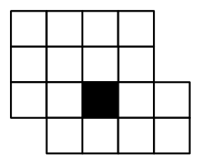
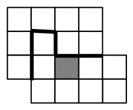
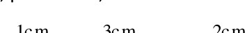
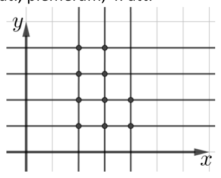
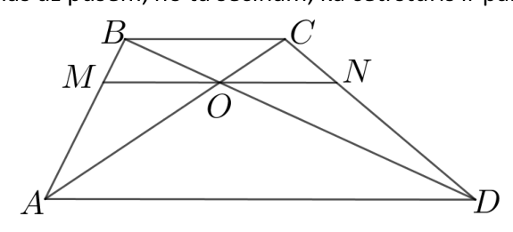
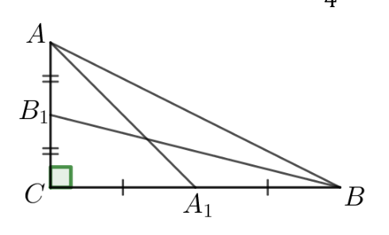
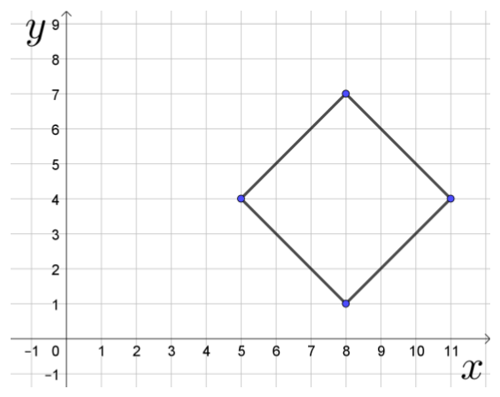
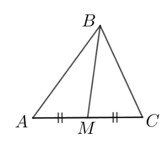
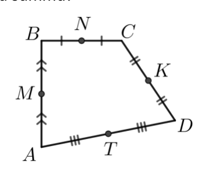
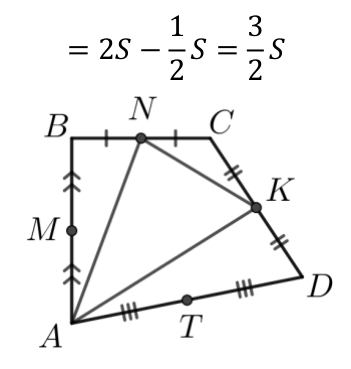

# <lo-sample/> LV.SOL.2018.5.1

Istabā sēž $8$ cilvēki. Pierādīt, ka starp tiem ir vismaz $2$, kuri dzimuši vienā un tajā pašā nedēļas dienā!

<small>
   
* questionType:
* domain:
   
</small>

## Atrisinājums

Ja uzdevumā prasītais neizpildītos, tad katrā nedēļas dienā būtu dzimis ne vairāk kā $1$ cilvēks, bet tādā gadījumā istabā atrastos ne vairāk kā $7$ cilvēki. Tā ir pretruna ar doto, ka istabā ir $8$ cilvēki. Tātad ir vismaz divi cilvēki, kas dzimuši vienā nedēļas dienā.

# <lo-sample/> LV.SOL.2018.5.2

Sagriezt $1.$ att. parādīto figūru divās vienādās daļās! Griezumiem jāiet pa rūtiņu līnijām; tumšā rūtiņa ir caurums.

{ width=100px }

$1.$ att.

<small>
   
* questionType:
* domain:
   
</small>

## Atrisinājums

Skat. $2.$ att.

{ width=100px }

$2.$ att.

# <lo-sample/> LV.SOL.2018.5.3

Jānis, Juris, Andris, Pēteris un Kārlis katrs iedomājās pa skaitlim; tie visi bija dažādi. Jāņa skaitlis bija lielāks nekā divi citi iedomātie skaitļi, Kārļa skaitlis – lielāks nekā četri citi iedomātie skaitļi, Pētera skaitlis – lielāks nekā viens cits iedomātais skaitlis, bet Jura skaitlis bija vismazākais. Par cik no iedomātajiem skaitļiem bija lielāks Andra iedomātais skaitlis?

<small>
   
* questionType:
* domain:
   
</small>

## Atrisinājums

Katrs no iedomātajiem skaitļiem var būt lielāks nekā $0$, $1$, $2$, $3$ vai $4$ citi iedomātie skaitļi. Tā kā no iedomātajiem skaitļiem jau ir skaitļi, kas ir lielāki nekā $0$, $1$, $2$ vai $4$ citi iedomātie skaitļi un visi iedomātie skaitļi ir dažādi, tad Andra iedomātais skaitlis ir lielāks nekā $3$ citi iedomātie skaitļi.

# <lo-sample/> LV.SOL.2018.6.1

Istabā sēž $13$ cilvēki. Pierādīt, ka starp tiem ir vismaz $2$, kuri dzimuši vienā un tajā pašā mēnesī!

<small>
   
* questionType:
* domain:
   
</small>

## Atrisinājums

Ja uzdevumā prasītais neizpildītos, tad katrā mēnesī būtu dzimis ne vairāk kā $1$ cilvēks, bet tādā gadījumā istabā atrastos ne vairāk kā $12$ cilvēki. Tā ir pretruna ar doto, ka istabā ir $13$ cilvēki. Tātad ir vismaz divi cilvēki, kas dzimuši vienā mēnesī.

# <lo-sample/> LV.SOL.2018.6.2

Vai visus divciparu pirmskaitļus var uzrakstīt rindā tā, lai katrs nākamais pirmskaitlis sāktos ar tādu pašu ciparu, ar kādu beidzas iepriekšējais?

<small>
   
* questionType:
* domain:
   
</small>

## Atrisinājums

Nē, nevar. Pirmskaitlis $43$ nevar atrasties ne aiz viena cita pirmskaitļa (nav pirmskaitļa, kura pēdējais cipars ir $4$). To varētu ņemt kā pirmo, taču tad rindā nevar uzrakstīt pirmskaitli $47$.

# <lo-sample/> LV.SOL.2018.6.3

Vai uz lineāla var atzīmēt četrus punktus tā, lai seši attālumi starp tiem būtu $1$ cm, $2$ cm, $3$ cm, $4$ cm, $5$ cm, $6$ cm? Attālumiem starp jebkuriem diviem atzīmētajiem punktiem jābūt dažādiem.

<small>
   
* questionType:
* domain:
   
</small>

## Atrisinājums

To var izdarīt, skat., piemēram, $3.$ att.

{ width=150px }

$3.$ att.

# <lo-sample/> LV.SOL.2018.7.1

Tabulā $3 \times 3$ rūtiņas katrā rūtiņā ierakstīts viens no trim skaitļiem $-1$, $0$ vai $1$. Velta aprēķināja katrā rindiņā, katrā kolonnā un galvenajās diagonālēs ierakstīto skaitļu summas. Vai noteikti Velta ieguva vismaz divas vienādas summas?

<small>
   
* questionType:
* domain:
   
</small>

## Atrisinājums

Pamatosim, ka Velta noteikti ieguva vismaz divas vienādas summas. Velta aprēķināja astoņas summas ($3$ rindas, $3$ kolonnas un $2$ diagonāles). No skaitļiem $-1$, $0$, $1$ var iegūt septiņas dažādas summas (mazāko summu iegūst, ja visās trīs rūtiņās ieraksta “$-1$”, lielāko summu iegūst, ja visās trīs rūtiņās ieraksta “$1$”):

- $-1-1-1=-3$
- $-1-1+0=-2$
- $-1+0+0=-1$
- $0+0+0=0$
- $1+0+0=1$
- $1+1+0=2$
- $1+1+1=3$

Ja Velta nebūtu ieguvusi divas vienādas summas, tad viņa būtu aprēķinājusi ne vairāk kā septiņas summas, bet tā ir pretruna ar to, ka Velta aprēķināja astoņas summas. Tātad no iegūtajām summām vismaz divas ir vienādas.

*Piezīme.* Risinājumā var izmantot Dirihlē principu: tā kā Velta ieguva $8$ summas un ir iespējamas $7$ dažādas summas, tad no Dirihlē principa izriet, ka Velta noteikti ieguva vismaz divas vienādas summas (“truši” – Veltas aprēķinātās summas, “būri” – iespējamās summas).

# <lo-sample/> LV.SOL.2018.7.2

Vienādojumam $ax=b$ nav neviena atrisinājuma ($a$ un $b$ – kaut kādi doti skaitļi, $x$ – mainīgais). Cik atrisinājumu ir vienādojumam $bx=a$?

<small>
   
* questionType:
* domain:
   
</small>

## Atrisinājums

Tā kā vienādojumam $ax=b$ nav atrisinājuma, tad $a=0$ un $b \ne 0$. Tātad vienādojumam $bx=a$ ir viens atrisinājums $x=0$.

# <lo-sample/> LV.SOL.2018.7.3

Koordinātu plaknē atzīmēti $10$ punkti. Caur katru no tiem novilktas $2$ taisnes perpendikulāri koordinātu asīm. Vai var gadīties, ka pavisam novilktas a) tieši $7$ dažādas taisnes; b) tieši $6$ dažādas taisnes?

<small>
   
* questionType:
* domain:
   
</small>

## Atrisinājums

**a)** Var būt $7$ taisnes, skat., piemēram, $4$. att.

{ width=200px }

$4$. att.

**b)** Nevar būt novilktas tieši $6$ taisnes. Ja horizontālajā virzienā ir tieši $n$ taisnes, bet vertikālajā virzienā ir $(6-n)$ taisnes, tad kopā veidojas $n \cdot (6-n)$ krustpunkti. Apskatām, kādas vērtības var pieņemt reizinājums $n \cdot (6-n)$.

| $n$ | $0$ | $1$ | $2$ | $3$ | $4$ | $5$ | $6$ |
|---|---|---|---|---|---|---|---|
| $n \cdot (6-n)$ | $0$ | $5$ | $8$ | $9$ | $8$ | $5$ | $0$ |

Tātad krustpunktu skaits šajā gadījumā nav lielāks kā $9$.

# <lo-sample/> LV.SOL.2018.8.1

Kontroldarbu rakstīja $17$ skolēni. Vienam no viņiem bija $5$ kļūdas, pārējiem mazāk. Pierādīt, ka noteikti var atrast četrus skolēnus, kuriem bija vienāds skaits kļūdu!

<small>
   
* questionType:
* domain:
   
</small>

## Atrisinājums

Zināms, ka $5$ kļūdas bija tikai vienam skolēnam. Apskatīsim kādās grupās varam sadalīt pārējos $16$ skolēnus:

- $1$. grupa – skolēni, kuriem nebija kļūdu,
- $2$. grupa – skolēni, kuriem bija $1$ kļūda,
- $3$. grupa – skolēni, kuriem bija $2$ kļūdas,
- $4$. grupa – skolēni, kuriem bija $3$ kļūdas,
- $5$. grupa – skolēni, kuriem bija $4$ kļūdas.

No Dirihlē principā izriet, ka noteikti būs viena grupa, kurā būs vismaz $4$ skolēni, jo $16=5\cdot 3+1$.

# <lo-sample/> LV.SOL.2018.8.2

Rindā uzrakstīti cipari $12345678901234567890...1234567890$ (ciparu grupa $1234567890$ atkārtota $100$ reizes). Iegūtajā ciparu virknē izsvītroja visus ciparus, kas atrodas nepāra vietās. Ar palikušo virkni izdarīja to pašu, tas ir, izsvītroja visus ciparus, kas atrodas nepāra vietās. Tā turpināja, kamēr nenosvītrots palika viens cipars. Kāds tas ir?

<small>
   
* questionType:
* domain:
   
</small>

## Atrisinājums

Rindā pavisam ir uzrakstīti $1000$ cipari. Ievērojam, ka

- pēc pirmās svītrošanas paliek cipari, kuru sākotnējais kārtas numurs dalās ar $2$,
- pēc otrās svītrošanas paliek cipari, kuru sākotnējais kārtas numurs dalās ar $4$,
- pēc trešās svītrošanas paliek cipari, kuru sākotnējais kārtas numurs dalās ar $8$,
- ...
- pēc devītās svītrošanas paliek cipari, kuru sākotnējais kārtas numurs dalās ar $512$.

Tāds cipars ir tikai viens – tas, kas atrodas $512$. vietā. Tas ir cipars $2$, jo $512=51\cdot 10+2$.

# <lo-sample/> LV.SOL.2018.8.3

Kvadrāts sastāv no $8 \times 8$ rūtiņām. Vienu rūtiņu izgriež. Vai atlikušo daļu var sagriezt $63$ vienādsānu taisnleņķa trijstūros, tā, lai trijstūru virsotnes atrastos rūtiņu virsotnēs un katra katete būtu vienas rūtiņas diagonāle?

<small>
   
* questionType:
* domain:
   
</small>

## Atrisinājums

Izkrāsosim kvadrātu kā šaha galdiņu, ir $32$ baltas un $32$ melnas rūtiņas. Pēc vienas rūtiņas izgriešanas vienas krāsas rūtiņu skaits samazinās par $1$. Katrs trijstūris pārklāj vienādu balto un melno laukumu. Tātad prasītā sagriešana nav iespējama.

# <lo-sample/> LV.SOL.2018.9.1

Kādā namā dzīvo $135$ cilvēki. Neviens no viņiem nav jaunāks par $10$ gadiem un neviens nav vecāks par $75$ gadiem. Pierādīt, ka starp nama iedzīvotājiem noteikti ir vismaz trīs tādi cilvēki, kuriem ir vienāds gadu skaits!

<small>
   
* questionType:
* domain:
   
</small>

## Atrisinājums

Sadalīsim visus iedzīvotājus grupās pēc to vecumiem:

- $1$. grupa – cilvēki, kuriem ir $10$ gadi,
- $2$. grupa – cilvēki, kuriem ir $11$ gadi,
- $3$. grupa – cilvēki, kuriem ir $12$ gadi,
- ...
- $66$. grupa - cilvēki, kuriem ir $75$ gadi.

Pieņemsim, ka nav tādu trīs cilvēku, kuru gadu skaits būtu vienāds, jeb nav tādas grupas, kurā būtu trīs cilvēki. Tādā gadījumā katrā grupā ir ne vairāk kā $2$ cilvēki, taču tas nozīmētu, ka šajā namā dzīvo ne vairāk kā $2\cdot 66=132$ cilvēki. Bet uzdevumā dots, ka ēkā dzīvo $135$ cilvēki, tātad mūsu pieņēmums bijis aplams, un starp nama iedzīvotājiem noteikti ir vismaz trīs tādi cilvēki, kuriem ir vienāds gadu skaits.

# <lo-sample/> LV.SOL.2018.9.2

Cik ir tādu naturālu skaitļu $n$, ka $\left[\sqrt{n}\right] = 25$? Ar $[x]$ apzīmē skaitļa $x$ veselo daļu, tas ir, lielāko veselo skaitli, kas nepārsniedz $x$. Piemēram, $[4{,}1] = 4$, $[3] = 3$, $[-4{,}3] = -5$.

<small>
   
* questionType:
* domain:
   
</small>

## Atrisinājums

Lai izpildītos vienādība $\left[\sqrt{n}\right]=25$, tad jāizpildās divkāršajai nevienādībai $25\leq \sqrt{n}<26$ jeb $25^2\leq n<26^2$. Tātad šādu naturālu skaitļu skaits ir $26^2-25^2=(26-25)(26+25)=51$.

# <lo-sample/> LV.SOL.2018.9.3

Vai trapeces diagonāļu krustpunkts var atrasties uz tās viduslīnijas?

<small>
   
* questionType:
* domain:
   
</small>

## Atrisinājums

Nē, nevar. Pieņemsim, ka tāda situācija izveidojusies (skat. $5$. att.). Tā kā $BM=AM$ un $MO\parallel BC$, tad pēc Talesa teorēmas $AO=OC$. Līdzīgi pierāda, ka $DO=OB$. Tātad četrstūra $ABCD$ diagonāles krustojoties dalās uz pusēm, no tā secinām, ka četrstūris ir paralelograms; tātad nav trapece.

{ width=250px }

$5$. att.

# <lo-sample/> LV.SOL.2018.10.1

Pierādīt, ka no jebkuriem $11$ naturāliem skaitļiem var izvēlēties divus tādus, kuru starpība dalās ar $10$.

<small>
   
* questionType:
* domain:
   
</small>

## Atrisinājums

Naturāls skaitlis, dalot ar $10$, var dot $10$ dažādus atlikumus: $0$; $1$; $2$; $3$; $4$; $5$; $6$; $7$; $8$ vai $9$. Dotos $11$ skaitļus uzskatīsim par „trušiem”, savukārt vienā „būrī” ievietosim tos skaitļus, kas dod vienādus atlikumus, dalot ar $10$, tātad ir $10$ „būri”. No Dirihlē principa izriet, ka, $11$ „trušus” izvietojot pa $10$ „būriem”, vismaz vienā „būrī” nonāks vismaz divi „truši”, tas ir, vismaz divi skaitļi dod vienādus atlikumus, dalot ar $10$. Šo divu skaitļu starpība dalās ar $10$.

*Piezīme.* Prasīto var pierādīt arī, apskatot izvēlēto skaitļu pēdējo ciparu.

# <lo-sample/> LV.SOL.2018.10.2

Pierādīt, ka aritmētiskajā progresijā, kuras vispārīgais loceklis ir $a_n = 2017 + 2018n$ var atrast bezgalīgi daudzus locekļus, kuru ciparu summas savā starpā ir vienādas!

<small>
   
* questionType:
* domain:
   
</small>

## Atrisinājums

Dotajai aritmētiskajai progresijai pieder visi skaitļi, kas uzrakstāmi formā $2018\underbrace{00\ldots 0}_{k}2017$. Visiem šādiem skaitļiem ciparu summa ir $21$.

# <lo-sample/> LV.SOL.2018.10.3

Taisnleņķa trijstūrī hipotenūzas garums ir $10$. Aprēķināt to mediānu garumu kvadrātu summu, kuras novilktas no šauro leņķu virsotnēm!

<small>
   
* questionType:
* domain:
   
</small>

## Atrisinājums

Apzīmējam $BC=2a$ un $AC=2b$. Izmantojot Pitagora teorēmu (skat. $6.$ att.), iegūstam

- $AB^2=4a^2+4b^2$ (no $\triangle ACB$);
- $(AA_1)^2=4b^2+a^2$ (no $\triangle ACA_1$);
- $(BB_1)^2=b^2+4a^2$ (no $\triangle BCB_1$).

Saskaitām pēdējās divas iegūtās vienādības

$$(AA_1)^2+(BB_1)^2=5a^2+5b^2=5(a^2+b^2)=\frac{5}{4}AB^2=\frac{5}{4}\cdot 10^2=125$$

{ width=250px }

$6.$ att.

# <lo-sample/> LV.SOL.2018.11.1

Pierādīt, ka no patvaļīgiem pieciem naturāliem skaitļiem var izvēlēties divus tādus skaitļus, kuru kvadrāti, dalot ar $7$, dod vienādus atlikumus!

<small>
   
* questionType:
* domain:
   
</small>

## Atrisinājums

Aprēķinām, kādus atlikumus pēc moduļa $7$ dod naturālu skaitļu kvadrāti:

| $n\ (mod\ 7)$ | $0$ | $1$ | $2$ | $3$ | $4$ | $5$ | $6$ |
|---|---|---|---|---|---|---|---|
| $n^2\ (mod\ 7)$ | $0$ | $1$ | $4$ | $2$ | $2$ | $4$ | $1$ |

Tātad naturāla skaitļa kvadrāts, dalot ar $7$, var dot tikai atlikumu $0$, $1$, $2$ vai $4$. Tā kā doti pieci skaitļi, tad no Dirihlē principa izriet, ka divus no tiem kāpinot kvadrātā un dalot ar $7$, iegūsim vienādus atlikumus.

# <lo-sample/> LV.SOL.2018.11.2

Attēlot koordinātu plaknē visus tos punktus $(x; y)$, kas apmierina vienādību
$$|8 - x| + |4 - y| = 3.$$

<small>
   
* questionType:
* domain:
   
</small>

## Atrisinājums

Tā kā moduļa vērtības ir nenegatīvas, tad jāizpildās nevienādībām $|8-x|\leq 3$ un $|4-y|\leq 3$. Tātad $x\in[5;11]$ un $y\in[1;7]$. Apskatām četrus iespējamos gadījumus:

|  |  |  |
|---|---|---|
| $x\in[5;8]$ | $y\in[1;4]$ | $8-x+4-y=3$ $y=9-x$ |
| $x\in[8;11]$ | $y\in[1;4]$ | $x-8+4-y=3$ $y=x-7$ |
| $x\in[5;8]$ | $y\in[4;7]$ | $8-x+y-4=3$ $y=x-1$ |
| $x\in[8;11]$ | $y\in[4;7]$ | $x-8+y-4=3$ $y=15-x$ |

Tātad punkti veido kvadrāta kontūru (skat. 7. att.), kura virsotnes atrodas punktos ar koordinātām $(5; 4)$, $(11; 4)$, $(8; 1)$, $(8; 7)$.

{ width=250px }

7. att.

# <lo-sample/> LV.SOL.2018.11.3

Trijstūrī $ABC$ novilkta mediāna $BM$. Vai var gadīties, ka trijstūrī $ABM$ ievilktās riņķa līnijas rādiuss ir divas reizes garāks nekā trijstūrī $CBM$ ievilktās riņķa līnijas rādiuss?

<small>
   
* questionType:
* domain:
   
</small>

## Atrisinājums

Apzīmēsim trijstūrī $ABM$ (skat. 8. att.) ievilktās riņķa līnijas rādiusu ar $r_1$, bet trijstūrī $CBM$ ievilktās riņķa līnijas rādiusu ar $r_2$. Pieņemsim, ka $r_1=2r_2$.

Trijstūru $AMB$ un $CBM$ laukumi ir vienādi (vienāda garuma pamati un kopīgs augstums).

No formulas $S=p\cdot r$ izriet, ka trijstūra $CBM$ perimetrs ir divas reizes lielāks nekā trijstūra $AMB$ perimetrs jeb $MB+MC+BC=2\cdot(AM+BM+AB)$.

Tātad $BC=AM+BM+2AB=CM+BM+2AB>CM+BM$, kas ir pretrunā ar trijstūra nevienādību. Tātad trijstūrī $ABM$ ievilktās riņķa līnijas rādiuss nevar būt divas reizes garāks nekā trijstūrī $CBM$ ievilktās riņķa līnijas rādiuss.

{ width=150px }

8. att.

# <lo-sample/> LV.SOL.2018.12.1

Pierādīt, ka no jebkuriem $15$ naturāliem skaitļiem var izvēlēties divus tādus, kuru starpība dalās ar $14$.

<small>
   
* questionType:
* domain:
   
</small>

## Atrisinājums

Naturāls skaitlis, dalot ar $14$, var dot $14$ dažādus atlikumus: $0$; $1$; $2$; $3$; $4$; $5$; $6$; $7$; $8$; $9$; $10$; $11$; $12$ vai $13$. Dotos $15$ skaitļus uzskatīsim par „trušiem”, savukārt vienā „būrī” ievietosim tos skaitļus, kas dod vienādus atlikumus, dalot ar $14$, tātad ir $14$ „būri”. No Dirihlē principa izriet, ka, $15$ „trušus” izvietojot pa $14$ „būriem”, vismaz vienā „būrī” nonāks vismaz divi „truši”, tas ir, vismaz divi skaitļi dod vienādus atlikumus, dalot ar $14$. Šo divu skaitļu starpība dalās ar $14$.

# <lo-sample/> LV.SOL.2018.12.2

Dots, ka $a$ un $b$ – naturāli skaitļi un $a^2 + b^2$ dalās ar $7$. Pierādīt, ka $a^2 + b^2$ dalās ar $49$.

<small>
   
* questionType:
* domain:
   
</small>

## Atrisinājums

Aprēķinām, kādus atlikumus pēc moduļa $7$ dod naturālu skaitļu kvadrāti:

| $n\ (\mathrm{mod}\ 7)$ | $0$ | $1$ | $2$ | $3$ | $4$ | $5$ | $6$ |
|---|---|---|---|---|---|---|---|
| $n^2\ (\mathrm{mod}\ 7)$ | $0$ | $1$ | $4$ | $2$ | $2$ | $4$ | $1$ |

Tātad naturāla skaitļa kvadrāts, dalot ar $7$, var dot tikai atlikumu $0$, $1$, $2$ vai $4$.

Tā kā $a^2+b^2\equiv 0\ (\mathrm{mod}\ 7)$, tad vienīgais veids, kā iegūt $0$ no iespējamajiem atlikumiem, ir $0+0$. Tas nozīmē, ka $a$ un $b$ dalās ar $7$, bet tādā gadījumā $a^2$ un $b^2$ dalās ar $49$ un arī $a^2+b^2$ dalās ar $49$.

# <lo-sample/> LV.SOL.2018.12.3

Izliekta četrstūra $ABCD$ laukums ir $S$, bet malu viduspunkti ir $M, N, K, T$ (skat. $3$. att.). Aprēķināt trijstūru $ANK$, $BKT$, $CTM$ un $DMN$ laukumu summu!

{ width=150px }

3. att.

<small>
   
* questionType:
* domain:
   
</small>

## Atrisinājums

Tā kā $N$ un $K$ ir malu viduspunkti (skat. $10.$ att.), tad

$$
S_{ANK}=S-S_{ABN}-S_{DKA}-S_{CNK}=S-\frac{1}{2}S_{ABC}-\frac{1}{2}S_{ACD}-\frac{1}{4}S_{CDB}=\frac{1}{2}S-\frac{1}{4}S_{CDB}
$$

Līdzīgas sakarības iegūst arī pārējiem trim trijstūriem. Izmantojot šīs formulas, aprēķinām prasīto summu:

$$
\begin{aligned}
S_{ANK}+S_{BKT}+S_{CTM}+S_{DMN}={}&\\
={}&\left(\frac{1}{2}S-\frac{1}{4}S_{CDB}\right)+\left(\frac{1}{2}S-\frac{1}{4}S_{ACD}\right)+\left(\frac{1}{2}S-\frac{1}{4}S_{ABD}\right)+\left(\frac{1}{2}S-\frac{1}{4}S_{ABC}\right)=\\
={}&2S-\frac{1}{2}S=\frac{3}{2}S
\end{aligned}
$$

{ width=150px }

10. att.
