# <lo-sample/> LV.SOL.2019.5.1

Katrā tukšajā aplītī (skat. $1.$ att.) ieraksti vienu naturālu skaitli tā, lai aplīšos būtu ierakstīti visi naturālie skaitļi no $1$ līdz $12$ un lai skaitļu summa uz katras trijstūra malas būtu $28$.

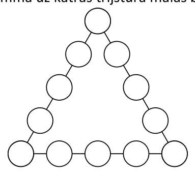{ width=200px }

$1.$ att.

<small>
   
* questionType:
* domain:
   
</small>

## Atrisinājums

Skat., piemēram, $2.$ att.

{ width=200px }

$1.$ att.

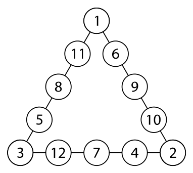{ width=200px }

$2.$ att.

*Piezīme.* Dots tikai viens no vairākiem iespējamiem skaitļu izvietojumiem. Lai atrastu skaitļu izvietojumu, var palīdzēt tālākie spriedumi. Aprēķināsim kopējo skaitļu summu visām trim trijstūra malām, ievērojot, ka trijstūra virsotnēs ierakstītie skaitļi $a$, $b$ un $c$ tiek pieskaitīti divas reizes: $3 \cdot 28 = 1 + 2 + 3 + 4 + 5 + 6 + 7 + 8 + 9 + 10 + 11 + 12 + a + b + c$ jeb $84 = 78 + a + b + c$. Tātad $a + b + c = 6$ un vienīgā iespēja ir $1 + 2 + 3 = 6$.

# <lo-sample/> LV.SOL.2019.5.2

Vai $x$ un $y$ vietā var ierakstīt pa vienam ciparam tā, lai skaitlis **a)** $\overline{9x8y7}$ dalītos ar $9$; **b)** $\overline{12x3y}$ dalītos ar $6$; **c)** $\overline{6x5y34}$ dalītos ar $4$?

<small>
   
* questionType:
* domain:
   
</small>

## Atrisinājums

a) Jā, piemēram, skaitlis $90837$ dalās ar $9$, jo tā ciparu summa dalās ar $9$.

b) Jā, piemēram, skaitlis $12132$ dalās ar $6$, jo tas dalās ar $2$ un $3$, tas ir, tā pēdējais cipars ir pāra un ciparu summa dalās ar $3$.

c) Nē. Lai skaitlis dalītos ar $4$, tā pēdējo divu ciparu veidotajam skaitlim jādalās ar $4$, bet dotā skaitļa pēdējo divu ciparu veidotais skaitlis ir $34$, kas nedalās ar $4$.

# <lo-sample/> LV.SOL.2019.5.3

Kādos daudzstūros ar vienu taisnu griezienu var sagriezt trijstūri? *Atrodi visas iespējas un pamato, ka citu nav!*

<small>
   
* questionType:
* domain:
   
</small>

## Atrisinājums

Ar vienu taisnu griezienu trijstūri var sadalīt divos trijstūros vai trijstūrī un četrstūrī (skat. $3.$ att.). Pamatosim, ka citu variantu nav.

Pastāv divas iespējas:

1) ja griezuma līnija iet caur trijstūra virsotni, tad, lai iegūtu daudzstūrus, tai jākrusto trijstūra pretējā mala, un šajā gadījumā iegūstam divus trijstūrus;

2) ja griezuma līnija neiet caur trijstūra virsotni, tad, lai iegūtu daudzstūrus, tai jākrusto divas trijstūra malas un šajā gadījumā iegūstam trijstūri un četrstūri.

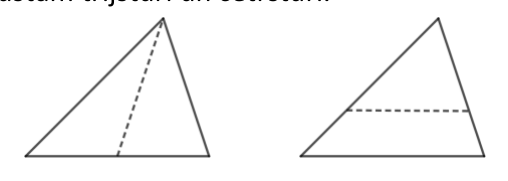{ width=250px }

$3.$ att.

# <lo-sample/> LV.SOL.2019.6.1

Katrā tukšajā aplītī (skat. $2.$ att.) ieraksti vienu naturālu skaitli tā, lai aplīšos būtu ierakstīti visi naturālie skaitļi no $1$ līdz $12$ un lai skaitļu summa uz katras trijstūra malas būtu $29$.

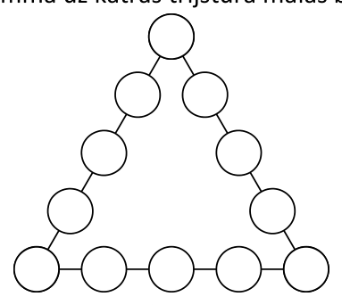{ width=200px }

$2.$ att.

<small>
   
* questionType:
* domain:
   
</small>

## Atrisinājums

Skat., piemēram, 5. att.

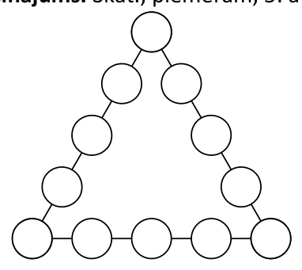{ width=200px }

4. att.

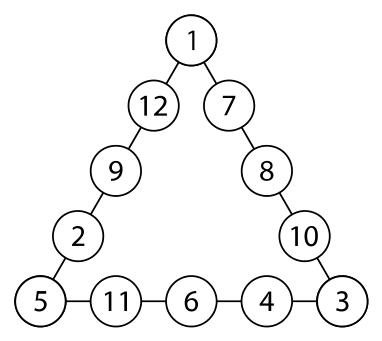{ width=200px }

5. att.

*Piezīme.* Dots tikai viens no vairākiem iespējamiem skaitļu izvietojumiem. Lai atrastu skaitļu izvietojumu, var palīdzēt tālākie spriedumi. Aprēķināsim kopējo skaitļu summu visām trim trijstūra malām, ievērojot, ka trijstūra virsotnēs ierakstītie skaitļi $a$, $b$ un $c$ tiek pieskaitīti divas reizes: $3 \cdot 29 = 1 + 2 + 3 + 4 + 5 + 6 + 7 + 8 + 9 + 10 + 11 + 12 + a + b + c$ jeb $87 = 78 + a + b + c$. Tātad $a + b + c = 9$ un ievērojam, ka pastāv trīs varianti, kādi skaitļi varētu būt ierakstīti trijstūra virsotnēs: $9 = 1 + 2 + 6 = 1 + 3 + 5 = 2 + 3 + 4$.

# <lo-sample/> LV.SOL.2019.6.2

**a)** Kādu ciparu var ierakstīt $x$ vietā tā, lai piecciparu skaitlis $\overline{20x18}$ dalītos ar $6$?  
**b)** Vai $x$ un $y$ vietā var ierakstīt pa vienam ciparam tā, lai sešciparu skaitlis $\overline{20x18y}$ dalītos ar $25$?

<small>
   
* questionType:
* domain:
   
</small>

## Atrisinājums

**a)** Lai skaitlis dalītos ar $6$, tam jādalās ar $2$ un $3$. Dotais skaitlis dalās ar $2$, jo tā pēdējais cipars ir pāra. Lai skaitlis dalītos ar $3$, tā ciparu summai jādalās ar $3$, tas ir, $2 + 0 + x + 1 + 8 = 11 + x$ jādalās ar $3$. Tātad $x$ vietā var ierakstīt vai nu ciparu $1$, vai $4$, vai $7$.  
**b)** Nē. Lai skaitlis dalītos ar $25$, tā pēdējo divu ciparu veidotajam skaitlim jādalās ar $25$. Tas nozīmē, ka divciparu skaitlim $\overline{8y}$ jādalās ar $25$, kas nav iespējams.

# <lo-sample/> LV.SOL.2019.6.3

Uz taisnstūra $ABCD$ malas $AB$ atzīmēts punkts $M$ tā, ka nogrieznis $AM$ ir četras reizes garāks nekā nogrieznis $MB$. Zināms, ka trijstūra $MBC$ laukums ir $5\ \mathrm{cm}^2$. **a)** Aprēķini taisnstūra $ABCD$ laukumu! **b)** Kāds var būt taisnstūra $ABCD$ perimetrs, ja tā malu garumi izsakāmi veselos centimetros? *Atrodi visas iespējas un pamato, ka citu nav!*

<small>
   
* questionType:
* domain:
   
</small>

## Atrisinājums

**a)** Ievērojam, ka trijstūra $MBC$ laukums ir puse no taisnstūra $MBCN$ laukuma (skat. 6. att.). Tāpēc $MBCN$ laukums ir $5 \cdot 2 = 10 \text{ (cm}^2\text{)}$. Tā kā $AM$ ir četras reizes garāks nekā $MB$, tad taisnstūra $AMND$ laukums ir četras reizes lielāks nekā $MBCN$ laukums, tas ir, $10 \cdot 4 = 40 \text{ (cm}^2\text{)}$. Līdz ar to taisnstūra $ABCD$ laukums ir $10 + 40 = 50 \text{ (cm}^2\text{)}$.

**b)** Tā kā taisnstūra $ABCD$ malu garumi ir izsakāmi veselos centimetros, tad taisnstūra $ABCD$ laukums izsakāms kā divu naturālu skaitļu reizinājums. Skaitli $50$ kā divu naturālu skaitļu reizinājumu var iegūt trīs dažādos veidos:

$$50 = 1 \cdot 50 = 2 \cdot 25 = 5 \cdot 10$$

Līdz ar to taisnstūra $ABCD$ perimetrs var būt $2 \cdot (1 + 50) = 102 \text{ (cm)}$ vai $2 \cdot (2 + 25) = 54 \text{ (cm)}$, vai $2 \cdot (5 + 10) = 30 \text{ (cm)}$.

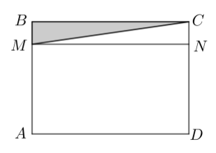{ width=150px }

6. att.

# <lo-sample/> LV.SOL.2019.7.1

Ziemassvētku vecīša noliktavā ir skapis, kas sastāv no $6 \cdot 6$ kvadrātveida plauktiem (skat. $3.$ att.). Katrā plauktā ir ielikta ne vairāk kā viena dāvana un pavisam kopā skapī ir **a)** $9$ dāvanas; **b)** $10$ dāvanas. Vai var gadīties, ka nekādas divas dāvanas neatrodas blakus plauktos? Par blakus plauktiem sauksim tos plauktus, kuriem ir vismaz viens kopīgs stūris.

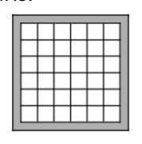{ width=100px }

*3. att.*

<small>
   
* questionType:
* domain:
   
</small>

## Atrisinājums

**a)** Jā, piemēram, skat. 8. att., kur tie plaukti, kuros atrodas dāvanas, ir iekrāsoti pelēki.

**b)** Nē, nevar. Kvadrātu $6 \cdot 6$ sadalām $9$ kvadrātos ar izmēriem $2 \cdot 2$ (skat. 9. att.). Ja dāvanas būtu ieliktas $10$ plauktos, tad noteikti būtu tāds kvadrāts ar izmēriem $2 \cdot 2$, kurā atrastos vismaz divas dāvanas (izmantojot Dirihlē principu), bet šīs dāvanas noteikti atrodas blakus plauktos, jo kvadrātā ar izmēriem $2 \cdot 2$ katrs plaukts ir blakus plaukts pārējiem.

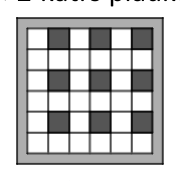{ width=100px }

8. att.

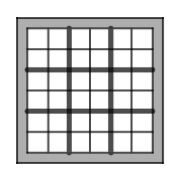{ width=100px }

9. att.

# <lo-sample/> LV.SOL.2019.7.2

Kādus ciparus var ierakstīt $x$ un $y$ vietā, lai piecciparu skaitlis $\overline{1x73y}$ dalītos ar $12$?

<small>
   
* questionType:
* domain:
   
</small>

## Atrisinājums

Lai skaitlis dalītos ar $12$, tam jādalās ar $3$ un $4$. Skaitlis dalās ar $3$, ja tā ciparu summa dalās ar $3$. Skaitlis dalās ar $4$, ja tā pēdējo divu ciparu veidotais skaitlis dalās ar $4$. Tātad divciparu skaitlim $\overline{3y}$ jādalās ar $4$. Tas nozīmē, ka $y$ vietā var būt vai nu $2$, vai $6$.

$1)$ Ja $y = 2$, tad piecciparu skaitļa ciparu summa ir $1 + x + 7 + 3 + 2 = 13 + x$. Lai skaitlis dalītos ar $3$, cipara $x$ vietā var būt vai nu $2$, vai $5$, vai $8$. Tātad iegūstam piecciparu skaitļus **$12732$, $15732$, $18732$**.

$2)$ Ja $y = 6$, tad piecciparu skaitļa ciparu summa ir $1 + x + 7 + 3 + 6 = 17 + x$. Lai skaitlis dalītos ar $3$, cipara $x$ vietā var būt vai nu $1$, vai $4$, vai $7$. Tātad iegūstam piecciparu skaitļus **$11736$, $14736$, $17736$**.

# <lo-sample/> LV.SOL.2019.7.3

Plaknē novilktas četras taisnes. Cik leņķus, kas mazāki nekā $180^{\circ}$, var veidot šīs taisnes?

<small>
   
* questionType:
* domain:
   
</small>

## Atrisinājums

Pamatosim, ka četras taisnes var veidot $0$; $12$, $16$, $20$ vai $24$ leņķus, kas mazāki nekā $180^{\circ}$. Ievērojam, ka katras divas taisnes, kas krustojas, veido $4$ leņķus, kas mazāki nekā $180^{\circ}$. Pavisam iespējamas četras dažādas četru taišņu krustošanās iespējas:

$1)$ ja nekādas divas taisnes nekrustojas, tas ir, visas četras taisnes ir paralēlas, tad meklēto leņķu skaits ir $0$ (skat., piemēram, 10. att. A);

$2)$ ja trīs taisnes ir savstarpēji paralēlas, bet ceturtā taisne krusto tās visas, tad rodas trīs krustisku taišņu pāri $(ad, bd, cd)$ un veidojas $4 \cdot 3 = 12$ meklētie leņķi (skat., piemēram, 10. att. B);

$3)$ ja divas taisnes ir savstarpēji paralēlas un arī pārējās divas taisnes ir savstarpēji paralēlas, bet krusto pirmās divas taisnes, tad rodas četri krustisku taišņu pāri $(ac, ad, bc, bd)$ un veidojas $4 \cdot 4 = 16$ meklētie leņķi (skat., piemēram, 10. att. C);

$4)$ ja divas taisnes ir savstarpēji paralēlas, bet abas pārējās krustojas savā starpā un krusto arī pirmās divas taisnes, tad rodas pieci krustisku taišņu pāri $(ac, ad, bc, bd, cd)$ un veidojas $4 \cdot 5 = 20$ meklētie leņķi (skat., piemēram, 10. att. D);

$5)$ ja nekādas divas taisnes nav paralēlas, tad rodas seši krustisku taišņu pāri $(ab, ac, ad, bc, bd, cd)$ un veidojas $4 \cdot 6 = 24$ meklētie leņķi.

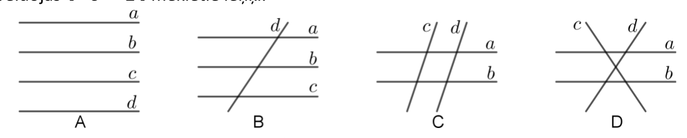{ width=500px }

10. att.

# <lo-sample/> LV.SOL.2019.8.1

Skolēni jau laicīgi gribēja radīt sev Ziemassvētku noskaņu. Katrs no $26$ vienas klases skolēniem izlozēja kāda sava klases biedra vārdu. Katrs no šiem skolēniem katrā adventē dāvinās izlozētajam klases biedram kādu našķi, kura vērtība nepārsniedz $1$ eiro. Vai pēc Ceturtās adventes (tas ir, pēc četrām šādām apdāvināšanās reizēm) noteikti būs bijušas divas dāvanas, kuru cena ir vienāda?

<small>
   
* questionType:
* domain:
   
</small>

## Atrisinājums

Jā, noteikti. Ja katrai dāvanai būtu bijusi cita cena, tad kopā būtu ne vairāk kā $100$ dāvanas, bet tā ir pretruna ar to, ka pēc ceturtās reizes pavisam kopā būs uzdāvinātas $26 \cdot 4 = 104$ dāvanas. Tātad noteikti ir vismaz divas dāvanas, kuru cena ir vienāda. (Izmantots Dirihlē princips, kur būri – dāvanu iespējamā cena; truši – dāvanas.)

# <lo-sample/> LV.SOL.2019.8.2

**a)** Vai $x$, $y$ un $z$ vietā var ierakstīt pa vienam ciparam tā, lai sešciparu skaitlis $\overline{z1x73y}$ dalītos ar $20$?  
**b)** Kādus ciparus var ierakstīt $x$ un $y$ vietā, lai piecciparu skaitlis $\overline{1x73y}$ dalītos ar $88$?

<small>
   
* questionType:
* domain:
   
</small>

## Atrisinājums

**a)** Nē. Lai skaitlis dalītos ar $20$, tam jādalās ar $4$ un $5$. Skaitlis dalās ar $5$, ja tā pēdējais cipars ir vai nu $0$, vai $5$. Skaitlis dalās ar $4$, ja tā pēdējo divu ciparu veidotais skaitlis dalās ar $4$. Taču ne $30$, ne $35$ ar $4$ nedalās. Tātad prasītais nav iespējams.  

**b)** Pamatosim, ka $x = 0$ un $y = 6$ ir vienīgās iespējamās vērtības. Lai skaitlis dalītos ar $88$, tam jādalās ar $8$ un $11$. Skaitlis dalās ar $8$, ja tā pēdējo trīs ciparu veidotais skaitlis dalās ar $8$. Tātad skaitlim $\overline{73y}$ jādalās ar $8$. Ja skaitlis dalās ar $8$, tad tas dalās arī ar $4$. Tas nozīmē, ka pēdējais cipars varētu būt vai nu $2$, vai $6$ (jo ar $4$ dalās $32$ un $36$). Pārbaudot, kurš no skaitļiem $732$ un $736$ dalās ar $8$, iegūstam, ka vienīgā iespēja ir $y = 6$. Tātad esam ieguvuši piecciparu skaitli $\overline{1x736}$, kuram jādalās ar $11$. Skaitlis dalās ar $11$, ja tā ciparu summas, kas atrodas nepāra pozīcijās, un ciparu summas, kas atrodas pāra pozīcijās, starpība dalās ar $11$. Tas nozīmē, ka $(1 + 7 + 6) - (x + 3) = 11 - x$ jādalās ar $11$ un vienīgā iespēja, ka $x = 0$.

# <lo-sample/> LV.SOL.2019.8.3

Pierādīt, ka izliekta četrstūra diagonāļu garumu summa ir lielāka nekā jebkuru divu pretējo malu garumu summa!

<small>
   
* questionType:
* domain:
   
</small>

## Atrisinājums

Patvaļīgā izliektā četrstūrī $ABCD$ jāpierāda, ka $AB + CD < AC + BD$. Apzīmēsim diagonāļu krustpunktu ar $O$ (skat. $11.$ att.). Trijstūrī $AOB$ no trijstūra nevienādības izriet, ka
$$
AB < AO + OB \tag{1}
$$
Trijstūrī $DOC$ no trijstūra nevienādības izriet, ka
$$
CD < DO + OC \tag{2}
$$
No $(1)$ un $(2)$ iegūstam $AB + CD < AO + OB + DO + OC$. Tā kā $AO + OC = AC$ un $DO + OB = BD$, tad iegūstam $AB + CD < AC + BD$, kas arī bija jāpierāda.

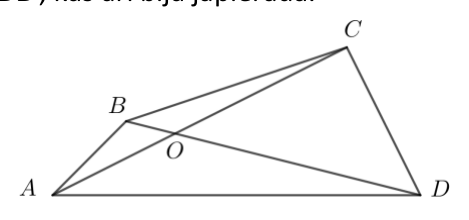{ width=200px }

$11.$ att.

# <lo-sample/> LV.SOL.2019.9.1

Vai var atrast tādus veselus skaitļus $x$ un $y$, ka $xy(x+69y)=2018201920182019$?

<small>
   
* questionType:
* domain:
   
</small>

## Atrisinājums

Nē, nevar atrast. Ja $x$ vai $y$ ir pāra skaitlis, tad vienādojuma kreisās puses izteiksmes vērtība ir pāra skaitlis, kas nevar būt vienāda ar nepāra skaitli $2018201920182019$. Ja $x$ un $y$ abi ir nepāra skaitļi, tad $x+69y$ ir pāra skaitlis un vienādojuma kreisās puses izteiksmes vērtība ir pāra skaitlis, kas nevar būt vienāda ar nepāra skaitli $2018201920182019$.

Tātad nevar atrast tādus veselus skaitļus $x$ un $y$, lai dotā vienādība būtu patiesa.

# <lo-sample/> LV.SOL.2019.9.2

Doti astoņi dažādi naturāli skaitļi, kuri nepārsniedz $28$. Pierādīt, ka no tiem var izvēlēties divus skaitļu pārus, kuru starpības ir vienādas. (Dažādiem skaitļu pāriem var būt arī kopīgs skaitlis, starpību rēķina, no lielākā skaitļa atņemot mazāko.)

<small>
   
* questionType:
* domain:
   
</small>

## Atrisinājums

Pārī nav nozīmes skaitļu secībai, jo interesējamies par lielākā un mazākā skaitļa starpību. Tātad no astoņiem dažādiem skaitļiem var izveidot $8 \cdot 7 : 2 = 28$ dažādus pārus.

Dotie skaitļi ir naturāli, dažādi un robežās no $1$ līdz $28$, tātad to starpības ir robežās no $1$ (jebkuru divu pēc kārtas sekojošu skaitļu starpība ir $1$) līdz $27$ ($27=28-1$). Tātad starpības var pieņemt tikai kādu no $27$ vērtībām, taču iespējams izveidot $28$ dažādus skaitļu pārus. No Dirihlē principa izriet, ka ir vismaz divi tādi skaitļu pāri, kuru starpības ir vienādas.

# <lo-sample/> LV.SOL.2019.9.3

Romba $ABCD$ iekšpusē izvēlēts patvaļīgs punkts $M$, bet $K$, $L$, $P$ un $R$ ir attiecīgi romba malu $AB$, $BC$, $CD$ un $DA$ viduspunkti. Pierādīt, ka četrstūris, kura virsotnes ir nogriežņu $MK$, $ML$, $MP$ un $MR$ viduspunkti, ir taisnstūris!

<small>
   
* questionType:
* domain:
   
</small>

## Atrisinājums

Ar $X$, $Y$, $Z$ un $T$ apzīmējam attiecīgi nogriežņu $MK$, $ML$, $MP$ un $MR$ viduspunktus (skat. $12.$ att.). No viduslīnijas īpašībām trijstūrī $BCD$ izriet, ka $BD \parallel PL$. No viduslīnijas īpašībām trijstūrī $MPL$ izriet, ka $PL \parallel ZY$. Tātad $ZY \parallel BD$.

Analoģiski parāda, ka

- $TX \parallel BD$ (izmantojot trijstūrus $ABD$ un $MRK$);
- $XY \parallel AC$ (izmantojot trijstūrus $ABC$ un $MKL$);
- $TZ \parallel AC$ (izmantojot trijstūrus $ACD$ un $MRP$).

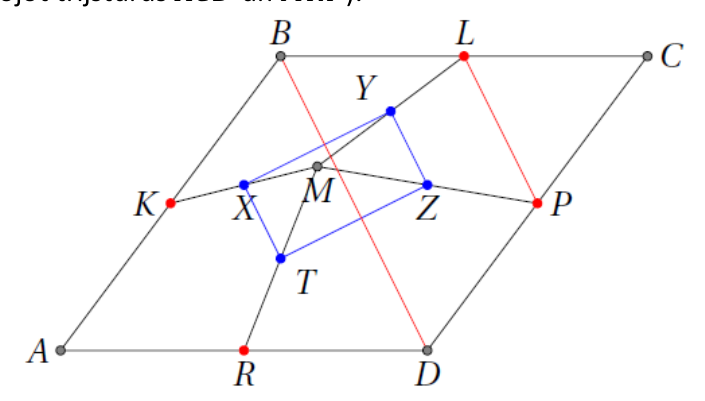{ width=350px }

12. att.

Līdz ar to ir pierādīts, ka $ZY \parallel TX \parallel BD$ un $XY \parallel TZ \parallel AC$.

Pierādīts, ka $XYZT$ ir paralelograms, jo tā malas ir pa pāriem paralēlas. Taču $XYZT$ ir arī taisnstūris, jo tā malas ir paralēlas romba $ABCD$ diagonālēm $AC$ un $BD$, bet romba diagonāles ir perpendikulāras: $AC \perp BD$, tātad arī $XY \perp YZ$.

# <lo-sample/> LV.SOL.2019.10.1

Pierādīt, ka $9x^2 - 12xy + 20y^2 + 8y + 4 > 0$ visām reālām $x$ un $y$ vērtībām!

<small>
   
* questionType:
* domain:
   
</small>

## Atrisinājums

Veicot ekvivalentus pārveidojumus, iegūstam
$$
9x^2 - 12xy + 20y^2 + 8y + 4 = (9x^2 - 12xy + 4y^2) + (16y^2 + 8y + 1) + 3 =
$$
$$
= (3x - 2y)^2 + (4y + 1)^2 + 3 > 0,
$$
jo $(3x - 2y)^2 + (4y + 1)^2 \ge 0$ kā reālu skaitļu kvadrātu summa un $3 > 0$.

# <lo-sample/> LV.SOL.2019.10.2

Ap apaļu galdu sēž zēni un meitenes, turklāt zēnu ir trīs reizes vairāk nekā meiteņu. Tādu vietu, kur blakus sēž zēns un meitene, ir divas reizes mazāk nekā pārējo vietu (tas ir, tādu vietu, kur blakus sēž vai nu zēns un zēns, vai meitene un meitene). Kāds ir mazākais iespējamais bērnu skaits?

<small>
   
* questionType:
* domain:
   
</small>

## Atrisinājums

Apzīmējam meiteņu skaitu ar $m$ un zēnu skaitu ar $z$, tad $z = 3m$ un kopējais bērnu skaits ir $4m$. Ja ir $a$ pāru „zēns-meitene” skaits, tad citu pāru ir $2a$, tātad pavisam ir $3a$ pāru. Tāpēc $3a = 4m$. Tātad $m$ jādalās ar $3$ un ir vismaz $12$ bērni. Piemēru, kā $12$ bērni var sēdēt pie galda, skat. $13$. att.

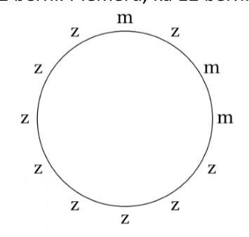{ width=150px }

$13$. att.

# <lo-sample/> LV.SOL.2019.10.3

Regulāra trijstūra $ABC$ virsotne $B$ atrodas uz riņķa līnijas, bet virsotnes $A$ un $C$ atrodas riņķa līnijas iekšpusē. Malu $BA$ un $BC$ pagarinājumi krusto riņķa līniju attiecīgi punktos $N$ un $L$. Taisne, uz kuras atrodas $AC$, krusto riņķa līniju punktos $M$ un $K$ (skat. $4$. att.). Pierādīt, ka $AM + CL = AN + CK$.

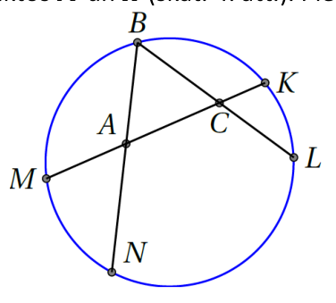{ width=200px }

$4$. att.

<small>
   
* questionType:
* domain:
   
</small>

## Atrisinājums

No hordu īpašības iegūstam, ka $AM \cdot AK = AN \cdot AB$ un $CK \cdot CM = CL \cdot CB$.

Apzīmējam regulārā trijstūra malas garumu ar $a$, tad iegūtās vienādības var pārrakstīt kā
$$
AM \cdot (a + CK) = AN \cdot a;
$$
$$
CK \cdot (a + AM) = CL \cdot a.
$$
Atverot iekavas un atņemot no pirmās vienādības otro, iegūstam
$$
AM \cdot a - CK \cdot a = AN \cdot a - CL \cdot a,
$$
$$
(AM + CL) \cdot a = (AN + CK) \cdot a.
$$
Dalot abas vienādības puses ar $a$ (kas ir pozitīvs skaitlis), iegūstam vajadzīgo vienādību.

# <lo-sample/> LV.SOL.2019.11.1

Vai vienādojumam $6^x + 15^y = 7^z$ eksistē atrisinājums naturālos skaitļos?

<small>
   
* questionType:
* domain:
   
</small>

## Atrisinājums

Nē, neeksistē. Dotā vienādojuma kreisās puses izteiksme dalās ar $3$, jo katrs saskaitāmais dalās ar $3$, bet vienādojuma labā puse nedalās ar $3$. Līdz ar to dotajam vienādojumam nav atrisinājumu naturālos skaitļos.

# <lo-sample/> LV.SOL.2019.11.2

Klasē ir $30$ skolēni. Katrā decembra dienā daži (varbūt arī neviens, viens vai visi) no šiem skolēniem uzraksta savus novēlējumus uz lapiņas un piesprauž pie sienas, turklāt katru dienu katrs skolēns piesprauž pie sienas ne vairāk kā vienu lapiņu. Decembrim beidzoties, izrādījās, ka katrā dienā pie sienas ir piesprausts dažāds lapiņu skaits. Vai ir iespējams, ka, decembrim beidzoties, visi skolēni pie sienas ir piesprauduši vienu un to pašu lapiņu skaitu?

<small>
   
* questionType:
* domain:
   
</small>

## Atrisinājums

Pamatosim, ka prasītais nav iespējams. Pieņemsim pretējo, ka visi skolēni pie sienas ir piesprauduši vienu un to pašu lapiņu skaitu $n$. Divos dažādos veidos saskaitīsim kopējo piesprausto lapiņu skaitu.

- Ja katrs skolēns ir piespraudis $n$ lapiņas, tad kopā ir piespraustas $30n$ lapiņas.
- Tā kā katrā dienā piespraustas ne vairāk kā $30$ lapiņas un katrā no $31$ dienas ir piesprausts atšķirīgs lapiņu skaits, tad secinām, ka tieši vienā dienā piespraustas $0$ lapiņas, tieši vienā dienā – $1$ lapiņa, tieši vienā dienā – $2$ lapiņas, ..., tieši vienā dienā – $30$ lapiņas. Šādā veidā iegūstam, ka kopā piespraustas $0 + 1 + 2 + \cdots + 30 = 30 \cdot 15 = 465$ lapiņas.

Tātad $30n = 465$, kas ir pretrunā ar to, ka $n$ ir vesels skaitlis. Tātad pieņēmums bijis aplams un nav iespējams, ka visi skolēni pie sienas ir piesprauduši vienu un to pašu lapiņu skaitu.

# <lo-sample/> LV.SOL.2019.11.3

Trijstūrim $ABC$, $AC < BC$ apvilkta riņķa līnija. Punkts $E$ ir loka $ACB$ viduspunkts. Uz nogriežņa $BC$ atlikts tāds punkts $D$, ka $BD = AC$. Stars $ED$ krusto riņķa līniju punktā $F$ (skat. $5$. att.). Pierādīt, ka $AF \parallel BC$.

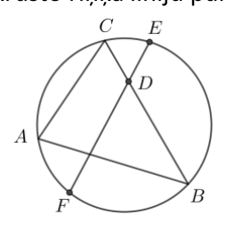{ width=100px }

$5$. att.

<small>
   
* questionType:
* domain:
   
</small>

## Atrisinājums

{ width=100px }

15. att.

Ievērojam, ka $\triangle CAE = \triangle DBE$ (skat. $16.$ att.) pēc pazīmes $mlm$, jo

- no ievilkto leņķu īpašībām $\angle CAE = \angle CBE = \angle DBE$,
- tā kā loki, uz kuriem balstās hordas $AE$ un $BE$, ir vienādi (jo $E$ ir loka $ACB$ viduspunkts), tad $AE = BE$;
- $AC = BD$ pēc dotā.

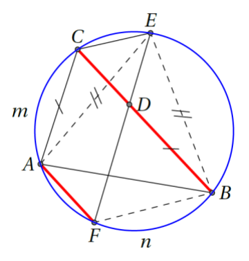{ width=150px }

16. att.

Tātad $\angle CEA = \angle DEB = \angle FEB$.

Tā kā vienādi ievilktie leņķi balstās uz vienādiem lokiem, tad loki $A\overset{m}{\frown}C$ un $F\overset{n}{\frown}B$ ir vienādi. Ja loki starp divām hordām ir vienādi, tad hordas ir paralēlas; tātad $AF \parallel BC$, kas arī bija jāpierāda.

# <lo-sample/> LV.SOL.2019.12.1

Kāds atlikums rodas, $2018^{10} + 2019^5$ dalot ar $9$?

<small>
   
* questionType:
* domain:
   
</small>

## Atrisinājums

Ievērojam, ka

- $2018 = 9 \cdot 224 + 2$ jeb $2018 \equiv 2 \pmod{9}$;
- $2019 = 9 \cdot 224 + 3$ jeb $2019 \equiv 3 \pmod{9}$.

Līdz ar to $2018^{10} + 2019^5 \equiv 2^{10} + 3^5 \equiv (2^5)^2 + 0 \equiv 32^2 \equiv 5^2 \equiv 25 \equiv 7 \pmod{9}$.

Tātad, $2018^{10} + 2019^5$ dalot ar $9$, atlikumā iegūst $7$.

*Piezīme.* Uzdevumu var atrisināt bez kongruenču izmantošanas, izdarot līdzīgus spriedumus par skaitļu atlikumiem un izmantojot, ka $2019 \cdot 2019$ dalās ar $9$.

# <lo-sample/> LV.SOL.2019.12.2

Cik daudz ir piecciparu skaitļu, kas sastāv tieši no trīs dažādiem cipariem, no kuriem neviens nav $0$ un neviens cipars neatkārtojas vairāk kā divas reizes?

<small>
   
* questionType:
* domain:
   
</small>

## Atrisinājums

Katrā šādā skaitlī ir viens cipars $a$, kas skaitlī ir tikai vienu reizi un divi cipari $b$ un $c$, kas katrs parādās šajā skaitlī divas reizes.

Cipars $a$ var būt kādā no $5$ pozīcijām; atlikušajās četrās pozīcijās jānovieto divi cipari $b$, ko var izdarīt $C_4^2 = \frac{4 \cdot 3}{2} = 6$ dažādos veidos; pēc tam ciparu $c$ atlikušajās divās pozīcijās var ierakstīt tikai vienā veidā.

No reizināšanas likuma izriet, ka pie konkrētām $a$, $b$, $c$ vērtībām ir $5 \cdot 6 \cdot 1 = 30$ veidi, kā izveidot šādu piecciparu skaitli (turklāt $b$ un $c$ secībai nav nozīmes, jo, mainot vietām ciparus $b$ un $c$, iegūstam tos pašus $30$ skaitļus).

Ciparu $a$ var izvēlēties $9$ veidos; pēc tam ciparus $b$ un $c$ var izvēlēties $C_8^2 = \frac{8 \cdot 7}{2} = 28$ veidos. No reizināšanas likuma izriet, ka meklēto piecciparu skaitļu kopējais skaits ir $30 \cdot 9 \cdot 28 = 7560$.

# <lo-sample/> LV.SOL.2019.12.3

Trijstūra $ABC$ leņķa $ACB$ bisektrise un leņķa $ABC$ blakusleņķa bisektrise krustojas punktā $D$. Pierādīt, ka $\triangle BCD$ apvilktās riņķa līnijas centrs atrodas uz $\triangle ABC$ apvilktās riņķa līnijas.

<small>
   
* questionType:
* domain:
   
</small>

## Atrisinājums

Apzīmējam $\angle ACD = \angle BCD = \alpha$ un $\angle ABD = \angle DBX = \beta$ (skat. $17.$ att.). Tad $\angle ABC = 180^{\circ} - 2\beta$ un $\angle BAC = 180^{\circ} - \angle ABC - \angle ACB = 2\beta - 2\alpha = 2(\beta - \alpha)$.

No otras puses, $\angle BDC = 180^{\circ} - \angle DBA - \angle ABC - \angle DCB = 180^{\circ} - \beta - (180^{\circ} - 2\beta) - \alpha = \beta - \alpha$.

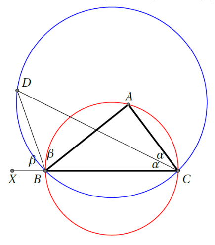{ width=200px }

$17.$ att.

Aplūkojam abas apvilktās riņķa līnijas. Abām ir kopīga horda $BC$. Trijstūrim $BDC$ apvilktajā riņķa līnijā uz šīs hordas balstās ievilktais leņķis $\angle BDC = \beta - \alpha$. Tātad atbilstošajam centra leņķim jābūt divas reizes lielākam, tas ir, $\angle BOC = 2(\beta - \alpha)$, kur $O$ ir $\triangle BCD$ apvilktās riņķa līnijas centrs.

Taču tad redzam, ka $\angle BOC = \angle BAC = 2(\beta - \alpha)$, tātad punkti $O$, $A$, $B$ un $C$ atrodas uz vienas riņķa līnijas, tas ir, $O$ atrodas uz $\triangle ABC$ apvilktās riņķa līnijas, kas arī bija jāpierāda.
