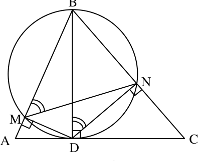

# Sagatavošanās olimpiāde, 10.klase. Atrisinājumi

<!-- Algebra; līdzīgs: LV.NEW.2026.10 -->

**1.uzdevums.** *(LV.SOL.1995.11.1)* Atrisināt vienādojumu

$$|x-1|+|x-3|+|x-5|=3.$$

**Atrisinājums.** Vienādojumam nav atrisinājumu, jo

$$|x-1|+|x-3|+|x-5| \geq |x-1|+|x-5| \geq |(x-1)-(x-5)| = 4 > 3.$$

*Piezīme.* Ģeometriski $|x-1|+|x-5|$ ir attālumu summa no punkta $x$ līdz punktiem $1$ un $5$ uz skaitļu ass; tā nav mazāka par attālumu starp šiem punktiem, t.i., $4$.

<!-- Skaitļu teorija; līdzīgs: LV.NEW.2026.8 -->

**2.uzdevums.** *(LV.NOL.2025.10.2)* Kāds ir vismazākais naturālais skaitlis, kuram ir tieši $18$ dažādi naturāli dalītāji un kas dalās ar $7$?

**Atrisinājums.** **Atbilde:** $252$.

Ievērojam, ka $18=18 \cdot 1=9 \cdot 2=6 \cdot 3=3 \cdot 3 \cdot 2$. Ja skaitlis $n$ sadalās pirmreizinātājos kā $n=p_{1}^{k_{1}} p_{2}^{k_{2}} \ldots p_{m}^{k_{m}}$, tad tā dalītāju skaits ir $d(n)=\left(k_{1}+1\right) \cdot\left(k_{2}+1\right) \cdot \ldots \cdot\left(k_{m}+1\right)$. No tā izriet, ka skaitli, kuram ir tieši $18$ dalītāji, var uzrakstīt vienā no formām:

$$p_{1}^{17}, \quad p_{1}^{8} \cdot p_{2}, \quad p_{1}^{5} \cdot p_{2}^{2}, \quad p_{1}^{2} \cdot p_{2}^{2} \cdot p_{3}.$$

Skaitlim jādalās ar $7$, tāpēc kādam no pirmreizinātājiem ir jābūt $7$, un, tā kā meklējam mazāko skaitli, tad kā citi reizinātāji jāņem mazākie pirmskaitļi ar vislielākajām pakāpēm. Apskatām visus gadījumus:

- $p_{1}=7$; iegūstam skaitli $7^{17}>252$;
- $p_{1}=2$ un $p_{2}=7$; iegūstam skaitli $2^{8} \cdot 7=256 \cdot 7=1792$;
- $p_{1}=2$ un $p_{2}=7$; iegūstam skaitli $2^{5} \cdot 7^{2}=32 \cdot 49=1568$;
- $p_{1}=2$, $p_{2}=3$ un $p_{3}=7$; iegūstam skaitli $2^{2} \cdot 3^{2} \cdot 7=36 \cdot 7=252$.

Tātad vismazākais naturālais skaitlis, kuram ir tieši $18$ dažādi naturāli dalītāji un kas dalās ar $7$, ir $252$.

<!-- Ģeometrija; līdzīgs: LV.NEW.2026.3 -->

**3.uzdevums.** *(LV.SOL.2007.10.4)* Šaurleņķu trijstūrī $ABC$ novilkts augstums $BD$. No punkta $D$ novilkti perpendikuli pret malām $AB$ un $CB$; to pamati ir attiecīgi $M$ un $N$. Pierādīt, ka punkti $A$, $M$, $N$, $C$ atrodas uz vienas riņķa līnijas.

**Atrisinājums.** Tā kā $\angle BMD+\angle BND=90^{\circ}+90^{\circ}=180^{\circ}$, tad ap četrstūri $BNDM$ var apvilkt riņķa līniju (tās diametrs ir $BD$). Tāpēc $\angle BMN=\angle BDN$ (ievilkti leņķi, kas balstās uz vienu un to pašu loku). Bet $\angle NCD=90^{\circ}-\angle NDC=\angle BDN$, tātad $\angle NCD=\angle BMN$. Tāpēc

$$\angle AMN+\angle ACN=\angle AMN+\angle BMN=180^{\circ},$$

un ap četrstūri $AMNC$ var apvilkt riņķa līniju, no kā seko prasītais.

{: width="250"}

<!-- Kombinatorika (svēršana) -->

**4.uzdevums.** *(LV.SOL.2010.10.4)* Ir $100$ pēc ārējā izskata vienādas monētas. Dažas (vismaz viena) ir īstas un dažas (vismaz viena) ir viltotas. Visām īstajām monētām ir vienādas masas; arī visām viltotajām monētām ir vienādas masas. Viltotās monētas ir vieglākas par īstajām. Kā, izmantojot sviras svarus bez atsvariem, ar $51$ svēršanu noskaidrot, cik ir viltoto monētu?

**Atrisinājums.** Salīdzinām divas monētas $A$ un $B$. Pastāv divas iespējas.

1. $A$ un $B$ ir dažādas masas. Tad viena no tām ir viltota, otra – īsta. Sadalām atlikušās $98$ monētas $49$ pāros un katru no tiem salīdzinām ar pāri $(A,B)$. Katrā svēršanā mēs noskaidrosim, cik viltoto monētu ir konkrētajā pārī (ja pāris ir smagāks, abas monētas ir īstas; ja svari ir līdzsvarā – viena viltota; ja pāris ir vieglāks – abas viltotas). Pavisam tiks izmantotas $1+49=50$ svēršanas.
2. $A$ un $B$ ir vienādas masas. Kā iepriekš salīdzinām pāri $(A,B)$ ar citiem monētu pāriem, kamēr atrodam pāri $(C,D)$, kura masa atšķiras no pāra $(A,B)$ masas. Pieņemsim, ka pāra $(C,D)$ kopējā masa ir mazāka nekā pāra $(A,B)$ kopējā masa (otrs gadījums ir simetrisks). Tad $A$ un $B$, kā arī visas citas līdz šim svērtās monētas ir īstas. Salīdzinām $C$ un $D$. Rezultātā mēs atrodam vismaz vienu monētu no pāra $(C,D)$, kura ir viltota. Tagad izveidojam pāri (īsta monēta, viltota monēta) un turpinām kā $1.$ gadījumā. Pavisam tiks izmantotas ne vairāk kā $1+49+1=51$ svēršana.
