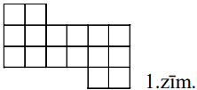
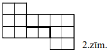

# Sagatavošanās olimpiāde, 7.klase. Atrisinājumi

<!-- Algebra; līdzīgs: LV.NEW.2026.6 -->

**1.uzdevums.** *(LV.SOL.2000.7.5)* Uz tāfeles uzrakstīti skaitļi $2$; $4$; $6$. Ar vienu gājienu atļauts nodzēst vienu no skaitļiem un tā vietā uzrakstīt abu pārējo skaitļu summu, no kuras atņemts vieninieks. Vai var gadīties, ka, izpildot vairākus šādus gājienus pēc kārtas, uz tāfeles atrodas skaitļi $1997$; $1999$; $2001$?

**Atrisinājums.** Nē, nevar.

*1. metode.* Pēc jebkura gājiena uz tāfeles ir $2$ pāra un $1$ nepāra skaitlis. (Ja uz tāfeles ir divi pāra skaitļi un viens nepāra skaitlis, tad, nodzēšot pāra skaitli, tā vietā uzraksta (pāra + nepāra) $-\,1$, t.i., pāra skaitli; nodzēšot nepāra skaitli, tā vietā uzraksta (pāra + pāra) $-\,1$, t.i., nepāra skaitli.) Bet skaitļi $1997$; $1999$; $2001$ visi ir nepāra skaitļi.

*2. metode.* Pēc jebkura gājiena uz tāfeles ir uzrakstīts skaitļu trijnieks $a,\ b,\ a+b-1$. Acīmredzami skaitļi $1997$, $1999$, $2001$ šādu trijnieku neveido.

<!-- Skaitļu teorija; līdzīgs: LV.NEW.2026.4 -->

**2.uzdevums.** *(LV.NOL.2017.6.2)* Skaitlim $201720182019$ izsvītroja vienu vai vairākus ciparus tā, ka iegūtais skaitlis dalās ar $9$. Kādu lielāko skaitli varēja iegūt?

**Atrisinājums.** Lielākais skaitlis, kādu var iegūt, ir $2012012019$.

Pamatosim, ka lielāku skaitli nevar iegūt. Lai iegūtu lielāko skaitli, jāizsvītro pēc iespējas mazāk ciparu. Lai skaitlis dalītos ar $9$, tā ciparu summai jādalās ar $9$. Dotā skaitļa ciparu summa ir $33$. Nav iespējams izsvītrot vienu ciparu tā, lai iegūtā skaitļa ciparu summa dalītos ar $9$ (būtu jāizsvītro cipars $6$, bet tāda skaitlī nav). Izsvītrojot divus ciparus, to summai jābūt $6$ vai $15$; summu $15$ dod tikai cipari $7$ un $8$, bet summu $6$ neviens šī skaitļa ciparu pāris nedod. Tātad vienīgā iespēja izsvītrot divus ciparus ir izsvītrot ciparus $7$ un $8$.

<!-- Ģeometrija; līdzīgs: LV.NEW.2026.13 -->

**3.uzdevums.** *(LV.NOL.2009.5.2)* Figūra, kas attēlota 1.zīm., sastāv no vienādām kvadrātiskām rūtiņām. Vai to var sagriezt divos gabalos tā, lai no šiem gabaliem varētu salikt vienu kvadrātu? Griezumiem jāiet pa rūtiņu līnijām; gabali saliekot nedrīkst pārklāties un saliktā kvadrāta iekšpusē nedrīkst palikt tukšumi.

{: width="160"}

**Atrisinājums.** Jā, var. Skat., piem., 2.zīm. (treknā līnija rāda griezumu).

{: width="160"}

<!-- Kombinatorika (svēršana) -->

**4.uzdevums.** *(LV.SOL.2014.7.4)* Dotas $8$ pēc ārējā izskata vienādas monētas. No tām $7$ ir ar vienādu masu, bet vienas monētas masa ir citāda. Doti arī sviras svari bez atsvariem. Kā ar $3$ svēršanu palīdzību atrast atšķirīgo monētu?

**Atrisinājums.** Novietojam uz katra svaru kausa pa divām monētām. Ja kausi nav līdzsvarā, tad atšķirīgā monēta ir starp šīm četrām. Ja ir līdzsvarā, tad starp atlikušajām četrām. Atrastas četras monētas, starp kurām ir atšķirīgā, un četras noteikti īstas monētas.

Novietojam uz kausiem pa vienai no atrastajām četrām monētām. Ja kausi nav līdzsvarā, tad atšķirīgā monēta ir starp šīm divām. Ja ir līdzsvarā, tad starp atlikušajām divām. Atrastas divas monētas, starp kurām ir atšķirīgā.

Vienu no tām salīdzinām ar kādu no noteikti īstajām monētām. Ja svari ir līdzsvarā, atšķirīgā ir otra monēta; ja nav, tad atšķirīgā ir salīdzinātā monēta.
