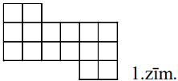

# Sagatavošanās olimpiāde, 7.klase

<!-- LV.SOL.2000.7.5 (Algebra; līdzīgs: LV.NEW.2026.6) -->

**1.uzdevums.** Uz tāfeles uzrakstīti skaitļi $2$; $4$; $6$. Ar vienu gājienu atļauts nodzēst vienu no skaitļiem un tā vietā uzrakstīt abu pārējo skaitļu summu, no kuras atņemts vieninieks. Vai var gadīties, ka, izpildot vairākus šādus gājienus pēc kārtas, uz tāfeles atrodas skaitļi $1997$; $1999$; $2001$?

<!-- LV.NOL.2017.6.2 (Skaitļu teorija; līdzīgs: LV.NEW.2026.4) -->

**2.uzdevums.** Skaitlim $201720182019$ izsvītroja vienu vai vairākus ciparus tā, ka iegūtais skaitlis dalās ar $9$. Kādu lielāko skaitli varēja iegūt?

<!-- LV.NOL.2009.5.2 (Ģeometrija; līdzīgs: LV.NEW.2026.13) -->

**3.uzdevums.** Figūra, kas attēlota 1.zīm., sastāv no vienādām kvadrātiskām rūtiņām. Vai to var sagriezt divos gabalos tā, lai no šiem gabaliem varētu salikt vienu kvadrātu? Griezumiem jāiet pa rūtiņu līnijām; gabali saliekot nedrīkst pārklāties un saliktā kvadrāta iekšpusē nedrīkst palikt tukšumi.

{: width="160"}

<!-- LV.SOL.2014.7.4 (Kombinatorika (svēršana)) -->

**4.uzdevums.** Dotas $8$ pēc ārējā izskata vienādas monētas. No tām $7$ ir ar vienādu masu, bet vienas monētas masa ir citāda. Doti arī sviras svari bez atsvariem. Kā ar $3$ svēršanu palīdzību atrast atšķirīgo monētu?
