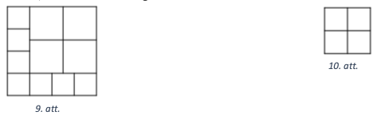

# Sagatavošanās olimpiāde, 8.klase. Atrisinājumi

<!-- Algebra; līdzīgs: LV.NEW.2026.5 -->

**1.uzdevums.** *(LV.NOL.2015.10.2)* Ar naturālu skaitli atļauts veikt šādas darbības:

- pieskaitīt $6$;
- dalīt ar $4$, ja skaitlis dalās ar $4$;
- mainīt vietām skaitļa ciparus (skaitļa sākumā nedrīkst atrasties nulle).

Vai, atkārtoti izpildot šīs darbības, no skaitļa $30$ var iegūt skaitli $2015$?

**Atrisinājums.** Nē, nevar. Kā invariantu aplūkojam dalāmību ar $3$: skaitlim $30$ izpildās īpašība "dalās ar $3$", bet skaitlim $2015$ šī īpašība neizpildās.

No otras puses, ja kāds skaitlis dalās ar $3$, tad skaitlis, kas no tā tiek iegūts ar uzdevumā dotajām darbībām, arī dalās ar $3$. Pārbaudām pēdējo apgalvojumu:

- ja skaitlis $n$ dalās ar $3$, tad arī $n+6$ dalās ar $3$;
- ja skaitlis $4n$ dalās ar $3$, tad arī skaitlis $n$ dalās ar $3$ (jo $4$ un $3$ ir savstarpēji pirmskaitļi, tātad reizinātājs $3$ ir skaitlī $n$);
- ja skaitlis $n$ dalās ar $3$, tad arī tā ciparu summa dalās ar $3$, bet ciparu summa nemainās, ja ciparus pārkārto.

Tātad, ja dotais skaitlis dalās ar $3$, tad pēc atļauto darbību izpildes arī jauniegūtais skaitlis dalīsies ar $3$. Skaitlis $2015$ ar $3$ nedalās, tātad ar atļautajām darbībām to iegūt nevar.

<!-- Skaitļu teorija; līdzīgs: LV.NEW.2026.9 -->

**2.uzdevums.** *(LV.AMO.2012.6.5)* Zīmuļi tiek pakoti divu veidu kastītēs: pa $7$ zīmuļiem kastītē un pa $10$ zīmuļiem kastītē. Kāds ir vislielākais zīmuļu skaits, ko nevar precīzi sapakot minēto veidu kastītēs (t.i., visām izmantotajām kastītēm jābūt pilnām un neviens zīmulis nedrīkst palikt pāri)?

**Atrisinājums.** **Atbilde:** $53$.

Ja zīmuļu skaits ir pilni desmiti, tad tos var sapakot kastītēs pa $10$ zīmuļiem. Ja zīmuļu skaits nav izsakāms veselos desmitos, tad zīmuļu pakošanai jāizmanto arī $7$ zīmuļu kastītes. Mazākie skaitļi, kas izsakāmi kā skaitļa $7$ daudzkārtņi, ir $7, 14, 21, 28, 35, 42, 49, 56, 63$ (to pēdējie cipari visi ir dažādi). Visus skaitļus, kas lielāki nekā $63$, var izteikt kā atbilstošā $7$ daudzkārtņa (kura vienu cipars sakrīt ar izsakāmā skaitļa vienu ciparu) un pilnu desmitu summu. Savukārt nevienu skaitli, kas mazāks nekā $63$ un kura pēdējais cipars ir $3$, nevar izteikt kā $7$ daudzkārtņa un pilnu desmitu summu. Lielākais no tādiem skaitļiem ir $53$.

Visus skaitļus no $54$ līdz $62$ var izteikt, piemēram, $54 = 7 \cdot 2 + 10 \cdot 4$, $55 = 7 \cdot 5 + 10 \cdot 2$, $56 = 7 \cdot 8$, $57 = 7 \cdot 1 + 10 \cdot 5$, $58 = 7 \cdot 4 + 10 \cdot 3$, $59 = 7 \cdot 7 + 10 \cdot 1$, $60 = 10 \cdot 6$, $61 = 7 \cdot 3 + 10 \cdot 4$, $62 = 7 \cdot 6 + 10 \cdot 2$.

<!-- Ģeometrija; līdzīgs: LV.NEW.2026.1 -->

**3.uzdevums.** *(LV.SOL.2020.7.1)* **(A)** Vai kvadrātu var sagriezt $11$ kvadrātos?

**(B)** Vai kvadrātu var sagriezt $113$ kvadrātos?

**Atrisinājums.** **(A)** Jā, var, skat., piemēram, 9.att.

**(B)** Jā, var. Ievērojam, ka kvadrātu var sadalīt $4$ kvadrātos, ja katrai malai atrod viduspunktu un savieno pretējo malu viduspunktus (skat. 10.att.). Ja vienu no 9.att. dotajiem kvadrātiem sadala $4$ kvadrātos, tad kvadrātu skaits palielinās par $3$. Šādi turpinot, iegūsim, ka kvadrātu var sadalīt $14, 17, 20, \ldots$ kvadrātos. Tā kā $113 = 11 + 3 \cdot 34$, tad kvadrātu var sagriezt $113$ kvadrātos.

{: width="400"}

<!-- Kombinatorika (svēršana) -->

**4.uzdevums.** *(LV.SOL.1991.6.5)* Dotas $6$ pēc ārējā izskata vienādas monētas. Četrām no tām masas savā starpā vienādas, bet divām – arī savā starpā vienādas, taču mazākas nekā pirmajām četrām. Doti arī sviras svari bez atsvariem. Kā ar $3$ svēršanu palīdzību atrast abas vieglākās monētas?

**Atrisinājums.** Apzīmēsim monētas ar $A, B, C, D, E, F$. Salīdzinām $A+B$ ar $C+D$ (uz viena svaru kausa uzliktas monētas $A$ un $B$, uz otra – $C$ un $D$).

**1)** $A+B = C+D$; salīdzinām $A$ ar $B$.

- a) $A = B$; tad vieglākās monētas ir $E$ un $F$.
- b) $A > B$; tad viena no vieglākajām monētām ir $B$. Salīdzinot $C$ ar $D$, noskaidrojam otru vieglāko monētu.

**2)** $A+B > C+D$ (gadījums $A+B < C+D$ ir analoģisks); tad $A$ un $B$ ir smagākās monētas. Salīdzinām $C$ un $D$.

- a) $C = D$; tad vieglākās monētas ir $C$ un $D$.
- b) $C > D$; tad viena no vieglākajām monētām ir $D$. Salīdzinot $E$ ar $F$, noskaidrojam otru vieglāko monētu.
