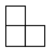
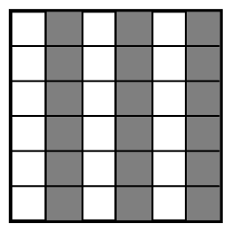

# Sagatavošanās olimpiāde, 9.klase. Atrisinājumi

<!-- Algebra; līdzīgs: LV.NEW.2026.2 -->

**1.uzdevums.** *(LV.AMO.2004.10.3)* Dots, ka $n$ – naturāls skaitlis.

**(A)** Pierādīt, ka $\sqrt{n^{2}+11n+30}$ nav naturāls skaitlis.

**(B)** Atrast šī skaitļa pirmo ciparu aiz komata atkarībā no $n$.

**Atrisinājums.** **(A)** Katram naturālam $n$ ir spēkā $(n+5)^{2} < n^{2}+11n+30 < (n+6)^{2}$, jo $(n+5)^2 = n^2+10n+25$ un $(n+6)^2 = n^2+12n+36$. Tātad $n^{2}+11n+30$ atrodas starp blakus esošu naturālu skaitļu kvadrātiem un nav naturāla skaitļa kvadrāts.

**(B)** Apzīmējam $n+5=x$; tad $n^2+11n+30 = (n+5)(n+6) = x^2+x$, un pētāmais skaitlis ir $\sqrt{x^{2}+x}$. Naturāliem $x \geq 6$ pastāv nevienādības $x+0{,}4 < \sqrt{x^{2}+x} < x+0{,}5$: kāpinot kvadrātā, tās nozīmē $x^2+0{,}8x+0{,}16 < x^2+x < x^2+x+0{,}25$, t.i., $0{,}16 < 0{,}2x$ (pareizi, jo $x = n+5 \geq 6$) un $0 < 0{,}25$. Tāpēc meklējamais cipars visiem $n$ ir $4$.

<!-- Skaitļu teorija; līdzīgs: LV.NEW.2026.11 -->

**2.uzdevums.** *(LV.AMO.2015.7.3)* **(A)** Atrast tādu naturālu skaitli, kura ciparu summa ir $13$, pēdējie divi cipari ir $13$ un kurš dalās ar $13$.

**(B)** Vai var atrast tādu naturālu skaitli, kura ciparu summa ir $11$, pēdējie divi cipari ir $11$ un kurš dalās ar $11$?

**Atrisinājums.** **(A)** Der, piemēram, skaitlis $11713$, jo $1+1+7+1+3=13$ un $11713 : 13 = 901$.

*Piezīme.* Atrisinājumu var palīdzēt atrast šādi spriedumi. Skaitļa pirmo ciparu (bez pēdējiem diviem cipariem $1$ un $3$) veidotā skaitļa $x$ ciparu summai jābūt $9$. Tas nozīmē, ka skaitlis $x$ dalās ar $9$. Bet tam ir jādalās arī ar $13$, jo meklētajam skaitlim $100x+13$ jādalās ar $13$ un skaitļi $100$ un $13$ ir savstarpēji pirmskaitļi. Tātad $x$ jādalās ar $9 \cdot 13 = 117$. Pats skaitlis $117$ arī ir mazākais iespējamais skaitlis $x$.

**(B)** Nē, nevar. Izmantosim dalāmības pazīmi ar $11$: skaitlis dalās ar $11$, ja tā ciparu, kas atrodas pāra pozīcijās, summas un ciparu, kas atrodas nepāra pozīcijās, summas starpība dalās ar $11$.

Pieņemsim, ka var atrast skaitli formā $\overline{m_{1}m_{2} \ldots m_{k}11}$, kas dalās ar $11$. Tad $\left(m_{1}+m_{3}+\ldots\right)-\left(m_{2}+m_{4}+\ldots\right)$ jādalās ar $11$. Tā kā $m_{1}+m_{2}+m_{3}+\ldots+m_{k}=9$, tad vienīgā iespēja ir $\left(m_{1}+m_{3}+\ldots\right)-\left(m_{2}+m_{4}+\ldots\right)=0$. Saskaitot pēdējās divas vienādības, iegūstam $2 \cdot\left(m_{1}+m_{3}+m_{5}+\ldots\right)=9$ jeb $m_{1}+m_{3}+m_{5}+\ldots=4{,}5$, kas nav iespējams nekādām ciparu $m_{i}$ vērtībām.

<!-- Ģeometrija; līdzīgs: LV.NEW.2026.14 -->

**3.uzdevums.** *(LV.SOL.1993.7.3)* Kādu mazāko skaitu rūtiņu jāiekrāso kvadrātā ar izmēriem $6 \times 6$ rūtiņas, lai neiekrāsotajā daļā nevarētu ievietot tādu stūrīti (varbūt pagrieztu citā virzienā), kāds redzams zīmējumā?

{: width="60"}

**Atrisinājums.** Mazākais daudzums rūtiņu, kāds jāiekrāso, ir $18$. Var iekrāsot $18$ rūtiņas, piemēram, kā parādīts zīmējumā.

{: width="150"}

Ar mazāku skaitu iekrāsoto rūtiņu nepietiek. Tiešām, sadalīsim kvadrātu $9$ kvadrātos $2 \times 2$. Ja iekrāsotas ne vairāk kā $17$ rūtiņas, tad kādā no $9$ kvadrātiem $2 \times 2$ iekrāsota ne vairāk kā viena rūtiņa. Atlikušajās $3$ rūtiņās izvietosies stūrītis.

<!-- Kombinatorika (svēršana) -->

**4.uzdevums.** *(LV.SOL.2002.9.4)* Dotas $25$ pēc ārējā izskata vienādas monētas. Zināms, ka $24$ monētu masas ir vienādas savā starpā, bet vienas monētas masa ir citāda. Kā ar divām svēršanām uz sviras svariem bez atsvariem noskaidrot, vai atšķirīgā monēta ir vieglāka vai smagāka nekā pārējās?

**Atrisinājums.** Uzliekam uz kausiem pa $8$ monētām.

Ja kausi ir līdzsvarā, tad atšķirīgā monēta palikusi malā, bet visas $16$ svērtās monētas ir īstas. Otrajā svēršanā salīdzinām malā palikušās $9$ monētas ar jebkurām $9$ jau svērtajām: ja nosveras malā palikušās monētas, atšķirīgā monēta ir smagāka, ja tās paceļas – vieglāka.

Ja pirmajā svēršanā viens kauss nosveras uz leju, tad atšķirīgā monēta atradusies uz svariem, bet $9$ nesvērtās monētas ir īstas. Otrajā svēršanā salīdzinām, piemēram, smagākajā kausā bijušās $8$ monētas ar $8$ vēl nesvērtajām. Ja tās atkal ir smagākas, atšķirīgā monēta ir starp tām un ir smagāka; ja svari ir līdzsvarā, atšķirīgā monēta bija vieglākajā kausā un ir vieglāka. (Gadījums, ka tās būtu vieglākas, nav iespējams.)
