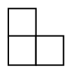

# Sagatavošanās olimpiāde, 9.klase

<!-- LV.AMO.2004.10.3 (Algebra; līdzīgs: LV.NEW.2026.2) -->

**1.uzdevums.** Dots, ka $n$ – naturāls skaitlis.

**(A)** Pierādīt, ka $\sqrt{n^{2}+11n+30}$ nav naturāls skaitlis.

**(B)** Atrast šī skaitļa pirmo ciparu aiz komata atkarībā no $n$.

<!-- LV.AMO.2015.7.3 (Skaitļu teorija; līdzīgs: LV.NEW.2026.11) -->

**2.uzdevums.** **(A)** Atrast tādu naturālu skaitli, kura ciparu summa ir $13$, pēdējie divi cipari ir $13$ un kurš dalās ar $13$.

**(B)** Vai var atrast tādu naturālu skaitli, kura ciparu summa ir $11$, pēdējie divi cipari ir $11$ un kurš dalās ar $11$?

<!-- LV.SOL.1993.7.3 (Ģeometrija; līdzīgs: LV.NEW.2026.14) -->

**3.uzdevums.** Kādu mazāko skaitu rūtiņu jāiekrāso kvadrātā ar izmēriem $6 \times 6$ rūtiņas, lai neiekrāsotajā daļā nevarētu ievietot tādu stūrīti (varbūt pagrieztu citā virzienā), kāds redzams zīmējumā?

{: width="60"}

<!-- LV.SOL.2002.9.4 (Kombinatorika (svēršana)) -->

**4.uzdevums.** Dotas $25$ pēc ārējā izskata vienādas monētas. Zināms, ka $24$ monētu masas ir vienādas savā starpā, bet vienas monētas masa ir citāda. Kā ar divām svēršanām uz sviras svariem bez atsvariem noskaidrot, vai atšķirīgā monēta ir vieglāka vai smagāka nekā pārējās?
