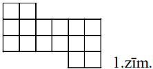
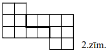
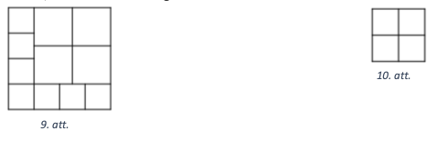
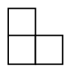
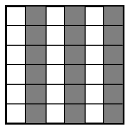
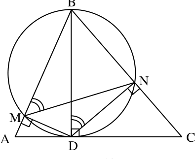

## Sagatavošanās olimpiāde, 7.klase. Atrisinājumi

<!-- Algebra; līdzīgs: LV.NEW.2026.6 -->

**1.uzdevums.** *(LV.SOL.2000.7.5)* Uz tāfeles uzrakstīti skaitļi $2$; $4$; $6$. Ar vienu gājienu atļauts nodzēst vienu no skaitļiem un tā vietā uzrakstīt abu pārējo skaitļu summu, no kuras atņemts vieninieks. Vai var gadīties, ka, izpildot vairākus šādus gājienus pēc kārtas, uz tāfeles atrodas skaitļi $1997$; $1999$; $2001$?

**Atrisinājums.** Nē, nevar.

*1. metode.* Pēc jebkura gājiena uz tāfeles ir $2$ pāra un $1$ nepāra skaitlis. (Ja uz tāfeles ir divi pāra skaitļi un viens nepāra skaitlis, tad, nodzēšot pāra skaitli, tā vietā uzraksta (pāra + nepāra) $-\,1$, t.i., pāra skaitli; nodzēšot nepāra skaitli, tā vietā uzraksta (pāra + pāra) $-\,1$, t.i., nepāra skaitli.) Bet skaitļi $1997$; $1999$; $2001$ visi ir nepāra skaitļi.

*2. metode.* Pēc jebkura gājiena uz tāfeles ir uzrakstīts skaitļu trijnieks $a,\ b,\ a+b-1$. Acīmredzami skaitļi $1997$, $1999$, $2001$ šādu trijnieku neveido.

<!-- Skaitļu teorija; līdzīgs: LV.NEW.2026.4 -->

**2.uzdevums.** *(LV.NOL.2017.6.2)* Skaitlim $201720182019$ izsvītroja vienu vai vairākus ciparus tā, ka iegūtais skaitlis dalās ar $9$. Kādu lielāko skaitli varēja iegūt?

**Atrisinājums.** Lielākais skaitlis, kādu var iegūt, ir $2012012019$.

Pamatosim, ka lielāku skaitli nevar iegūt. Lai iegūtu lielāko skaitli, jāizsvītro pēc iespējas mazāk ciparu. Lai skaitlis dalītos ar $9$, tā ciparu summai jādalās ar $9$. Dotā skaitļa ciparu summa ir $33$. Nav iespējams izsvītrot vienu ciparu tā, lai iegūtā skaitļa ciparu summa dalītos ar $9$ (būtu jāizsvītro cipars $6$, bet tāda skaitlī nav). Izsvītrojot divus ciparus, to summai jābūt $6$ vai $15$; summu $15$ dod tikai cipari $7$ un $8$, bet summu $6$ neviens šī skaitļa ciparu pāris nedod. Tātad vienīgā iespēja izsvītrot divus ciparus ir izsvītrot ciparus $7$ un $8$.

<!-- Ģeometrija; līdzīgs: LV.NEW.2026.13 -->

**3.uzdevums.** *(LV.NOL.2009.5.2)* Figūra, kas attēlota 1.zīm., sastāv no vienādām kvadrātiskām rūtiņām. Vai to var sagriezt divos gabalos tā, lai no šiem gabaliem varētu salikt vienu kvadrātu? Griezumiem jāiet pa rūtiņu līnijām; gabali saliekot nedrīkst pārklāties un saliktā kvadrāta iekšpusē nedrīkst palikt tukšumi.

{: width="160"}

**Atrisinājums.** Jā, var. Skat., piem., 2.zīm. (treknā līnija rāda griezumu).

{: width="160"}

<!-- Kombinatorika (svēršana) -->

**4.uzdevums.** *(LV.SOL.2014.7.4)* Dotas $8$ pēc ārējā izskata vienādas monētas. No tām $7$ ir ar vienādu masu, bet vienas monētas masa ir citāda. Doti arī sviras svari bez atsvariem. Kā ar $3$ svēršanu palīdzību atrast atšķirīgo monētu?

**Atrisinājums.** Novietojam uz katra svaru kausa pa divām monētām. Ja kausi nav līdzsvarā, tad atšķirīgā monēta ir starp šīm četrām. Ja ir līdzsvarā, tad starp atlikušajām četrām. Atrastas četras monētas, starp kurām ir atšķirīgā, un četras noteikti īstas monētas.

Novietojam uz kausiem pa vienai no atrastajām četrām monētām. Ja kausi nav līdzsvarā, tad atšķirīgā monēta ir starp šīm divām. Ja ir līdzsvarā, tad starp atlikušajām divām. Atrastas divas monētas, starp kurām ir atšķirīgā.

Vienu no tām salīdzinām ar kādu no noteikti īstajām monētām. Ja svari ir līdzsvarā, atšķirīgā ir otra monēta; ja nav, tad atšķirīgā ir salīdzinātā monēta.

## Sagatavošanās olimpiāde, 8.klase. Atrisinājumi

<!-- Algebra; līdzīgs: LV.NEW.2026.5 -->

**1.uzdevums.** *(LV.NOL.2015.10.2)* Ar naturālu skaitli atļauts veikt šādas darbības:

- pieskaitīt $6$;
- dalīt ar $4$, ja skaitlis dalās ar $4$;
- mainīt vietām skaitļa ciparus (skaitļa sākumā nedrīkst atrasties nulle).

Vai, atkārtoti izpildot šīs darbības, no skaitļa $30$ var iegūt skaitli $2015$?

**Atrisinājums.** Nē, nevar. Kā invariantu aplūkojam dalāmību ar $3$: skaitlim $30$ izpildās īpašība "dalās ar $3$", bet skaitlim $2015$ šī īpašība neizpildās.

No otras puses, ja kāds skaitlis dalās ar $3$, tad skaitlis, kas no tā tiek iegūts ar uzdevumā dotajām darbībām, arī dalās ar $3$. Pārbaudām pēdējo apgalvojumu:

- ja skaitlis $n$ dalās ar $3$, tad arī $n+6$ dalās ar $3$;
- ja skaitlis $4n$ dalās ar $3$, tad arī skaitlis $n$ dalās ar $3$ (jo $4$ un $3$ ir savstarpēji pirmskaitļi, tātad reizinātājs $3$ ir skaitlī $n$);
- ja skaitlis $n$ dalās ar $3$, tad arī tā ciparu summa dalās ar $3$, bet ciparu summa nemainās, ja ciparus pārkārto.

Tātad, ja dotais skaitlis dalās ar $3$, tad pēc atļauto darbību izpildes arī jauniegūtais skaitlis dalīsies ar $3$. Skaitlis $2015$ ar $3$ nedalās, tātad ar atļautajām darbībām to iegūt nevar.

<!-- Skaitļu teorija; līdzīgs: LV.NEW.2026.9 -->

**2.uzdevums.** *(LV.AMO.2012.6.5)* Zīmuļi tiek pakoti divu veidu kastītēs: pa $7$ zīmuļiem kastītē un pa $10$ zīmuļiem kastītē. Kāds ir vislielākais zīmuļu skaits, ko nevar precīzi sapakot minēto veidu kastītēs (t.i., visām izmantotajām kastītēm jābūt pilnām un neviens zīmulis nedrīkst palikt pāri)?

**Atrisinājums.** **Atbilde:** $53$.

Ja zīmuļu skaits ir pilni desmiti, tad tos var sapakot kastītēs pa $10$ zīmuļiem. Ja zīmuļu skaits nav izsakāms veselos desmitos, tad zīmuļu pakošanai jāizmanto arī $7$ zīmuļu kastītes. Mazākie skaitļi, kas izsakāmi kā skaitļa $7$ daudzkārtņi, ir $7, 14, 21, 28, 35, 42, 49, 56, 63$ (to pēdējie cipari visi ir dažādi). Visus skaitļus, kas lielāki nekā $63$, var izteikt kā atbilstošā $7$ daudzkārtņa (kura vienu cipars sakrīt ar izsakāmā skaitļa vienu ciparu) un pilnu desmitu summu. Savukārt nevienu skaitli, kas mazāks nekā $63$ un kura pēdējais cipars ir $3$, nevar izteikt kā $7$ daudzkārtņa un pilnu desmitu summu. Lielākais no tādiem skaitļiem ir $53$.

Visus skaitļus no $54$ līdz $62$ var izteikt, piemēram, $54 = 7 \cdot 2 + 10 \cdot 4$, $55 = 7 \cdot 5 + 10 \cdot 2$, $56 = 7 \cdot 8$, $57 = 7 \cdot 1 + 10 \cdot 5$, $58 = 7 \cdot 4 + 10 \cdot 3$, $59 = 7 \cdot 7 + 10 \cdot 1$, $60 = 10 \cdot 6$, $61 = 7 \cdot 3 + 10 \cdot 4$, $62 = 7 \cdot 6 + 10 \cdot 2$.

<!-- Ģeometrija; līdzīgs: LV.NEW.2026.1 -->

**3.uzdevums.** *(LV.SOL.2020.7.1)* **(A)** Vai kvadrātu var sagriezt $11$ kvadrātos?

**(B)** Vai kvadrātu var sagriezt $113$ kvadrātos?

**Atrisinājums.** **(A)** Jā, var, skat., piemēram, 9.att.

**(B)** Jā, var. Ievērojam, ka kvadrātu var sadalīt $4$ kvadrātos, ja katrai malai atrod viduspunktu un savieno pretējo malu viduspunktus (skat. 10.att.). Ja vienu no 9.att. dotajiem kvadrātiem sadala $4$ kvadrātos, tad kvadrātu skaits palielinās par $3$. Šādi turpinot, iegūsim, ka kvadrātu var sadalīt $14, 17, 20, \ldots$ kvadrātos. Tā kā $113 = 11 + 3 \cdot 34$, tad kvadrātu var sagriezt $113$ kvadrātos.

{: width="400"}

<!-- Kombinatorika (svēršana) -->

**4.uzdevums.** *(LV.SOL.1991.6.5)* Dotas $6$ pēc ārējā izskata vienādas monētas. Četrām no tām masas savā starpā vienādas, bet divām – arī savā starpā vienādas, taču mazākas nekā pirmajām četrām. Doti arī sviras svari bez atsvariem. Kā ar $3$ svēršanu palīdzību atrast abas vieglākās monētas?

**Atrisinājums.** Apzīmēsim monētas ar $A, B, C, D, E, F$. Salīdzinām $A+B$ ar $C+D$ (uz viena svaru kausa uzliktas monētas $A$ un $B$, uz otra – $C$ un $D$).

**1)** $A+B = C+D$; salīdzinām $A$ ar $B$.

- a) $A = B$; tad vieglākās monētas ir $E$ un $F$.
- b) $A > B$; tad viena no vieglākajām monētām ir $B$. Salīdzinot $C$ ar $D$, noskaidrojam otru vieglāko monētu.

**2)** $A+B > C+D$ (gadījums $A+B < C+D$ ir analoģisks); tad $A$ un $B$ ir smagākās monētas. Salīdzinām $C$ un $D$.

- a) $C = D$; tad vieglākās monētas ir $C$ un $D$.
- b) $C > D$; tad viena no vieglākajām monētām ir $D$. Salīdzinot $E$ ar $F$, noskaidrojam otru vieglāko monētu.

## Sagatavošanās olimpiāde, 9.klase. Atrisinājumi

<!-- Algebra; līdzīgs: LV.NEW.2026.2 -->

**1.uzdevums.** *(LV.AMO.2004.10.3)* Dots, ka $n$ – naturāls skaitlis.

**(A)** Pierādīt, ka $\sqrt{n^{2}+11n+30}$ nav naturāls skaitlis.

**(B)** Atrast šī skaitļa pirmo ciparu aiz komata atkarībā no $n$.

**Atrisinājums.** **(A)** Katram naturālam $n$ ir spēkā $(n+5)^{2} < n^{2}+11n+30 < (n+6)^{2}$, jo $(n+5)^2 = n^2+10n+25$ un $(n+6)^2 = n^2+12n+36$. Tātad $n^{2}+11n+30$ atrodas starp blakus esošu naturālu skaitļu kvadrātiem un nav naturāla skaitļa kvadrāts.

**(B)** Apzīmējam $n+5=x$; tad $n^2+11n+30 = (n+5)(n+6) = x^2+x$, un pētāmais skaitlis ir $\sqrt{x^{2}+x}$. Naturāliem $x \geq 6$ pastāv nevienādības $x+0{,}4 < \sqrt{x^{2}+x} < x+0{,}5$: kāpinot kvadrātā, tās nozīmē $x^2+0{,}8x+0{,}16 < x^2+x < x^2+x+0{,}25$, t.i., $0{,}16 < 0{,}2x$ (pareizi, jo $x = n+5 \geq 6$) un $0 < 0{,}25$. Tāpēc meklējamais cipars visiem $n$ ir $4$.

<!-- Skaitļu teorija; līdzīgs: LV.NEW.2026.11 -->

**2.uzdevums.** *(LV.AMO.2015.7.3)* **(A)** Atrast tādu naturālu skaitli, kura ciparu summa ir $13$, pēdējie divi cipari ir $13$ un kurš dalās ar $13$.

**(B)** Vai var atrast tādu naturālu skaitli, kura ciparu summa ir $11$, pēdējie divi cipari ir $11$ un kurš dalās ar $11$?

**Atrisinājums.** **(A)** Der, piemēram, skaitlis $11713$, jo $1+1+7+1+3=13$ un $11713 : 13 = 901$.

*Piezīme.* Atrisinājumu var palīdzēt atrast šādi spriedumi. Skaitļa pirmo ciparu (bez pēdējiem diviem cipariem $1$ un $3$) veidotā skaitļa $x$ ciparu summai jābūt $9$. Tas nozīmē, ka skaitlis $x$ dalās ar $9$. Bet tam ir jādalās arī ar $13$, jo meklētajam skaitlim $100x+13$ jādalās ar $13$ un skaitļi $100$ un $13$ ir savstarpēji pirmskaitļi. Tātad $x$ jādalās ar $9 \cdot 13 = 117$. Pats skaitlis $117$ arī ir mazākais iespējamais skaitlis $x$.

**(B)** Nē, nevar. Izmantosim dalāmības pazīmi ar $11$: skaitlis dalās ar $11$, ja tā ciparu, kas atrodas pāra pozīcijās, summas un ciparu, kas atrodas nepāra pozīcijās, summas starpība dalās ar $11$.

Pieņemsim, ka var atrast skaitli formā $\overline{m_{1}m_{2} \ldots m_{k}11}$, kas dalās ar $11$. Tad $\left(m_{1}+m_{3}+\ldots\right)-\left(m_{2}+m_{4}+\ldots\right)$ jādalās ar $11$. Tā kā $m_{1}+m_{2}+m_{3}+\ldots+m_{k}=9$, tad vienīgā iespēja ir $\left(m_{1}+m_{3}+\ldots\right)-\left(m_{2}+m_{4}+\ldots\right)=0$. Saskaitot pēdējās divas vienādības, iegūstam $2 \cdot\left(m_{1}+m_{3}+m_{5}+\ldots\right)=9$ jeb $m_{1}+m_{3}+m_{5}+\ldots=4{,}5$, kas nav iespējams nekādām ciparu $m_{i}$ vērtībām.

<!-- Ģeometrija; līdzīgs: LV.NEW.2026.14 -->

**3.uzdevums.** *(LV.SOL.1993.7.3)* Kādu mazāko skaitu rūtiņu jāiekrāso kvadrātā ar izmēriem $6 \times 6$ rūtiņas, lai neiekrāsotajā daļā nevarētu ievietot tādu stūrīti (varbūt pagrieztu citā virzienā), kāds redzams zīmējumā?

{: width="60"}

**Atrisinājums.** Mazākais daudzums rūtiņu, kāds jāiekrāso, ir $18$. Var iekrāsot $18$ rūtiņas, piemēram, kā parādīts zīmējumā.

{: width="150"}

Ar mazāku skaitu iekrāsoto rūtiņu nepietiek. Tiešām, sadalīsim kvadrātu $9$ kvadrātos $2 \times 2$. Ja iekrāsotas ne vairāk kā $17$ rūtiņas, tad kādā no $9$ kvadrātiem $2 \times 2$ iekrāsota ne vairāk kā viena rūtiņa. Atlikušajās $3$ rūtiņās izvietosies stūrītis.

<!-- Kombinatorika (svēršana) -->

**4.uzdevums.** *(LV.SOL.2002.9.4)* Dotas $25$ pēc ārējā izskata vienādas monētas. Zināms, ka $24$ monētu masas ir vienādas savā starpā, bet vienas monētas masa ir citāda. Kā ar divām svēršanām uz sviras svariem bez atsvariem noskaidrot, vai atšķirīgā monēta ir vieglāka vai smagāka nekā pārējās?

**Atrisinājums.** Uzliekam uz kausiem pa $8$ monētām.

Ja kausi ir līdzsvarā, tad atšķirīgā monēta palikusi malā, bet visas $16$ svērtās monētas ir īstas. Otrajā svēršanā salīdzinām malā palikušās $9$ monētas ar jebkurām $9$ jau svērtajām: ja nosveras malā palikušās monētas, atšķirīgā monēta ir smagāka, ja tās paceļas – vieglāka.

Ja pirmajā svēršanā viens kauss nosveras uz leju, tad atšķirīgā monēta atradusies uz svariem, bet $9$ nesvērtās monētas ir īstas. Otrajā svēršanā salīdzinām, piemēram, smagākajā kausā bijušās $8$ monētas ar $8$ vēl nesvērtajām. Ja tās atkal ir smagākas, atšķirīgā monēta ir starp tām un ir smagāka; ja svari ir līdzsvarā, atšķirīgā monēta bija vieglākajā kausā un ir vieglāka. (Gadījums, ka tās būtu vieglākas, nav iespējams.)

## Sagatavošanās olimpiāde, 10.klase. Atrisinājumi

<!-- Algebra; līdzīgs: LV.NEW.2026.10 -->

**1.uzdevums.** *(LV.SOL.1995.11.1)* Atrisināt vienādojumu

$$|x-1|+|x-3|+|x-5|=3.$$

**Atrisinājums.** Vienādojumam nav atrisinājumu, jo

$$|x-1|+|x-3|+|x-5| \geq |x-1|+|x-5| \geq |(x-1)-(x-5)| = 4 > 3.$$

*Piezīme.* Ģeometriski $|x-1|+|x-5|$ ir attālumu summa no punkta $x$ līdz punktiem $1$ un $5$ uz skaitļu ass; tā nav mazāka par attālumu starp šiem punktiem, t.i., $4$.

<!-- Skaitļu teorija; līdzīgs: LV.NEW.2026.8 -->

**2.uzdevums.** *(LV.NOL.2025.10.2)* Kāds ir vismazākais naturālais skaitlis, kuram ir tieši $18$ dažādi naturāli dalītāji un kas dalās ar $7$?

**Atrisinājums.** **Atbilde:** $252$.

Ievērojam, ka $18=18 \cdot 1=9 \cdot 2=6 \cdot 3=3 \cdot 3 \cdot 2$. Ja skaitlis $n$ sadalās pirmreizinātājos kā $n=p_{1}^{k_{1}} p_{2}^{k_{2}} \ldots p_{m}^{k_{m}}$, tad tā dalītāju skaits ir $d(n)=\left(k_{1}+1\right) \cdot\left(k_{2}+1\right) \cdot \ldots \cdot\left(k_{m}+1\right)$. No tā izriet, ka skaitli, kuram ir tieši $18$ dalītāji, var uzrakstīt vienā no formām:

$$p_{1}^{17}, \quad p_{1}^{8} \cdot p_{2}, \quad p_{1}^{5} \cdot p_{2}^{2}, \quad p_{1}^{2} \cdot p_{2}^{2} \cdot p_{3}.$$

Skaitlim jādalās ar $7$, tāpēc kādam no pirmreizinātājiem ir jābūt $7$, un, tā kā meklējam mazāko skaitli, tad kā citi reizinātāji jāņem mazākie pirmskaitļi ar vislielākajām pakāpēm. Apskatām visus gadījumus:

- $p_{1}=7$; iegūstam skaitli $7^{17}>252$;
- $p_{1}=2$ un $p_{2}=7$; iegūstam skaitli $2^{8} \cdot 7=256 \cdot 7=1792$;
- $p_{1}=2$ un $p_{2}=7$; iegūstam skaitli $2^{5} \cdot 7^{2}=32 \cdot 49=1568$;
- $p_{1}=2$, $p_{2}=3$ un $p_{3}=7$; iegūstam skaitli $2^{2} \cdot 3^{2} \cdot 7=36 \cdot 7=252$.

Tātad vismazākais naturālais skaitlis, kuram ir tieši $18$ dažādi naturāli dalītāji un kas dalās ar $7$, ir $252$.

<!-- Ģeometrija; līdzīgs: LV.NEW.2026.3 -->

**3.uzdevums.** *(LV.SOL.2007.10.4)* Šaurleņķu trijstūrī $ABC$ novilkts augstums $BD$. No punkta $D$ novilkti perpendikuli pret malām $AB$ un $CB$; to pamati ir attiecīgi $M$ un $N$. Pierādīt, ka punkti $A$, $M$, $N$, $C$ atrodas uz vienas riņķa līnijas.

**Atrisinājums.** Tā kā $\angle BMD+\angle BND=90^{\circ}+90^{\circ}=180^{\circ}$, tad ap četrstūri $BNDM$ var apvilkt riņķa līniju (tās diametrs ir $BD$). Tāpēc $\angle BMN=\angle BDN$ (ievilkti leņķi, kas balstās uz vienu un to pašu loku). Bet $\angle NCD=90^{\circ}-\angle NDC=\angle BDN$, tātad $\angle NCD=\angle BMN$. Tāpēc

$$\angle AMN+\angle ACN=\angle AMN+\angle BMN=180^{\circ},$$

un ap četrstūri $AMNC$ var apvilkt riņķa līniju, no kā seko prasītais.

{: width="250"}

<!-- Kombinatorika (svēršana) -->

**4.uzdevums.** *(LV.SOL.2010.10.4)* Ir $100$ pēc ārējā izskata vienādas monētas. Dažas (vismaz viena) ir īstas un dažas (vismaz viena) ir viltotas. Visām īstajām monētām ir vienādas masas; arī visām viltotajām monētām ir vienādas masas. Viltotās monētas ir vieglākas par īstajām. Kā, izmantojot sviras svarus bez atsvariem, ar $51$ svēršanu noskaidrot, cik ir viltoto monētu?

**Atrisinājums.** Salīdzinām divas monētas $A$ un $B$. Pastāv divas iespējas.

1. $A$ un $B$ ir dažādas masas. Tad viena no tām ir viltota, otra – īsta. Sadalām atlikušās $98$ monētas $49$ pāros un katru no tiem salīdzinām ar pāri $(A,B)$. Katrā svēršanā mēs noskaidrosim, cik viltoto monētu ir konkrētajā pārī (ja pāris ir smagāks, abas monētas ir īstas; ja svari ir līdzsvarā – viena viltota; ja pāris ir vieglāks – abas viltotas). Pavisam tiks izmantotas $1+49=50$ svēršanas.
2. $A$ un $B$ ir vienādas masas. Kā iepriekš salīdzinām pāri $(A,B)$ ar citiem monētu pāriem, kamēr atrodam pāri $(C,D)$, kura masa atšķiras no pāra $(A,B)$ masas. Pieņemsim, ka pāra $(C,D)$ kopējā masa ir mazāka nekā pāra $(A,B)$ kopējā masa (otrs gadījums ir simetrisks). Tad $A$ un $B$, kā arī visas citas līdz šim svērtās monētas ir īstas. Salīdzinām $C$ un $D$. Rezultātā mēs atrodam vismaz vienu monētu no pāra $(C,D)$, kura ir viltota. Tagad izveidojam pāri (īsta monēta, viltota monēta) un turpinām kā $1.$ gadījumā. Pavisam tiks izmantotas ne vairāk kā $1+49+1=51$ svēršana.
