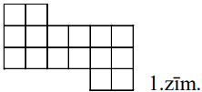
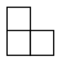

## Sagatavošanās olimpiāde, 7.klase

<!-- LV.SOL.2000.7.5 (Algebra; līdzīgs: LV.NEW.2026.6) -->

**1.uzdevums.** Uz tāfeles uzrakstīti skaitļi $2$; $4$; $6$. Ar vienu gājienu atļauts nodzēst vienu no skaitļiem un tā vietā uzrakstīt abu pārējo skaitļu summu, no kuras atņemts vieninieks. Vai var gadīties, ka, izpildot vairākus šādus gājienus pēc kārtas, uz tāfeles atrodas skaitļi $1997$; $1999$; $2001$?

<!-- LV.NOL.2017.6.2 (Skaitļu teorija; līdzīgs: LV.NEW.2026.4) -->

**2.uzdevums.** Skaitlim $201720182019$ izsvītroja vienu vai vairākus ciparus tā, ka iegūtais skaitlis dalās ar $9$. Kādu lielāko skaitli varēja iegūt?

<!-- LV.NOL.2009.5.2 (Ģeometrija; līdzīgs: LV.NEW.2026.13) -->

**3.uzdevums.** Figūra, kas attēlota 1.zīm., sastāv no vienādām kvadrātiskām rūtiņām. Vai to var sagriezt divos gabalos tā, lai no šiem gabaliem varētu salikt vienu kvadrātu? Griezumiem jāiet pa rūtiņu līnijām; gabali saliekot nedrīkst pārklāties un saliktā kvadrāta iekšpusē nedrīkst palikt tukšumi.

{: width="160"}

<!-- LV.SOL.2014.7.4 (Kombinatorika (svēršana)) -->

**4.uzdevums.** Dotas $8$ pēc ārējā izskata vienādas monētas. No tām $7$ ir ar vienādu masu, bet vienas monētas masa ir citāda. Doti arī sviras svari bez atsvariem. Kā ar $3$ svēršanu palīdzību atrast atšķirīgo monētu?

## Sagatavošanās olimpiāde, 8.klase

<!-- LV.NOL.2015.10.2 (Algebra; līdzīgs: LV.NEW.2026.5) -->

**1.uzdevums.** Ar naturālu skaitli atļauts veikt šādas darbības:

- pieskaitīt $6$;
- dalīt ar $4$, ja skaitlis dalās ar $4$;
- mainīt vietām skaitļa ciparus (skaitļa sākumā nedrīkst atrasties nulle).

Vai, atkārtoti izpildot šīs darbības, no skaitļa $30$ var iegūt skaitli $2015$?

<!-- LV.AMO.2012.6.5 (Skaitļu teorija; līdzīgs: LV.NEW.2026.9) -->

**2.uzdevums.** Zīmuļi tiek pakoti divu veidu kastītēs: pa $7$ zīmuļiem kastītē un pa $10$ zīmuļiem kastītē. Kāds ir vislielākais zīmuļu skaits, ko nevar precīzi sapakot minēto veidu kastītēs (t.i., visām izmantotajām kastītēm jābūt pilnām un neviens zīmulis nedrīkst palikt pāri)?

<!-- LV.SOL.2020.7.1 (Ģeometrija; līdzīgs: LV.NEW.2026.1) -->

**3.uzdevums.** **(A)** Vai kvadrātu var sagriezt $11$ kvadrātos?

**(B)** Vai kvadrātu var sagriezt $113$ kvadrātos?

<!-- LV.SOL.1991.6.5 (Kombinatorika (svēršana)) -->

**4.uzdevums.** Dotas $6$ pēc ārējā izskata vienādas monētas. Četrām no tām masas savā starpā vienādas, bet divām – arī savā starpā vienādas, taču mazākas nekā pirmajām četrām. Doti arī sviras svari bez atsvariem. Kā ar $3$ svēršanu palīdzību atrast abas vieglākās monētas?

## Sagatavošanās olimpiāde, 9.klase

<!-- LV.AMO.2004.10.3 (Algebra; līdzīgs: LV.NEW.2026.2) -->

**1.uzdevums.** Dots, ka $n$ – naturāls skaitlis.

**(A)** Pierādīt, ka $\sqrt{n^{2}+11n+30}$ nav naturāls skaitlis.

**(B)** Atrast šī skaitļa pirmo ciparu aiz komata atkarībā no $n$.

<!-- LV.AMO.2015.7.3 (Skaitļu teorija; līdzīgs: LV.NEW.2026.11) -->

**2.uzdevums.** **(A)** Atrast tādu naturālu skaitli, kura ciparu summa ir $13$, pēdējie divi cipari ir $13$ un kurš dalās ar $13$.

**(B)** Vai var atrast tādu naturālu skaitli, kura ciparu summa ir $11$, pēdējie divi cipari ir $11$ un kurš dalās ar $11$?

<!-- LV.SOL.1993.7.3 (Ģeometrija; līdzīgs: LV.NEW.2026.14) -->

**3.uzdevums.** Kādu mazāko skaitu rūtiņu jāiekrāso kvadrātā ar izmēriem $6 \times 6$ rūtiņas, lai neiekrāsotajā daļā nevarētu ievietot tādu stūrīti (varbūt pagrieztu citā virzienā), kāds redzams zīmējumā?

{: width="60"}

<!-- LV.SOL.2002.9.4 (Kombinatorika (svēršana)) -->

**4.uzdevums.** Dotas $25$ pēc ārējā izskata vienādas monētas. Zināms, ka $24$ monētu masas ir vienādas savā starpā, bet vienas monētas masa ir citāda. Kā ar divām svēršanām uz sviras svariem bez atsvariem noskaidrot, vai atšķirīgā monēta ir vieglāka vai smagāka nekā pārējās?

## Sagatavošanās olimpiāde, 10.klase

<!-- LV.SOL.1995.11.1 (Algebra; līdzīgs: LV.NEW.2026.10) -->

**1.uzdevums.** Atrisināt vienādojumu

$$|x-1|+|x-3|+|x-5|=3.$$

<!-- LV.NOL.2025.10.2 (Skaitļu teorija; līdzīgs: LV.NEW.2026.8) -->

**2.uzdevums.** Kāds ir vismazākais naturālais skaitlis, kuram ir tieši $18$ dažādi naturāli dalītāji un kas dalās ar $7$?

<!-- LV.SOL.2007.10.4 (Ģeometrija; līdzīgs: LV.NEW.2026.3) -->

**3.uzdevums.** Šaurleņķu trijstūrī $ABC$ novilkts augstums $BD$. No punkta $D$ novilkti perpendikuli pret malām $AB$ un $CB$; to pamati ir attiecīgi $M$ un $N$. Pierādīt, ka punkti $A$, $M$, $N$, $C$ atrodas uz vienas riņķa līnijas.

<!-- LV.SOL.2010.10.4 (Kombinatorika (svēršana)) -->

**4.uzdevums.** Ir $100$ pēc ārējā izskata vienādas monētas. Dažas (vismaz viena) ir īstas un dažas (vismaz viena) ir viltotas. Visām īstajām monētām ir vienādas masas; arī visām viltotajām monētām ir vienādas masas. Viltotās monētas ir vieglākas par īstajām. Kā, izmantojot sviras svarus bez atsvariem, ar $51$ svēršanu noskaidrot, cik ir viltoto monētu?
